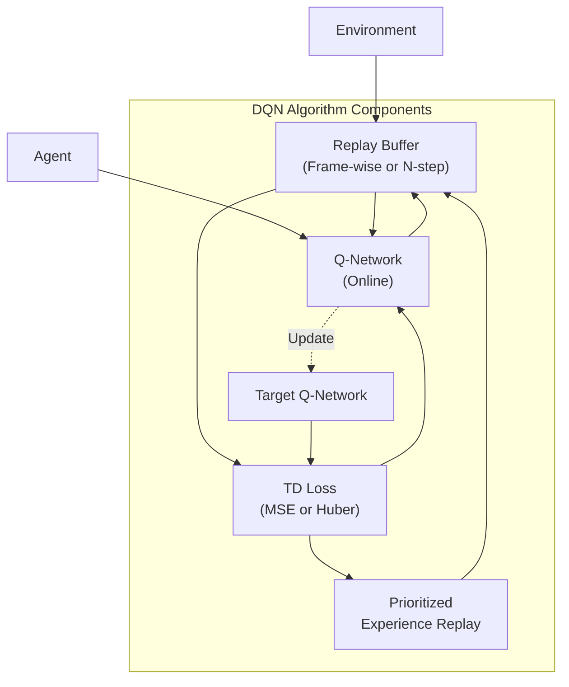
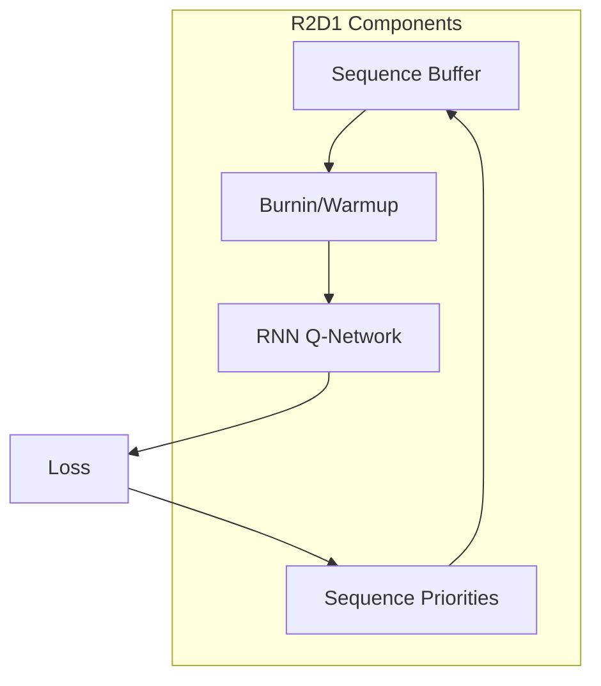
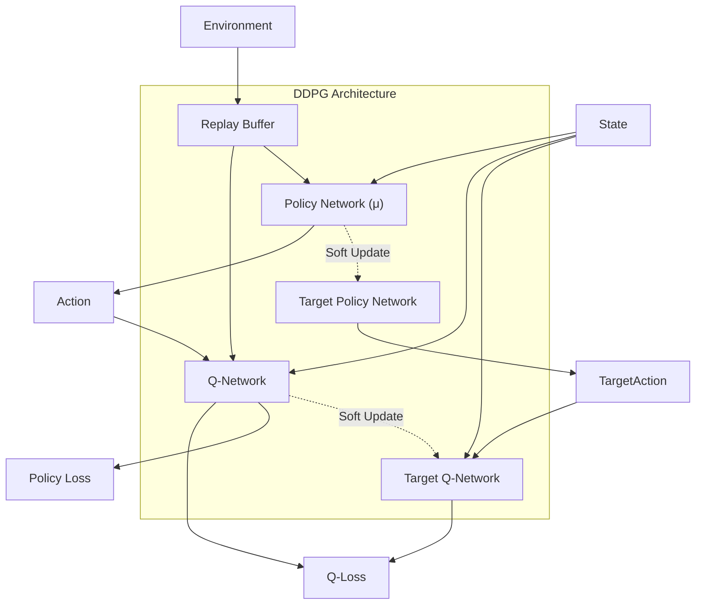
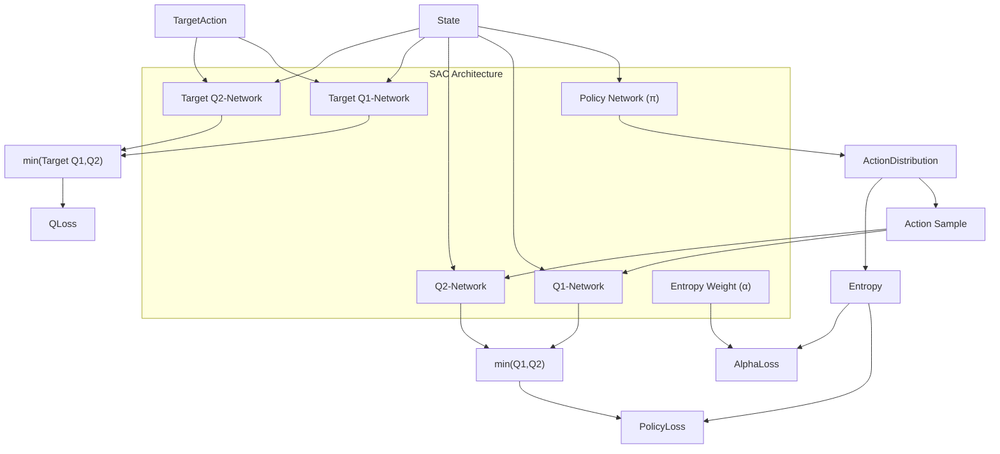
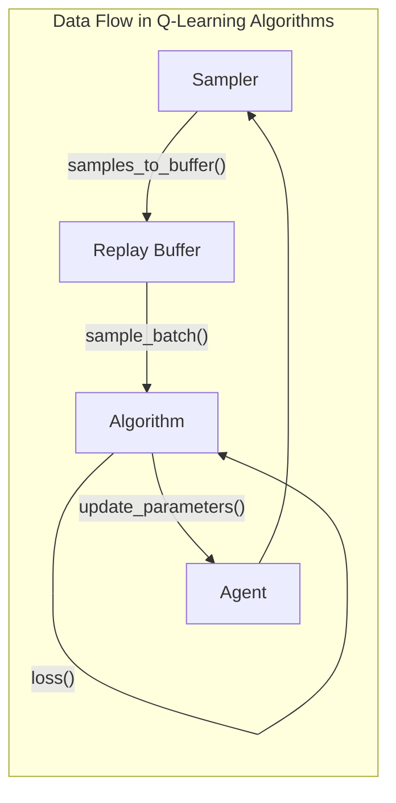

<!-- source: DeepWiki mcp.deepwiki.com · repo astooke/rlpyt · page 3.1 Q-Learning Algorithms · fetched 2026-10-30 -->

# Q-Learning Algorithms

<details>
<summary>Relevant source files</summary>

The following files were used as context for generating this wiki page:

- [rlpyt/algos/dqn/dqn.py](rlpyt/algos/dqn/dqn.py)
- [rlpyt/algos/dqn/r2d1.py](rlpyt/algos/dqn/r2d1.py)
- [rlpyt/algos/qpg/ddpg.py](rlpyt/algos/qpg/ddpg.py)
- [rlpyt/algos/qpg/sac.py](rlpyt/algos/qpg/sac.py)
- [rlpyt/algos/qpg/sac_v.py](rlpyt/algos/qpg/sac_v.py)
- [rlpyt/algos/qpg/td3.py](rlpyt/algos/qpg/td3.py)
- [rlpyt/experiments/configs/atari/dqn/atari_dqn.py](rlpyt/experiments/configs/atari/dqn/atari_dqn.py)
- [rlpyt/experiments/configs/mujoco/qpg/mujoco_sac_v.py](rlpyt/experiments/configs/mujoco/qpg/mujoco_sac_v.py)
- [rlpyt/experiments/scripts/atari/dqn/launch/pabti/launch_atari_dqn_gpu_noeval.py](rlpyt/experiments/scripts/atari/dqn/launch/pabti/launch_atari_dqn_gpu_noeval.py)
- [rlpyt/experiments/scripts/atari/dqn/train/atari_catdqn_gpu.py](rlpyt/experiments/scripts/atari/dqn/train/atari_catdqn_gpu.py)
- [rlpyt/experiments/scripts/atari/dqn/train/atari_dqn_gpu.py](rlpyt/experiments/scripts/atari/dqn/train/atari_dqn_gpu.py)
- [rlpyt/experiments/scripts/atari/dqn/train/atari_dqn_gpu_noeval.py](rlpyt/experiments/scripts/atari/dqn/train/atari_dqn_gpu_noeval.py)
- [rlpyt/experiments/scripts/atari/dqn/train/atari_r2d1_gpu.py](rlpyt/experiments/scripts/atari/dqn/train/atari_r2d1_gpu.py)
- [rlpyt/experiments/scripts/atari/pg/train/atari_lstm_ppo_gpu.py](rlpyt/experiments/scripts/atari/pg/train/atari_lstm_ppo_gpu.py)
- [rlpyt/experiments/scripts/mujoco/pg/train/mujoco_ff_ppo_gpu.py](rlpyt/experiments/scripts/mujoco/pg/train/mujoco_ff_ppo_gpu.py)

</details>


This page documents the Q-learning algorithms implemented in the rlpyt framework, including both value-based methods (DQN family) and actor-critic methods that use Q-functions (DDPG, TD3, SAC). For information about policy gradient algorithms that don't use Q-functions, see [Policy Gradient Algorithms](#3.2).

## Algorithm Family Overview

The Q-learning algorithms in rlpyt can be categorized into two main families:

1. **DQN Family** - Value-based methods for discrete action spaces that learn Q-value functions
2. **Continuous Q-Learning with Policy Gradients** - Actor-critic methods for continuous action spaces that combine Q-learning with policy gradients

```mermaid
graph TD
    subgraph "Value-Based Q-Learning"
        DQN["DQN
        (Deep Q-Network)"]
        DDQN["Double DQN"]
        Dueling["Dueling DQN"]
        CatDQN["Categorical DQN
        (C51)"]
        R2D1["R2D1
        (Recurrent DQN)"]
        
        DQN --> DDQN
        DQN --> Dueling
        DQN --> CatDQN
        DQN --> R2D1
    end
    
    subgraph "Continuous Action Q-Learning"
        DDPG["DDPG
        (Deep Deterministic
        Policy Gradient)"]
        TD3["TD3
        (Twin Delayed DDPG)"]
        SAC["SAC
        (Soft Actor-Critic)"]
        
        DDPG --> TD3
        SAC
    end
    
    QLearning["Q-Learning Algorithms"] --> "Value-Based Q-Learning"
    QLearning --> "Continuous Action Q-Learning"
```

Sources: [rlpyt/algos/dqn/dqn.py](), [rlpyt/algos/dqn/r2d1.py](), [rlpyt/algos/qpg/ddpg.py](), [rlpyt/algos/qpg/td3.py](), [rlpyt/algos/qpg/sac.py]()

## DQN Family

### Base DQN Implementation

The Deep Q-Network (DQN) algorithm learns a Q-function that estimates the expected return from taking an action in a given state. The rlpyt implementation includes the core DQN algorithm with support for several extensions:



The core DQN class extends `RlAlgorithm` and implements the following key methods:

- `initialize_replay_buffer`: Sets up the replay buffer (uniform or prioritized)
- `optimize_agent`: Main training loop that samples from replay and updates the network
- `loss`: Computes TD error between Q-values and targets

Key features of the base DQN implementation:

- **Experience Replay**: Stores and samples transitions for off-policy learning
- **Target Network**: Maintains a separate target network for stable learning
- **TD Learning**: Uses Temporal Difference learning with bootstrapping
- **Gradient Clipping**: Limits gradient magnitude for stability
- **Epsilon-Greedy Exploration**: Scheduled exploration rate (implemented in agent)

Sources: [rlpyt/algos/dqn/dqn.py:20-267](), [rlpyt/experiments/configs/atari/dqn/atari_dqn.py:7-43]()

### DQN Variants

The rlpyt framework implements several DQN variants that build upon the base algorithm:

#### Double DQN

Addresses the overestimation bias in Q-learning by decoupling action selection and evaluation:

```python
if self.double_dqn:
    next_qs = self.agent(*samples.target_inputs)
    next_a = torch.argmax(next_qs, dim=-1)
    target_q = select_at_indexes(next_a, target_qs)
else:
    target_q = torch.max(target_qs, dim=-1).values
```

#### Dueling DQN

Separates value and advantage estimation in the network architecture (implemented in the model, configured via parameters).

#### Prioritized Experience Replay

Samples transitions based on TD error magnitude for more efficient learning:

```python
if self.prioritized_replay:
    losses *= samples.is_weights
    self.replay_buffer.update_batch_priorities(td_abs_errors)
```

#### N-Step Returns

Allows using multi-step returns for better credit assignment:

```python
disc_target_q = (self.discount ** self.n_step_return) * target_q
y = samples.return_ + (1 - samples.done_n.float()) * disc_target_q
```

Sources: [rlpyt/algos/dqn/dqn.py:211-266](), [rlpyt/experiments/configs/atari/dqn/atari_dqn.py:47-77]()

### Recurrent DQN (R2D1)

R2D1 (Recurrent Replay Distributed DQN) extends DQN to handle sequential data using recurrent neural networks:



Key R2D1 features:

1. **Sequence Replay Buffer**: Handles sequences of experiences rather than individual transitions
2. **RNN State Management**: Stores and manages recurrent states at specific intervals
3. **Burnin/Warmup**: Initializes RNN state with a warmup period before computing losses
4. **Sequence Prioritization**: Prioritizes sequences based on TD errors

The R2D1 implementation handles several complexities:

- **State Storage Interval**: Stores RNN states periodically to reduce memory usage
- **Recurrent State Initialization**: Warms up RNN states before computing gradients
- **Sequence-based Priorities**: Computes priorities for entire sequences rather than individual transitions

Sources: [rlpyt/algos/dqn/r2d1.py:24-345]()

## Continuous Action Q-Learning

For environments with continuous action spaces, rlpyt implements several algorithms that combine Q-learning with policy gradients.

### DDPG (Deep Deterministic Policy Gradient)

DDPG adapts Q-learning for continuous action spaces using a deterministic policy:



DDPG's key components include:

1. **Deterministic Policy Network (μ)**: Outputs deterministic actions
2. **Q-Network**: Evaluates state-action pairs
3. **Target Networks**: Stabilizes learning with soft updates
4. **Experience Replay**: Enables off-policy learning
5. **Policy Gradient**: Updates policy to maximize Q-values

The DDPG algorithm implements:

- **Two Separate Optimizers**: One for policy and one for Q-function
- **Soft Target Updates**: Gradually updates target networks
- **Time-limit Bootstrapping**: Special handling for timeout transitions

Sources: [rlpyt/algos/qpg/ddpg.py:22-214]()

### TD3 (Twin Delayed DDPG)

TD3 extends DDPG with three key improvements to address function approximation errors:

1. **Twin Q-Networks**: Uses two Q-networks and takes the minimum to reduce overestimation
2. **Delayed Policy Updates**: Updates policy less frequently than Q-functions
3. **Target Policy Smoothing**: Adds noise to target actions for regularization

The critical TD3 improvement in the Q-loss function:

```python
q1, q2 = self.agent.q(*samples.agent_inputs, samples.action)
with torch.no_grad():
    target_q1, target_q2 = self.agent.target_q_at_mu(*samples.target_inputs)
    target_q = torch.min(target_q1, target_q2)
```

Sources: [rlpyt/algos/qpg/td3.py:9-50]()

### SAC (Soft Actor-Critic)

SAC is an entropy-regularized actor-critic algorithm that learns a stochastic policy:



Key SAC features:

1. **Maximum Entropy RL**: Encourages exploration by maximizing entropy
2. **Twin Q-Networks**: Mitigates overestimation bias
3. **Automatic Temperature Tuning**: Adjusts entropy weight automatically
4. **Reparameterization Trick**: Enables direct policy gradient computation

SAC implementation details:

- **Policy Network**: Outputs mean and log standard deviation of Gaussian action distribution
- **Temperature Parameter (α)**: Controls the trade-off between entropy and reward
- **Adaptive Temperature**: Automatically adjusts α based on target entropy
- **Minimum Q-Value**: Uses minimum of two Q-networks for targets

Sources: [rlpyt/algos/qpg/sac.py:31-331]()

## Implementation Details

### Common Patterns

Across all Q-learning algorithms in rlpyt, several common implementation patterns emerge:

#### Algorithm Structure

Each algorithm inherits from `RlAlgorithm` and implements:

1. `initialize`: Sets up replay buffer and optimizers
2. `optimize_agent`: Main training loop that samples and updates networks
3. `loss`: Computes loss functions for network updates

#### Data Handling



Key data handling components:

- **SamplesToBuffer**: Structure for converting sampler data to replay buffer format
- **NamedTuple Interface**: Consistent data structures across components
- **Experience Replay**: Uniform or prioritized sampling from buffer
- **Batch Processing**: Efficient tensor operations on batches of data

#### Optimization Process

All Q-learning algorithms follow a similar optimization pattern:

1. **Sample Batch**: Get transitions or sequences from replay buffer
2. **Compute Targets**: Use target networks to compute TD targets
3. **Compute Loss**: Calculate TD error or policy gradient loss
4. **Gradient Update**: Apply backpropagation and optimizer step
5. **Update Targets**: Periodically update target networks

Sources: [rlpyt/algos/dqn/dqn.py:158-190](), [rlpyt/algos/qpg/sac.py:160-211]()

### Replay Buffer Integration

Replay buffers are a critical component of Q-learning algorithms:

| Algorithm | Replay Buffer Type | Key Features |
|-----------|-------------------|--------------|
| DQN | UniformReplayFrameBuffer | Frame-wise storage for efficiency |
| DQN + PER | PrioritizedReplayFrameBuffer | Prioritized sampling based on TD error |
| R2D1 | UniformSequenceReplayFrameBuffer | Stores sequences for recurrent networks |
| R2D1 + PER | PrioritizedSequenceReplayFrameBuffer | Prioritized sampling of sequences |
| DDPG/TD3/SAC | UniformReplayBuffer | Standard experience replay |

Sources: [rlpyt/algos/dqn/dqn.py:125-156](), [rlpyt/algos/dqn/r2d1.py:86-128]()

## Usage and Configuration

### Configuration Structure

Q-learning algorithms in rlpyt are typically configured through dictionary-based configuration files:

```python
config = dict(
    agent=dict(),
    algo=dict(
        discount=0.99,
        batch_size=128,
        learning_rate=1e-4,
        clip_grad_norm=10.,
        min_steps_learn=int(5e4),
        double_dqn=False,
        prioritized_replay=False,
        n_step_return=1,
        replay_size=int(1e6),
    ),
    env=dict(
        game="pong",
        episodic_lives=True,
    ),
    model=dict(dueling=False),
    runner=dict(
        n_steps=50e6,
        log_interval_steps=1e6,
    ),
    sampler=dict(
        batch_T=2,
        batch_B=16,
        max_decorrelation_steps=1000,
    ),
)
```

Sources: [rlpyt/experiments/configs/atari/dqn/atari_dqn.py:7-43]()

### Training Script Example

Q-learning algorithms are typically used with the following pattern:

```python
# Define components
sampler = GpuSampler(
    EnvCls=AtariEnv,
    env_kwargs=config["env"],
    CollectorCls=GpuWaitResetCollector,
    TrajInfoCls=AtariTrajInfo,
    **config["sampler"]
)
algo = DQN(optim_kwargs=config["optim"], **config["algo"])
agent = AtariDqnAgent(model_kwargs=config["model"], **config["agent"])
runner = MinibatchRlEval(
    algo=algo,
    agent=agent,
    sampler=sampler,
    affinity=affinity,
    **config["runner"]
)

# Train
runner.train()
```

Sources: [rlpyt/experiments/scripts/atari/dqn/train/atari_dqn_gpu.py:24-43]()

### Key Algorithm Parameters

| Algorithm | Key Parameters | Description |
|-----------|----------------|-------------|
| DQN | `discount` | Discount factor for future rewards |
| | `batch_size` | Number of transitions per update |
| | `replay_ratio` | Ratio of updates to new samples |
| | `target_update_interval` | Frequency of target network updates |
| | `double_dqn` | Whether to use double DQN |
| | `prioritized_replay` | Whether to use prioritized replay |
| R2D1 | `batch_T` | Sequence length for training |
| | `warmup_T` | Length of warmup/burnin period |
| | `store_rnn_state_interval` | Interval for storing RNN states |
| DDPG/TD3 | `target_update_tau` | Rate of soft target updates |
| | `policy_update_interval` | Frequency of policy updates |
| SAC | `fixed_alpha` | Entropy coefficient (None for auto-tuning) |
| | `target_entropy` | Target entropy for auto-tuning |
| | `reparameterize` | Whether to use reparameterization trick |

Sources: [rlpyt/algos/dqn/dqn.py:28-58](), [rlpyt/algos/dqn/r2d1.py:30-66](), [rlpyt/algos/qpg/sac.py:36-60]()

---

