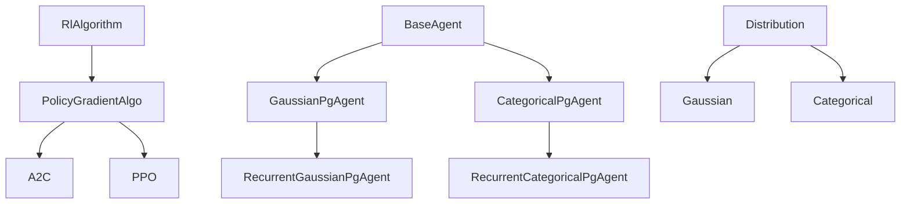
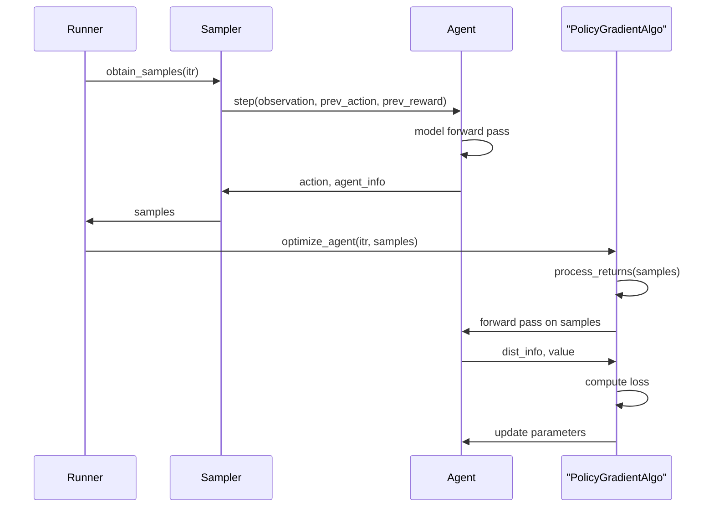
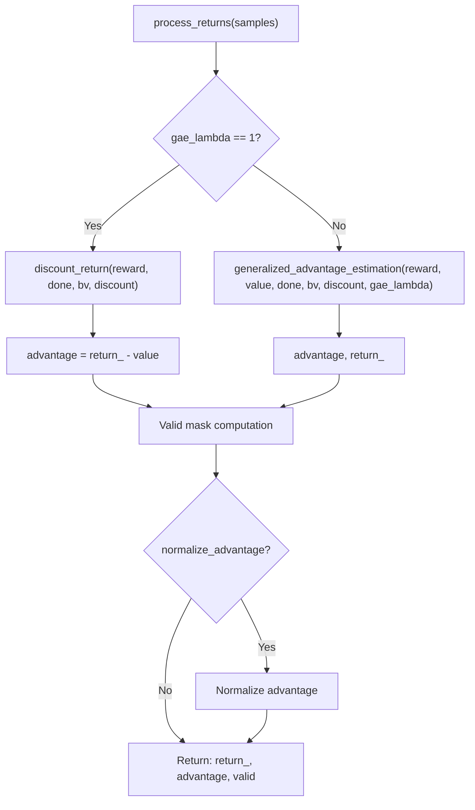
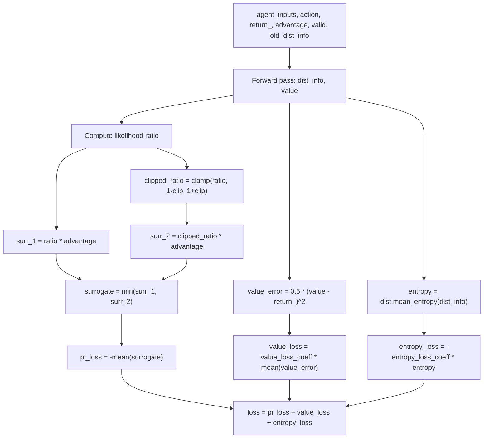

<!-- source: DeepWiki mcp.deepwiki.com · repo astooke/rlpyt · page 3.2 Policy Gradient Algorithms · fetched 2026-10-30 -->

# Policy Gradient Algorithms

<details>
<summary>Relevant source files</summary>

The following files were used as context for generating this wiki page:

- [docs/source/pages/util.rst](docs/source/pages/util.rst)
- [rlpyt/agents/dqn/r2d1_agent.py](rlpyt/agents/dqn/r2d1_agent.py)
- [rlpyt/agents/pg/atari.py](rlpyt/agents/pg/atari.py)
- [rlpyt/agents/pg/categorical.py](rlpyt/agents/pg/categorical.py)
- [rlpyt/agents/pg/gaussian.py](rlpyt/agents/pg/gaussian.py)
- [rlpyt/algos/pg/a2c.py](rlpyt/algos/pg/a2c.py)
- [rlpyt/algos/pg/base.py](rlpyt/algos/pg/base.py)
- [rlpyt/algos/pg/ppo.py](rlpyt/algos/pg/ppo.py)
- [rlpyt/algos/utils.py](rlpyt/algos/utils.py)
- [rlpyt/distributions/gaussian.py](rlpyt/distributions/gaussian.py)
- [rlpyt/experiments/scripts/mujoco/pg/launch/pabti/launch_mujoco_ppo_serial.py](rlpyt/experiments/scripts/mujoco/pg/launch/pabti/launch_mujoco_ppo_serial.py)
- [rlpyt/samplers/parallel/gpu/alternating_sampler.py](rlpyt/samplers/parallel/gpu/alternating_sampler.py)

</details>


## Purpose and Scope

This document details the policy gradient algorithm implementations in the rlpyt framework. Policy gradient methods are a class of reinforcement learning algorithms that directly optimize policy parameters by computing gradients of expected return with respect to policy parameters. This page covers the base policy gradient class, specific algorithm implementations (A2C and PPO), agent implementations that use these algorithms, and related components such as distributions and utility functions.

For Q-learning algorithms, see [Q-Learning Algorithms](#3.1). For actor-critic algorithms like SAC, DDPG, and TD3, see [Actor-Critic Algorithms](#3.3).

## Policy Gradient Architecture

The policy gradient implementation in rlpyt follows a modular design with inheritance patterns that allow for code reuse across algorithms.

### Class Hierarchy and Structure



Sources: [rlpyt/algos/pg/base.py](), [rlpyt/algos/pg/a2c.py](), [rlpyt/algos/pg/ppo.py](), [rlpyt/agents/pg/gaussian.py](), [rlpyt/agents/pg/categorical.py](), [rlpyt/distributions/gaussian.py]()

### Data Flow



Sources: [rlpyt/algos/pg/base.py:42-75](), [rlpyt/algos/pg/a2c.py:41-61](), [rlpyt/algos/pg/ppo.py:59-115]()

## Base Policy Gradient Algorithm

The `PolicyGradientAlgo` class serves as the foundation for all policy gradient algorithms in rlpyt. It provides common functionality and methods used by specific algorithm implementations.

### Key Features

- **Bootstrap Value Mechanism**: The `bootstrap_value = True` attribute tells the sampler that it needs the value of the next state for bootstrapping.
- **Initialize Method**: Sets up the optimizer, stores agent reference, and other initialization parameters.
- **Process Returns Method**: Computes bootstrapped returns and advantages from a minibatch of samples.

```python
# Key parameters for policy gradient algorithms
self.optimizer = self.OptimCls(agent.parameters(),
    lr=self.learning_rate, **self.optim_kwargs)
self.agent = agent
self.batch_spec = batch_spec
```

### Return and Advantage Calculation

The `process_returns` method computes bootstrapped returns and advantages from samples:

- Uses `discount_return` if `gae_lambda==1` (empirical discounted return)
- Uses `generalized_advantage_estimation` otherwise
- Handles masking for recurrent agents or mid-batch resets
- Optionally normalizes advantages



Sources: [rlpyt/algos/pg/base.py:42-75](), [rlpyt/algos/utils.py:8-40]()

## Algorithm Implementations

### A2C (Advantage Actor-Critic)

A2C is a synchronous advantage actor-critic algorithm that takes one gradient step on each iteration of samples.

#### Key Parameters

| Parameter | Description |
|-----------|-------------|
| `discount` | Discount factor for future rewards (default: 0.99) |
| `learning_rate` | Learning rate for optimizer (default: 0.001) |
| `value_loss_coeff` | Coefficient for value function loss (default: 0.5) |
| `entropy_loss_coeff` | Coefficient for entropy regularization (default: 0.01) |
| `clip_grad_norm` | Gradient norm clipping value (default: 1.0) |
| `gae_lambda` | Lambda parameter for GAE (default: 1) |
| `normalize_advantage` | Whether to normalize advantages (default: False) |

#### Optimization Process

The `optimize_agent` method performs a single gradient step:

1. Updates observation running mean/std if agent has `update_obs_rms`
2. Zeroes gradients
3. Computes loss, entropy, and perplexity
4. Performs backward pass
5. Clips gradients
6. Takes optimizer step

#### Loss Computation

The `loss` method computes the total loss as a combination of three components:

1. **Policy Loss**: `-mean(log_likelihood * advantage)`
2. **Value Loss**: `value_loss_coeff * mean((value - return_)^2)`
3. **Entropy Loss**: `-entropy_loss_coeff * entropy`

```python
# From A2C.loss method
pi_loss = - valid_mean(logli * advantage, valid)
value_error = 0.5 * (value - return_) ** 2
value_loss = self.value_loss_coeff * valid_mean(value_error, valid)
entropy = dist.mean_entropy(dist_info, valid)
entropy_loss = - self.entropy_loss_coeff * entropy
loss = pi_loss + value_loss + entropy_loss
```

Sources: [rlpyt/algos/pg/a2c.py:19-103]()

### PPO (Proximal Policy Optimization)

PPO is an algorithm that uses clipped likelihood ratios to constrain policy updates, taking multiple epochs of gradient steps on minibatches of the training data.

#### Additional Parameters

| Parameter | Description |
|-----------|-------------|
| `minibatches` | Number of minibatches to create from batch (default: 4) |
| `epochs` | Number of passes through minibatches (default: 4) |
| `ratio_clip` | Clipping parameter for likelihood ratio (default: 0.1) |
| `linear_lr_schedule` | Whether to use linear learning rate schedule (default: True) |

#### Optimization Process

The `optimize_agent` method:

1. Organizes agent inputs from training data
2. Moves data to device (e.g., GPU)
3. Processes returns
4. For each epoch and minibatch:
   - Computes loss, performs backward pass, clips gradients, takes optimizer step
5. Updates learning rate if using linear schedule

#### PPO-Specific Loss

PPO uses a clipped surrogate objective to constrain policy updates:

```python
# From PPO.loss method
ratio = dist.likelihood_ratio(action, old_dist_info, new_dist_info)
surr_1 = ratio * advantage
clipped_ratio = torch.clamp(ratio, 1. - self.ratio_clip, 1. + self.ratio_clip)
surr_2 = clipped_ratio * advantage
surrogate = torch.min(surr_1, surr_2)
pi_loss = - valid_mean(surrogate, valid)
```



Sources: [rlpyt/algos/pg/ppo.py:16-154]()

## Policy Gradient Agents

Rlpyt provides dedicated agent classes that implement policy gradient methods for different action spaces.

### Gaussian Agents (Continuous Action Space)

- **GaussianPgAgent**: For feedforward policies with continuous action spaces
- **RecurrentGaussianPgAgent**: For recurrent policies with continuous action spaces

```python
# From GaussianPgAgent.__call__
model_inputs = buffer_to((observation, prev_action, prev_reward), device=self.device)
mu, log_std, value = self.model(*model_inputs)
return buffer_to((DistInfoStd(mean=mu, log_std=log_std), value), device="cpu")

# From GaussianPgAgent.step
dist_info = DistInfoStd(mean=mu, log_std=log_std)
action = self.distribution.sample(dist_info)
agent_info = AgentInfo(dist_info=dist_info, value=value)
```

Sources: [rlpyt/agents/pg/gaussian.py:14-130]()

### Categorical Agents (Discrete Action Space)

- **CategoricalPgAgent**: For feedforward policies with discrete action spaces
- **RecurrentCategoricalPgAgent**: For recurrent policies with discrete action spaces

```python
# From CategoricalPgAgent.__call__
prev_action = self.distribution.to_onehot(prev_action)
model_inputs = buffer_to((observation, prev_action, prev_reward), device=self.device)
pi, value = self.model(*model_inputs)
return buffer_to((DistInfo(prob=pi), value), device="cpu")

# From CategoricalPgAgent.step
dist_info = DistInfo(prob=pi)
action = self.distribution.sample(dist_info)
agent_info = AgentInfo(dist_info=dist_info, value=value)
```

Sources: [rlpyt/agents/pg/categorical.py:11-106]()

### Specialized Agent Implementations

- **AtariFfAgent**: Categorical agent specifically for Atari environments
- **AtariLstmAgent**: Recurrent categorical agent for Atari environments

Sources: [rlpyt/agents/pg/atari.py:1-37]()

## Distributions

Policy gradient algorithms use probability distributions over actions to enable stochastic policies and exploration.

### Gaussian Distribution (Continuous Actions)

The `Gaussian` class implements a multivariate Gaussian with diagonal covariance for continuous action spaces.

#### Key Methods

- **sample(dist_info)**: Samples an action from the distribution
- **log_likelihood(x, dist_info)**: Computes log-likelihood of an action
- **entropy(dist_info)**: Computes entropy of the distribution
- **kl(old_dist_info, new_dist_info)**: Computes KL divergence between distributions

#### Optional Features

- Standard deviation clipping
- Action clipping
- Sample squashing (tanh transformation)
- Noise clipping

```python
# From Gaussian.sample
noise = std * torch.normal(torch.zeros_like(mean), torch.ones_like(mean))
sample = mean + noise
if self.squash is not None:
    sample = self.squash * torch.tanh(sample)
```

Sources: [rlpyt/distributions/gaussian.py:15-246]()

### Categorical Distribution (Discrete Actions)

Implements a categorical distribution for discrete action spaces.

## Utility Functions

The `rlpyt/algos/utils.py` module provides essential utility functions for policy gradient algorithms.

### Discounted Return Calculation

```python
# Computing discounted return
return_ = zeros(reward.shape, dtype=reward.dtype)
nd = 1 - done
return_[-1] = reward[-1] + discount * bootstrap_value * nd[-1]
for t in reversed(range(len(reward) - 1)):
    return_[t] = reward[t] + return_[t + 1] * discount * nd[t]
```

### Generalized Advantage Estimation (GAE)

```python
# Computing GAE
advantage = zeros(reward.shape, dtype=reward.dtype)
advantage[-1] = reward[-1] + discount * bootstrap_value * nd[-1] - value[-1]
for t in reversed(range(len(reward) - 1)):
    delta = reward[t] + discount * value[t + 1] * nd[t] - value[t]
    advantage[t] = delta + discount * gae_lambda * nd[t] * advantage[t + 1]
return_ = advantage + value
```

### Valid Mask Computation

```python
# Computing valid mask from done signals
valid = torch.ones_like(done)
valid[1:] = 1 - torch.clamp(torch.cumsum(done[:-1], dim=0), max=1)
```

Sources: [rlpyt/algos/utils.py:8-162]()

## Running Policy Gradient Algorithms

The framework provides launch scripts for running policy gradient algorithms on various environments:

```python
# Example from launch_mujoco_ppo_serial.py
script = "rlpyt/experiments/scripts/mujoco/pg/train/mujoco_ppo_serial.py"
env_ids = ["Hopper-v3", "Walker2d-v3", "Ant-v3", "HalfCheetah-v3"]
```

Sources: [rlpyt/experiments/scripts/mujoco/pg/launch/pabti/launch_mujoco_ppo_serial.py:1-61]()

---

