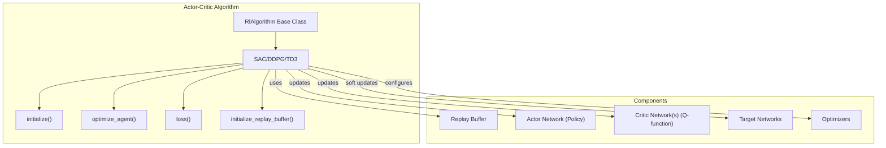
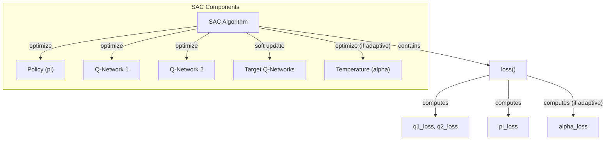
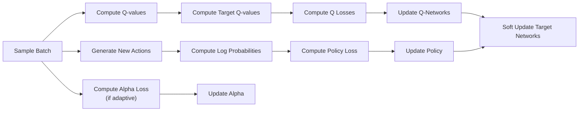
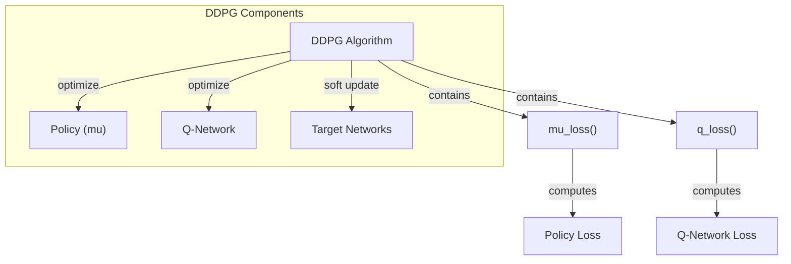
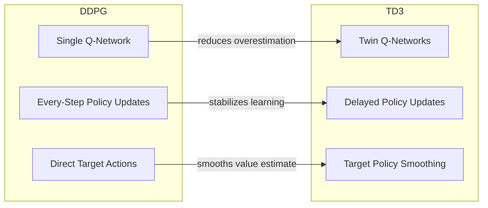
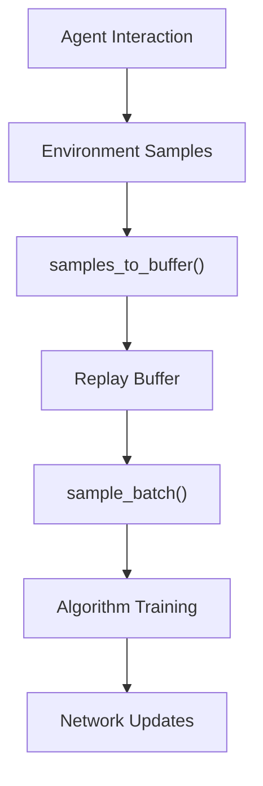
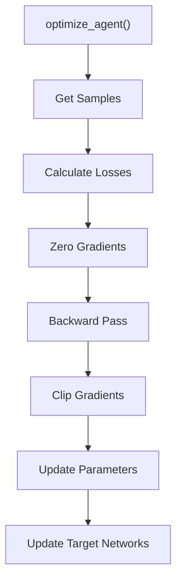
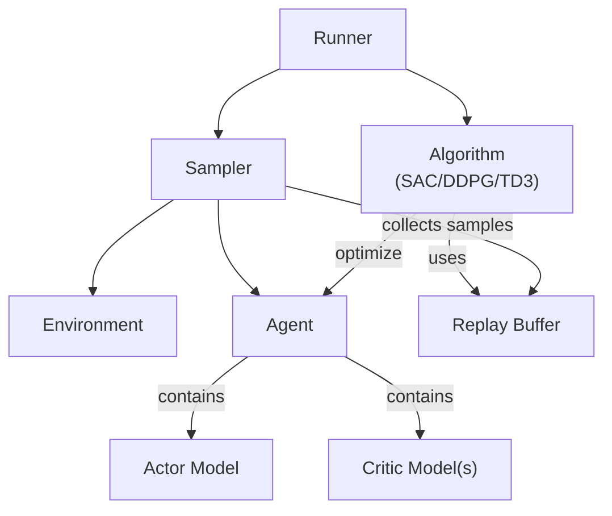

<!-- source: DeepWiki mcp.deepwiki.com · repo astooke/rlpyt · page 3.3 Actor-Critic Algorithms · fetched 2026-10-30 -->

# Actor-Critic Algorithms

<details>
<summary>Relevant source files</summary>

The following files were used as context for generating this wiki page:

- [rlpyt/algos/dqn/dqn.py](rlpyt/algos/dqn/dqn.py)
- [rlpyt/algos/dqn/r2d1.py](rlpyt/algos/dqn/r2d1.py)
- [rlpyt/algos/qpg/ddpg.py](rlpyt/algos/qpg/ddpg.py)
- [rlpyt/algos/qpg/sac.py](rlpyt/algos/qpg/sac.py)
- [rlpyt/algos/qpg/sac_v.py](rlpyt/algos/qpg/sac_v.py)
- [rlpyt/algos/qpg/td3.py](rlpyt/algos/qpg/td3.py)
- [rlpyt/experiments/configs/atari/dqn/atari_r2d1.py](rlpyt/experiments/configs/atari/dqn/atari_r2d1.py)
- [rlpyt/experiments/configs/mujoco/qpg/mujoco_sac_v.py](rlpyt/experiments/configs/mujoco/qpg/mujoco_sac_v.py)
- [rlpyt/experiments/scripts/atari/dqn/launch/dgx/launch_atari_r2d1_async_gpu.py](rlpyt/experiments/scripts/atari/dqn/launch/dgx/launch_atari_r2d1_async_gpu.py)

</details>


This page documents the actor-critic algorithm implementations in the rlpyt framework. Actor-critic algorithms combine policy-based methods (the actor) and value-based methods (the critic) for reinforcement learning. In rlpyt, actor-critic algorithms are primarily implemented under the `qpg` (Q-function Policy Gradient) module, which combines Q-learning with policy gradient methods for continuous action spaces.

For policy gradient algorithms like A2C and PPO, see [Policy Gradient Algorithms](#3.2). For Q-learning algorithms like DQN and R2D1, see [Q-Learning Algorithms](#3.1).

## Algorithm Overview

Actor-critic algorithms in rlpyt share a common design pattern:
- They all derive from the `RlAlgorithm` base class
- They use off-policy learning with replay buffers
- They maintain target networks for stable learning
- They support various optimization configurations and hyperparameters

### Implemented Algorithms

The following actor-critic algorithms are implemented in rlpyt:

| Algorithm | Description | Key Features |
|-----------|-------------|--------------|
| SAC       | Soft Actor-Critic | Entropy maximization, twin Q-networks, automatic temperature tuning |
| DDPG      | Deep Deterministic Policy Gradient | Deterministic policy, single Q-network, target networks |
| TD3       | Twin Delayed DDPG | Twin Q-networks, delayed policy updates, target policy smoothing |
| SAC-V     | Soft Actor-Critic with Value Function | Explicit value function (deprecated) |

## Algorithm Architecture

### Core Architecture



Sources: [rlpyt/algos/qpg/sac.py:31-330](), [rlpyt/algos/qpg/ddpg.py:22-213]()

### Learning Process Flow

```mermaid
sequenceDiagram
    participant Agent
    participant Environment
    participant ReplayBuffer
    participant Algorithm
    participant Actor
    participant Critic
    participant TargetNetworks
    
    Agent->>Environment: Take action
    Environment->>Agent: Return observation, reward, done
    Agent->>ReplayBuffer: Store experience
    
    loop For each optimization step
        Algorithm->>ReplayBuffer: Sample batch
        Algorithm->>Critic: Compute Q losses
        Algorithm->>Actor: Compute policy loss
        
        Critic->>Critic: Update Q-networks
        Actor->>Actor: Update policy
        
        Algorithm->>TargetNetworks: Soft update target networks
    end
```

Sources: [rlpyt/algos/qpg/sac.py:160-211](), [rlpyt/algos/qpg/ddpg.py:131-175]()

## Soft Actor-Critic (SAC)

SAC is an off-policy actor-critic algorithm that maximizes both expected return and entropy, encouraging exploration while maximizing performance.

### SAC Architecture



Sources: [rlpyt/algos/qpg/sac.py:227-285]()

### SAC Process Flow



Sources: [rlpyt/algos/qpg/sac.py:160-211](), [rlpyt/algos/qpg/sac.py:227-285]()

### SAC Implementation

The SAC implementation includes:

1. **Twin Q-networks** to mitigate overestimation bias
2. **Automatic entropy coefficient adjustment** to maintain a desired level of entropy
3. **Reparameterization trick** for backpropagation through the stochastic policy
4. **Soft target updates** for stable learning

Key methods:
- `initialize()`: Sets up replay buffer and optimizers
- `optimize_agent()`: Main training loop that updates networks
- `loss()`: Computes SAC-specific losses for Q-functions, policy, and temperature

Sources: [rlpyt/algos/qpg/sac.py:31-330]()

## Deep Deterministic Policy Gradient (DDPG)

DDPG is an off-policy actor-critic algorithm designed for continuous action spaces, using a deterministic policy.

### DDPG Architecture



Sources: [rlpyt/algos/qpg/ddpg.py:22-213]()

### DDPG Implementation

The DDPG implementation includes:

1. **Deterministic policy** for action selection
2. **Single Q-network** to evaluate state-action pairs
3. **Target networks** for stable learning with soft updates
4. **Experience replay** for sample efficiency

Key methods:
- `mu_loss()`: Computes policy loss by evaluating Q-value at policy outputs
- `q_loss()`: Computes Q-learning loss using target network
- `optimize_agent()`: Updates both policy and Q-function networks

Sources: [rlpyt/algos/qpg/ddpg.py:188-205]()

## Twin Delayed DDPG (TD3)

TD3 improves upon DDPG by addressing function approximation errors through three key modifications.

### TD3 vs DDPG Comparison



Sources: [rlpyt/algos/qpg/td3.py:9-50]()

### TD3 Implementation

The TD3 implementation extends DDPG with:

1. **Twin Q-networks** to mitigate overestimation bias
2. **Delayed policy updates** by updating the policy less frequently than Q-networks
3. **Target policy smoothing** by adding noise to target actions (implemented in agent)

Key differences from DDPG:
- Custom `q_loss()` that uses minimum of two Q-values for targets
- Policy update frequency controlled by `policy_update_interval`

Sources: [rlpyt/algos/qpg/td3.py:38-50]()

## Implementation Details

### Replay Buffer Integration

Actor-critic algorithms in rlpyt use replay buffers for off-policy learning:



The replay buffer stores transitions (observation, action, reward, done) and can handle:
- Time limit bootstrapping
- N-step returns
- Prioritized experience replay (in SAC)

Sources: [rlpyt/algos/qpg/sac.py:130-158](), [rlpyt/algos/qpg/ddpg.py:102-129]()

### Optimization Process



Key optimization features:
- Separate optimizers for actor and critic networks
- Gradient clipping to prevent exploding gradients
- Periodic target network updates with configurable τ
- Configurable replay ratio and batch size

Sources: [rlpyt/algos/qpg/sac.py:160-211](), [rlpyt/algos/qpg/ddpg.py:131-175]()

## Configuration and Usage

### Common Parameters

Actor-critic algorithms share several configuration parameters:

| Parameter | Description | Default Value (SAC) |
|-----------|-------------|---------------------|
| `discount` | Reward discount factor | 0.99 |
| `batch_size` | Training batch size | 256 |
| `replay_size` | Replay buffer capacity | 1e6 |
| `replay_ratio` | Ratio of training:collection | 256 |
| `target_update_tau` | Soft update coefficient | 0.005 |
| `learning_rate` | Optimizer learning rate | 3e-4 |
| `clip_grad_norm` | Gradient clipping threshold | 1e9 |

Sources: [rlpyt/algos/qpg/sac.py:36-59](), [rlpyt/algos/qpg/ddpg.py:28-49](), [rlpyt/algos/qpg/td3.py:12-21]()

### Algorithm-Specific Parameters

Each algorithm also has unique parameters:

**SAC:**
- `fixed_alpha`: Control entropy regularization strength (None for adaptive)
- `target_entropy`: Target entropy value for adaptive alpha
- `reparameterize`: Whether to use reparameterization trick

**DDPG:**
- `policy_update_interval`: How often to update the policy
- `q_target_clip`: Clipping value for target Q-values

**TD3:**
- `policy_update_interval`: Typically larger than DDPG (e.g., 2)
- `target_update_interval`: How often to update target networks

Sources: [rlpyt/algos/qpg/sac.py:36-59](), [rlpyt/algos/qpg/td3.py:12-21]()

### Example Configuration

The framework includes example configurations:

```python
# Example SAC configuration
config = dict(
    agent=dict(),
    algo=dict(
        discount=0.99,
        batch_size=256,
        replay_ratio=256,
        target_update_tau=0.005,
        target_update_interval=1,
        learning_rate=3e-4,
        reparameterize=True,
        fixed_alpha=None,
        reward_scale=5,
    ),
    env=dict(id="Hopper-v3"),
    model=dict(),
    runner=dict(
        n_steps=1e6,
        log_interval_steps=1e4,
    ),
)
```

Sources: [rlpyt/experiments/configs/mujoco/qpg/mujoco_sac_v.py:6-41]()

## Integration with rlpyt Framework

Actor-critic algorithms integrate with the broader rlpyt framework:



The algorithms:
1. Receive environment samples from the sampler
2. Store transitions in the replay buffer
3. Sample batches for training
4. Update the agent's networks
5. Return optimization information to the runner

Sources: [rlpyt/algos/qpg/sac.py:69-88](), [rlpyt/algos/qpg/sac.py:160-211]()

This arrangement allows the algorithms to be used with different samplers (CPU, GPU, parallel) and runners (synchronous, asynchronous) depending on computational requirements.

---

