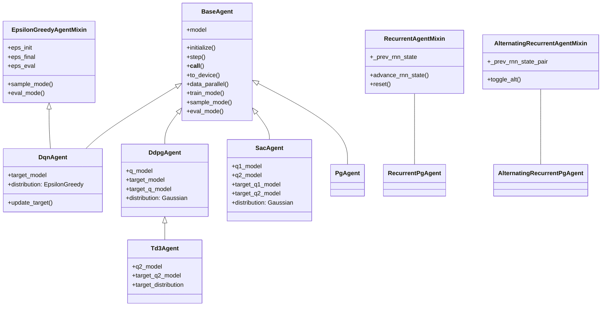
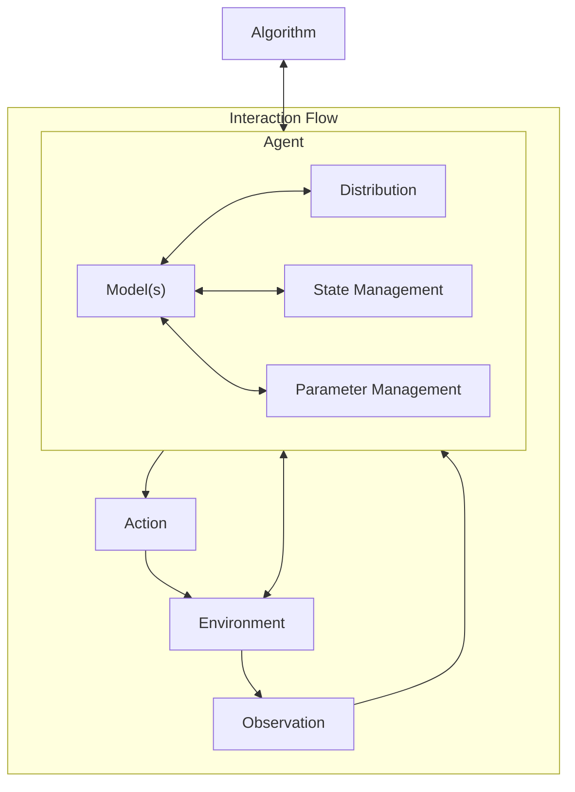
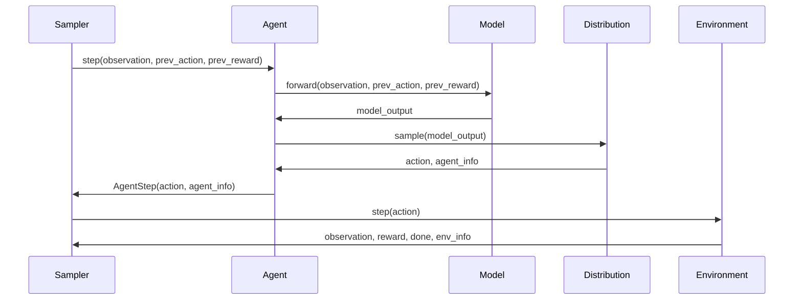
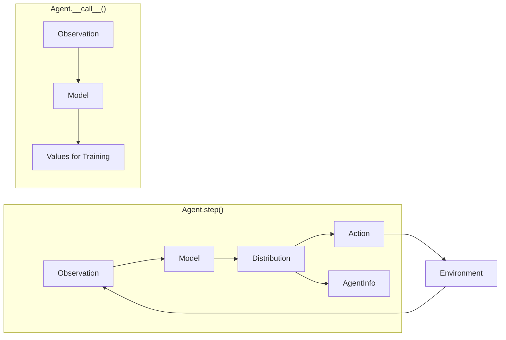

<!-- source: DeepWiki mcp.deepwiki.com · repo astooke/rlpyt · page 4 Agents · fetched 2026-10-30 -->

# Agents

<details>
<summary>Relevant source files</summary>

The following files were used as context for generating this wiki page:

- [rlpyt/agents/base.py](rlpyt/agents/base.py)
- [rlpyt/agents/dqn/dqn_agent.py](rlpyt/agents/dqn/dqn_agent.py)
- [rlpyt/agents/dqn/epsilon_greedy.py](rlpyt/agents/dqn/epsilon_greedy.py)
- [rlpyt/agents/pg/base.py](rlpyt/agents/pg/base.py)
- [rlpyt/agents/qpg/ddpg_agent.py](rlpyt/agents/qpg/ddpg_agent.py)
- [rlpyt/agents/qpg/sac_agent.py](rlpyt/agents/qpg/sac_agent.py)
- [rlpyt/agents/qpg/td3_agent.py](rlpyt/agents/qpg/td3_agent.py)
- [rlpyt/algos/base.py](rlpyt/algos/base.py)

</details>


## Introduction

In the rlpyt framework, agents serve as the critical interface between algorithms and environments. They encapsulate neural network models, implement action selection strategies, and manage the state of the learning process. This document provides a comprehensive overview of the agent system in rlpyt, including its architecture, various implementations, and key functionality.

For information on specific algorithm implementations that use these agents, see [Algorithms](#3). For details about the models used by agents, see [Models](#7).

## Agent Architecture

Agents in rlpyt follow a well-defined architecture that connects algorithms, models, and environments. The base agent class provides core functionality that specialized agent implementations extend to support different reinforcement learning algorithms.

### Class Hierarchy



Sources: [rlpyt/agents/base.py:17-246](). [rlpyt/agents/dqn/dqn_agent.py:18-82](). [rlpyt/agents/qpg/ddpg_agent.py:19-161](). [rlpyt/agents/qpg/td3_agent.py:13-121](). [rlpyt/agents/qpg/sac_agent.py:25-205]().

### Core Components



Sources: [rlpyt/agents/base.py:17-37]().

## BaseAgent

The `BaseAgent` class is the foundation of all agents in rlpyt. It provides core functionality for model initialization, device management, action selection, and parameter synchronization.

### Key Methods

- **initialize**: Creates the model and prepares it based on environment spaces
- **step**: Computes actions during sampling (no gradient)
- **__call__**: Computes values for algorithm training (with gradient)
- **to_device**: Moves models to specified device (CPU/GPU)
- **data_parallel**: Sets up PyTorch's DistributedDataParallel for multi-GPU training
- **train_mode/sample_mode/eval_mode**: Switches between different operation modes



Sources: [rlpyt/agents/base.py:36-246]().

### Data Structures

The agent module defines several important data structures:

```
AgentInputs = (observation, prev_action, prev_reward)
AgentStep = (action, agent_info)
AgentInputsRnn = (observation, prev_action, prev_reward, init_rnn_state)
```

These structured tuples facilitate clean interfaces between components in the system.

Sources: [rlpyt/agents/base.py:12-14](). [rlpyt/agents/base.py:248-249]().

## Agent Types

### Value-Based Agents

Value-based agents implement action selection based on state-action value estimation. The primary example is the `DqnAgent`, which uses epsilon-greedy exploration.

#### DqnAgent

The `DqnAgent` implements Deep Q-Network functionality:
- Maintains target network for stable learning
- Uses epsilon-greedy exploration through `EpsilonGreedyAgentMixin`
- Supports vector-valued epsilon for more efficient exploration

```python
# Key methods of DqnAgent
def step(self, observation, prev_action, prev_reward):
    # Convert actions to one-hot, compute Q-values, select actions
    
def target(self, observation, prev_action, prev_reward):
    # Compute target Q-values from target network
    
def update_target(self, tau=1):
    # Copy parameters from main network to target network
```

Sources: [rlpyt/agents/dqn/dqn_agent.py:18-82](). [rlpyt/agents/dqn/epsilon_greedy.py:12-132]().

### Policy-Based Agents

Policy-based agents directly learn a policy that maps states to actions. These agents typically involve policy gradient methods like A2C and PPO.

### Actor-Critic Agents

Actor-critic agents combine value estimation with direct policy learning. These include implementations for DDPG, TD3, and SAC algorithms.

#### DdpgAgent

`DdpgAgent` implements Deep Deterministic Policy Gradient:
- Maintains separate actor (μ) and critic (Q) networks
- Uses target networks for both actor and critic
- Employs Gaussian noise for exploration

Sources: [rlpyt/agents/qpg/ddpg_agent.py:19-161]().

#### Td3Agent

`Td3Agent` extends DDPG with twin delayed deep deterministic policy gradient:
- Uses twin Q-networks to reduce overestimation bias
- Adds noise to target actions for smoothing
- Maintains separate target networks for all models

Sources: [rlpyt/agents/qpg/td3_agent.py:13-121]().

#### SacAgent

`SacAgent` implements Soft Actor-Critic:
- Uses stochastic policy with entropy regularization
- Maintains twin Q-networks and targets
- Handles action squashing and log-probability computation

Sources: [rlpyt/agents/qpg/sac_agent.py:25-205]().

## Agent Functionality

### Action Selection

Agents select actions during sampling using the `step()` method. This process generally involves:
1. Forwarding observations through the model
2. Using a distribution to sample actions based on model outputs
3. Returning actions and relevant info to the sampler



Sources: [rlpyt/agents/base.py:167-170](). [rlpyt/agents/dqn/dqn_agent.py:57-69](). [rlpyt/agents/qpg/sac_agent.py:140-149]().

### Mode Switching

Agents operate in different modes:
- **Train Mode**: Used during optimization (model.train())
- **Sample Mode**: Used during collection of training data
- **Eval Mode**: Used during evaluation of agent performance

Each mode may modify agent behavior, such as changing exploration parameters or model behavior:

```python
# In SacAgent
def sample_mode(self, itr):
    super().sample_mode(itr)
    self.q1_model.eval()
    self.q2_model.eval()
    std = None if itr >= self.min_itr_learn else self.pretrain_std
    self.distribution.set_std(std)  # Use learned std after min_itr_learn
    
def eval_mode(self, itr):
    super().eval_mode(itr)
    self.q1_model.eval()
    self.q2_model.eval()
    self.distribution.set_std(0.)  # Deterministic actions for evaluation
```

Sources: [rlpyt/agents/base.py:190-203](). [rlpyt/agents/qpg/sac_agent.py:173-188]().

### Recurrent State Management

For recurrent agents, state management is handled through mixins:

- **RecurrentAgentMixin**: Manages single recurrent state for standard RNN policies
- **AlternatingRecurrentAgentMixin**: Manages alternating pair of recurrent states for specialized samplers

```python
# In RecurrentAgentMixin
def advance_rnn_state(self, new_rnn_state):
    """Sets the recurrent state to the newly computed one"""
    self._prev_rnn_state = new_rnn_state
```

Sources: [rlpyt/agents/base.py:252-304](). [rlpyt/agents/base.py:307-372]().

## Multi-Processing Support

Agents in rlpyt are designed to work efficiently in multi-processing environments:

### Shared Memory

Agents can share model parameters across processes using PyTorch's shared memory:

```python
# In BaseAgent.initialize
if share_memory:
    self.model.share_memory()
    self.shared_model = self.model
```

Sources: [rlpyt/agents/base.py:85-89]().

### Device Management

Agents handle moving models between CPU and GPU:

```python
# In BaseAgent.to_device
if cuda_idx is None:
    return
if self.shared_model is not None:
    self.model = self.ModelCls(**self.env_model_kwargs, **self.model_kwargs)
    self.model.load_state_dict(self.shared_model.state_dict())
self.device = torch.device("cuda", index=cuda_idx)
self.model.to(self.device)
```

Sources: [rlpyt/agents/base.py:99-116]().

### Distributed Data Parallel

For multi-GPU training, agents wrap models with PyTorch's DistributedDataParallel:

```python
# In BaseAgent.data_parallel
device_id = self.device.index
self.model = DDP(
    self.model,
    device_ids=None if device_id is None else [device_id],
    output_device=device_id,
)
```

Sources: [rlpyt/agents/base.py:118-136]().

### Asynchronous Operation

Agents support asynchronous operation where optimization and sampling can run in separate processes:

```python
# In BaseAgent.send_shared_memory and BaseAgent.recv_shared_memory
def send_shared_memory(self):
    """Copy parameters from trained model to shared model under write-lock"""
    if self.shared_model is not self.model:
        with self._rw_lock.write_lock:
            self.shared_model.load_state_dict(
                strip_ddp_state_dict(self.model.state_dict()))
            self._send_count.value += 1
            
def recv_shared_memory(self):
    """Copy parameters from shared model to local model under read-lock"""
    if self.shared_model is not self.model:
        with self._rw_lock:
            if self._recv_count < self._send_count.value:
                self.model.load_state_dict(self.shared_model.state_dict())
                self._recv_count = self._send_count.value
```

Sources: [rlpyt/agents/base.py:218-242]().

## Conclusion

Agents in rlpyt provide a robust interface between algorithms and environments. They handle the complexity of managing models, selecting actions, and facilitating learning across different reinforcement learning algorithms. The modular design enables specialized implementations for different algorithm families while maintaining a consistent interface for the rest of the framework.

---

