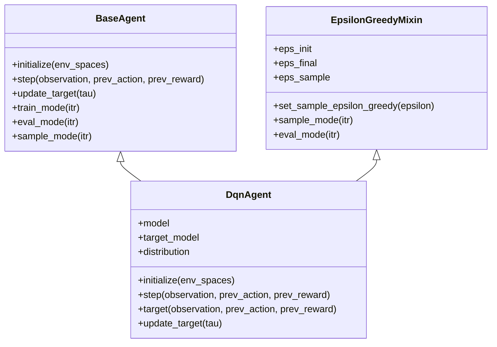
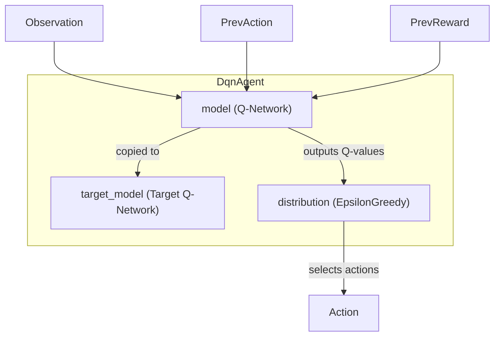
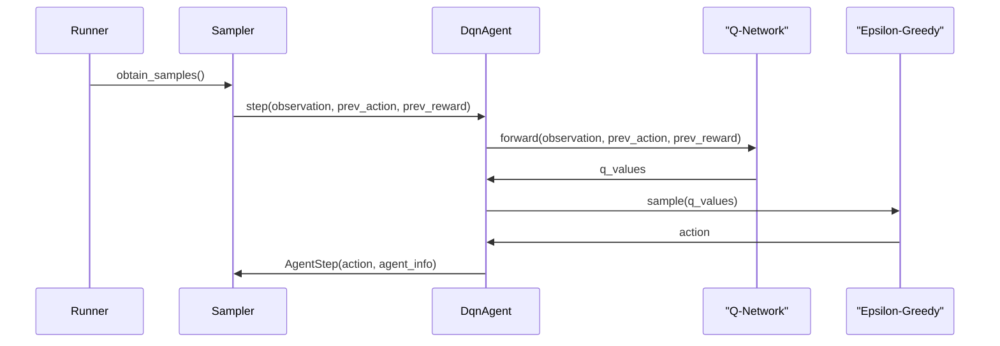
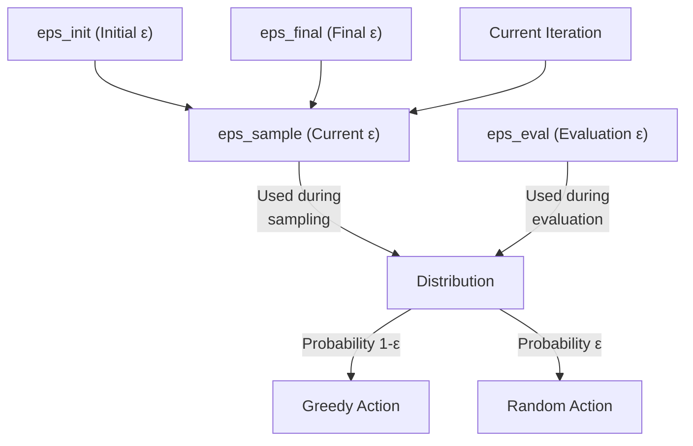
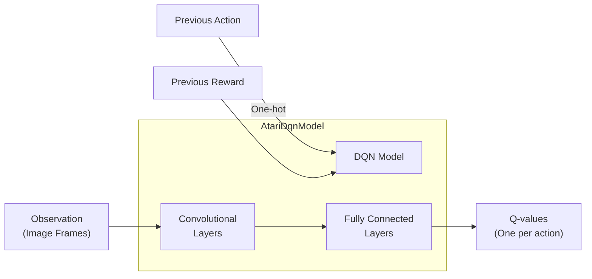
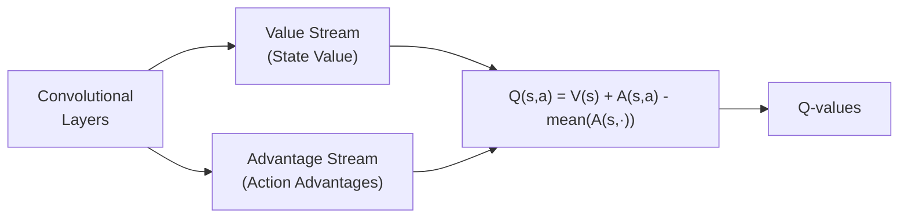
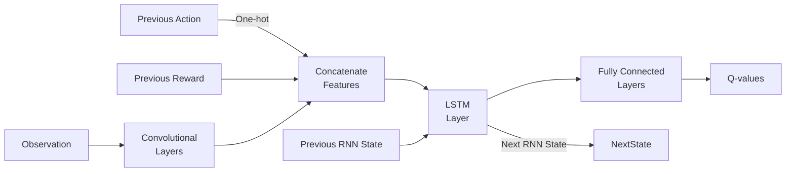
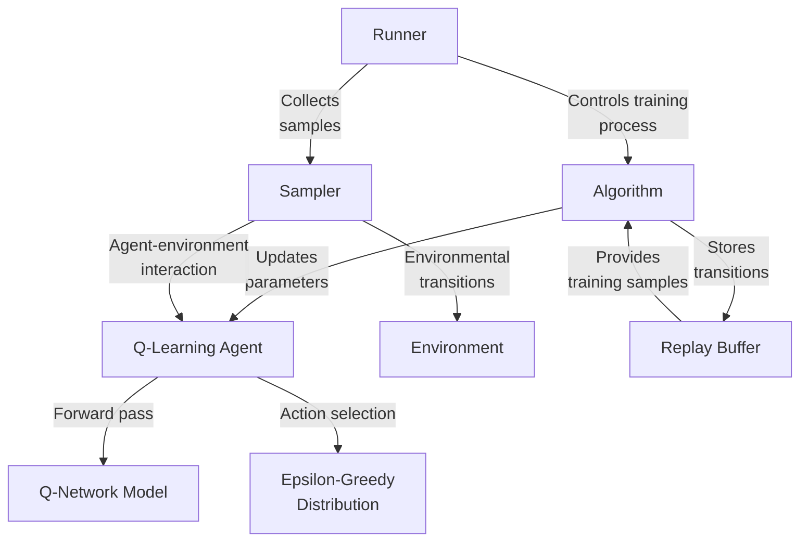

<!-- source: DeepWiki mcp.deepwiki.com · repo astooke/rlpyt · page 4.1 Q-Learning Agents · fetched 2026-10-30 -->

# Q-Learning Agents

Relevant source files

The following files were used as context for generating this wiki page:

- [rlpyt/agents/dqn/dqn_agent.py](rlpyt/agents/dqn/dqn_agent.py)
- [rlpyt/agents/dqn/epsilon_greedy.py](rlpyt/agents/dqn/epsilon_greedy.py)
- [rlpyt/agents/pg/base.py](rlpyt/agents/pg/base.py)
- [rlpyt/agents/qpg/ddpg_agent.py](rlpyt/agents/qpg/ddpg_agent.py)
- [rlpyt/agents/qpg/sac_agent.py](rlpyt/agents/qpg/sac_agent.py)
- [rlpyt/agents/qpg/td3_agent.py](rlpyt/agents/qpg/td3_agent.py)
- [rlpyt/models/dqn/atari_catdqn_model.py](rlpyt/models/dqn/atari_catdqn_model.py)
- [rlpyt/models/dqn/atari_dqn_model.py](rlpyt/models/dqn/atari_dqn_model.py)
- [rlpyt/models/dqn/atari_r2d1_model.py](rlpyt/models/dqn/atari_r2d1_model.py)
- [rlpyt/models/dqn/dueling.py](rlpyt/models/dqn/dueling.py)
- [rlpyt/models/pg/atari_ff_model.py](rlpyt/models/pg/atari_ff_model.py)
- [rlpyt/models/pg/atari_lstm_model.py](rlpyt/models/pg/atari_lstm_model.py)
- [rlpyt/models/qpg/mlp.py](rlpyt/models/qpg/mlp.py)

## Purpose and Scope

This document details the Q-Learning agent implementations in the rlpyt framework. Q-Learning agents serve as the interface between Q-Learning algorithms (such as DQN, described in [Q-Learning Algorithms](#3.1)) and the environment, handling action selection and neural network management. These agents implement discrete-action value-based methods where the agent learns to approximate Q-values for state-action pairs.

For policy gradient agents, see [Policy Gradient Agents](#4.2).

## Architecture Overview

Q-Learning agents in rlpyt follow a modular design, inheriting from base classes and mixins to provide specific functionality. The primary Q-Learning agent is the DQN agent, but the framework also supports other agents that use Q-function approximation like DDPG, TD3, and SAC.

Sources: [rlpyt/agents/dqn/dqn_agent.py](), [rlpyt/agents/dqn/epsilon_greedy.py](), [rlpyt/agents/base.py]()

## DQN Agent Implementation

The `DqnAgent` class provides the standard DQN agent implementation, combining the `BaseAgent` with the `EpsilonGreedyAgentMixin` for exploration.

### Core Components and Initialization

The DQN agent maintains two neural networks:
1. A main Q-network (`model`) for computing Q-values
2. A target Q-network (`target_model`) for stable learning

During initialization, the agent:
- Creates both main and target networks with identical architecture
- Initializes an epsilon-greedy distribution for action selection
- Sets up exploration parameters

Sources: [rlpyt/agents/dqn/dqn_agent.py:31-47]()

### Action Selection Process

The core functionality of the DQN agent is to select actions based on Q-values using the epsilon-greedy exploration strategy:

The `step` method performs the following operations:
1. Converts previous actions to one-hot format
2. Passes observation, previous action, and previous reward to the model
3. Gets Q-values from the model
4. Selects an action using epsilon-greedy distribution
5. Returns the selected action and agent info

Sources: [rlpyt/agents/dqn/dqn_agent.py:57-69]()

### Target Network Updates

The target network is periodically updated using the `update_target` method, which copies weights from the main model to the target model. This can be a hard update (tau=1) or soft update (0<tau<1).

Sources: [rlpyt/agents/dqn/dqn_agent.py:79-81]()

## Epsilon-Greedy Exploration

The `EpsilonGreedyAgentMixin` provides exploration functionality for Q-learning agents. Key features include:

- Epsilon annealing from initial to final values over training iterations
- Support for vector-valued epsilons (different values for different environment instances)
- Separate epsilons for sampling and evaluation

The epsilon value decreases linearly from `eps_init` to `eps_final` over iterations, controlled by:
- `eps_itr_min`: Iteration to start annealing
- `eps_itr_max`: Iteration where epsilon reaches its final value

Sources: [rlpyt/agents/dqn/epsilon_greedy.py:12-127]()

## Model Integration

Q-Learning agents interact with models that compute Q-values for state-action pairs. These models can have different architectures:

### Standard Q-Network

The standard Q-network for Atari games consists of convolutional layers followed by fully connected layers:

Sources: [rlpyt/models/dqn/atari_dqn_model.py:10-68]()

### Dueling Network Architecture

Agents can optionally use a dueling network architecture, which splits the representation into value and advantage streams:

Sources: [rlpyt/models/dqn/dueling.py:8-46]()

## Other Q-Learning Agents

### Categorical DQN

Categorical DQN extends standard DQN by outputting a distribution over discrete values for each action rather than a single Q-value.

Sources: [rlpyt/models/dqn/atari_catdqn_model.py:11-77]()

### Recurrent DQN (R2D1)

R2D1 incorporates recurrent layers (LSTM) into the DQN architecture to handle partial observability and temporal dependencies.

Sources: [rlpyt/models/dqn/atari_r2d1_model.py:14-77]()

## Related Actor-Critic Agents

While not pure Q-learning agents, several other implementations use Q-function approximation:

### DDPG Agent

Deep Deterministic Policy Gradient (DDPG) combines policy gradient with Q-learning for continuous action spaces:
- Uses deterministic policy (mu) for action selection
- Maintains Q-network and target networks for both policy and Q-function
- Adds noise to actions for exploration

Sources: [rlpyt/agents/qpg/ddpg_agent.py:19-160]()

### TD3 Agent

Twin Delayed DDPG (TD3) extends DDPG with several improvements:
- Uses twin Q-networks to reduce overestimation bias
- Adds noise to target actions for smoother policy updates
- Delays policy updates to reduce variance

Sources: [rlpyt/agents/qpg/td3_agent.py:13-120]()

### SAC Agent

Soft Actor-Critic (SAC) is an off-policy actor-critic algorithm that:
- Uses stochastic policy for better exploration
- Incorporates entropy maximization for exploration
- Employs twin Q-networks like TD3

Sources: [rlpyt/agents/qpg/sac_agent.py:25-204]()

## Integration with rlpyt Framework

Q-Learning agents are integrated into the rlpyt framework and interact with other components:

Sources: [rlpyt/agents/dqn/dqn_agent.py](), [rlpyt/agents/dqn/epsilon_greedy.py]()

## Summary

Q-Learning agents in rlpyt provide a flexible, modular implementation of value-based reinforcement learning methods. They handle:
- Model management (main and target networks)
- Action selection with exploration strategies
- Integration with algorithms and samplers

The system supports various Q-learning variants including standard DQN, categorical DQN, recurrent DQN, and related approaches like DDPG, TD3, and SAC.

---

