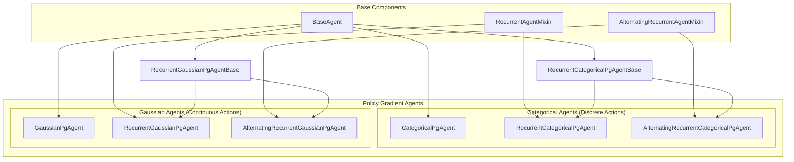
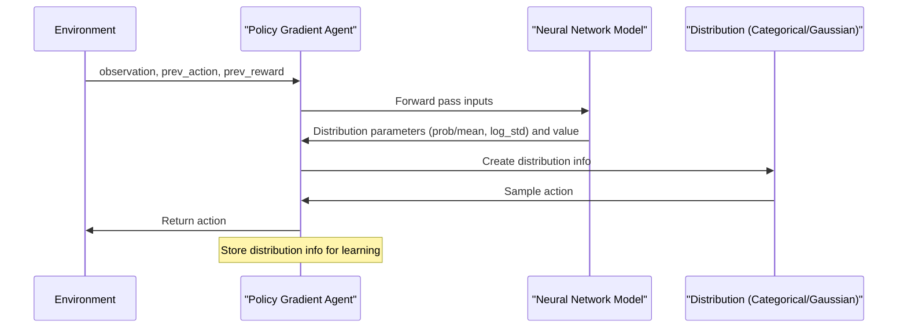
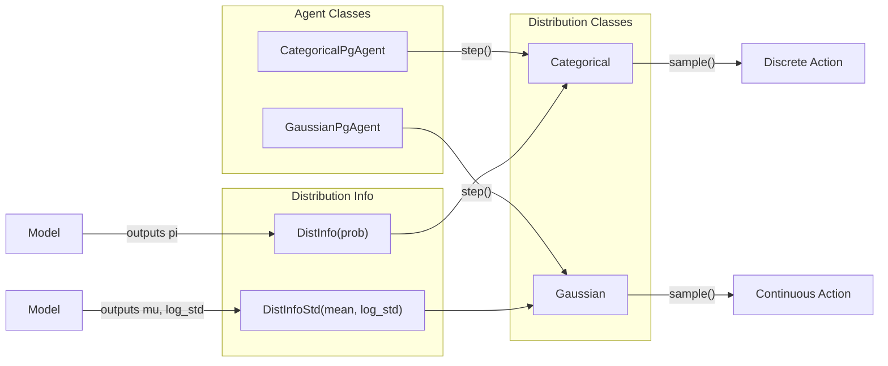
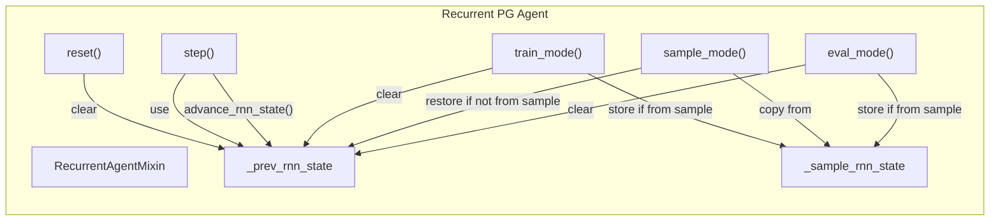
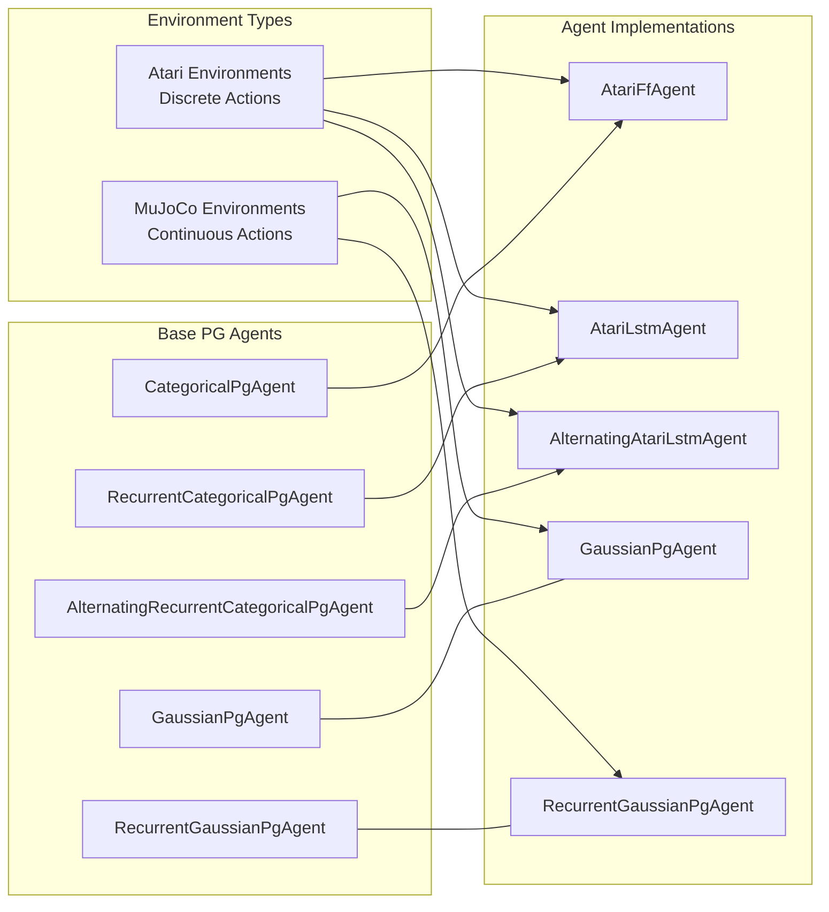

<!-- source: DeepWiki mcp.deepwiki.com · repo astooke/rlpyt · page 4.2 Policy Gradient Agents · fetched 2026-10-30 -->

# Policy Gradient Agents

Relevant source files

The following files were used as context for generating this wiki page:

- [rlpyt/agents/base.py](rlpyt/agents/base.py)
- [rlpyt/agents/dqn/r2d1_agent.py](rlpyt/agents/dqn/r2d1_agent.py)
- [rlpyt/agents/pg/atari.py](rlpyt/agents/pg/atari.py)
- [rlpyt/agents/pg/categorical.py](rlpyt/agents/pg/categorical.py)
- [rlpyt/agents/pg/gaussian.py](rlpyt/agents/pg/gaussian.py)
- [rlpyt/algos/base.py](rlpyt/algos/base.py)
- [rlpyt/distributions/gaussian.py](rlpyt/distributions/gaussian.py)
- [rlpyt/experiments/scripts/mujoco/pg/launch/pabti/launch_mujoco_ppo_serial.py](rlpyt/experiments/scripts/mujoco/pg/launch/pabti/launch_mujoco_ppo_serial.py)
- [rlpyt/samplers/parallel/gpu/alternating_sampler.py](rlpyt/samplers/parallel/gpu/alternating_sampler.py)

## Purpose and Scope

This document explains the policy gradient agent implementations in the rlpyt framework. Policy gradient agents directly parameterize a policy (action distribution) and use gradient ascent on the expected return to improve it, as opposed to Q-learning agents that learn state-action values (see [Q-Learning Agents](#4.1)). The agents described here serve as the interface between algorithms like PPO and A2C (see [Policy Gradient Algorithms](#3.2)) and the environment.

## Overview of Policy Gradient Agents

Policy gradient agents in rlpyt are classified by:
1. **Action space type**: Categorical (discrete) or Gaussian (continuous)
2. **State representation**: Standard (feedforward) or recurrent
3. **Sampling pattern**: Standard or alternating (for specialized parallel sampling)

### Agent Architecture Diagram

Sources: [rlpyt/agents/pg/categorical.py](), [rlpyt/agents/pg/gaussian.py](), [rlpyt/agents/base.py]()

## Basic Operation

Policy gradient agents follow this flow:

1. Receive observations, previous actions, and previous rewards
2. Process through neural network model to obtain distribution parameters
3. Create probability distribution (Categorical or Gaussian)
4. Sample actions from this distribution during exploration
5. Return action and agent info (containing distribution parameters and value estimates)

### Action Selection Workflow

Sources: [rlpyt/agents/pg/categorical.py:33-43](), [rlpyt/agents/pg/gaussian.py:40-55]()

## Distribution Types

Policy gradient agents use specific probability distributions for different action spaces:

1. **Categorical Distribution** - For discrete action spaces (e.g., Atari games)
   - Parameters: Action probabilities
   - Used by: `CategoricalPgAgent` and recurrent variants

2. **Gaussian Distribution** - For continuous action spaces (e.g., MuJoCo robotics environments)
   - Parameters: Mean and log standard deviation 
   - Supports optional action clipping and squashing transformations
   - Used by: `GaussianPgAgent` and recurrent variants

### Distribution Integration

Sources: [rlpyt/distributions/gaussian.py](), [rlpyt/agents/pg/categorical.py](), [rlpyt/agents/pg/gaussian.py]()

## Categorical Policy Gradient Agents

Categorical policy gradient agents are used for discrete action spaces. They work with models that output action probabilities.

### Key Methods

- `__call__`: Forward pass during training/optimization
- `step`: Action selection during sampling (environment interaction)
- `initialize`: Sets up the agent and initializes the categorical distribution

### Code Structure

The `CategoricalPgAgent` class performs the following operations:

1. Converts previous actions to one-hot representation
2. Passes inputs through model to get action probabilities and value estimate
3. Uses categorical distribution to sample actions
4. Returns action and agent information (distribution parameters and value)

Sources: [rlpyt/agents/pg/categorical.py:11-51]()

## Gaussian Policy Gradient Agents

Gaussian policy gradient agents are used for continuous action spaces. They work with models that output action means and log standard deviations.

### Key Methods

- `__call__`: Forward pass during training/optimization
- `step`: Action selection during sampling
- `initialize`: Sets up the agent and initializes the Gaussian distribution 

### Important Features

- Supports action clipping within environment bounds
- Can use fixed or learned standard deviations
- Handles proper scaling and transformation of actions

Sources: [rlpyt/agents/pg/gaussian.py:14-66](), [rlpyt/distributions/gaussian.py]()

## Recurrent Agents

For environments requiring memory, rlpyt provides recurrent variants of both categorical and Gaussian policy gradient agents.

### Key Differences

- Maintain recurrent state (hidden state) across time steps
- Handle state reset at environment episode boundaries
- Pass and manage recurrent state between components
- Properly track state across different modes (training/sampling/evaluation)

The recurrent mixins provide common functionality for:
- Tracking and advancing recurrent states
- Resetting states at the start of episodes
- Managing state during mode transitions

### Recurrent State Management

Sources: [rlpyt/agents/base.py:252-304](), [rlpyt/agents/pg/categorical.py:54-96](), [rlpyt/agents/pg/gaussian.py:69-126]()

## Alternating Recurrent Agents

Alternating recurrent agents are specialized versions designed to work with alternating samplers. These samplers divide environments into two sets, with each set taking turns computing actions while the other is stepping environments.

### Key Features

- Maintain two sets of recurrent states
- Toggle between states automatically
- Efficiently support parallelized sampling patterns
- Compatible with `AlternatingSampler` for potential 2x speedup

Sources: [rlpyt/agents/base.py:307-371](), [rlpyt/samplers/parallel/gpu/alternating_sampler.py]()

## Interface with Algorithms

Policy gradient agents provide outputs needed specifically for policy gradient algorithms:

1. Action distribution parameters for policy gradient computation
2. Value estimates for advantage calculation
3. Entropy of action distribution for optional entropy regularization
4. Interfacing between models and algorithms for proper loss calculation

Sources: [rlpyt/agents/pg/categorical.py](), [rlpyt/agents/pg/gaussian.py](), [rlpyt/algos/base.py]()

## Usage Example

To use a policy gradient agent, you typically:

1. Select the appropriate agent class based on action space and need for recurrence
2. Configure the appropriate model class
3. Initialize the agent with the model
4. Connect the agent to a sampler and algorithm for training

Here's how various agents are tied to specific environments:

### Specialized Environment Agents

Sources: [rlpyt/agents/pg/atari.py](), [rlpyt/experiments/scripts/mujoco/pg/launch/pabti/launch_mujoco_ppo_serial.py]()

## Integration with Other Framework Components

Policy gradient agents are one part of the rlpyt framework. They interact with:

1. **Models** - Neural networks that process observations and output action distributions
2. **Samplers** - Collect experiences using the agent's action selection 
3. **Algorithms** - Use the agent's outputs to compute gradients and update the model
4. **Distributions** - Handle the mathematical operations for action sampling and likelihood calculations

Sources: [rlpyt/agents/base.py](), [rlpyt/agents/pg/categorical.py](), [rlpyt/agents/pg/gaussian.py]()

---

