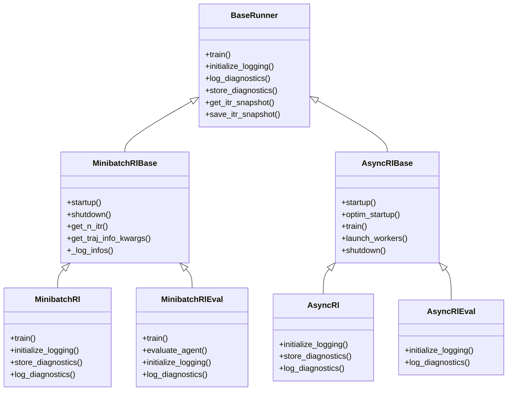
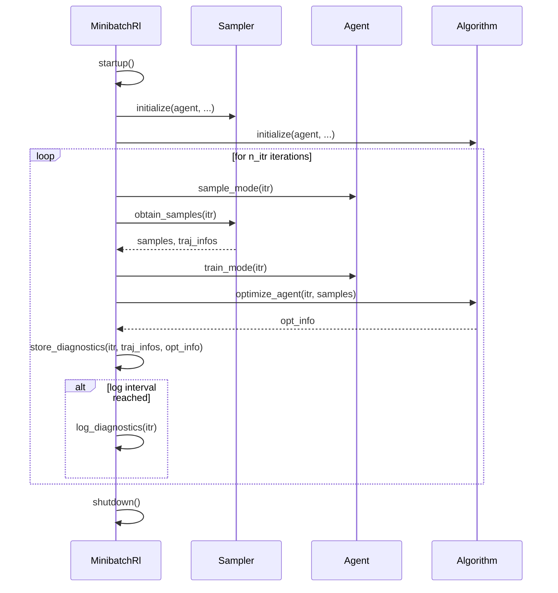
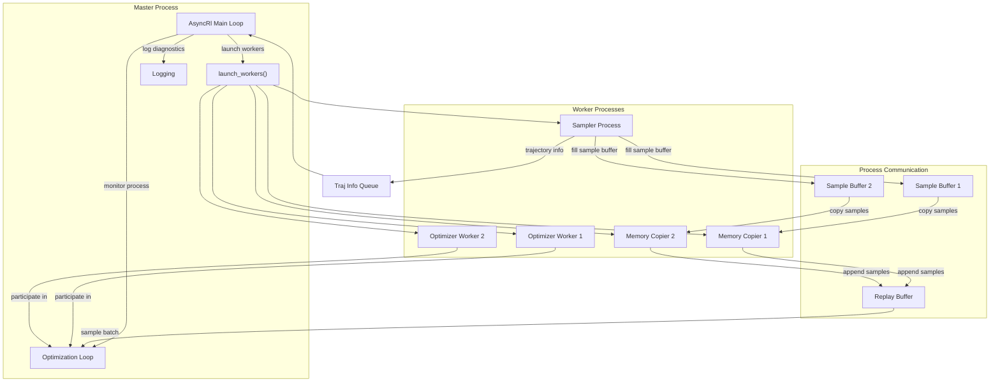
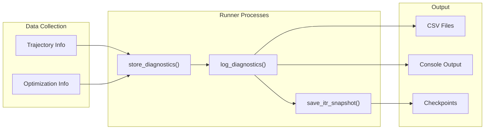
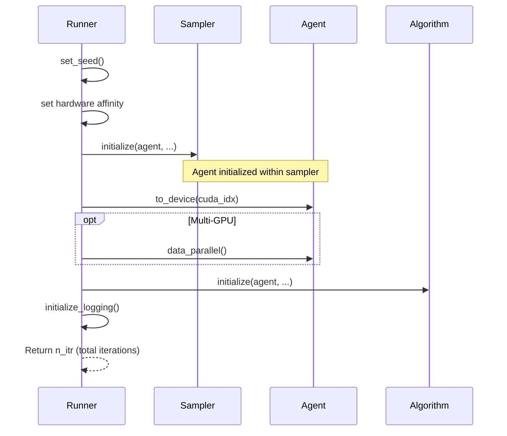

<!-- source: DeepWiki mcp.deepwiki.com · repo astooke/rlpyt · page 5 Runners · fetched 2026-10-30 -->

# Runners

<details>
<summary>Relevant source files</summary>

The following files were used as context for generating this wiki page:

- [rlpyt/runners/async_rl.py](rlpyt/runners/async_rl.py)
- [rlpyt/runners/minibatch_rl.py](rlpyt/runners/minibatch_rl.py)
- [rlpyt/utils/logging/logger.py](rlpyt/utils/logging/logger.py)

</details>


Runners in rlpyt are core orchestration components responsible for coordinating the entire reinforcement learning training process. They manage the interaction between samplers (which collect experience data) and algorithms (which update agent parameters), handle logging, checkpointing, and evaluation.

For specific types of runners, see [Synchronous Runners](#5.1) and [Asynchronous Runners](#5.2).

## Runner Overview

Runners serve as the main entry point for rlpyt reinforcement learning experiments. They provide a standardized interface for training agents, encapsulating the common patterns of:

1. Initializing the sampler, agent, and algorithm
2. Coordinating the main training loop
3. Managing hardware resource allocation
4. Handling logging and checkpointing
5. Coordinating evaluation (when applicable)

Runner classes in rlpyt are organized in a hierarchical structure, with specialized implementations for different parallelism patterns.



Sources: [rlpyt/runners/minibatch_rl.py:15-350](), [rlpyt/runners/async_rl.py:21-456]()

## Runner Types

Rlpyt provides two main types of runners with different performance characteristics:

### 1. Synchronous Runners

Synchronous runners (`MinibatchRl` and `MinibatchRlEval`) implement a sequential workflow where sampling and optimization strictly alternate. These runners provide simplicity and are suitable for single or multi-GPU data-parallel training.

### 2. Asynchronous Runners

Asynchronous runners (`AsyncRl` and `AsyncRlEval`) decouple sampling and optimization by running them in separate processes. This allows parallel execution and can improve hardware utilization (e.g., CPUs running environment simulation concurrently with GPU optimization).

Each type also comes in two variants:
- **Standard**: Tracks agent performance using statistics from training trajectories
- **Eval**: Performs periodic dedicated evaluation runs to measure agent performance

## Training Workflow

The training workflow differs significantly between synchronous and asynchronous runners.

### Synchronous Training Workflow



Sources: [rlpyt/runners/minibatch_rl.py:232-284]()

### Asynchronous Training Workflow



Sources: [rlpyt/runners/async_rl.py:80-132](), [rlpyt/runners/async_rl.py:189-195](), [rlpyt/runners/async_rl.py:515-608]()

## Core Runner Methods

All runners implement several key methods that define the training process:

| Method | Purpose |
|--------|---------|
| `startup()` | Initializes hardware affinity, samplers, agents, algorithms, logging |
| `train()` | Executes the main training loop |
| `store_diagnostics()` | Collects and stores performance metrics during training |
| `log_diagnostics()` | Writes diagnostics to csv and console at logging intervals |
| `save_itr_snapshot()` | Saves checkpoints of agent and algorithm state |
| `shutdown()` | Cleans up processes and resources |

Sources: [rlpyt/runners/minibatch_rl.py:49-133](), [rlpyt/runners/async_rl.py:134-178]()

## Hardware Affinity Management

Runners handle hardware resource allocation through an affinity configuration that specifies:

- CPU core assignments
- CUDA device selection
- PyTorch thread settings

This enables efficient parallel execution across multiple processes and devices.

```python
# Example affinity configuration
affinity = dict(
    cuda_idx=0,
    master_cpus=[0, 1],
    master_torch_threads=2,
    sampler=dict(
        worker_cpus=[[2, 3], [4, 5]],
        worker_torch_threads=1
    ),
    optimizer=dict(
        master_cpus=[0, 1],
        worker_cpus=[[6, 7]],
        cuda_idx=[0, 1]
    )
)
```

Sources: [rlpyt/runners/minibatch_rl.py:55-68](), [rlpyt/runners/async_rl.py:169-178]()

## Logging and Monitoring

Runners are responsible for tracking and reporting training progress. They:

1. Collect trajectory statistics from completed episodes
2. Store optimization metrics from algorithm updates
3. Calculate performance metrics (e.g., samples/second, updates/second)
4. Log everything to csv files and console output
5. Save model checkpoints at specified intervals



Sources: [rlpyt/runners/minibatch_rl.py:157-229](), [rlpyt/utils/logging/logger.py:191-472]()

## Evaluation Mechanisms

Rlpyt runners support two evaluation approaches:

1. **Online evaluation**: Tracks performance using trajectories collected during training
   - Used by `MinibatchRl` and `AsyncRl`
   - Lightweight but potentially biased by exploration

2. **Offline evaluation**: Performs dedicated evaluation runs at specific intervals
   - Used by `MinibatchRlEval` and `AsyncRlEval`
   - More accurate but requires additional computation time

For offline evaluation, runners pause the training process, switch the agent to evaluation mode, collect dedicated evaluation trajectories, and log the results separately.

Sources: [rlpyt/runners/minibatch_rl.py:286-350](), [rlpyt/runners/async_rl.py:434-456]()

## Initialization Process

The initialization sequence in runners is responsible for setting up all components before training begins:



Sources: [rlpyt/runners/minibatch_rl.py:49-99](), [rlpyt/runners/async_rl.py:134-178]()

## Usage Example

To use a runner, you typically instantiate and configure the sampler, agent, and algorithm, then pass them to the appropriate runner:

```python
# Create sampler, agent, and algorithm
sampler = CpuSampler(
    EnvCls=MyEnv,
    env_kwargs=env_kwargs,
    batch_T=batch_T,
    batch_B=batch_B,
)

agent = MyAgent(
    model_kwargs=model_kwargs
)

algo = MyAlgorithm(
    learning_rate=learning_rate,
    batch_size=batch_size
)

# Create and run the runner
runner = MinibatchRl(
    algo=algo,
    agent=agent,
    sampler=sampler,
    n_steps=n_steps,
    log_interval_steps=log_interval_steps,
    affinity=affinity
)

runner.train()
```

Sources: [rlpyt/runners/minibatch_rl.py:232-284]()

## Conclusion

Runners are a fundamental component of the rlpyt framework that handle the orchestration of the reinforcement learning training process. They provide a standardized interface for coordinating samplers, agents, and algorithms, while managing hardware resources, logging, and checkpointing.

The choice between synchronous and asynchronous runners depends on hardware configuration and training requirements:
- Synchronous runners offer simplicity and predictable behavior
- Asynchronous runners can provide better hardware utilization through parallel execution

---

