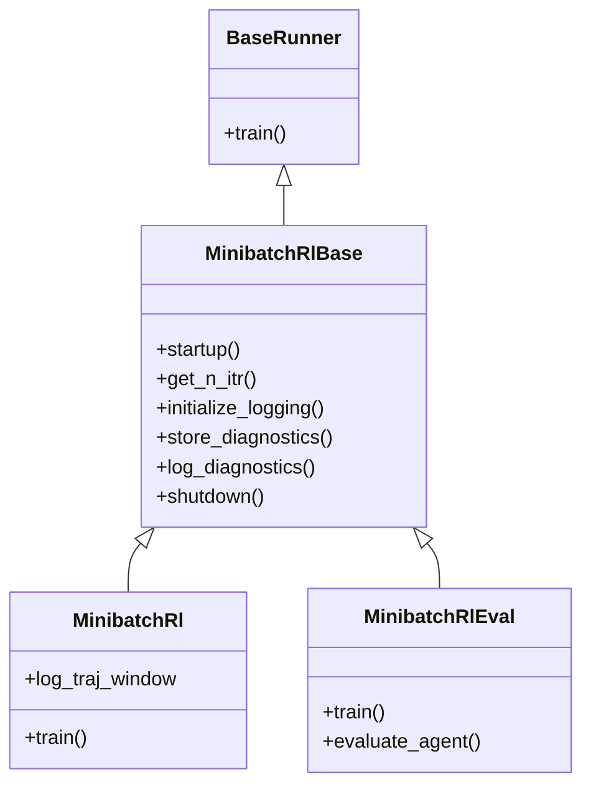
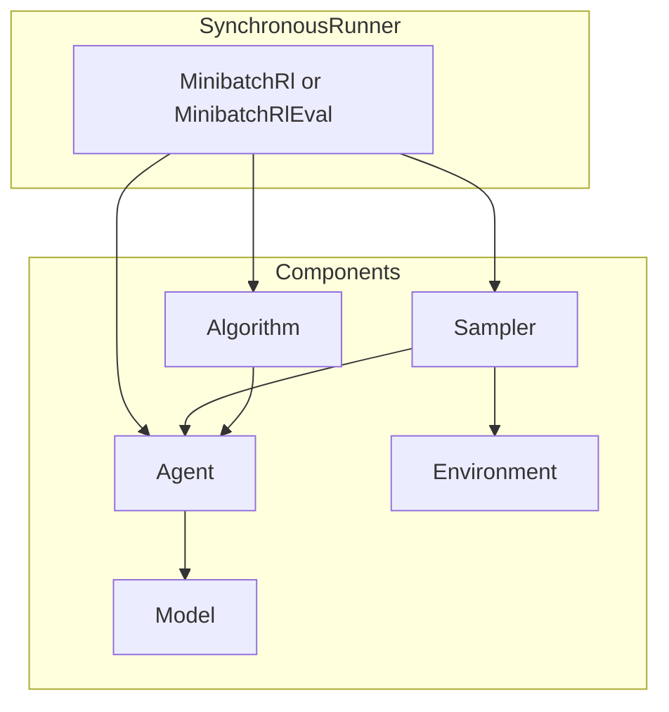
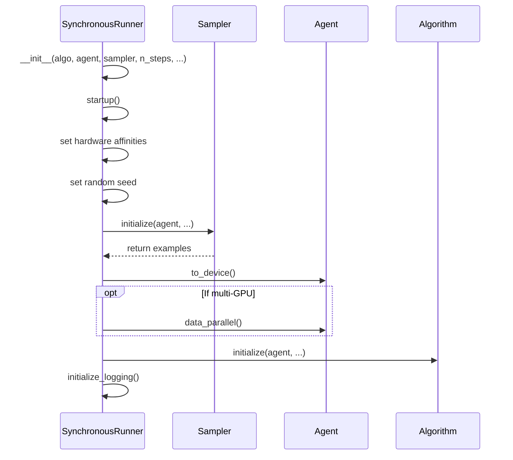
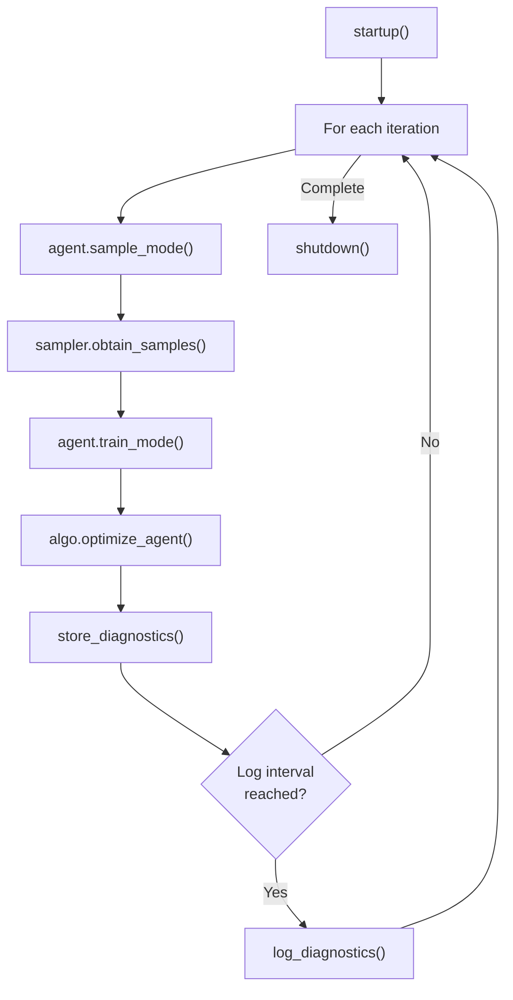
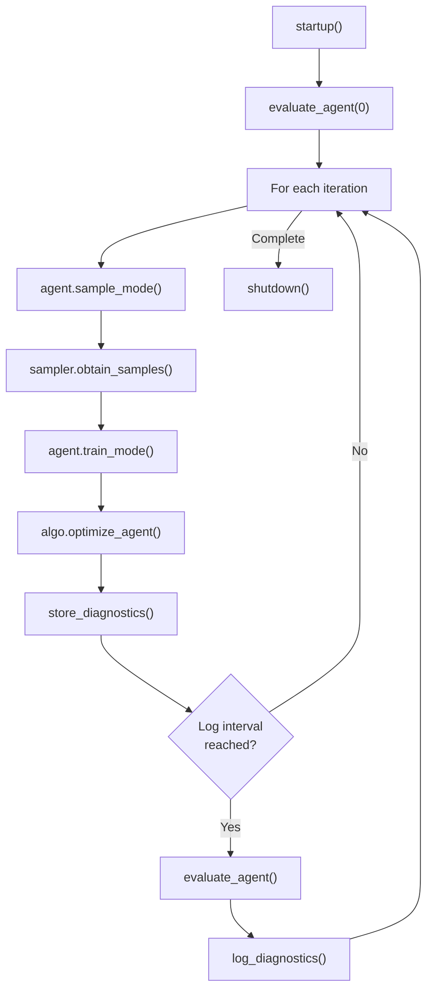
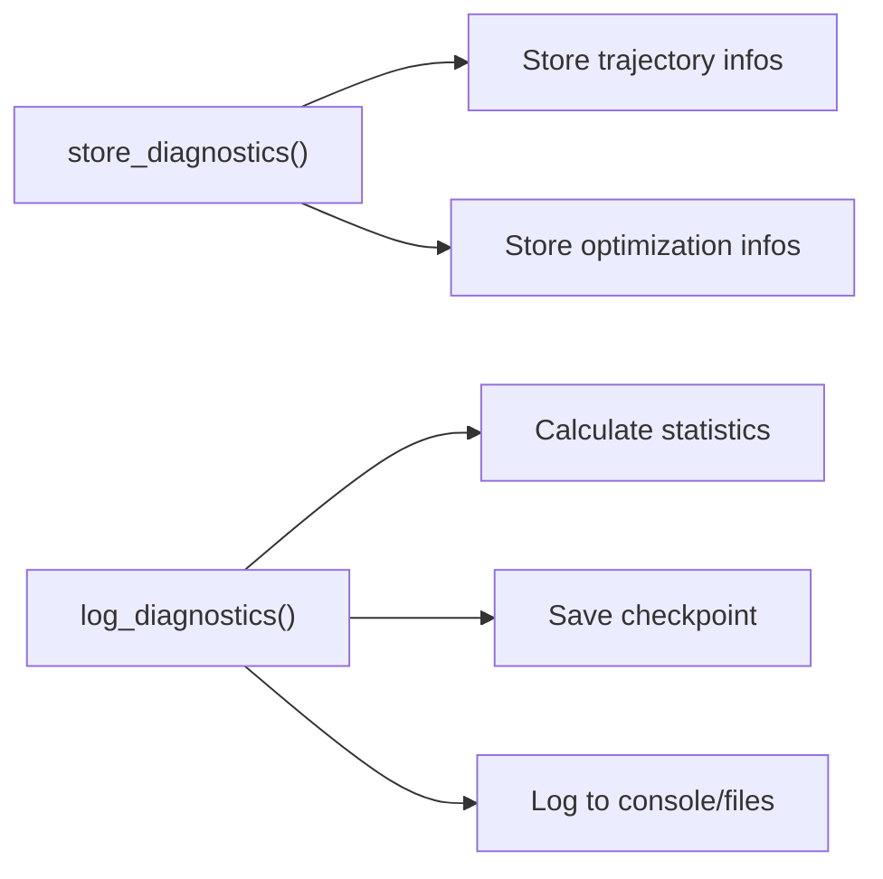
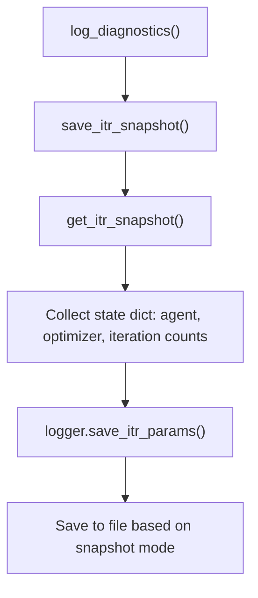
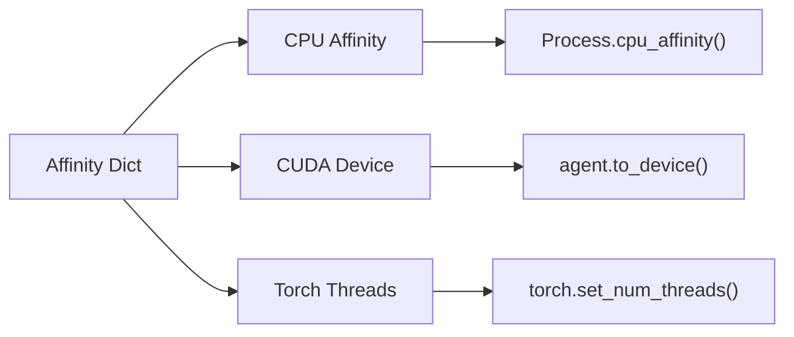

<!-- source: DeepWiki mcp.deepwiki.com · repo astooke/rlpyt · page 5.1 Synchronous Runners · fetched 2026-10-30 -->

# Synchronous Runners

<details>
<summary>Relevant source files</summary>

The following files were used as context for generating this wiki page:

- [rlpyt/runners/async_rl.py](rlpyt/runners/async_rl.py)
- [rlpyt/runners/minibatch_rl.py](rlpyt/runners/minibatch_rl.py)
- [rlpyt/utils/logging/logger.py](rlpyt/utils/logging/logger.py)

</details>


## Purpose and Scope

Synchronous Runners in rlpyt are responsible for orchestrating the training process in reinforcement learning experiments. They coordinate the interaction between the agent, sampler, and algorithm in a synchronous manner, meaning they alternate between collecting samples from the environment and optimizing the agent, without any overlap between these operations.

This page covers the implementation and functionality of synchronous runner classes, their training loop structure, and configuration options. For information about asynchronous runners that allow sampling and optimization to run in parallel, see [Asynchronous Runners](#5.2).

Sources: [rlpyt/runners/minibatch_rl.py:15-232]()

## Core Runner Classes

The synchronous runners are implemented in a hierarchy of classes, each adding specific functionality:



### MinibatchRlBase

This is the base class providing common functionality for synchronous runners. It handles:

- Setting up hardware affinities
- Initializing the sampler, agent, and algorithm
- Configuring logging
- Managing diagnostics and checkpointing
- Handling training iterations

Sources: [rlpyt/runners/minibatch_rl.py:15-231]()

### MinibatchRl

A concrete implementation focused on online performance tracking using learning trajectories. It tracks performance statistics continuously during training, without separate evaluation phases.

Sources: [rlpyt/runners/minibatch_rl.py:232-284]()

### MinibatchRlEval

An alternative implementation that performs explicit periodic evaluation of the agent. This class runs dedicated evaluation episodes at specified intervals to assess agent performance in a more controlled setting.

Sources: [rlpyt/runners/minibatch_rl.py:286-351]()

## System Architecture

The synchronous runner integrates with other components of rlpyt to create a complete reinforcement learning system:



Sources: [rlpyt/runners/minibatch_rl.py:33-46](), [rlpyt/runners/minibatch_rl.py:72-96]()

## Initialization and Startup

The synchronous runner initialization process follows these steps:



Key steps in the initialization:

1. Setting CPU affinities for proper hardware utilization
2. Setting random seeds for reproducibility
3. Initializing the sampler, which also initializes the agent
4. Moving the agent to the appropriate device (CPU/GPU)
5. Setting up the algorithm with the agent
6. Initializing logging systems

Sources: [rlpyt/runners/minibatch_rl.py:49-98]()

## Training Loop

The core of synchronous runners is the training loop, which alternates between sampling and optimization:

### MinibatchRl Training Loop



Sources: [rlpyt/runners/minibatch_rl.py:246-264]()

### MinibatchRlEval Training Loop



The key difference from `MinibatchRl` is the addition of periodic agent evaluation, which runs the agent in evaluation mode for a set number of episodes without exploration.

Sources: [rlpyt/runners/minibatch_rl.py:294-316](), [rlpyt/runners/minibatch_rl.py:318-335]()

## Diagnostic Tracking and Logging

Synchronous runners track multiple types of diagnostics:

| Diagnostic Type | Description | Class |
|----------------|-------------|-------|
| Trajectory Info | Statistics from completed trajectories (e.g., episode length, return) | Both |
| Optimization Info | Internal algorithm metrics (e.g., loss values, gradient norms) | Both |
| Evaluation Metrics | Performance during dedicated evaluation episodes | MinibatchRlEval only |
| Timing Statistics | Time per step, iterations per second, etc. | Both |

The tracking mechanism:



Sources: [rlpyt/runners/minibatch_rl.py:157-167](), [rlpyt/runners/minibatch_rl.py:168-213](), [rlpyt/utils/logging/logger.py:191-209](), [rlpyt/utils/logging/logger.py:311-323]()

## Checkpointing

The synchronous runners implement checkpointing to save the training state at specified intervals:



Available snapshot modes:
- `all`: Save at every logging iteration
- `last`: Keep only the most recent snapshot
- `gap`: Save at specified intervals
- `last+gap`: Combination of last and gap

Sources: [rlpyt/runners/minibatch_rl.py:135-155](), [rlpyt/utils/logging/logger.py:332-353]()

## Hardware Configuration and Affinity

Synchronous runners support configuring hardware affinities to optimize performance:



Multi-GPU data parallelism is supported through the `agent.data_parallel()` method, which allows the agent's model to be distributed across multiple GPUs for faster forward and backward passes.

Sources: [rlpyt/runners/minibatch_rl.py:54-68](), [rlpyt/runners/minibatch_rl.py:85-87]()

## Comparison with Asynchronous Runners

| Feature | Synchronous Runners | Asynchronous Runners |
|---------|-------------------|---------------------|
| Execution Model | Sequential: sample then optimize | Parallel: sampling and optimization run concurrently |
| Implementation Complexity | Simpler | More complex due to inter-process communication |
| Hardware Utilization | May leave resources idle | Better hardware utilization (CPU for sampling, GPU for training) |
| Determinism | More deterministic | May introduce non-determinism |
| Data Flow | Direct | Uses shared memory and multiple processes |
| Classes | MinibatchRl, MinibatchRlEval | AsyncRl, AsyncRlEval |

Sources: [rlpyt/runners/minibatch_rl.py:15-232](), [rlpyt/runners/async_rl.py:21-62]()

## Usage Example

To use a synchronous runner, you need to:

1. Create an agent, algorithm, and sampler
2. Configure the runner with these components
3. Call the `train()` method

The basic configuration follows this pattern:

```python
# Create components
sampler = CpuSampler(env_kwargs=env_kwargs, batch_T=batch_T, batch_B=batch_B)
agent = CategoricalPgAgent(model_kwargs=model_kwargs)
algorithm = PPO(discount=discount, learning_rate=learning_rate)

# Create runner
runner = MinibatchRl(
    algo=algorithm,
    agent=agent,
    sampler=sampler,
    n_steps=n_steps,
    log_interval_steps=log_interval_steps,
    affinity=affinity,
)

# Start training
runner.train()
```

Sources: [rlpyt/runners/minibatch_rl.py:33-46](), [rlpyt/runners/minibatch_rl.py:246-264]()

---

