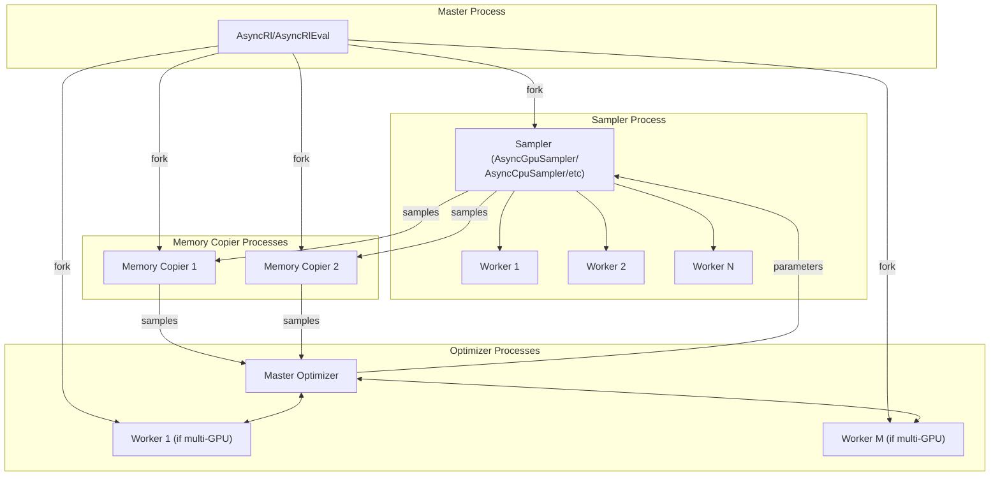
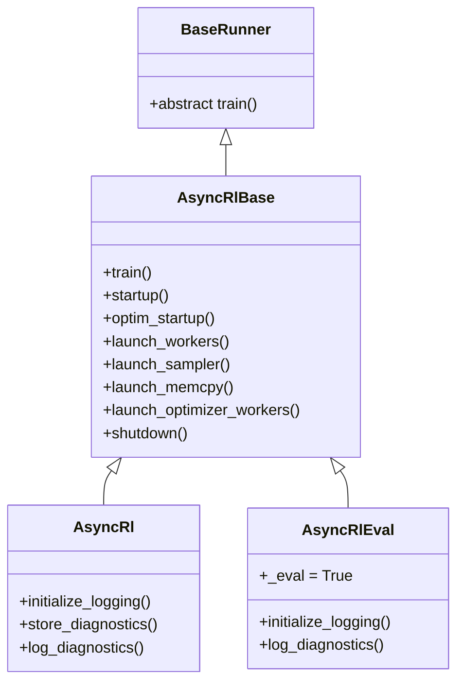
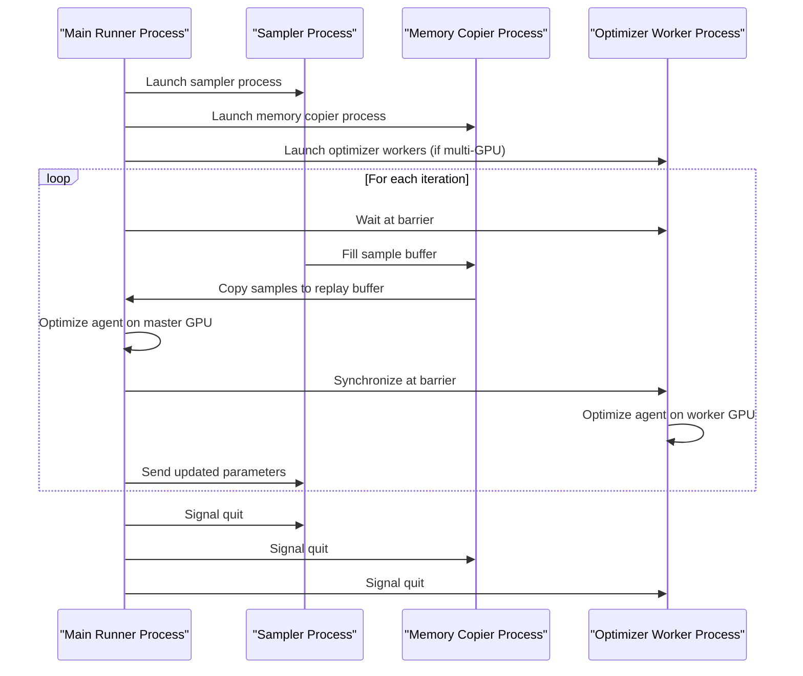
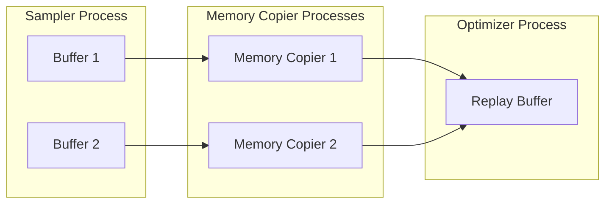
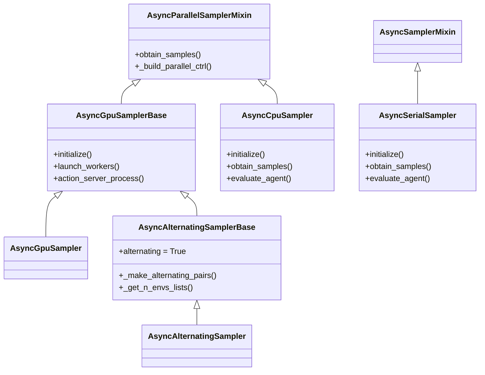

<!-- source: DeepWiki mcp.deepwiki.com · repo astooke/rlpyt · page 5.2 Asynchronous Runners · fetched 2026-10-30 -->

# Asynchronous Runners

<details>
<summary>Relevant source files</summary>

The following files were used as context for generating this wiki page:

- [rlpyt/runners/async_rl.py](rlpyt/runners/async_rl.py)
- [rlpyt/runners/minibatch_rl.py](rlpyt/runners/minibatch_rl.py)
- [rlpyt/samplers/async_/alternating_sampler.py](rlpyt/samplers/async_/alternating_sampler.py)
- [rlpyt/samplers/async_/base.py](rlpyt/samplers/async_/base.py)
- [rlpyt/samplers/async_/cpu_sampler.py](rlpyt/samplers/async_/cpu_sampler.py)
- [rlpyt/samplers/async_/gpu_sampler.py](rlpyt/samplers/async_/gpu_sampler.py)
- [rlpyt/samplers/async_/serial_sampler.py](rlpyt/samplers/async_/serial_sampler.py)
- [rlpyt/utils/logging/logger.py](rlpyt/utils/logging/logger.py)

</details>


Asynchronous runners in rlpyt orchestrate reinforcement learning training by running sampling (collection of environment experiences) and optimization (model training) asynchronously in separate processes. This approach can achieve higher hardware utilization by allowing CPUs to fully simulate environments while GPUs train the agent concurrently. For information about synchronous runners, see [Synchronous Runners](#5.1).

## Purpose and Core Design

Asynchronous runners separate environment interaction from agent optimization, running them in parallel processes. This design offers several advantages:

1. **Improved hardware utilization**: CPUs can be busy simulating environments while GPUs simultaneously train neural networks
2. **Reduced idle time**: When sampling and optimization operate at different speeds, asynchronous operation prevents the faster component from waiting for the slower one
3. **Flexible parallelism**: Supports various parallelism patterns within the sampler and optimizer independently

However, this approach adds complexity in process management, inter-process communication, and synchronization.



Sources: [rlpyt/runners/async_rl.py:18-62](), [rlpyt/runners/async_rl.py:134-162]()

## Core Classes

The asynchronous runner implementation includes three main classes:

1. **`AsyncRlBase`** - Base class implementing core asynchronous functionality
2. **`AsyncRl`** - Extension with online agent performance tracking
3. **`AsyncRlEval`** - Extension with offline agent performance evaluation 



Sources: [rlpyt/runners/async_rl.py:21-456]()

### AsyncRlBase

The `AsyncRlBase` class provides the core functionality for asynchronous training:

- Orchestrates the parallel processes for sampling and optimization
- Sets up shared memory for communication between processes
- Manages the training loop, including throttling to balance sampling and optimization rates
- Handles logging and performance measurements

Sources: [rlpyt/runners/async_rl.py:21-400]()

### AsyncRl and AsyncRlEval

Two concrete implementations extend the base functionality:

- **`AsyncRl`**: Tracks agent performance online using metrics from learning trajectories
- **`AsyncRlEval`**: Periodically pauses sampling to evaluate agent performance in a separate evaluation phase

Sources: [rlpyt/runners/async_rl.py:401-456]()

## Process Architecture

The asynchronous runner creates and manages four types of processes:

1. **Main Process (Runner)**: Executes optimization on the master GPU and handles logging
2. **Sampler Process**: Collects samples from environments via worker processes
3. **Memory Copier Process(es)**: Transfers samples from sampler to the replay buffer
4. **Optimizer Worker Process(es)** (if multi-GPU): Distributes optimization across GPUs

### Control and Communication

The runner uses several parallel communication mechanisms to coordinate these processes:

- **Semaphores**: Coordinate access to shared buffers
- **Barriers**: Synchronize optimization workers
- **Shared values**: Pass control signals and iteration counters
- **Message queues**: Transfer trajectory information



Sources: [rlpyt/runners/async_rl.py:80-132](), [rlpyt/runners/async_rl.py:189-302]()

## Memory Management and Shared Buffers

A critical aspect of asynchronous training is efficient memory management:

1. **Double Buffering**: The sampler uses two alternating sample buffers (double buffer) to allow sampling to continue while optimization is in progress
2. **Shared Memory**: Buffers are allocated on shared memory to enable zero-copy transfers between processes
3. **Memory Copier**: Dedicated processes copy samples from the sampler buffers to the algorithm's replay buffer



Sources: [rlpyt/runners/async_rl.py:134-162](), [rlpyt/runners/async_rl.py:254-273](), [rlpyt/runners/async_rl.py:573-608]()

## Training Workflow

The training workflow in asynchronous runners involves:

1. **Initialization**:
   - Create shared memory buffers
   - Launch sampler, memory copier, and optimizer processes
   - Set up synchronization primitives

2. **Training Loop**:
   - Wait for sampler to collect a minimal number of samples
   - Receive samples via memory copier processes
   - Optimize agent on available samples
   - Send updated parameters to the sampler
   - Balance optimization and sampling rates through throttling
   - Log performance metrics

3. **Shutdown**:
   - Signal all processes to quit
   - Wait for processes to terminate
   - Clean up resources

Sources: [rlpyt/runners/async_rl.py:80-132](), [rlpyt/runners/async_rl.py:289-302]()

### Throttling Mechanism

A key feature of asynchronous runners is the throttling mechanism that balances sampling and optimization rates:

- The algorithm's `replay_ratio` sets an upper bound on the ratio of training samples used to samples generated
- The runner calculates appropriate throttling intervals based on batch sizes and update frequencies
- If optimization is running too fast relative to sampling, the runner pauses to allow sampling to catch up

Sources: [rlpyt/runners/async_rl.py:41-47](), [rlpyt/runners/async_rl.py:98-109](), [rlpyt/runners/async_rl.py:164-187]()

## Compatible Samplers

Asynchronous runners require specialized samplers that support asynchronous operation:

1. **`AsyncGpuSampler`**: Uses GPU(s) for agent action selection
2. **`AsyncCpuSampler`**: Uses CPU for agent action selection 
3. **`AsyncSerialSampler`**: Simple sampler with no internal parallelism
4. **`AsyncAlternatingSampler`**: Uses two alternating sets of environment workers for increased efficiency



Sources: [rlpyt/samplers/async_/gpu_sampler.py:20-244](), [rlpyt/samplers/async_/cpu_sampler.py:17-96](), [rlpyt/samplers/async_/serial_sampler.py:13-96](), [rlpyt/samplers/async_/alternating_sampler.py:8-100]()

## Usage Examples

### Basic Configuration

```python
from rlpyt.runners.async_rl import AsyncRl
from rlpyt.samplers.async_.gpu_sampler import AsyncGpuSampler
from rlpyt.algos.dqn.dqn import DQN
from rlpyt.agents.dqn.atari.atari_dqn_agent import AtariDqnAgent
from rlpyt.envs.atari.atari_env import AtariEnv

sampler = AsyncGpuSampler(
    EnvCls=AtariEnv,
    env_kwargs=dict(game="pong"),
    batch_T=4,
    batch_B=32,
    max_decorrelation_steps=1000
)

agent = AtariDqnAgent()

algo = DQN(
    replay_ratio=4,
    min_steps_learn=1000
)

runner = AsyncRl(
    algo=algo,
    agent=agent,
    sampler=sampler,
    n_steps=1e6,
    log_interval_steps=1e4,
    affinity=dict(
        cuda_idx=0,
        sampler=dict(cuda_idx=1, workers_cpus=list(range(8))),
        optimizer=dict(cuda_idx=0)
    )
)

runner.train()
```

### Multi-GPU Configuration

```python
affinity = dict(
    cuda_idx=0,  # Master GPU
    sampler=dict(cuda_idx=0, workers_cpus=list(range(10, 18))),
    optimizer=dict(
        master_cuda_idx=0,
        master_cpus=[0, 1],
        worker_cpus=[[2, 3], [4, 5]],
        worker_cuda_idx=[1, 2]
    )
)

runner = AsyncRl(
    algo=algo,
    agent=agent,
    sampler=sampler,
    n_steps=1e6,
    log_interval_steps=1e4,
    affinity=affinity
)
```

## Common Pitfalls and Best Practices

1. **Balancing Sampling and Optimization Rates**: Set the `replay_ratio` appropriately to avoid excessive throttling. Monitor the `OptThrottle` metric in logs.

2. **Resource Allocation**: Be careful with CPU and GPU affinity settings to avoid resource contention.

3. **Debugging Complexity**: Asynchronous systems are harder to debug; start with synchronous runners for algorithm development before switching to asynchronous for production training.

4. **Memory Usage**: Ensure sufficient system memory, as shared buffers can consume substantial RAM, especially for large batch sizes or complex observations.

5. **Performance Monitoring**: Watch for bottlenecks by monitoring the `StepsPerSecond` and `UpdatesPerSecond` metrics in the logs.

Sources: [rlpyt/runners/async_rl.py:337-384](), [rlpyt/runners/async_rl.py:386-399]()

## Logging and Diagnostics

The asynchronous runners implement comprehensive logging:

- **Iteration Information**: Track iterations, steps, and updates
- **Performance Metrics**: Record samples per second, updates per second, and replay ratios
- **Trajectory Statistics**: Collect statistics from completed trajectories
- **Optimizer Information**: Log optimization-related metrics from the algorithm
- **Throttle Metrics**: Monitor how often optimization is throttled to balance with sampling

Sources: [rlpyt/runners/async_rl.py:304-399](), [rlpyt/utils/logging/logger.py:190-472]()

## Comparison with Synchronous Runners

| Feature | Synchronous Runners | Asynchronous Runners |
|---------|--------------------|-----------------------|
| **Hardware Utilization** | Sequential use of CPU/GPU | Concurrent use of CPU/GPU |
| **Replay Ratio Control** | Precise | Upper bound only |
| **Complexity** | Simpler | More complex |
| **Parallelism** | Within sampling only | Both sampling and optimization |
| **Debugging** | Easier | More challenging |
| **Best For** | Algorithm development, small-scale training | Production training, maximizing throughput |

Sources: [rlpyt/runners/async_rl.py:21-62](), [rlpyt/runners/minibatch_rl.py:15-284]()

---

