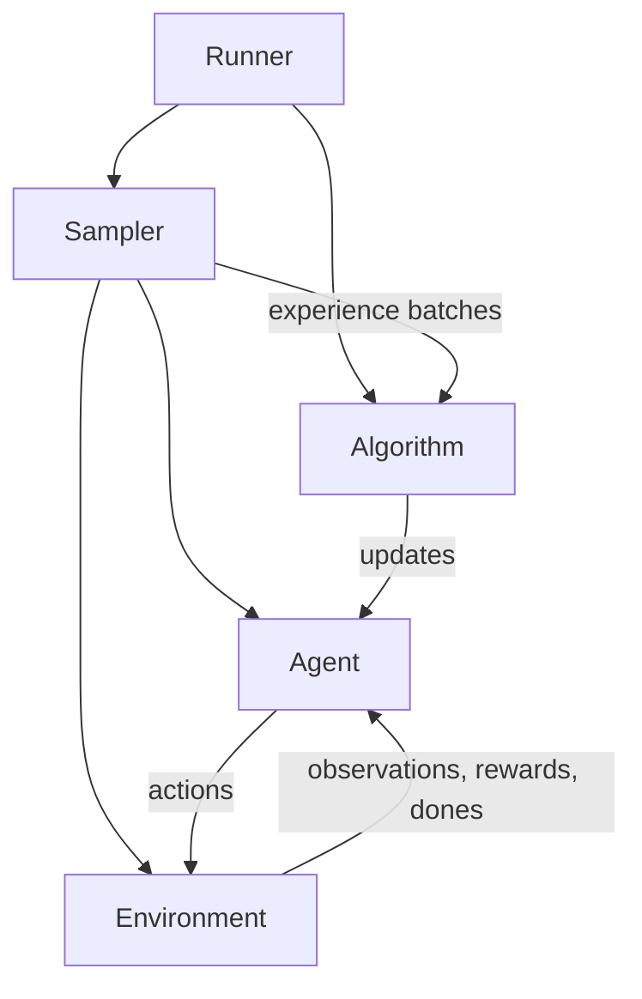
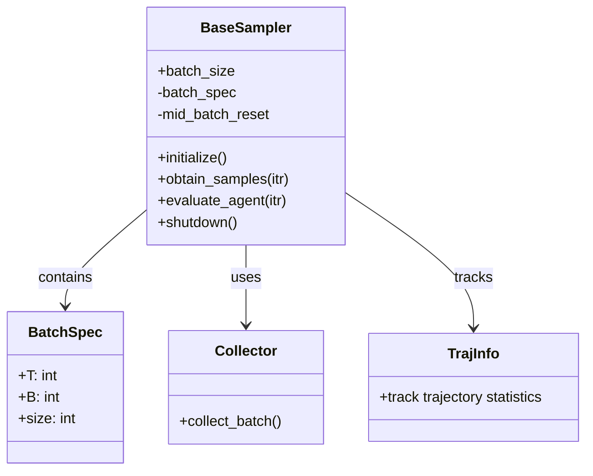
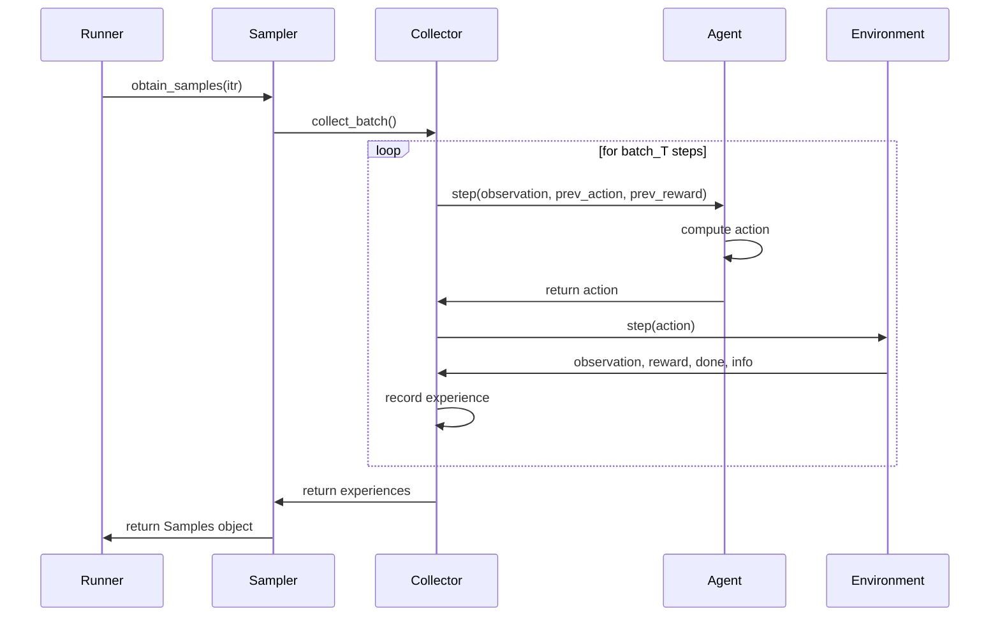
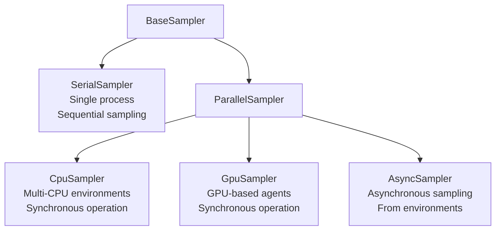
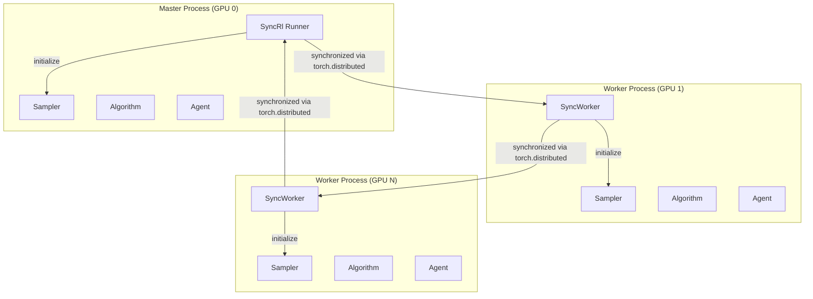
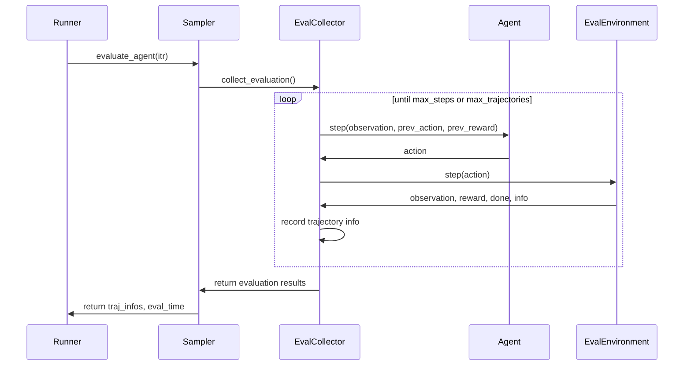
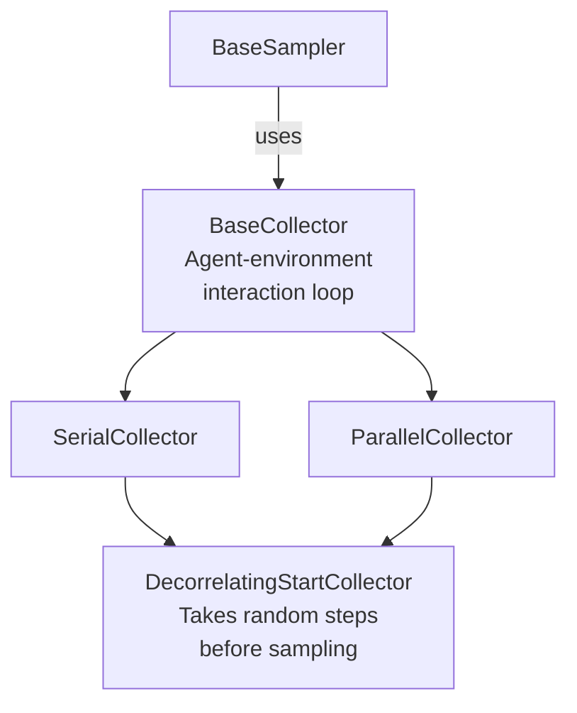

<!-- source: DeepWiki mcp.deepwiki.com · repo astooke/rlpyt · page 6 Samplers · fetched 2026-10-30 -->

# Samplers

Relevant source files

The following files were used as context for generating this wiki page:

- [rlpyt/runners/sync_rl.py](rlpyt/runners/sync_rl.py)
- [rlpyt/samplers/base.py](rlpyt/samplers/base.py)
- [rlpyt/utils/synchronize.py](rlpyt/utils/synchronize.py)

Samplers are a core component of the rlpyt framework, responsible for orchestrating the collection of experience data from environments. They manage the interaction between agents and environments, producing batches of experience samples that algorithms use for learning. This page covers the architecture and functionality of samplers in the rlpyt framework. For information about specific sampler implementations, see [CPU Samplers](#6.1) and [GPU Samplers](#6.2).

## Purpose and Role

Samplers serve as the bridge between the runner (which orchestrates training) and the agent-environment interactions that produce experience data. They are responsible for:

1. Initializing and managing environments
2. Facilitating interactions between agents and environments
3. Collecting and organizing experience data into batches
4. Providing interfaces for evaluation

Sources: [rlpyt/samplers/base.py:7-67](rlpyt/samplers/base.py:7-67)

## Base Sampler Architecture

All samplers in rlpyt derive from the `BaseSampler` class, which defines the core interface and functionality.

The `BaseSampler` has these key attributes and methods:

- **batch_spec**: Defines the shape of collected batches with dimensions:
  - **T**: Time steps per batch
  - **B**: Number of parallel environment instances
- **mid_batch_reset**: Whether environments can reset in the middle of a batch
- **initialize()**: Sets up environments, agents, and parallel processes
- **obtain_samples()**: Collects experience data through agent-environment interaction
- **evaluate_agent()**: Conducts offline evaluation of agent performance
- **shutdown()**: Cleans up resources when sampling is complete

Sources: [rlpyt/samplers/base.py:7-67](rlpyt/samplers/base.py:7-67)

## Sampler Initialization Parameters

When creating a sampler, several key parameters configure its behavior:

| Parameter | Description |
|-----------|-------------|
| **EnvCls** | Environment class or factory function |
| **env_kwargs** | Arguments to initialize environments |
| **batch_T** | Time steps per batch |
| **batch_B** | Number of parallel environments |
| **CollectorCls** | Class that manages agent-environment interaction |
| **max_decorrelation_steps** | Random steps to take before sampling to decorrelate states |
| **TrajInfoCls** | Class for tracking trajectory information |
| **eval_n_envs** | Number of environments for evaluation |
| **eval_max_steps** | Maximum steps for evaluation |

Sources: [rlpyt/samplers/base.py:27-45](rlpyt/samplers/base.py:27-45)

## Experience Collection Process

The sampler's primary function is to collect experiences through agent-environment interaction. This process follows a specific flow:

The `obtain_samples()` method returns a `Samples` object containing:
- Observations
- Actions
- Rewards
- Done flags
- Agent information
- Environment information

Sources: [rlpyt/samplers/base.py:54-56](rlpyt/samplers/base.py:54-56)

## Sampler Types

Rlpyt provides several sampler implementations to support different hardware configurations and parallelization strategies:

The sampler types differ in:
- **Parallelization**: Single-process vs. multi-process
- **Hardware utilization**: CPU-only vs. GPU-accelerated
- **Synchronization**: Synchronous vs. asynchronous collection

Sources: [rlpyt/samplers/base.py:7-67](rlpyt/samplers/base.py:7-67)

## Samplers and Multi-GPU Training

In multi-GPU training scenarios, each GPU process initializes its own sampler. This allows for parallel collection of experiences across multiple GPUs:

The `SyncRlMixin` allows for parallelization across multiple GPUs, where each process has its own sampler instance. This design enables efficient use of hardware resources while maintaining synchronization through PyTorch's distributed module.

Sources: [rlpyt/runners/sync_rl.py:13-46](rlpyt/runners/sync_rl.py:13-46)

## Evaluation Sampling

Samplers also handle agent evaluation, allowing for separate evaluation environments with potentially different parameters:

During evaluation:
- A separate set of environments can be used
- Agent operates in evaluation mode (e.g., deterministic actions)
- Trajectory statistics are collected but not used for learning
- Evaluation can run for a specified number of steps or trajectories

Sources: [rlpyt/samplers/base.py:58-60](rlpyt/samplers/base.py:58-60)

## Integration with Collectors

Samplers delegate the actual agent-environment interaction to Collector objects, which handle the step-by-step interaction loop. For more details on collectors, see [Collectors](#6.3).

The Collector handles the core interaction loop, while the Sampler manages initialization, batching, and communication with the Runner.

Sources: [rlpyt/samplers/base.py:32-33](rlpyt/samplers/base.py:32-33)

## Conclusion

Samplers are a critical component of rlpyt, managing the collection of experience data that drives reinforcement learning. By abstracting the details of agent-environment interaction and batch collection, they allow algorithms to focus on learning from experiences without worrying about the mechanics of data collection. 

The flexible, modular design of samplers in rlpyt enables efficient use of hardware resources and supports various parallelization strategies for improved performance.

---

