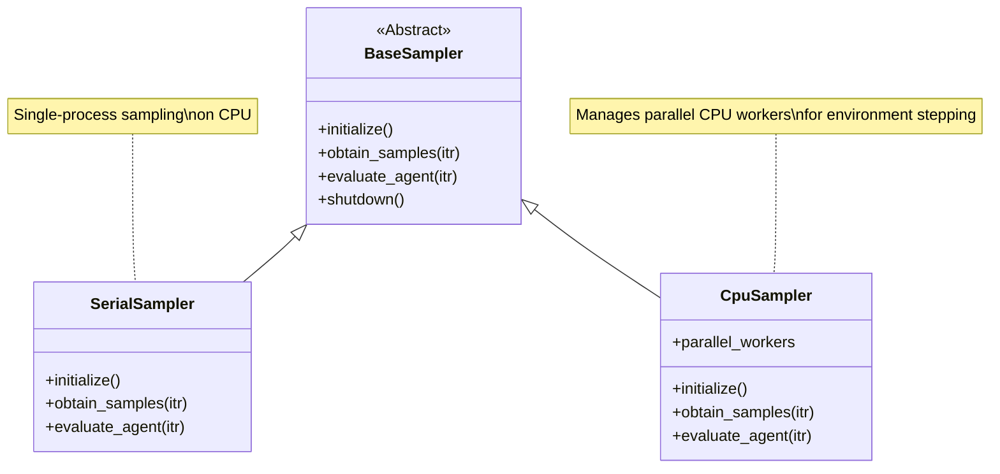
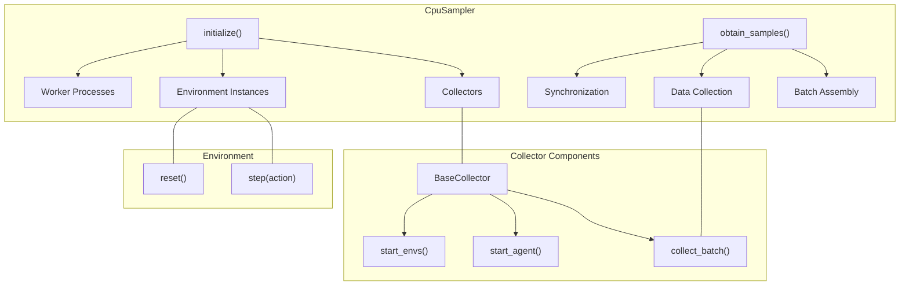
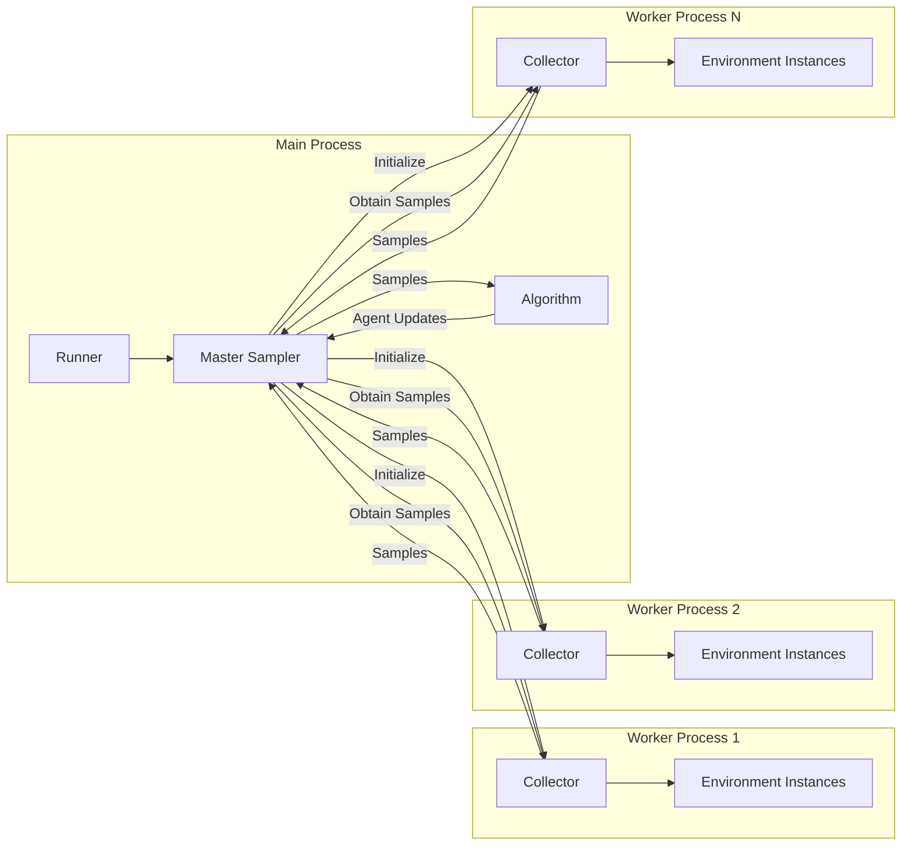
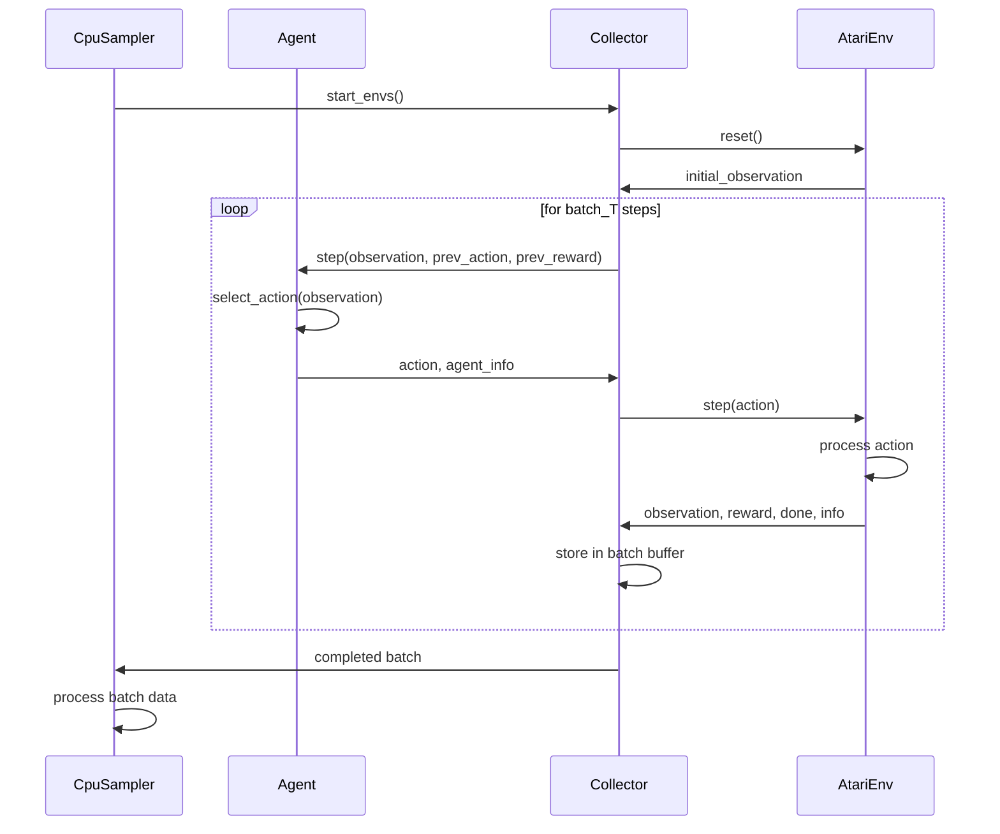

<!-- source: DeepWiki mcp.deepwiki.com · repo astooke/rlpyt · page 6.1 CPU Samplers · fetched 2026-10-30 -->

# CPU Samplers

<details>
<summary>Relevant source files</summary>

The following files were used as context for generating this wiki page:

- [rlpyt/envs/atari/atari_env.py](rlpyt/envs/atari/atari_env.py)
- [rlpyt/samplers/base.py](rlpyt/samplers/base.py)
- [rlpyt/samplers/collectors.py](rlpyt/samplers/collectors.py)
- [rlpyt/spaces/composite.py](rlpyt/spaces/composite.py)
- [rlpyt/spaces/float_box.py](rlpyt/spaces/float_box.py)
- [rlpyt/spaces/int_box.py](rlpyt/spaces/int_box.py)
- [rlpyt/utils/tensor.py](rlpyt/utils/tensor.py)

</details>


CPU Samplers in rlpyt are responsible for collecting experience data from environments for reinforcement learning algorithms using CPU resources. They manage environment interactions, action selection, and trajectory information collection while running entirely on the CPU. This page details the implementation and use of CPU-based samplers, which are distinct from GPU Samplers (covered in [GPU Samplers](#6.2)) that use GPU acceleration for certain operations.

## Purpose and Role

CPU Samplers serve as the data collection mechanism in the rlpyt framework. They:

1. Create and manage environment instances
2. Coordinate agent-environment interactions
3. Collect experience trajectories in batches
4. Provide data to learning algorithms
5. Support parallel execution across CPU cores

The CPU samplers are particularly useful for environments that don't benefit from GPU acceleration or when GPU resources should be reserved for neural network training.

Sources: [rlpyt/samplers/base.py:7-67](). [rlpyt/samplers/collectors.py:10-52]()

## Architecture and Components

### Sampler Hierarchy



The CPU Samplers extend the base sampler functionality with CPU-specific implementations. The `SerialSampler` operates in a single process, while the `CpuSampler` leverages parallel CPU workers to step environments concurrently.

Sources: [rlpyt/samplers/base.py:7-67]()

### CPU Sampler Components



CPU Samplers use collectors that handle the specific agent-environment interaction loop. The main components include:

1. **Environment Instances**: Multiple copies of the environment
2. **Collectors**: Handle agent-environment interaction loop
3. **Worker Processes**: Parallel processes for environment stepping
4. **Synchronization**: Coordination between processes

Sources: [rlpyt/samplers/base.py:24-46](), [rlpyt/samplers/collectors.py:10-52]()

## Data Collection Process

CPU Samplers collect experience data through a structured process:

### Initialization Phase

1. Create environment instances based on `EnvCls` and `env_kwargs`
2. Initialize collectors with environments and agents
3. Set up trajectory info objects for logging
4. Start environments and get initial observations
5. Optionally decorrelate environment states with random actions

### Collection Phase

| Phase | Action | Components Involved |
|-------|--------|---------------------|
| 1. Environment Reset | Initialize or reset environments | `start_envs()` |
| 2. Agent Initialization | Reset agent state and set to sample mode | `start_agent()` |
| 3. Action Selection | Agent processes observations and selects actions | Agent |
| 4. Environment Stepping | Apply actions and get new observations, rewards, done flags | Environment |
| 5. Data Collection | Store transitions in batch buffers | Collector |
| 6. Batch Assembly | Format collected data for algorithm consumption | `obtain_samples()` |

### Parallelization Model

CPU Samplers can operate in parallel using multiple CPU cores:



When using parallel CPU samplers, the main process coordinates multiple worker processes, each responsible for stepping a subset of environments. This allows for efficient utilization of multi-core CPUs.

Sources: [rlpyt/samplers/collectors.py:10-52](), [rlpyt/samplers/base.py:48-67]()

## Environment Interaction

CPU Samplers interact with environments that implement the base environment interface. For example, with Atari environments:



The collector manages the loop of agent-environment interactions, collecting a batch of experiences before returning it to the sampler.

Sources: [rlpyt/envs/atari/atari_env.py:33-105](), [rlpyt/samplers/collectors.py:75-119]()

## Special Collector Features

### Decorrelating Start Collector

CPU Samplers can use a special collector that decorrelates environment states at the beginning of training:

```python
class DecorrelatingStartCollector(BaseCollector):
    """Collector which can step all environments through a random number of random
    actions during startup, to decorrelate the states in training batches.
    """
```

This feature is important for preventing correlated observations across parallel environments, which can negatively impact learning. The collector:

1. Resets all environments
2. Applies a random number of random actions to each environment (up to `max_decorrelation_steps`)
3. Returns the resulting decorrelated states

Sources: [rlpyt/samplers/collectors.py:75-119]()

## Usage and Configuration

CPU Samplers are configured with several important parameters:

| Parameter | Description | Default |
|-----------|-------------|---------|
| `EnvCls` | Environment class or factory function | Required |
| `env_kwargs` | Keyword arguments for environment instantiation | `{}` |
| `batch_T` | Number of time steps per batch | Required |
| `batch_B` | Number of environment instances | Required |
| `CollectorCls` | Collector class to use | Required |
| `max_decorrelation_steps` | Maximum random steps for decorrelation | `100` |
| `TrajInfoCls` | Class for trajectory information | `TrajInfo` |
| `eval_n_envs` | Number of environments for evaluation | `0` |

For parallel CPU samplers, additional parameters control:
- Number of parallel workers
- Work division across workers
- Synchronization mechanism

Sources: [rlpyt/samplers/base.py:24-46]()

## When to Use CPU Samplers

CPU Samplers are ideal in the following scenarios:

1. **Environment Compatibility**: When environments don't benefit from GPU acceleration
2. **Resource Allocation**: When GPU resources should be reserved for neural network training
3. **Debugging**: For easier debugging of environment-agent interactions
4. **Simple Environments**: For environments with lightweight computations
5. **Limited Hardware**: When GPU hardware is not available

For environments that benefit from GPU acceleration or for methods that require tight integration between sampling and network computation, consider using [GPU Samplers](#6.2) instead.

Sources: [rlpyt/samplers/base.py:7-20]()

---

