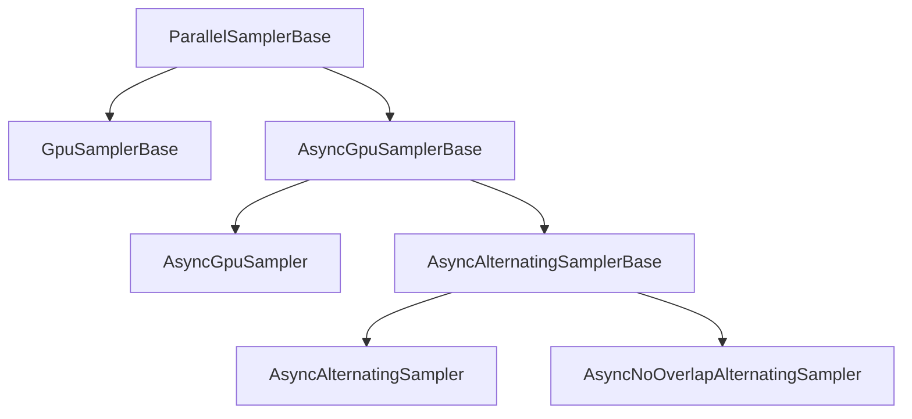
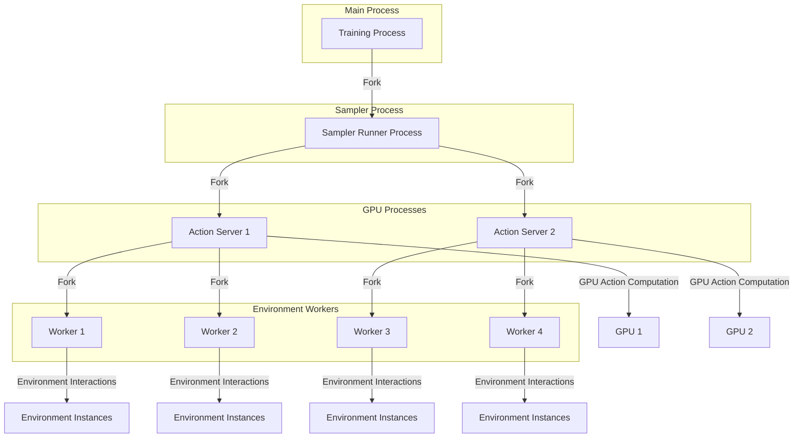
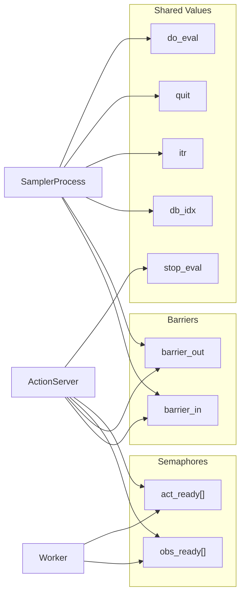
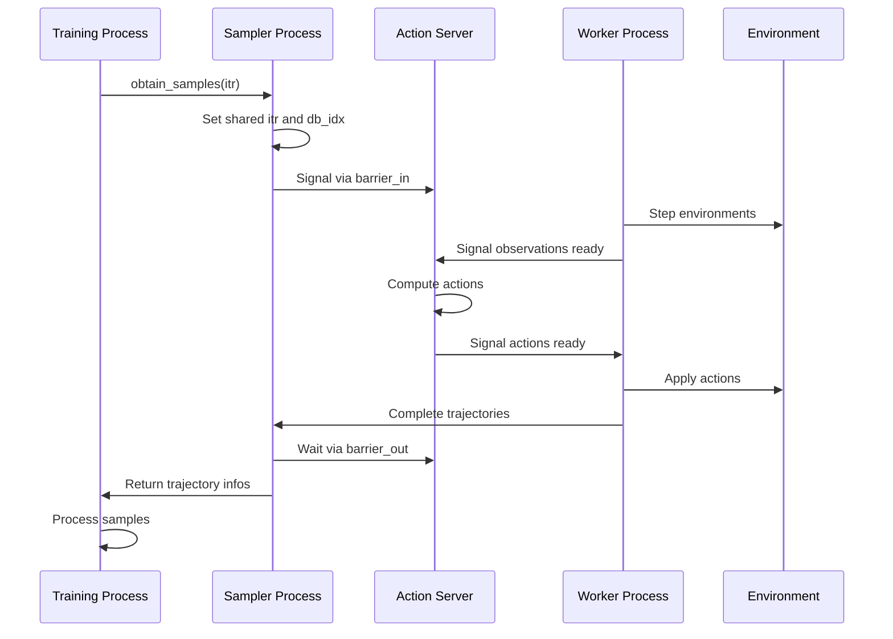
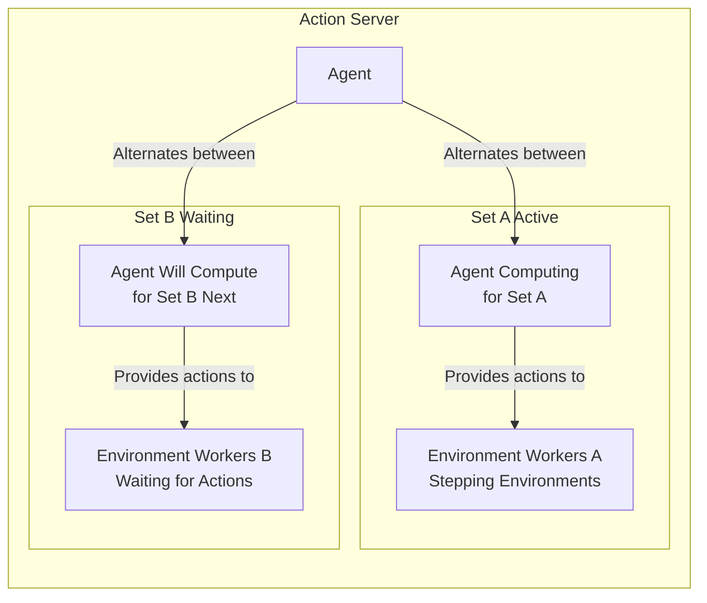
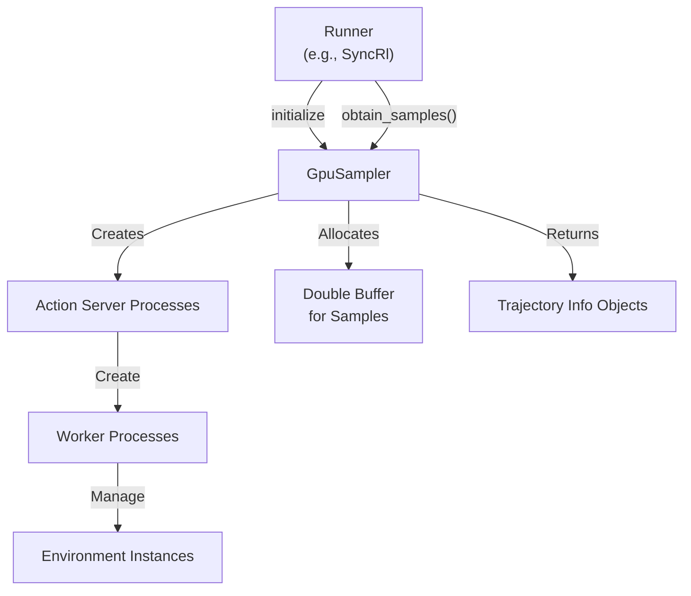

<!-- source: DeepWiki mcp.deepwiki.com · repo astooke/rlpyt · page 6.2 GPU Samplers · fetched 2026-10-30 -->

# GPU Samplers

Relevant source files

The following files were used as context for generating this wiki page:

- [rlpyt/runners/sync_rl.py](rlpyt/runners/sync_rl.py)
- [rlpyt/samplers/async_/alternating_sampler.py](rlpyt/samplers/async_/alternating_sampler.py)
- [rlpyt/samplers/async_/base.py](rlpyt/samplers/async_/base.py)
- [rlpyt/samplers/async_/cpu_sampler.py](rlpyt/samplers/async_/cpu_sampler.py)
- [rlpyt/samplers/async_/gpu_sampler.py](rlpyt/samplers/async_/gpu_sampler.py)
- [rlpyt/samplers/async_/serial_sampler.py](rlpyt/samplers/async_/serial_sampler.py)
- [rlpyt/utils/synchronize.py](rlpyt/utils/synchronize.py)

## Purpose and Scope

GPU Samplers in rlpyt allow reinforcement learning environments to leverage GPU acceleration for agent action selection while efficiently managing parallel environment interactions. They provide a framework for distributed sampling of environment experiences where action computation is performed on one or more GPUs. This document covers the implementation, architecture, and functionality of GPU samplers in rlpyt.

For information about CPU-based sampling, see [CPU Samplers](#6.1).

## Types of GPU Samplers

The rlpyt framework offers multiple GPU sampler implementations to accommodate different parallelization needs and hardware configurations:

Sources: [rlpyt/samplers/async_/gpu_sampler.py:20-33](), [rlpyt/samplers/async_/alternating_sampler.py:8-100]()

### Key Sampler Classes

- **GpuSamplerBase**: Base class for synchronous GPU-based sampling
- **AsyncGpuSamplerBase**: Base class for asynchronous GPU sampling that defines the core functionality
- **AsyncGpuSampler**: Concrete implementation combining AsyncActionServer with AsyncGpuSamplerBase
- **AsyncAlternatingSamplerBase**: Extension of AsyncGpuSamplerBase that uses two alternating sets of environment workers for improved throughput
- **AsyncAlternatingSampler** and **AsyncNoOverlapAlternatingSampler**: Concrete implementations of alternating samplers with different overlap strategies

## Process Architecture

GPU Samplers implement a multi-level process hierarchy to distribute work across GPUs and CPUs efficiently:

Sources: [rlpyt/samplers/async_/gpu_sampler.py:39-126]()

The architecture consists of:

1. **Main Process**: The training process that manages the overall learning algorithm
2. **Sampler Process**: The main sampler process forked from the training process
3. **Action Server Processes**: One process per GPU, responsible for computing actions
4. **Worker Processes**: Multiple CPU worker processes that manage environment interactions

## Synchronization Mechanisms

AsyncGpuSamplerBase uses several synchronization primitives to coordinate between processes:

Sources: [rlpyt/samplers/async_/gpu_sampler.py:174-188](), [rlpyt/samplers/async_/base.py:59-71]()

- **Barriers**: Used to synchronize phases between processes
- **Semaphores**: Used for signaling between workers and action servers
- **Shared Values**: Used to communicate control information across processes

## Sampling Process Flow

The sampling process in AsyncGpuSampler follows this sequence:

Sources: [rlpyt/samplers/async_/gpu_sampler.py:127-172](), [rlpyt/samplers/async_/base.py:59-71]()

## Alternating Samplers for Efficiency

AsyncAlternatingSamplerBase extends AsyncGpuSamplerBase to use two alternating sets of environment workers:

Sources: [rlpyt/samplers/async_/alternating_sampler.py:8-92]()

Benefits of alternating samplers:
- Improved GPU utilization by reducing idle time
- Enhanced throughput by overlapping computation and environment stepping
- Better suited for recurrent agent policies

The alternating pattern requires:
- Even number of workers and environments
- Special handling for recurrent agents
- Paired synchronization primitives for each worker set

## Initialization and Integration with Runners

GPU Samplers are typically initialized through a Runner class like SyncRl:

Sources: [rlpyt/samplers/async_/gpu_sampler.py:39-76](), [rlpyt/runners/sync_rl.py:13-46]()

When integrating with runners:
- The runner may use data parallelism across multiple GPUs
- Each GPU gets its own action server process
- Batch sizes scale with the number of GPUs used
- Synchronization happens through PyTorch's distributed package

## Memory Management

GPU Samplers use shared memory and double buffering to efficiently communicate between processes:

1. **Double Buffer**: Two sample buffers that alternate between collection and training
2. **Step Buffer**: Temporary buffer for the current environment step
3. **Shared Memory**: PyTorch tensors in shared memory for interprocess communication

This design minimizes data copying between processes and allows for efficient GPU utilization.

Sources: [rlpyt/samplers/async_/gpu_sampler.py:102-122](), [rlpyt/samplers/async_/base.py:17-47]()

## Usage Considerations

When using GPU Samplers:
- Ensure proper affinity settings for CPU cores and GPUs
- Consider using alternating samplers for recurrent policies
- Balance the number of environment workers per GPU
- Be aware of potential synchronization overhead

The optimal configuration depends on the specific environment, agent architecture, and hardware configuration.

---

