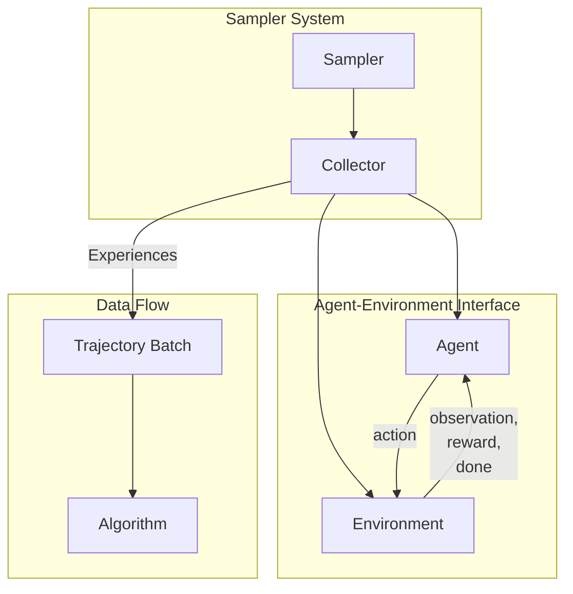
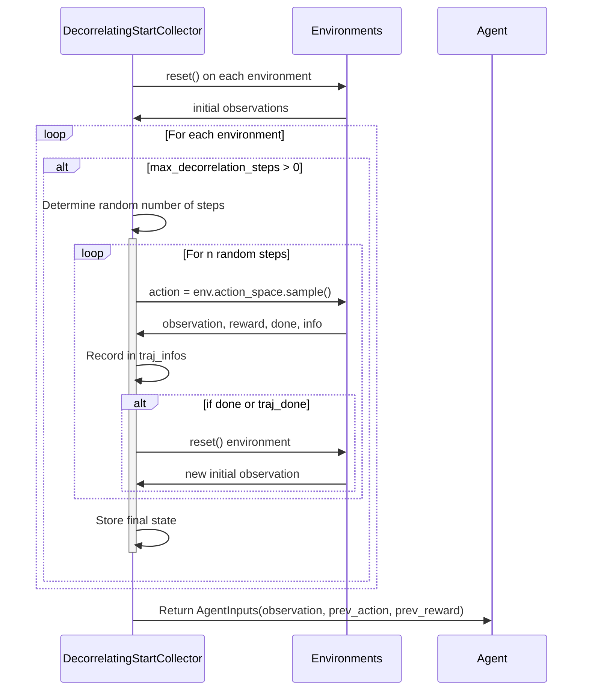
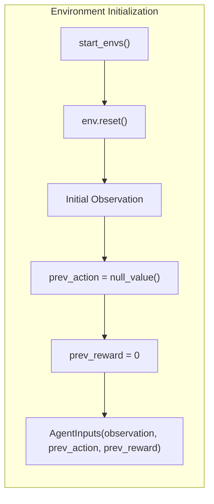
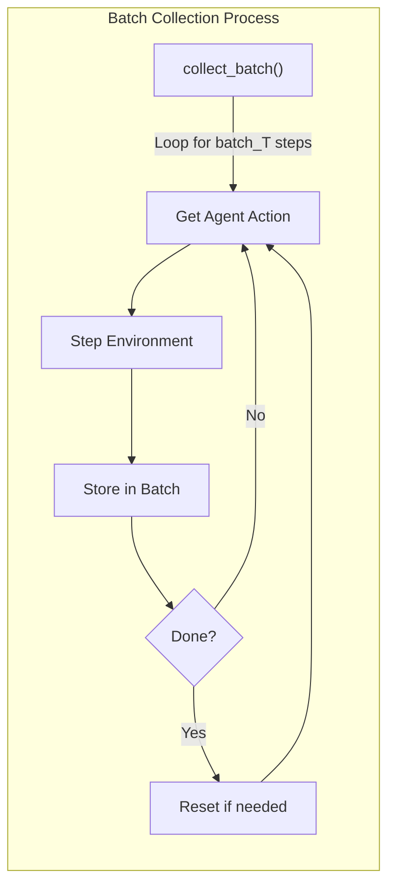
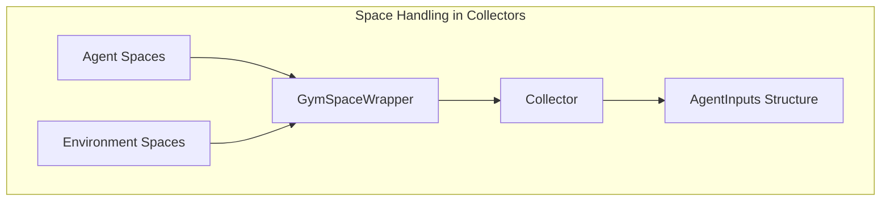
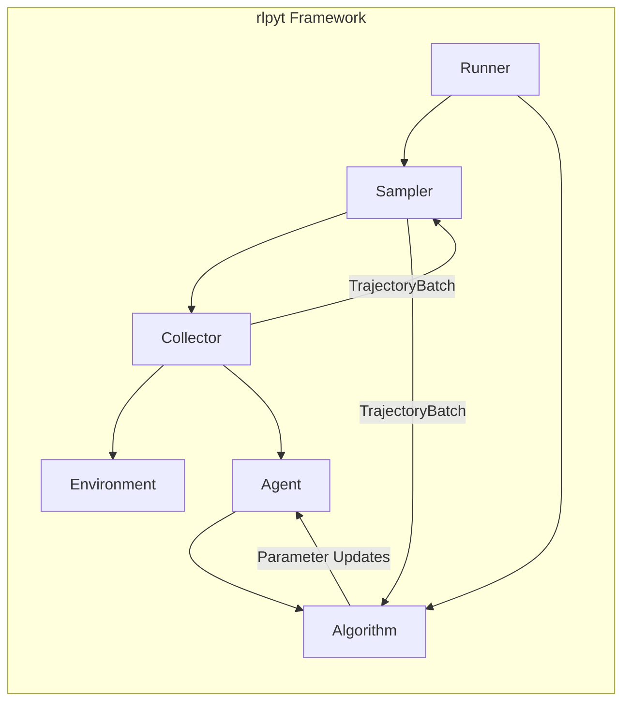

<!-- source: DeepWiki mcp.deepwiki.com · repo astooke/rlpyt · page 6.3 Collectors · fetched 2026-10-30 -->

# Collectors

<details>
<summary>Relevant source files</summary>

The following files were used as context for generating this wiki page:

- [rlpyt/envs/atari/atari_env.py](rlpyt/envs/atari/atari_env.py)
- [rlpyt/envs/gym.py](rlpyt/envs/gym.py)
- [rlpyt/samplers/collectors.py](rlpyt/samplers/collectors.py)
- [rlpyt/spaces/composite.py](rlpyt/spaces/composite.py)
- [rlpyt/spaces/float_box.py](rlpyt/spaces/float_box.py)
- [rlpyt/spaces/gym_wrapper.py](rlpyt/spaces/gym_wrapper.py)
- [rlpyt/spaces/gym_wrapper_schema.py](rlpyt/spaces/gym_wrapper_schema.py)
- [rlpyt/spaces/int_box.py](rlpyt/spaces/int_box.py)
- [rlpyt/utils/tensor.py](rlpyt/utils/tensor.py)
- [tests/__init__.py](tests/__init__.py)
- [tests/test_gym_wrapper.py](tests/test_gym_wrapper.py)
- [tests/test_serial_sampler.py](tests/test_serial_sampler.py)

</details>


Collectors are a critical component in the rlpyt reinforcement learning framework that manage the direct interaction between agents and environments. They are responsible for stepping through environments, collecting experiences (observations, actions, rewards, etc.), and preparing this data for use by learning algorithms. Collectors operate within the sampler system, serving as the bridge between environment state transitions and agent decision-making.

For information about the broader sampling system that uses collectors, see [Samplers](#6).

## Purpose and Role

Collectors serve several key functions in the reinforcement learning pipeline:

1. Orchestrating environment stepping and agent interactions
2. Collecting trajectory data in batches
3. Managing environment resets and agent initialization
4. Supporting both training data collection and evaluation runs



Sources: [rlpyt/samplers/collectors.py:10-51]()

## Collector Classes

The rlpyt framework provides several collector implementations to handle different collection strategies:

### BaseCollector

`BaseCollector` is the abstract base class that defines the core interface for all collectors. It handles the basic workflow of environment stepping and data collection.

Key responsibilities:
- Starting environments (`start_envs`)
- Starting agents (`start_agent`) 
- Collecting batches of experiences (`collect_batch`)
- Resetting environments and agents when needed (`reset_if_needed`)

```python
class BaseCollector:
    """Class that steps environments, possibly in worker process."""
    
    def __init__(self, rank, envs, samples_np, batch_T, TrajInfoCls, 
                 agent=None, sync=None, step_buffer_np=None, global_B=1, env_ranks=None):
        # Initialize collector with environments, agents, and data buffers
        
    def start_envs(self):
        """e.g. calls reset() on every env."""
        raise NotImplementedError
        
    def start_agent(self):
        """In CPU-collectors, call agent.collector_initialize() e.g. to set up
        vector epsilon-greedy, and reset the agent.
        """
        
    def collect_batch(self, agent_inputs, traj_infos):
        """Main data collection loop."""
        raise NotImplementedError
        
    def reset_if_needed(self, agent_inputs):
        """Reset agent and or env as needed, if doing between batches."""
        pass
```

Sources: [rlpyt/samplers/collectors.py:10-51]()

### BaseEvalCollector

`BaseEvalCollector` is specialized for evaluation runs, where we want to assess agent performance without collecting training data.

```python
class BaseEvalCollector:
    """Collectors for offline agent evalution; not to record intermediate samples."""
    
    def __init__(self, rank, envs, TrajInfoCls, traj_infos_queue, max_T, 
                 agent=None, sync=None, step_buffer_np=None):
        # Initialize evaluation collector
        
    def collect_evaluation(self):
        """Run agent evaluation in environment and return completed trajectory
        infos."""
        raise NotImplementedError
```

Sources: [rlpyt/samplers/collectors.py:53-72]()

### DecorrelatingStartCollector

`DecorrelatingStartCollector` extends `BaseCollector` with the ability to perform random actions at the start of collection to decorrelate initial states, which can be important for statistical efficiency in training.



The `start_envs` method in `DecorrelatingStartCollector` performs the following steps:

1. Resets all environments to get initial observations
2. Takes random actions for a random number of steps (up to `max_decorrelation_steps`)
3. Handles episode terminations that may occur during decorrelation
4. Returns the resulting agent inputs (observations, previous actions, previous rewards)

Sources: [rlpyt/samplers/collectors.py:75-119]()

## Collector Operations

### Environment Initialization

Collectors are responsible for initializing environments and establishing the initial state for data collection:



Sources: [rlpyt/samplers/collectors.py:80-119](), [rlpyt/envs/gym.py:79-82](), [rlpyt/envs/atari/atari_env.py:105-116]()

### Agent Initialization

Before collection begins, the collectors initialize the agent to prepare it for interaction:

```python
def start_agent(self):
    """In CPU-collectors, call agent.collector_initialize() e.g. to set up
    vector epsilon-greedy, and reset the agent.
    """
    if getattr(self, "agent", None) is not None:  # Not in GPU collectors.
        self.agent.collector_initialize(
            global_B=self.global_B,  # Args used e.g. for vector epsilon greedy.
            env_ranks=self.env_ranks,
        )
        self.agent.reset()
        self.agent.sample_mode(itr=0)
```

This initialization typically includes:
- Setting up exploration parameters (e.g., epsilon-greedy policies)
- Resetting agent state
- Switching the agent to sampling mode

Sources: [rlpyt/samplers/collectors.py:32-42]()

### Data Collection Flow

The core function of collectors is the collection of batches of experience data through agent-environment interaction. This process follows a general pattern:



For each step in the batch collection:
1. The agent receives the current observation and selects an action
2. The environment executes the action and returns a new observation, reward, done flag, and info
3. These experiences are stored in the batch buffer
4. If the episode terminates, the environment is reset

Sources: [rlpyt/samplers/collectors.py:44-46]()

## Interaction with Environments and Spaces

Collectors must handle various environment interfaces and space types:

### Environment Step Interface

Collectors interact with environments through a standard interface:

```python
# Example environment step
observation, reward, done, info = env.step(action)
```

The collector needs to handle:
- Converting actions from agent format to environment format
- Processing observations from environment format to agent format
- Managing episode terminations and resets

Sources: [rlpyt/envs/gym.py:61-77](), [rlpyt/envs/atari/atari_env.py:118-134]()

### Space Wrappers and Conversions

Collectors work with different space types, using wrappers to ensure consistent interfaces:



Space handling includes:
- Converting between environment-specific formats and rlpyt's standard formats
- Handling null values for initial states
- Managing space transformations for observations and actions

Sources: [rlpyt/spaces/gym_wrapper.py:10-123](), [rlpyt/spaces/int_box.py:1-49](), [rlpyt/spaces/float_box.py:1-51]()

## The Role of Collectors in Trajectory Information

Collectors maintain trajectory information throughout episodes, which is important for:
- Computing return statistics
- Tracking environment-specific metrics (e.g., game score in Atari)
- Determining when episodes truly end vs. when they're artificially terminated

```python
# Example trajectory info recording in collector
traj_infos[b].step(o, a, r, d, None, info)
if getattr(info, "traj_done", d):  # Check if trajectory is actually done
    o = env.reset()
    traj_infos[b] = self.TrajInfoCls()
```

Sources: [rlpyt/samplers/collectors.py:103-107](), [rlpyt/envs/atari/atari_env.py:20-31]()

## Implementation Considerations

### Decorrelation Strategy

The decorrelation strategy in `DecorrelatingStartCollector` helps avoid correlated starting states:

```python
# For each environment
n_steps = 1 + int(np.random.rand() * max_decorrelation_steps)
for _ in range(n_steps):
    a = env.action_space.sample()  # Take random action
    o, r, d, info = env.step(a)
    # Process results...
```

This is particularly important for:
- Ensuring statistical independence in batch updates
- Avoiding policy collapse due to limited state exploration
- Improving stability in training

Sources: [rlpyt/samplers/collectors.py:98-113]()

### Parallel Collection

While the base collectors demonstrate the core functionality, rlpyt also supports parallel collection strategies:
- Multiple environments can be stepped simultaneously
- Collection can occur across multiple processes or devices
- The collector interface remains consistent regardless of parallelization strategy

Sources: [rlpyt/samplers/collectors.py:13-26]()

## Collectors in the rlpyt Framework

Collectors are a vital link in the overall rlpyt architecture:



Collectors' primary responsibility is to mediate the interaction between agents and environments, while the broader system handles the learning process.

Sources: [rlpyt/samplers/collectors.py:10-119]()

## Summary

Collectors in rlpyt serve as the interface between agents and environments, managing the collection of experiences for both training and evaluation. The framework provides extensible base classes that can be customized for different collection strategies, environment types, and parallelization approaches. By handling the complexities of agent-environment interaction, collectors allow the rest of the framework to focus on learning algorithms and policy representations.

---

