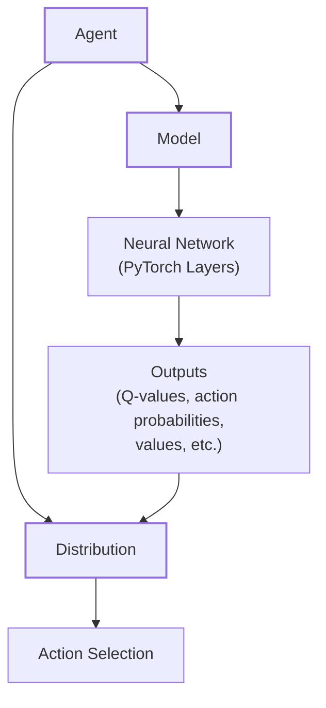
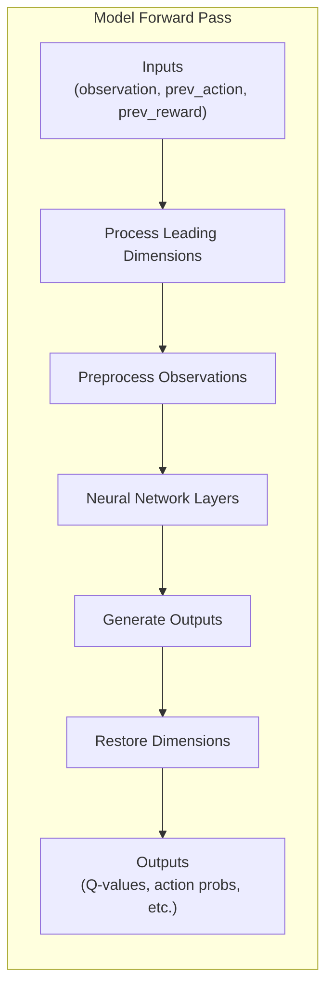
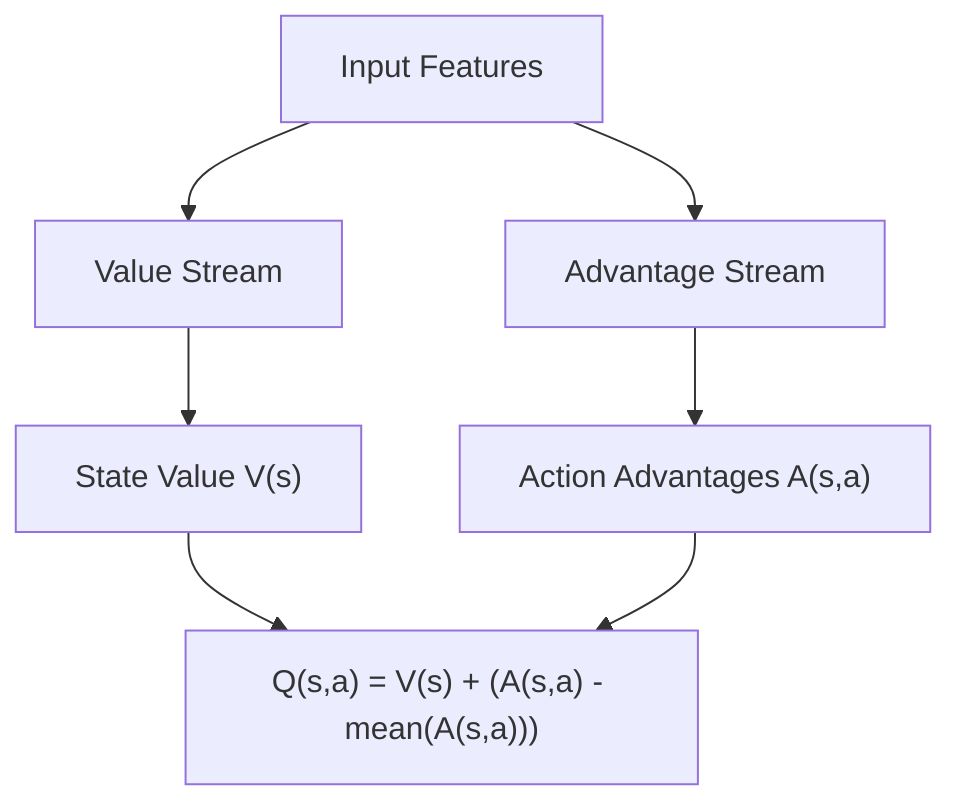
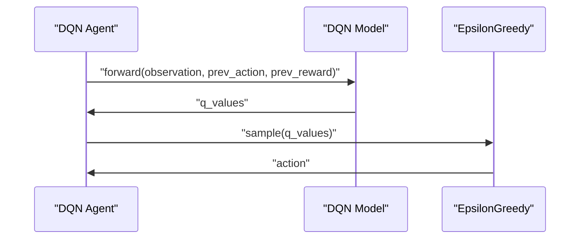
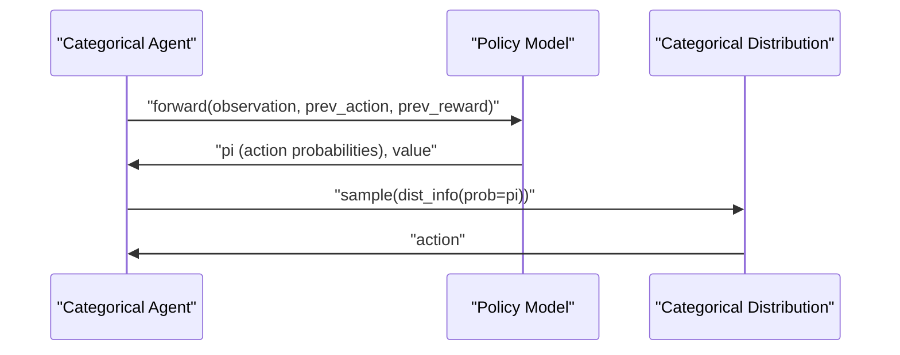
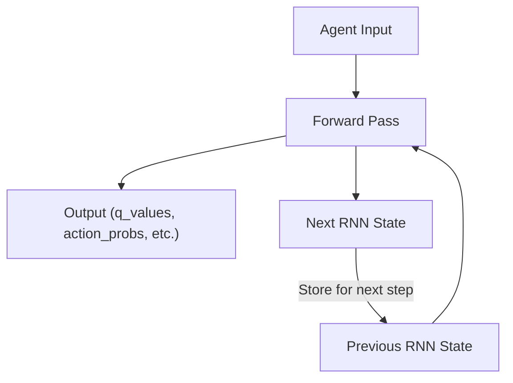
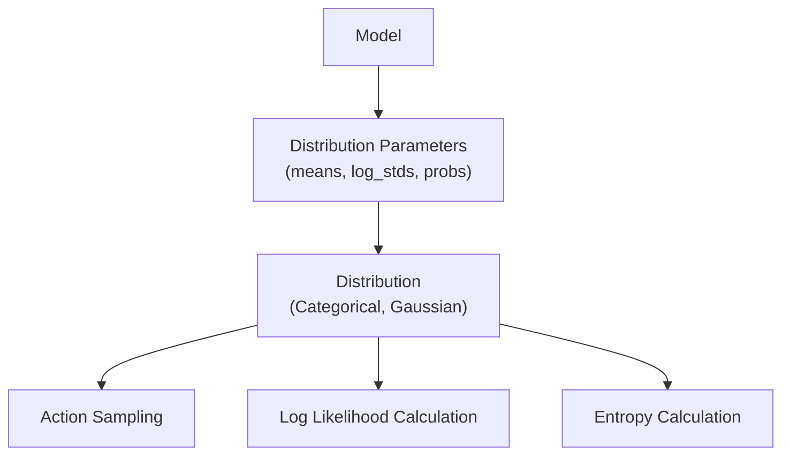

<!-- source: DeepWiki mcp.deepwiki.com · repo astooke/rlpyt · page 7 Models · fetched 2026-10-30 -->

# Models

<details>
<summary>Relevant source files</summary>

The following files were used as context for generating this wiki page:

- [rlpyt/agents/dqn/r2d1_agent.py](rlpyt/agents/dqn/r2d1_agent.py)
- [rlpyt/agents/pg/atari.py](rlpyt/agents/pg/atari.py)
- [rlpyt/agents/pg/categorical.py](rlpyt/agents/pg/categorical.py)
- [rlpyt/agents/pg/gaussian.py](rlpyt/agents/pg/gaussian.py)
- [rlpyt/distributions/gaussian.py](rlpyt/distributions/gaussian.py)
- [rlpyt/experiments/scripts/mujoco/pg/launch/pabti/launch_mujoco_ppo_serial.py](rlpyt/experiments/scripts/mujoco/pg/launch/pabti/launch_mujoco_ppo_serial.py)
- [rlpyt/models/dqn/atari_catdqn_model.py](rlpyt/models/dqn/atari_catdqn_model.py)
- [rlpyt/models/dqn/atari_dqn_model.py](rlpyt/models/dqn/atari_dqn_model.py)
- [rlpyt/models/dqn/atari_r2d1_model.py](rlpyt/models/dqn/atari_r2d1_model.py)
- [rlpyt/models/dqn/dueling.py](rlpyt/models/dqn/dueling.py)
- [rlpyt/models/pg/atari_ff_model.py](rlpyt/models/pg/atari_ff_model.py)
- [rlpyt/models/pg/atari_lstm_model.py](rlpyt/models/pg/atari_lstm_model.py)
- [rlpyt/models/qpg/mlp.py](rlpyt/models/qpg/mlp.py)
- [rlpyt/samplers/parallel/gpu/alternating_sampler.py](rlpyt/samplers/parallel/gpu/alternating_sampler.py)

</details>


The Models component in rlpyt provides the neural network architectures that power various reinforcement learning algorithms. These models are responsible for processing environment observations and producing outputs that agents use to select actions, estimate values, or both. This page documents the different model types, their structure, and how they integrate with other components of the rlpyt framework.

## Overview of Models in rlpyt

Models in rlpyt are implemented as PyTorch modules that follow a consistent interface to integrate with agents and algorithms. They serve as the brain of learning agents, transforming observations into action probabilities, state values, or Q-values depending on the algorithm being used.

Model relationships with other system components:



Sources: [rlpyt/agents/pg/categorical.py:20-25](), [rlpyt/agents/pg/gaussian.py:20-24]()

## Model Architecture Types

The rlpyt framework implements several model architecture types for different algorithms and environment domains:

```mermaid
classDiagram
    class "PyTorch Module" {
        forward()
    }
    
    "PyTorch Module" <|-- "DQN Models"
    "PyTorch Module" <|-- "Policy Gradient Models"
    "PyTorch Module" <|-- "QPG Models"
    
    "DQN Models" <|-- "AtariDqnModel"
    "DQN Models" <|-- "AtariR2d1Model"
    "DQN Models" <|-- "AtariCatDqnModel"
    
    "Policy Gradient Models" <|-- "AtariFfModel"
    "Policy Gradient Models" <|-- "AtariLstmModel"
    
    "QPG Models" <|-- "MuMlpModel"
    "QPG Models" <|-- "PiMlpModel"
    "QPG Models" <|-- "QofMuMlpModel"
    "QPG Models" <|-- "VMlpModel"
    
    "AtariDqnModel" -- "DuelingHeadModel"
    "AtariCatDqnModel" -- "DistributionalDuelingHeadModel"
```

Sources: [rlpyt/models/dqn/atari_dqn_model.py](), [rlpyt/models/pg/atari_ff_model.py](), [rlpyt/models/qpg/mlp.py]()

## Common Model Structure

All models in rlpyt share a similar structure and interface pattern:

1. They extend PyTorch's `nn.Module`
2. They have an initialization method that sets up the neural network layers
3. They implement a `forward()` method that processes observations and returns outputs
4. They handle batch and time dimensions using utility functions

Here's a visualization of the data flow through models:



Sources: [rlpyt/models/dqn/atari_dqn_model.py:47-68](), [rlpyt/models/pg/atari_ff_model.py:40-63]()

## DQN Models

DQN (Deep Q-Network) models are used in value-based reinforcement learning algorithms. They estimate the Q-value (expected future rewards) for each possible action in a given state.

### AtariDqnModel

The `AtariDqnModel` is a standard convolutional network for DQN that processes multiple video frames per observation:

```python
# Standard convolutional network for DQN with 2D convolution for multiple 
# video frames per observation, feeding an MLP for Q-value outputs
```

Key features:
- Convolutional layers for processing image observations
- Optional dueling architecture for better performance
- Configurable hyperparameters (channels, kernel sizes, strides, etc.)

Sources: [rlpyt/models/dqn/atari_dqn_model.py:10-68]()

### AtariR2d1Model

The `AtariR2d1Model` extends the DQN architecture with recurrent layers:

```python
# 2D convolutional neural network feeding into an LSTM and MLP 
# output for Q-value outputs for the action set
```

Key features:
- Convolutional layers for processing image observations
- LSTM layer for maintaining a memory of past observations
- Handles recurrent state across forward passes

Sources: [rlpyt/models/dqn/atari_r2d1_model.py:14-77]()

### Dueling Architecture

Dueling networks separate the estimation of state value and action advantages:



The `DuelingHeadModel` implements this architecture:

```python
# Model component for dueling DQN that separates state value and action advantages
```

Sources: [rlpyt/models/dqn/dueling.py:8-46]()

## Policy Gradient Models

Policy gradient models are used in algorithms that directly optimize a policy function.

### AtariFfModel

The `AtariFfModel` is a feedforward model for Atari agents:

```python
# Feedforward model for Atari agents: a convolutional network feeding an
# MLP with outputs for action probabilities and state-value estimate
```

Key features:
- Convolutional network for processing image observations
- Outputs both action probabilities and state-value estimate
- Used in algorithms like A2C and PPO for Atari environments

Sources: [rlpyt/models/pg/atari_ff_model.py:9-63]()

### AtariLstmModel

The `AtariLstmModel` adds recurrent capability to the policy gradient model:

```python
# Recurrent model for Atari agents: a convolutional network into an FC layer
# into an LSTM which outputs action probabilities and state-value estimate
```

Key features:
- Convolutional layers followed by an LSTM
- Maintains and updates recurrent state across time steps
- Outputs action probabilities and value estimates

Sources: [rlpyt/models/pg/atari_lstm_model.py:13-78]()

## QPG Models

QPG (Q-Policy Gradient) models are used in algorithms that combine aspects of Q-learning and policy gradients, such as DDPG, TD3, and SAC.

### MuMlpModel

The `MuMlpModel` is an MLP that outputs the deterministic action mean:

```python
# MLP neural net for action mean (mu) output for DDPG agent
```

Sources: [rlpyt/models/qpg/mlp.py:9-32]()

### PiMlpModel

The `PiMlpModel` outputs parameters for a Gaussian action distribution:

```python
# Action distribution MLP model for SAC agent
```

Sources: [rlpyt/models/qpg/mlp.py:35-59]()

### QofMuMlpModel

The `QofMuMlpModel` estimates Q-values for state-action pairs:

```python
# Q portion of the model for DDPG, an MLP
```

Sources: [rlpyt/models/qpg/mlp.py:62-87]()

## Model Integration with Agents

Models in rlpyt are instantiated by agents and used to process observations and select actions. The flow of data between agents and models depends on the agent type.

### Data Flow for DQN Agents



Sources: [rlpyt/agents/dqn/r2d1_agent.py:25-42]()

### Data Flow for Policy Gradient Agents



Sources: [rlpyt/agents/pg/categorical.py:33-43](), [rlpyt/agents/pg/atari.py:15-25]()

## Handling Recurrent State

Recurrent models in rlpyt use a consistent pattern for managing recurrent state across time steps:



The recurrent state is managed by the following pattern:

```python
# For recurrent models, store and update RNN state
RnnState = namedarraytuple("RnnState", ["h", "c"])
```

Sources: [rlpyt/models/dqn/atari_r2d1_model.py:11-11](), [rlpyt/models/pg/atari_lstm_model.py:10-10]()

## Observation Processing

Most models in rlpyt use a common pattern for processing image observations:

```python
# Convert uint8 to float and normalize
img = observation.type(torch.float)  # Expect torch.uint8 inputs
img = img.mul_(1. / 255)  # From [0-255] to [0-1], in place.
```

Additionally, they handle batch and time dimensions using utility functions:

```python
# Handle leading dimensions
lead_dim, T, B, img_shape = infer_leading_dims(img, 3)
# ...
# Restore leading dimensions
outputs = restore_leading_dims(outputs, lead_dim, T, B)
```

Sources: [rlpyt/models/dqn/atari_dqn_model.py:57-67](), [rlpyt/models/pg/atari_ff_model.py:50-61]()

## Distributional RL Models

For distributional reinforcement learning algorithms like Categorical DQN, special model architectures are provided:

```python
# 2D convolutional network feeding into MLP with n_atoms outputs
# per action, representing a discrete probability distribution of Q-values
```

The `AtariCatDqnModel` implements this approach, where instead of outputting a single Q-value per action, it outputs a probability distribution over possible Q-values.

Sources: [rlpyt/models/dqn/atari_catdqn_model.py:24-77]()

## Model-Distribution Interaction

For stochastic policies, models output parameters that are passed to distribution classes for action sampling:



For example, Gaussian distributions for continuous actions:

```python
# Multivariate Gaussian with independent variables (diagonal covariance)
# used with output from PiMlpModel
```

Sources: [rlpyt/distributions/gaussian.py:15-246]()

## Summary

The Models component in rlpyt provides a flexible set of neural network architectures tailored for different reinforcement learning algorithms and environments. These models follow consistent patterns and interfaces, making them easy to use and extend. By understanding the different model types and their integration with agents and distributions, you can effectively use existing models or create custom ones for your specific needs.

Sources: All referenced files

---

