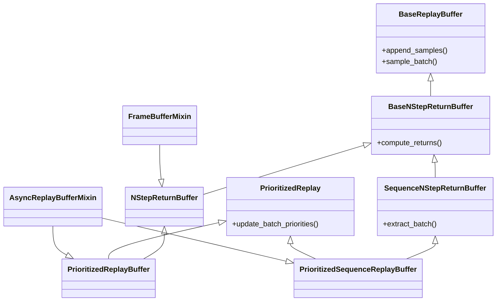
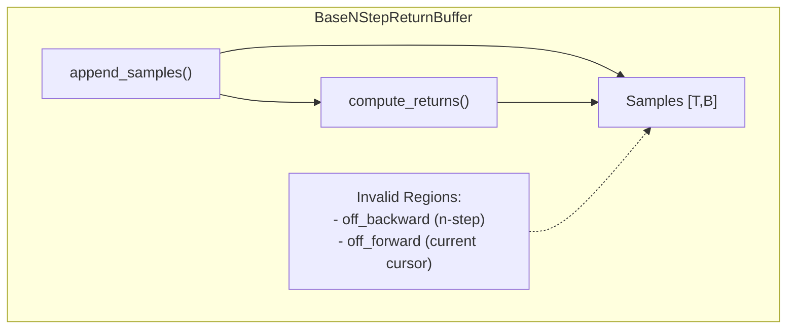
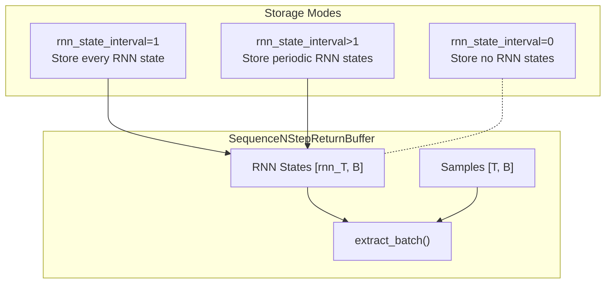
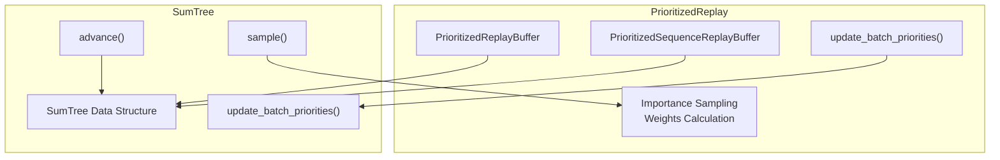
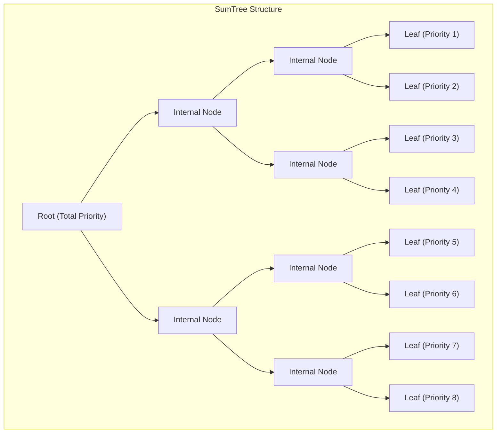
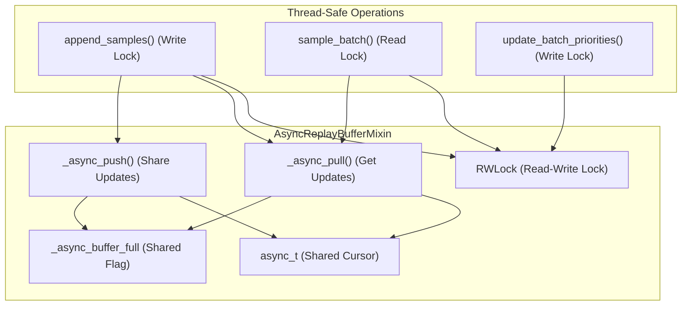
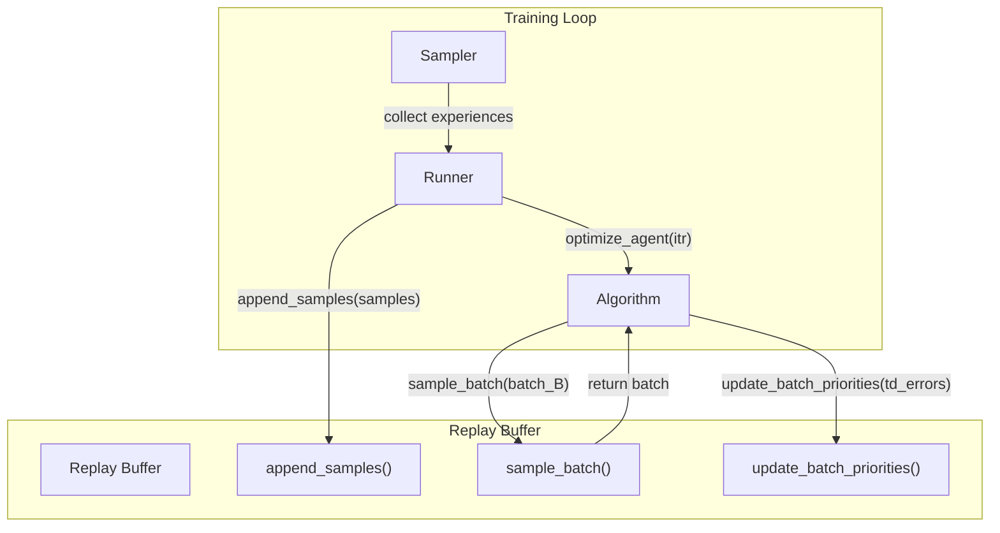

<!-- source: DeepWiki mcp.deepwiki.com · repo astooke/rlpyt · page 8 Replay Buffers · fetched 2026-10-30 -->

# Replay Buffers

<details>
<summary>Relevant source files</summary>

The following files were used as context for generating this wiki page:

- [rlpyt/replays/async_.py](rlpyt/replays/async_.py)
- [rlpyt/replays/frame.py](rlpyt/replays/frame.py)
- [rlpyt/replays/n_step.py](rlpyt/replays/n_step.py)
- [rlpyt/replays/non_sequence/prioritized.py](rlpyt/replays/non_sequence/prioritized.py)
- [rlpyt/replays/sequence/n_step.py](rlpyt/replays/sequence/n_step.py)
- [rlpyt/replays/sequence/prioritized.py](rlpyt/replays/sequence/prioritized.py)
- [rlpyt/replays/sum_tree.py](rlpyt/replays/sum_tree.py)

</details>


Replay Buffers are a core component in rlpyt that store agent experiences for off-policy reinforcement learning algorithms. They enable efficient data reuse by allowing algorithms to sample past experiences, breaking the temporal correlation between samples and improving data efficiency. This page covers the various replay buffer implementations in rlpyt, including standard buffers, prioritized experience replay, sequence-based storage for recurrent networks, and frame-based buffering for visual observations.

For information about the algorithms that use these buffers, see [Algorithms](#3).

## Replay Buffer Architecture

The replay buffer system in rlpyt follows a hierarchical structure with specialized implementations for different needs. The base functionality handles the core storage and sampling mechanics, with extensions for n-step returns, prioritized sampling, and sequence data.

### Replay Buffer Hierarchy



Sources: [rlpyt/replays/n_step.py](), [rlpyt/replays/sequence/n_step.py](), [rlpyt/replays/non_sequence/prioritized.py](), [rlpyt/replays/sequence/prioritized.py](), [rlpyt/replays/frame.py](), [rlpyt/replays/async_.py]()

## Basic Replay Buffer Implementation

The foundation of the replay system is the `BaseNStepReturnBuffer` class, which handles storage and computation of n-step returns. This buffer stores experiences in a circular buffer with leading dimensions [T, B], where T is time and B is batch size.

### Key Components and Behavior



Sources: [rlpyt/replays/n_step.py:11-109]()

The `BaseNStepReturnBuffer` manages:

1. **Sample Storage**: Maintains a ring buffer of experiences with dimensions [T,B]
2. **N-Step Returns**: Computes n-step returns using discounted rewards
3. **Cursor Management**: Tracks the current write position and handles wrapping
4. **Validity Tracking**: Manages which samples are valid for sampling based on:
   - `off_backward`: Most recent n-step samples (incomplete returns)
   - `off_forward`: Current cursor position (overwritten previous action/reward)

When new samples are appended to the buffer:

```python
def append_samples(self, samples):
    T, B = get_leading_dims(samples, n_dim=2)
    t = self.t
    if t + T > self.T:  # Wrap.
        idxs = np.arange(t, t + T) % self.T
    else:
        idxs = slice(t, t + T)
    self.samples[idxs] = samples
    self.compute_returns(T)
    # Update buffer state
    if not self._buffer_full and t + T >= self.T:
        self._buffer_full = True
    self.t = (t + T) % self.T
    return T, idxs
```

Sources: [rlpyt/replays/n_step.py:62-79]()

## Sequence Replay Buffer

The `SequenceNStepReturnBuffer` extends the base buffer to handle sequential data, particularly for recurrent neural networks (RNNs). This buffer stores RNN states and can extract continuous sequences for training.

### RNN State Storage Strategies



Sources: [rlpyt/replays/sequence/n_step.py:17-106]()

Key features:

1. **RNN State Management**: 
   - Can store RNN states at regular intervals (`rnn_state_interval`) to save memory
   - Only timesteps with saved RNN states are valid starting points for sequences

2. **Sequence Extraction**:
   - `extract_batch()` returns full sequences including all relevant fields
   - Handles the extraction of valid sequences based on RNN state availability

## Prioritized Experience Replay

Prioritized Experience Replay (PER) samples experiences based on their TD errors, focusing learning on surprising or informative transitions. The implementation uses a Sum Tree data structure for efficient prioritized sampling.

### Prioritized Replay System



Sources: [rlpyt/replays/non_sequence/prioritized.py:15-88](), [rlpyt/replays/sequence/prioritized.py:16-125](), [rlpyt/replays/sum_tree.py:8-222]()

Key components:

1. **Priority Management**:
   - Uses a `SumTree` for efficient storage and sampling of priorities
   - Priorities are raised to power α (alpha) to control prioritization strength

2. **Sampling Process**:
   - Samples based on priority weights
   - Computes importance sampling weights to correct for bias: (1/priority)^β
   - Supports unique sampling to avoid duplicates

3. **Priority Updates**:
   - Updates priorities after learning based on new TD errors
   - Propagates changes through the tree efficiently

### Sum Tree Implementation

The `SumTree` class provides a binary tree structure for efficient prioritized sampling:



Sources: [rlpyt/replays/sum_tree.py:8-222]()

The `SumTree` implements:

1. **Efficient Sampling**:
   - O(log n) sampling based on priority
   - Binary search through tree to find samples

2. **Priority Updates**:
   - Updates priorities efficiently
   - Propagates changes up the tree

3. **Cursor Management**:
   - Handles advancing the buffer cursor
   - Marks invalid regions around cursor

## Frame-Based Buffer

The `FrameBufferMixin` provides memory-efficient storage for frame-based observations (e.g., in Atari games) by storing only unique frames instead of redundant stacked observations.

### Frame Buffer Operation

```mermaid
flowchart LR
    subgraph "Observation Structure"
        F1["Frame 1 (Oldest)"]
        F2["Frame 2"]
        F3["Frame 3"]
        F4["Frame 4 (Newest)"]
    end
    
    subgraph "FrameBufferMixin"
        SF["samples_frames [T+n_frames-1, B]"]
        SNF["samples_new_frames [T, B]"]
    end
    
    F1 --> SF
    F2 --> SF
    F3 --> SF
    F4 --> SNF
    
    SF -.-> "Reconstructed during sampling"
    SNF -.-> "Reconstructed during sampling"
```

Sources: [rlpyt/replays/frame.py:10-59]()

Key features:

1. **Memory Efficiency**:
   - Only stores unique/new frames instead of full stacked observations
   - Significantly reduces memory usage for visual observations

2. **Frame Organization**:
   - `samples_frames`: Stores all unique frames including duplicates at boundaries
   - `samples_new_frames`: View into samples_frames without duplicates

3. **Appending Process**:
   - Only the newest frame from each observation is stored
   - Handles duplication at buffer wrapping points

## Asynchronous Replay Support

The `AsyncReplayBufferMixin` provides thread-safe operation for multi-process training scenarios using read-write locks.

### Asynchronous Operation



Sources: [rlpyt/replays/async_.py:8-47](), [rlpyt/replays/sum_tree.py:225-249]()

Key components:

1. **Synchronization Primitives**:
   - Uses read-write locks to allow multiple readers but exclusive writers
   - Maintains shared variables for buffer state across processes

2. **Thread-Safe Operations**:
   - `append_samples()`: Uses write lock to safely add new experiences
   - `sample_batch()`: Uses read lock to safely sample without interference
   - `update_batch_priorities()`: Uses write lock to update priorities

3. **State Synchronization**:
   - `_async_pull()`: Updates local state from shared memory
   - `_async_push()`: Updates shared memory from local state

## Usage Pattern Table

| Buffer Type | Use Case | Key Features | Algorithm Examples |
|-------------|----------|--------------|-------------------|
| `NStepReturnBuffer` | Basic off-policy RL | N-step returns, circular buffer | DQN, SAC, DDPG |
| `PrioritizedReplayBuffer` | Improved sample efficiency | Priority-based sampling | Prioritized DQN, Rainbow |
| `SequenceNStepReturnBuffer` | Recurrent networks | RNN state storage, sequence sampling | R2D2 |
| `PrioritizedSequenceReplayBuffer` | Recurrent with priorities | Sequence priorities, RNN states | Prioritized R2D2 |
| `FrameBufferMixin` | Visual observations | Memory-efficient frame storage | Visual DQN variants |
| Async variants | Multi-process training | Thread-safe operations | Any off-policy with parallelism |

Sources: [rlpyt/replays/n_step.py](), [rlpyt/replays/non_sequence/prioritized.py](), [rlpyt/replays/sequence/n_step.py](), [rlpyt/replays/sequence/prioritized.py](), [rlpyt/replays/frame.py](), [rlpyt/replays/async_.py]()

## Integration with Algorithms

Replay buffers integrate with rlpyt's algorithm components as follows:



Sources: [rlpyt/replays/n_step.py](), [rlpyt/replays/non_sequence/prioritized.py](), [rlpyt/replays/sequence/prioritized.py]()

During training:

1. The **Sampler** collects experiences from environment interactions
2. The **Runner** appends these experiences to the replay buffer
3. The **Algorithm** samples batches from the buffer for optimization
4. For prioritized replay, the algorithm updates priorities based on TD errors

This design allows for flexible replay strategies while maintaining a consistent interface for algorithms to interact with.

---

