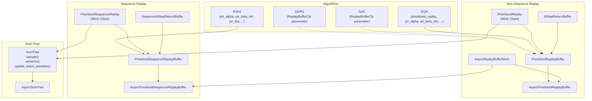
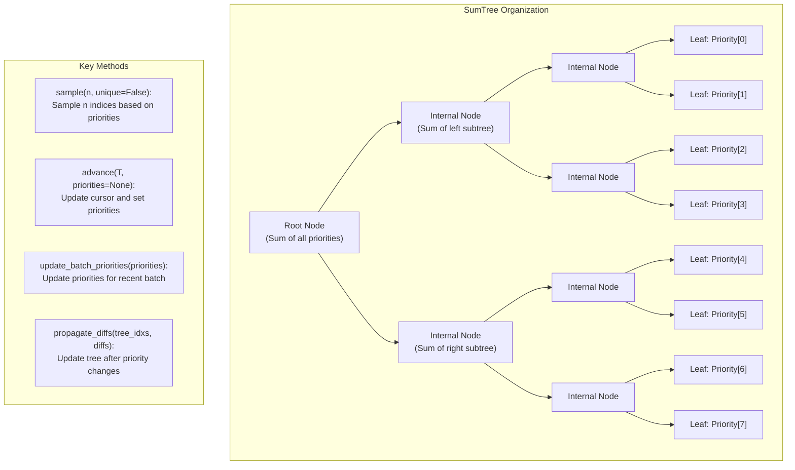
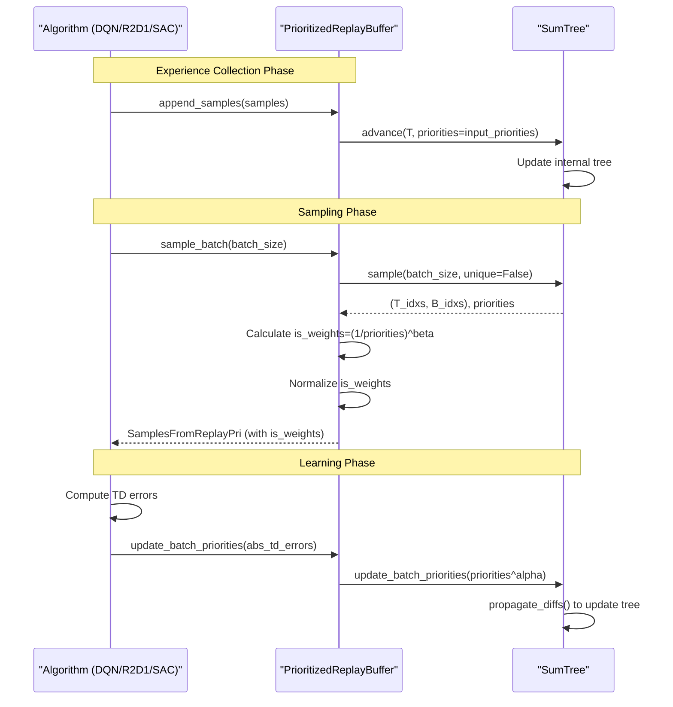

<!-- source: DeepWiki mcp.deepwiki.com · repo astooke/rlpyt · page 8.1 Prioritized Replay · fetched 2026-10-30 -->

# Prioritized Replay

<details>
<summary>Relevant source files</summary>

The following files were used as context for generating this wiki page:

- [rlpyt/algos/dqn/dqn.py](rlpyt/algos/dqn/dqn.py)
- [rlpyt/algos/dqn/r2d1.py](rlpyt/algos/dqn/r2d1.py)
- [rlpyt/algos/qpg/ddpg.py](rlpyt/algos/qpg/ddpg.py)
- [rlpyt/algos/qpg/sac.py](rlpyt/algos/qpg/sac.py)
- [rlpyt/algos/qpg/sac_v.py](rlpyt/algos/qpg/sac_v.py)
- [rlpyt/algos/qpg/td3.py](rlpyt/algos/qpg/td3.py)
- [rlpyt/experiments/configs/mujoco/qpg/mujoco_sac_v.py](rlpyt/experiments/configs/mujoco/qpg/mujoco_sac_v.py)
- [rlpyt/replays/async_.py](rlpyt/replays/async_.py)
- [rlpyt/replays/non_sequence/prioritized.py](rlpyt/replays/non_sequence/prioritized.py)
- [rlpyt/replays/sequence/prioritized.py](rlpyt/replays/sequence/prioritized.py)
- [rlpyt/replays/sum_tree.py](rlpyt/replays/sum_tree.py)

</details>


## Overview

Prioritized Experience Replay (PER) is a technique that improves sample efficiency in reinforcement learning by sampling transitions with higher temporal-difference (TD) errors more frequently. This focuses computational resources on the most informative experiences. In rlpyt, prioritized replay is implemented using a sum-tree data structure for efficient sampling proportional to priorities.

This technique is particularly valuable for off-policy algorithms like DQN, SAC, DDPG, and TD3, where experience can be reused multiple times for learning.

Sources:
- [rlpyt/replays/non_sequence/prioritized.py:14-88]()
- [rlpyt/replays/sequence/prioritized.py:16-125]()

## Architecture and Implementation



The prioritized replay implementation in rlpyt consists of several key components:

1. **Mixin Classes**: 
   - `PrioritizedReplay`: Core functionality for non-sequence buffers
   - `PrioritizedSequenceReplay`: Extends functionality for sequence/recurrent buffers

2. **Concrete Buffer Classes**:
   - `PrioritizedReplayBuffer`: For standard transitions
   - `PrioritizedSequenceReplayBuffer`: For sequence transitions (recurrent networks)
   - Async versions for parallel operation

3. **Sum-Tree Data Structure**:
   - `SumTree`: Efficient priority-based sampling structure
   - `AsyncSumTree`: Thread-safe version for parallel processing

Sources:
- [rlpyt/replays/non_sequence/prioritized.py:14-88]()
- [rlpyt/replays/sequence/prioritized.py:16-125]()
- [rlpyt/replays/sum_tree.py:8-250]()

## Sum-Tree Data Structure



The `SumTree` class maintains a binary tree where:
- Leaf nodes store the priority values for individual transitions
- Internal nodes store the sum of their children's values
- The root node contains the sum of all priorities

This structure allows efficient operations:
- Sampling proportional to priorities in O(log n) time
- Updating priorities in O(log n) time
- Managing valid/invalid samples as the buffer cursor advances

The tree also handles:
- Turning off priorities for samples near the buffer cursor (to avoid using incomplete n-step returns)
- Applying new priorities for fresh samples

Sources:
- [rlpyt/replays/sum_tree.py:8-250]()
- [rlpyt/replays/sum_tree.py:101-129]() (sample method)
- [rlpyt/replays/sum_tree.py:71-99]() (advance method)
- [rlpyt/replays/sum_tree.py:130-139]() (update_batch_priorities method)

## Priority Computation and Sampling Process



The priority-based sampling process involves:

1. **Priority Assignment**:
   - New samples: Assigned default priority or computed input priority
   - After learning: Updated based on TD error (|target - prediction|)
   - Priorities raised to power of `alpha` to control prioritization strength

2. **Sampling**:
   - Generate random values between 0 and total priority sum
   - Traverse tree to find corresponding experiences
   - Calculate importance sampling weights: (1/N * 1/P)^beta

3. **Importance Sampling Correction**:
   - Apply weights to loss function to correct sampling bias
   - Normalize weights by the maximum weight
   - Anneal beta from initial value toward 1.0 over time

Sources:
- [rlpyt/replays/non_sequence/prioritized.py:46-58]() (append_samples)
- [rlpyt/replays/non_sequence/prioritized.py:60-72]() (sample_batch)
- [rlpyt/replays/non_sequence/prioritized.py:73-79]() (update_batch_priorities)
- [rlpyt/algos/dqn/dqn.py:180-182]() (DQN update priorities)
- [rlpyt/algos/dqn/r2d1.py:153-159]() (R2D1 update priorities)

## Algorithm Integration

Prioritized replay is integrated with different algorithms in the following ways:

| Algorithm | Integration Method | Key Parameters | Priority Computation |
|-----------|-------------------|----------------|----------------------|
| DQN | Built-in support via `prioritized_replay` flag | `pri_alpha`, `pri_beta_init`, `pri_beta_final` | Absolute TD error |
| R2D1 | Extended for sequence data with `PrioritizedSequenceReplayBuffer` | Above + `pri_eta` (max/mean priority mixing factor) | Weighted max/mean TD error over sequence |
| SAC | Via custom `ReplayBufferCls` parameter | N/A (defined in buffer) | Typically absolute TD error |
| DDPG/TD3 | Via custom `ReplayBufferCls` parameter | N/A (defined in buffer) | Typically absolute TD error |

The priority computation varies slightly between algorithms:

- **DQN**: Uses absolute TD error, optionally clipped by `delta_clip`
- **R2D1**: Uses a weighted combination of max and mean TD error across the sequence: `pri_eta * max_td_error + (1 - pri_eta) * mean_td_error`
- **SAC/DDPG/TD3**: Can use absolute TD error if prioritized replay is configured

Sources:
- [rlpyt/algos/dqn/dqn.py:248-254]() (DQN TD error computation)
- [rlpyt/algos/dqn/r2d1.py:329-332]() (R2D1 priority computation)
- [rlpyt/algos/dqn/dqn.py:140-148]() (Initialize prioritized buffer)
- [rlpyt/algos/dqn/r2d1.py:109-118]() (Initialize prioritized sequence buffer)

## Configuration Parameters

| Parameter | Default | Description | Effect |
|-----------|---------|-------------|--------|
| `alpha` | 0.6 | Priority exponent | Controls degree of prioritization (0=uniform, 1=fully prioritized) |
| `beta` | 0.4 (init) to 1.0 (final) | IS weight exponent | Controls importance sampling correction (1=full correction) |
| `pri_eta` | 0.9 (R2D1) | Mixing coefficient | Balances max vs. mean TD error for sequence priorities |
| `default_priority` | 1.0 or `delta_clip` | Priority for new samples | Initial sampling probability for transitions |
| `unique` | False | Unique sampling flag | Whether to enforce unique samples in a batch |
| `input_priorities` | False | Input priority flag | Whether to use provided priorities for new samples |

Sources:
- [rlpyt/replays/non_sequence/prioritized.py:24-25]() (PrioritizedReplay parameters)
- [rlpyt/algos/dqn/dqn.py:49-56]() (DQN prioritized parameters)
- [rlpyt/algos/dqn/r2d1.py:54-61]() (R2D1 prioritized parameters)

## Example Usage

To configure an algorithm with prioritized replay:

```python
algo_config = dict(
    # DQN with prioritized replay
    algo="DQN",
    prioritized_replay=True,
    pri_alpha=0.6,
    pri_beta_init=0.4,
    pri_beta_final=1.0,
    pri_beta_steps=int(50e6)
)
```

For R2D1 with advanced prioritized replay options:

```python
algo_config = dict(
    # R2D1 with prioritized sequence replay
    algo="R2D1",
    prioritized_replay=True,
    pri_alpha=0.6,
    pri_beta_init=0.9,
    pri_beta_final=0.9,
    pri_beta_steps=int(50e6),
    pri_eta=0.9,
    input_priorities=True,
    input_priority_shift=2  # For RNN state alignment
)
```

Sources:
- [rlpyt/algos/dqn/dqn.py:49-56]() (DQN parameters)
- [rlpyt/algos/dqn/r2d1.py:54-61]() (R2D1 parameters)

---

