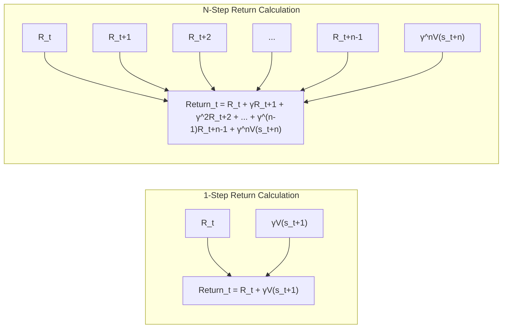
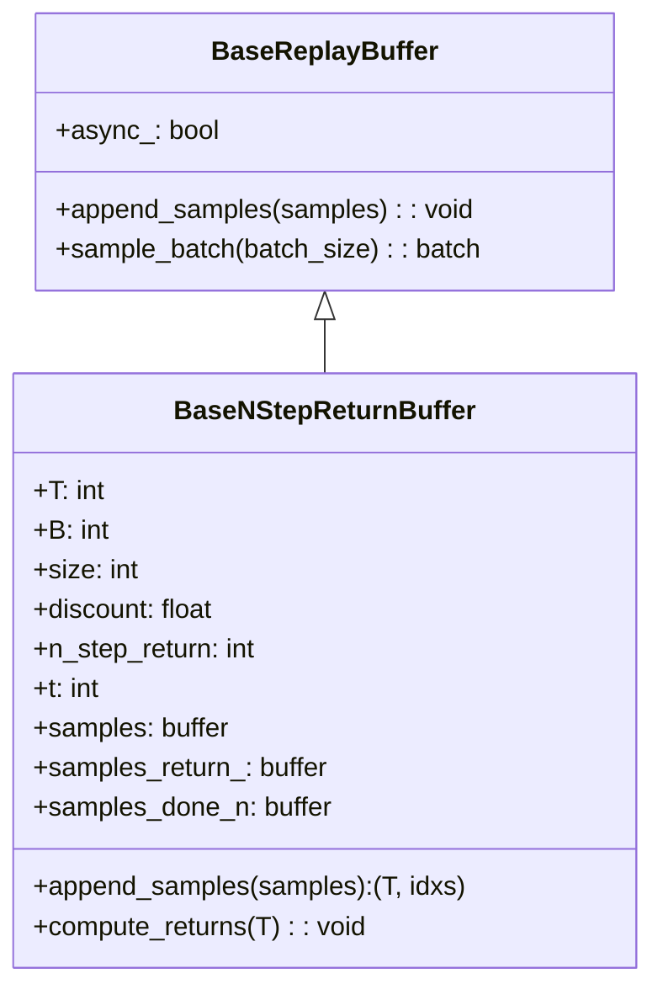
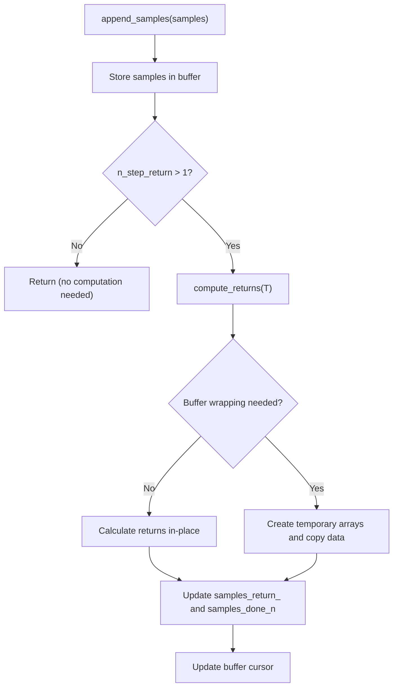
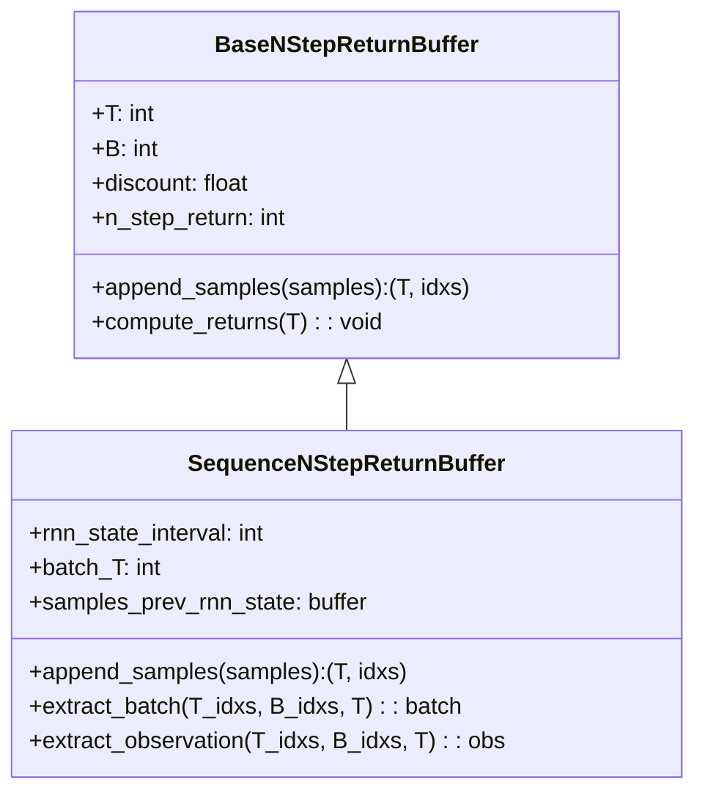
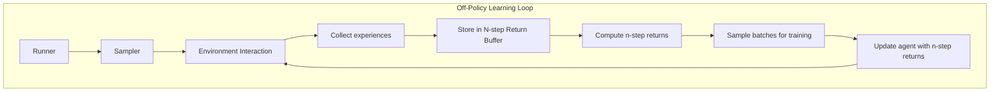

<!-- source: DeepWiki mcp.deepwiki.com · repo astooke/rlpyt · page 8.2 N-Step Returns · fetched 2026-10-30 -->

# N-Step Returns

<details>
<summary>Relevant source files</summary>

The following files were used as context for generating this wiki page:

- [rlpyt/experiments/configs/atari/dqn/atari_r2d1.py](rlpyt/experiments/configs/atari/dqn/atari_r2d1.py)
- [rlpyt/experiments/scripts/atari/dqn/launch/dgx/launch_atari_r2d1_async_gpu.py](rlpyt/experiments/scripts/atari/dqn/launch/dgx/launch_atari_r2d1_async_gpu.py)
- [rlpyt/replays/frame.py](rlpyt/replays/frame.py)
- [rlpyt/replays/n_step.py](rlpyt/replays/n_step.py)
- [rlpyt/replays/sequence/n_step.py](rlpyt/replays/sequence/n_step.py)

</details>


## Purpose and Scope

This document explains the N-Step Returns system in rlpyt, which provides an implementation of n-step return calculations within the replay buffer architecture. N-step returns are a fundamental concept in reinforcement learning that helps balance bias and variance in value estimation by incorporating rewards from multiple future timesteps. This page focuses on how n-step returns are implemented and used within the rlpyt framework's replay buffer system.

For information about replay buffers in general, see [Replay Buffers](#8).

## What are N-Step Returns?

N-step returns are a method for estimating the expected future reward (return) by looking ahead n timesteps instead of just one. In standard 1-step temporal difference (TD) learning, we update value estimates using the immediate reward plus the discounted value of the next state. With n-step returns, we use the sum of the next n rewards plus the discounted value estimate at the n-th future state.



The n-step return (G_t) at time t is calculated as:

G_t = R_t + γR_t+1 + γ^2R_t+2 + ... + γ^(n-1)R_t+n-1 + γ^nV(s_t+n)

Where:
- R_t is the reward at time t
- γ is the discount factor
- V(s_t+n) is the estimated value at state s_t+n
- The sum is truncated if a terminal state is reached before n steps

Sources: [rlpyt/replays/n_step.py:87-109]()

## Implementation in rlpyt

### Base N-Step Return Buffer

The core implementation of n-step returns in rlpyt is in the `BaseNStepReturnBuffer` class. This class handles storing experience samples and computing n-step returns.



Key attributes and methods:
- `T`: Time dimension of the buffer (ceiling of size/B)
- `B`: Batch dimension of the buffer
- `discount`: Discount factor for future rewards (γ)
- `n_step_return`: Number of steps to look ahead for return calculation
- `samples`: Buffer storing experience samples with shape (T, B)
- `samples_return_`: Buffer storing calculated n-step returns
- `samples_done_n`: Buffer indicating if any of the next n steps includes a terminal state

Sources: [rlpyt/replays/n_step.py:11-62]()

### Computing N-Step Returns

The `compute_returns` method is responsible for calculating n-step returns each time new samples are added to the buffer. It handles both normal and wrapped cases (when buffer indices loop around).



The computation uses the formula:
1. Take rewards from t-n+1 to t+T
2. For each position i, compute the sum of discounted future rewards up to i+n
3. Handle done states by truncating the sum appropriately
4. Store the result in the corresponding position of samples_return_

Sources: [rlpyt/replays/n_step.py:80-108]()

## Specialized N-Step Return Buffers

rlpyt extends the base implementation with specialized buffers for different use cases.

### Sequence N-Step Return Buffer

For recurrent policies that require sequential processing of state information:



This specialized buffer:
- Stores RNN states, either at every timestep or at specified intervals to save memory
- Provides methods to extract sequences that maintain temporal dependencies
- Handles proper alignment of observation, action, reward, and RNN state data

Sources: [rlpyt/replays/sequence/n_step.py:17-105]()

### Frame Buffer Mixin

For frame-stacking environments (like Atari) where consecutive observations share frames:

```mermaid
classDiagram
    class FrameBufferMixin {
        +n_frames: int
        +samples_frames: buffer
        +samples_new_frames: buffer
        +append_samples(samples): (T, idxs)
    }
    
    class BaseNStepReturnBuffer {
        +T: int
        +B: int
        +discount: float
        +n_step_return: int
        +append_samples(samples): (T, idxs)
        +compute_returns(T): void
    }
    
    FrameBufferMixin <|-- "ConcreteFrameBuffer"
    BaseNStepReturnBuffer <|-- "ConcreteFrameBuffer"
    
    note for FrameBufferMixin "Optimizes memory by storing only unique frames"
```

This mixin:
- Optimizes memory by storing only unique frames rather than full observations
- Handles proper reconstruction of frame-stacked observations during sampling
- Incorporates special handling for transitions between episodes

Sources: [rlpyt/replays/frame.py:10-59]()

## Configuring N-Step Returns

When using algorithms like DQN or R2D1 (Recurrent Replay Distributed DQN), you can configure the n-step return parameter in the algorithm configuration:

```python
algo=dict(
    discount=0.997,
    n_step_return=5,
    # other parameters...
)
```

The value of `n_step_return` determines how many future rewards are incorporated into the return calculation. Higher values (e.g., 5) typically provide better performance but may increase variance.

Sources: [rlpyt/experiments/configs/atari/dqn/atari_r2d1.py:10-27]()

## Integration with rlpyt Architecture

N-step returns are a key component in the broader rlpyt replay system, which is used by off-policy algorithms.



In this process:
1. The sampler collects experiences from environment interactions
2. Experiences are stored in an n-step return buffer
3. N-step returns are computed when new experiences are added
4. The algorithm samples batches from the buffer, including the pre-computed n-step returns
5. The agent is updated using these n-step returns

Sources: [rlpyt/replays/n_step.py:11-62](), [rlpyt/experiments/configs/atari/dqn/atari_r2d1.py:7-27]()

## Conclusion

N-step returns in rlpyt provide a powerful mechanism for balancing bias and variance in value estimation. The implementation is designed for flexibility and efficiency, with specialized buffers for different use cases. By understanding and properly configuring n-step returns, you can potentially improve the performance of off-policy reinforcement learning algorithms.

---

