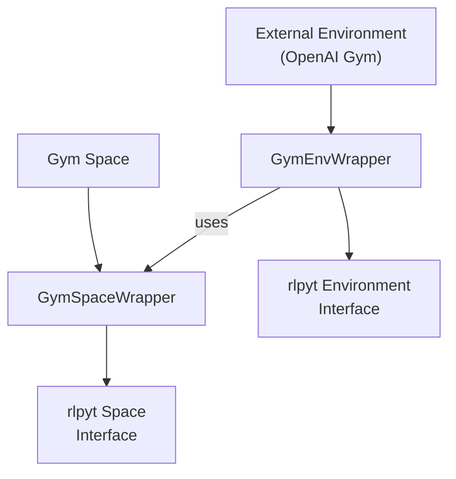
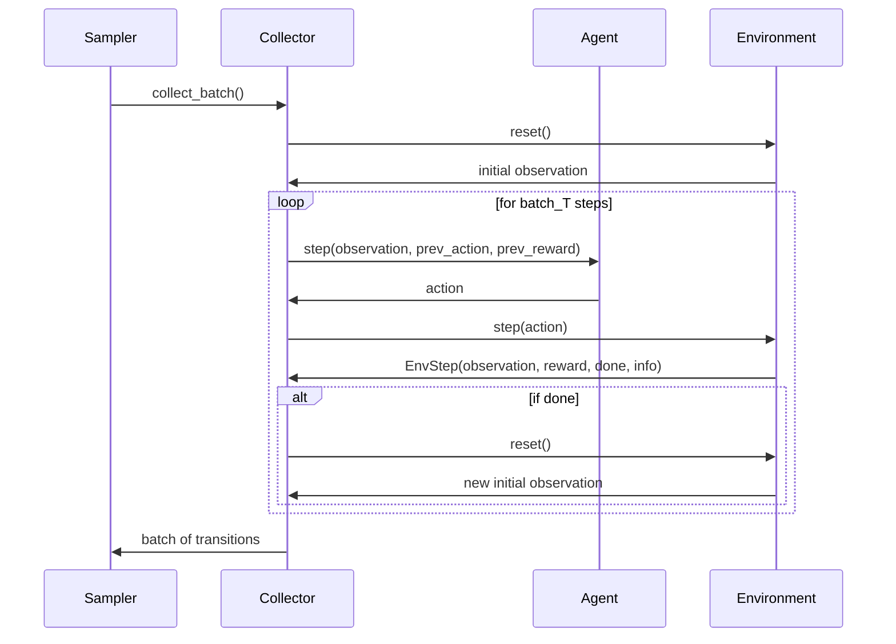

<!-- source: DeepWiki mcp.deepwiki.com · repo astooke/rlpyt · page 9 Environments · fetched 2026-10-30 -->

# Environments

<details>
<summary>Relevant source files</summary>

The following files were used as context for generating this wiki page:

- [rlpyt/envs/atari/atari_env.py](rlpyt/envs/atari/atari_env.py)
- [rlpyt/envs/gym.py](rlpyt/envs/gym.py)
- [rlpyt/samplers/collectors.py](rlpyt/samplers/collectors.py)
- [rlpyt/spaces/composite.py](rlpyt/spaces/composite.py)
- [rlpyt/spaces/float_box.py](rlpyt/spaces/float_box.py)
- [rlpyt/spaces/gym_wrapper.py](rlpyt/spaces/gym_wrapper.py)
- [rlpyt/spaces/gym_wrapper_schema.py](rlpyt/spaces/gym_wrapper_schema.py)
- [rlpyt/spaces/int_box.py](rlpyt/spaces/int_box.py)
- [rlpyt/utils/tensor.py](rlpyt/utils/tensor.py)
- [tests/__init__.py](tests/__init__.py)
- [tests/test_gym_wrapper.py](tests/test_gym_wrapper.py)
- [tests/test_serial_sampler.py](tests/test_serial_sampler.py)

</details>


## Overview

The environment system in rlpyt provides a standardized interface for reinforcement learning environments, supporting both custom implementations and wrappers for existing environment libraries like OpenAI Gym. This page documents the environment interfaces, built-in environments, and wrappers available in rlpyt.

Environments in rlpyt form a critical bridge between agents and the reinforcement learning problem. They define the observation and action spaces, implement the dynamics of the task, and provide feedback in the form of rewards.

For information about how samplers interact with environments to collect experience, see [Samplers](#6).

## Environment Interface

```mermaid
classDiagram
    class "Env" {
        reset() : observation
        step(action) : EnvStep
        spaces : EnvSpaces
    }
    
    class "EnvSpaces" {
        observation : Space
        action : Space
    }
    
    class "EnvStep" {
        observation
        reward
        done
        env_info
    }
    
    "Env" --> "EnvSpaces" : has
    "Env" --> "EnvStep" : returns from step()
```

Sources: [rlpyt/envs/atari/atari_env.py:33-228](), [rlpyt/envs/gym.py:13-89]()

The core environment interface in rlpyt is defined by the `Env` class. All environments must implement:

- `reset()`: Resets the environment to an initial state and returns the initial observation
- `step(action)`: Takes an action, advances the environment, and returns an `EnvStep`
- `spaces`: Property returning an `EnvSpaces` instance containing the observation and action spaces

The `EnvStep` is a container with four elements:
- `observation`: The new observation after taking the action
- `reward`: The reward received for the action
- `done`: A boolean indicating if the episode has ended
- `env_info`: Additional information as a namedtuple (environment-specific)

## Space Types

```mermaid
classDiagram
    class "Space" {
        sample() : sample
        null_value() : null_value
        shape : tuple
    }
    
    class "IntBox" {
        low : int
        high : int
        dtype : np.dtype
        sample() : np.ndarray
        null_value() : np.ndarray
    }
    
    class "FloatBox" {
        low : np.ndarray
        high : np.ndarray
        dtype : np.dtype
        sample() : np.ndarray
        null_value() : np.ndarray
    }
    
    class "Composite" {
        spaces : list~Space~
        NamedTupleCls
        sample() : NamedTuple
        null_value() : NamedTuple
    }
    
    "Space" <|-- "IntBox"
    "Space" <|-- "FloatBox"
    "Space" <|-- "Composite"
```

Sources: [rlpyt/spaces/int_box.py:7-49](), [rlpyt/spaces/float_box.py:7-51](), [rlpyt/spaces/composite.py:6-45]()

Spaces define the format and constraints of observations and actions. The main space types are:

### IntBox

`IntBox` represents a box of discrete integers with specificiable bounds. It's typically used for:
- Discrete action spaces (e.g., selecting one of N actions)
- Pixel observations in environments like Atari (as uint8 arrays)

```python
# Example: An IntBox for an action space with 4 possible actions
action_space = IntBox(low=0, high=4, dtype="int32")
```

### FloatBox

`FloatBox` represents a box of continuous values with specificiable bounds. It's typically used for:
- Continuous action spaces (e.g., joint torques in robotics tasks)
- Processed observations (e.g., normalized sensor readings)

```python
# Example: A FloatBox for a 3D continuous action space
action_space = FloatBox(low=-1.0, high=1.0, shape=(3,), dtype="float32")
```

### Composite

`Composite` combines multiple spaces into a single space, using named tuples to organize the components. It's useful for:
- Complex observation spaces with multiple modalities
- Action spaces that combine discrete and continuous components

## Built-in Environments

### Atari Environments

```mermaid
classDiagram
    class "Env" {
        reset() : observation
        step(action) : EnvStep
        spaces : EnvSpaces
    }
    
    class "AtariEnv" {
        game : str
        frame_skip : int
        num_img_obs : int
        clip_reward : bool
        episodic_lives : bool
        max_start_noops : int
        repeat_action_probability : float
        horizon : int
        reset() : observation
        step(action) : EnvStep
        render(wait, show_full_obs)
    }
    
    class "AtariTrajInfo" {
        GameScore : int
        step(observation, action, reward, done, agent_info, env_info)
    }
    
    "Env" <|-- "AtariEnv"
    "AtariEnv" --> "AtariTrajInfo" : uses
```

Sources: [rlpyt/envs/atari/atari_env.py:20-251]()

rlpyt provides a custom implementation of Atari environments using the Arcade Learning Environment (ALE). The `AtariEnv` class includes:

- **Frame skipping**: Repeating the same action for multiple frames to improve efficiency
- **Frame stacking**: Combining multiple frames to represent the observation to capture temporal information
- **Observation processing**: Max pooling between frames, cropping, and downsampling to (80, 104)
- **Game options**: Support for episodic lives, reward clipping, and random start noops
- **Diagnostics**: Tracking of raw game score separate from clipped rewards

Key parameters:
- `game`: The Atari game to play (e.g., "pong", "breakout")
- `frame_skip`: Number of frames to repeat each action
- `num_img_obs`: Number of frames to stack in each observation
- `clip_reward`: Whether to clip rewards to {-1, 0, 1}
- `episodic_lives`: Whether losing a life ends the episode (while continuing the game)

The `AtariTrajInfo` class tracks trajectory information specific to Atari games, such as the raw game score.

## Environment Wrappers



Sources: [rlpyt/envs/gym.py:13-172](), [rlpyt/spaces/gym_wrapper.py:10-138]()

### OpenAI Gym Integration

rlpyt provides wrappers to use environments from OpenAI Gym. The main components are:

#### GymEnvWrapper

The `GymEnvWrapper` converts Gym environments to the rlpyt interface:

- Wraps Gym's observation and action spaces with `GymSpaceWrapper`
- Converts Gym's dictionary-based `info` to namedtuples for consistency and efficiency
- Detects time limits in Gym environments and adds `timeout` flags to `env_info`
- Provides conversion methods for observations and actions

```python
# Using the factory function to create a wrapped Gym environment
from rlpyt.envs.gym import make
env = make("CartPole-v1")  # Returns a GymEnvWrapper instance
```

#### GymSpaceWrapper

The `GymSpaceWrapper` adapts Gym spaces to rlpyt spaces:

- Handles conversion between Gym's dictionary spaces and rlpyt's namedtuples
- Provides methods for sampling and generating null values
- Ensures correct data types (e.g., converting float64 to float32)

### EnvInfoWrapper

The `EnvInfoWrapper` ensures consistent information dictionaries:

- Fills in missing keys in the environment info dictionary
- Useful for environments that provide inconsistent information between steps
- Helps prevent errors in samplers that expect specific keys

## Environment Interaction



Sources: [rlpyt/samplers/collectors.py:10-119]()

Environments in rlpyt are primarily interacted with through collectors, which gather batches of experience:

### BaseCollector

The `BaseCollector` defines the interface for collectors:

- `start_envs()`: Initializes environments, typically by calling `reset()`
- `collect_batch()`: Collects a batch of transitions by stepping environments
- `reset_if_needed()`: Resets environments when episodes end

### DecorrelatingStartCollector

The `DecorrelatingStartCollector` extends the base collector with the ability to decorrelate initial states:

- Takes random actions at the start of data collection to decorrelate states across parallel environments
- Useful for preventing correlations in batch updates that could destabilize learning
- Configurable with the `max_decorrelation_steps` parameter

## Example Usage

Here's a simple example of how to create and use an environment in rlpyt:

```python
# For Atari environment
from rlpyt.envs.atari.atari_env import AtariEnv

# Create an Atari environment
env = AtariEnv(
    game="pong",
    frame_skip=4,
    num_img_obs=4,
    clip_reward=True,
    episodic_lives=True
)

# Reset the environment
observation = env.reset()

# Take a step
action = env.action_space.sample()  # Random action
env_step = env.step(action)
next_observation, reward, done, info = env_step
```

```python
# For Gym environment
from rlpyt.envs.gym import make

# Create a wrapped Gym environment
env = make("CartPole-v1")

# Reset the environment
observation = env.reset()

# Take a step
action = env.action_space.sample()  # Random action
env_step = env.step(action)
next_observation, reward, done, info = env_step
```

## Environment Design Considerations

When implementing custom environments for rlpyt, consider:

1. **Interface Compliance**: Ensure your environment implements the required `reset()` and `step()` methods with correct return types
2. **Space Definitions**: Define appropriate observation and action spaces using rlpyt's space classes
3. **Information Structure**: Use namedtuples for `env_info` to ensure consistency
4. **Timeout Handling**: Include a `timeout` field in `env_info` if your environment has a maximum episode length
5. **Observation Format**: Consider the dimensionality and type of observations (uint8 for pixels to save memory, float32 for continuous values)

## Environment Registration

Unlike OpenAI Gym, rlpyt does not have a central environment registry. Instead:

- For custom environments, define a class extending `Env` and instantiate it directly
- For Gym environments, use the `make` function from `rlpyt.envs.gym`
- For Atari environments, instantiate `AtariEnv` with the appropriate game name

---

