# Page: Overview

# Overview

<details>
<summary>Relevant source files</summary>

The following files were used as context for generating this wiki page:

- [README.md](README.md)
- [docs/source/conf.py](docs/source/conf.py)
- [docs/source/index.rst](docs/source/index.rst)
- [docs/source/pages/base.rst](docs/source/pages/base.rst)
- [docs/source/pages/qpg.rst](docs/source/pages/qpg.rst)
- [docs/source/pages/runner.rst](docs/source/pages/runner.rst)
- [docs/source/pages/sampler.rst](docs/source/pages/sampler.rst)
- [linux_cpu.yml](linux_cpu.yml)
- [linux_cuda10.yml](linux_cuda10.yml)
- [linux_cuda9.yml](linux_cuda9.yml)
- [macos_cpu.yml](macos_cpu.yml)
- [rlpyt/agents/qpg/sac_v_agent.py](rlpyt/agents/qpg/sac_v_agent.py)
- [rlpyt/envs/base.py](rlpyt/envs/base.py)
- [rlpyt/runners/base.py](rlpyt/runners/base.py)
- [setup.py](setup.py)

</details>


The `rlpyt` framework is a modular, optimized implementation of common deep reinforcement learning algorithms in PyTorch. This page introduces the purpose, design philosophy, and key features of the framework, providing a foundation for understanding its architecture and capabilities.

## Purpose and Scope

`rlpyt` is designed to be a high-throughput codebase for small to medium-scale reinforcement learning research. It supports all three major families of model-free algorithms:

- Policy Gradient methods (like A2C, PPO)
- Deep Q-Learning methods (like DQN and variants)
- Q-Function Policy Gradient methods (like SAC, DDPG, TD3)

The framework prioritizes modularity, allowing researchers to easily modify components, and performance optimization, with support for parallelization across CPUs and GPUs.

Sources: [README.md:11-18](), [docs/source/index.rst:10-10]()

## System Architecture

This diagram shows the primary building blocks of the `rlpyt` framework and their relationships:

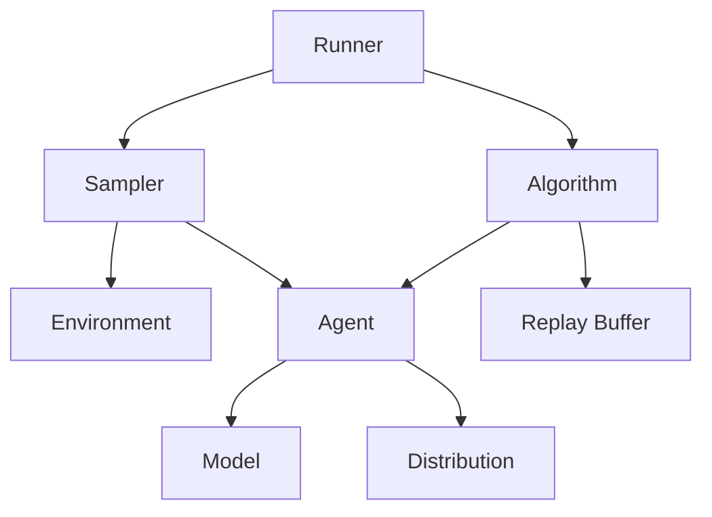

The key components and their roles are:

| Component | Role |
|-----------|------|
| Runner | Orchestrates the training process, connecting samplers with algorithms |
| Algorithm | Implements learning methods (PPO, DQN, SAC, etc.) that update agent parameters |
| Agent | Interfaces between algorithms and environments, selects actions using models |
| Sampler | Manages environment interaction to collect training data |
| Environment | Provides the task to be learned (compatible with OpenAI Gym) |
| Model | PyTorch neural network that processes observations |
| Distribution | Handles action sampling for stochastic policies |
| Replay Buffer | Stores experiences for off-policy algorithms |

Sources: [README.md:108-123](), [docs/source/base.rst:1-41]()

## Training Process Flow

The following diagram illustrates the typical training loop in `rlpyt`:

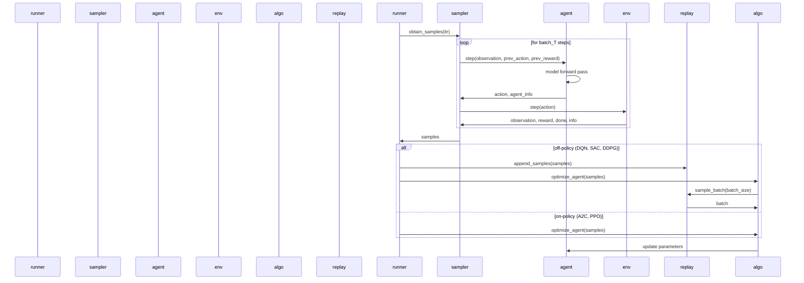

Sources: [README.md:18-29](), [docs/source/pages/runner.rst:1-24](), [rlpyt/runners/base.py:1-15]()

## Implemented Algorithms

The framework includes implementations for all three major families of model-free reinforcement learning algorithms:

### Policy Gradient Methods
- Advantage Actor-Critic (A2C)
- Proximal Policy Optimization (PPO)

### Deep Q-Learning Methods
- Deep Q-Network (DQN)
- Double DQN
- Dueling DQN
- Categorical DQN
- Recurrent DQN (R2D2-style)

### Q-Function Policy Gradient Methods
- Deep Deterministic Policy Gradient (DDPG)
- Twin Delayed DDPG (TD3)
- Soft Actor-Critic (SAC)

Sources: [README.md:33-40](), [docs/source/pages/qpg.rst:1-54]()

## Parallelization Options

`rlpyt` provides flexible options for parallel execution to maximize throughput:

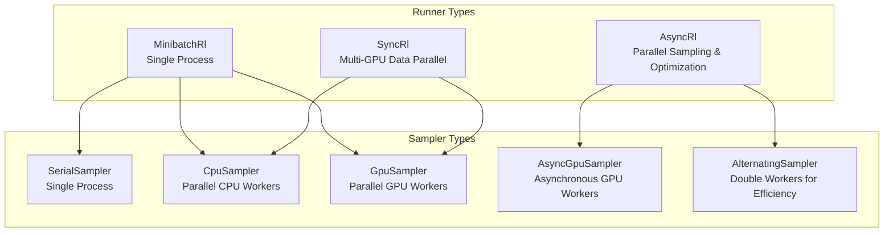

Key parallelization features:

1. **Serial mode**: For debugging and small experiments (MinibatchRl + SerialSampler)
2. **Parallel sampling**: Multiple environment instances running on CPU
3. **Multi-GPU optimization**: Using PyTorch's DistributedDataParallel
4. **Asynchronous operation**: Decouple sampling and optimization

Sources: [README.md:20-24](), [docs/source/pages/runner.rst:8-49](), [docs/source/pages/sampler.rst:1-71]()

## Key Features

### Recurrent Agents
- All agents receive `observation, prev_action, prev_reward`
- Training data organized with leading dimensions as `[Time, Batch]`
- Specialized sequence replay buffers for recurrent networks

### Data Structure: `namedarraytuple`
`rlpyt` introduces a custom data structure called `namedarraytuple` for organizing collections of numpy arrays/torch tensors. This allows for:
- Easier slicing and indexing into structured data
- Support for multi-modal observations (e.g., joint angles and camera images)
- Uniform syntax regardless of data complexity

### Environment Compatibility
- Works with OpenAI Gym interface
- Custom environment wrappers provided

### Experiment Management
- Utilities for launching and configuring experiments
- Tools for evaluating agent performance during training

Sources: [README.md:25-32](), [README.md:48-62]()

## Installation

`rlpyt` can be installed on Linux, macOS, or Windows with support for CPU-only or CUDA-enabled systems:

1. Clone the repository
2. Create and activate the appropriate conda environment:
   ```
   conda env create -f linux_[cpu|cuda9|cuda10].yml
   source activate rlpyt
   ```
3. Either add to PYTHONPATH or install as an editable package:
   ```
   pip install -e .
   ```

Sources: [README.md:75-100](), [linux_cpu.yml:1-14](), [linux_cuda9.yml:1-15](), [linux_cuda10.yml:1-15](), [setup.py:1-25]()

For more detailed information on specific components, see the following pages:
- Core Architecture [Core Architecture](#2)
- Algorithms [Algorithms](#3)
- Agents [Agents](#4)
- Runners [Runners](#5)
- Samplers [Samplers](#6)

---

# Page: Installation and Setup

# Installation and Setup

<details>
<summary>Relevant source files</summary>

The following files were used as context for generating this wiki page:

- [README.md](README.md)
- [docs/source/pages/launch.rst](docs/source/pages/launch.rst)
- [docs/source/pages/log.rst](docs/source/pages/log.rst)
- [docs/source/pages/model.rst](docs/source/pages/model.rst)
- [linux_cpu.yml](linux_cpu.yml)
- [linux_cuda10.yml](linux_cuda10.yml)
- [linux_cuda9.yml](linux_cuda9.yml)
- [macos_cpu.yml](macos_cpu.yml)
- [rlpyt/agents/qpg/sac_v_agent.py](rlpyt/agents/qpg/sac_v_agent.py)
- [rlpyt/utils/launching/affinity.py](rlpyt/utils/launching/affinity.py)
- [rlpyt/utils/launching/exp_launcher.py](rlpyt/utils/launching/exp_launcher.py)
- [rlpyt/utils/launching/variant.py](rlpyt/utils/launching/variant.py)
- [rlpyt/utils/logging/context.py](rlpyt/utils/logging/context.py)
- [setup.py](setup.py)

</details>


This document provides detailed instructions for installing and configuring the rlpyt framework on your system. Rlpyt is a modular, optimized implementation of common deep reinforcement learning algorithms in PyTorch, supporting policy gradient, deep Q-learning, and Q-function policy gradient algorithms. For a general overview of the framework, see [Overview](#1).

## Prerequisites

Before installing rlpyt, ensure your system meets the following requirements:

### Hardware Requirements
- **For CPU-only operation**: Any modern CPU will work
- **For GPU acceleration**: NVIDIA GPU with CUDA support (9.2 or 10.2 compatible)

### Software Requirements
- Python 3.7
- Git (for cloning the repository)
- Conda (Anaconda or Miniconda)

## Installation Steps

### 1. Clone the Repository

First, clone the rlpyt repository to your local machine:

```bash
git clone https://github.com/astooke/rlpyt.git
cd rlpyt
```

Sources: [README.md:77-77]()

### 2. Create Conda Environment

Rlpyt provides different environment configuration files depending on your hardware setup:

- **Linux with CUDA 10**:
  ```bash
  conda env create -f linux_cuda10.yml
  ```
  
- **Linux with CUDA 9**:
  ```bash
  conda env create -f linux_cuda9.yml
  ```
  
- **Linux CPU-only**:
  ```bash
  conda env create -f linux_cpu.yml
  ```
  
- **macOS CPU-only**:
  ```bash
  conda env create -f macos_cpu.yml
  ```

After creating the environment, activate it:

```bash
conda activate rlpyt
```

Sources: [README.md:79-83](), [linux_cuda10.yml:1-14](), [linux_cuda9.yml:1-14](), [linux_cpu.yml:1-14](), [macos_cpu.yml:1-13]()

### 3. Make rlpyt Available to Python

You have two options to add rlpyt to your Python path:

**Option A**: Modify the PYTHONPATH environment variable
```bash
export PYTHONPATH=/path/to/rlpyt:$PYTHONPATH
```

**Option B**: Install as an editable Python package
```bash
pip install -e .
```

Sources: [README.md:85-93](), [setup.py:1-25]()

### 4. Install Environment-Specific Packages

Rlpyt includes support for Atari environments by default. For other environments:

- **Gym**: Already included in test dependencies
- **Mujoco**: Requires separate installation (not included)
- **Other environments**: Install as needed for your specific use case

Sources: [README.md:95-95](), [setup.py:7-12]()

## Hardware Configuration and Affinity

Rlpyt includes a sophisticated system for managing hardware resources, particularly for parallel execution. The affinity system helps distribute workloads efficiently across CPUs and GPUs.

### Understanding Affinity Configuration

The affinity system determines:
1. How many experiments can run concurrently
2. Which GPU device(s) to use for each run
3. How many worker processes to use for parallel sampling
4. How to configure processes for multi-GPU and asynchronous runners

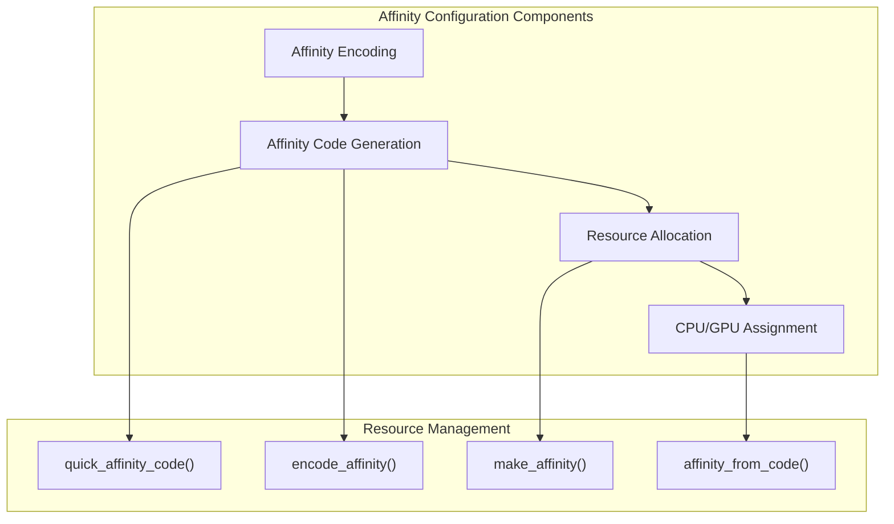

Sources: [rlpyt/utils/launching/affinity.py:29-168]()

### Basic Affinity Configuration

For simple setups, use the `quick_affinity_code()` function to automatically detect and allocate resources:

```python
from rlpyt.utils.launching.affinity import quick_affinity_code

# For GPU usage
affinity = quick_affinity_code(use_gpu=True)

# For CPU-only operation
affinity = quick_affinity_code(n_parallel=4, use_gpu=False)
```

For more detailed configuration, use the `encode_affinity()` function to specify exact hardware resources:

```python
from rlpyt.utils.launching.affinity import encode_affinity

# Example: 4 GPUs, 40 CPU cores
affinity = encode_affinity(
    n_cpu_core=40,
    n_gpu=4,
    contexts_per_gpu=1,
    gpu_per_run=1
)
```

Sources: [rlpyt/utils/launching/affinity.py:31-64](), [rlpyt/utils/launching/affinity.py:67-142]()

## Experiment Logging Configuration

Rlpyt includes a logging system to record experiment results. By default, experiments are logged to `rlpyt/data/local/YYYYMMDD/HHMMSS/experiment_name/run_ID`.

### Configuring Logging

When setting up an experiment, you can configure the logging directory:

```python
from rlpyt.utils.logging.context import logger_context

with logger_context(
    log_dir="path/to/log",
    run_ID=0,
    name="experiment_name",
    snapshot_mode="last"
):
    # Run your experiment
    runner.train()
```

The `snapshot_mode` parameter controls how often to save experiment snapshots:
- `"none"`: Don't save snapshots
- `"last"`: Always save and overwrite previous snapshots
- `"all"`: Always save and keep each iteration
- `"gap"`: Save periodically and keep each

Sources: [rlpyt/utils/logging/context.py:24-83]()

## Hardware Parallelism Model

Rlpyt supports various parallelism patterns for efficient utilization of hardware resources:

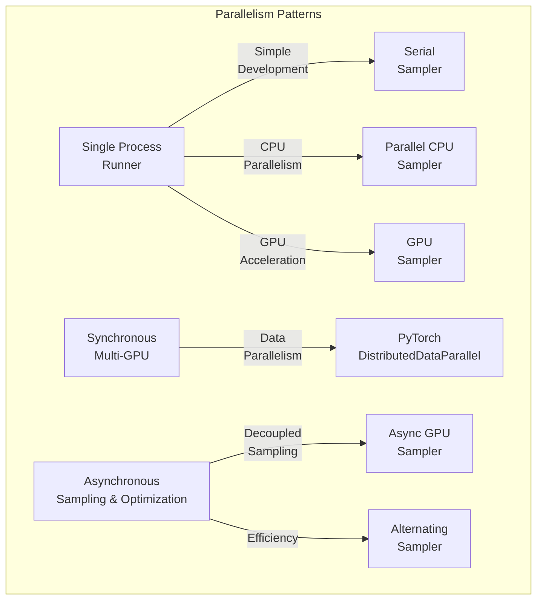

### Using Affinity for Parallel Runs

To launch multiple experiments in parallel on available hardware:

```python
from rlpyt.utils.launching.exp_launcher import run_experiments

run_experiments(
    script="path/to/experiment_script.py",
    affinity_code=affinity_code,
    experiment_title="my_experiment",
    runs_per_setting=2,
    variants=variants,
    log_dirs=log_dirs
)
```

Sources: [rlpyt/utils/launching/exp_launcher.py:27-135](), [rlpyt/utils/launching/affinity.py:258-485]()

## Verifying Installation

To verify your installation, run one of the example scripts in the examples directory. The examples are ordered by increasing complexity.

```bash
cd rlpyt/examples
python example_1.py
```

## Troubleshooting

### Common Issues

1. **CUDA version mismatch**: Ensure your installed CUDA toolkit version matches the one specified in the conda environment file

2. **PyTorch import errors**: Verify PyTorch was installed with the correct CUDA support by running:
   ```python
   import torch
   print(torch.cuda.is_available())
   ```

3. **Missing environment-specific dependencies**: Install any additional packages required for your specific environment

### Getting Help

For issues not covered here, refer to the project's GitHub issues page or documentation.

## Next Steps

After installation, you can:

1. Explore the examples directory to understand how to use the framework
2. Learn about the [Core Architecture](#2) of rlpyt
3. Study specific algorithm implementations in the [Algorithms](#3) section

Sources: [README.md:43-46]()

---

# Page: Core Architecture

# Core Architecture

<details>
<summary>Relevant source files</summary>

The following files were used as context for generating this wiki page:

- [docs/source/conf.py](docs/source/conf.py)
- [docs/source/index.rst](docs/source/index.rst)
- [docs/source/pages/base.rst](docs/source/pages/base.rst)
- [docs/source/pages/qpg.rst](docs/source/pages/qpg.rst)
- [docs/source/pages/runner.rst](docs/source/pages/runner.rst)
- [docs/source/pages/sampler.rst](docs/source/pages/sampler.rst)
- [rlpyt/agents/base.py](rlpyt/agents/base.py)
- [rlpyt/algos/base.py](rlpyt/algos/base.py)
- [rlpyt/envs/base.py](rlpyt/envs/base.py)
- [rlpyt/runners/base.py](rlpyt/runners/base.py)

</details>


This document provides a technical overview of the rlpyt framework's core architecture, explaining the fundamental building blocks and how they interact to implement reinforcement learning algorithms. For specific algorithm implementations, see [Algorithms](#3), and for detailed information about samplers, see [Samplers](#6).

## Core Components and Relationships

The rlpyt framework is built around several key components that work together to implement reinforcement learning algorithms:

**Core Components Diagram**
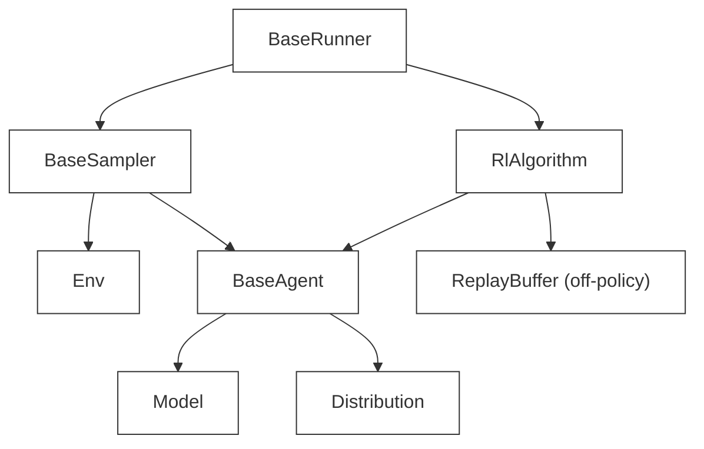

Sources:
- [rlpyt/runners/base.py:1-16]()
- [rlpyt/algos/base.py:1-69]()
- [rlpyt/agents/base.py:17-246]()
- [rlpyt/envs/base.py:11-66]()

### Runner

The Runner (implemented as `BaseRunner` in [rlpyt/runners/base.py:1-16]()) orchestrates the entire training process. It connects the sampling system with the optimization system and manages the training loop, evaluation, and checkpointing. The `train()` method serves as the entry point for running an RL experiment.

### Algorithm

The Algorithm (implemented as `RlAlgorithm` in [rlpyt/algos/base.py:1-69]()) is responsible for updating the agent's parameters based on collected experience data. It handles the reinforcement learning logic, such as computing TD-errors and performing gradient descent on the agent's model parameters. Key methods include `initialize()` to set up optimization and `optimize_agent()` to perform parameter updates.

### Agent

The Agent (implemented as `BaseAgent` in [rlpyt/agents/base.py:17-246]()) serves as the interface between the algorithm and environment. It contains the policy model (neural network) and handles action selection during sampling and training. The agent manages model device placement, recurrent state (if applicable), and parameter communication between processes.

### Sampler

The Sampler collects experience by coordinating agent-environment interactions. It manages worker processes that run environments in parallel to collect training data. Different sampler implementations support various parallelization strategies for CPU or GPU computation.

### Environment

The Environment (interface defined in [rlpyt/envs/base.py:11-66]() as `Env`) provides the interface to the reinforcement learning task, with defined observation and action spaces. It follows a standard interface similar to OpenAI Gym with `step()` and `reset()` methods.

## Training Process Flow

The following diagram illustrates how components interact during the training process:

**Training Flow Diagram**
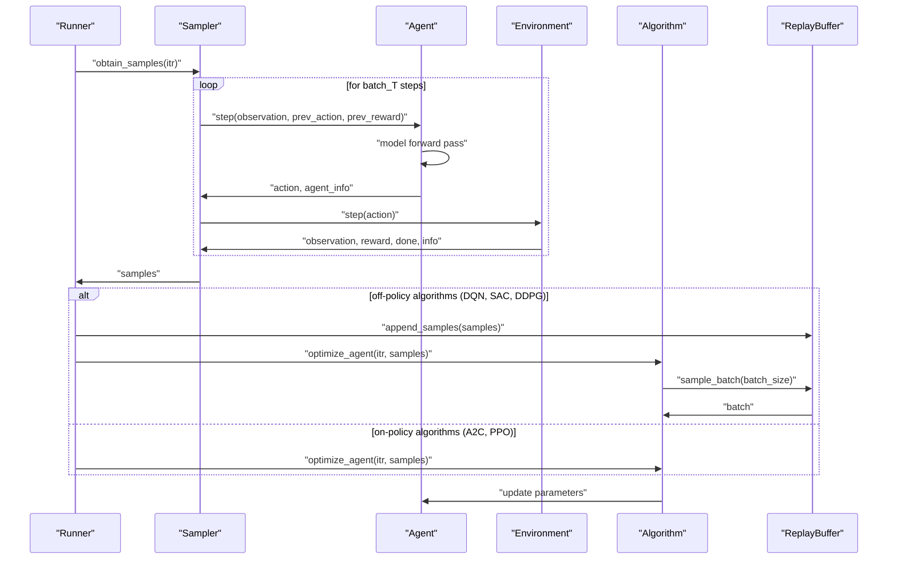

Sources:
- [rlpyt/runners/base.py:1-16]()
- [rlpyt/agents/base.py:59-170]()
- [rlpyt/algos/base.py:42-54]()
- [rlpyt/envs/base.py:17-32]()

The typical data flow in rlpyt follows these steps:

1. The Runner initializes all components (agent, algorithm, sampler) and starts the training loop
2. The Runner calls `sampler.obtain_samples(itr)` to collect experiences
3. The Sampler coordinates:
   - Getting actions from the Agent via `agent.step(observation, prev_action, prev_reward)`
   - Executing actions in Environments via `env.step(action)`
   - Collecting the resulting observations, rewards, and done flags
4. The collected experiences are returned to the Runner
5. For off-policy algorithms, experiences may be stored in a replay buffer
6. The Algorithm processes experiences and updates the Agent's parameters via `algorithm.optimize_agent(itr, samples)`
7. This cycle repeats until training completes

## Parallelism Patterns

rlpyt provides flexible parallelism options to efficiently utilize available hardware:

**Parallelism Options Diagram**
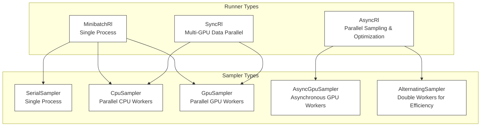

Sources:
- [docs/source/pages/runner.rst:1-60]()
- [docs/source/pages/sampler.rst:1-71]()

### Single-Process Execution (MinibatchRl)
A simple execution pattern with minimal overhead, suitable for debugging or small-scale experiments. The `MinibatchRl` runner implements this pattern with sequential sampling and optimization.

### Multi-GPU Data Parallel (SyncRl)
Distributes neural network computation across multiple GPUs for faster training. The `SyncRl` runner implements this pattern using PyTorch's DistributedDataParallel for data-parallel training.

### Asynchronous Execution (AsyncRl)
Separates sampling and optimization into different processes, allowing them to run concurrently. The `AsyncRl` runner implements this pattern for better resource utilization.

## Agent Architecture

The agent is a crucial component that bridges between the algorithm and environment. It encapsulates neural networks and manages model state:

**Agent Structure Diagram**
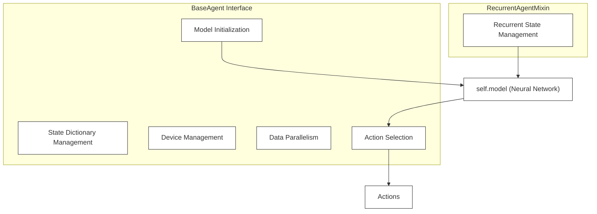

Sources:
- [rlpyt/agents/base.py:17-246]()
- [rlpyt/agents/base.py:252-372]()

The `BaseAgent` class in [rlpyt/agents/base.py:17-246]() defines the interface for all agents. Key methods include:

- `initialize(env_spaces, ...)`: Sets up the agent's model based on environment specifications
- `step(observation, prev_action, prev_reward)`: Selects actions during sampling
- `to_device(cuda_idx)`: Moves the model to a specified GPU device
- `data_parallel()`: Wraps the model with PyTorch's DistributedDataParallel
- `train_mode()`, `sample_mode()`, `eval_mode()`: Toggle between different operation modes

For recurrent agents, additional functionality is provided by `RecurrentAgentMixin` [rlpyt/agents/base.py:252-304](), which manages recurrent state during sampling. For alternating samplers, `AlternatingRecurrentAgentMixin` [rlpyt/agents/base.py:307-372]() provides specialized state management.

## Data Structures

rlpyt uses structured named tuples for passing data between components:

| Data Structure | Fields | Purpose |
|----------------|--------|---------|
| `AgentInputs` | observation, prev_action, prev_reward | Input to agent's step function |
| `AgentStep` | action, agent_info | Output from agent's step function |
| `EnvStep` | observation, reward, done, env_info | Output from environment's step function |
| `AgentInputsRnn` | observation, prev_action, prev_reward, init_rnn_state | Input for recurrent agents (training) |

Sources:
- [rlpyt/agents/base.py:12-14]()
- [rlpyt/agents/base.py:248-249]()
- [rlpyt/envs/base.py:5-8]()

These data structures ensure consistent interfaces and memory layout between components.

## Environment Interface

Environments in rlpyt follow a standard interface similar to OpenAI Gym:

```python
# Environment step interface
observation, reward, done, info = env.step(action)

# Environment reset interface
observation = env.reset()
```

The environment interface is defined in the `Env` class in [rlpyt/envs/base.py:11-66](). Each environment must provide:

- `step(action)`: Execute action and return next observation, reward, done flag, and info
- `reset()`: Reset the environment and return initial observation
- `action_space` and `observation_space`: Define the shape and type of actions and observations

## Extending the Framework

To implement new algorithms or agents in rlpyt, you typically:

1. Subclass the appropriate base class (`RlAlgorithm`, `BaseAgent`, etc.)
2. Implement the required methods for that component
3. Define any custom models needed

For example, to create a new agent:

```python
class MyCustomAgent(BaseAgent):
    def __init__(self, ModelCls=MyCustomModel, **kwargs):
        super().__init__(ModelCls=ModelCls, **kwargs)
        
    def step(self, observation, prev_action, prev_reward):
        # Custom action selection logic
        return AgentStep(action=action, agent_info=info)
```

## Conclusion

The core architecture of rlpyt provides a flexible, modular framework for implementing reinforcement learning algorithms. Its components are designed to be interchangeable, allowing researchers to easily experiment with different algorithms, agents, and parallelization strategies. The clean separation of concerns between sampling, agent behavior, and optimization makes it straightforward to extend the framework with new methods.

---

# Page: Algorithms

# Algorithms

<details>
<summary>Relevant source files</summary>

The following files were used as context for generating this wiki page:

- [docs/source/pages/util.rst](docs/source/pages/util.rst)
- [rlpyt/algos/dqn/dqn.py](rlpyt/algos/dqn/dqn.py)
- [rlpyt/algos/dqn/r2d1.py](rlpyt/algos/dqn/r2d1.py)
- [rlpyt/algos/pg/a2c.py](rlpyt/algos/pg/a2c.py)
- [rlpyt/algos/pg/base.py](rlpyt/algos/pg/base.py)
- [rlpyt/algos/pg/ppo.py](rlpyt/algos/pg/ppo.py)
- [rlpyt/algos/qpg/ddpg.py](rlpyt/algos/qpg/ddpg.py)
- [rlpyt/algos/qpg/sac.py](rlpyt/algos/qpg/sac.py)
- [rlpyt/algos/qpg/sac_v.py](rlpyt/algos/qpg/sac_v.py)
- [rlpyt/algos/qpg/td3.py](rlpyt/algos/qpg/td3.py)
- [rlpyt/algos/utils.py](rlpyt/algos/utils.py)
- [rlpyt/experiments/configs/mujoco/qpg/mujoco_sac_v.py](rlpyt/experiments/configs/mujoco/qpg/mujoco_sac_v.py)

</details>


This page documents the reinforcement learning algorithms implemented in the rlpyt framework. Algorithms in rlpyt define the learning process - they determine how agent parameters are updated using collected experiences, implement optimization procedures, and manage replay buffers when needed. For information about Agents that use these algorithms, see [Agents](#4), and for how Runners coordinate the training process, see [Runners](#5).

## Algorithm Hierarchy and Categories

Rlpyt organizes algorithms into three main families, all deriving from a common base class:

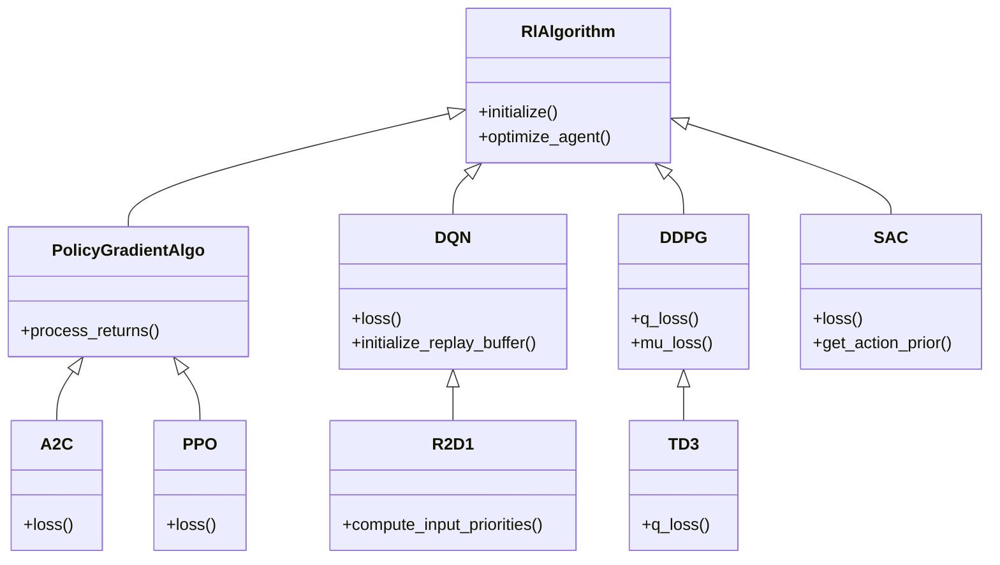

Sources: 
- [rlpyt/algos/base.py]()
- [rlpyt/algos/pg/base.py]()
- [rlpyt/algos/dqn/dqn.py]()
- [rlpyt/algos/qpg/ddpg.py]()
- [rlpyt/algos/qpg/sac.py]()

## Common Algorithm Interface

All algorithms in rlpyt implement a standardized interface for interacting with other framework components:

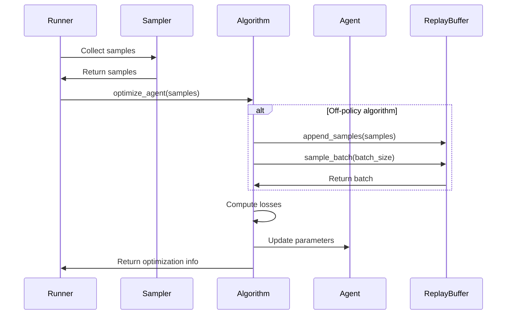

Sources:
- [rlpyt/algos/dqn/dqn.py:158-190]()
- [rlpyt/algos/qpg/sac.py:160-211]()
- [rlpyt/algos/pg/a2c.py:41-61]()

## Base Algorithm Class

The `RlAlgorithm` base class defines the interface that all algorithms must implement:

| Method | Purpose |
|--------|---------|
| `initialize` | Setup algorithm for standard training runs |
| `async_initialize` | Setup for parallel/async training |
| `optimize_agent` | Main training method that processes samples and updates agent |
| `optim_initialize` | Initialize optimizers |
| `initialize_replay_buffer` | Setup replay buffers for off-policy algorithms |

Sources:
- [rlpyt/algos/base.py]()

## Policy Gradient Algorithms

Policy gradient algorithms in rlpyt optimize the agent's policy directly by computing gradients of the expected return.

### Policy Gradient Base Class

The `PolicyGradientAlgo` class provides common functionality for all policy gradient methods:

```python
# Key method in PolicyGradientAlgo
def process_returns(self, samples):
    # Compute bootstrapped returns and advantages
    # Handle GAE if specified
    # Normalize advantages if requested
    return return_, advantage, valid
```

Sources:
- [rlpyt/algos/pg/base.py:41-75]()

### A2C (Advantage Actor-Critic)

A2C is a synchronous version of Advantage Actor-Critic that performs one gradient update per batch of collected experiences.

```python
# A2C loss computation
def loss(self, samples):
    # Policy loss: -log_likelihood * advantage
    pi_loss = -valid_mean(logli * advantage, valid)
    
    # Value loss: 0.5 * (value - return)^2
    value_loss = self.value_loss_coeff * valid_mean(value_error, valid)
    
    # Entropy loss to encourage exploration
    entropy_loss = -self.entropy_loss_coeff * entropy
    
    # Combined loss
    loss = pi_loss + value_loss + entropy_loss
```

Sources:
- [rlpyt/algos/pg/a2c.py:63-103]()

### PPO (Proximal Policy Optimization)

PPO uses clipped surrogate objectives to improve stability by preventing too large policy updates.

```python
# PPO loss computation
def loss(self, agent_inputs, action, return_, advantage, valid, old_dist_info):
    # Compute likelihood ratio
    ratio = dist.likelihood_ratio(action, old_dist_info, new_dist_info)
    
    # Clipped surrogate objective
    surr_1 = ratio * advantage
    clipped_ratio = torch.clamp(ratio, 1-self.ratio_clip, 1+self.ratio_clip)
    surr_2 = clipped_ratio * advantage
    surrogate = torch.min(surr_1, surr_2)
    pi_loss = -valid_mean(surrogate, valid)
```

Sources:
- [rlpyt/algos/pg/ppo.py:117-154]()

## Q-Learning Algorithms

Q-learning algorithms learn action-value functions and derive policies from them, typically using experience replay.

### DQN (Deep Q-Network)

DQN learns an action-value function by minimizing the temporal difference error.

```python
# DQN loss computation
def loss(self, samples):
    # Compute Q-values for current states and actions
    q = select_at_indexes(samples.action, qs)
    
    # Compute target Q-values
    with torch.no_grad():
        if self.double_dqn:
            # Double DQN: Select actions using online network
            next_a = torch.argmax(next_qs, dim=-1)
            target_q = select_at_indexes(next_a, target_qs)
        else:
            # Standard DQN: Max over target network Q-values
            target_q = torch.max(target_qs, dim=-1).values
    
    # Compute TD error
    y = samples.return_ + (1 - samples.done_n.float()) * disc_target_q
    delta = y - q
    
    # Compute loss (MSE or Huber)
    losses = 0.5 * delta ** 2
    if self.delta_clip is not None:  # Huber loss
        b = self.delta_clip * (abs_delta - self.delta_clip / 2)
        losses = torch.where(abs_delta <= self.delta_clip, losses, b)
```

Sources:
- [rlpyt/algos/dqn/dqn.py:211-265]()

### R2D1 (Recurrent Replay Distributed DQN)

R2D1 extends DQN to recurrent networks with special handling for sequence data and priorities.

```python
# R2D1 loss computation
def loss(self, samples):
    # Warm up RNN state first
    if wT > 0:
        with torch.no_grad():
            _, target_rnn_state = self.agent.target(*warmup_inputs, init_rnn_state)
            _, init_rnn_state = self.agent(*warmup_inputs, init_rnn_state)
    
    # Compute Q-values and targets
    qs, _ = self.agent(*agent_inputs, init_rnn_state)
    q = select_at_indexes(action, qs)
    
    with torch.no_grad():
        target_qs, _ = self.agent.target(*target_inputs, target_rnn_state)
        # Similar to DQN but with recurrent state handling
```

Sources:
- [rlpyt/algos/dqn/r2d1.py:244-333]()

## Actor-Critic Algorithms

Actor-critic algorithms combine policy optimization with value function learning.

### SAC (Soft Actor-Critic)

SAC is an off-policy actor-critic method that uses entropy regularization and twin Q-functions.

```python
# SAC loss computation
def loss(self, samples):
    # Twin Q-losses
    q1, q2 = self.agent.q(*agent_inputs, action)
    with torch.no_grad():
        target_action, target_log_pi, _ = self.agent.pi(*target_inputs)
        target_q1, target_q2 = self.agent.target_q(*target_inputs, target_action)
    min_target_q = torch.min(target_q1, target_q2)
    target_value = min_target_q - self._alpha * target_log_pi
    y = self.reward_scale * samples.return_ + (1 - samples.done_n.float()) * disc * target_value
    q1_loss = 0.5 * valid_mean((y - q1) ** 2, valid)
    q2_loss = 0.5 * valid_mean((y - q2) ** 2, valid)
    
    # Policy loss
    new_action, log_pi, (pi_mean, pi_log_std) = self.agent.pi(*agent_inputs)
    log_target1, log_target2 = self.agent.q(*agent_inputs, new_action)
    min_log_target = torch.min(log_target1, log_target2)
    prior_log_pi = self.get_action_prior(new_action.cpu())
    pi_losses = self._alpha * log_pi - min_log_target - prior_log_pi
    pi_loss = valid_mean(pi_losses, valid)
    
    # Alpha loss for automatic entropy tuning
    if self.target_entropy is not None and self.fixed_alpha is None:
        alpha_losses = -self._log_alpha * (log_pi.detach() + self.target_entropy)
        alpha_loss = valid_mean(alpha_losses, valid)
```

Sources:
- [rlpyt/algos/qpg/sac.py:227-283]()

### DDPG (Deep Deterministic Policy Gradient)

DDPG is a deterministic policy gradient algorithm that uses an actor-critic architecture with off-policy learning.

```python
# DDPG Q-loss computation
def q_loss(self, samples, valid):
    q = self.agent.q(*samples.agent_inputs, samples.action)
    with torch.no_grad():
        target_q = self.agent.target_q_at_mu(*samples.target_inputs)
    y = samples.return_ + (1 - samples.done_n.float()) * disc * target_q
    y = torch.clamp(y, -self.q_target_clip, self.q_target_clip)
    q_losses = 0.5 * (y - q) ** 2
    q_loss = valid_mean(q_losses, valid)
    return q_loss

# DDPG policy loss
def mu_loss(self, samples, valid):
    mu_losses = self.agent.q_at_mu(*samples.agent_inputs)
    mu_loss = valid_mean(mu_losses, valid)
    return -mu_loss  # Negative for gradient ascent
```

Sources:
- [rlpyt/algos/qpg/ddpg.py:188-204]()

### TD3 (Twin Delayed DDPG)

TD3 improves DDPG with twin Q-functions, delayed policy updates, and target policy noise.

```python
# TD3 Q-loss computation
def q_loss(self, samples, valid):
    q1, q2 = self.agent.q(*samples.agent_inputs, samples.action)
    with torch.no_grad():
        target_q1, target_q2 = self.agent.target_q_at_mu(*samples.target_inputs)
        target_q = torch.min(target_q1, target_q2)
    y = samples.return_ + (1 - samples.done_n.float()) * disc * target_q
    q1_losses = 0.5 * (y - q1) ** 2
    q2_losses = 0.5 * (y - q2) ** 2
    q_loss = valid_mean(q1_losses + q2_losses, valid)
    return q_loss
```

Sources:
- [rlpyt/algos/qpg/td3.py:38-50]()

## Algorithm Optimization Flow

The following diagram illustrates the optimization flow for different algorithm types:

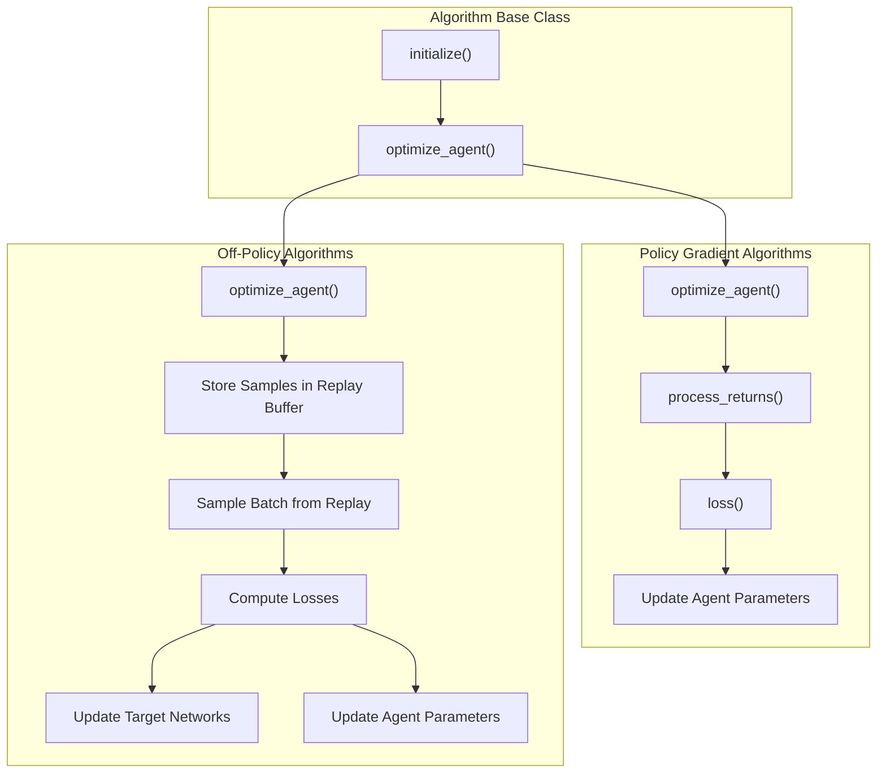

Sources:
- [rlpyt/algos/pg/a2c.py:41-61]()
- [rlpyt/algos/dqn/dqn.py:158-190]()
- [rlpyt/algos/qpg/sac.py:160-211]()

## Algorithm Utility Functions

Rlpyt provides utility functions for common RL algorithm operations:

| Function | Purpose |
|----------|---------|
| `discount_return` | Computes discounted returns from rewards |
| `generalized_advantage_estimation` | Computes GAE for policy gradient methods |
| `discount_return_n_step` | Computes n-step returns for Q-learning |
| `valid_from_done` | Creates a mask for valid timesteps in trajectories |

```python
# Example: Generalized Advantage Estimation
def generalized_advantage_estimation(reward, value, done, bootstrap_value,
        discount, gae_lambda, advantage_dest=None, return_dest=None):
    """
    Computes generalized advantage estimation (GAE) for policy gradient methods.
    Used to reduce variance in policy gradient estimates.
    """
    advantage = advantage_dest if advantage_dest is not None else zeros(
        reward.shape, dtype=reward.dtype)
    return_ = return_dest if return_dest is not None else zeros(
        reward.shape, dtype=reward.dtype)
    nd = 1 - done
    advantage[-1] = reward[-1] + discount * bootstrap_value * nd[-1] - value[-1]
    for t in reversed(range(len(reward) - 1)):
        delta = reward[t] + discount * value[t + 1] * nd[t] - value[t]
        advantage[t] = delta + discount * gae_lambda * nd[t] * advantage[t + 1]
    return_[:] = advantage + value
    return advantage, return_
```

Sources:
- [rlpyt/algos/utils.py:8-162]()
- [docs/source/pages/util.rst:83-96]()

## Advanced Features

### Prioritized Experience Replay

DQN and R2D1 support prioritized experience replay to more efficiently learn from important samples:

```python
# R2D1 with prioritized replay
def compute_input_priorities(self, samples):
    """
    Computes priorities for new samples entering the replay buffer
    based on TD-error magnitudes
    """
    q = samples.agent.agent_info.q
    action = samples.agent.action
    q_at_a = select_at_indexes(action, q)
    
    # Compute n-step returns
    return_n, done_n = discount_return_n_step(
        reward=samples.env.reward,
        done=samples.env.done,
        n_step=self.n_step_return,
        discount=self.discount,
        do_truncated=False,
    )
    
    # Compute TD-error and use it for priorities
    y = self.value_scale(return_n + (1 - done_n.float()) * self.inv_value_scale(q_max[nm1:]))
    delta = abs(q_at_a[:-nm1] - y)
    
    # Combine max and mean TD-errors for robust prioritization
    max_d = torch.max(delta * valid, dim=0).values
    mean_d = valid_mean(delta, valid, dim=0)
    priorities = self.pri_eta * max_d + (1 - self.pri_eta) * mean_d
```

Sources:
- [rlpyt/algos/dqn/r2d1.py:181-242]()

### Automatic Entropy Tuning

SAC includes automatic tuning of the entropy coefficient to maintain a target entropy level:

```python
# SAC entropy coefficient tuning
if self.target_entropy is not None and self.fixed_alpha is None:
    alpha_losses = -self._log_alpha * (log_pi.detach() + self.target_entropy)
    alpha_loss = valid_mean(alpha_losses, valid)
    
    self.alpha_optimizer.zero_grad()
    alpha_loss.backward()
    self.alpha_optimizer.step()
    self._alpha = torch.exp(self._log_alpha.detach())
```

Sources:
- [rlpyt/algos/qpg/sac.py:277-283]()
- [rlpyt/algos/qpg/sac.py:179-183]()

## Implementing Custom Algorithms

Custom algorithms can be implemented by subclassing one of the base algorithm classes and implementing the required methods:

1. Subclass `RlAlgorithm` or one of its derivatives like `PolicyGradientAlgo`
2. Implement `initialize` to set up your algorithm
3. Implement `optimize_agent` to define the update rule
4. Implement `loss` to compute your algorithm's loss function

For off-policy algorithms, you'll also need to implement:

1. `initialize_replay_buffer` to set up your experience replay
2. `samples_to_buffer` to define how samples are stored

---

# Page: Q-Learning Algorithms

# Q-Learning Algorithms

<details>
<summary>Relevant source files</summary>

The following files were used as context for generating this wiki page:

- [rlpyt/algos/dqn/dqn.py](rlpyt/algos/dqn/dqn.py)
- [rlpyt/algos/dqn/r2d1.py](rlpyt/algos/dqn/r2d1.py)
- [rlpyt/algos/qpg/ddpg.py](rlpyt/algos/qpg/ddpg.py)
- [rlpyt/algos/qpg/sac.py](rlpyt/algos/qpg/sac.py)
- [rlpyt/algos/qpg/sac_v.py](rlpyt/algos/qpg/sac_v.py)
- [rlpyt/algos/qpg/td3.py](rlpyt/algos/qpg/td3.py)
- [rlpyt/experiments/configs/atari/dqn/atari_dqn.py](rlpyt/experiments/configs/atari/dqn/atari_dqn.py)
- [rlpyt/experiments/configs/mujoco/qpg/mujoco_sac_v.py](rlpyt/experiments/configs/mujoco/qpg/mujoco_sac_v.py)
- [rlpyt/experiments/scripts/atari/dqn/launch/pabti/launch_atari_dqn_gpu_noeval.py](rlpyt/experiments/scripts/atari/dqn/launch/pabti/launch_atari_dqn_gpu_noeval.py)
- [rlpyt/experiments/scripts/atari/dqn/train/atari_catdqn_gpu.py](rlpyt/experiments/scripts/atari/dqn/train/atari_catdqn_gpu.py)
- [rlpyt/experiments/scripts/atari/dqn/train/atari_dqn_gpu.py](rlpyt/experiments/scripts/atari/dqn/train/atari_dqn_gpu.py)
- [rlpyt/experiments/scripts/atari/dqn/train/atari_dqn_gpu_noeval.py](rlpyt/experiments/scripts/atari/dqn/train/atari_dqn_gpu_noeval.py)
- [rlpyt/experiments/scripts/atari/dqn/train/atari_r2d1_gpu.py](rlpyt/experiments/scripts/atari/dqn/train/atari_r2d1_gpu.py)
- [rlpyt/experiments/scripts/atari/pg/train/atari_lstm_ppo_gpu.py](rlpyt/experiments/scripts/atari/pg/train/atari_lstm_ppo_gpu.py)
- [rlpyt/experiments/scripts/mujoco/pg/train/mujoco_ff_ppo_gpu.py](rlpyt/experiments/scripts/mujoco/pg/train/mujoco_ff_ppo_gpu.py)

</details>


This page documents the Q-learning algorithms implemented in the rlpyt framework, including both value-based methods (DQN family) and actor-critic methods that use Q-functions (DDPG, TD3, SAC). For information about policy gradient algorithms that don't use Q-functions, see [Policy Gradient Algorithms](#3.2).

## Algorithm Family Overview

The Q-learning algorithms in rlpyt can be categorized into two main families:

1. **DQN Family** - Value-based methods for discrete action spaces that learn Q-value functions
2. **Continuous Q-Learning with Policy Gradients** - Actor-critic methods for continuous action spaces that combine Q-learning with policy gradients

```mermaid
graph TD
    subgraph "Value-Based Q-Learning"
        DQN["DQN
        (Deep Q-Network)"]
        DDQN["Double DQN"]
        Dueling["Dueling DQN"]
        CatDQN["Categorical DQN
        (C51)"]
        R2D1["R2D1
        (Recurrent DQN)"]
        
        DQN --> DDQN
        DQN --> Dueling
        DQN --> CatDQN
        DQN --> R2D1
    end
    
    subgraph "Continuous Action Q-Learning"
        DDPG["DDPG
        (Deep Deterministic
        Policy Gradient)"]
        TD3["TD3
        (Twin Delayed DDPG)"]
        SAC["SAC
        (Soft Actor-Critic)"]
        
        DDPG --> TD3
        SAC
    end
    
    QLearning["Q-Learning Algorithms"] --> "Value-Based Q-Learning"
    QLearning --> "Continuous Action Q-Learning"
```

Sources: [rlpyt/algos/dqn/dqn.py](), [rlpyt/algos/dqn/r2d1.py](), [rlpyt/algos/qpg/ddpg.py](), [rlpyt/algos/qpg/td3.py](), [rlpyt/algos/qpg/sac.py]()

## DQN Family

### Base DQN Implementation

The Deep Q-Network (DQN) algorithm learns a Q-function that estimates the expected return from taking an action in a given state. The rlpyt implementation includes the core DQN algorithm with support for several extensions:

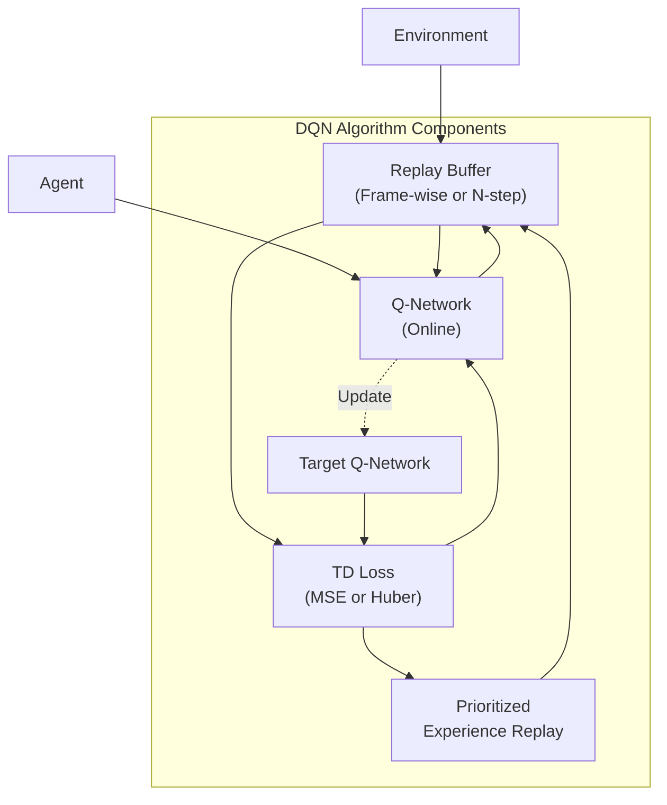

The core DQN class extends `RlAlgorithm` and implements the following key methods:

- `initialize_replay_buffer`: Sets up the replay buffer (uniform or prioritized)
- `optimize_agent`: Main training loop that samples from replay and updates the network
- `loss`: Computes TD error between Q-values and targets

Key features of the base DQN implementation:

- **Experience Replay**: Stores and samples transitions for off-policy learning
- **Target Network**: Maintains a separate target network for stable learning
- **TD Learning**: Uses Temporal Difference learning with bootstrapping
- **Gradient Clipping**: Limits gradient magnitude for stability
- **Epsilon-Greedy Exploration**: Scheduled exploration rate (implemented in agent)

Sources: [rlpyt/algos/dqn/dqn.py:20-267](), [rlpyt/experiments/configs/atari/dqn/atari_dqn.py:7-43]()

### DQN Variants

The rlpyt framework implements several DQN variants that build upon the base algorithm:

#### Double DQN

Addresses the overestimation bias in Q-learning by decoupling action selection and evaluation:

```python
if self.double_dqn:
    next_qs = self.agent(*samples.target_inputs)
    next_a = torch.argmax(next_qs, dim=-1)
    target_q = select_at_indexes(next_a, target_qs)
else:
    target_q = torch.max(target_qs, dim=-1).values
```

#### Dueling DQN

Separates value and advantage estimation in the network architecture (implemented in the model, configured via parameters).

#### Prioritized Experience Replay

Samples transitions based on TD error magnitude for more efficient learning:

```python
if self.prioritized_replay:
    losses *= samples.is_weights
    self.replay_buffer.update_batch_priorities(td_abs_errors)
```

#### N-Step Returns

Allows using multi-step returns for better credit assignment:

```python
disc_target_q = (self.discount ** self.n_step_return) * target_q
y = samples.return_ + (1 - samples.done_n.float()) * disc_target_q
```

Sources: [rlpyt/algos/dqn/dqn.py:211-266](), [rlpyt/experiments/configs/atari/dqn/atari_dqn.py:47-77]()

### Recurrent DQN (R2D1)

R2D1 (Recurrent Replay Distributed DQN) extends DQN to handle sequential data using recurrent neural networks:

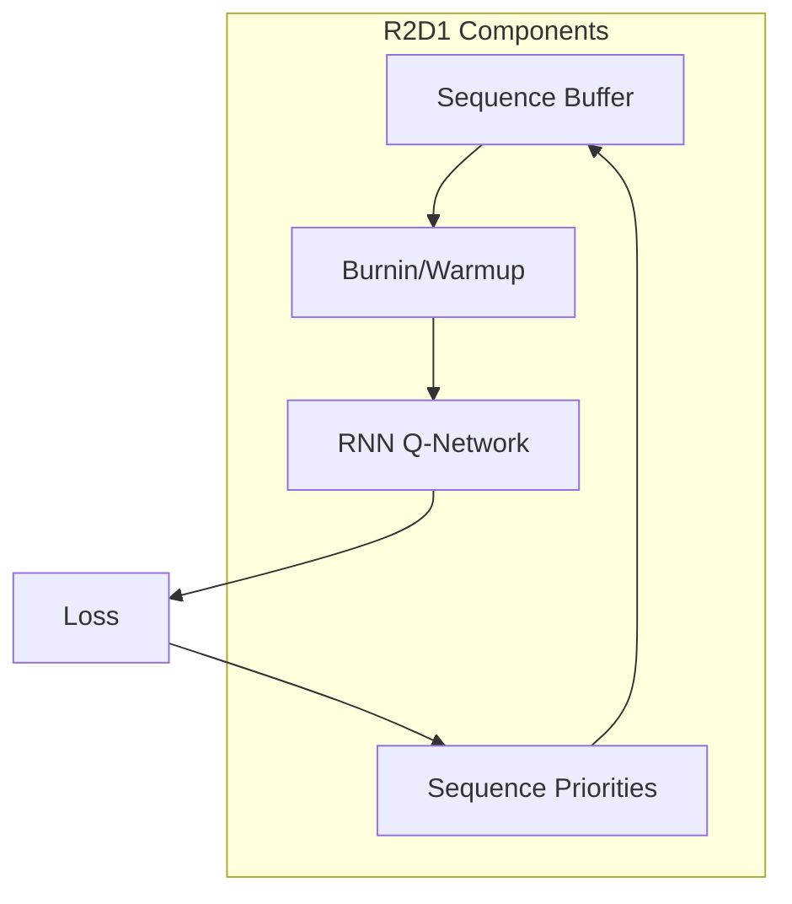

Key R2D1 features:

1. **Sequence Replay Buffer**: Handles sequences of experiences rather than individual transitions
2. **RNN State Management**: Stores and manages recurrent states at specific intervals
3. **Burnin/Warmup**: Initializes RNN state with a warmup period before computing losses
4. **Sequence Prioritization**: Prioritizes sequences based on TD errors

The R2D1 implementation handles several complexities:

- **State Storage Interval**: Stores RNN states periodically to reduce memory usage
- **Recurrent State Initialization**: Warms up RNN states before computing gradients
- **Sequence-based Priorities**: Computes priorities for entire sequences rather than individual transitions

Sources: [rlpyt/algos/dqn/r2d1.py:24-345]()

## Continuous Action Q-Learning

For environments with continuous action spaces, rlpyt implements several algorithms that combine Q-learning with policy gradients.

### DDPG (Deep Deterministic Policy Gradient)

DDPG adapts Q-learning for continuous action spaces using a deterministic policy:

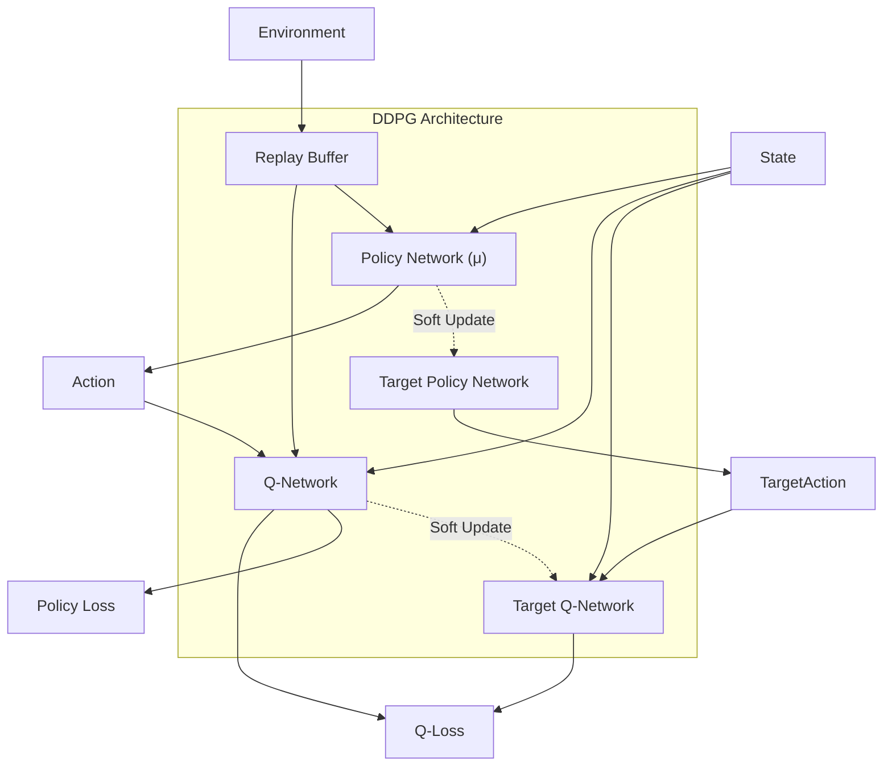

DDPG's key components include:

1. **Deterministic Policy Network (μ)**: Outputs deterministic actions
2. **Q-Network**: Evaluates state-action pairs
3. **Target Networks**: Stabilizes learning with soft updates
4. **Experience Replay**: Enables off-policy learning
5. **Policy Gradient**: Updates policy to maximize Q-values

The DDPG algorithm implements:

- **Two Separate Optimizers**: One for policy and one for Q-function
- **Soft Target Updates**: Gradually updates target networks
- **Time-limit Bootstrapping**: Special handling for timeout transitions

Sources: [rlpyt/algos/qpg/ddpg.py:22-214]()

### TD3 (Twin Delayed DDPG)

TD3 extends DDPG with three key improvements to address function approximation errors:

1. **Twin Q-Networks**: Uses two Q-networks and takes the minimum to reduce overestimation
2. **Delayed Policy Updates**: Updates policy less frequently than Q-functions
3. **Target Policy Smoothing**: Adds noise to target actions for regularization

The critical TD3 improvement in the Q-loss function:

```python
q1, q2 = self.agent.q(*samples.agent_inputs, samples.action)
with torch.no_grad():
    target_q1, target_q2 = self.agent.target_q_at_mu(*samples.target_inputs)
    target_q = torch.min(target_q1, target_q2)
```

Sources: [rlpyt/algos/qpg/td3.py:9-50]()

### SAC (Soft Actor-Critic)

SAC is an entropy-regularized actor-critic algorithm that learns a stochastic policy:

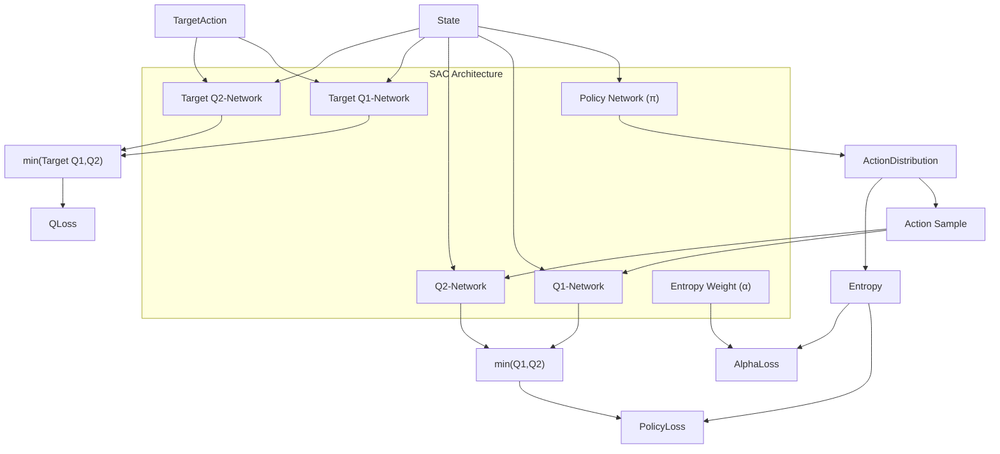

Key SAC features:

1. **Maximum Entropy RL**: Encourages exploration by maximizing entropy
2. **Twin Q-Networks**: Mitigates overestimation bias
3. **Automatic Temperature Tuning**: Adjusts entropy weight automatically
4. **Reparameterization Trick**: Enables direct policy gradient computation

SAC implementation details:

- **Policy Network**: Outputs mean and log standard deviation of Gaussian action distribution
- **Temperature Parameter (α)**: Controls the trade-off between entropy and reward
- **Adaptive Temperature**: Automatically adjusts α based on target entropy
- **Minimum Q-Value**: Uses minimum of two Q-networks for targets

Sources: [rlpyt/algos/qpg/sac.py:31-331]()

## Implementation Details

### Common Patterns

Across all Q-learning algorithms in rlpyt, several common implementation patterns emerge:

#### Algorithm Structure

Each algorithm inherits from `RlAlgorithm` and implements:

1. `initialize`: Sets up replay buffer and optimizers
2. `optimize_agent`: Main training loop that samples and updates networks
3. `loss`: Computes loss functions for network updates

#### Data Handling

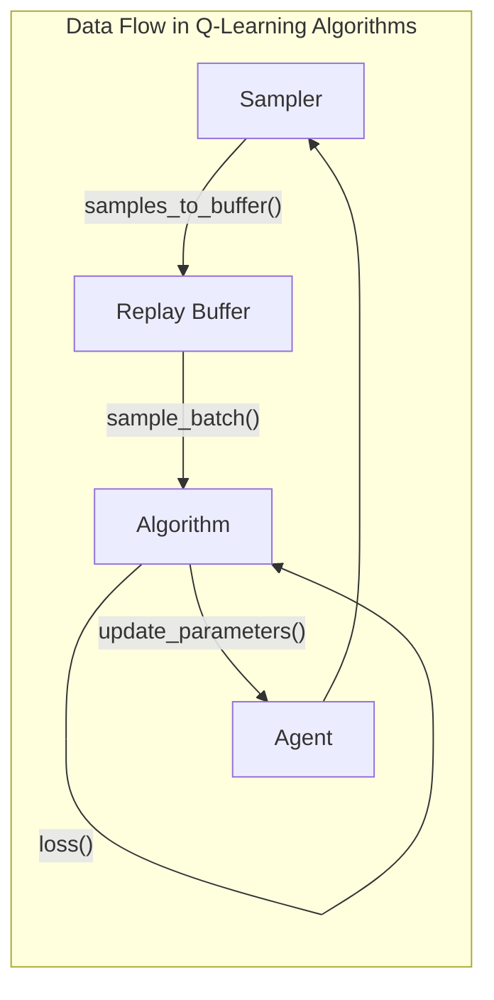

Key data handling components:

- **SamplesToBuffer**: Structure for converting sampler data to replay buffer format
- **NamedTuple Interface**: Consistent data structures across components
- **Experience Replay**: Uniform or prioritized sampling from buffer
- **Batch Processing**: Efficient tensor operations on batches of data

#### Optimization Process

All Q-learning algorithms follow a similar optimization pattern:

1. **Sample Batch**: Get transitions or sequences from replay buffer
2. **Compute Targets**: Use target networks to compute TD targets
3. **Compute Loss**: Calculate TD error or policy gradient loss
4. **Gradient Update**: Apply backpropagation and optimizer step
5. **Update Targets**: Periodically update target networks

Sources: [rlpyt/algos/dqn/dqn.py:158-190](), [rlpyt/algos/qpg/sac.py:160-211]()

### Replay Buffer Integration

Replay buffers are a critical component of Q-learning algorithms:

| Algorithm | Replay Buffer Type | Key Features |
|-----------|-------------------|--------------|
| DQN | UniformReplayFrameBuffer | Frame-wise storage for efficiency |
| DQN + PER | PrioritizedReplayFrameBuffer | Prioritized sampling based on TD error |
| R2D1 | UniformSequenceReplayFrameBuffer | Stores sequences for recurrent networks |
| R2D1 + PER | PrioritizedSequenceReplayFrameBuffer | Prioritized sampling of sequences |
| DDPG/TD3/SAC | UniformReplayBuffer | Standard experience replay |

Sources: [rlpyt/algos/dqn/dqn.py:125-156](), [rlpyt/algos/dqn/r2d1.py:86-128]()

## Usage and Configuration

### Configuration Structure

Q-learning algorithms in rlpyt are typically configured through dictionary-based configuration files:

```python
config = dict(
    agent=dict(),
    algo=dict(
        discount=0.99,
        batch_size=128,
        learning_rate=1e-4,
        clip_grad_norm=10.,
        min_steps_learn=int(5e4),
        double_dqn=False,
        prioritized_replay=False,
        n_step_return=1,
        replay_size=int(1e6),
    ),
    env=dict(
        game="pong",
        episodic_lives=True,
    ),
    model=dict(dueling=False),
    runner=dict(
        n_steps=50e6,
        log_interval_steps=1e6,
    ),
    sampler=dict(
        batch_T=2,
        batch_B=16,
        max_decorrelation_steps=1000,
    ),
)
```

Sources: [rlpyt/experiments/configs/atari/dqn/atari_dqn.py:7-43]()

### Training Script Example

Q-learning algorithms are typically used with the following pattern:

```python
# Define components
sampler = GpuSampler(
    EnvCls=AtariEnv,
    env_kwargs=config["env"],
    CollectorCls=GpuWaitResetCollector,
    TrajInfoCls=AtariTrajInfo,
    **config["sampler"]
)
algo = DQN(optim_kwargs=config["optim"], **config["algo"])
agent = AtariDqnAgent(model_kwargs=config["model"], **config["agent"])
runner = MinibatchRlEval(
    algo=algo,
    agent=agent,
    sampler=sampler,
    affinity=affinity,
    **config["runner"]
)

# Train
runner.train()
```

Sources: [rlpyt/experiments/scripts/atari/dqn/train/atari_dqn_gpu.py:24-43]()

### Key Algorithm Parameters

| Algorithm | Key Parameters | Description |
|-----------|----------------|-------------|
| DQN | `discount` | Discount factor for future rewards |
| | `batch_size` | Number of transitions per update |
| | `replay_ratio` | Ratio of updates to new samples |
| | `target_update_interval` | Frequency of target network updates |
| | `double_dqn` | Whether to use double DQN |
| | `prioritized_replay` | Whether to use prioritized replay |
| R2D1 | `batch_T` | Sequence length for training |
| | `warmup_T` | Length of warmup/burnin period |
| | `store_rnn_state_interval` | Interval for storing RNN states |
| DDPG/TD3 | `target_update_tau` | Rate of soft target updates |
| | `policy_update_interval` | Frequency of policy updates |
| SAC | `fixed_alpha` | Entropy coefficient (None for auto-tuning) |
| | `target_entropy` | Target entropy for auto-tuning |
| | `reparameterize` | Whether to use reparameterization trick |

Sources: [rlpyt/algos/dqn/dqn.py:28-58](), [rlpyt/algos/dqn/r2d1.py:30-66](), [rlpyt/algos/qpg/sac.py:36-60]()

---

# Page: Policy Gradient Algorithms

# Policy Gradient Algorithms

<details>
<summary>Relevant source files</summary>

The following files were used as context for generating this wiki page:

- [docs/source/pages/util.rst](docs/source/pages/util.rst)
- [rlpyt/agents/dqn/r2d1_agent.py](rlpyt/agents/dqn/r2d1_agent.py)
- [rlpyt/agents/pg/atari.py](rlpyt/agents/pg/atari.py)
- [rlpyt/agents/pg/categorical.py](rlpyt/agents/pg/categorical.py)
- [rlpyt/agents/pg/gaussian.py](rlpyt/agents/pg/gaussian.py)
- [rlpyt/algos/pg/a2c.py](rlpyt/algos/pg/a2c.py)
- [rlpyt/algos/pg/base.py](rlpyt/algos/pg/base.py)
- [rlpyt/algos/pg/ppo.py](rlpyt/algos/pg/ppo.py)
- [rlpyt/algos/utils.py](rlpyt/algos/utils.py)
- [rlpyt/distributions/gaussian.py](rlpyt/distributions/gaussian.py)
- [rlpyt/experiments/scripts/mujoco/pg/launch/pabti/launch_mujoco_ppo_serial.py](rlpyt/experiments/scripts/mujoco/pg/launch/pabti/launch_mujoco_ppo_serial.py)
- [rlpyt/samplers/parallel/gpu/alternating_sampler.py](rlpyt/samplers/parallel/gpu/alternating_sampler.py)

</details>


## Purpose and Scope

This document details the policy gradient algorithm implementations in the rlpyt framework. Policy gradient methods are a class of reinforcement learning algorithms that directly optimize policy parameters by computing gradients of expected return with respect to policy parameters. This page covers the base policy gradient class, specific algorithm implementations (A2C and PPO), agent implementations that use these algorithms, and related components such as distributions and utility functions.

For Q-learning algorithms, see [Q-Learning Algorithms](#3.1). For actor-critic algorithms like SAC, DDPG, and TD3, see [Actor-Critic Algorithms](#3.3).

## Policy Gradient Architecture

The policy gradient implementation in rlpyt follows a modular design with inheritance patterns that allow for code reuse across algorithms.

### Class Hierarchy and Structure

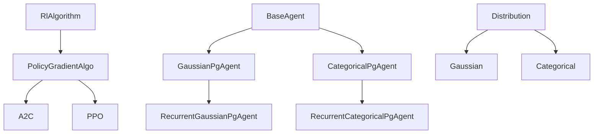

Sources: [rlpyt/algos/pg/base.py](), [rlpyt/algos/pg/a2c.py](), [rlpyt/algos/pg/ppo.py](), [rlpyt/agents/pg/gaussian.py](), [rlpyt/agents/pg/categorical.py](), [rlpyt/distributions/gaussian.py]()

### Data Flow

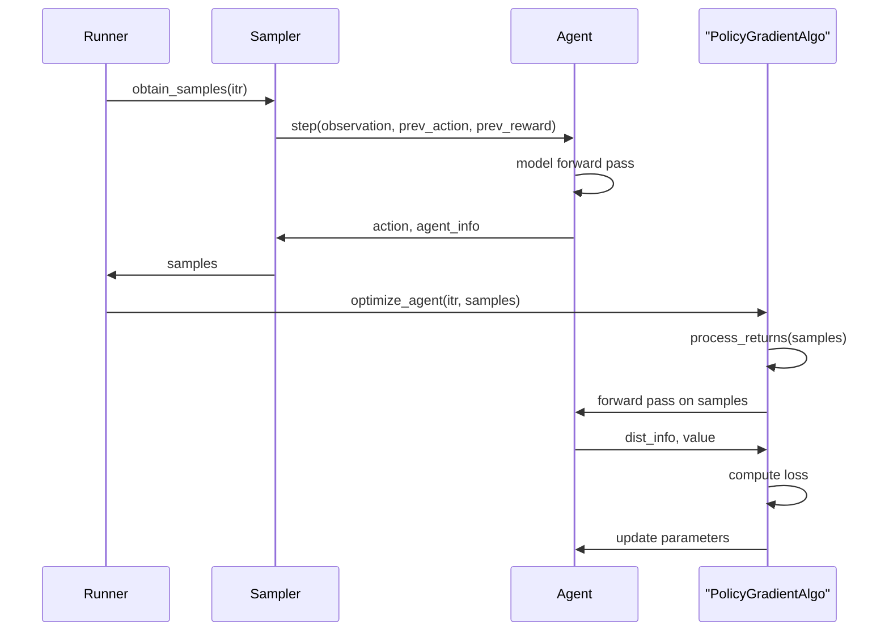

Sources: [rlpyt/algos/pg/base.py:42-75](), [rlpyt/algos/pg/a2c.py:41-61](), [rlpyt/algos/pg/ppo.py:59-115]()

## Base Policy Gradient Algorithm

The `PolicyGradientAlgo` class serves as the foundation for all policy gradient algorithms in rlpyt. It provides common functionality and methods used by specific algorithm implementations.

### Key Features

- **Bootstrap Value Mechanism**: The `bootstrap_value = True` attribute tells the sampler that it needs the value of the next state for bootstrapping.
- **Initialize Method**: Sets up the optimizer, stores agent reference, and other initialization parameters.
- **Process Returns Method**: Computes bootstrapped returns and advantages from a minibatch of samples.

```python
# Key parameters for policy gradient algorithms
self.optimizer = self.OptimCls(agent.parameters(),
    lr=self.learning_rate, **self.optim_kwargs)
self.agent = agent
self.batch_spec = batch_spec
```

### Return and Advantage Calculation

The `process_returns` method computes bootstrapped returns and advantages from samples:

- Uses `discount_return` if `gae_lambda==1` (empirical discounted return)
- Uses `generalized_advantage_estimation` otherwise
- Handles masking for recurrent agents or mid-batch resets
- Optionally normalizes advantages

```mermaid
graph TD
    A["process_returns(samples)"] --> B{"gae_lambda == 1?"}
    B -->|Yes| C["discount_return(reward, done, bv, discount)"]
    B -->|No| D["generalized_advantage_estimation(reward, value, done, bv, discount, gae_lambda)"]
    C --> E["advantage = return_ - value"]
    D --> F["advantage, return_"]
    E --> G["Valid mask computation"]
    F --> G
    G --> H{"normalize_advantage?"}
    H -->|Yes| I["Normalize advantage"]
    H -->|No| J["Return: return_, advantage, valid"]
    I --> J
```

Sources: [rlpyt/algos/pg/base.py:42-75](), [rlpyt/algos/utils.py:8-40]()

## Algorithm Implementations

### A2C (Advantage Actor-Critic)

A2C is a synchronous advantage actor-critic algorithm that takes one gradient step on each iteration of samples.

#### Key Parameters

| Parameter | Description |
|-----------|-------------|
| `discount` | Discount factor for future rewards (default: 0.99) |
| `learning_rate` | Learning rate for optimizer (default: 0.001) |
| `value_loss_coeff` | Coefficient for value function loss (default: 0.5) |
| `entropy_loss_coeff` | Coefficient for entropy regularization (default: 0.01) |
| `clip_grad_norm` | Gradient norm clipping value (default: 1.0) |
| `gae_lambda` | Lambda parameter for GAE (default: 1) |
| `normalize_advantage` | Whether to normalize advantages (default: False) |

#### Optimization Process

The `optimize_agent` method performs a single gradient step:

1. Updates observation running mean/std if agent has `update_obs_rms`
2. Zeroes gradients
3. Computes loss, entropy, and perplexity
4. Performs backward pass
5. Clips gradients
6. Takes optimizer step

#### Loss Computation

The `loss` method computes the total loss as a combination of three components:

1. **Policy Loss**: `-mean(log_likelihood * advantage)`
2. **Value Loss**: `value_loss_coeff * mean((value - return_)^2)`
3. **Entropy Loss**: `-entropy_loss_coeff * entropy`

```python
# From A2C.loss method
pi_loss = - valid_mean(logli * advantage, valid)
value_error = 0.5 * (value - return_) ** 2
value_loss = self.value_loss_coeff * valid_mean(value_error, valid)
entropy = dist.mean_entropy(dist_info, valid)
entropy_loss = - self.entropy_loss_coeff * entropy
loss = pi_loss + value_loss + entropy_loss
```

Sources: [rlpyt/algos/pg/a2c.py:19-103]()

### PPO (Proximal Policy Optimization)

PPO is an algorithm that uses clipped likelihood ratios to constrain policy updates, taking multiple epochs of gradient steps on minibatches of the training data.

#### Additional Parameters

| Parameter | Description |
|-----------|-------------|
| `minibatches` | Number of minibatches to create from batch (default: 4) |
| `epochs` | Number of passes through minibatches (default: 4) |
| `ratio_clip` | Clipping parameter for likelihood ratio (default: 0.1) |
| `linear_lr_schedule` | Whether to use linear learning rate schedule (default: True) |

#### Optimization Process

The `optimize_agent` method:

1. Organizes agent inputs from training data
2. Moves data to device (e.g., GPU)
3. Processes returns
4. For each epoch and minibatch:
   - Computes loss, performs backward pass, clips gradients, takes optimizer step
5. Updates learning rate if using linear schedule

#### PPO-Specific Loss

PPO uses a clipped surrogate objective to constrain policy updates:

```python
# From PPO.loss method
ratio = dist.likelihood_ratio(action, old_dist_info, new_dist_info)
surr_1 = ratio * advantage
clipped_ratio = torch.clamp(ratio, 1. - self.ratio_clip, 1. + self.ratio_clip)
surr_2 = clipped_ratio * advantage
surrogate = torch.min(surr_1, surr_2)
pi_loss = - valid_mean(surrogate, valid)
```

```mermaid
graph TD
    A["agent_inputs, action, return_, advantage, valid, old_dist_info"] --> B["Forward pass: dist_info, value"]
    B --> C["Compute likelihood ratio"]
    C --> D["surr_1 = ratio * advantage"]
    C --> E["clipped_ratio = clamp(ratio, 1-clip, 1+clip)"]
    E --> F["surr_2 = clipped_ratio * advantage"]
    D --> G["surrogate = min(surr_1, surr_2)"]
    F --> G
    G --> H["pi_loss = -mean(surrogate)"]
    B --> I["value_error = 0.5 * (value - return_)^2"]
    I --> J["value_loss = value_loss_coeff * mean(value_error)"]
    B --> K["entropy = dist.mean_entropy(dist_info)"]
    K --> L["entropy_loss = -entropy_loss_coeff * entropy"]
    H --> M["loss = pi_loss + value_loss + entropy_loss"]
    J --> M
    L --> M
```

Sources: [rlpyt/algos/pg/ppo.py:16-154]()

## Policy Gradient Agents

Rlpyt provides dedicated agent classes that implement policy gradient methods for different action spaces.

### Gaussian Agents (Continuous Action Space)

- **GaussianPgAgent**: For feedforward policies with continuous action spaces
- **RecurrentGaussianPgAgent**: For recurrent policies with continuous action spaces

```python
# From GaussianPgAgent.__call__
model_inputs = buffer_to((observation, prev_action, prev_reward), device=self.device)
mu, log_std, value = self.model(*model_inputs)
return buffer_to((DistInfoStd(mean=mu, log_std=log_std), value), device="cpu")

# From GaussianPgAgent.step
dist_info = DistInfoStd(mean=mu, log_std=log_std)
action = self.distribution.sample(dist_info)
agent_info = AgentInfo(dist_info=dist_info, value=value)
```

Sources: [rlpyt/agents/pg/gaussian.py:14-130]()

### Categorical Agents (Discrete Action Space)

- **CategoricalPgAgent**: For feedforward policies with discrete action spaces
- **RecurrentCategoricalPgAgent**: For recurrent policies with discrete action spaces

```python
# From CategoricalPgAgent.__call__
prev_action = self.distribution.to_onehot(prev_action)
model_inputs = buffer_to((observation, prev_action, prev_reward), device=self.device)
pi, value = self.model(*model_inputs)
return buffer_to((DistInfo(prob=pi), value), device="cpu")

# From CategoricalPgAgent.step
dist_info = DistInfo(prob=pi)
action = self.distribution.sample(dist_info)
agent_info = AgentInfo(dist_info=dist_info, value=value)
```

Sources: [rlpyt/agents/pg/categorical.py:11-106]()

### Specialized Agent Implementations

- **AtariFfAgent**: Categorical agent specifically for Atari environments
- **AtariLstmAgent**: Recurrent categorical agent for Atari environments

Sources: [rlpyt/agents/pg/atari.py:1-37]()

## Distributions

Policy gradient algorithms use probability distributions over actions to enable stochastic policies and exploration.

### Gaussian Distribution (Continuous Actions)

The `Gaussian` class implements a multivariate Gaussian with diagonal covariance for continuous action spaces.

#### Key Methods

- **sample(dist_info)**: Samples an action from the distribution
- **log_likelihood(x, dist_info)**: Computes log-likelihood of an action
- **entropy(dist_info)**: Computes entropy of the distribution
- **kl(old_dist_info, new_dist_info)**: Computes KL divergence between distributions

#### Optional Features

- Standard deviation clipping
- Action clipping
- Sample squashing (tanh transformation)
- Noise clipping

```python
# From Gaussian.sample
noise = std * torch.normal(torch.zeros_like(mean), torch.ones_like(mean))
sample = mean + noise
if self.squash is not None:
    sample = self.squash * torch.tanh(sample)
```

Sources: [rlpyt/distributions/gaussian.py:15-246]()

### Categorical Distribution (Discrete Actions)

Implements a categorical distribution for discrete action spaces.

## Utility Functions

The `rlpyt/algos/utils.py` module provides essential utility functions for policy gradient algorithms.

### Discounted Return Calculation

```python
# Computing discounted return
return_ = zeros(reward.shape, dtype=reward.dtype)
nd = 1 - done
return_[-1] = reward[-1] + discount * bootstrap_value * nd[-1]
for t in reversed(range(len(reward) - 1)):
    return_[t] = reward[t] + return_[t + 1] * discount * nd[t]
```

### Generalized Advantage Estimation (GAE)

```python
# Computing GAE
advantage = zeros(reward.shape, dtype=reward.dtype)
advantage[-1] = reward[-1] + discount * bootstrap_value * nd[-1] - value[-1]
for t in reversed(range(len(reward) - 1)):
    delta = reward[t] + discount * value[t + 1] * nd[t] - value[t]
    advantage[t] = delta + discount * gae_lambda * nd[t] * advantage[t + 1]
return_ = advantage + value
```

### Valid Mask Computation

```python
# Computing valid mask from done signals
valid = torch.ones_like(done)
valid[1:] = 1 - torch.clamp(torch.cumsum(done[:-1], dim=0), max=1)
```

Sources: [rlpyt/algos/utils.py:8-162]()

## Running Policy Gradient Algorithms

The framework provides launch scripts for running policy gradient algorithms on various environments:

```python
# Example from launch_mujoco_ppo_serial.py
script = "rlpyt/experiments/scripts/mujoco/pg/train/mujoco_ppo_serial.py"
env_ids = ["Hopper-v3", "Walker2d-v3", "Ant-v3", "HalfCheetah-v3"]
```

Sources: [rlpyt/experiments/scripts/mujoco/pg/launch/pabti/launch_mujoco_ppo_serial.py:1-61]()

---

# Page: Actor-Critic Algorithms

# Actor-Critic Algorithms

<details>
<summary>Relevant source files</summary>

The following files were used as context for generating this wiki page:

- [rlpyt/algos/dqn/dqn.py](rlpyt/algos/dqn/dqn.py)
- [rlpyt/algos/dqn/r2d1.py](rlpyt/algos/dqn/r2d1.py)
- [rlpyt/algos/qpg/ddpg.py](rlpyt/algos/qpg/ddpg.py)
- [rlpyt/algos/qpg/sac.py](rlpyt/algos/qpg/sac.py)
- [rlpyt/algos/qpg/sac_v.py](rlpyt/algos/qpg/sac_v.py)
- [rlpyt/algos/qpg/td3.py](rlpyt/algos/qpg/td3.py)
- [rlpyt/experiments/configs/atari/dqn/atari_r2d1.py](rlpyt/experiments/configs/atari/dqn/atari_r2d1.py)
- [rlpyt/experiments/configs/mujoco/qpg/mujoco_sac_v.py](rlpyt/experiments/configs/mujoco/qpg/mujoco_sac_v.py)
- [rlpyt/experiments/scripts/atari/dqn/launch/dgx/launch_atari_r2d1_async_gpu.py](rlpyt/experiments/scripts/atari/dqn/launch/dgx/launch_atari_r2d1_async_gpu.py)

</details>


This page documents the actor-critic algorithm implementations in the rlpyt framework. Actor-critic algorithms combine policy-based methods (the actor) and value-based methods (the critic) for reinforcement learning. In rlpyt, actor-critic algorithms are primarily implemented under the `qpg` (Q-function Policy Gradient) module, which combines Q-learning with policy gradient methods for continuous action spaces.

For policy gradient algorithms like A2C and PPO, see [Policy Gradient Algorithms](#3.2). For Q-learning algorithms like DQN and R2D1, see [Q-Learning Algorithms](#3.1).

## Algorithm Overview

Actor-critic algorithms in rlpyt share a common design pattern:
- They all derive from the `RlAlgorithm` base class
- They use off-policy learning with replay buffers
- They maintain target networks for stable learning
- They support various optimization configurations and hyperparameters

### Implemented Algorithms

The following actor-critic algorithms are implemented in rlpyt:

| Algorithm | Description | Key Features |
|-----------|-------------|--------------|
| SAC       | Soft Actor-Critic | Entropy maximization, twin Q-networks, automatic temperature tuning |
| DDPG      | Deep Deterministic Policy Gradient | Deterministic policy, single Q-network, target networks |
| TD3       | Twin Delayed DDPG | Twin Q-networks, delayed policy updates, target policy smoothing |
| SAC-V     | Soft Actor-Critic with Value Function | Explicit value function (deprecated) |

## Algorithm Architecture

### Core Architecture

```mermaid
flowchart TD
    subgraph "Actor-Critic Algorithm"
        A["RlAlgorithm Base Class"] --> B["SAC/DDPG/TD3"]
        B --> C["initialize()"]
        B --> D["optimize_agent()"]
        B --> E["loss()"]
        B --> F["initialize_replay_buffer()"]
    end
    
    subgraph "Components"
        G["Replay Buffer"] 
        H["Actor Network (Policy)"]
        I["Critic Network(s) (Q-function)"]
        J["Target Networks"]
        K["Optimizers"]
    end
    
    B --"uses"--> G
    B --"updates"--> H
    B --"updates"--> I
    B --"soft updates"--> J
    B --"configures"--> K
```

Sources: [rlpyt/algos/qpg/sac.py:31-330](), [rlpyt/algos/qpg/ddpg.py:22-213]()

### Learning Process Flow

```mermaid
sequenceDiagram
    participant Agent
    participant Environment
    participant ReplayBuffer
    participant Algorithm
    participant Actor
    participant Critic
    participant TargetNetworks
    
    Agent->>Environment: Take action
    Environment->>Agent: Return observation, reward, done
    Agent->>ReplayBuffer: Store experience
    
    loop For each optimization step
        Algorithm->>ReplayBuffer: Sample batch
        Algorithm->>Critic: Compute Q losses
        Algorithm->>Actor: Compute policy loss
        
        Critic->>Critic: Update Q-networks
        Actor->>Actor: Update policy
        
        Algorithm->>TargetNetworks: Soft update target networks
    end
```

Sources: [rlpyt/algos/qpg/sac.py:160-211](), [rlpyt/algos/qpg/ddpg.py:131-175]()

## Soft Actor-Critic (SAC)

SAC is an off-policy actor-critic algorithm that maximizes both expected return and entropy, encouraging exploration while maximizing performance.

### SAC Architecture

```mermaid
flowchart TD
    subgraph "SAC Components"
        A["SAC Algorithm"] 
        B["Policy (pi)"]
        C["Q-Network 1"]
        D["Q-Network 2"]
        E["Target Q-Networks"]
        F["Temperature (alpha)"]
    end
    
    A --"optimize"--> B
    A --"optimize"--> C
    A --"optimize"--> D
    A --"soft update"--> E
    A --"optimize (if adaptive)"--> F
    
    G["loss()"] --"computes"--> H["q1_loss, q2_loss"]
    G --"computes"--> I["pi_loss"]
    G --"computes (if adaptive)"--> J["alpha_loss"]
    
    A --"contains"--> G
```

Sources: [rlpyt/algos/qpg/sac.py:227-285]()

### SAC Process Flow

```mermaid
flowchart LR
    A["Sample Batch"] --> B["Compute Q-values"]
    B --> C["Compute Target Q-values"]
    C --> D["Compute Q Losses"]
    
    A --> E["Generate New Actions"]
    E --> F["Compute Log Probabilities"]
    F --> G["Compute Policy Loss"]
    
    A --> H["Compute Alpha Loss\n(if adaptive)"]
    
    D --> I["Update Q-Networks"]
    G --> J["Update Policy"]
    H --> K["Update Alpha"]
    
    I --> L["Soft Update Target Networks"]
    J --> L
```

Sources: [rlpyt/algos/qpg/sac.py:160-211](), [rlpyt/algos/qpg/sac.py:227-285]()

### SAC Implementation

The SAC implementation includes:

1. **Twin Q-networks** to mitigate overestimation bias
2. **Automatic entropy coefficient adjustment** to maintain a desired level of entropy
3. **Reparameterization trick** for backpropagation through the stochastic policy
4. **Soft target updates** for stable learning

Key methods:
- `initialize()`: Sets up replay buffer and optimizers
- `optimize_agent()`: Main training loop that updates networks
- `loss()`: Computes SAC-specific losses for Q-functions, policy, and temperature

Sources: [rlpyt/algos/qpg/sac.py:31-330]()

## Deep Deterministic Policy Gradient (DDPG)

DDPG is an off-policy actor-critic algorithm designed for continuous action spaces, using a deterministic policy.

### DDPG Architecture

```mermaid
flowchart TD
    subgraph "DDPG Components"
        A["DDPG Algorithm"]
        B["Policy (mu)"]
        C["Q-Network"]
        D["Target Networks"]
    end
    
    A --"optimize"--> B
    A --"optimize"--> C
    A --"soft update"--> D
    
    E["mu_loss()"] --"computes"--> F["Policy Loss"]
    G["q_loss()"] --"computes"--> H["Q-Network Loss"]
    
    A --"contains"--> E
    A --"contains"--> G
```

Sources: [rlpyt/algos/qpg/ddpg.py:22-213]()

### DDPG Implementation

The DDPG implementation includes:

1. **Deterministic policy** for action selection
2. **Single Q-network** to evaluate state-action pairs
3. **Target networks** for stable learning with soft updates
4. **Experience replay** for sample efficiency

Key methods:
- `mu_loss()`: Computes policy loss by evaluating Q-value at policy outputs
- `q_loss()`: Computes Q-learning loss using target network
- `optimize_agent()`: Updates both policy and Q-function networks

Sources: [rlpyt/algos/qpg/ddpg.py:188-205]()

## Twin Delayed DDPG (TD3)

TD3 improves upon DDPG by addressing function approximation errors through three key modifications.

### TD3 vs DDPG Comparison

```mermaid
flowchart LR
    subgraph "DDPG"
        A1["Single Q-Network"]
        B1["Every-Step Policy Updates"]
        C1["Direct Target Actions"]
    end
    
    subgraph "TD3"
        A2["Twin Q-Networks"]
        B2["Delayed Policy Updates"]
        C2["Target Policy Smoothing"]
    end
    
    A1 --"reduces overestimation"--> A2
    B1 --"stabilizes learning"--> B2
    C1 --"smooths value estimate"--> C2
```

Sources: [rlpyt/algos/qpg/td3.py:9-50]()

### TD3 Implementation

The TD3 implementation extends DDPG with:

1. **Twin Q-networks** to mitigate overestimation bias
2. **Delayed policy updates** by updating the policy less frequently than Q-networks
3. **Target policy smoothing** by adding noise to target actions (implemented in agent)

Key differences from DDPG:
- Custom `q_loss()` that uses minimum of two Q-values for targets
- Policy update frequency controlled by `policy_update_interval`

Sources: [rlpyt/algos/qpg/td3.py:38-50]()

## Implementation Details

### Replay Buffer Integration

Actor-critic algorithms in rlpyt use replay buffers for off-policy learning:

```mermaid
flowchart TD
    A["Agent Interaction"] --> B["Environment Samples"]
    B --> C["samples_to_buffer()"]
    C --> D["Replay Buffer"]
    D --> E["sample_batch()"]
    E --> F["Algorithm Training"]
    F --> G["Network Updates"]
```

The replay buffer stores transitions (observation, action, reward, done) and can handle:
- Time limit bootstrapping
- N-step returns
- Prioritized experience replay (in SAC)

Sources: [rlpyt/algos/qpg/sac.py:130-158](), [rlpyt/algos/qpg/ddpg.py:102-129]()

### Optimization Process

```mermaid
flowchart TD
    A["optimize_agent()"] --> B["Get Samples"]
    B --> C["Calculate Losses"]
    C --> D["Zero Gradients"]
    D --> E["Backward Pass"]
    E --> F["Clip Gradients"]
    F --> G["Update Parameters"]
    G --> H["Update Target Networks"]
```

Key optimization features:
- Separate optimizers for actor and critic networks
- Gradient clipping to prevent exploding gradients
- Periodic target network updates with configurable τ
- Configurable replay ratio and batch size

Sources: [rlpyt/algos/qpg/sac.py:160-211](), [rlpyt/algos/qpg/ddpg.py:131-175]()

## Configuration and Usage

### Common Parameters

Actor-critic algorithms share several configuration parameters:

| Parameter | Description | Default Value (SAC) |
|-----------|-------------|---------------------|
| `discount` | Reward discount factor | 0.99 |
| `batch_size` | Training batch size | 256 |
| `replay_size` | Replay buffer capacity | 1e6 |
| `replay_ratio` | Ratio of training:collection | 256 |
| `target_update_tau` | Soft update coefficient | 0.005 |
| `learning_rate` | Optimizer learning rate | 3e-4 |
| `clip_grad_norm` | Gradient clipping threshold | 1e9 |

Sources: [rlpyt/algos/qpg/sac.py:36-59](), [rlpyt/algos/qpg/ddpg.py:28-49](), [rlpyt/algos/qpg/td3.py:12-21]()

### Algorithm-Specific Parameters

Each algorithm also has unique parameters:

**SAC:**
- `fixed_alpha`: Control entropy regularization strength (None for adaptive)
- `target_entropy`: Target entropy value for adaptive alpha
- `reparameterize`: Whether to use reparameterization trick

**DDPG:**
- `policy_update_interval`: How often to update the policy
- `q_target_clip`: Clipping value for target Q-values

**TD3:**
- `policy_update_interval`: Typically larger than DDPG (e.g., 2)
- `target_update_interval`: How often to update target networks

Sources: [rlpyt/algos/qpg/sac.py:36-59](), [rlpyt/algos/qpg/td3.py:12-21]()

### Example Configuration

The framework includes example configurations:

```python
# Example SAC configuration
config = dict(
    agent=dict(),
    algo=dict(
        discount=0.99,
        batch_size=256,
        replay_ratio=256,
        target_update_tau=0.005,
        target_update_interval=1,
        learning_rate=3e-4,
        reparameterize=True,
        fixed_alpha=None,
        reward_scale=5,
    ),
    env=dict(id="Hopper-v3"),
    model=dict(),
    runner=dict(
        n_steps=1e6,
        log_interval_steps=1e4,
    ),
)
```

Sources: [rlpyt/experiments/configs/mujoco/qpg/mujoco_sac_v.py:6-41]()

## Integration with rlpyt Framework

Actor-critic algorithms integrate with the broader rlpyt framework:

```mermaid
flowchart TD
    A["Runner"] --> B["Algorithm\n(SAC/DDPG/TD3)"]
    A --> C["Sampler"]
    C --> D["Environment"]
    C --> E["Agent"]
    
    B --"optimize"--> E
    E --"contains"--> F["Actor Model"]
    E --"contains"--> G["Critic Model(s)"]
    
    B --"uses"--> H["Replay Buffer"]
    C --"collects samples"--> H
```

The algorithms:
1. Receive environment samples from the sampler
2. Store transitions in the replay buffer
3. Sample batches for training
4. Update the agent's networks
5. Return optimization information to the runner

Sources: [rlpyt/algos/qpg/sac.py:69-88](), [rlpyt/algos/qpg/sac.py:160-211]()

This arrangement allows the algorithms to be used with different samplers (CPU, GPU, parallel) and runners (synchronous, asynchronous) depending on computational requirements.

---

# Page: Agents

# Agents

<details>
<summary>Relevant source files</summary>

The following files were used as context for generating this wiki page:

- [rlpyt/agents/base.py](rlpyt/agents/base.py)
- [rlpyt/agents/dqn/dqn_agent.py](rlpyt/agents/dqn/dqn_agent.py)
- [rlpyt/agents/dqn/epsilon_greedy.py](rlpyt/agents/dqn/epsilon_greedy.py)
- [rlpyt/agents/pg/base.py](rlpyt/agents/pg/base.py)
- [rlpyt/agents/qpg/ddpg_agent.py](rlpyt/agents/qpg/ddpg_agent.py)
- [rlpyt/agents/qpg/sac_agent.py](rlpyt/agents/qpg/sac_agent.py)
- [rlpyt/agents/qpg/td3_agent.py](rlpyt/agents/qpg/td3_agent.py)
- [rlpyt/algos/base.py](rlpyt/algos/base.py)

</details>


## Introduction

In the rlpyt framework, agents serve as the critical interface between algorithms and environments. They encapsulate neural network models, implement action selection strategies, and manage the state of the learning process. This document provides a comprehensive overview of the agent system in rlpyt, including its architecture, various implementations, and key functionality.

For information on specific algorithm implementations that use these agents, see [Algorithms](#3). For details about the models used by agents, see [Models](#7).

## Agent Architecture

Agents in rlpyt follow a well-defined architecture that connects algorithms, models, and environments. The base agent class provides core functionality that specialized agent implementations extend to support different reinforcement learning algorithms.

### Class Hierarchy

```mermaid
classDiagram
    BaseAgent <|-- DqnAgent
    EpsilonGreedyAgentMixin <|-- DqnAgent
    BaseAgent <|-- DdpgAgent
    DdpgAgent <|-- Td3Agent
    BaseAgent <|-- SacAgent
    BaseAgent <|-- PgAgent
    RecurrentAgentMixin -- RecurrentPgAgent
    AlternatingRecurrentAgentMixin -- AlternatingRecurrentPgAgent
    
    class BaseAgent {
        +model
        +initialize()
        +step()
        +__call__()
        +to_device()
        +data_parallel()
        +train_mode()
        +sample_mode()
        +eval_mode()
    }
    
    class RecurrentAgentMixin {
        +_prev_rnn_state
        +advance_rnn_state()
        +reset()
    }
    
    class AlternatingRecurrentAgentMixin {
        +_prev_rnn_state_pair
        +toggle_alt()
    }
    
    class EpsilonGreedyAgentMixin {
        +eps_init
        +eps_final
        +eps_eval
        +sample_mode()
        +eval_mode()
    }
    
    class DqnAgent {
        +target_model
        +distribution: EpsilonGreedy
        +update_target()
    }
    
    class DdpgAgent {
        +q_model
        +target_model
        +target_q_model
        +distribution: Gaussian
    }
    
    class Td3Agent {
        +q2_model
        +target_q2_model
        +target_distribution
    }
    
    class SacAgent {
        +q1_model
        +q2_model
        +target_q1_model
        +target_q2_model
        +distribution: Gaussian
    }
```

Sources: [rlpyt/agents/base.py:17-246](). [rlpyt/agents/dqn/dqn_agent.py:18-82](). [rlpyt/agents/qpg/ddpg_agent.py:19-161](). [rlpyt/agents/qpg/td3_agent.py:13-121](). [rlpyt/agents/qpg/sac_agent.py:25-205]().

### Core Components

```mermaid
flowchart TB
    subgraph "Agent"
        M["Model(s)"] <--> D["Distribution"]
        M <--> S["State Management"]
        M <--> P["Parameter Management"]
    end
    
    A["Algorithm"] <--> Agent
    Agent <--> E["Environment"]
    
    subgraph "Interaction Flow"
        O["Observation"] --> Agent
        Agent --> AC["Action"]
        AC --> E
        E --> O
    end
```

Sources: [rlpyt/agents/base.py:17-37]().

## BaseAgent

The `BaseAgent` class is the foundation of all agents in rlpyt. It provides core functionality for model initialization, device management, action selection, and parameter synchronization.

### Key Methods

- **initialize**: Creates the model and prepares it based on environment spaces
- **step**: Computes actions during sampling (no gradient)
- **__call__**: Computes values for algorithm training (with gradient)
- **to_device**: Moves models to specified device (CPU/GPU)
- **data_parallel**: Sets up PyTorch's DistributedDataParallel for multi-GPU training
- **train_mode/sample_mode/eval_mode**: Switches between different operation modes

```mermaid
sequenceDiagram
    participant S as Sampler
    participant A as Agent
    participant M as Model
    participant D as Distribution
    participant E as Environment
    
    S->>A: step(observation, prev_action, prev_reward)
    A->>M: forward(observation, prev_action, prev_reward)
    M->>A: model_output
    A->>D: sample(model_output)
    D->>A: action, agent_info
    A->>S: AgentStep(action, agent_info)
    S->>E: step(action)
    E->>S: observation, reward, done, env_info
```

Sources: [rlpyt/agents/base.py:36-246]().

### Data Structures

The agent module defines several important data structures:

```
AgentInputs = (observation, prev_action, prev_reward)
AgentStep = (action, agent_info)
AgentInputsRnn = (observation, prev_action, prev_reward, init_rnn_state)
```

These structured tuples facilitate clean interfaces between components in the system.

Sources: [rlpyt/agents/base.py:12-14](). [rlpyt/agents/base.py:248-249]().

## Agent Types

### Value-Based Agents

Value-based agents implement action selection based on state-action value estimation. The primary example is the `DqnAgent`, which uses epsilon-greedy exploration.

#### DqnAgent

The `DqnAgent` implements Deep Q-Network functionality:
- Maintains target network for stable learning
- Uses epsilon-greedy exploration through `EpsilonGreedyAgentMixin`
- Supports vector-valued epsilon for more efficient exploration

```python
# Key methods of DqnAgent
def step(self, observation, prev_action, prev_reward):
    # Convert actions to one-hot, compute Q-values, select actions
    
def target(self, observation, prev_action, prev_reward):
    # Compute target Q-values from target network
    
def update_target(self, tau=1):
    # Copy parameters from main network to target network
```

Sources: [rlpyt/agents/dqn/dqn_agent.py:18-82](). [rlpyt/agents/dqn/epsilon_greedy.py:12-132]().

### Policy-Based Agents

Policy-based agents directly learn a policy that maps states to actions. These agents typically involve policy gradient methods like A2C and PPO.

### Actor-Critic Agents

Actor-critic agents combine value estimation with direct policy learning. These include implementations for DDPG, TD3, and SAC algorithms.

#### DdpgAgent

`DdpgAgent` implements Deep Deterministic Policy Gradient:
- Maintains separate actor (μ) and critic (Q) networks
- Uses target networks for both actor and critic
- Employs Gaussian noise for exploration

Sources: [rlpyt/agents/qpg/ddpg_agent.py:19-161]().

#### Td3Agent

`Td3Agent` extends DDPG with twin delayed deep deterministic policy gradient:
- Uses twin Q-networks to reduce overestimation bias
- Adds noise to target actions for smoothing
- Maintains separate target networks for all models

Sources: [rlpyt/agents/qpg/td3_agent.py:13-121]().

#### SacAgent

`SacAgent` implements Soft Actor-Critic:
- Uses stochastic policy with entropy regularization
- Maintains twin Q-networks and targets
- Handles action squashing and log-probability computation

Sources: [rlpyt/agents/qpg/sac_agent.py:25-205]().

## Agent Functionality

### Action Selection

Agents select actions during sampling using the `step()` method. This process generally involves:
1. Forwarding observations through the model
2. Using a distribution to sample actions based on model outputs
3. Returning actions and relevant info to the sampler

```mermaid
flowchart LR
    subgraph "Agent.step()"
        O["Observation"] --> M["Model"]
        M --> D["Distribution"]
        D --> A["Action"]
        D --> I["AgentInfo"]
    end
    
    subgraph "Agent.__call__()"
        TO["Observation"] --> TM["Model"]
        TM --> TV["Values for Training"]
    end
    
    A --> E["Environment"]
    E --> O
```

Sources: [rlpyt/agents/base.py:167-170](). [rlpyt/agents/dqn/dqn_agent.py:57-69](). [rlpyt/agents/qpg/sac_agent.py:140-149]().

### Mode Switching

Agents operate in different modes:
- **Train Mode**: Used during optimization (model.train())
- **Sample Mode**: Used during collection of training data
- **Eval Mode**: Used during evaluation of agent performance

Each mode may modify agent behavior, such as changing exploration parameters or model behavior:

```python
# In SacAgent
def sample_mode(self, itr):
    super().sample_mode(itr)
    self.q1_model.eval()
    self.q2_model.eval()
    std = None if itr >= self.min_itr_learn else self.pretrain_std
    self.distribution.set_std(std)  # Use learned std after min_itr_learn
    
def eval_mode(self, itr):
    super().eval_mode(itr)
    self.q1_model.eval()
    self.q2_model.eval()
    self.distribution.set_std(0.)  # Deterministic actions for evaluation
```

Sources: [rlpyt/agents/base.py:190-203](). [rlpyt/agents/qpg/sac_agent.py:173-188]().

### Recurrent State Management

For recurrent agents, state management is handled through mixins:

- **RecurrentAgentMixin**: Manages single recurrent state for standard RNN policies
- **AlternatingRecurrentAgentMixin**: Manages alternating pair of recurrent states for specialized samplers

```python
# In RecurrentAgentMixin
def advance_rnn_state(self, new_rnn_state):
    """Sets the recurrent state to the newly computed one"""
    self._prev_rnn_state = new_rnn_state
```

Sources: [rlpyt/agents/base.py:252-304](). [rlpyt/agents/base.py:307-372]().

## Multi-Processing Support

Agents in rlpyt are designed to work efficiently in multi-processing environments:

### Shared Memory

Agents can share model parameters across processes using PyTorch's shared memory:

```python
# In BaseAgent.initialize
if share_memory:
    self.model.share_memory()
    self.shared_model = self.model
```

Sources: [rlpyt/agents/base.py:85-89]().

### Device Management

Agents handle moving models between CPU and GPU:

```python
# In BaseAgent.to_device
if cuda_idx is None:
    return
if self.shared_model is not None:
    self.model = self.ModelCls(**self.env_model_kwargs, **self.model_kwargs)
    self.model.load_state_dict(self.shared_model.state_dict())
self.device = torch.device("cuda", index=cuda_idx)
self.model.to(self.device)
```

Sources: [rlpyt/agents/base.py:99-116]().

### Distributed Data Parallel

For multi-GPU training, agents wrap models with PyTorch's DistributedDataParallel:

```python
# In BaseAgent.data_parallel
device_id = self.device.index
self.model = DDP(
    self.model,
    device_ids=None if device_id is None else [device_id],
    output_device=device_id,
)
```

Sources: [rlpyt/agents/base.py:118-136]().

### Asynchronous Operation

Agents support asynchronous operation where optimization and sampling can run in separate processes:

```python
# In BaseAgent.send_shared_memory and BaseAgent.recv_shared_memory
def send_shared_memory(self):
    """Copy parameters from trained model to shared model under write-lock"""
    if self.shared_model is not self.model:
        with self._rw_lock.write_lock:
            self.shared_model.load_state_dict(
                strip_ddp_state_dict(self.model.state_dict()))
            self._send_count.value += 1
            
def recv_shared_memory(self):
    """Copy parameters from shared model to local model under read-lock"""
    if self.shared_model is not self.model:
        with self._rw_lock:
            if self._recv_count < self._send_count.value:
                self.model.load_state_dict(self.shared_model.state_dict())
                self._recv_count = self._send_count.value
```

Sources: [rlpyt/agents/base.py:218-242]().

## Conclusion

Agents in rlpyt provide a robust interface between algorithms and environments. They handle the complexity of managing models, selecting actions, and facilitating learning across different reinforcement learning algorithms. The modular design enables specialized implementations for different algorithm families while maintaining a consistent interface for the rest of the framework.

---

# Page: Q-Learning Agents

# Q-Learning Agents

<details>
<summary>Relevant source files</summary>

The following files were used as context for generating this wiki page:

- [rlpyt/agents/dqn/dqn_agent.py](rlpyt/agents/dqn/dqn_agent.py)
- [rlpyt/agents/dqn/epsilon_greedy.py](rlpyt/agents/dqn/epsilon_greedy.py)
- [rlpyt/agents/pg/base.py](rlpyt/agents/pg/base.py)
- [rlpyt/agents/qpg/ddpg_agent.py](rlpyt/agents/qpg/ddpg_agent.py)
- [rlpyt/agents/qpg/sac_agent.py](rlpyt/agents/qpg/sac_agent.py)
- [rlpyt/agents/qpg/td3_agent.py](rlpyt/agents/qpg/td3_agent.py)
- [rlpyt/models/dqn/atari_catdqn_model.py](rlpyt/models/dqn/atari_catdqn_model.py)
- [rlpyt/models/dqn/atari_dqn_model.py](rlpyt/models/dqn/atari_dqn_model.py)
- [rlpyt/models/dqn/atari_r2d1_model.py](rlpyt/models/dqn/atari_r2d1_model.py)
- [rlpyt/models/dqn/dueling.py](rlpyt/models/dqn/dueling.py)
- [rlpyt/models/pg/atari_ff_model.py](rlpyt/models/pg/atari_ff_model.py)
- [rlpyt/models/pg/atari_lstm_model.py](rlpyt/models/pg/atari_lstm_model.py)
- [rlpyt/models/qpg/mlp.py](rlpyt/models/qpg/mlp.py)

</details>


## Purpose and Scope

This document details the Q-Learning agent implementations in the rlpyt framework. Q-Learning agents serve as the interface between Q-Learning algorithms (such as DQN, described in [Q-Learning Algorithms](#3.1)) and the environment, handling action selection and neural network management. These agents implement discrete-action value-based methods where the agent learns to approximate Q-values for state-action pairs.

For policy gradient agents, see [Policy Gradient Agents](#4.2).

## Architecture Overview

Q-Learning agents in rlpyt follow a modular design, inheriting from base classes and mixins to provide specific functionality. The primary Q-Learning agent is the DQN agent, but the framework also supports other agents that use Q-function approximation like DDPG, TD3, and SAC.

```mermaid
classDiagram
    class BaseAgent {
        +initialize(env_spaces)
        +step(observation, prev_action, prev_reward)
        +update_target(tau)
        +train_mode(itr)
        +eval_mode(itr)
        +sample_mode(itr)
    }
    
    class EpsilonGreedyMixin {
        +eps_init
        +eps_final
        +eps_sample
        +set_sample_epsilon_greedy(epsilon)
        +sample_mode(itr)
        +eval_mode(itr)
    }
    
    class DqnAgent {
        +model
        +target_model
        +distribution
        +initialize(env_spaces)
        +step(observation, prev_action, prev_reward)
        +target(observation, prev_action, prev_reward)
        +update_target(tau)
    }
    
    BaseAgent <|-- DqnAgent
    EpsilonGreedyMixin <|-- DqnAgent
```

Sources: [rlpyt/agents/dqn/dqn_agent.py](), [rlpyt/agents/dqn/epsilon_greedy.py](), [rlpyt/agents/base.py]()

## DQN Agent Implementation

The `DqnAgent` class provides the standard DQN agent implementation, combining the `BaseAgent` with the `EpsilonGreedyAgentMixin` for exploration.

### Core Components and Initialization

```mermaid
flowchart TD
    subgraph "DqnAgent"
        Model["model (Q-Network)"]
        TargetModel["target_model (Target Q-Network)"]
        Distribution["distribution (EpsilonGreedy)"]
    end
    
    Model -- "copied to" --> TargetModel
    Model -- "outputs Q-values" --> Distribution
    Distribution -- "selects actions" --> Action
    
    Observation --> Model
    PrevAction --> Model
    PrevReward --> Model
```

The DQN agent maintains two neural networks:
1. A main Q-network (`model`) for computing Q-values
2. A target Q-network (`target_model`) for stable learning

During initialization, the agent:
- Creates both main and target networks with identical architecture
- Initializes an epsilon-greedy distribution for action selection
- Sets up exploration parameters

Sources: [rlpyt/agents/dqn/dqn_agent.py:31-47]()

### Action Selection Process

The core functionality of the DQN agent is to select actions based on Q-values using the epsilon-greedy exploration strategy:

```mermaid
sequenceDiagram
    participant Runner
    participant Sampler
    participant DqnAgent
    participant Model as "Q-Network"
    participant Dist as "Epsilon-Greedy"
    
    Runner->>Sampler: obtain_samples()
    Sampler->>DqnAgent: step(observation, prev_action, prev_reward)
    DqnAgent->>Model: forward(observation, prev_action, prev_reward)
    Model->>DqnAgent: q_values
    DqnAgent->>Dist: sample(q_values)
    Dist->>DqnAgent: action
    DqnAgent->>Sampler: AgentStep(action, agent_info)
```

The `step` method performs the following operations:
1. Converts previous actions to one-hot format
2. Passes observation, previous action, and previous reward to the model
3. Gets Q-values from the model
4. Selects an action using epsilon-greedy distribution
5. Returns the selected action and agent info

Sources: [rlpyt/agents/dqn/dqn_agent.py:57-69]()

### Target Network Updates

The target network is periodically updated using the `update_target` method, which copies weights from the main model to the target model. This can be a hard update (tau=1) or soft update (0<tau<1).

Sources: [rlpyt/agents/dqn/dqn_agent.py:79-81]()

## Epsilon-Greedy Exploration

The `EpsilonGreedyAgentMixin` provides exploration functionality for Q-learning agents. Key features include:

- Epsilon annealing from initial to final values over training iterations
- Support for vector-valued epsilons (different values for different environment instances)
- Separate epsilons for sampling and evaluation

```mermaid
flowchart TD
    Init["eps_init (Initial ε)"] --> CurrentEps["eps_sample (Current ε)"]
    Final["eps_final (Final ε)"] --> CurrentEps
    Itr["Current Iteration"] --> CurrentEps
    
    CurrentEps -- "Used during<br>sampling" --> Distribution
    EvalEps["eps_eval (Evaluation ε)"] -- "Used during<br>evaluation" --> Distribution
    
    Distribution -- "Probability 1-ε" --> Greedy["Greedy Action"]
    Distribution -- "Probability ε" --> Random["Random Action"]
```

The epsilon value decreases linearly from `eps_init` to `eps_final` over iterations, controlled by:
- `eps_itr_min`: Iteration to start annealing
- `eps_itr_max`: Iteration where epsilon reaches its final value

Sources: [rlpyt/agents/dqn/epsilon_greedy.py:12-127]()

## Model Integration

Q-Learning agents interact with models that compute Q-values for state-action pairs. These models can have different architectures:

### Standard Q-Network

The standard Q-network for Atari games consists of convolutional layers followed by fully connected layers:

```mermaid
flowchart LR
    Obs["Observation<br>(Image Frames)"] --> Conv["Convolutional<br>Layers"]
    PrevAction["Previous Action"] --> |"One-hot"| Model
    PrevReward["Previous Reward"] --> Model
    
    Conv --> FC["Fully Connected<br>Layers"]
    FC --> Qvalues["Q-values<br>(One per action)"]
    
    subgraph "AtariDqnModel"
        Model["DQN Model"]
        Conv
        FC
    end
```

Sources: [rlpyt/models/dqn/atari_dqn_model.py:10-68]()

### Dueling Network Architecture

Agents can optionally use a dueling network architecture, which splits the representation into value and advantage streams:

```mermaid
flowchart LR
    Conv["Convolutional<br>Layers"] --> Value["Value Stream<br>(State Value)"]
    Conv --> Advantage["Advantage Stream<br>(Action Advantages)"]
    
    Value --> Combine["Q(s,a) = V(s) + A(s,a) - mean(A(s,·))"]
    Advantage --> Combine
    Combine --> Qvalues["Q-values"]
```

Sources: [rlpyt/models/dqn/dueling.py:8-46]()

## Other Q-Learning Agents

### Categorical DQN

Categorical DQN extends standard DQN by outputting a distribution over discrete values for each action rather than a single Q-value.

Sources: [rlpyt/models/dqn/atari_catdqn_model.py:11-77]()

### Recurrent DQN (R2D1)

R2D1 incorporates recurrent layers (LSTM) into the DQN architecture to handle partial observability and temporal dependencies.

```mermaid
flowchart LR
    Obs["Observation"] --> Conv["Convolutional<br>Layers"]
    PrevAction["Previous Action"] --> |"One-hot"| Concat["Concatenate<br>Features"]
    PrevReward["Previous Reward"] --> Concat
    
    Conv --> Concat
    Concat --> LSTM["LSTM<br>Layer"]
    PrevState["Previous RNN State"] --> LSTM
    
    LSTM --> FC["Fully Connected<br>Layers"]
    LSTM --> |"Next RNN State"| NextState
    
    FC --> Qvalues["Q-values"]
```

Sources: [rlpyt/models/dqn/atari_r2d1_model.py:14-77]()

## Related Actor-Critic Agents

While not pure Q-learning agents, several other implementations use Q-function approximation:

### DDPG Agent

Deep Deterministic Policy Gradient (DDPG) combines policy gradient with Q-learning for continuous action spaces:
- Uses deterministic policy (mu) for action selection
- Maintains Q-network and target networks for both policy and Q-function
- Adds noise to actions for exploration

Sources: [rlpyt/agents/qpg/ddpg_agent.py:19-160]()

### TD3 Agent

Twin Delayed DDPG (TD3) extends DDPG with several improvements:
- Uses twin Q-networks to reduce overestimation bias
- Adds noise to target actions for smoother policy updates
- Delays policy updates to reduce variance

Sources: [rlpyt/agents/qpg/td3_agent.py:13-120]()

### SAC Agent

Soft Actor-Critic (SAC) is an off-policy actor-critic algorithm that:
- Uses stochastic policy for better exploration
- Incorporates entropy maximization for exploration
- Employs twin Q-networks like TD3

Sources: [rlpyt/agents/qpg/sac_agent.py:25-204]()

## Integration with rlpyt Framework

Q-Learning agents are integrated into the rlpyt framework and interact with other components:

```mermaid
flowchart TD
    Runner["Runner"] -- "Controls training<br>process" --> Algorithm
    Runner -- "Collects<br>samples" --> Sampler
    
    Algorithm -- "Updates<br>parameters" --> QAgent["Q-Learning Agent"]
    Sampler -- "Agent-environment<br>interaction" --> QAgent
    Sampler -- "Environmental<br>transitions" --> Environment
    
    QAgent -- "Forward pass" --> QModel["Q-Network Model"]
    QAgent -- "Action selection" --> Distribution["Epsilon-Greedy<br>Distribution"]
    
    ReplayBuffer["Replay Buffer"] -- "Provides<br>training samples" --> Algorithm
    Algorithm -- "Stores<br>transitions" --> ReplayBuffer
```

Sources: [rlpyt/agents/dqn/dqn_agent.py](), [rlpyt/agents/dqn/epsilon_greedy.py]()

## Summary

Q-Learning agents in rlpyt provide a flexible, modular implementation of value-based reinforcement learning methods. They handle:
- Model management (main and target networks)
- Action selection with exploration strategies
- Integration with algorithms and samplers

The system supports various Q-learning variants including standard DQN, categorical DQN, recurrent DQN, and related approaches like DDPG, TD3, and SAC.

---

# Page: Policy Gradient Agents

# Policy Gradient Agents

<details>
<summary>Relevant source files</summary>

The following files were used as context for generating this wiki page:

- [rlpyt/agents/base.py](rlpyt/agents/base.py)
- [rlpyt/agents/dqn/r2d1_agent.py](rlpyt/agents/dqn/r2d1_agent.py)
- [rlpyt/agents/pg/atari.py](rlpyt/agents/pg/atari.py)
- [rlpyt/agents/pg/categorical.py](rlpyt/agents/pg/categorical.py)
- [rlpyt/agents/pg/gaussian.py](rlpyt/agents/pg/gaussian.py)
- [rlpyt/algos/base.py](rlpyt/algos/base.py)
- [rlpyt/distributions/gaussian.py](rlpyt/distributions/gaussian.py)
- [rlpyt/experiments/scripts/mujoco/pg/launch/pabti/launch_mujoco_ppo_serial.py](rlpyt/experiments/scripts/mujoco/pg/launch/pabti/launch_mujoco_ppo_serial.py)
- [rlpyt/samplers/parallel/gpu/alternating_sampler.py](rlpyt/samplers/parallel/gpu/alternating_sampler.py)

</details>


## Purpose and Scope

This document explains the policy gradient agent implementations in the rlpyt framework. Policy gradient agents directly parameterize a policy (action distribution) and use gradient ascent on the expected return to improve it, as opposed to Q-learning agents that learn state-action values (see [Q-Learning Agents](#4.1)). The agents described here serve as the interface between algorithms like PPO and A2C (see [Policy Gradient Algorithms](#3.2)) and the environment.

## Overview of Policy Gradient Agents

Policy gradient agents in rlpyt are classified by:
1. **Action space type**: Categorical (discrete) or Gaussian (continuous)
2. **State representation**: Standard (feedforward) or recurrent
3. **Sampling pattern**: Standard or alternating (for specialized parallel sampling)

### Agent Architecture Diagram

```mermaid
flowchart TD
    subgraph "Base Components"
        BA["BaseAgent"]
        RAM["RecurrentAgentMixin"]
        ARAM["AlternatingRecurrentAgentMixin"]
    end
    
    subgraph "Policy Gradient Agents"
        direction LR
        subgraph "Categorical Agents (Discrete Actions)"
            CPG["CategoricalPgAgent"]
            RCPG["RecurrentCategoricalPgAgent"]
            ARCPG["AlternatingRecurrentCategoricalPgAgent"]
        end
        
        subgraph "Gaussian Agents (Continuous Actions)"
            GPG["GaussianPgAgent"]
            RGPG["RecurrentGaussianPgAgent"]
            ARGPG["AlternatingRecurrentGaussianPgAgent"]
        end
    end
    
    BA --> CPG
    BA --> GPG
    BA --> RCPGB["RecurrentCategoricalPgAgentBase"]
    BA --> RGPGB["RecurrentGaussianPgAgentBase"]
    
    RAM --> RCPG
    ARAM --> ARCPG
    
    RAM --> RGPG
    ARAM --> ARGPG
    
    RCPGB --> RCPG
    RCPGB --> ARCPG
    
    RGPGB --> RGPG
    RGPGB --> ARGPG
```

Sources: [rlpyt/agents/pg/categorical.py](), [rlpyt/agents/pg/gaussian.py](), [rlpyt/agents/base.py]()

## Basic Operation

Policy gradient agents follow this flow:

1. Receive observations, previous actions, and previous rewards
2. Process through neural network model to obtain distribution parameters
3. Create probability distribution (Categorical or Gaussian)
4. Sample actions from this distribution during exploration
5. Return action and agent info (containing distribution parameters and value estimates)

### Action Selection Workflow

```mermaid
sequenceDiagram
    participant Environment
    participant Agent as "Policy Gradient Agent"
    participant Model as "Neural Network Model"
    participant Distribution as "Distribution (Categorical/Gaussian)"
    
    Environment->>Agent: observation, prev_action, prev_reward
    Agent->>Model: Forward pass inputs
    Model->>Agent: Distribution parameters (prob/mean, log_std) and value
    Agent->>Distribution: Create distribution info
    Distribution->>Agent: Sample action
    Agent->>Environment: Return action
    Note over Agent: Store distribution info for learning
```

Sources: [rlpyt/agents/pg/categorical.py:33-43](), [rlpyt/agents/pg/gaussian.py:40-55]()

## Distribution Types

Policy gradient agents use specific probability distributions for different action spaces:

1. **Categorical Distribution** - For discrete action spaces (e.g., Atari games)
   - Parameters: Action probabilities
   - Used by: `CategoricalPgAgent` and recurrent variants

2. **Gaussian Distribution** - For continuous action spaces (e.g., MuJoCo robotics environments)
   - Parameters: Mean and log standard deviation 
   - Supports optional action clipping and squashing transformations
   - Used by: `GaussianPgAgent` and recurrent variants

### Distribution Integration

```mermaid
flowchart LR
    subgraph "Agent Classes"
        CPG["CategoricalPgAgent"]
        GPG["GaussianPgAgent"]
    end
    
    subgraph "Distribution Classes"
        CD["Categorical"]
        GD["Gaussian"]
    end
    
    subgraph "Distribution Info"
        DIC["DistInfo(prob)"]
        DIG["DistInfoStd(mean, log_std)"]
    end
    
    Model1["Model"] -->|"outputs pi"| DIC
    Model2["Model"] -->|"outputs mu, log_std"| DIG
    
    CPG -->|"step()"| CD
    GPG -->|"step()"| GD
    
    DIC --> CD
    DIG --> GD
    
    CD -->|"sample()"| Action1["Discrete Action"]
    GD -->|"sample()"| Action2["Continuous Action"]
```

Sources: [rlpyt/distributions/gaussian.py](), [rlpyt/agents/pg/categorical.py](), [rlpyt/agents/pg/gaussian.py]()

## Categorical Policy Gradient Agents

Categorical policy gradient agents are used for discrete action spaces. They work with models that output action probabilities.

### Key Methods

- `__call__`: Forward pass during training/optimization
- `step`: Action selection during sampling (environment interaction)
- `initialize`: Sets up the agent and initializes the categorical distribution

### Code Structure

The `CategoricalPgAgent` class performs the following operations:

1. Converts previous actions to one-hot representation
2. Passes inputs through model to get action probabilities and value estimate
3. Uses categorical distribution to sample actions
4. Returns action and agent information (distribution parameters and value)

Sources: [rlpyt/agents/pg/categorical.py:11-51]()

## Gaussian Policy Gradient Agents

Gaussian policy gradient agents are used for continuous action spaces. They work with models that output action means and log standard deviations.

### Key Methods

- `__call__`: Forward pass during training/optimization
- `step`: Action selection during sampling
- `initialize`: Sets up the agent and initializes the Gaussian distribution 

### Important Features

- Supports action clipping within environment bounds
- Can use fixed or learned standard deviations
- Handles proper scaling and transformation of actions

Sources: [rlpyt/agents/pg/gaussian.py:14-66](), [rlpyt/distributions/gaussian.py]()

## Recurrent Agents

For environments requiring memory, rlpyt provides recurrent variants of both categorical and Gaussian policy gradient agents.

### Key Differences

- Maintain recurrent state (hidden state) across time steps
- Handle state reset at environment episode boundaries
- Pass and manage recurrent state between components
- Properly track state across different modes (training/sampling/evaluation)

The recurrent mixins provide common functionality for:
- Tracking and advancing recurrent states
- Resetting states at the start of episodes
- Managing state during mode transitions

### Recurrent State Management

```mermaid
flowchart TD
    subgraph "Recurrent PG Agent"
        direction TB
        RM["RecurrentAgentMixin"]
        step["step()"]
        reset["reset()"]
        train["train_mode()"]
        sample["sample_mode()"]
        eval["eval_mode()"]
        rnn_state["_prev_rnn_state"]
        sample_state["_sample_rnn_state"]
    end
    
    reset -->|"clear"| rnn_state
    step -->|"use"| rnn_state
    step -->|"advance_rnn_state()"| rnn_state
    
    train -->|"store if from sample"| sample_state
    train -->|"clear"| rnn_state
    
    sample -->|"restore if not from sample"| rnn_state
    sample -->|"copy from"| sample_state
    
    eval -->|"store if from sample"| sample_state
    eval -->|"clear"| rnn_state
```

Sources: [rlpyt/agents/base.py:252-304](), [rlpyt/agents/pg/categorical.py:54-96](), [rlpyt/agents/pg/gaussian.py:69-126]()

## Alternating Recurrent Agents

Alternating recurrent agents are specialized versions designed to work with alternating samplers. These samplers divide environments into two sets, with each set taking turns computing actions while the other is stepping environments.

### Key Features

- Maintain two sets of recurrent states
- Toggle between states automatically
- Efficiently support parallelized sampling patterns
- Compatible with `AlternatingSampler` for potential 2x speedup

Sources: [rlpyt/agents/base.py:307-371](), [rlpyt/samplers/parallel/gpu/alternating_sampler.py]()

## Interface with Algorithms

Policy gradient agents provide outputs needed specifically for policy gradient algorithms:

1. Action distribution parameters for policy gradient computation
2. Value estimates for advantage calculation
3. Entropy of action distribution for optional entropy regularization
4. Interfacing between models and algorithms for proper loss calculation

Sources: [rlpyt/agents/pg/categorical.py](), [rlpyt/agents/pg/gaussian.py](), [rlpyt/algos/base.py]()

## Usage Example

To use a policy gradient agent, you typically:

1. Select the appropriate agent class based on action space and need for recurrence
2. Configure the appropriate model class
3. Initialize the agent with the model
4. Connect the agent to a sampler and algorithm for training

Here's how various agents are tied to specific environments:

### Specialized Environment Agents

```mermaid
flowchart LR
    subgraph "Environment Types"
        Atari["Atari Environments<br>Discrete Actions"]
        Mujoco["MuJoCo Environments<br>Continuous Actions"]
    end
    
    subgraph "Agent Implementations"
        AtariFf["AtariFfAgent"]
        AtariLstm["AtariLstmAgent"]
        Alternating["AlternatingAtariLstmAgent"]
        Gaussian["GaussianPgAgent"]
        RecurrentGaussian["RecurrentGaussianPgAgent"]
    end
    
    subgraph "Base PG Agents"
        CPG["CategoricalPgAgent"]
        RCPG["RecurrentCategoricalPgAgent"]
        ARCPG["AlternatingRecurrentCategoricalPgAgent"]
        GPG["GaussianPgAgent"]
        RGPG["RecurrentGaussianPgAgent"]
    end
    
    Atari --> AtariFf
    Atari --> AtariLstm
    Atari --> Alternating
    
    Mujoco --> Gaussian
    Mujoco --> RecurrentGaussian
    
    CPG --> AtariFf
    RCPG --> AtariLstm
    ARCPG --> Alternating
    
    GPG --- Gaussian
    RGPG --- RecurrentGaussian
```

Sources: [rlpyt/agents/pg/atari.py](), [rlpyt/experiments/scripts/mujoco/pg/launch/pabti/launch_mujoco_ppo_serial.py]()

## Integration with Other Framework Components

Policy gradient agents are one part of the rlpyt framework. They interact with:

1. **Models** - Neural networks that process observations and output action distributions
2. **Samplers** - Collect experiences using the agent's action selection 
3. **Algorithms** - Use the agent's outputs to compute gradients and update the model
4. **Distributions** - Handle the mathematical operations for action sampling and likelihood calculations

Sources: [rlpyt/agents/base.py](), [rlpyt/agents/pg/categorical.py](), [rlpyt/agents/pg/gaussian.py]()

---

# Page: Runners

# Runners

<details>
<summary>Relevant source files</summary>

The following files were used as context for generating this wiki page:

- [rlpyt/runners/async_rl.py](rlpyt/runners/async_rl.py)
- [rlpyt/runners/minibatch_rl.py](rlpyt/runners/minibatch_rl.py)
- [rlpyt/utils/logging/logger.py](rlpyt/utils/logging/logger.py)

</details>


Runners in rlpyt are core orchestration components responsible for coordinating the entire reinforcement learning training process. They manage the interaction between samplers (which collect experience data) and algorithms (which update agent parameters), handle logging, checkpointing, and evaluation.

For specific types of runners, see [Synchronous Runners](#5.1) and [Asynchronous Runners](#5.2).

## Runner Overview

Runners serve as the main entry point for rlpyt reinforcement learning experiments. They provide a standardized interface for training agents, encapsulating the common patterns of:

1. Initializing the sampler, agent, and algorithm
2. Coordinating the main training loop
3. Managing hardware resource allocation
4. Handling logging and checkpointing
5. Coordinating evaluation (when applicable)

Runner classes in rlpyt are organized in a hierarchical structure, with specialized implementations for different parallelism patterns.

```mermaid
classDiagram
    class BaseRunner {
        +train()
        +initialize_logging()
        +log_diagnostics()
        +store_diagnostics()
        +get_itr_snapshot()
        +save_itr_snapshot()
    }
    
    class MinibatchRlBase {
        +startup()
        +shutdown()
        +get_n_itr()
        +get_traj_info_kwargs()
        +_log_infos()
    }
    
    class AsyncRlBase {
        +startup()
        +optim_startup()
        +train()
        +launch_workers()
        +shutdown()
    }
    
    class MinibatchRl {
        +train()
        +initialize_logging()
        +store_diagnostics()
        +log_diagnostics()
    }
    
    class MinibatchRlEval {
        +train()
        +evaluate_agent()
        +initialize_logging()
        +log_diagnostics()
    }
    
    class AsyncRl {
        +initialize_logging()
        +store_diagnostics()
        +log_diagnostics()
    }
    
    class AsyncRlEval {
        +initialize_logging()
        +log_diagnostics()
    }
    
    BaseRunner <|-- MinibatchRlBase
    BaseRunner <|-- AsyncRlBase
    MinibatchRlBase <|-- MinibatchRl
    MinibatchRlBase <|-- MinibatchRlEval
    AsyncRlBase <|-- AsyncRl
    AsyncRlBase <|-- AsyncRlEval
```

Sources: [rlpyt/runners/minibatch_rl.py:15-350](), [rlpyt/runners/async_rl.py:21-456]()

## Runner Types

Rlpyt provides two main types of runners with different performance characteristics:

### 1. Synchronous Runners

Synchronous runners (`MinibatchRl` and `MinibatchRlEval`) implement a sequential workflow where sampling and optimization strictly alternate. These runners provide simplicity and are suitable for single or multi-GPU data-parallel training.

### 2. Asynchronous Runners

Asynchronous runners (`AsyncRl` and `AsyncRlEval`) decouple sampling and optimization by running them in separate processes. This allows parallel execution and can improve hardware utilization (e.g., CPUs running environment simulation concurrently with GPU optimization).

Each type also comes in two variants:
- **Standard**: Tracks agent performance using statistics from training trajectories
- **Eval**: Performs periodic dedicated evaluation runs to measure agent performance

## Training Workflow

The training workflow differs significantly between synchronous and asynchronous runners.

### Synchronous Training Workflow

```mermaid
sequenceDiagram
    participant R as MinibatchRl
    participant S as Sampler
    participant A as Agent
    participant Algo as Algorithm
    
    R->>R: startup()
    R->>S: initialize(agent, ...)
    R->>Algo: initialize(agent, ...)
    
    loop for n_itr iterations
        R->>A: sample_mode(itr)
        R->>S: obtain_samples(itr)
        S-->>R: samples, traj_infos
        R->>A: train_mode(itr)
        R->>Algo: optimize_agent(itr, samples)
        Algo-->>R: opt_info
        R->>R: store_diagnostics(itr, traj_infos, opt_info)
        
        alt log interval reached
            R->>R: log_diagnostics(itr)
        end
    end
    
    R->>R: shutdown()
```

Sources: [rlpyt/runners/minibatch_rl.py:232-284]()

### Asynchronous Training Workflow

```mermaid
flowchart TD
    subgraph "Master Process"
        M["AsyncRl Main Loop"]
        M --> |"launch workers"| W
        M --> |"monitor process"| O
        M --> |"log diagnostics"| L["Logging"]
    end
    
    subgraph "Worker Processes"
        W["launch_workers()"]
        W --> S["Sampler Process"]
        W --> C1["Memory Copier 1"]
        W --> C2["Memory Copier 2"]
        W --> O1["Optimizer Worker 1"]
        W --> O2["Optimizer Worker 2"]
    end
    
    subgraph "Process Communication"
        S --> |"fill sample buffer"| B1["Sample Buffer 1"]
        S --> |"fill sample buffer"| B2["Sample Buffer 2"]
        B1 --> |"copy samples"| C1
        B2 --> |"copy samples"| C2
        C1 --> |"append samples"| R["Replay Buffer"]
        C2 --> |"append samples"| R
        R --> |"sample batch"| O["Optimization Loop"]
        O1 --> |"participate in"| O
        O2 --> |"participate in"| O
    end
    
    S --> |"trajectory info"| Q["Traj Info Queue"]
    Q --> M
```

Sources: [rlpyt/runners/async_rl.py:80-132](), [rlpyt/runners/async_rl.py:189-195](), [rlpyt/runners/async_rl.py:515-608]()

## Core Runner Methods

All runners implement several key methods that define the training process:

| Method | Purpose |
|--------|---------|
| `startup()` | Initializes hardware affinity, samplers, agents, algorithms, logging |
| `train()` | Executes the main training loop |
| `store_diagnostics()` | Collects and stores performance metrics during training |
| `log_diagnostics()` | Writes diagnostics to csv and console at logging intervals |
| `save_itr_snapshot()` | Saves checkpoints of agent and algorithm state |
| `shutdown()` | Cleans up processes and resources |

Sources: [rlpyt/runners/minibatch_rl.py:49-133](), [rlpyt/runners/async_rl.py:134-178]()

## Hardware Affinity Management

Runners handle hardware resource allocation through an affinity configuration that specifies:

- CPU core assignments
- CUDA device selection
- PyTorch thread settings

This enables efficient parallel execution across multiple processes and devices.

```python
# Example affinity configuration
affinity = dict(
    cuda_idx=0,
    master_cpus=[0, 1],
    master_torch_threads=2,
    sampler=dict(
        worker_cpus=[[2, 3], [4, 5]],
        worker_torch_threads=1
    ),
    optimizer=dict(
        master_cpus=[0, 1],
        worker_cpus=[[6, 7]],
        cuda_idx=[0, 1]
    )
)
```

Sources: [rlpyt/runners/minibatch_rl.py:55-68](), [rlpyt/runners/async_rl.py:169-178]()

## Logging and Monitoring

Runners are responsible for tracking and reporting training progress. They:

1. Collect trajectory statistics from completed episodes
2. Store optimization metrics from algorithm updates
3. Calculate performance metrics (e.g., samples/second, updates/second)
4. Log everything to csv files and console output
5. Save model checkpoints at specified intervals

```mermaid
flowchart LR
    subgraph "Data Collection"
        T["Trajectory Info"]
        O["Optimization Info"]
    end
    
    subgraph "Runner Processes"
        S["store_diagnostics()"]
        L["log_diagnostics()"]
        C["save_itr_snapshot()"]
    end
    
    subgraph "Output"
        CSV["CSV Files"]
        CON["Console Output"]
        CKP["Checkpoints"]
    end
    
    T --> S
    O --> S
    S --> L
    L --> CSV
    L --> CON
    L --> C
    C --> CKP
```

Sources: [rlpyt/runners/minibatch_rl.py:157-229](), [rlpyt/utils/logging/logger.py:191-472]()

## Evaluation Mechanisms

Rlpyt runners support two evaluation approaches:

1. **Online evaluation**: Tracks performance using trajectories collected during training
   - Used by `MinibatchRl` and `AsyncRl`
   - Lightweight but potentially biased by exploration

2. **Offline evaluation**: Performs dedicated evaluation runs at specific intervals
   - Used by `MinibatchRlEval` and `AsyncRlEval`
   - More accurate but requires additional computation time

For offline evaluation, runners pause the training process, switch the agent to evaluation mode, collect dedicated evaluation trajectories, and log the results separately.

Sources: [rlpyt/runners/minibatch_rl.py:286-350](), [rlpyt/runners/async_rl.py:434-456]()

## Initialization Process

The initialization sequence in runners is responsible for setting up all components before training begins:

```mermaid
sequenceDiagram
    participant Runner
    participant Sampler
    participant Agent
    participant Algorithm
    
    Runner->>Runner: set_seed()
    Runner->>Runner: set hardware affinity
    Runner->>Sampler: initialize(agent, ...)
    Note over Sampler,Agent: Agent initialized within sampler
    Runner->>Agent: to_device(cuda_idx)
    
    opt Multi-GPU
        Runner->>Agent: data_parallel()
    end
    
    Runner->>Algorithm: initialize(agent, ...)
    Runner->>Runner: initialize_logging()
    Runner-->>Runner: Return n_itr (total iterations)
```

Sources: [rlpyt/runners/minibatch_rl.py:49-99](), [rlpyt/runners/async_rl.py:134-178]()

## Usage Example

To use a runner, you typically instantiate and configure the sampler, agent, and algorithm, then pass them to the appropriate runner:

```python
# Create sampler, agent, and algorithm
sampler = CpuSampler(
    EnvCls=MyEnv,
    env_kwargs=env_kwargs,
    batch_T=batch_T,
    batch_B=batch_B,
)

agent = MyAgent(
    model_kwargs=model_kwargs
)

algo = MyAlgorithm(
    learning_rate=learning_rate,
    batch_size=batch_size
)

# Create and run the runner
runner = MinibatchRl(
    algo=algo,
    agent=agent,
    sampler=sampler,
    n_steps=n_steps,
    log_interval_steps=log_interval_steps,
    affinity=affinity
)

runner.train()
```

Sources: [rlpyt/runners/minibatch_rl.py:232-284]()

## Conclusion

Runners are a fundamental component of the rlpyt framework that handle the orchestration of the reinforcement learning training process. They provide a standardized interface for coordinating samplers, agents, and algorithms, while managing hardware resources, logging, and checkpointing.

The choice between synchronous and asynchronous runners depends on hardware configuration and training requirements:
- Synchronous runners offer simplicity and predictable behavior
- Asynchronous runners can provide better hardware utilization through parallel execution

---

# Page: Synchronous Runners

# Synchronous Runners

<details>
<summary>Relevant source files</summary>

The following files were used as context for generating this wiki page:

- [rlpyt/runners/async_rl.py](rlpyt/runners/async_rl.py)
- [rlpyt/runners/minibatch_rl.py](rlpyt/runners/minibatch_rl.py)
- [rlpyt/utils/logging/logger.py](rlpyt/utils/logging/logger.py)

</details>


## Purpose and Scope

Synchronous Runners in rlpyt are responsible for orchestrating the training process in reinforcement learning experiments. They coordinate the interaction between the agent, sampler, and algorithm in a synchronous manner, meaning they alternate between collecting samples from the environment and optimizing the agent, without any overlap between these operations.

This page covers the implementation and functionality of synchronous runner classes, their training loop structure, and configuration options. For information about asynchronous runners that allow sampling and optimization to run in parallel, see [Asynchronous Runners](#5.2).

Sources: [rlpyt/runners/minibatch_rl.py:15-232]()

## Core Runner Classes

The synchronous runners are implemented in a hierarchy of classes, each adding specific functionality:

```mermaid
classDiagram
    BaseRunner <|-- MinibatchRlBase
    MinibatchRlBase <|-- MinibatchRl
    MinibatchRlBase <|-- MinibatchRlEval
    
    class BaseRunner {
        +train()
    }
    
    class MinibatchRlBase {
        +startup()
        +get_n_itr()
        +initialize_logging()
        +store_diagnostics()
        +log_diagnostics()
        +shutdown()
    }
    
    class MinibatchRl {
        +train()
        +log_traj_window
    }
    
    class MinibatchRlEval {
        +train()
        +evaluate_agent()
    }
```

### MinibatchRlBase

This is the base class providing common functionality for synchronous runners. It handles:

- Setting up hardware affinities
- Initializing the sampler, agent, and algorithm
- Configuring logging
- Managing diagnostics and checkpointing
- Handling training iterations

Sources: [rlpyt/runners/minibatch_rl.py:15-231]()

### MinibatchRl

A concrete implementation focused on online performance tracking using learning trajectories. It tracks performance statistics continuously during training, without separate evaluation phases.

Sources: [rlpyt/runners/minibatch_rl.py:232-284]()

### MinibatchRlEval

An alternative implementation that performs explicit periodic evaluation of the agent. This class runs dedicated evaluation episodes at specified intervals to assess agent performance in a more controlled setting.

Sources: [rlpyt/runners/minibatch_rl.py:286-351]()

## System Architecture

The synchronous runner integrates with other components of rlpyt to create a complete reinforcement learning system:

```mermaid
flowchart TD
    subgraph "SynchronousRunner"
        R["MinibatchRl or MinibatchRlEval"]
    end
    
    subgraph "Components"
        A["Agent"]
        AL["Algorithm"]
        S["Sampler"]
        M["Model"]
        E["Environment"]
    end
    
    R --> S
    R --> AL
    R --> A
    S --> A
    S --> E
    A --> M
    AL --> A
```

Sources: [rlpyt/runners/minibatch_rl.py:33-46](), [rlpyt/runners/minibatch_rl.py:72-96]()

## Initialization and Startup

The synchronous runner initialization process follows these steps:

```mermaid
sequenceDiagram
    participant Runner as SynchronousRunner
    participant Sampler
    participant Agent
    participant Algorithm
    
    Runner->>Runner: __init__(algo, agent, sampler, n_steps, ...)
    Runner->>Runner: startup()
    Runner->>Runner: set hardware affinities
    Runner->>Runner: set random seed
    Runner->>Sampler: initialize(agent, ...)
    Sampler-->>Runner: return examples
    Runner->>Agent: to_device()
    opt If multi-GPU
        Runner->>Agent: data_parallel()
    end
    Runner->>Algorithm: initialize(agent, ...)
    Runner->>Runner: initialize_logging()
```

Key steps in the initialization:

1. Setting CPU affinities for proper hardware utilization
2. Setting random seeds for reproducibility
3. Initializing the sampler, which also initializes the agent
4. Moving the agent to the appropriate device (CPU/GPU)
5. Setting up the algorithm with the agent
6. Initializing logging systems

Sources: [rlpyt/runners/minibatch_rl.py:49-98]()

## Training Loop

The core of synchronous runners is the training loop, which alternates between sampling and optimization:

### MinibatchRl Training Loop

```mermaid
flowchart TD
    A["startup()"] --> B["For each iteration"]
    B --> C["agent.sample_mode()"]
    C --> D["sampler.obtain_samples()"]
    D --> E["agent.train_mode()"]
    E --> F["algo.optimize_agent()"]
    F --> G["store_diagnostics()"]
    G --> H{"Log interval\nreached?"}
    H -->|"Yes"| I["log_diagnostics()"]
    I --> B
    H -->|"No"| B
    B -->|"Complete"| J["shutdown()"]
```

Sources: [rlpyt/runners/minibatch_rl.py:246-264]()

### MinibatchRlEval Training Loop

```mermaid
flowchart TD
    A["startup()"] --> B["evaluate_agent(0)"]
    B --> C["For each iteration"]
    C --> D["agent.sample_mode()"]
    D --> E["sampler.obtain_samples()"]
    E --> F["agent.train_mode()"]
    F --> G["algo.optimize_agent()"]
    G --> H["store_diagnostics()"]
    H --> I{"Log interval\nreached?"}
    I -->|"Yes"| J["evaluate_agent()"]
    J --> K["log_diagnostics()"]
    K --> C
    I -->|"No"| C
    C -->|"Complete"| L["shutdown()"]
```

The key difference from `MinibatchRl` is the addition of periodic agent evaluation, which runs the agent in evaluation mode for a set number of episodes without exploration.

Sources: [rlpyt/runners/minibatch_rl.py:294-316](), [rlpyt/runners/minibatch_rl.py:318-335]()

## Diagnostic Tracking and Logging

Synchronous runners track multiple types of diagnostics:

| Diagnostic Type | Description | Class |
|----------------|-------------|-------|
| Trajectory Info | Statistics from completed trajectories (e.g., episode length, return) | Both |
| Optimization Info | Internal algorithm metrics (e.g., loss values, gradient norms) | Both |
| Evaluation Metrics | Performance during dedicated evaluation episodes | MinibatchRlEval only |
| Timing Statistics | Time per step, iterations per second, etc. | Both |

The tracking mechanism:

```mermaid
flowchart LR
    A["store_diagnostics()"] --> B["Store trajectory infos"]
    A --> C["Store optimization infos"]
    D["log_diagnostics()"] --> E["Calculate statistics"]
    D --> F["Save checkpoint"]
    D --> G["Log to console/files"]
```

Sources: [rlpyt/runners/minibatch_rl.py:157-167](), [rlpyt/runners/minibatch_rl.py:168-213](), [rlpyt/utils/logging/logger.py:191-209](), [rlpyt/utils/logging/logger.py:311-323]()

## Checkpointing

The synchronous runners implement checkpointing to save the training state at specified intervals:

```mermaid
flowchart TD
    A["log_diagnostics()"] --> B["save_itr_snapshot()"]
    B --> C["get_itr_snapshot()"]
    C --> D["Collect state dict: agent, optimizer, iteration counts"]
    D --> E["logger.save_itr_params()"]
    E --> F["Save to file based on snapshot mode"]
```

Available snapshot modes:
- `all`: Save at every logging iteration
- `last`: Keep only the most recent snapshot
- `gap`: Save at specified intervals
- `last+gap`: Combination of last and gap

Sources: [rlpyt/runners/minibatch_rl.py:135-155](), [rlpyt/utils/logging/logger.py:332-353]()

## Hardware Configuration and Affinity

Synchronous runners support configuring hardware affinities to optimize performance:

```mermaid
flowchart LR
    A["Affinity Dict"] --> B["CPU Affinity"]
    A --> C["CUDA Device"]
    A --> D["Torch Threads"]
    B --> E["Process.cpu_affinity()"]
    C --> F["agent.to_device()"]
    D --> G["torch.set_num_threads()"]
```

Multi-GPU data parallelism is supported through the `agent.data_parallel()` method, which allows the agent's model to be distributed across multiple GPUs for faster forward and backward passes.

Sources: [rlpyt/runners/minibatch_rl.py:54-68](), [rlpyt/runners/minibatch_rl.py:85-87]()

## Comparison with Asynchronous Runners

| Feature | Synchronous Runners | Asynchronous Runners |
|---------|-------------------|---------------------|
| Execution Model | Sequential: sample then optimize | Parallel: sampling and optimization run concurrently |
| Implementation Complexity | Simpler | More complex due to inter-process communication |
| Hardware Utilization | May leave resources idle | Better hardware utilization (CPU for sampling, GPU for training) |
| Determinism | More deterministic | May introduce non-determinism |
| Data Flow | Direct | Uses shared memory and multiple processes |
| Classes | MinibatchRl, MinibatchRlEval | AsyncRl, AsyncRlEval |

Sources: [rlpyt/runners/minibatch_rl.py:15-232](), [rlpyt/runners/async_rl.py:21-62]()

## Usage Example

To use a synchronous runner, you need to:

1. Create an agent, algorithm, and sampler
2. Configure the runner with these components
3. Call the `train()` method

The basic configuration follows this pattern:

```python
# Create components
sampler = CpuSampler(env_kwargs=env_kwargs, batch_T=batch_T, batch_B=batch_B)
agent = CategoricalPgAgent(model_kwargs=model_kwargs)
algorithm = PPO(discount=discount, learning_rate=learning_rate)

# Create runner
runner = MinibatchRl(
    algo=algorithm,
    agent=agent,
    sampler=sampler,
    n_steps=n_steps,
    log_interval_steps=log_interval_steps,
    affinity=affinity,
)

# Start training
runner.train()
```

Sources: [rlpyt/runners/minibatch_rl.py:33-46](), [rlpyt/runners/minibatch_rl.py:246-264]()

---

# Page: Asynchronous Runners

# Asynchronous Runners

<details>
<summary>Relevant source files</summary>

The following files were used as context for generating this wiki page:

- [rlpyt/runners/async_rl.py](rlpyt/runners/async_rl.py)
- [rlpyt/runners/minibatch_rl.py](rlpyt/runners/minibatch_rl.py)
- [rlpyt/samplers/async_/alternating_sampler.py](rlpyt/samplers/async_/alternating_sampler.py)
- [rlpyt/samplers/async_/base.py](rlpyt/samplers/async_/base.py)
- [rlpyt/samplers/async_/cpu_sampler.py](rlpyt/samplers/async_/cpu_sampler.py)
- [rlpyt/samplers/async_/gpu_sampler.py](rlpyt/samplers/async_/gpu_sampler.py)
- [rlpyt/samplers/async_/serial_sampler.py](rlpyt/samplers/async_/serial_sampler.py)
- [rlpyt/utils/logging/logger.py](rlpyt/utils/logging/logger.py)

</details>


Asynchronous runners in rlpyt orchestrate reinforcement learning training by running sampling (collection of environment experiences) and optimization (model training) asynchronously in separate processes. This approach can achieve higher hardware utilization by allowing CPUs to fully simulate environments while GPUs train the agent concurrently. For information about synchronous runners, see [Synchronous Runners](#5.1).

## Purpose and Core Design

Asynchronous runners separate environment interaction from agent optimization, running them in parallel processes. This design offers several advantages:

1. **Improved hardware utilization**: CPUs can be busy simulating environments while GPUs simultaneously train neural networks
2. **Reduced idle time**: When sampling and optimization operate at different speeds, asynchronous operation prevents the faster component from waiting for the slower one
3. **Flexible parallelism**: Supports various parallelism patterns within the sampler and optimizer independently

However, this approach adds complexity in process management, inter-process communication, and synchronization.

```mermaid
flowchart TB
    subgraph "Master Process"
        R["AsyncRl/AsyncRlEval"]
    end
    
    subgraph "Sampler Process"
        S["Sampler (AsyncGpuSampler/\nAsyncCpuSampler/etc)"]
        W1["Worker 1"]
        W2["Worker 2"]
        W3["Worker N"]
        S --> W1
        S --> W2
        S --> W3
    end
    
    subgraph "Memory Copier Processes"
        MC1["Memory Copier 1"]
        MC2["Memory Copier 2"]
    end
    
    subgraph "Optimizer Processes"
        O1["Master Optimizer"]
        O2["Worker 1 (if multi-GPU)"]
        O3["Worker M (if multi-GPU)"]
    end
    
    R -- "fork" --> S
    R -- "fork" --> MC1
    R -- "fork" --> MC2
    R -- "fork" --> O2
    R -- "fork" --> O3
    
    S -- "samples" --> MC1
    S -- "samples" --> MC2
    MC1 -- "samples" --> O1
    MC2 -- "samples" --> O1
    
    O1 -- "parameters" --> S
    O1 <--> O2
    O1 <--> O3
```

Sources: [rlpyt/runners/async_rl.py:18-62](), [rlpyt/runners/async_rl.py:134-162]()

## Core Classes

The asynchronous runner implementation includes three main classes:

1. **`AsyncRlBase`** - Base class implementing core asynchronous functionality
2. **`AsyncRl`** - Extension with online agent performance tracking
3. **`AsyncRlEval`** - Extension with offline agent performance evaluation 

```mermaid
classDiagram
    BaseRunner <|-- AsyncRlBase
    AsyncRlBase <|-- AsyncRl
    AsyncRlBase <|-- AsyncRlEval
    
    class BaseRunner {
        +abstract train()
    }
    
    class AsyncRlBase {
        +train()
        +startup()
        +optim_startup()
        +launch_workers()
        +launch_sampler()
        +launch_memcpy()
        +launch_optimizer_workers()
        +shutdown()
    }
    
    class AsyncRl {
        +initialize_logging()
        +store_diagnostics()
        +log_diagnostics()
    }
    
    class AsyncRlEval {
        +_eval = True
        +initialize_logging()
        +log_diagnostics()
    }
```

Sources: [rlpyt/runners/async_rl.py:21-456]()

### AsyncRlBase

The `AsyncRlBase` class provides the core functionality for asynchronous training:

- Orchestrates the parallel processes for sampling and optimization
- Sets up shared memory for communication between processes
- Manages the training loop, including throttling to balance sampling and optimization rates
- Handles logging and performance measurements

Sources: [rlpyt/runners/async_rl.py:21-400]()

### AsyncRl and AsyncRlEval

Two concrete implementations extend the base functionality:

- **`AsyncRl`**: Tracks agent performance online using metrics from learning trajectories
- **`AsyncRlEval`**: Periodically pauses sampling to evaluate agent performance in a separate evaluation phase

Sources: [rlpyt/runners/async_rl.py:401-456]()

## Process Architecture

The asynchronous runner creates and manages four types of processes:

1. **Main Process (Runner)**: Executes optimization on the master GPU and handles logging
2. **Sampler Process**: Collects samples from environments via worker processes
3. **Memory Copier Process(es)**: Transfers samples from sampler to the replay buffer
4. **Optimizer Worker Process(es)** (if multi-GPU): Distributes optimization across GPUs

### Control and Communication

The runner uses several parallel communication mechanisms to coordinate these processes:

- **Semaphores**: Coordinate access to shared buffers
- **Barriers**: Synchronize optimization workers
- **Shared values**: Pass control signals and iteration counters
- **Message queues**: Transfer trajectory information

```mermaid
sequenceDiagram
    participant Runner as "Main Runner Process"
    participant Sampler as "Sampler Process"
    participant MemCopy as "Memory Copier Process"
    participant OptWorker as "Optimizer Worker Process"
    
    Runner->>Sampler: Launch sampler process
    Runner->>MemCopy: Launch memory copier process
    Runner->>OptWorker: Launch optimizer workers (if multi-GPU)
    
    loop For each iteration
        Runner->>OptWorker: Wait at barrier
        Sampler->>MemCopy: Fill sample buffer
        MemCopy->>Runner: Copy samples to replay buffer
        Runner->>Runner: Optimize agent on master GPU
        Runner->>OptWorker: Synchronize at barrier
        OptWorker->>OptWorker: Optimize agent on worker GPU
        Runner->>Sampler: Send updated parameters
    end
    
    Runner->>Sampler: Signal quit
    Runner->>MemCopy: Signal quit
    Runner->>OptWorker: Signal quit
```

Sources: [rlpyt/runners/async_rl.py:80-132](), [rlpyt/runners/async_rl.py:189-302]()

## Memory Management and Shared Buffers

A critical aspect of asynchronous training is efficient memory management:

1. **Double Buffering**: The sampler uses two alternating sample buffers (double buffer) to allow sampling to continue while optimization is in progress
2. **Shared Memory**: Buffers are allocated on shared memory to enable zero-copy transfers between processes
3. **Memory Copier**: Dedicated processes copy samples from the sampler buffers to the algorithm's replay buffer

```mermaid
flowchart LR
    subgraph "Sampler Process"
        B1["Buffer 1"]
        B2["Buffer 2"]
    end
    
    subgraph "Memory Copier Processes"
        MC1["Memory Copier 1"]
        MC2["Memory Copier 2"]
    end
    
    subgraph "Optimizer Process"
        RB["Replay Buffer"]
    end
    
    B1 --> MC1
    B2 --> MC2
    MC1 --> RB
    MC2 --> RB
```

Sources: [rlpyt/runners/async_rl.py:134-162](), [rlpyt/runners/async_rl.py:254-273](), [rlpyt/runners/async_rl.py:573-608]()

## Training Workflow

The training workflow in asynchronous runners involves:

1. **Initialization**:
   - Create shared memory buffers
   - Launch sampler, memory copier, and optimizer processes
   - Set up synchronization primitives

2. **Training Loop**:
   - Wait for sampler to collect a minimal number of samples
   - Receive samples via memory copier processes
   - Optimize agent on available samples
   - Send updated parameters to the sampler
   - Balance optimization and sampling rates through throttling
   - Log performance metrics

3. **Shutdown**:
   - Signal all processes to quit
   - Wait for processes to terminate
   - Clean up resources

Sources: [rlpyt/runners/async_rl.py:80-132](), [rlpyt/runners/async_rl.py:289-302]()

### Throttling Mechanism

A key feature of asynchronous runners is the throttling mechanism that balances sampling and optimization rates:

- The algorithm's `replay_ratio` sets an upper bound on the ratio of training samples used to samples generated
- The runner calculates appropriate throttling intervals based on batch sizes and update frequencies
- If optimization is running too fast relative to sampling, the runner pauses to allow sampling to catch up

Sources: [rlpyt/runners/async_rl.py:41-47](), [rlpyt/runners/async_rl.py:98-109](), [rlpyt/runners/async_rl.py:164-187]()

## Compatible Samplers

Asynchronous runners require specialized samplers that support asynchronous operation:

1. **`AsyncGpuSampler`**: Uses GPU(s) for agent action selection
2. **`AsyncCpuSampler`**: Uses CPU for agent action selection 
3. **`AsyncSerialSampler`**: Simple sampler with no internal parallelism
4. **`AsyncAlternatingSampler`**: Uses two alternating sets of environment workers for increased efficiency

```mermaid
classDiagram
    AsyncParallelSamplerMixin <|-- AsyncGpuSamplerBase
    AsyncParallelSamplerMixin <|-- AsyncCpuSampler
    AsyncSamplerMixin <|-- AsyncSerialSampler
    AsyncGpuSamplerBase <|-- AsyncGpuSampler
    AsyncGpuSamplerBase <|-- AsyncAlternatingSamplerBase
    AsyncAlternatingSamplerBase <|-- AsyncAlternatingSampler
    
    class AsyncParallelSamplerMixin {
        +obtain_samples()
        +_build_parallel_ctrl()
    }
    
    class AsyncGpuSamplerBase {
        +initialize()
        +launch_workers()
        +action_server_process()
    }
    
    class AsyncCpuSampler {
        +initialize()
        +obtain_samples()
        +evaluate_agent()
    }
    
    class AsyncSerialSampler {
        +initialize()
        +obtain_samples()
        +evaluate_agent()
    }
    
    class AsyncAlternatingSamplerBase {
        +alternating = True
        +_make_alternating_pairs()
        +_get_n_envs_lists()
    }
```

Sources: [rlpyt/samplers/async_/gpu_sampler.py:20-244](), [rlpyt/samplers/async_/cpu_sampler.py:17-96](), [rlpyt/samplers/async_/serial_sampler.py:13-96](), [rlpyt/samplers/async_/alternating_sampler.py:8-100]()

## Usage Examples

### Basic Configuration

```python
from rlpyt.runners.async_rl import AsyncRl
from rlpyt.samplers.async_.gpu_sampler import AsyncGpuSampler
from rlpyt.algos.dqn.dqn import DQN
from rlpyt.agents.dqn.atari.atari_dqn_agent import AtariDqnAgent
from rlpyt.envs.atari.atari_env import AtariEnv

sampler = AsyncGpuSampler(
    EnvCls=AtariEnv,
    env_kwargs=dict(game="pong"),
    batch_T=4,
    batch_B=32,
    max_decorrelation_steps=1000
)

agent = AtariDqnAgent()

algo = DQN(
    replay_ratio=4,
    min_steps_learn=1000
)

runner = AsyncRl(
    algo=algo,
    agent=agent,
    sampler=sampler,
    n_steps=1e6,
    log_interval_steps=1e4,
    affinity=dict(
        cuda_idx=0,
        sampler=dict(cuda_idx=1, workers_cpus=list(range(8))),
        optimizer=dict(cuda_idx=0)
    )
)

runner.train()
```

### Multi-GPU Configuration

```python
affinity = dict(
    cuda_idx=0,  # Master GPU
    sampler=dict(cuda_idx=0, workers_cpus=list(range(10, 18))),
    optimizer=dict(
        master_cuda_idx=0,
        master_cpus=[0, 1],
        worker_cpus=[[2, 3], [4, 5]],
        worker_cuda_idx=[1, 2]
    )
)

runner = AsyncRl(
    algo=algo,
    agent=agent,
    sampler=sampler,
    n_steps=1e6,
    log_interval_steps=1e4,
    affinity=affinity
)
```

## Common Pitfalls and Best Practices

1. **Balancing Sampling and Optimization Rates**: Set the `replay_ratio` appropriately to avoid excessive throttling. Monitor the `OptThrottle` metric in logs.

2. **Resource Allocation**: Be careful with CPU and GPU affinity settings to avoid resource contention.

3. **Debugging Complexity**: Asynchronous systems are harder to debug; start with synchronous runners for algorithm development before switching to asynchronous for production training.

4. **Memory Usage**: Ensure sufficient system memory, as shared buffers can consume substantial RAM, especially for large batch sizes or complex observations.

5. **Performance Monitoring**: Watch for bottlenecks by monitoring the `StepsPerSecond` and `UpdatesPerSecond` metrics in the logs.

Sources: [rlpyt/runners/async_rl.py:337-384](), [rlpyt/runners/async_rl.py:386-399]()

## Logging and Diagnostics

The asynchronous runners implement comprehensive logging:

- **Iteration Information**: Track iterations, steps, and updates
- **Performance Metrics**: Record samples per second, updates per second, and replay ratios
- **Trajectory Statistics**: Collect statistics from completed trajectories
- **Optimizer Information**: Log optimization-related metrics from the algorithm
- **Throttle Metrics**: Monitor how often optimization is throttled to balance with sampling

Sources: [rlpyt/runners/async_rl.py:304-399](), [rlpyt/utils/logging/logger.py:190-472]()

## Comparison with Synchronous Runners

| Feature | Synchronous Runners | Asynchronous Runners |
|---------|--------------------|-----------------------|
| **Hardware Utilization** | Sequential use of CPU/GPU | Concurrent use of CPU/GPU |
| **Replay Ratio Control** | Precise | Upper bound only |
| **Complexity** | Simpler | More complex |
| **Parallelism** | Within sampling only | Both sampling and optimization |
| **Debugging** | Easier | More challenging |
| **Best For** | Algorithm development, small-scale training | Production training, maximizing throughput |

Sources: [rlpyt/runners/async_rl.py:21-62](), [rlpyt/runners/minibatch_rl.py:15-284]()

---

# Page: Samplers

# Samplers

<details>
<summary>Relevant source files</summary>

The following files were used as context for generating this wiki page:

- [rlpyt/runners/sync_rl.py](rlpyt/runners/sync_rl.py)
- [rlpyt/samplers/base.py](rlpyt/samplers/base.py)
- [rlpyt/utils/synchronize.py](rlpyt/utils/synchronize.py)

</details>


Samplers are a core component of the rlpyt framework, responsible for orchestrating the collection of experience data from environments. They manage the interaction between agents and environments, producing batches of experience samples that algorithms use for learning. This page covers the architecture and functionality of samplers in the rlpyt framework. For information about specific sampler implementations, see [CPU Samplers](#6.1) and [GPU Samplers](#6.2).

## Purpose and Role

Samplers serve as the bridge between the runner (which orchestrates training) and the agent-environment interactions that produce experience data. They are responsible for:

1. Initializing and managing environments
2. Facilitating interactions between agents and environments
3. Collecting and organizing experience data into batches
4. Providing interfaces for evaluation

```mermaid
flowchart TD
    A["Runner"]
    B["Sampler"]
    C["Agent"]
    D["Environment"]
    E["Algorithm"]
    
    A --> B
    A --> E
    B --> C
    B --> D
    C -- "actions" --> D
    D -- "observations, rewards, dones" --> C
    B -- "experience batches" --> E
    E -- "updates" --> C
```

Sources: [rlpyt/samplers/base.py:7-67](rlpyt/samplers/base.py:7-67)

## Base Sampler Architecture

All samplers in rlpyt derive from the `BaseSampler` class, which defines the core interface and functionality.

```mermaid
classDiagram
    class BaseSampler {
        +initialize()
        +obtain_samples(itr)
        +evaluate_agent(itr)
        +shutdown()
        +batch_size
        -batch_spec
        -mid_batch_reset
    }
    
    BaseSampler --> BatchSpec: contains
    BaseSampler --> Collector: uses
    BaseSampler --> TrajInfo: tracks
    
    class BatchSpec {
        +T: int
        +B: int
        +size: int
    }
    
    class Collector {
        +collect_batch()
    }
    
    class TrajInfo {
        +track trajectory statistics
    }
```

The `BaseSampler` has these key attributes and methods:

- **batch_spec**: Defines the shape of collected batches with dimensions:
  - **T**: Time steps per batch
  - **B**: Number of parallel environment instances
- **mid_batch_reset**: Whether environments can reset in the middle of a batch
- **initialize()**: Sets up environments, agents, and parallel processes
- **obtain_samples()**: Collects experience data through agent-environment interaction
- **evaluate_agent()**: Conducts offline evaluation of agent performance
- **shutdown()**: Cleans up resources when sampling is complete

Sources: [rlpyt/samplers/base.py:7-67](rlpyt/samplers/base.py:7-67)

## Sampler Initialization Parameters

When creating a sampler, several key parameters configure its behavior:

| Parameter | Description |
|-----------|-------------|
| **EnvCls** | Environment class or factory function |
| **env_kwargs** | Arguments to initialize environments |
| **batch_T** | Time steps per batch |
| **batch_B** | Number of parallel environments |
| **CollectorCls** | Class that manages agent-environment interaction |
| **max_decorrelation_steps** | Random steps to take before sampling to decorrelate states |
| **TrajInfoCls** | Class for tracking trajectory information |
| **eval_n_envs** | Number of environments for evaluation |
| **eval_max_steps** | Maximum steps for evaluation |

Sources: [rlpyt/samplers/base.py:27-45](rlpyt/samplers/base.py:27-45)

## Experience Collection Process

The sampler's primary function is to collect experiences through agent-environment interaction. This process follows a specific flow:

```mermaid
sequenceDiagram
    participant Runner
    participant Sampler
    participant Collector
    participant Agent
    participant Environment
    
    Runner->>Sampler: obtain_samples(itr)
    Sampler->>Collector: collect_batch()
    
    loop for batch_T steps
        Collector->>Agent: step(observation, prev_action, prev_reward)
        Agent->>Agent: compute action
        Agent->>Collector: return action
        Collector->>Environment: step(action)
        Environment->>Collector: observation, reward, done, info
        Collector->>Collector: record experience
    end
    
    Collector->>Sampler: return experiences
    Sampler->>Runner: return Samples object
```

The `obtain_samples()` method returns a `Samples` object containing:
- Observations
- Actions
- Rewards
- Done flags
- Agent information
- Environment information

Sources: [rlpyt/samplers/base.py:54-56](rlpyt/samplers/base.py:54-56)

## Sampler Types

Rlpyt provides several sampler implementations to support different hardware configurations and parallelization strategies:

```mermaid
graph TD
    A["BaseSampler"]
    B["SerialSampler"]
    C["ParallelSampler"]
    D["CpuSampler"]
    E["GpuSampler"]
    F["AsyncSampler"]
    
    A --> B
    A --> C
    C --> D
    C --> E
    C --> F
    
    B["SerialSampler<br>Single process<br>Sequential sampling"]
    D["CpuSampler<br>Multi-CPU environments<br>Synchronous operation"]
    E["GpuSampler<br>GPU-based agents<br>Synchronous operation"]
    F["AsyncSampler<br>Asynchronous sampling<br>From environments"]
```

The sampler types differ in:
- **Parallelization**: Single-process vs. multi-process
- **Hardware utilization**: CPU-only vs. GPU-accelerated
- **Synchronization**: Synchronous vs. asynchronous collection

Sources: [rlpyt/samplers/base.py:7-67](rlpyt/samplers/base.py:7-67)

## Samplers and Multi-GPU Training

In multi-GPU training scenarios, each GPU process initializes its own sampler. This allows for parallel collection of experiences across multiple GPUs:

```mermaid
graph TD
    subgraph "Master Process (GPU 0)"
        A1["SyncRl Runner"]
        B1["Sampler"]
        C1["Algorithm"]
        D1["Agent"]
    end
    
    subgraph "Worker Process (GPU 1)"
        A2["SyncWorker"]
        B2["Sampler"]
        C2["Algorithm"]
        D2["Agent"]
    end
    
    subgraph "Worker Process (GPU N)"
        A3["SyncWorker"]
        B3["Sampler"]
        C3["Algorithm"]
        D3["Agent"]
    end
    
    A1 -- "initialize" --> B1
    A2 -- "initialize" --> B2
    A3 -- "initialize" --> B3
    
    A1 -- "synchronized via torch.distributed" --> A2
    A2 -- "synchronized via torch.distributed" --> A3
    A3 -- "synchronized via torch.distributed" --> A1
```

The `SyncRlMixin` allows for parallelization across multiple GPUs, where each process has its own sampler instance. This design enables efficient use of hardware resources while maintaining synchronization through PyTorch's distributed module.

Sources: [rlpyt/runners/sync_rl.py:13-46](rlpyt/runners/sync_rl.py:13-46)

## Evaluation Sampling

Samplers also handle agent evaluation, allowing for separate evaluation environments with potentially different parameters:

```mermaid
sequenceDiagram
    participant Runner
    participant Sampler
    participant EvalCollector
    participant Agent
    participant EvalEnvironment
    
    Runner->>Sampler: evaluate_agent(itr)
    Sampler->>EvalCollector: collect_evaluation()
    
    loop until max_steps or max_trajectories
        EvalCollector->>Agent: step(observation, prev_action, prev_reward)
        Agent->>EvalCollector: action
        EvalCollector->>EvalEnvironment: step(action)
        EvalEnvironment->>EvalCollector: observation, reward, done, info
        EvalCollector->>EvalCollector: record trajectory info
    end
    
    EvalCollector->>Sampler: return evaluation results
    Sampler->>Runner: return traj_infos, eval_time
```

During evaluation:
- A separate set of environments can be used
- Agent operates in evaluation mode (e.g., deterministic actions)
- Trajectory statistics are collected but not used for learning
- Evaluation can run for a specified number of steps or trajectories

Sources: [rlpyt/samplers/base.py:58-60](rlpyt/samplers/base.py:58-60)

## Integration with Collectors

Samplers delegate the actual agent-environment interaction to Collector objects, which handle the step-by-step interaction loop. For more details on collectors, see [Collectors](#6.3).

```mermaid
graph TD
    A["BaseSampler"]
    B["BaseCollector"]
    C["SerialCollector"]
    D["ParallelCollector"]
    E["DecorrelatingStartCollector"]
    
    A -- "uses" --> B
    B --> C
    B --> D
    C --> E
    D --> E
    
    B["BaseCollector<br>Agent-environment<br>interaction loop"]
    E["DecorrelatingStartCollector<br>Takes random steps<br>before sampling"]
```

The Collector handles the core interaction loop, while the Sampler manages initialization, batching, and communication with the Runner.

Sources: [rlpyt/samplers/base.py:32-33](rlpyt/samplers/base.py:32-33)

## Conclusion

Samplers are a critical component of rlpyt, managing the collection of experience data that drives reinforcement learning. By abstracting the details of agent-environment interaction and batch collection, they allow algorithms to focus on learning from experiences without worrying about the mechanics of data collection. 

The flexible, modular design of samplers in rlpyt enables efficient use of hardware resources and supports various parallelization strategies for improved performance.

---

# Page: CPU Samplers

# CPU Samplers

<details>
<summary>Relevant source files</summary>

The following files were used as context for generating this wiki page:

- [rlpyt/envs/atari/atari_env.py](rlpyt/envs/atari/atari_env.py)
- [rlpyt/samplers/base.py](rlpyt/samplers/base.py)
- [rlpyt/samplers/collectors.py](rlpyt/samplers/collectors.py)
- [rlpyt/spaces/composite.py](rlpyt/spaces/composite.py)
- [rlpyt/spaces/float_box.py](rlpyt/spaces/float_box.py)
- [rlpyt/spaces/int_box.py](rlpyt/spaces/int_box.py)
- [rlpyt/utils/tensor.py](rlpyt/utils/tensor.py)

</details>


CPU Samplers in rlpyt are responsible for collecting experience data from environments for reinforcement learning algorithms using CPU resources. They manage environment interactions, action selection, and trajectory information collection while running entirely on the CPU. This page details the implementation and use of CPU-based samplers, which are distinct from GPU Samplers (covered in [GPU Samplers](#6.2)) that use GPU acceleration for certain operations.

## Purpose and Role

CPU Samplers serve as the data collection mechanism in the rlpyt framework. They:

1. Create and manage environment instances
2. Coordinate agent-environment interactions
3. Collect experience trajectories in batches
4. Provide data to learning algorithms
5. Support parallel execution across CPU cores

The CPU samplers are particularly useful for environments that don't benefit from GPU acceleration or when GPU resources should be reserved for neural network training.

Sources: [rlpyt/samplers/base.py:7-67](). [rlpyt/samplers/collectors.py:10-52]()

## Architecture and Components

### Sampler Hierarchy

```mermaid
classDiagram
    class BaseSampler {
        <<Abstract>>
        +initialize()
        +obtain_samples(itr)
        +evaluate_agent(itr)
        +shutdown()
    }
    
    class SerialSampler {
        +initialize()
        +obtain_samples(itr)
        +evaluate_agent(itr)
    }
    
    class CpuSampler {
        +parallel_workers
        +initialize()
        +obtain_samples(itr)
        +evaluate_agent(itr)
    }
    
    BaseSampler <|-- SerialSampler
    BaseSampler <|-- CpuSampler
    
    note for CpuSampler "Manages parallel CPU workers\nfor environment stepping"
    note for SerialSampler "Single-process sampling\non CPU"
```

The CPU Samplers extend the base sampler functionality with CPU-specific implementations. The `SerialSampler` operates in a single process, while the `CpuSampler` leverages parallel CPU workers to step environments concurrently.

Sources: [rlpyt/samplers/base.py:7-67]()

### CPU Sampler Components

```mermaid
flowchart TD
    subgraph "CpuSampler"
        I["initialize()"] --> W["Worker Processes"]
        I --> C["Collectors"]
        I --> E["Environment Instances"]
        
        O["obtain_samples()"] --> S["Synchronization"]
        O --> D["Data Collection"]
        O --> B["Batch Assembly"]
    end
    
    subgraph "Collector Components"
        BC["BaseCollector"] --> SE["start_envs()"]
        BC --> SA["start_agent()"]
        BC --> CB["collect_batch()"]
    end
    
    subgraph "Environment"
        ER["reset()"]
        ES["step(action)"]
    end
    
    C --- BC
    E --- ER
    E --- ES
    D --- CB
```

CPU Samplers use collectors that handle the specific agent-environment interaction loop. The main components include:

1. **Environment Instances**: Multiple copies of the environment
2. **Collectors**: Handle agent-environment interaction loop
3. **Worker Processes**: Parallel processes for environment stepping
4. **Synchronization**: Coordination between processes

Sources: [rlpyt/samplers/base.py:24-46](), [rlpyt/samplers/collectors.py:10-52]()

## Data Collection Process

CPU Samplers collect experience data through a structured process:

### Initialization Phase

1. Create environment instances based on `EnvCls` and `env_kwargs`
2. Initialize collectors with environments and agents
3. Set up trajectory info objects for logging
4. Start environments and get initial observations
5. Optionally decorrelate environment states with random actions

### Collection Phase

| Phase | Action | Components Involved |
|-------|--------|---------------------|
| 1. Environment Reset | Initialize or reset environments | `start_envs()` |
| 2. Agent Initialization | Reset agent state and set to sample mode | `start_agent()` |
| 3. Action Selection | Agent processes observations and selects actions | Agent |
| 4. Environment Stepping | Apply actions and get new observations, rewards, done flags | Environment |
| 5. Data Collection | Store transitions in batch buffers | Collector |
| 6. Batch Assembly | Format collected data for algorithm consumption | `obtain_samples()` |

### Parallelization Model

CPU Samplers can operate in parallel using multiple CPU cores:

```mermaid
flowchart LR
    subgraph "Main Process"
        R["Runner"]
        A["Algorithm"]
        M["Master Sampler"]
    end
    
    subgraph "Worker Process 1"
        W1["Collector"]
        E1["Environment Instances"]
    end
    
    subgraph "Worker Process 2"
        W2["Collector"]
        E2["Environment Instances"]
    end
    
    subgraph "Worker Process N"
        WN["Collector"]
        EN["Environment Instances"]
    end
    
    R --> M
    M -- "Initialize" --> W1
    M -- "Initialize" --> W2
    M -- "Initialize" --> WN
    
    M -- "Obtain Samples" --> W1
    M -- "Obtain Samples" --> W2
    M -- "Obtain Samples" --> WN
    
    W1 --> E1
    W2 --> E2
    WN --> EN
    
    W1 -- "Samples" --> M
    W2 -- "Samples" --> M
    WN -- "Samples" --> M
    
    M -- "Samples" --> A
    A -- "Agent Updates" --> M
```

When using parallel CPU samplers, the main process coordinates multiple worker processes, each responsible for stepping a subset of environments. This allows for efficient utilization of multi-core CPUs.

Sources: [rlpyt/samplers/collectors.py:10-52](), [rlpyt/samplers/base.py:48-67]()

## Environment Interaction

CPU Samplers interact with environments that implement the base environment interface. For example, with Atari environments:

```mermaid
sequenceDiagram
    participant S as CpuSampler
    participant A as Agent
    participant C as Collector
    participant E as AtariEnv
    
    S->>C: start_envs()
    C->>E: reset()
    E->>C: initial_observation
    
    loop for batch_T steps
        C->>A: step(observation, prev_action, prev_reward)
        A->>A: select_action(observation)
        A->>C: action, agent_info
        C->>E: step(action)
        E->>E: process action
        E->>C: observation, reward, done, info
        C->>C: store in batch buffer
    end
    
    C->>S: completed batch
    S->>S: process batch data
```

The collector manages the loop of agent-environment interactions, collecting a batch of experiences before returning it to the sampler.

Sources: [rlpyt/envs/atari/atari_env.py:33-105](), [rlpyt/samplers/collectors.py:75-119]()

## Special Collector Features

### Decorrelating Start Collector

CPU Samplers can use a special collector that decorrelates environment states at the beginning of training:

```python
class DecorrelatingStartCollector(BaseCollector):
    """Collector which can step all environments through a random number of random
    actions during startup, to decorrelate the states in training batches.
    """
```

This feature is important for preventing correlated observations across parallel environments, which can negatively impact learning. The collector:

1. Resets all environments
2. Applies a random number of random actions to each environment (up to `max_decorrelation_steps`)
3. Returns the resulting decorrelated states

Sources: [rlpyt/samplers/collectors.py:75-119]()

## Usage and Configuration

CPU Samplers are configured with several important parameters:

| Parameter | Description | Default |
|-----------|-------------|---------|
| `EnvCls` | Environment class or factory function | Required |
| `env_kwargs` | Keyword arguments for environment instantiation | `{}` |
| `batch_T` | Number of time steps per batch | Required |
| `batch_B` | Number of environment instances | Required |
| `CollectorCls` | Collector class to use | Required |
| `max_decorrelation_steps` | Maximum random steps for decorrelation | `100` |
| `TrajInfoCls` | Class for trajectory information | `TrajInfo` |
| `eval_n_envs` | Number of environments for evaluation | `0` |

For parallel CPU samplers, additional parameters control:
- Number of parallel workers
- Work division across workers
- Synchronization mechanism

Sources: [rlpyt/samplers/base.py:24-46]()

## When to Use CPU Samplers

CPU Samplers are ideal in the following scenarios:

1. **Environment Compatibility**: When environments don't benefit from GPU acceleration
2. **Resource Allocation**: When GPU resources should be reserved for neural network training
3. **Debugging**: For easier debugging of environment-agent interactions
4. **Simple Environments**: For environments with lightweight computations
5. **Limited Hardware**: When GPU hardware is not available

For environments that benefit from GPU acceleration or for methods that require tight integration between sampling and network computation, consider using [GPU Samplers](#6.2) instead.

Sources: [rlpyt/samplers/base.py:7-20]()

---

# Page: GPU Samplers

# GPU Samplers

<details>
<summary>Relevant source files</summary>

The following files were used as context for generating this wiki page:

- [rlpyt/runners/sync_rl.py](rlpyt/runners/sync_rl.py)
- [rlpyt/samplers/async_/alternating_sampler.py](rlpyt/samplers/async_/alternating_sampler.py)
- [rlpyt/samplers/async_/base.py](rlpyt/samplers/async_/base.py)
- [rlpyt/samplers/async_/cpu_sampler.py](rlpyt/samplers/async_/cpu_sampler.py)
- [rlpyt/samplers/async_/gpu_sampler.py](rlpyt/samplers/async_/gpu_sampler.py)
- [rlpyt/samplers/async_/serial_sampler.py](rlpyt/samplers/async_/serial_sampler.py)
- [rlpyt/utils/synchronize.py](rlpyt/utils/synchronize.py)

</details>


## Purpose and Scope

GPU Samplers in rlpyt allow reinforcement learning environments to leverage GPU acceleration for agent action selection while efficiently managing parallel environment interactions. They provide a framework for distributed sampling of environment experiences where action computation is performed on one or more GPUs. This document covers the implementation, architecture, and functionality of GPU samplers in rlpyt.

For information about CPU-based sampling, see [CPU Samplers](#6.1).

## Types of GPU Samplers

The rlpyt framework offers multiple GPU sampler implementations to accommodate different parallelization needs and hardware configurations:

```mermaid
graph TD
    ParallelSamplerBase["ParallelSamplerBase"] --> GpuSamplerBase["GpuSamplerBase"]
    ParallelSamplerBase --> AsyncGpuSamplerBase["AsyncGpuSamplerBase"]
    AsyncGpuSamplerBase --> AsyncGpuSampler["AsyncGpuSampler"]
    AsyncGpuSamplerBase --> AsyncAlternatingSamplerBase["AsyncAlternatingSamplerBase"]
    AsyncAlternatingSamplerBase --> AsyncAlternatingSampler["AsyncAlternatingSampler"]
    AsyncAlternatingSamplerBase --> AsyncNoOverlapAlternatingSampler["AsyncNoOverlapAlternatingSampler"]
```

Sources: [rlpyt/samplers/async_/gpu_sampler.py:20-33](), [rlpyt/samplers/async_/alternating_sampler.py:8-100]()

### Key Sampler Classes

- **GpuSamplerBase**: Base class for synchronous GPU-based sampling
- **AsyncGpuSamplerBase**: Base class for asynchronous GPU sampling that defines the core functionality
- **AsyncGpuSampler**: Concrete implementation combining AsyncActionServer with AsyncGpuSamplerBase
- **AsyncAlternatingSamplerBase**: Extension of AsyncGpuSamplerBase that uses two alternating sets of environment workers for improved throughput
- **AsyncAlternatingSampler** and **AsyncNoOverlapAlternatingSampler**: Concrete implementations of alternating samplers with different overlap strategies

## Process Architecture

GPU Samplers implement a multi-level process hierarchy to distribute work across GPUs and CPUs efficiently:

```mermaid
graph TD
    subgraph "Main Process"
        Training["Training Process"]
    end
    
    subgraph "Sampler Process"
        SamplerRunner["Sampler Runner Process"]
    end
    
    subgraph "GPU Processes"
        ActionServer1["Action Server 1"]
        ActionServer2["Action Server 2"]
    end
    
    subgraph "Environment Workers"
        Worker1["Worker 1"]
        Worker2["Worker 2"]
        Worker3["Worker 3"]
        Worker4["Worker 4"]
    end
    
    Training -->|"Fork"| SamplerRunner
    SamplerRunner -->|"Fork"| ActionServer1
    SamplerRunner -->|"Fork"| ActionServer2
    ActionServer1 -->|"Fork"| Worker1
    ActionServer1 -->|"Fork"| Worker2
    ActionServer2 -->|"Fork"| Worker3
    ActionServer2 -->|"Fork"| Worker4
    
    Worker1 -->|"Environment Interactions"| Env1["Environment Instances"]
    Worker2 -->|"Environment Interactions"| Env2["Environment Instances"]
    Worker3 -->|"Environment Interactions"| Env3["Environment Instances"]
    Worker4 -->|"Environment Interactions"| Env4["Environment Instances"]
    
    ActionServer1 -->|"GPU Action Computation"| GPU1["GPU 1"]
    ActionServer2 -->|"GPU Action Computation"| GPU2["GPU 2"]
```

Sources: [rlpyt/samplers/async_/gpu_sampler.py:39-126]()

The architecture consists of:

1. **Main Process**: The training process that manages the overall learning algorithm
2. **Sampler Process**: The main sampler process forked from the training process
3. **Action Server Processes**: One process per GPU, responsible for computing actions
4. **Worker Processes**: Multiple CPU worker processes that manage environment interactions

## Synchronization Mechanisms

AsyncGpuSamplerBase uses several synchronization primitives to coordinate between processes:

```mermaid
graph LR
    subgraph "Barriers"
        barrier_in["barrier_in"]
        barrier_out["barrier_out"]
    end
    
    subgraph "Semaphores"
        obs_ready["obs_ready[]"]
        act_ready["act_ready[]"]
    end
    
    subgraph "Shared Values"
        db_idx["db_idx"]
        stop_eval["stop_eval"]
        itr["itr"]
        quit["quit"]
        do_eval["do_eval"]
    end
    
    SamplerProcess --> barrier_in
    SamplerProcess --> barrier_out
    ActionServer --> barrier_in
    ActionServer --> barrier_out
    
    Worker --> obs_ready
    ActionServer --> obs_ready
    ActionServer --> act_ready
    Worker --> act_ready
    
    SamplerProcess --> db_idx
    SamplerProcess --> itr
    SamplerProcess --> quit
    SamplerProcess --> do_eval
    
    ActionServer --> stop_eval
```

Sources: [rlpyt/samplers/async_/gpu_sampler.py:174-188](), [rlpyt/samplers/async_/base.py:59-71]()

- **Barriers**: Used to synchronize phases between processes
- **Semaphores**: Used for signaling between workers and action servers
- **Shared Values**: Used to communicate control information across processes

## Sampling Process Flow

The sampling process in AsyncGpuSampler follows this sequence:

```mermaid
sequenceDiagram
    participant T as Training Process
    participant S as Sampler Process
    participant A as Action Server
    participant W as Worker Process
    participant E as Environment
    
    T->>S: obtain_samples(itr)
    S->>S: Set shared itr and db_idx
    S->>A: Signal via barrier_in
    W->>E: Step environments
    W->>A: Signal observations ready
    A->>A: Compute actions
    A->>W: Signal actions ready
    W->>E: Apply actions
    W->>S: Complete trajectories
    S->>A: Wait via barrier_out
    S->>T: Return trajectory infos
    T->>T: Process samples
```

Sources: [rlpyt/samplers/async_/gpu_sampler.py:127-172](), [rlpyt/samplers/async_/base.py:59-71]()

## Alternating Samplers for Efficiency

AsyncAlternatingSamplerBase extends AsyncGpuSamplerBase to use two alternating sets of environment workers:

```mermaid
graph LR
    subgraph "Action Server"
        Agent["Agent"]
        
        subgraph "Set A Active"
            AgentA["Agent Computing\nfor Set A"]
            WorkersA["Environment Workers A\nStepping Environments"]
        end
        
        subgraph "Set B Waiting"
            AgentB["Agent Will Compute\nfor Set B Next"]
            WorkersB["Environment Workers B\nWaiting for Actions"]
        end
    end
    
    Agent -->|"Alternates between"| AgentA
    Agent -->|"Alternates between"| AgentB
    AgentA -->|"Provides actions to"| WorkersA
    AgentB -->|"Provides actions to"| WorkersB
```

Sources: [rlpyt/samplers/async_/alternating_sampler.py:8-92]()

Benefits of alternating samplers:
- Improved GPU utilization by reducing idle time
- Enhanced throughput by overlapping computation and environment stepping
- Better suited for recurrent agent policies

The alternating pattern requires:
- Even number of workers and environments
- Special handling for recurrent agents
- Paired synchronization primitives for each worker set

## Initialization and Integration with Runners

GPU Samplers are typically initialized through a Runner class like SyncRl:

```mermaid
graph TD
    Runner["Runner<br>(e.g., SyncRl)"] -->|"initialize"| GpuSampler["GpuSampler"]
    GpuSampler -->|"Creates"| ActionServers["Action Server Processes"]
    GpuSampler -->|"Allocates"| DoubleBuffer["Double Buffer<br>for Samples"]
    ActionServers -->|"Create"| Workers["Worker Processes"]
    Workers -->|"Manage"| Environments["Environment Instances"]
    Runner -->|"obtain_samples()"| GpuSampler
    GpuSampler -->|"Returns"| Trajectories["Trajectory Info Objects"]
```

Sources: [rlpyt/samplers/async_/gpu_sampler.py:39-76](), [rlpyt/runners/sync_rl.py:13-46]()

When integrating with runners:
- The runner may use data parallelism across multiple GPUs
- Each GPU gets its own action server process
- Batch sizes scale with the number of GPUs used
- Synchronization happens through PyTorch's distributed package

## Memory Management

GPU Samplers use shared memory and double buffering to efficiently communicate between processes:

1. **Double Buffer**: Two sample buffers that alternate between collection and training
2. **Step Buffer**: Temporary buffer for the current environment step
3. **Shared Memory**: PyTorch tensors in shared memory for interprocess communication

This design minimizes data copying between processes and allows for efficient GPU utilization.

Sources: [rlpyt/samplers/async_/gpu_sampler.py:102-122](), [rlpyt/samplers/async_/base.py:17-47]()

## Usage Considerations

When using GPU Samplers:
- Ensure proper affinity settings for CPU cores and GPUs
- Consider using alternating samplers for recurrent policies
- Balance the number of environment workers per GPU
- Be aware of potential synchronization overhead

The optimal configuration depends on the specific environment, agent architecture, and hardware configuration.

---

# Page: Collectors

# Collectors

<details>
<summary>Relevant source files</summary>

The following files were used as context for generating this wiki page:

- [rlpyt/envs/atari/atari_env.py](rlpyt/envs/atari/atari_env.py)
- [rlpyt/envs/gym.py](rlpyt/envs/gym.py)
- [rlpyt/samplers/collectors.py](rlpyt/samplers/collectors.py)
- [rlpyt/spaces/composite.py](rlpyt/spaces/composite.py)
- [rlpyt/spaces/float_box.py](rlpyt/spaces/float_box.py)
- [rlpyt/spaces/gym_wrapper.py](rlpyt/spaces/gym_wrapper.py)
- [rlpyt/spaces/gym_wrapper_schema.py](rlpyt/spaces/gym_wrapper_schema.py)
- [rlpyt/spaces/int_box.py](rlpyt/spaces/int_box.py)
- [rlpyt/utils/tensor.py](rlpyt/utils/tensor.py)
- [tests/__init__.py](tests/__init__.py)
- [tests/test_gym_wrapper.py](tests/test_gym_wrapper.py)
- [tests/test_serial_sampler.py](tests/test_serial_sampler.py)

</details>


Collectors are a critical component in the rlpyt reinforcement learning framework that manage the direct interaction between agents and environments. They are responsible for stepping through environments, collecting experiences (observations, actions, rewards, etc.), and preparing this data for use by learning algorithms. Collectors operate within the sampler system, serving as the bridge between environment state transitions and agent decision-making.

For information about the broader sampling system that uses collectors, see [Samplers](#6).

## Purpose and Role

Collectors serve several key functions in the reinforcement learning pipeline:

1. Orchestrating environment stepping and agent interactions
2. Collecting trajectory data in batches
3. Managing environment resets and agent initialization
4. Supporting both training data collection and evaluation runs

```mermaid
flowchart TB
    subgraph "Sampler System"
        direction LR
        S["Sampler"]
        C["Collector"]
        S --> C
    end

    subgraph "Agent-Environment Interface"
        direction TB
        A["Agent"] 
        E["Environment"]
        C --> A
        C --> E
        A -- "action" --> E
        E -- "observation,\nreward,\ndone" --> A
    end

    subgraph "Data Flow"
        C -- "Experiences" --> B["Trajectory Batch"]
        B --> ALG["Algorithm"]
    end
```

Sources: [rlpyt/samplers/collectors.py:10-51]()

## Collector Classes

The rlpyt framework provides several collector implementations to handle different collection strategies:

### BaseCollector

`BaseCollector` is the abstract base class that defines the core interface for all collectors. It handles the basic workflow of environment stepping and data collection.

Key responsibilities:
- Starting environments (`start_envs`)
- Starting agents (`start_agent`) 
- Collecting batches of experiences (`collect_batch`)
- Resetting environments and agents when needed (`reset_if_needed`)

```python
class BaseCollector:
    """Class that steps environments, possibly in worker process."""
    
    def __init__(self, rank, envs, samples_np, batch_T, TrajInfoCls, 
                 agent=None, sync=None, step_buffer_np=None, global_B=1, env_ranks=None):
        # Initialize collector with environments, agents, and data buffers
        
    def start_envs(self):
        """e.g. calls reset() on every env."""
        raise NotImplementedError
        
    def start_agent(self):
        """In CPU-collectors, call agent.collector_initialize() e.g. to set up
        vector epsilon-greedy, and reset the agent.
        """
        
    def collect_batch(self, agent_inputs, traj_infos):
        """Main data collection loop."""
        raise NotImplementedError
        
    def reset_if_needed(self, agent_inputs):
        """Reset agent and or env as needed, if doing between batches."""
        pass
```

Sources: [rlpyt/samplers/collectors.py:10-51]()

### BaseEvalCollector

`BaseEvalCollector` is specialized for evaluation runs, where we want to assess agent performance without collecting training data.

```python
class BaseEvalCollector:
    """Collectors for offline agent evalution; not to record intermediate samples."""
    
    def __init__(self, rank, envs, TrajInfoCls, traj_infos_queue, max_T, 
                 agent=None, sync=None, step_buffer_np=None):
        # Initialize evaluation collector
        
    def collect_evaluation(self):
        """Run agent evaluation in environment and return completed trajectory
        infos."""
        raise NotImplementedError
```

Sources: [rlpyt/samplers/collectors.py:53-72]()

### DecorrelatingStartCollector

`DecorrelatingStartCollector` extends `BaseCollector` with the ability to perform random actions at the start of collection to decorrelate initial states, which can be important for statistical efficiency in training.

```mermaid
sequenceDiagram
    participant C as DecorrelatingStartCollector
    participant E as Environments
    participant A as Agent
    
    C->>E: reset() on each environment
    E->>C: initial observations
    
    loop For each environment
        alt max_decorrelation_steps > 0
            C->>+C: Determine random number of steps
            loop For n random steps
                C->>E: action = env.action_space.sample()
                E->>C: observation, reward, done, info
                C->>C: Record in traj_infos
                alt if done or traj_done
                    C->>E: reset() environment
                    E->>C: new initial observation
                end
            end
            C->>-C: Store final state
        end
    end
    
    C->>A: Return AgentInputs(observation, prev_action, prev_reward)
```

The `start_envs` method in `DecorrelatingStartCollector` performs the following steps:

1. Resets all environments to get initial observations
2. Takes random actions for a random number of steps (up to `max_decorrelation_steps`)
3. Handles episode terminations that may occur during decorrelation
4. Returns the resulting agent inputs (observations, previous actions, previous rewards)

Sources: [rlpyt/samplers/collectors.py:75-119]()

## Collector Operations

### Environment Initialization

Collectors are responsible for initializing environments and establishing the initial state for data collection:

```mermaid
flowchart LR
    subgraph "Environment Initialization"
        direction TB
        SR["start_envs()"] --> ER["env.reset()"]
        ER --> IO["Initial Observation"]
        IO --> PA["prev_action = null_value()"]
        PA --> PR["prev_reward = 0"]
        PR --> AI["AgentInputs(observation, prev_action, prev_reward)"]
    end
```

Sources: [rlpyt/samplers/collectors.py:80-119](), [rlpyt/envs/gym.py:79-82](), [rlpyt/envs/atari/atari_env.py:105-116]()

### Agent Initialization

Before collection begins, the collectors initialize the agent to prepare it for interaction:

```python
def start_agent(self):
    """In CPU-collectors, call agent.collector_initialize() e.g. to set up
    vector epsilon-greedy, and reset the agent.
    """
    if getattr(self, "agent", None) is not None:  # Not in GPU collectors.
        self.agent.collector_initialize(
            global_B=self.global_B,  # Args used e.g. for vector epsilon greedy.
            env_ranks=self.env_ranks,
        )
        self.agent.reset()
        self.agent.sample_mode(itr=0)
```

This initialization typically includes:
- Setting up exploration parameters (e.g., epsilon-greedy policies)
- Resetting agent state
- Switching the agent to sampling mode

Sources: [rlpyt/samplers/collectors.py:32-42]()

### Data Collection Flow

The core function of collectors is the collection of batches of experience data through agent-environment interaction. This process follows a general pattern:

```mermaid
flowchart TB
    subgraph "Batch Collection Process"
        direction TB
        CB["collect_batch()"] --> |"Loop for batch_T steps"| OA["Get Agent Action"]
        OA --> SE["Step Environment"]
        SE --> SB["Store in Batch"]
        SB --> CD{"Done?"}
        CD -->|"No"| OA
        CD -->|"Yes"| RE["Reset if needed"]
        RE --> OA
    end
```

For each step in the batch collection:
1. The agent receives the current observation and selects an action
2. The environment executes the action and returns a new observation, reward, done flag, and info
3. These experiences are stored in the batch buffer
4. If the episode terminates, the environment is reset

Sources: [rlpyt/samplers/collectors.py:44-46]()

## Interaction with Environments and Spaces

Collectors must handle various environment interfaces and space types:

### Environment Step Interface

Collectors interact with environments through a standard interface:

```python
# Example environment step
observation, reward, done, info = env.step(action)
```

The collector needs to handle:
- Converting actions from agent format to environment format
- Processing observations from environment format to agent format
- Managing episode terminations and resets

Sources: [rlpyt/envs/gym.py:61-77](), [rlpyt/envs/atari/atari_env.py:118-134]()

### Space Wrappers and Conversions

Collectors work with different space types, using wrappers to ensure consistent interfaces:

```mermaid
graph TD
    subgraph "Space Handling in Collectors"
        AS["Agent Spaces"] --> GW["GymSpaceWrapper"]
        ES["Environment Spaces"] --> GW
        GW --> C["Collector"]
        C --> AIS["AgentInputs Structure"]
    end
```

Space handling includes:
- Converting between environment-specific formats and rlpyt's standard formats
- Handling null values for initial states
- Managing space transformations for observations and actions

Sources: [rlpyt/spaces/gym_wrapper.py:10-123](), [rlpyt/spaces/int_box.py:1-49](), [rlpyt/spaces/float_box.py:1-51]()

## The Role of Collectors in Trajectory Information

Collectors maintain trajectory information throughout episodes, which is important for:
- Computing return statistics
- Tracking environment-specific metrics (e.g., game score in Atari)
- Determining when episodes truly end vs. when they're artificially terminated

```python
# Example trajectory info recording in collector
traj_infos[b].step(o, a, r, d, None, info)
if getattr(info, "traj_done", d):  # Check if trajectory is actually done
    o = env.reset()
    traj_infos[b] = self.TrajInfoCls()
```

Sources: [rlpyt/samplers/collectors.py:103-107](), [rlpyt/envs/atari/atari_env.py:20-31]()

## Implementation Considerations

### Decorrelation Strategy

The decorrelation strategy in `DecorrelatingStartCollector` helps avoid correlated starting states:

```python
# For each environment
n_steps = 1 + int(np.random.rand() * max_decorrelation_steps)
for _ in range(n_steps):
    a = env.action_space.sample()  # Take random action
    o, r, d, info = env.step(a)
    # Process results...
```

This is particularly important for:
- Ensuring statistical independence in batch updates
- Avoiding policy collapse due to limited state exploration
- Improving stability in training

Sources: [rlpyt/samplers/collectors.py:98-113]()

### Parallel Collection

While the base collectors demonstrate the core functionality, rlpyt also supports parallel collection strategies:
- Multiple environments can be stepped simultaneously
- Collection can occur across multiple processes or devices
- The collector interface remains consistent regardless of parallelization strategy

Sources: [rlpyt/samplers/collectors.py:13-26]()

## Collectors in the rlpyt Framework

Collectors are a vital link in the overall rlpyt architecture:

```mermaid
flowchart LR
    subgraph "rlpyt Framework"
        direction TB
        R["Runner"]
        S["Sampler"]
        A["Algorithm"]
        AG["Agent"]
        C["Collector"]
        E["Environment"]
        
        R --> S
        R --> A
        S --> C
        C --> E
        C --> AG
        AG --> A
    end
    
    C -- "TrajectoryBatch" --> S
    S -- "TrajectoryBatch" --> A
    A -- "Parameter Updates" --> AG
```

Collectors' primary responsibility is to mediate the interaction between agents and environments, while the broader system handles the learning process.

Sources: [rlpyt/samplers/collectors.py:10-119]()

## Summary

Collectors in rlpyt serve as the interface between agents and environments, managing the collection of experiences for both training and evaluation. The framework provides extensible base classes that can be customized for different collection strategies, environment types, and parallelization approaches. By handling the complexities of agent-environment interaction, collectors allow the rest of the framework to focus on learning algorithms and policy representations.

---

# Page: Models

# Models

<details>
<summary>Relevant source files</summary>

The following files were used as context for generating this wiki page:

- [rlpyt/agents/dqn/r2d1_agent.py](rlpyt/agents/dqn/r2d1_agent.py)
- [rlpyt/agents/pg/atari.py](rlpyt/agents/pg/atari.py)
- [rlpyt/agents/pg/categorical.py](rlpyt/agents/pg/categorical.py)
- [rlpyt/agents/pg/gaussian.py](rlpyt/agents/pg/gaussian.py)
- [rlpyt/distributions/gaussian.py](rlpyt/distributions/gaussian.py)
- [rlpyt/experiments/scripts/mujoco/pg/launch/pabti/launch_mujoco_ppo_serial.py](rlpyt/experiments/scripts/mujoco/pg/launch/pabti/launch_mujoco_ppo_serial.py)
- [rlpyt/models/dqn/atari_catdqn_model.py](rlpyt/models/dqn/atari_catdqn_model.py)
- [rlpyt/models/dqn/atari_dqn_model.py](rlpyt/models/dqn/atari_dqn_model.py)
- [rlpyt/models/dqn/atari_r2d1_model.py](rlpyt/models/dqn/atari_r2d1_model.py)
- [rlpyt/models/dqn/dueling.py](rlpyt/models/dqn/dueling.py)
- [rlpyt/models/pg/atari_ff_model.py](rlpyt/models/pg/atari_ff_model.py)
- [rlpyt/models/pg/atari_lstm_model.py](rlpyt/models/pg/atari_lstm_model.py)
- [rlpyt/models/qpg/mlp.py](rlpyt/models/qpg/mlp.py)
- [rlpyt/samplers/parallel/gpu/alternating_sampler.py](rlpyt/samplers/parallel/gpu/alternating_sampler.py)

</details>


The Models component in rlpyt provides the neural network architectures that power various reinforcement learning algorithms. These models are responsible for processing environment observations and producing outputs that agents use to select actions, estimate values, or both. This page documents the different model types, their structure, and how they integrate with other components of the rlpyt framework.

## Overview of Models in rlpyt

Models in rlpyt are implemented as PyTorch modules that follow a consistent interface to integrate with agents and algorithms. They serve as the brain of learning agents, transforming observations into action probabilities, state values, or Q-values depending on the algorithm being used.

Model relationships with other system components:

```mermaid
graph TD
    A["Agent"] --> M["Model"]
    A --> D["Distribution"]
    M --> NN["Neural Network\n(PyTorch Layers)"]
    NN --> O["Outputs\n(Q-values, action probabilities,\nvalues, etc.)"]
    D --> AC["Action Selection"]
    O --> D
    
    style A stroke-width:2px
    style M stroke-width:2px
    style D stroke-width:2px
```

Sources: [rlpyt/agents/pg/categorical.py:20-25](), [rlpyt/agents/pg/gaussian.py:20-24]()

## Model Architecture Types

The rlpyt framework implements several model architecture types for different algorithms and environment domains:

```mermaid
classDiagram
    class "PyTorch Module" {
        forward()
    }
    
    "PyTorch Module" <|-- "DQN Models"
    "PyTorch Module" <|-- "Policy Gradient Models"
    "PyTorch Module" <|-- "QPG Models"
    
    "DQN Models" <|-- "AtariDqnModel"
    "DQN Models" <|-- "AtariR2d1Model"
    "DQN Models" <|-- "AtariCatDqnModel"
    
    "Policy Gradient Models" <|-- "AtariFfModel"
    "Policy Gradient Models" <|-- "AtariLstmModel"
    
    "QPG Models" <|-- "MuMlpModel"
    "QPG Models" <|-- "PiMlpModel"
    "QPG Models" <|-- "QofMuMlpModel"
    "QPG Models" <|-- "VMlpModel"
    
    "AtariDqnModel" -- "DuelingHeadModel"
    "AtariCatDqnModel" -- "DistributionalDuelingHeadModel"
```

Sources: [rlpyt/models/dqn/atari_dqn_model.py](), [rlpyt/models/pg/atari_ff_model.py](), [rlpyt/models/qpg/mlp.py]()

## Common Model Structure

All models in rlpyt share a similar structure and interface pattern:

1. They extend PyTorch's `nn.Module`
2. They have an initialization method that sets up the neural network layers
3. They implement a `forward()` method that processes observations and returns outputs
4. They handle batch and time dimensions using utility functions

Here's a visualization of the data flow through models:

```mermaid
flowchart LR
    subgraph "Model Forward Pass"
        I["Inputs\n(observation, prev_action, prev_reward)"] --> LD["Process Leading Dimensions"]
        LD --> PP["Preprocess Observations"]
        PP --> NL["Neural Network Layers"]
        NL --> OP["Generate Outputs"]
        OP --> RD["Restore Dimensions"]
        RD --> O["Outputs\n(Q-values, action probs, etc.)"]
    end
```

Sources: [rlpyt/models/dqn/atari_dqn_model.py:47-68](), [rlpyt/models/pg/atari_ff_model.py:40-63]()

## DQN Models

DQN (Deep Q-Network) models are used in value-based reinforcement learning algorithms. They estimate the Q-value (expected future rewards) for each possible action in a given state.

### AtariDqnModel

The `AtariDqnModel` is a standard convolutional network for DQN that processes multiple video frames per observation:

```python
# Standard convolutional network for DQN with 2D convolution for multiple 
# video frames per observation, feeding an MLP for Q-value outputs
```

Key features:
- Convolutional layers for processing image observations
- Optional dueling architecture for better performance
- Configurable hyperparameters (channels, kernel sizes, strides, etc.)

Sources: [rlpyt/models/dqn/atari_dqn_model.py:10-68]()

### AtariR2d1Model

The `AtariR2d1Model` extends the DQN architecture with recurrent layers:

```python
# 2D convolutional neural network feeding into an LSTM and MLP 
# output for Q-value outputs for the action set
```

Key features:
- Convolutional layers for processing image observations
- LSTM layer for maintaining a memory of past observations
- Handles recurrent state across forward passes

Sources: [rlpyt/models/dqn/atari_r2d1_model.py:14-77]()

### Dueling Architecture

Dueling networks separate the estimation of state value and action advantages:

```mermaid
graph TD
    I["Input Features"] --> V["Value Stream"]
    I --> A["Advantage Stream"]
    V --> SV["State Value V(s)"]
    A --> AA["Action Advantages A(s,a)"]
    SV --> Q["Q(s,a) = V(s) + (A(s,a) - mean(A(s,a)))"]
    AA --> Q
```

The `DuelingHeadModel` implements this architecture:

```python
# Model component for dueling DQN that separates state value and action advantages
```

Sources: [rlpyt/models/dqn/dueling.py:8-46]()

## Policy Gradient Models

Policy gradient models are used in algorithms that directly optimize a policy function.

### AtariFfModel

The `AtariFfModel` is a feedforward model for Atari agents:

```python
# Feedforward model for Atari agents: a convolutional network feeding an
# MLP with outputs for action probabilities and state-value estimate
```

Key features:
- Convolutional network for processing image observations
- Outputs both action probabilities and state-value estimate
- Used in algorithms like A2C and PPO for Atari environments

Sources: [rlpyt/models/pg/atari_ff_model.py:9-63]()

### AtariLstmModel

The `AtariLstmModel` adds recurrent capability to the policy gradient model:

```python
# Recurrent model for Atari agents: a convolutional network into an FC layer
# into an LSTM which outputs action probabilities and state-value estimate
```

Key features:
- Convolutional layers followed by an LSTM
- Maintains and updates recurrent state across time steps
- Outputs action probabilities and value estimates

Sources: [rlpyt/models/pg/atari_lstm_model.py:13-78]()

## QPG Models

QPG (Q-Policy Gradient) models are used in algorithms that combine aspects of Q-learning and policy gradients, such as DDPG, TD3, and SAC.

### MuMlpModel

The `MuMlpModel` is an MLP that outputs the deterministic action mean:

```python
# MLP neural net for action mean (mu) output for DDPG agent
```

Sources: [rlpyt/models/qpg/mlp.py:9-32]()

### PiMlpModel

The `PiMlpModel` outputs parameters for a Gaussian action distribution:

```python
# Action distribution MLP model for SAC agent
```

Sources: [rlpyt/models/qpg/mlp.py:35-59]()

### QofMuMlpModel

The `QofMuMlpModel` estimates Q-values for state-action pairs:

```python
# Q portion of the model for DDPG, an MLP
```

Sources: [rlpyt/models/qpg/mlp.py:62-87]()

## Model Integration with Agents

Models in rlpyt are instantiated by agents and used to process observations and select actions. The flow of data between agents and models depends on the agent type.

### Data Flow for DQN Agents

```mermaid
sequenceDiagram
    participant Agent as "DQN Agent"
    participant Model as "DQN Model"
    participant Dist as "EpsilonGreedy"
    
    Agent->>Model: "forward(observation, prev_action, prev_reward)"
    Model->>Agent: "q_values"
    Agent->>Dist: "sample(q_values)"
    Dist->>Agent: "action"
```

Sources: [rlpyt/agents/dqn/r2d1_agent.py:25-42]()

### Data Flow for Policy Gradient Agents

```mermaid
sequenceDiagram
    participant Agent as "Categorical Agent"
    participant Model as "Policy Model"
    participant Dist as "Categorical Distribution"
    
    Agent->>Model: "forward(observation, prev_action, prev_reward)"
    Model->>Agent: "pi (action probabilities), value"
    Agent->>Dist: "sample(dist_info(prob=pi))"
    Dist->>Agent: "action"
```

Sources: [rlpyt/agents/pg/categorical.py:33-43](), [rlpyt/agents/pg/atari.py:15-25]()

## Handling Recurrent State

Recurrent models in rlpyt use a consistent pattern for managing recurrent state across time steps:

```mermaid
graph TD
    I["Agent Input"] --> F["Forward Pass"]
    R["Previous RNN State"] --> F
    F --> O["Output (q_values, action_probs, etc.)"]
    F --> N["Next RNN State"]
    N -->|"Store for next step"| R
```

The recurrent state is managed by the following pattern:

```python
# For recurrent models, store and update RNN state
RnnState = namedarraytuple("RnnState", ["h", "c"])
```

Sources: [rlpyt/models/dqn/atari_r2d1_model.py:11-11](), [rlpyt/models/pg/atari_lstm_model.py:10-10]()

## Observation Processing

Most models in rlpyt use a common pattern for processing image observations:

```python
# Convert uint8 to float and normalize
img = observation.type(torch.float)  # Expect torch.uint8 inputs
img = img.mul_(1. / 255)  # From [0-255] to [0-1], in place.
```

Additionally, they handle batch and time dimensions using utility functions:

```python
# Handle leading dimensions
lead_dim, T, B, img_shape = infer_leading_dims(img, 3)
# ...
# Restore leading dimensions
outputs = restore_leading_dims(outputs, lead_dim, T, B)
```

Sources: [rlpyt/models/dqn/atari_dqn_model.py:57-67](), [rlpyt/models/pg/atari_ff_model.py:50-61]()

## Distributional RL Models

For distributional reinforcement learning algorithms like Categorical DQN, special model architectures are provided:

```python
# 2D convolutional network feeding into MLP with n_atoms outputs
# per action, representing a discrete probability distribution of Q-values
```

The `AtariCatDqnModel` implements this approach, where instead of outputting a single Q-value per action, it outputs a probability distribution over possible Q-values.

Sources: [rlpyt/models/dqn/atari_catdqn_model.py:24-77]()

## Model-Distribution Interaction

For stochastic policies, models output parameters that are passed to distribution classes for action sampling:

```mermaid
graph TD
    M["Model"] --> DP["Distribution Parameters\n(means, log_stds, probs)"]
    DP --> D["Distribution\n(Categorical, Gaussian)"]
    D --> A["Action Sampling"]
    D --> L["Log Likelihood Calculation"]
    D --> E["Entropy Calculation"]
```

For example, Gaussian distributions for continuous actions:

```python
# Multivariate Gaussian with independent variables (diagonal covariance)
# used with output from PiMlpModel
```

Sources: [rlpyt/distributions/gaussian.py:15-246]()

## Summary

The Models component in rlpyt provides a flexible set of neural network architectures tailored for different reinforcement learning algorithms and environments. These models follow consistent patterns and interfaces, making them easy to use and extend. By understanding the different model types and their integration with agents and distributions, you can effectively use existing models or create custom ones for your specific needs.

Sources: All referenced files

---

# Page: Replay Buffers

# Replay Buffers

<details>
<summary>Relevant source files</summary>

The following files were used as context for generating this wiki page:

- [rlpyt/replays/async_.py](rlpyt/replays/async_.py)
- [rlpyt/replays/frame.py](rlpyt/replays/frame.py)
- [rlpyt/replays/n_step.py](rlpyt/replays/n_step.py)
- [rlpyt/replays/non_sequence/prioritized.py](rlpyt/replays/non_sequence/prioritized.py)
- [rlpyt/replays/sequence/n_step.py](rlpyt/replays/sequence/n_step.py)
- [rlpyt/replays/sequence/prioritized.py](rlpyt/replays/sequence/prioritized.py)
- [rlpyt/replays/sum_tree.py](rlpyt/replays/sum_tree.py)

</details>


Replay Buffers are a core component in rlpyt that store agent experiences for off-policy reinforcement learning algorithms. They enable efficient data reuse by allowing algorithms to sample past experiences, breaking the temporal correlation between samples and improving data efficiency. This page covers the various replay buffer implementations in rlpyt, including standard buffers, prioritized experience replay, sequence-based storage for recurrent networks, and frame-based buffering for visual observations.

For information about the algorithms that use these buffers, see [Algorithms](#3).

## Replay Buffer Architecture

The replay buffer system in rlpyt follows a hierarchical structure with specialized implementations for different needs. The base functionality handles the core storage and sampling mechanics, with extensions for n-step returns, prioritized sampling, and sequence data.

### Replay Buffer Hierarchy

```mermaid
classDiagram
    class BaseReplayBuffer {
        +append_samples()
        +sample_batch()
    }
    class BaseNStepReturnBuffer {
        +compute_returns()
    }
    class NStepReturnBuffer
    class SequenceNStepReturnBuffer {
        +extract_batch()
    }
    class PrioritizedReplay {
        +update_batch_priorities()
    }
    class FrameBufferMixin
    
    BaseReplayBuffer <|-- BaseNStepReturnBuffer
    BaseNStepReturnBuffer <|-- NStepReturnBuffer
    BaseNStepReturnBuffer <|-- SequenceNStepReturnBuffer
    NStepReturnBuffer <|-- PrioritizedReplayBuffer
    SequenceNStepReturnBuffer <|-- PrioritizedSequenceReplayBuffer
    PrioritizedReplay <|-- PrioritizedReplayBuffer
    PrioritizedReplay <|-- PrioritizedSequenceReplayBuffer
    FrameBufferMixin --|> NStepReturnBuffer
    AsyncReplayBufferMixin --|> PrioritizedReplayBuffer
    AsyncReplayBufferMixin --|> PrioritizedSequenceReplayBuffer
```

Sources: [rlpyt/replays/n_step.py](), [rlpyt/replays/sequence/n_step.py](), [rlpyt/replays/non_sequence/prioritized.py](), [rlpyt/replays/sequence/prioritized.py](), [rlpyt/replays/frame.py](), [rlpyt/replays/async_.py]()

## Basic Replay Buffer Implementation

The foundation of the replay system is the `BaseNStepReturnBuffer` class, which handles storage and computation of n-step returns. This buffer stores experiences in a circular buffer with leading dimensions [T, B], where T is time and B is batch size.

### Key Components and Behavior

```mermaid
flowchart TD
    subgraph "BaseNStepReturnBuffer"
        S["Samples [T,B]"] 
        CR["compute_returns()"]
        AS["append_samples()"]
        INV["Invalid Regions:<br>- off_backward (n-step)<br>- off_forward (current cursor)"]
    end
    
    AS --> S
    AS --> CR
    CR --> S
    INV -.-> S
```

Sources: [rlpyt/replays/n_step.py:11-109]()

The `BaseNStepReturnBuffer` manages:

1. **Sample Storage**: Maintains a ring buffer of experiences with dimensions [T,B]
2. **N-Step Returns**: Computes n-step returns using discounted rewards
3. **Cursor Management**: Tracks the current write position and handles wrapping
4. **Validity Tracking**: Manages which samples are valid for sampling based on:
   - `off_backward`: Most recent n-step samples (incomplete returns)
   - `off_forward`: Current cursor position (overwritten previous action/reward)

When new samples are appended to the buffer:

```python
def append_samples(self, samples):
    T, B = get_leading_dims(samples, n_dim=2)
    t = self.t
    if t + T > self.T:  # Wrap.
        idxs = np.arange(t, t + T) % self.T
    else:
        idxs = slice(t, t + T)
    self.samples[idxs] = samples
    self.compute_returns(T)
    # Update buffer state
    if not self._buffer_full and t + T >= self.T:
        self._buffer_full = True
    self.t = (t + T) % self.T
    return T, idxs
```

Sources: [rlpyt/replays/n_step.py:62-79]()

## Sequence Replay Buffer

The `SequenceNStepReturnBuffer` extends the base buffer to handle sequential data, particularly for recurrent neural networks (RNNs). This buffer stores RNN states and can extract continuous sequences for training.

### RNN State Storage Strategies

```mermaid
flowchart TD
    subgraph "SequenceNStepReturnBuffer"
        RS["RNN States [rnn_T, B]"]
        S["Samples [T, B]"]
        EB["extract_batch()"]
    end
    
    subgraph "Storage Modes"
        RSI1["rnn_state_interval=1<br>Store every RNN state"]
        RSI2["rnn_state_interval>1<br>Store periodic RNN states"]
        RSI0["rnn_state_interval=0<br>Store no RNN states"]
    end
    
    RSI1 --> RS
    RSI2 --> RS
    RSI0 -.- RS
    RS --> EB
    S --> EB
```

Sources: [rlpyt/replays/sequence/n_step.py:17-106]()

Key features:

1. **RNN State Management**: 
   - Can store RNN states at regular intervals (`rnn_state_interval`) to save memory
   - Only timesteps with saved RNN states are valid starting points for sequences

2. **Sequence Extraction**:
   - `extract_batch()` returns full sequences including all relevant fields
   - Handles the extraction of valid sequences based on RNN state availability

## Prioritized Experience Replay

Prioritized Experience Replay (PER) samples experiences based on their TD errors, focusing learning on surprising or informative transitions. The implementation uses a Sum Tree data structure for efficient prioritized sampling.

### Prioritized Replay System

```mermaid
flowchart TD
    subgraph "PrioritizedReplay"
        PB["PrioritizedReplayBuffer"]
        PSB["PrioritizedSequenceReplayBuffer"]
        IS["Importance Sampling<br>Weights Calculation"]
        UP["update_batch_priorities()"]
    end
    
    subgraph "SumTree"
        ST["SumTree Data Structure"]
        SA["sample()"]
        UP2["update_batch_priorities()"]
        ADV["advance()"]
    end
    
    PB --> ST
    PSB --> ST
    SA --> IS
    UP --> UP2
    ADV --> ST
```

Sources: [rlpyt/replays/non_sequence/prioritized.py:15-88](), [rlpyt/replays/sequence/prioritized.py:16-125](), [rlpyt/replays/sum_tree.py:8-222]()

Key components:

1. **Priority Management**:
   - Uses a `SumTree` for efficient storage and sampling of priorities
   - Priorities are raised to power α (alpha) to control prioritization strength

2. **Sampling Process**:
   - Samples based on priority weights
   - Computes importance sampling weights to correct for bias: (1/priority)^β
   - Supports unique sampling to avoid duplicates

3. **Priority Updates**:
   - Updates priorities after learning based on new TD errors
   - Propagates changes through the tree efficiently

### Sum Tree Implementation

The `SumTree` class provides a binary tree structure for efficient prioritized sampling:

```mermaid
flowchart TD
    subgraph "SumTree Structure"
        R["Root (Total Priority)"]
        L1A["Internal Node"]
        L1B["Internal Node"]
        L2A["Internal Node"]
        L2B["Internal Node"]
        L2C["Internal Node"]
        L2D["Internal Node"]
        L3A["Leaf (Priority 1)"]
        L3B["Leaf (Priority 2)"]
        L3C["Leaf (Priority 3)"]
        L3D["Leaf (Priority 4)"]
        L3E["Leaf (Priority 5)"]
        L3F["Leaf (Priority 6)"]
        L3G["Leaf (Priority 7)"]
        L3H["Leaf (Priority 8)"]
    end
    
    R --> L1A
    R --> L1B
    L1A --> L2A
    L1A --> L2B
    L1B --> L2C
    L1B --> L2D
    L2A --> L3A
    L2A --> L3B
    L2B --> L3C
    L2B --> L3D
    L2C --> L3E
    L2C --> L3F
    L2D --> L3G
    L2D --> L3H
```

Sources: [rlpyt/replays/sum_tree.py:8-222]()

The `SumTree` implements:

1. **Efficient Sampling**:
   - O(log n) sampling based on priority
   - Binary search through tree to find samples

2. **Priority Updates**:
   - Updates priorities efficiently
   - Propagates changes up the tree

3. **Cursor Management**:
   - Handles advancing the buffer cursor
   - Marks invalid regions around cursor

## Frame-Based Buffer

The `FrameBufferMixin` provides memory-efficient storage for frame-based observations (e.g., in Atari games) by storing only unique frames instead of redundant stacked observations.

### Frame Buffer Operation

```mermaid
flowchart LR
    subgraph "Observation Structure"
        F1["Frame 1 (Oldest)"]
        F2["Frame 2"]
        F3["Frame 3"]
        F4["Frame 4 (Newest)"]
    end
    
    subgraph "FrameBufferMixin"
        SF["samples_frames [T+n_frames-1, B]"]
        SNF["samples_new_frames [T, B]"]
    end
    
    F1 --> SF
    F2 --> SF
    F3 --> SF
    F4 --> SNF
    
    SF -.-> "Reconstructed during sampling"
    SNF -.-> "Reconstructed during sampling"
```

Sources: [rlpyt/replays/frame.py:10-59]()

Key features:

1. **Memory Efficiency**:
   - Only stores unique/new frames instead of full stacked observations
   - Significantly reduces memory usage for visual observations

2. **Frame Organization**:
   - `samples_frames`: Stores all unique frames including duplicates at boundaries
   - `samples_new_frames`: View into samples_frames without duplicates

3. **Appending Process**:
   - Only the newest frame from each observation is stored
   - Handles duplication at buffer wrapping points

## Asynchronous Replay Support

The `AsyncReplayBufferMixin` provides thread-safe operation for multi-process training scenarios using read-write locks.

### Asynchronous Operation

```mermaid
flowchart TD
    subgraph "AsyncReplayBufferMixin"
        RWL["RWLock (Read-Write Lock)"]
        AST["async_t (Shared Cursor)"]
        BF["_async_buffer_full (Shared Flag)"]
        AP["_async_pull() (Get Updates)"]
        ASH["_async_push() (Share Updates)"]
    end
    
    subgraph "Thread-Safe Operations"
        AS["append_samples() (Write Lock)"]
        SB["sample_batch() (Read Lock)"]
        UBP["update_batch_priorities() (Write Lock)"]
    end
    
    AS --> RWL
    SB --> RWL
    UBP --> RWL
    AS --> AP
    AS --> ASH
    SB --> AP
    AP --> AST
    AP --> BF
    ASH --> AST
    ASH --> BF
```

Sources: [rlpyt/replays/async_.py:8-47](), [rlpyt/replays/sum_tree.py:225-249]()

Key components:

1. **Synchronization Primitives**:
   - Uses read-write locks to allow multiple readers but exclusive writers
   - Maintains shared variables for buffer state across processes

2. **Thread-Safe Operations**:
   - `append_samples()`: Uses write lock to safely add new experiences
   - `sample_batch()`: Uses read lock to safely sample without interference
   - `update_batch_priorities()`: Uses write lock to update priorities

3. **State Synchronization**:
   - `_async_pull()`: Updates local state from shared memory
   - `_async_push()`: Updates shared memory from local state

## Usage Pattern Table

| Buffer Type | Use Case | Key Features | Algorithm Examples |
|-------------|----------|--------------|-------------------|
| `NStepReturnBuffer` | Basic off-policy RL | N-step returns, circular buffer | DQN, SAC, DDPG |
| `PrioritizedReplayBuffer` | Improved sample efficiency | Priority-based sampling | Prioritized DQN, Rainbow |
| `SequenceNStepReturnBuffer` | Recurrent networks | RNN state storage, sequence sampling | R2D2 |
| `PrioritizedSequenceReplayBuffer` | Recurrent with priorities | Sequence priorities, RNN states | Prioritized R2D2 |
| `FrameBufferMixin` | Visual observations | Memory-efficient frame storage | Visual DQN variants |
| Async variants | Multi-process training | Thread-safe operations | Any off-policy with parallelism |

Sources: [rlpyt/replays/n_step.py](), [rlpyt/replays/non_sequence/prioritized.py](), [rlpyt/replays/sequence/n_step.py](), [rlpyt/replays/sequence/prioritized.py](), [rlpyt/replays/frame.py](), [rlpyt/replays/async_.py]()

## Integration with Algorithms

Replay buffers integrate with rlpyt's algorithm components as follows:

```mermaid
flowchart TD
    subgraph "Training Loop"
        R["Runner"]
        S["Sampler"]
        A["Algorithm"]
    end
    
    subgraph "Replay Buffer"
        RB["Replay Buffer"]
        AS["append_samples()"]
        SB["sample_batch()"]
        UBP["update_batch_priorities()"]
    end
    
    S -->|"collect experiences"| R
    R -->|"append_samples(samples)"| AS
    R -->|"optimize_agent(itr)"| A
    A -->|"sample_batch(batch_B)"| SB
    SB -->|"return batch"| A
    A -->|"update_batch_priorities(td_errors)"| UBP
```

Sources: [rlpyt/replays/n_step.py](), [rlpyt/replays/non_sequence/prioritized.py](), [rlpyt/replays/sequence/prioritized.py]()

During training:

1. The **Sampler** collects experiences from environment interactions
2. The **Runner** appends these experiences to the replay buffer
3. The **Algorithm** samples batches from the buffer for optimization
4. For prioritized replay, the algorithm updates priorities based on TD errors

This design allows for flexible replay strategies while maintaining a consistent interface for algorithms to interact with.

---

# Page: Prioritized Replay

# Prioritized Replay

<details>
<summary>Relevant source files</summary>

The following files were used as context for generating this wiki page:

- [rlpyt/algos/dqn/dqn.py](rlpyt/algos/dqn/dqn.py)
- [rlpyt/algos/dqn/r2d1.py](rlpyt/algos/dqn/r2d1.py)
- [rlpyt/algos/qpg/ddpg.py](rlpyt/algos/qpg/ddpg.py)
- [rlpyt/algos/qpg/sac.py](rlpyt/algos/qpg/sac.py)
- [rlpyt/algos/qpg/sac_v.py](rlpyt/algos/qpg/sac_v.py)
- [rlpyt/algos/qpg/td3.py](rlpyt/algos/qpg/td3.py)
- [rlpyt/experiments/configs/mujoco/qpg/mujoco_sac_v.py](rlpyt/experiments/configs/mujoco/qpg/mujoco_sac_v.py)
- [rlpyt/replays/async_.py](rlpyt/replays/async_.py)
- [rlpyt/replays/non_sequence/prioritized.py](rlpyt/replays/non_sequence/prioritized.py)
- [rlpyt/replays/sequence/prioritized.py](rlpyt/replays/sequence/prioritized.py)
- [rlpyt/replays/sum_tree.py](rlpyt/replays/sum_tree.py)

</details>


## Overview

Prioritized Experience Replay (PER) is a technique that improves sample efficiency in reinforcement learning by sampling transitions with higher temporal-difference (TD) errors more frequently. This focuses computational resources on the most informative experiences. In rlpyt, prioritized replay is implemented using a sum-tree data structure for efficient sampling proportional to priorities.

This technique is particularly valuable for off-policy algorithms like DQN, SAC, DDPG, and TD3, where experience can be reused multiple times for learning.

Sources:
- [rlpyt/replays/non_sequence/prioritized.py:14-88]()
- [rlpyt/replays/sequence/prioritized.py:16-125]()

## Architecture and Implementation

```mermaid
graph TD
    subgraph "Non-Sequence Replay"
        A["NStepReturnBuffer"] --> B["PrioritizedReplayBuffer"]
        C["AsyncReplayBufferMixin"] --> D["AsyncPrioritizedReplayBuffer"]
        B --> D
        PR["PrioritizedReplay\n(Mixin Class)"] --> B
    end
    
    subgraph "Sequence Replay"
        E["SequenceNStepReturnBuffer"] --> F["PrioritizedSequenceReplayBuffer"]
        C --> G["AsyncPrioritizedSequenceReplayBuffer"]
        F --> G
        PSR["PrioritizedSequenceReplay\n(Mixin Class)"] --> F
    end
    
    subgraph "Sum-Tree"
        ST["SumTree\nsample()\nadvance()\nupdate_batch_priorities()"] --> AST["AsyncSumTree"]
    end
    
    PR --> ST
    PSR --> ST
    
    subgraph "Algorithms"
        DQN["DQN\n(prioritized_replay, pri_alpha, pri_beta_init, ...)"] --> B
        R2D1["R2D1\n(pri_alpha, pri_beta_init, pri_eta, ...)"] --> F
        SAC["SAC\n(ReplayBufferCls parameter)"] -.-> B
        DDPG["DDPG\n(ReplayBufferCls parameter)"] -.-> B
    end
```

The prioritized replay implementation in rlpyt consists of several key components:

1. **Mixin Classes**: 
   - `PrioritizedReplay`: Core functionality for non-sequence buffers
   - `PrioritizedSequenceReplay`: Extends functionality for sequence/recurrent buffers

2. **Concrete Buffer Classes**:
   - `PrioritizedReplayBuffer`: For standard transitions
   - `PrioritizedSequenceReplayBuffer`: For sequence transitions (recurrent networks)
   - Async versions for parallel operation

3. **Sum-Tree Data Structure**:
   - `SumTree`: Efficient priority-based sampling structure
   - `AsyncSumTree`: Thread-safe version for parallel processing

Sources:
- [rlpyt/replays/non_sequence/prioritized.py:14-88]()
- [rlpyt/replays/sequence/prioritized.py:16-125]()
- [rlpyt/replays/sum_tree.py:8-250]()

## Sum-Tree Data Structure

```mermaid
graph TD
    subgraph "SumTree Organization"
        Root["Root Node\n(Sum of all priorities)"] --> L1_1["Internal Node\n(Sum of left subtree)"]
        Root --> L1_2["Internal Node\n(Sum of right subtree)"]
        L1_1 --> L2_1["Internal Node"]
        L1_1 --> L2_2["Internal Node"]
        L1_2 --> L2_3["Internal Node"]
        L1_2 --> L2_4["Internal Node"]
        L2_1 --> L3_1["Leaf: Priority[0]"]
        L2_1 --> L3_2["Leaf: Priority[1]"]
        L2_2 --> L3_3["Leaf: Priority[2]"]
        L2_2 --> L3_4["Leaf: Priority[3]"]
        L2_3 --> L3_5["Leaf: Priority[4]"]
        L2_3 --> L3_6["Leaf: Priority[5]"]
        L2_4 --> L3_7["Leaf: Priority[6]"]
        L2_4 --> L3_8["Leaf: Priority[7]"]
    end
    
    subgraph "Key Methods"
        S["sample(n, unique=False):\nSample n indices based on priorities"]
        A["advance(T, priorities=None):\nUpdate cursor and set priorities"]
        U["update_batch_priorities(priorities):\nUpdate priorities for recent batch"]
        P["propagate_diffs(tree_idxs, diffs):\nUpdate tree after priority changes"]
    end
```

The `SumTree` class maintains a binary tree where:
- Leaf nodes store the priority values for individual transitions
- Internal nodes store the sum of their children's values
- The root node contains the sum of all priorities

This structure allows efficient operations:
- Sampling proportional to priorities in O(log n) time
- Updating priorities in O(log n) time
- Managing valid/invalid samples as the buffer cursor advances

The tree also handles:
- Turning off priorities for samples near the buffer cursor (to avoid using incomplete n-step returns)
- Applying new priorities for fresh samples

Sources:
- [rlpyt/replays/sum_tree.py:8-250]()
- [rlpyt/replays/sum_tree.py:101-129]() (sample method)
- [rlpyt/replays/sum_tree.py:71-99]() (advance method)
- [rlpyt/replays/sum_tree.py:130-139]() (update_batch_priorities method)

## Priority Computation and Sampling Process

```mermaid
sequenceDiagram
    participant Algorithm as "Algorithm (DQN/R2D1/SAC)"
    participant PriBuffer as "PrioritizedReplayBuffer"
    participant SumTree as "SumTree"
    
    Note over Algorithm, PriBuffer: Experience Collection Phase
    Algorithm->>PriBuffer: append_samples(samples)
    PriBuffer->>SumTree: advance(T, priorities=input_priorities)
    SumTree->>SumTree: Update internal tree
    
    Note over Algorithm, SumTree: Sampling Phase
    Algorithm->>PriBuffer: sample_batch(batch_size)
    PriBuffer->>SumTree: sample(batch_size, unique=False)
    SumTree-->>PriBuffer: (T_idxs, B_idxs), priorities
    PriBuffer->>PriBuffer: Calculate is_weights=(1/priorities)^beta
    PriBuffer->>PriBuffer: Normalize is_weights
    PriBuffer-->>Algorithm: SamplesFromReplayPri (with is_weights)
    
    Note over Algorithm, SumTree: Learning Phase
    Algorithm->>Algorithm: Compute TD errors
    Algorithm->>PriBuffer: update_batch_priorities(abs_td_errors)
    PriBuffer->>SumTree: update_batch_priorities(priorities^alpha)
    SumTree->>SumTree: propagate_diffs() to update tree
```

The priority-based sampling process involves:

1. **Priority Assignment**:
   - New samples: Assigned default priority or computed input priority
   - After learning: Updated based on TD error (|target - prediction|)
   - Priorities raised to power of `alpha` to control prioritization strength

2. **Sampling**:
   - Generate random values between 0 and total priority sum
   - Traverse tree to find corresponding experiences
   - Calculate importance sampling weights: (1/N * 1/P)^beta

3. **Importance Sampling Correction**:
   - Apply weights to loss function to correct sampling bias
   - Normalize weights by the maximum weight
   - Anneal beta from initial value toward 1.0 over time

Sources:
- [rlpyt/replays/non_sequence/prioritized.py:46-58]() (append_samples)
- [rlpyt/replays/non_sequence/prioritized.py:60-72]() (sample_batch)
- [rlpyt/replays/non_sequence/prioritized.py:73-79]() (update_batch_priorities)
- [rlpyt/algos/dqn/dqn.py:180-182]() (DQN update priorities)
- [rlpyt/algos/dqn/r2d1.py:153-159]() (R2D1 update priorities)

## Algorithm Integration

Prioritized replay is integrated with different algorithms in the following ways:

| Algorithm | Integration Method | Key Parameters | Priority Computation |
|-----------|-------------------|----------------|----------------------|
| DQN | Built-in support via `prioritized_replay` flag | `pri_alpha`, `pri_beta_init`, `pri_beta_final` | Absolute TD error |
| R2D1 | Extended for sequence data with `PrioritizedSequenceReplayBuffer` | Above + `pri_eta` (max/mean priority mixing factor) | Weighted max/mean TD error over sequence |
| SAC | Via custom `ReplayBufferCls` parameter | N/A (defined in buffer) | Typically absolute TD error |
| DDPG/TD3 | Via custom `ReplayBufferCls` parameter | N/A (defined in buffer) | Typically absolute TD error |

The priority computation varies slightly between algorithms:

- **DQN**: Uses absolute TD error, optionally clipped by `delta_clip`
- **R2D1**: Uses a weighted combination of max and mean TD error across the sequence: `pri_eta * max_td_error + (1 - pri_eta) * mean_td_error`
- **SAC/DDPG/TD3**: Can use absolute TD error if prioritized replay is configured

Sources:
- [rlpyt/algos/dqn/dqn.py:248-254]() (DQN TD error computation)
- [rlpyt/algos/dqn/r2d1.py:329-332]() (R2D1 priority computation)
- [rlpyt/algos/dqn/dqn.py:140-148]() (Initialize prioritized buffer)
- [rlpyt/algos/dqn/r2d1.py:109-118]() (Initialize prioritized sequence buffer)

## Configuration Parameters

| Parameter | Default | Description | Effect |
|-----------|---------|-------------|--------|
| `alpha` | 0.6 | Priority exponent | Controls degree of prioritization (0=uniform, 1=fully prioritized) |
| `beta` | 0.4 (init) to 1.0 (final) | IS weight exponent | Controls importance sampling correction (1=full correction) |
| `pri_eta` | 0.9 (R2D1) | Mixing coefficient | Balances max vs. mean TD error for sequence priorities |
| `default_priority` | 1.0 or `delta_clip` | Priority for new samples | Initial sampling probability for transitions |
| `unique` | False | Unique sampling flag | Whether to enforce unique samples in a batch |
| `input_priorities` | False | Input priority flag | Whether to use provided priorities for new samples |

Sources:
- [rlpyt/replays/non_sequence/prioritized.py:24-25]() (PrioritizedReplay parameters)
- [rlpyt/algos/dqn/dqn.py:49-56]() (DQN prioritized parameters)
- [rlpyt/algos/dqn/r2d1.py:54-61]() (R2D1 prioritized parameters)

## Example Usage

To configure an algorithm with prioritized replay:

```python
algo_config = dict(
    # DQN with prioritized replay
    algo="DQN",
    prioritized_replay=True,
    pri_alpha=0.6,
    pri_beta_init=0.4,
    pri_beta_final=1.0,
    pri_beta_steps=int(50e6)
)
```

For R2D1 with advanced prioritized replay options:

```python
algo_config = dict(
    # R2D1 with prioritized sequence replay
    algo="R2D1",
    prioritized_replay=True,
    pri_alpha=0.6,
    pri_beta_init=0.9,
    pri_beta_final=0.9,
    pri_beta_steps=int(50e6),
    pri_eta=0.9,
    input_priorities=True,
    input_priority_shift=2  # For RNN state alignment
)
```

Sources:
- [rlpyt/algos/dqn/dqn.py:49-56]() (DQN parameters)
- [rlpyt/algos/dqn/r2d1.py:54-61]() (R2D1 parameters)

---

# Page: N-Step Returns

# N-Step Returns

<details>
<summary>Relevant source files</summary>

The following files were used as context for generating this wiki page:

- [rlpyt/experiments/configs/atari/dqn/atari_r2d1.py](rlpyt/experiments/configs/atari/dqn/atari_r2d1.py)
- [rlpyt/experiments/scripts/atari/dqn/launch/dgx/launch_atari_r2d1_async_gpu.py](rlpyt/experiments/scripts/atari/dqn/launch/dgx/launch_atari_r2d1_async_gpu.py)
- [rlpyt/replays/frame.py](rlpyt/replays/frame.py)
- [rlpyt/replays/n_step.py](rlpyt/replays/n_step.py)
- [rlpyt/replays/sequence/n_step.py](rlpyt/replays/sequence/n_step.py)

</details>


## Purpose and Scope

This document explains the N-Step Returns system in rlpyt, which provides an implementation of n-step return calculations within the replay buffer architecture. N-step returns are a fundamental concept in reinforcement learning that helps balance bias and variance in value estimation by incorporating rewards from multiple future timesteps. This page focuses on how n-step returns are implemented and used within the rlpyt framework's replay buffer system.

For information about replay buffers in general, see [Replay Buffers](#8).

## What are N-Step Returns?

N-step returns are a method for estimating the expected future reward (return) by looking ahead n timesteps instead of just one. In standard 1-step temporal difference (TD) learning, we update value estimates using the immediate reward plus the discounted value of the next state. With n-step returns, we use the sum of the next n rewards plus the discounted value estimate at the n-th future state.

```mermaid
flowchart LR
    subgraph "1-Step Return Calculation"
        R1["R_t"] --> G1["G_t"]
        V1["γV(s_t+1)"] --> G1
    end
    
    subgraph "N-Step Return Calculation"
        R2["R_t"] --> G2["G_t"]
        R3["R_t+1"] --> G2
        R4["R_t+2"] --> G2
        D["..."] --> G2
        R5["R_t+n-1"] --> G2
        V2["γ^nV(s_t+n)"] --> G2
    end
    
    G1["Return_t = R_t + γV(s_t+1)"]
    G2["Return_t = R_t + γR_t+1 + γ^2R_t+2 + ... + γ^(n-1)R_t+n-1 + γ^nV(s_t+n)"]
```

The n-step return (G_t) at time t is calculated as:

G_t = R_t + γR_t+1 + γ^2R_t+2 + ... + γ^(n-1)R_t+n-1 + γ^nV(s_t+n)

Where:
- R_t is the reward at time t
- γ is the discount factor
- V(s_t+n) is the estimated value at state s_t+n
- The sum is truncated if a terminal state is reached before n steps

Sources: [rlpyt/replays/n_step.py:87-109]()

## Implementation in rlpyt

### Base N-Step Return Buffer

The core implementation of n-step returns in rlpyt is in the `BaseNStepReturnBuffer` class. This class handles storing experience samples and computing n-step returns.

```mermaid
classDiagram
    class BaseReplayBuffer {
        +async_: bool
        +append_samples(samples): void
        +sample_batch(batch_size): batch
    }
    
    class BaseNStepReturnBuffer {
        +T: int
        +B: int
        +size: int
        +discount: float
        +n_step_return: int
        +t: int
        +samples: buffer
        +samples_return_: buffer
        +samples_done_n: buffer
        +append_samples(samples): (T, idxs)
        +compute_returns(T): void
    }
    
    BaseReplayBuffer <|-- BaseNStepReturnBuffer
```

Key attributes and methods:
- `T`: Time dimension of the buffer (ceiling of size/B)
- `B`: Batch dimension of the buffer
- `discount`: Discount factor for future rewards (γ)
- `n_step_return`: Number of steps to look ahead for return calculation
- `samples`: Buffer storing experience samples with shape (T, B)
- `samples_return_`: Buffer storing calculated n-step returns
- `samples_done_n`: Buffer indicating if any of the next n steps includes a terminal state

Sources: [rlpyt/replays/n_step.py:11-62]()

### Computing N-Step Returns

The `compute_returns` method is responsible for calculating n-step returns each time new samples are added to the buffer. It handles both normal and wrapped cases (when buffer indices loop around).

```mermaid
flowchart TD
    A["append_samples(samples)"] --> B["Store samples in buffer"]
    B --> C{"n_step_return > 1?"}
    C -->|"No"| E["Return (no computation needed)"]
    C -->|"Yes"| D["compute_returns(T)"]
    D --> F{"Buffer wrapping needed?"}
    F -->|"No"| G["Calculate returns in-place"]
    F -->|"Yes"| H["Create temporary arrays and copy data"]
    G --> I["Update samples_return_ and samples_done_n"]
    H --> I
    I --> J["Update buffer cursor"]
```

The computation uses the formula:
1. Take rewards from t-n+1 to t+T
2. For each position i, compute the sum of discounted future rewards up to i+n
3. Handle done states by truncating the sum appropriately
4. Store the result in the corresponding position of samples_return_

Sources: [rlpyt/replays/n_step.py:80-108]()

## Specialized N-Step Return Buffers

rlpyt extends the base implementation with specialized buffers for different use cases.

### Sequence N-Step Return Buffer

For recurrent policies that require sequential processing of state information:

```mermaid
classDiagram
    class BaseNStepReturnBuffer {
        +T: int
        +B: int
        +discount: float
        +n_step_return: int
        +append_samples(samples): (T, idxs)
        +compute_returns(T): void
    }
    
    class SequenceNStepReturnBuffer {
        +rnn_state_interval: int
        +batch_T: int
        +samples_prev_rnn_state: buffer
        +append_samples(samples): (T, idxs)
        +extract_batch(T_idxs, B_idxs, T): batch
        +extract_observation(T_idxs, B_idxs, T): obs
    }
    
    BaseNStepReturnBuffer <|-- SequenceNStepReturnBuffer
```

This specialized buffer:
- Stores RNN states, either at every timestep or at specified intervals to save memory
- Provides methods to extract sequences that maintain temporal dependencies
- Handles proper alignment of observation, action, reward, and RNN state data

Sources: [rlpyt/replays/sequence/n_step.py:17-105]()

### Frame Buffer Mixin

For frame-stacking environments (like Atari) where consecutive observations share frames:

```mermaid
classDiagram
    class FrameBufferMixin {
        +n_frames: int
        +samples_frames: buffer
        +samples_new_frames: buffer
        +append_samples(samples): (T, idxs)
    }
    
    class BaseNStepReturnBuffer {
        +T: int
        +B: int
        +discount: float
        +n_step_return: int
        +append_samples(samples): (T, idxs)
        +compute_returns(T): void
    }
    
    FrameBufferMixin <|-- "ConcreteFrameBuffer"
    BaseNStepReturnBuffer <|-- "ConcreteFrameBuffer"
    
    note for FrameBufferMixin "Optimizes memory by storing only unique frames"
```

This mixin:
- Optimizes memory by storing only unique frames rather than full observations
- Handles proper reconstruction of frame-stacked observations during sampling
- Incorporates special handling for transitions between episodes

Sources: [rlpyt/replays/frame.py:10-59]()

## Configuring N-Step Returns

When using algorithms like DQN or R2D1 (Recurrent Replay Distributed DQN), you can configure the n-step return parameter in the algorithm configuration:

```python
algo=dict(
    discount=0.997,
    n_step_return=5,
    # other parameters...
)
```

The value of `n_step_return` determines how many future rewards are incorporated into the return calculation. Higher values (e.g., 5) typically provide better performance but may increase variance.

Sources: [rlpyt/experiments/configs/atari/dqn/atari_r2d1.py:10-27]()

## Integration with rlpyt Architecture

N-step returns are a key component in the broader rlpyt replay system, which is used by off-policy algorithms.

```mermaid
flowchart TD
    subgraph "Off-Policy Learning Loop"
        Runner["Runner"] --> Sampler["Sampler"]
        Sampler --> A["Environment Interaction"]
        A --> B["Collect experiences"]
        B --> C["Store in N-step Return Buffer"]
        C --> D["Compute n-step returns"]
        D --> E["Sample batches for training"]
        E --> F["Update agent with n-step returns"]
        F --> A
    end
```

In this process:
1. The sampler collects experiences from environment interactions
2. Experiences are stored in an n-step return buffer
3. N-step returns are computed when new experiences are added
4. The algorithm samples batches from the buffer, including the pre-computed n-step returns
5. The agent is updated using these n-step returns

Sources: [rlpyt/replays/n_step.py:11-62](), [rlpyt/experiments/configs/atari/dqn/atari_r2d1.py:7-27]()

## Conclusion

N-step returns in rlpyt provide a powerful mechanism for balancing bias and variance in value estimation. The implementation is designed for flexibility and efficiency, with specialized buffers for different use cases. By understanding and properly configuring n-step returns, you can potentially improve the performance of off-policy reinforcement learning algorithms.

---

# Page: Environments

# Environments

<details>
<summary>Relevant source files</summary>

The following files were used as context for generating this wiki page:

- [rlpyt/envs/atari/atari_env.py](rlpyt/envs/atari/atari_env.py)
- [rlpyt/envs/gym.py](rlpyt/envs/gym.py)
- [rlpyt/samplers/collectors.py](rlpyt/samplers/collectors.py)
- [rlpyt/spaces/composite.py](rlpyt/spaces/composite.py)
- [rlpyt/spaces/float_box.py](rlpyt/spaces/float_box.py)
- [rlpyt/spaces/gym_wrapper.py](rlpyt/spaces/gym_wrapper.py)
- [rlpyt/spaces/gym_wrapper_schema.py](rlpyt/spaces/gym_wrapper_schema.py)
- [rlpyt/spaces/int_box.py](rlpyt/spaces/int_box.py)
- [rlpyt/utils/tensor.py](rlpyt/utils/tensor.py)
- [tests/__init__.py](tests/__init__.py)
- [tests/test_gym_wrapper.py](tests/test_gym_wrapper.py)
- [tests/test_serial_sampler.py](tests/test_serial_sampler.py)

</details>


## Overview

The environment system in rlpyt provides a standardized interface for reinforcement learning environments, supporting both custom implementations and wrappers for existing environment libraries like OpenAI Gym. This page documents the environment interfaces, built-in environments, and wrappers available in rlpyt.

Environments in rlpyt form a critical bridge between agents and the reinforcement learning problem. They define the observation and action spaces, implement the dynamics of the task, and provide feedback in the form of rewards.

For information about how samplers interact with environments to collect experience, see [Samplers](#6).

## Environment Interface

```mermaid
classDiagram
    class "Env" {
        reset() : observation
        step(action) : EnvStep
        spaces : EnvSpaces
    }
    
    class "EnvSpaces" {
        observation : Space
        action : Space
    }
    
    class "EnvStep" {
        observation
        reward
        done
        env_info
    }
    
    "Env" --> "EnvSpaces" : has
    "Env" --> "EnvStep" : returns from step()
```

Sources: [rlpyt/envs/atari/atari_env.py:33-228](), [rlpyt/envs/gym.py:13-89]()

The core environment interface in rlpyt is defined by the `Env` class. All environments must implement:

- `reset()`: Resets the environment to an initial state and returns the initial observation
- `step(action)`: Takes an action, advances the environment, and returns an `EnvStep`
- `spaces`: Property returning an `EnvSpaces` instance containing the observation and action spaces

The `EnvStep` is a container with four elements:
- `observation`: The new observation after taking the action
- `reward`: The reward received for the action
- `done`: A boolean indicating if the episode has ended
- `env_info`: Additional information as a namedtuple (environment-specific)

## Space Types

```mermaid
classDiagram
    class "Space" {
        sample() : sample
        null_value() : null_value
        shape : tuple
    }
    
    class "IntBox" {
        low : int
        high : int
        dtype : np.dtype
        sample() : np.ndarray
        null_value() : np.ndarray
    }
    
    class "FloatBox" {
        low : np.ndarray
        high : np.ndarray
        dtype : np.dtype
        sample() : np.ndarray
        null_value() : np.ndarray
    }
    
    class "Composite" {
        spaces : list~Space~
        NamedTupleCls
        sample() : NamedTuple
        null_value() : NamedTuple
    }
    
    "Space" <|-- "IntBox"
    "Space" <|-- "FloatBox"
    "Space" <|-- "Composite"
```

Sources: [rlpyt/spaces/int_box.py:7-49](), [rlpyt/spaces/float_box.py:7-51](), [rlpyt/spaces/composite.py:6-45]()

Spaces define the format and constraints of observations and actions. The main space types are:

### IntBox

`IntBox` represents a box of discrete integers with specificiable bounds. It's typically used for:
- Discrete action spaces (e.g., selecting one of N actions)
- Pixel observations in environments like Atari (as uint8 arrays)

```python
# Example: An IntBox for an action space with 4 possible actions
action_space = IntBox(low=0, high=4, dtype="int32")
```

### FloatBox

`FloatBox` represents a box of continuous values with specificiable bounds. It's typically used for:
- Continuous action spaces (e.g., joint torques in robotics tasks)
- Processed observations (e.g., normalized sensor readings)

```python
# Example: A FloatBox for a 3D continuous action space
action_space = FloatBox(low=-1.0, high=1.0, shape=(3,), dtype="float32")
```

### Composite

`Composite` combines multiple spaces into a single space, using named tuples to organize the components. It's useful for:
- Complex observation spaces with multiple modalities
- Action spaces that combine discrete and continuous components

## Built-in Environments

### Atari Environments

```mermaid
classDiagram
    class "Env" {
        reset() : observation
        step(action) : EnvStep
        spaces : EnvSpaces
    }
    
    class "AtariEnv" {
        game : str
        frame_skip : int
        num_img_obs : int
        clip_reward : bool
        episodic_lives : bool
        max_start_noops : int
        repeat_action_probability : float
        horizon : int
        reset() : observation
        step(action) : EnvStep
        render(wait, show_full_obs)
    }
    
    class "AtariTrajInfo" {
        GameScore : int
        step(observation, action, reward, done, agent_info, env_info)
    }
    
    "Env" <|-- "AtariEnv"
    "AtariEnv" --> "AtariTrajInfo" : uses
```

Sources: [rlpyt/envs/atari/atari_env.py:20-251]()

rlpyt provides a custom implementation of Atari environments using the Arcade Learning Environment (ALE). The `AtariEnv` class includes:

- **Frame skipping**: Repeating the same action for multiple frames to improve efficiency
- **Frame stacking**: Combining multiple frames to represent the observation to capture temporal information
- **Observation processing**: Max pooling between frames, cropping, and downsampling to (80, 104)
- **Game options**: Support for episodic lives, reward clipping, and random start noops
- **Diagnostics**: Tracking of raw game score separate from clipped rewards

Key parameters:
- `game`: The Atari game to play (e.g., "pong", "breakout")
- `frame_skip`: Number of frames to repeat each action
- `num_img_obs`: Number of frames to stack in each observation
- `clip_reward`: Whether to clip rewards to {-1, 0, 1}
- `episodic_lives`: Whether losing a life ends the episode (while continuing the game)

The `AtariTrajInfo` class tracks trajectory information specific to Atari games, such as the raw game score.

## Environment Wrappers

```mermaid
flowchart TD
    A["External Environment\n(OpenAI Gym)"] --> B["GymEnvWrapper"]
    C["Gym Space"] --> D["GymSpaceWrapper"]
    B --> E["rlpyt Environment\nInterface"]
    D --> F["rlpyt Space\nInterface"]
    B -- "uses" --> D
```

Sources: [rlpyt/envs/gym.py:13-172](), [rlpyt/spaces/gym_wrapper.py:10-138]()

### OpenAI Gym Integration

rlpyt provides wrappers to use environments from OpenAI Gym. The main components are:

#### GymEnvWrapper

The `GymEnvWrapper` converts Gym environments to the rlpyt interface:

- Wraps Gym's observation and action spaces with `GymSpaceWrapper`
- Converts Gym's dictionary-based `info` to namedtuples for consistency and efficiency
- Detects time limits in Gym environments and adds `timeout` flags to `env_info`
- Provides conversion methods for observations and actions

```python
# Using the factory function to create a wrapped Gym environment
from rlpyt.envs.gym import make
env = make("CartPole-v1")  # Returns a GymEnvWrapper instance
```

#### GymSpaceWrapper

The `GymSpaceWrapper` adapts Gym spaces to rlpyt spaces:

- Handles conversion between Gym's dictionary spaces and rlpyt's namedtuples
- Provides methods for sampling and generating null values
- Ensures correct data types (e.g., converting float64 to float32)

### EnvInfoWrapper

The `EnvInfoWrapper` ensures consistent information dictionaries:

- Fills in missing keys in the environment info dictionary
- Useful for environments that provide inconsistent information between steps
- Helps prevent errors in samplers that expect specific keys

## Environment Interaction

```mermaid
sequenceDiagram
    participant Sampler
    participant Collector
    participant Agent
    participant Environment
    
    Sampler->>Collector: collect_batch()
    Collector->>Environment: reset()
    Environment->>Collector: initial observation
    
    loop for batch_T steps
        Collector->>Agent: step(observation, prev_action, prev_reward)
        Agent->>Collector: action
        Collector->>Environment: step(action)
        Environment->>Collector: EnvStep(observation, reward, done, info)
        
        alt if done
            Collector->>Environment: reset()
            Environment->>Collector: new initial observation
        end
    end
    
    Collector->>Sampler: batch of transitions
```

Sources: [rlpyt/samplers/collectors.py:10-119]()

Environments in rlpyt are primarily interacted with through collectors, which gather batches of experience:

### BaseCollector

The `BaseCollector` defines the interface for collectors:

- `start_envs()`: Initializes environments, typically by calling `reset()`
- `collect_batch()`: Collects a batch of transitions by stepping environments
- `reset_if_needed()`: Resets environments when episodes end

### DecorrelatingStartCollector

The `DecorrelatingStartCollector` extends the base collector with the ability to decorrelate initial states:

- Takes random actions at the start of data collection to decorrelate states across parallel environments
- Useful for preventing correlations in batch updates that could destabilize learning
- Configurable with the `max_decorrelation_steps` parameter

## Example Usage

Here's a simple example of how to create and use an environment in rlpyt:

```python
# For Atari environment
from rlpyt.envs.atari.atari_env import AtariEnv

# Create an Atari environment
env = AtariEnv(
    game="pong",
    frame_skip=4,
    num_img_obs=4,
    clip_reward=True,
    episodic_lives=True
)

# Reset the environment
observation = env.reset()

# Take a step
action = env.action_space.sample()  # Random action
env_step = env.step(action)
next_observation, reward, done, info = env_step
```

```python
# For Gym environment
from rlpyt.envs.gym import make

# Create a wrapped Gym environment
env = make("CartPole-v1")

# Reset the environment
observation = env.reset()

# Take a step
action = env.action_space.sample()  # Random action
env_step = env.step(action)
next_observation, reward, done, info = env_step
```

## Environment Design Considerations

When implementing custom environments for rlpyt, consider:

1. **Interface Compliance**: Ensure your environment implements the required `reset()` and `step()` methods with correct return types
2. **Space Definitions**: Define appropriate observation and action spaces using rlpyt's space classes
3. **Information Structure**: Use namedtuples for `env_info` to ensure consistency
4. **Timeout Handling**: Include a `timeout` field in `env_info` if your environment has a maximum episode length
5. **Observation Format**: Consider the dimensionality and type of observations (uint8 for pixels to save memory, float32 for continuous values)

## Environment Registration

Unlike OpenAI Gym, rlpyt does not have a central environment registry. Instead:

- For custom environments, define a class extending `Env` and instantiate it directly
- For Gym environments, use the `make` function from `rlpyt.envs.gym`
- For Atari environments, instantiate `AtariEnv` with the appropriate game name

---

# Page: Utilities

# Utilities

<details>
<summary>Relevant source files</summary>

The following files were used as context for generating this wiki page:

- [docs/source/pages/launch.rst](docs/source/pages/launch.rst)
- [docs/source/pages/log.rst](docs/source/pages/log.rst)
- [docs/source/pages/model.rst](docs/source/pages/model.rst)
- [rlpyt/distributions/categorical.py](rlpyt/distributions/categorical.py)
- [rlpyt/envs/gym_schema.py](rlpyt/envs/gym_schema.py)
- [rlpyt/utils/array.py](rlpyt/utils/array.py)
- [rlpyt/utils/buffer.py](rlpyt/utils/buffer.py)
- [rlpyt/utils/launching/affinity.py](rlpyt/utils/launching/affinity.py)
- [rlpyt/utils/launching/exp_launcher.py](rlpyt/utils/launching/exp_launcher.py)
- [rlpyt/utils/launching/variant.py](rlpyt/utils/launching/variant.py)
- [rlpyt/utils/logging/console.py](rlpyt/utils/logging/console.py)
- [rlpyt/utils/logging/context.py](rlpyt/utils/logging/context.py)
- [rlpyt/utils/misc.py](rlpyt/utils/misc.py)

</details>


The rlpyt framework provides a robust set of utility modules that support core components of the reinforcement learning pipeline. These utilities handle essential functions like buffer management, experiment launching, hardware resource allocation, logging, and array manipulations. This page documents these utility components and their relationships to other parts of the framework.

For information about probability distributions used in stochastic policies, see [Distributions](#10.2).

## Buffer Utilities

Buffer utilities provide functions for creating, manipulating, and converting data structures used throughout the rlpyt framework. These are particularly important for handling transitions between NumPy arrays and PyTorch tensors, managing shared memory for multiprocessing, and working with the namedarraytuple structures that are pervasive in rlpyt.

```mermaid
flowchart TB
    subgraph "Buffer Creation"
        buffer_from_example["buffer_from_example()"]
        build_array["build_array()"]
        np_mp_array["np_mp_array()"]
        np_mp_array_spawn["np_mp_array_spawn()"]
        
        buffer_from_example --> build_array
        build_array --> np_mp_array
        np_mp_array --> np_mp_array_spawn
    end
    
    subgraph "Buffer Conversion"
        torchify_buffer["torchify_buffer()"]
        numpify_buffer["numpify_buffer()"]
        buffer_to["buffer_to()"]
    end
    
    subgraph "Buffer Operations"
        buffer_method["buffer_method()"]
        buffer_func["buffer_func()"]
        get_leading_dims["get_leading_dims()"]
    end
    
    ReplayBuffer[["Replay Buffers"]] --> buffer_from_example
    Samplers[["Samplers"]] --> buffer_from_example
    Algorithms[["Algorithms"]] --> torchify_buffer
    Algorithms --> numpify_buffer
    Algorithms --> buffer_method
    GPU[["GPU Processing"]] --> buffer_to
```

**Diagram: Buffer Utility Functions and Their Relationships**

Key buffer utilities include:

1. **Buffer Creation Functions**:
   - `buffer_from_example()`: Creates a buffer structure matching an example's structure
   - `build_array()`: Allocates a NumPy array matching an example's shape and dtype
   - `np_mp_array()`: Creates a shared memory NumPy array for multiprocessing

2. **Buffer Conversion Functions**:
   - `torchify_buffer()`: Converts NumPy arrays to PyTorch tensors throughout a buffer structure
   - `numpify_buffer()`: Converts PyTorch tensors to NumPy arrays throughout a buffer structure
   - `buffer_to()`: Moves PyTorch tensors to a specified device throughout a buffer structure

3. **Buffer Operations**:
   - `buffer_method()`: Applies a method to all array/tensor elements in a buffer structure
   - `buffer_func()`: Applies a function to all array/tensor elements in a buffer structure
   - `get_leading_dims()`: Gets the leading dimensions of a buffer structure

Sources: [rlpyt/utils/buffer.py]()

## Experiment Management Utilities

Experiment management utilities facilitate the creation, configuration, and launching of reinforcement learning experiments. This includes hardware resource allocation (affinity), experiment variant generation, and process management.

### Affinity Management

The affinity utilities provide tools for efficiently allocating hardware resources (CPUs and GPUs) for parallel and distributed learning runs.

```mermaid
flowchart TD
    subgraph "Affinity Configuration"
        encode_affinity["encode_affinity()"]
        make_affinity["make_affinity()"]
        quick_affinity_code["quick_affinity_code()"]
        prepend_run_slot["prepend_run_slot()"]
        affinity_from_code["affinity_from_code()"]
    end
    
    subgraph "Affinity Types"
        build_cpu_affinity["build_cpu_affinity()"]
        build_gpu_affinity["build_gpu_affinity()"]
        build_multigpu_affinity["build_multigpu_affinity()"]
        build_async_affinity["build_async_affinity()"]
    end
    
    subgraph "Hardware Detection"
        get_n_socket["get_n_socket()"]
        get_hyperthread_offset["get_hyperthread_offset()"]
        get_n_run_slots["get_n_run_slots()"]
    end
    
    encode_affinity --> affinity_from_code
    quick_affinity_code --> encode_affinity
    make_affinity --> encode_affinity
    make_affinity --> affinity_from_code
    
    affinity_from_code --> build_cpu_affinity
    affinity_from_code --> build_gpu_affinity
    affinity_from_code --> build_multigpu_affinity
    affinity_from_code --> build_async_affinity
    
    encode_affinity --> get_n_socket
    encode_affinity --> get_hyperthread_offset
    
    RunExperiments[["run_experiments()"]] --> get_n_run_slots
    RunExperiments --> prepend_run_slot
    RunExperiments --> affinity_from_code
```

**Diagram: Affinity Utility Functions and Their Relationships**

The affinity system helps distribute computing resources across parallel training processes, ensuring efficient utilization of hardware. Key functions include:

- `encode_affinity()`: Encodes hardware configuration into a string code
- `affinity_from_code()`: Converts an affinity code into an affinity configuration structure
- `quick_affinity_code()`: Automatically detects hardware and creates an appropriate affinity code
- `make_affinity()`: Directly creates an affinity configuration structure
- `get_n_run_slots()`: Determines how many parallel experiments can run with a given affinity code

Sources: [rlpyt/utils/launching/affinity.py]()

### Experiment Launching

The experiment launching utilities facilitate running large batches of experiments with different configurations.

```mermaid
flowchart TD
    subgraph "Experiment Launching"
        run_experiments["run_experiments()"]
        launch_experiment["launch_experiment()"]
        log_exps_tree["log_exps_tree()"]
        log_num_launched["log_num_launched()"]
    end
    
    subgraph "Variant Management"
        make_variants["make_variants()"]
        cross_variants["_cross_variants()"]
        save_variant["save_variant()"]
        load_variant["load_variant()"]
        update_config["update_config()"]
        VariantLevel["VariantLevel"]
    end
    
    run_experiments --> launch_experiment
    run_experiments --> log_exps_tree
    run_experiments --> log_num_launched
    run_experiments --> make_variants
    
    make_variants --> cross_variants
    make_variants --> VariantLevel
    
    launch_experiment --> save_variant
    launch_experiment --> affinity_from_code["affinity_from_code()"]
```

**Diagram: Experiment Launching Utilities**

Key experiment launching utilities include:

- `run_experiments()`: Main function for launching a series of experiments with different configurations
- `launch_experiment()`: Launches a single experiment with specific configuration
- `make_variants()`: Creates variants from multiple VariantLevel objects
- `save_variant()`: Saves experiment variant configuration to a JSON file
- `load_variant()`: Loads experiment variant configuration from a JSON file
- `update_config()`: Updates a configuration with new values from a variant

Sources: 
- [rlpyt/utils/launching/exp_launcher.py]()
- [rlpyt/utils/launching/variant.py]()

## Logging Utilities

Logging utilities provide tools for tracking and recording experiment progress, metrics, and configurations.

```mermaid
flowchart TD
    subgraph "Logger Context"
        logger_context["logger_context()"]
        get_log_dir["get_log_dir()"]
        add_exp_param["add_exp_param()"]
        check_progress["check_progress()"]
    end
    
    subgraph "Console Logging"
        log["log()"]
        colorize["colorize()"]
        Message["Message"]
        SimpleMessage["SimpleMessage"]
    end
    
    logger_context --> get_log_dir
    RunExperiments[["run_experiments()"]] --> get_log_dir
    Runner[["Runner"]] -.-> logger_context
    
    logger_context --> Logger[["logger"]]
    Message --> log
    SimpleMessage --> log
```

**Diagram: Logging Utility Components**

The logging system provides mechanisms for:

- Contextual logging for training runs
- Saving experiment parameters and progress
- Console output with formatting
- Tracking experiment progress

Key functions include:

- `logger_context()`: Creates a logging context for a training run
- `get_log_dir()`: Generates a log directory path with timestamp
- `add_exp_param()`: Adds a parameter to all experiments in a directory
- `check_progress()`: Prints the progress of experiments in a directory

Sources: 
- [rlpyt/utils/logging/context.py]()
- [rlpyt/utils/logging/console.py]()

## Array Manipulation Utilities

Array manipulation utilities provide functions for common operations on NumPy arrays and PyTorch tensors.

| Function | Description |
|----------|-------------|
| `select_at_indexes()` | Returns contents of an array at multi-dimensional indexes |
| `to_onehot()` | Converts integer values to one-hot representations |
| `from_onehot()` | Converts one-hot representations to integer values |
| `valid_mean()` | Computes mean with an optional mask for valid values |
| `infer_leading_dims()` | Determines the leading dimensions of an array |
| `iterate_mb_idxs()` | Yields minibatch indexes for iterating over data |
| `zeros()` | Creates a zero array in either PyTorch or NumPy |
| `empty()` | Creates an empty array in either PyTorch or NumPy |
| `extract_sequences()` | Extracts sequences from an array with proper handling of wrapping |

These utilities help with common operations across the framework, particularly in algorithms and models.

Sources: 
- [rlpyt/utils/array.py]()
- [rlpyt/utils/misc.py]()

## Integration with rlpyt Framework

The utilities serve as the foundation for many operations throughout the rlpyt framework. The following diagram illustrates how these utilities integrate with the major components of the system:

```mermaid
flowchart TD
    subgraph "Utilities"
        BufferUtils["Buffer Utilities"]
        ExpMgmtUtils["Experiment Management"]
        LoggingUtils["Logging Utilities"]
        ArrayUtils["Array Manipulation"]
    end
    
    subgraph "Core Components"
        Runner["Runner"]
        Sampler["Sampler"]
        Algorithm["Algorithm"]
        Agent["Agent"]
        ReplayBuffer["Replay Buffer"]
        Environment["Environment"]
    end
    
    BufferUtils --> ReplayBuffer
    BufferUtils --> Sampler
    BufferUtils --> Algorithm
    
    ExpMgmtUtils --> Runner
    ExpMgmtUtils --> Sampler
    
    LoggingUtils --> Runner
    LoggingUtils --> Algorithm
    
    ArrayUtils --> Algorithm
    ArrayUtils --> Agent
    
    Runner --> Sampler
    Runner --> Algorithm
    Sampler --> Agent
    Sampler --> Environment
    Algorithm --> Agent
    Algorithm --> ReplayBuffer
```

**Diagram: Utility Integration in the rlpyt Framework**

Sources: Repository overview

## Summary

The utility modules in rlpyt provide essential functions for:

- Creating and manipulating data structures for reinforcement learning
- Managing experiment resources and configurations
- Logging experiment progress and results
- Performing common array operations

These utilities are foundational to the framework, enabling the efficient implementation of RL algorithms and the effective management of experiments.

Sources: All provided files

## See Also

- [Core Architecture](#2) - For information about how these utilities fit into the overall system architecture
- [Experiment Management](#10.1) - For more detailed information about experiment management utilities
- [Distributions](#10.2) - For information about probability distribution utilities

---

# Page: Experiment Management

# Experiment Management

<details>
<summary>Relevant source files</summary>

The following files were used as context for generating this wiki page:

- [docs/source/pages/launch.rst](docs/source/pages/launch.rst)
- [docs/source/pages/log.rst](docs/source/pages/log.rst)
- [docs/source/pages/model.rst](docs/source/pages/model.rst)
- [rlpyt/experiments/configs/atari/dqn/atari_dqn.py](rlpyt/experiments/configs/atari/dqn/atari_dqn.py)
- [rlpyt/experiments/scripts/atari/dqn/launch/pabti/launch_atari_dqn_gpu_noeval.py](rlpyt/experiments/scripts/atari/dqn/launch/pabti/launch_atari_dqn_gpu_noeval.py)
- [rlpyt/experiments/scripts/atari/dqn/train/atari_catdqn_gpu.py](rlpyt/experiments/scripts/atari/dqn/train/atari_catdqn_gpu.py)
- [rlpyt/experiments/scripts/atari/dqn/train/atari_dqn_gpu.py](rlpyt/experiments/scripts/atari/dqn/train/atari_dqn_gpu.py)
- [rlpyt/experiments/scripts/atari/dqn/train/atari_dqn_gpu_noeval.py](rlpyt/experiments/scripts/atari/dqn/train/atari_dqn_gpu_noeval.py)
- [rlpyt/experiments/scripts/atari/dqn/train/atari_r2d1_gpu.py](rlpyt/experiments/scripts/atari/dqn/train/atari_r2d1_gpu.py)
- [rlpyt/experiments/scripts/atari/pg/train/atari_lstm_ppo_gpu.py](rlpyt/experiments/scripts/atari/pg/train/atari_lstm_ppo_gpu.py)
- [rlpyt/experiments/scripts/mujoco/pg/train/mujoco_ff_ppo_gpu.py](rlpyt/experiments/scripts/mujoco/pg/train/mujoco_ff_ppo_gpu.py)
- [rlpyt/utils/launching/affinity.py](rlpyt/utils/launching/affinity.py)
- [rlpyt/utils/launching/exp_launcher.py](rlpyt/utils/launching/exp_launcher.py)
- [rlpyt/utils/launching/variant.py](rlpyt/utils/launching/variant.py)
- [rlpyt/utils/logging/context.py](rlpyt/utils/logging/context.py)

</details>


The experiment management system in rlpyt provides utilities for configuring, launching, and tracking reinforcement learning experiments. This page covers the core components for managing experiments, including configuration structures, variant generation, hardware affinity specification, experiment launching mechanisms, and experiment logging.

## System Overview

Rlpyt's experiment management system allows researchers to efficiently run and track reinforcement learning experiments across different configurations. The system handles the complexities of experiment configuration, resource allocation, and result logging.

```mermaid
flowchart TB
    subgraph "Experiment Configuration"
        CF["Configuration Files"]
        VC["Variant Creation"]
    end
    
    subgraph "Experiment Execution"
        EL["Experiment Launcher"]
        TS["Training Scripts"]
        AF["Affinity Management"]
    end
    
    subgraph "Experiment Tracking"
        LC["Logger Context"]
        LP["Logging Progress"]
    end
    
    CF --> VC
    VC --> EL
    AF --> EL
    EL --> TS
    TS --> LC
    LC --> LP
```

Sources:
- [rlpyt/utils/launching/variant.py]()
- [rlpyt/utils/launching/exp_launcher.py]()
- [rlpyt/utils/launching/affinity.py]()
- [rlpyt/utils/logging/context.py]()

## Configuration Management

Configurations in rlpyt are structured as nested dictionaries that define parameters for different system components. A typical configuration includes settings for the agent, algorithm, environment, model, optimizer, runner, and sampler.

### Configuration Structure

```mermaid
flowchart TD
    Config["Configuration Dict"] --> Agent["agent: dict()"]
    Config --> Algo["algo: dict(discount, batch_size, etc.)"]
    Config --> Env["env: dict(game, etc.)"]
    Config --> Model["model: dict(dueling, etc.)"]
    Config --> Optim["optim: dict()"]
    Config --> Runner["runner: dict(n_steps, log_interval_steps)"]
    Config --> Sampler["sampler: dict(batch_T, batch_B, etc.)"]
```

Example configuration structure from a typical configuration file:

```python
config = dict(
    agent=dict(),
    algo=dict(
        discount=0.99,
        batch_size=128,
        learning_rate=1e-4,
        # Other algorithm parameters
    ),
    env=dict(
        game="pong",
        episodic_lives=True,
    ),
    model=dict(dueling=False),
    optim=dict(),
    runner=dict(
        n_steps=50e6,
        log_interval_steps=1e6,
    ),
    sampler=dict(
        batch_T=2,
        batch_B=16,
        max_decorrelation_steps=1000,
        # Other sampler parameters
    ),
)
```

Sources:
- [rlpyt/experiments/configs/atari/dqn/atari_dqn.py:7-43]()

### Variant Generation

The `variant.py` module provides utilities for creating hyperparameter variants:

```mermaid
flowchart LR
    VL1["VariantLevel1\n(keys, values, dir_names)"] --> MV["make_variants()"]
    VL2["VariantLevel2\n(keys, values, dir_names)"] --> MV
    VL3["VariantLevel3\n(keys, values, dir_names)"] --> MV
    MV --> V["variants: List[Dict]"]
    MV --> LD["log_dirs: List[str]"]
```

Key components:
- `VariantLevel`: Defines a set of hyperparameter variations
- `make_variants()`: Crosses multiple VariantLevel objects to create all combinations

Example:

```python
from rlpyt.utils.launching.variant import make_variants, VariantLevel

# Define variant for different games
games = ["pong", "seaquest", "qbert", "chopper_command"]
values = list(zip(games))
dir_names = ["{}".format(*v) for v in values]
keys = [("env", "game")]
variant_levels = [VariantLevel(keys, values, dir_names)]

# Generate all variants
variants, log_dirs = make_variants(*variant_levels)
```

Sources:
- [rlpyt/utils/launching/variant.py:10-23]()
- [rlpyt/utils/launching/variant.py:25-37]()
- [rlpyt/experiments/scripts/atari/dqn/launch/pabti/launch_atari_dqn_gpu_noeval.py:17-24]()

## Hardware Affinity Management

Rlpyt provides a system for specifying hardware resource allocation via affinity codes. This controls how experiments are distributed across CPUs and GPUs.

### Affinity Specification

```mermaid
flowchart TD
    EA["encode_affinity()"] --> AC["Affinity Code"]
    AC --> AFC["affinity_from_code()"]
    AFC --> AM["Affinity Mapping"]
    EA --> |"Inputs"| HWP["Hardware Parameters\n(n_cpu_core, n_gpu, etc.)"]
    AM --> |"Contains"| CPU["CPU Assignments"]
    AM --> |"Contains"| GPU["GPU Assignments"]
    AM --> |"Used by"| Runner["Runner"]
    AM --> |"Used by"| Sampler["Sampler"]
```

The `affinity.py` module provides functions for encoding and interpreting hardware specifications:

- `encode_affinity()`: Creates an affinity code string from hardware parameters
- `affinity_from_code()`: Interprets an affinity code to create hardware assignments
- `quick_affinity_code()`: Simplified interface that attempts to detect hardware resources

Example usage:

```python
from rlpyt.utils.launching.affinity import encode_affinity

# Specify hardware resources
affinity_code = encode_affinity(
    n_cpu_core=16,    # Total physical CPU cores
    n_gpu=8,          # Total GPUs
    hyperthread_offset=24,  # For hyperthreaded CPUs
    n_socket=2,       # Number of CPU sockets
    contexts_per_gpu=1  # How many experiments share each GPU
)
```

Sources:
- [rlpyt/utils/launching/affinity.py:30-64]()
- [rlpyt/utils/launching/affinity.py:67-142]()
- [rlpyt/utils/launching/affinity.py:150-160]()

## Launching Experiments

The experiment launcher system automates the process of running multiple experiments with different configurations.

### Experiment Launching Flow

```mermaid
sequenceDiagram
    participant LaunchScript as "Launch Script"
    participant ExpLauncher as "run_experiments()"
    participant Training as "Training Script"
    participant Logger as "Logger Context"
    
    LaunchScript->>ExpLauncher: variants, log_dirs, affinity_code
    
    loop For each variant and run_ID
        ExpLauncher->>ExpLauncher: Find available run slot
        ExpLauncher->>Training: launch_experiment(script, slot, affinity, log_dir, variant, run_ID)
        Training->>Training: Build components from config
        Training->>Logger: Setup logging
        Training->>Training: Run training
        Training->>Logger: Log results
    end
```

Key components:
- `run_experiments()`: Main function for launching multiple experiments
- `launch_experiment()`: Function for launching a single experiment subprocess

Example launch script:

```python
from rlpyt.utils.launching.affinity import encode_affinity
from rlpyt.utils.launching.exp_launcher import run_experiments

# Define hardware resources
affinity_code = encode_affinity(n_cpu_core=16, n_gpu=8)

# Launch experiments
run_experiments(
    script="rlpyt/experiments/scripts/atari/dqn/train/atari_dqn_gpu.py",
    affinity_code=affinity_code,
    experiment_title="atari_dqn_experiment",
    runs_per_setting=2,  # Run each variant twice
    variants=variants,
    log_dirs=log_dirs,
    common_args=("dqn",),  # Config key
)
```

Sources:
- [rlpyt/utils/launching/exp_launcher.py:27-77]()
- [rlpyt/utils/launching/exp_launcher.py:80-135]()
- [rlpyt/experiments/scripts/atari/dqn/launch/pabti/launch_atari_dqn_gpu_noeval.py:2-35]()

## Training Script Structure

Training scripts in rlpyt follow a common pattern that integrates with the experiment management system:

```mermaid
flowchart TD
    BS["build_and_train(slot_affinity_code, log_dir, run_ID, config_key)"] --> AFC["affinity_from_code()"]
    BS --> LC["load_variant()"]
    BS --> UC["update_config()"]
    BS --> Build["Build components\n(sampler, algo, agent, runner)"]
    Build --> LGC["logger_context()"]
    LGC --> Train["runner.train()"]
```

Example training script structure:

```python
def build_and_train(slot_affinity_code, log_dir, run_ID, config_key):
    # Parse affinity and configuration
    affinity = affinity_from_code(slot_affinity_code)
    config = configs[config_key]
    variant = load_variant(log_dir)
    config = update_config(config, variant)
    
    # Build components based on config
    sampler = GpuSampler(...)
    algo = DQN(...)
    agent = AtariDqnAgent(...)
    runner = MinibatchRlEval(...)
    
    # Run training with logging
    with logger_context(log_dir, run_ID, name, config):
        runner.train()
```

Sources:
- [rlpyt/experiments/scripts/atari/dqn/train/atari_dqn_gpu.py:17-43]()
- [rlpyt/experiments/scripts/atari/dqn/train/atari_r2d1_gpu.py:17-43]()
- [rlpyt/experiments/scripts/atari/pg/train/atari_lstm_ppo_gpu.py:17-41]()

## Experiment Logging

The logging system in rlpyt tracks experiment progress and saves results in a structured format.

### Logger Context and Directory Structure

```mermaid
flowchart TD
    LC["logger_context(log_dir, run_ID, name, log_params)"] --> DIR["Create Directory: log_dir/run_{run_ID}"]
    DIR --> PJ["Create params.json"]
    DIR --> PC["Create progress.csv"]
    DIR --> DL["Create debug.log"]
    DIR --> TS["Set up TensorBoard"]
    DIR --> SM["Set snapshot mode"]
```

The `logger_context` function:
- Creates a directory structure for experiment logs
- Saves hyperparameters to `params.json`
- Configures logging of progress metrics to `progress.csv`
- Configures debugging information to `debug.log`
- Sets up snapshot saving for model checkpoints

Example directory structure:
```
data/
  local/
    YYYYMMDD/
      HHMMSS/
        experiment_name/
          run_0/
            params.json
            progress.csv
            debug.log
            variant_config.json
            snapshots/
          run_1/
            ...
```

Snapshot modes:
- `"none"`: Don't save checkpoints
- `"last"`: Always save and overwrite previous checkpoint
- `"all"`: Save each iteration separately
- `"gap"`: Save periodically with specified gap

Sources:
- [rlpyt/utils/logging/context.py:24-83]()
- [rlpyt/utils/logging/context.py:16-21]()

### Checking Experiment Progress

Rlpyt provides utilities for monitoring experiment progress:

- `check_progress()`: Prints line counts of progress files for all experiments
- `add_exp_param()`: Adds or updates parameters in experiment configuration files

Example:
```python
from rlpyt.utils.logging.context import check_progress

check_progress('path_to_experiment_directory')
```

Sources:
- [rlpyt/utils/logging/context.py:117-128]()
- [rlpyt/utils/logging/context.py:86-114]()

## Complete Experiment Workflow

A typical workflow for running experiments in rlpyt involves:

1. Creating configuration files defining experiment parameters and variants
2. Creating a launch script that specifies hardware resources and variants
3. Implementing a training script that builds components and runs training
4. Using the launcher to execute experiments
5. Monitoring progress and analyzing results

This structure enables systematic experimentation and hyperparameter optimization while efficiently utilizing hardware resources.

```mermaid
flowchart LR
    subgraph "Setup"
        CF["Create Config Files"]
        LS["Create Launch Script"]
        TS["Implement Training Script"]
    end
    
    subgraph "Execution"
        LE["Launch Experiments"]
        MP["Monitor Progress"]
    end
    
    subgraph "Analysis"
        AR["Analyze Results"]
    end
    
    CF --> LS
    LS --> LE
    TS --> LE
    LE --> MP
    MP --> AR
```

Sources:
- [rlpyt/experiments/configs/atari/dqn/atari_dqn.py]()
- [rlpyt/experiments/scripts/atari/dqn/launch/pabti/launch_atari_dqn_gpu_noeval.py]()
- [rlpyt/experiments/scripts/atari/dqn/train/atari_dqn_gpu.py]()
- [rlpyt/utils/launching/exp_launcher.py]()
- [rlpyt/utils/logging/context.py]()

---

# Page: Distributions

# Distributions

<details>
<summary>Relevant source files</summary>

The following files were used as context for generating this wiki page:

- [rlpyt/agents/dqn/dqn_agent.py](rlpyt/agents/dqn/dqn_agent.py)
- [rlpyt/agents/dqn/epsilon_greedy.py](rlpyt/agents/dqn/epsilon_greedy.py)
- [rlpyt/agents/dqn/r2d1_agent.py](rlpyt/agents/dqn/r2d1_agent.py)
- [rlpyt/agents/pg/atari.py](rlpyt/agents/pg/atari.py)
- [rlpyt/agents/pg/base.py](rlpyt/agents/pg/base.py)
- [rlpyt/agents/pg/categorical.py](rlpyt/agents/pg/categorical.py)
- [rlpyt/agents/pg/gaussian.py](rlpyt/agents/pg/gaussian.py)
- [rlpyt/agents/qpg/ddpg_agent.py](rlpyt/agents/qpg/ddpg_agent.py)
- [rlpyt/agents/qpg/sac_agent.py](rlpyt/agents/qpg/sac_agent.py)
- [rlpyt/agents/qpg/td3_agent.py](rlpyt/agents/qpg/td3_agent.py)
- [rlpyt/distributions/gaussian.py](rlpyt/distributions/gaussian.py)
- [rlpyt/experiments/scripts/mujoco/pg/launch/pabti/launch_mujoco_ppo_serial.py](rlpyt/experiments/scripts/mujoco/pg/launch/pabti/launch_mujoco_ppo_serial.py)
- [rlpyt/samplers/parallel/gpu/alternating_sampler.py](rlpyt/samplers/parallel/gpu/alternating_sampler.py)

</details>


## Purpose and Overview

This page documents the probability distribution implementations in rlpyt, which are fundamental components that enable agents to select actions based on their policies. Distributions serve multiple purposes in reinforcement learning:

1. Generating actions during environment interaction
2. Computing log probabilities during policy updates
3. Calculating entropy for exploration regularization 
4. Computing KL-divergence between policy updates

For information about how agents use these distributions, see [Agents](#4).

Sources: [rlpyt/distributions/gaussian.py:15-246]()

## Distribution Hierarchy

The following diagram shows the distribution classes available in the rlpyt framework and their relationships with agents.

```mermaid
classDiagram
    class Distribution {
        <<abstract>>
        +dim
        +sample(dist_info)
        +log_likelihood(action, dist_info)
        +entropy(dist_info)
        +kl(old_dist_info, new_dist_info)
    }
    
    class Gaussian {
        +__init__(dim, std, clip, noise_clip, min_std, max_std, squash)
        +sample(dist_info)
        +log_likelihood(action, dist_info)
        +sample_loglikelihood(dist_info)
        +set_std(std)
        +set_noise_clip(noise_clip)
        +set_squash(squash)
    }
    
    class Categorical {
        +sample(dist_info)
        +log_likelihood(action, dist_info)
        +entropy(dist_info)
        +to_onehot(action)
    }
    
    class EpsilonGreedy {
        +__init__(dim, epsilon)
        +sample(q_values)
        +set_epsilon(epsilon)
        +to_onehot(action)
    }
    
    Distribution <|-- Gaussian
    Distribution <|-- Categorical
    Distribution <|-- EpsilonGreedy
    
    class "GaussianPgAgent" {
        +distribution: Gaussian
    }
    
    class "CategoricalPgAgent" {
        +distribution: Categorical
    }
    
    class "DqnAgent" {
        +distribution: EpsilonGreedy
    }
    
    class "SacAgent" {
        +distribution: Gaussian
    }
    
    Gaussian <-- "GaussianPgAgent"
    Gaussian <-- "SacAgent"
    Categorical <-- "CategoricalPgAgent"
    EpsilonGreedy <-- "DqnAgent"
```

Sources: [rlpyt/distributions/gaussian.py:15-246](), [rlpyt/agents/pg/gaussian.py:14-135](), [rlpyt/agents/pg/categorical.py:11-106](), [rlpyt/agents/dqn/dqn_agent.py:18-82](), [rlpyt/agents/qpg/sac_agent.py:25-204]()

## Distribution Information

Distribution information (dist_info) contains the parameters that define a probability distribution. This is passed between agents and distributions and allows for computation of probabilities and sampling.

| Distribution Type | DistInfo Class | Parameters |
|-------------------|---------------|------------|
| Gaussian | `DistInfo` | mean |
| Gaussian (learnable std) | `DistInfoStd` | mean, log_std |
| Categorical | `DistInfo` | prob |

Sources: [rlpyt/distributions/gaussian.py:11-12]()

## Gaussian Distribution

The Gaussian distribution is used for continuous action spaces and is implemented in `rlpyt/distributions/gaussian.py`. It's the most feature-rich distribution in rlpyt, supporting various transformations and constraints used by different algorithms.

```mermaid
flowchart TD
    subgraph "Gaussian Distribution"
        A["Agent Output"] --> B["Mean & Log Std"]
        B --> C["Sample from Normal\nN(mean, std)"]
        C --> D{"Apply\nTransformations?"}
        D -->|"Noise Clip"| E["Clipped Noise"]
        D -->|"Action Clip"| F["Clipped Action"]
        D -->|"Squash"| G["Tanh Squashing\naction = squash * tanh(action)"]
        E --> H["Final Action"]
        F --> H
        G --> H
    end
```

### Key Features

1. **Fixed or Learnable Standard Deviation**:
   - Can use a fixed standard deviation or learn it as part of the policy
   - Supports clamping of log_std values to prevent numerical issues

2. **Action Transformations**:
   - **Squashing**: Maps unbounded actions to a bounded range using tanh
   - **Clipping**: Simple clamping of values to a specified range
   - **Noise Clipping**: Controls exploration noise magnitude

3. **Special Methods**:
   - `sample_loglikelihood()`: Used by SAC to correctly compute log probabilities with squashed actions
   - `kl()`: Computes KL divergence for trust region methods like PPO
   - `entropy()`: Computes entropy for exploration regularization

### Usage Example

Gaussian distribution is instantiated by agents in their `initialize` methods:

```python
# In GaussianPgAgent.initialize
self.distribution = Gaussian(
    dim=env_spaces.action.shape[0],
)

# In SacAgent.initialize
self.distribution = Gaussian(
    dim=env_spaces.action.shape[0],
    squash=self.action_squash,
    min_std=np.exp(MIN_LOG_STD),
    max_std=np.exp(MAX_LOG_STD),
)
```

Sources: [rlpyt/distributions/gaussian.py:15-246](), [rlpyt/agents/pg/gaussian.py:33-38](), [rlpyt/agents/qpg/sac_agent.py:69-74]()

## Categorical Distribution

The Categorical distribution is used for discrete action spaces, particularly in policy gradient methods. It represents a probability distribution over a finite set of actions.

Key features:
- Generates one-hot encoded actions
- Computes entropy for exploration regularization
- Supports sampling with and without reparameterization

Usage example in agents:

```python
# In CategoricalPgAgent.initialize
self.distribution = Categorical(dim=env_spaces.action.n)
```

Sources: [rlpyt/agents/pg/categorical.py:31](), [rlpyt/agents/pg/categorical.py:68-69]()

## Epsilon Greedy Distribution

The Epsilon Greedy distribution is used for exploration in value-based methods like DQN. It selects the action with the highest Q-value with probability 1-ε, and a random action with probability ε.

```mermaid
flowchart LR
    A["Q-Values"] --> B{"Random < ε?"}
    B -->|"Yes"| C["Random Action"]
    B -->|"No"| D["Greedy Action\n(max Q-value)"]
    C --> E["Selected Action"]
    D --> E
```

### Epsilon Annealing

Epsilon can be annealed over time to decrease exploration as training progresses:

```mermaid
flowchart TD
    A["Initial ε"] --> B{"itr <= itr_min?"}
    B -->|"Yes"| C["ε = eps_init"]
    B -->|"No"| D{"itr >= itr_max?"}
    D -->|"Yes"| E["ε = eps_final"]
    D -->|"No"| F["ε = linear interpolation\nbetween eps_init and eps_final"]
```

### Vector-Valued Epsilon

For parallel sampling, DQN agents can use vector-valued epsilon, where each environment instance has its own exploration rate:

```python
# Vector epsilon in EpsilonGreedyAgentMixin.make_vec_eps
global_eps_final = torch.logspace(
    torch.log10(torch.tensor(self.eps_final_min)),
    torch.log10(torch.tensor(self._eps_final_scalar)),
    global_B)
self.eps_final = global_eps_final[env_ranks]
```

Sources: [rlpyt/agents/dqn/epsilon_greedy.py:12-132](), [rlpyt/agents/dqn/dqn_agent.py:45]()

## Integration with Agents

Distributions are created and configured by agents during initialization and are used for action selection during environment interaction.

### Action Selection Flow

```mermaid
sequenceDiagram
    participant Agent
    participant Model
    participant Distribution
    participant Environment
    
    Environment->>Agent: observation, prev_action, prev_reward
    Agent->>Model: forward(observation, prev_action, prev_reward)
    Model->>Agent: distribution parameters (mean/logits)
    Agent->>Distribution: sample(dist_info)
    Distribution->>Agent: action
    Agent->>Environment: action
```

### Distribution Modes

Agents configure their distributions differently based on the execution mode:

| Mode | Gaussian Behavior | Epsilon Greedy Behavior |
|------|------------------|------------------------|
| Sample (training) | Uses learned/configured std | Uses annealed epsilon |
| Evaluation | Uses zero std (deterministic) | Uses small/zero epsilon |

Sample code from agent implementations:

```python
# In DdpgAgent
def sample_mode(self, itr):
    super().sample_mode(itr)
    self.q_model.eval()
    self.distribution.set_std(self.action_std)

def eval_mode(self, itr):
    super().eval_mode(itr)
    self.q_model.eval()
    self.distribution.set_std(0.)  # Deterministic.
```

Sources: [rlpyt/agents/qpg/ddpg_agent.py:138-146](), [rlpyt/agents/dqn/epsilon_greedy.py:100-126]()

## Special Distribution Features

### Action Squashing in SAC

SAC uses a squashed Gaussian to bound actions to a range (typically [-1, 1]) while maintaining a continuous distribution:

1. Sample action from unbounded Gaussian
2. Apply tanh transformation: action = squash * tanh(action)
3. Adjust log probability to account for this non-linear transformation

```python
# In SacAgent.pi
action, log_pi = self.distribution.sample_loglikelihood(dist_info)
```

The `sample_loglikelihood` method handles the squashing correction:

```python
# In Gaussian.sample_loglikelihood
squash = self.squash
self.squash = None  # Temporarily turn OFF, raw sample into log_likelihood.
sample = self.sample(dist_info)
self.squash = squash  # Turn it back ON, squash correction in log_likelihood.
logli = self.log_likelihood(sample, dist_info)
if squash is not None:
    sample = squash * torch.tanh(sample)
return sample, logli
```

Sources: [rlpyt/distributions/gaussian.py:141-155](), [rlpyt/agents/qpg/sac_agent.py:134]()

### Noise Clipping in DDPG/TD3

DDPG and TD3 use clipped noise for stable exploration:

```python
# In Gaussian.sample
noise = std * torch.normal(torch.zeros_like(mean), torch.ones_like(mean))
if self.noise_clip is not None:
    noise = torch.clamp(noise, -self.noise_clip, self.noise_clip)
sample = mean + noise
```

TD3 also uses a separate target noise distribution for regularization:

```python
# In Td3Agent.initialize
self.target_distribution = Gaussian(
    dim=env_spaces.action.shape[0],
    std=self.target_noise_std,
    noise_clip=self.target_noise_clip,
    clip=env_spaces.action.high[0],
)
```

Sources: [rlpyt/distributions/gaussian.py:204-208](), [rlpyt/agents/qpg/td3_agent.py:39-44]()

## Summary

Distributions in rlpyt provide a unified interface for action selection and probability calculations across different reinforcement learning algorithms. The framework supports:

1. **Gaussian distributions** for continuous action spaces
2. **Categorical distributions** for discrete action spaces
3. **Epsilon Greedy** for value-based methods

Each distribution type offers specialized features needed by different algorithms, such as action squashing, noise clipping, and epsilon annealing. Distributions are created and managed by agents, which configure them based on the current execution mode (training or evaluation).

---

# Page: Examples and Tutorials

# Examples and Tutorials

<details>
<summary>Relevant source files</summary>

The following files were used as context for generating this wiki page:

- [README.md](README.md)
- [linux_cpu.yml](linux_cpu.yml)
- [linux_cuda10.yml](linux_cuda10.yml)
- [linux_cuda9.yml](linux_cuda9.yml)
- [macos_cpu.yml](macos_cpu.yml)
- [rlpyt/agents/qpg/sac_v_agent.py](rlpyt/agents/qpg/sac_v_agent.py)
- [rlpyt/experiments/configs/atari/dqn/atari_dqn.py](rlpyt/experiments/configs/atari/dqn/atari_dqn.py)
- [rlpyt/experiments/configs/atari/dqn/atari_r2d1.py](rlpyt/experiments/configs/atari/dqn/atari_r2d1.py)
- [rlpyt/experiments/scripts/atari/dqn/launch/dgx/launch_atari_r2d1_async_gpu.py](rlpyt/experiments/scripts/atari/dqn/launch/dgx/launch_atari_r2d1_async_gpu.py)
- [rlpyt/experiments/scripts/atari/dqn/launch/pabti/launch_atari_dqn_gpu_noeval.py](rlpyt/experiments/scripts/atari/dqn/launch/pabti/launch_atari_dqn_gpu_noeval.py)
- [rlpyt/experiments/scripts/atari/dqn/train/atari_catdqn_gpu.py](rlpyt/experiments/scripts/atari/dqn/train/atari_catdqn_gpu.py)
- [rlpyt/experiments/scripts/atari/dqn/train/atari_dqn_gpu.py](rlpyt/experiments/scripts/atari/dqn/train/atari_dqn_gpu.py)
- [rlpyt/experiments/scripts/atari/dqn/train/atari_dqn_gpu_noeval.py](rlpyt/experiments/scripts/atari/dqn/train/atari_dqn_gpu_noeval.py)
- [rlpyt/experiments/scripts/atari/dqn/train/atari_r2d1_gpu.py](rlpyt/experiments/scripts/atari/dqn/train/atari_r2d1_gpu.py)
- [rlpyt/experiments/scripts/atari/pg/train/atari_lstm_ppo_gpu.py](rlpyt/experiments/scripts/atari/pg/train/atari_lstm_ppo_gpu.py)
- [rlpyt/experiments/scripts/mujoco/pg/train/mujoco_ff_ppo_gpu.py](rlpyt/experiments/scripts/mujoco/pg/train/mujoco_ff_ppo_gpu.py)
- [setup.py](setup.py)

</details>


This page provides practical examples and tutorials for using the rlpyt reinforcement learning framework. It is designed to help users understand how to configure and run experiments, set up different environments, and implement various reinforcement learning algorithms. For a conceptual overview of the framework, see [Overview](#1), and for details on the core architecture, see [Core Architecture](#2).

## Getting Started with rlpyt

To begin using rlpyt, you first need to install it as described in the [Installation and Setup](#1.1) page. Once installed, you can start running experiments using the example scripts provided in the repository.

The example scripts are organized by environment type and algorithm family:
- `/rlpyt/experiments/scripts/atari/` - For Atari environments
- `/rlpyt/experiments/scripts/mujoco/` - For MuJoCo environments

Within each environment folder, there are subfolders for different algorithm families:
- `dqn/` - Deep Q-Learning algorithms
- `pg/` - Policy Gradient algorithms
- `qpg/` - Q-function Policy Gradient algorithms

Sources: [README.md:43-44]()

## Example Workflow

Below is a typical workflow for running an experiment in rlpyt:

```mermaid
flowchart TD
    A["Configuration Setup<br>(config dictionary)"] --> B["Environment Setup<br>(e.g., AtariEnv)"]
    A --> C["Algorithm Selection<br>(e.g., DQN, PPO)"]
    A --> D["Agent Creation<br>(with model parameters)"]
    B --> E["Sampler Creation<br>(collects experiences)"]
    C --> F["Runner Setup<br>(training loop)"]
    D --> F
    E --> F
    F --> G["Training Execution<br>(with logging)"]
```

Sources: [rlpyt/experiments/scripts/atari/dqn/train/atari_dqn_gpu.py:17-43]()

## Configuration System

The rlpyt framework uses a configuration system to define hyperparameters, environment settings, and algorithm parameters. Configurations are defined as nested dictionaries in Python files.

### Example Configuration for DQN

The following is an example of a basic DQN configuration for Atari environments:

```mermaid
flowchart LR
    subgraph "config dictionary"
        A["agent: {<br>eps_final: 0.1,<br>eps_final_min: 0.0005<br>}"]
        B["algo: {<br>discount: 0.99,<br>batch_size: 128,<br>learning_rate: 1e-4,<br>double_dqn: false,<br>prioritized_replay: false<br>}"]
        C["env: {<br>game: 'pong',<br>episodic_lives: true<br>}"]
        D["model: {<br>dueling: false<br>}"]
        E["runner: {<br>n_steps: 50e6,<br>log_interval_steps: 1e6<br>}"]
        F["sampler: {<br>batch_T: 2,<br>batch_B: 16,<br>eval_n_envs: 4<br>}"]
    end
```

Multiple configurations can be defined and stored in a dictionary of dictionaries, allowing easy experimentation with different settings:

```
configs = dict()
configs["dqn"] = config  # Basic DQN
configs["double"] = config  # Double DQN
configs["prioritized"] = config  # Prioritized replay
configs["dueling"] = config  # Dueling network architecture
```

Sources: [rlpyt/experiments/configs/atari/dqn/atari_dqn.py:7-64]()

## Basic Training Example

Here's a basic example of training a DQN agent on an Atari environment:

```mermaid
sequenceDiagram
    participant User
    participant Runner as "MinibatchRlEval"
    participant Agent as "AtariDqnAgent"
    participant Sampler as "GpuSampler"
    participant Algo as "DQN Algorithm"
    participant Env as "AtariEnv"
    
    User->>Runner: build_and_train()
    Runner->>Sampler: initialize(batch_T, batch_B)
    Sampler->>Env: create environments
    Runner->>Agent: initialize(model_kwargs)
    Runner->>Algo: initialize(optim_kwargs)
    
    loop Training Loop
        Runner->>Sampler: obtain_samples()
        Sampler->>Agent: get actions
        Sampler->>Env: step(actions)
        Env->>Sampler: observations, rewards, dones
        Sampler->>Runner: return samples
        Runner->>Algo: optimize_agent(samples)
        Algo->>Agent: update parameters
    end
    
    User->>Runner: evaluate performance
```

Sources: [rlpyt/experiments/scripts/atari/dqn/train/atari_dqn_gpu.py:17-43]()

## Training Script Structure

A typical training script in rlpyt follows this structure:

1. Import necessary components
2. Define a `build_and_train` function that:
   - Sets up the sampler, algorithm, agent, and runner
   - Launches training with logging
3. Call the `build_and_train` function with command-line arguments

Here's a typical script structure:

```mermaid
flowchart TD
    A["Import modules"] --> B["Define build_and_train function"]
    B --> C["Parse configuration"]
    C --> D["Setup sampler"]
    D --> E["Setup algorithm"]
    E --> F["Setup agent"]
    F --> G["Setup runner"]
    G --> H["Run training with logging"]
    I["Command line entry point"] --> B
```

Sources: [rlpyt/experiments/scripts/atari/dqn/train/atari_dqn_gpu.py:1-47](), [rlpyt/experiments/scripts/atari/pg/train/atari_lstm_ppo_gpu.py:1-45]()

## Launching Experiments

Rlpyt provides utilities for launching multiple experiments with different configurations. These scripts help organize experiments by variant and handle resource allocation.

### Example Launch Script

```mermaid
flowchart TD
    A["Define script path"] --> B["Configure CPU/GPU affinity"]
    B --> C["Set experiment title"]
    C --> D["Create variant levels<br>(e.g., different games)"]
    D --> E["Generate variants and log dirs"]
    E --> F["Run experiments"]
```

Sources: [rlpyt/experiments/scripts/atari/dqn/launch/pabti/launch_atari_dqn_gpu_noeval.py:1-35](), [rlpyt/experiments/scripts/atari/dqn/launch/dgx/launch_atari_r2d1_async_gpu.py:1-40]()

## Advanced Experiment Configuration

For more complex experiments, you can configure many aspects of the training process:

### Environment Configuration

```python
env = dict(
    game="pong",  # Atari game
    episodic_lives=True,  # Reset on life loss
)
```

### Algorithm Configuration

```python
algo = dict(
    discount=0.99,  # Reward discount factor
    batch_size=128,  # Training batch size
    learning_rate=1e-4,  # Optimizer learning rate
    double_dqn=True,  # Use double DQN
    prioritized_replay=True,  # Use prioritized experience replay
)
```

### Model Configuration

```python
model = dict(
    dueling=True,  # Use dueling network architecture
)
```

### Runner Configuration

```python
runner = dict(
    n_steps=50e6,  # Total number of environment steps
    log_interval_steps=1e6,  # Logging frequency
)
```

### Sampler Configuration

```python
sampler = dict(
    batch_T=2,  # Time dimension of batch
    batch_B=16,  # Batch dimension (number of parallel environments)
    eval_n_envs=4,  # Number of evaluation environments
)
```

Sources: [rlpyt/experiments/configs/atari/dqn/atari_dqn.py:7-43](), [rlpyt/experiments/configs/atari/dqn/atari_r2d1.py:7-55]()

## Deep Q-Learning Examples

Rlpyt implements several DQN variants. Here's how to configure and run them:

### Basic DQN

```python
# Basic DQN configuration
config = dict(
    algo=dict(
        double_dqn=False,
        prioritized_replay=False,
    ),
    model=dict(dueling=False),
)
```

### Double DQN

```python
# Double DQN configuration
config = dict(
    algo=dict(
        double_dqn=True,
        prioritized_replay=False,
    ),
    model=dict(dueling=False),
)
```

### Rainbow DQN (without Noisy Nets)

```python
# Rainbow-like configuration
config = dict(
    algo=dict(
        double_dqn=True,
        prioritized_replay=True,
        n_step_return=3,
    ),
    model=dict(dueling=True),
)
```

Sources: [rlpyt/experiments/configs/atari/dqn/atari_dqn.py:45-77]()

## Recurrent DQN (R2D1) Example

For recurrent agents, rlpyt provides the R2D1 algorithm:

```python
# R2D1 configuration
config = dict(
    algo=dict(
        discount=0.997,
        batch_T=80,  # Sequence length
        batch_B=32,  # Batch size
        warmup_T=40,  # Warmup sequence length
        store_rnn_state_interval=40,
        replay_ratio=4,
        prioritized_replay=True,
    ),
    model=dict(dueling=True),
)
```

Sources: [rlpyt/experiments/configs/atari/dqn/atari_r2d1.py:7-57]()

## Policy Gradient Examples

For policy gradient methods like PPO with LSTM networks:

```python
# PPO with LSTM configuration
config = dict(
    algo=dict(
        discount=0.99,
        learning_rate=2.5e-4,
        value_loss_coeff=0.5,
        entropy_loss_coeff=0.01,
        clip_grad_norm=1.0,
        gae_lambda=0.95,
        minibatches=4,
        epochs=4,
        ratio_clip=0.1,
    ),
    agent=dict(
        model=dict(
            lstm_size=256,
            lstm_layers=1,
        ),
    ),
)
```

Sources: [rlpyt/experiments/scripts/atari/pg/train/atari_lstm_ppo_gpu.py:1-45]()

## Running on Different Hardware Configurations

Rlpyt provides flexible options for running on different hardware setups:

### CPU-Only Training

```python
# CPU configuration
config = dict(
    sampler=dict(
        batch_T=4,  # Time dimension of batch
        batch_B=4,  # Number of parallel environments
    ),
)
```

### GPU-Accelerated Training

```python
# GPU configuration
config = dict(
    sampler=dict(
        batch_T=2,  # Time dimension of batch
        batch_B=16,  # Number of parallel environments (higher for GPU)
    ),
)
```

### Multi-GPU Training

For distributed training across multiple GPUs:

```mermaid
flowchart LR
    subgraph "Hardware Setup"
        A["n_cpu_core=40<br>n_gpu=4<br>gpu_per_run=1<br>sample_gpu_per_run=3"]
    end
    
    subgraph "Experiment Configuration"
        B["Async Sampling<br>Multiple GPUs for Sampling<br>Single GPU for Optimization"]
    end
    
    A --> B
```

Sources: [rlpyt/experiments/scripts/atari/dqn/launch/dgx/launch_atari_r2d1_async_gpu.py:6-17](), [linux_cuda10.yml:1-15](), [linux_cpu.yml:1-14]()

## Debugging and Profiling

For debugging purposes, rlpyt includes configurations with reduced computation:

```python
# Debug configuration
config = dict(
    sampler=dict(
        batch_T=8,
        batch_B=2,
        max_decorrelation_steps=20,  # Reduced steps
        eval_max_steps=8e3,  # Reduced evaluation steps
    ),
    runner=dict(
        n_steps=3e4,  # Reduced total steps
        log_interval_steps=1e4,  # More frequent logging
    ),
    algo=dict(
        min_steps_learn=1e4,  # Start learning earlier
        replay_size=1e4,  # Smaller replay buffer
    ),
)
```

Sources: [rlpyt/experiments/configs/atari/dqn/atari_dqn.py:105-126]()

## Advanced Agent Configuration: Soft Actor-Critic (SAC)

For continuous control problems, rlpyt implements SAC with several customizable components:

```mermaid
flowchart TD
    subgraph "SacAgent Components"
        A["Policy Model<br>(PiMlpModel)"] --> D["Gaussian Distribution"]
        B["Q-value Models<br>(QofMuMlpModel x2)"] --> E["Action-Value Estimation"]
        C["Value Model<br>(VMlpModel)"] --> F["State-Value Estimation"]
        D --> G["Action Selection"]
        E --> H["Policy Optimization"]
        F --> H
    end
```

Sources: [rlpyt/agents/qpg/sac_v_agent.py:24-210]()

## Conclusion

This page has provided examples and tutorials for using the rlpyt framework for reinforcement learning. By following these examples, you can configure and run experiments with various algorithms, environments, and hardware setups. For more details on specific components, please refer to their respective documentation pages:

- For more on algorithms, see [Algorithms](#3)
- For more on agents, see [Agents](#4)
- For more on samplers, see [Samplers](#6)
- For more on environments, see [Environments](#9)

Sources: [README.md:17-29]()