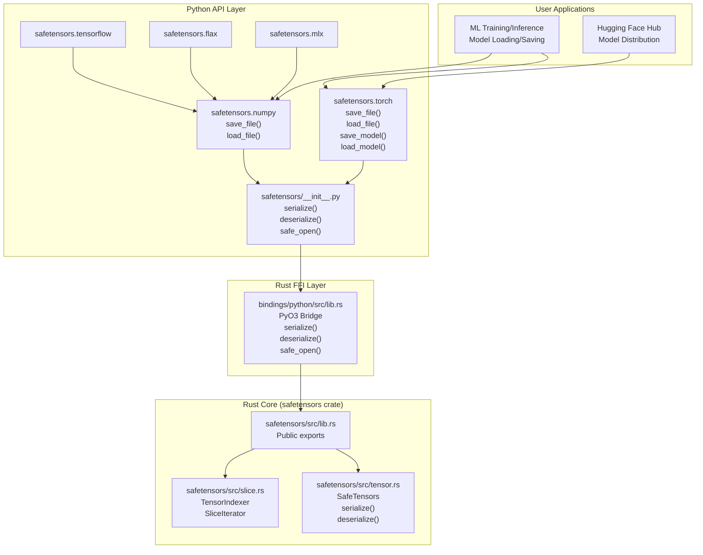
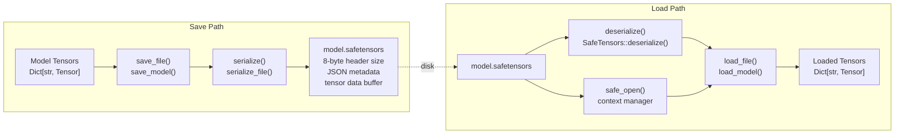
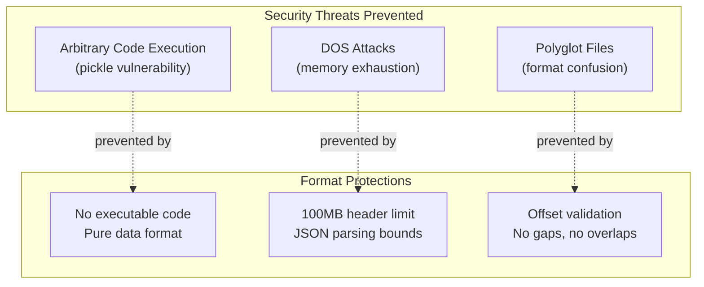

<!-- source: DeepWiki mcp.deepwiki.com · repo huggingface/safetensors · page 1 Overview · fetched 2026-10-21 -->

# Overview

<details>
<summary>Relevant source files</summary>

The following files were used as context for generating this wiki page:

- [README.md](README.md)
- [bindings/python/README.md](bindings/python/README.md)
- [safetensors/Cargo.toml](safetensors/Cargo.toml)
- [safetensors/README.md](safetensors/README.md)
- [safetensors/src/lib.rs](safetensors/src/lib.rs)

</details>


This document provides an introduction to the safetensors project, a tensor serialization format designed as a secure, fast alternative to pickle for storing machine learning model weights. This overview covers the project's core purpose, architecture, supported frameworks, key benefits (safety, zero-copy loading, lazy loading), and high-level capabilities.

For detailed information about specific components:
- File format specification: see [File Format](#2.1)
- Rust core implementation: see [Core Rust Library](#2.2)
- Python API usage: see [API Reference](#3.1)
- Framework-specific integration: see [PyTorch Integration](#3.2) and [NumPy, TensorFlow, and JAX/Flax Integration](#3.3)
- Performance benchmarks: see [Performance](#5)
- Security guarantees: see [Security](#6)

## Purpose and Problem Statement

The safetensors library addresses critical security and performance issues in machine learning model serialization. The primary problem is that PyTorch and many other ML frameworks default to using Python's `pickle` format for saving model weights, which allows arbitrary code execution when loading files. This creates a significant security vulnerability when loading models from untrusted sources.

Safetensors provides a simple, safe binary format for storing tensors that:
- **Prevents arbitrary code execution** (unlike pickle)
- **Enables zero-copy loading** through memory mapping
- **Supports lazy loading** for partial tensor access
- **Maintains fast serialization/deserialization** performance
- **Imposes no file size limits** while preventing DOS attacks

Sources: [README.md:23-28](), [README.md:111-118](), [safetensors/Cargo.toml:12-18]()

## Core Architecture



**Architecture Overview**: The safetensors system uses a three-tier architecture. The **Rust core** ([safetensors/src/]()) implements the format specification and validation logic. The **Python bindings layer** uses PyO3 to expose Rust functionality to Python with efficient type conversions. The **framework adapters** ([bindings/python/py_src/safetensors/]()) provide idiomatic interfaces for PyTorch, NumPy, TensorFlow, JAX/Flax, and MLX.

Sources: [safetensors/src/lib.rs:1-39](), [README.md:56-71](), [safetensors/Cargo.toml:24-31]()

## Serialization and Deserialization Flow



**Data Flow**: Serialization converts framework-specific tensors into the safetensors binary format using `serialize()` or `serialize_file()`. Deserialization offers two modes: **eager loading** via `load_file()` (returns all tensors as a dictionary) and **lazy loading** via `safe_open()` (memory-efficient context manager that enables on-demand tensor access and slicing).

Sources: [README.md:56-71](), [safetensors/src/lib.rs:8-9](), [bindings/python/README.md:13-44]()

## File Format Structure

The safetensors format uses a simple, safe binary layout:

| Component | Size | Description |
|-----------|------|-------------|
| Header Size | 8 bytes | Unsigned little-endian 64-bit integer (N) |
| JSON Header | N bytes | UTF-8 JSON containing tensor metadata |
| Data Buffer | Remaining bytes | Contiguous tensor data, no gaps |

### Header Structure

The JSON header contains tensor metadata with the following structure:

```json
{
  "tensor_name": {
    "dtype": "F32",
    "shape": [1024, 1024],
    "data_offsets": [0, 4194304]
  },
  "__metadata__": {
    "format": "pt",
    "version": "1.0"
  }
}
```

Key constraints enforced by the format:
- Header must begin with `{` character (0x7B) [README.md:78]()
- Header size limited to 100MB to prevent DOS attacks
- Data offsets must not overlap
- Byte buffer must be fully indexed with no gaps (prevents polyglot files) [README.md:99-100]()
- Little-endian byte order, row-major ('C') layout [README.md:101-103]()

Sources: [README.md:76-106](), [safetensors/README.md:76-106](), [safetensors/Cargo.toml:15-18]()

## Supported Frameworks

Safetensors provides native integration for major machine learning frameworks:

| Framework | Module | Key Functions |
|-----------|--------|---------------|
| PyTorch | `safetensors.torch` | `save_file()`, `load_file()`, `save_model()`, `load_model()` |
| NumPy | `safetensors.numpy` | `save_file()`, `load_file()` |
| TensorFlow | `safetensors.tensorflow` | `save_file()`, `load_file()` |
| JAX/Flax | `safetensors.flax` | `save_file()`, `load_file()` |
| MLX | `safetensors.mlx` | `save_file()`, `load_file()` |
| PaddlePaddle | `safetensors.paddle` | `save_file()`, `load_file()` |

Sources: [README.md:56-71](), [bindings/python/README.md:10-44]()

## Installation

### Via pip

```bash
pip install safetensors
```

### From Source

Building from source requires the Rust toolchain (MSRV 1.80):

```bash
# Install Rust
curl --proto '=https' --tlsv1.2 -sSf https://sh.rustup.rs | sh
rustup update

# Clone and build
git clone https://github.com/huggingface/safetensors
cd safetensors/bindings/python
pip install setuptools_rust
pip install -e .
```

Sources: [README.md:30-52](), [safetensors/Cargo.toml:5]()

## Quick Start Example

### Basic PyTorch Usage

```python
import torch
from safetensors import safe_open
from safetensors.torch import save_file

# Save tensors
tensors = {
   "weight1": torch.zeros((1024, 1024)),
   "weight2": torch.zeros((1024, 1024))
}
save_file(tensors, "model.safetensors")

# Load tensors (lazy mode)
tensors = {}
with safe_open("model.safetensors", framework="pt", device="cpu") as f:
   for key in f.keys():
       tensors[key] = f.get_tensor(key)
```

Sources: [README.md:54-71](), [bindings/python/README.md:31-44]()

## Key Features and Benefits

### Security Guarantees



**Security Implementation**: The format contains only data - no executable code. All data offsets are validated to ensure they fall within file bounds, do not overlap, and fully index the data buffer. The 100MB header limit prevents JSON parsing DOS attacks.

Sources: [README.md:131-144](), [README.md:99-100]()

### Performance Benefits

| Feature | Benefit | Example |
|---------|---------|---------|
| Zero-copy loading | No intermediate memory allocation | Direct memory mapping |
| Lazy loading | Load only needed tensors | Distributed training: select tensors per GPU |
| Fast serialization | Minimal overhead | Simple header + data copy |
| Memory efficiency | Avoid CPU buffer duplication | GPU loading without full CPU allocation |

**Real-world Impact**: Loading the BLOOM model (176B parameters) on 8 GPUs improved from 10 minutes with PyTorch pickle to 45 seconds with safetensors. This improvement comes from lazy loading specific tensor shards directly to each GPU.

Sources: [README.md:26-27](), [README.md:132-135]()

## Implementation Characteristics

### Code Organization

The library supports both `std` (standard library) and `no_std` (embedded) Rust environments through feature flags.

```rust
// From safetensors/src/lib.rs
#![cfg_attr(not(feature = "std"), no_std)]
pub mod slice;
pub mod tensor;
pub use tensor::{serialize, Dtype, SafeTensorError, SafeTensors, View};
```

The `no_std` mode uses `alloc` and `hashbrown` instead of standard library collections to provide high-performance hash maps in constrained environments.

Sources: [safetensors/src/lib.rs:3-9](), [safetensors/src/lib.rs:18-38](), [safetensors/Cargo.toml:41-45]()

### Dependencies

The Rust core is kept minimal to reduce the attack surface:
- `serde` and `serde_json`: For header parsing/generation [safetensors/Cargo.toml:25-29]()
- `hashbrown`: High-performance hash maps for `no_std` support [safetensors/Cargo.toml:30]()
- `memmap2`: For zero-copy file access (dev-dependency) [safetensors/Cargo.toml:38]()

Sources: [safetensors/Cargo.toml:24-45]()

---

