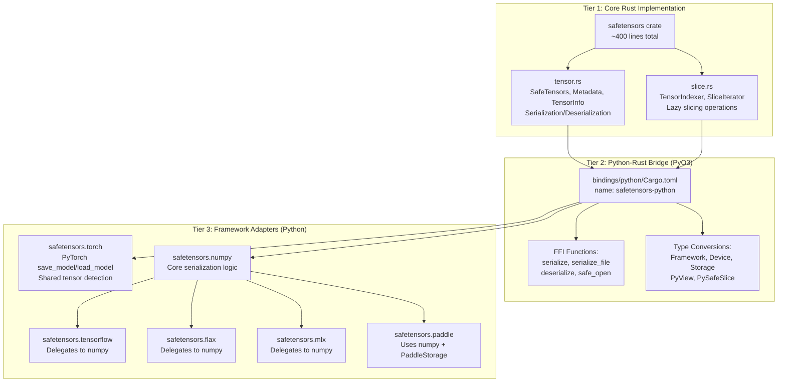
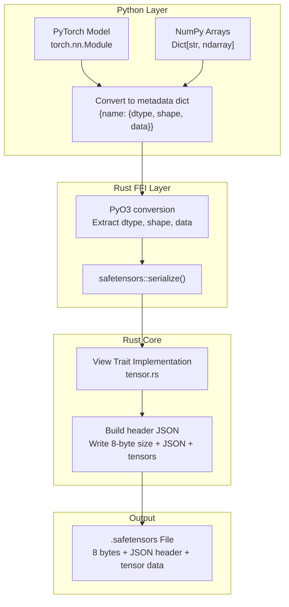
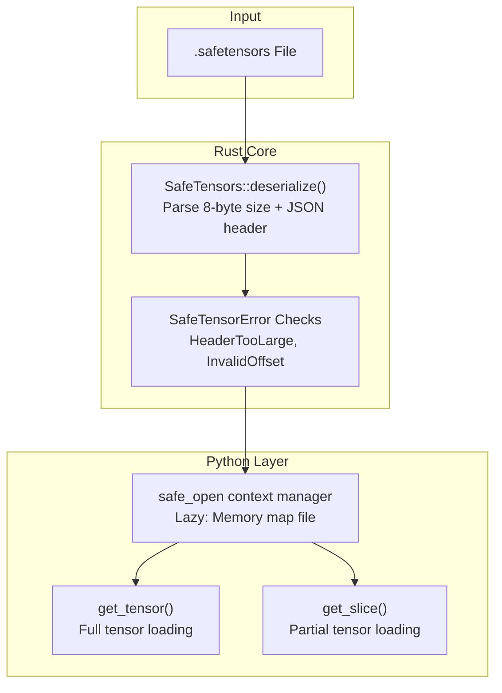
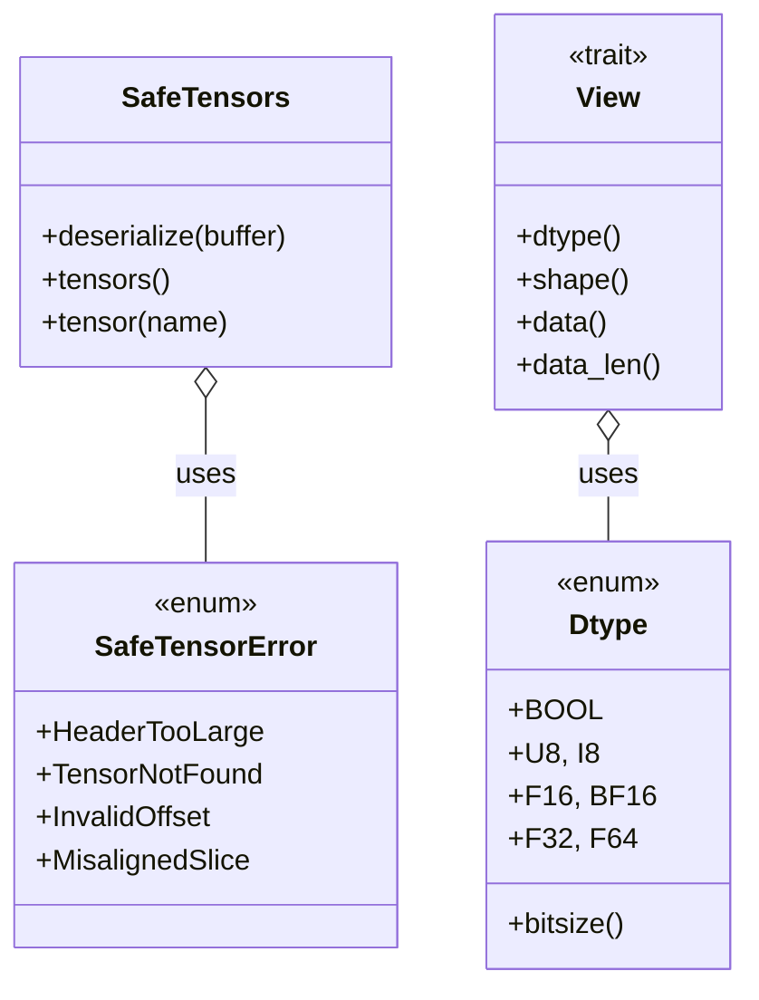

<!-- source: DeepWiki mcp.deepwiki.com · repo huggingface/safetensors · page 2 Architecture · fetched 2026-10-21 -->

# Architecture

<details>
<summary>Relevant source files</summary>

The following files were used as context for generating this wiki page:

- [README.md](README.md)
- [bindings/python/Cargo.toml](bindings/python/Cargo.toml)
- [safetensors/README.md](safetensors/README.md)
- [safetensors/benches/benchmark.rs](safetensors/benches/benchmark.rs)
- [safetensors/src/lib.rs](safetensors/src/lib.rs)
- [safetensors/src/slice.rs](safetensors/src/slice.rs)
- [safetensors/src/tensor.rs](safetensors/src/tensor.rs)

</details>


This document provides a comprehensive overview of the SafeTensors system architecture, describing its core components, design principles, and implementation details.

## High-Level Architecture

The SafeTensors library implements a three-tier architecture that separates concerns across implementation layers:

### Three-Tier System Design



Sources: [safetensors/src/lib.rs:1-39](), [safetensors/src/tensor.rs:1-118](), [safetensors/src/slice.rs:1-64](), [bindings/python/Cargo.toml:1-19]()

### Architectural Principles

The architecture follows several key design principles:

1.  **Safety**: Format prevents arbitrary code execution (unlike pickle) through validation and no dynamic code loading.
2.  **Performance**: Zero-copy design via memory mapping and lazy loading for efficient memory usage.
3.  **Simplicity**: Compact Rust core enables thorough security audits.
4.  **Framework Agnostic**: Common format with framework-specific adapters for idiomatic interfaces.
5.  **Layered Separation**: Clean boundaries between Rust core, FFI bridge, and Python adapters.

### Core Component Overview

| Component | Responsibility | Key Entities |
|-----------|--------------|--------------|
| **File Format** | Binary layout specification | 8-byte length, JSON header, byte buffer [README.md:74-104]() |
| **Core Rust Library** | Low-level serialization/validation | `SafeTensors`, `View`, `Dtype` [safetensors/src/lib.rs:1-10]() |
| **Tensor Slicing** | Lazy partial data access | `TensorIndexer`, `SliceIterator` [safetensors/src/slice.rs:56-64]() |
| **Python Bindings** | PyO3-based bridge to Python | `safe_open`, `serialize` [README.md:52-69]() |

For details, see [File Format](#2.1), [Core Rust Library](#2.2), and [Tensor Slicing](#2.3).

## Data Flow: Serialization and Deserialization

### Serialization Path

Title: Serialization Data Flow from Framework Tensors to .safetensors File



Sources: [safetensors/src/tensor.rs:126-149](), [safetensors/src/tensor.rs:179-195](), [README.md:52-69]()

### Deserialization Path

Title: Deserialization Data Flow with Eager and Lazy Loading Options



Sources: [safetensors/src/tensor.rs:13-50](), [safetensors/src/tensor.rs:511-540](), [README.md:65-69]()

## Core Rust Library Structure

The core Rust library provides the fundamental types and traits for tensor manipulation.



Sources: [safetensors/src/tensor.rs:15-50](), [safetensors/src/tensor.rs:130-148](), [safetensors/src/tensor.rs:511-540]()

### The View Trait

The `View` trait is fundamental to the SafeTensors architecture. It provides an abstraction for interacting with tensors regardless of their underlying implementation (owned or borrowed).

```rust
pub trait View {
   fn dtype(&self) -> Dtype;
   fn shape(&self) -> &[usize];
   fn data(&self) -> Cow<'_, [u8]>;
   fn data_len(&self) -> usize;
}
```

Sources: [safetensors/src/tensor.rs:135-148]()

## Performance and Security

SafeTensors is designed with strict constraints to ensure performance and safety:

*   **Header Limit**: The header is restricted to 100MB to prevent DoS attacks [safetensors/src/tensor.rs:10-22]().
*   **Zero-Copy**: Data is accessed directly from memory-mapped buffers without intermediate allocations [README.md:23-26]().
*   **Validation**: Offsets are validated to ensure they fully cover the buffer without overlaps, preventing polyglot file creation [README.md:99-100]().
*   **Sub-byte Alignment**: Special care is taken for dtypes smaller than 1 byte (e.g., F8), which introduce specific alignment constraints during slicing [safetensors/src/tensor.rs:47-50](), [safetensors/src/slice.rs:25-28]().

For more detailed technical information, refer to the child pages:
*   [File Format](#2.1) — Binary layout and JSON header spec.
*   [Core Rust Library](#2.2) — Rust API and `no_std` support.
*   [Tensor Slicing](#2.3) — Lazy loading and byte-range calculations.

---

