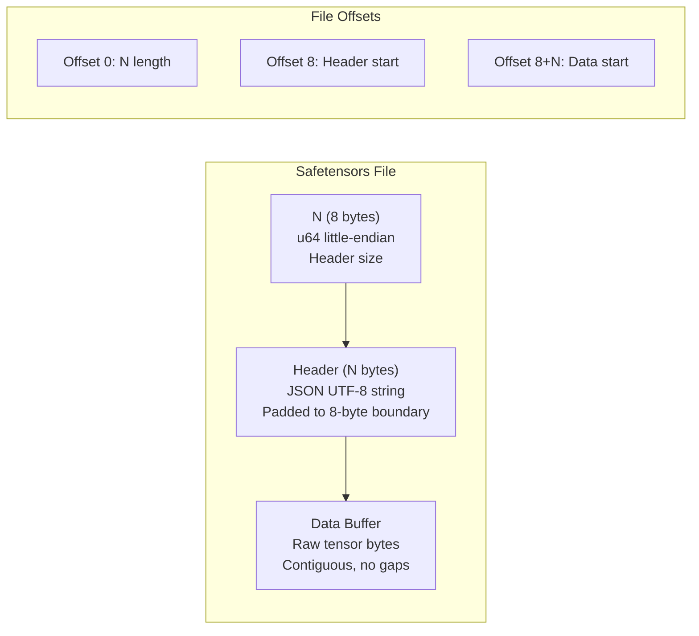
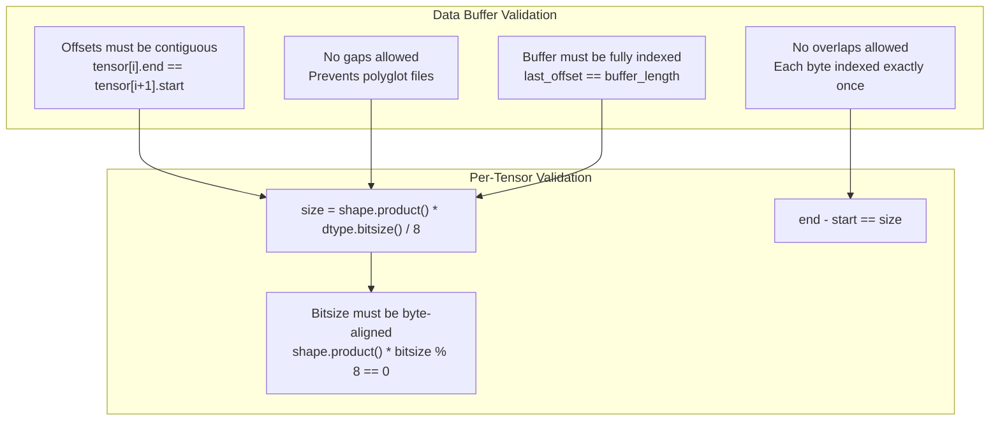
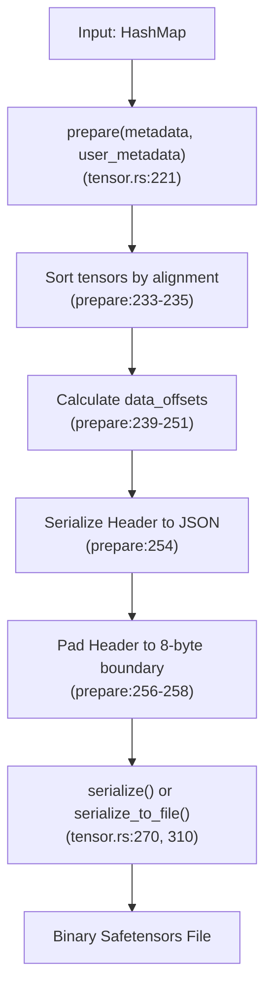
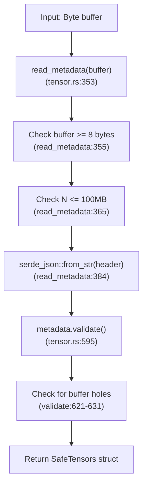

<!-- source: DeepWiki mcp.deepwiki.com · repo huggingface/safetensors · page 2.1 File Format · fetched 2026-10-21 -->

# File Format

<details>
<summary>Relevant source files</summary>

The following files were used as context for generating this wiki page:

- [README.md](README.md)
- [docs/safetensors.schema.json](docs/safetensors.schema.json)
- [docs/source/_toctree.yml](docs/source/_toctree.yml)
- [docs/source/api/paddle.mdx](docs/source/api/paddle.mdx)
- [docs/source/convert-weights.md](docs/source/convert-weights.md)
- [docs/source/metadata_parsing.mdx](docs/source/metadata_parsing.mdx)
- [safetensors/README.md](safetensors/README.md)
- [safetensors/benches/benchmark.rs](safetensors/benches/benchmark.rs)
- [safetensors/src/lib.rs](safetensors/src/lib.rs)
- [safetensors/src/slice.rs](safetensors/src/slice.rs)
- [safetensors/src/tensor.rs](safetensors/src/tensor.rs)

</details>


This page documents the binary structure and specification of the safetensors file format. For information about the Rust implementation that processes this format, see [Core Rust Library](#2.2). For details on how to use the format with various frameworks, see [Python Bindings](#3).

## Overview

The safetensors format is a simple binary format designed for safe, fast, and efficient storage of machine learning tensors. The format consists of three sequential components:

1. **8-byte header length**: An unsigned 64-bit little-endian integer.
2. **JSON header**: UTF-8 encoded JSON containing tensor metadata.
3. **Data buffer**: Contiguous byte buffer containing all tensor data.

This design enables zero-copy loading through memory mapping while maintaining strict safety guarantees through validation of metadata before data access.

## Binary Structure

### File Layout



**Sources:** [safetensors/README.md:76-84](), [safetensors/src/tensor.rs:10-11](), [safetensors/src/tensor.rs:353-393]()

### Header Length (N_LEN)

The first 8 bytes of the file contain the header size as an unsigned 64-bit integer in little-endian byte order. This value is defined as `N_LEN` in the implementation.

| Byte Offset | Type | Description |
|-------------|------|-------------|
| 0-7 | `u64` (little-endian) | Size of JSON header in bytes (N) |

The implementation enforces `MAX_HEADER_SIZE = 100_000_000` bytes (100MB) to prevent denial-of-service attacks through excessively large headers.

**Sources:** [safetensors/src/tensor.rs:10-11](), [safetensors/src/tensor.rs:355-367]()

### JSON Header Structure

The header is a UTF-8 encoded JSON object. It follows a specific schema defined in `safetensors.schema.json`.

```json
{
  "__metadata__": {
    "key1": "value1",
    "key2": "value2"
  },
  "tensor_name_1": {
    "dtype": "F32",
    "shape": [2, 3, 4],
    "data_offsets": [0, 96]
  },
  "tensor_name_2": {
    "dtype": "I64",
    "shape": [10],
    "data_offsets": [96, 176]
  }
}
```

#### Header Fields

| Field | Type | Required | Description |
|-------|------|----------|-------------|
| `__metadata__` | Object | No | String-to-string map for arbitrary metadata. Only strings allowed as values. |
| `<tensor_name>` | Object | Yes (≥1) | One entry per tensor with metadata. |
| `dtype` | String | Yes | Data type identifier (e.g., "F32", "BF16"). |
| `shape` | Array[Integer] | Yes | Dimensions of the tensor. |
| `data_offsets` | Array[Integer, Integer] | Yes | `[BEGIN, END]` byte offsets relative to data buffer start. |

**Header Constraints:**
- Must begin with `{` character (0x7B).
- May be trailing padded with whitespace (0x20).
- Duplicate keys are disallowed.
- Values in `__metadata__` must be strings.

**Sources:** [safetensors/README.md:79-84](), [docs/safetensors.schema.json:12-66](), [safetensors/src/tensor.rs:254-258]()

### Data Buffer

The data buffer begins immediately after the header at offset `8 + N`. It contains raw tensor bytes.

#### Buffer Requirements



**Sources:** [safetensors/src/tensor.rs:595-632](), [safetensors/README.md:99-103]()

## Data Types (Dtype)

The format supports a comprehensive set of numeric types. The `Dtype` enum represents these types in the Rust core.

### Supported Types

| Dtype | Bits | Description |
|-------|------|-------------|
| `BOOL` | 8 | Boolean |
| `U8` | 8 | Unsigned 8-bit integer |
| `I8` | 8 | Signed 8-bit integer |
| `I16` | 16 | Signed 16-bit integer |
| `U16` | 16 | Unsigned 16-bit integer |
| `F16` | 16 | Half-precision float |
| `BF16` | 16 | Brain float 16 |
| `I32` | 32 | Signed 32-bit integer |
| `U32` | 32 | Unsigned 32-bit integer |
| `F32` | 32 | Single-precision float |
| `F64` | 64 | Double-precision float |
| `I64` | 64 | Signed 64-bit integer |
| `U64` | 64 | Unsigned 64-bit integer |

**Sub-byte Types:** Some dtypes smaller than 1 byte (like 4-bit floats) make alignment tricky and require special care during slicing.

**Sources:** [safetensors/src/tensor.rs:777-861](), [safetensors/README.md:104]()

## Serialization Process

The serialization logic in `safetensors/src/tensor.rs` handles the transition from high-level tensor views to the binary format.



**Sources:** [safetensors/src/tensor.rs:221-268](), [safetensors/src/tensor.rs:270-302]()

## Deserialization and Validation

The `SafeTensors::deserialize()` function implement a multi-stage validation pipeline to ensure file safety.



### Validation Rules (Metadata.validate())

The `validate()` method enforces these invariants:
1. **Contiguous Offsets:** Tensor offsets must follow each other exactly.
2. **Size Consistency:** The byte range `END - BEGIN` must match `shape.product() * dtype.size`.
3. **Full Coverage:** The entire data buffer must be covered by the offsets defined in the header.
4. **No Polyglots:** By ensuring no gaps, the format prevents appending the file to other formats (like ZIP) to create polyglot exploits.

**Sources:** [safetensors/src/tensor.rs:595-632](), [safetensors/src/tensor.rs:353-393](), [safetensors/README.md:99-100]()

## Format Guarantees and Constraints

### Security Guarantees

| Guarantee | Mechanism |
|-----------|-----------|
| No Code Execution | Pure JSON + Raw Data. No pickle-like opcode evaluation. |
| DOS Protection | 100MB Header cap; arithmetic overflow checks during validation. |
| Memory Safety | Strict offset and shape validation before providing slices. |

### Layout Constraints
- **Endianness:** Little-endian.
- **Order:** 'C' or row-major.
- **Alignment:** The header is padded to an 8-byte boundary to facilitate aligned access to the data buffer.

**Sources:** [safetensors/README.md:101-104](), [safetensors/src/tensor.rs:10](), [safetensors/src/tensor.rs:595-632]()

## Implementation Reference

Key code entities for format processing:

| Entity | Location | Role |
|--------|----------|------|
| `SafeTensors` | [safetensors/src/tensor.rs:331]() | Primary structure for reading/accessing safetensors files. |
| `Metadata` | [safetensors/src/tensor.rs:556]() | Internal representation of the JSON header. |
| `TensorInfo` | [safetensors/src/tensor.rs:763]() | Metadata for a single tensor (dtype, shape, offsets). |
| `SafeTensorError` | [safetensors/src/tensor.rs:16]() | Errors for invalid headers, offsets, or sizes. |
| `serialize` | [safetensors/src/tensor.rs:270]() | Main entry point for binary serialization. |

**Sources:** [safetensors/src/tensor.rs:1-862]()

---

