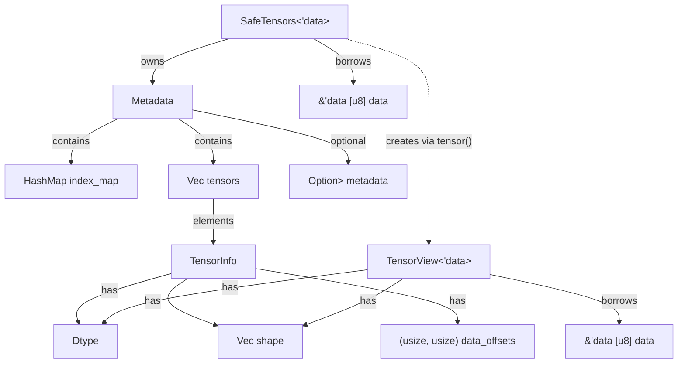
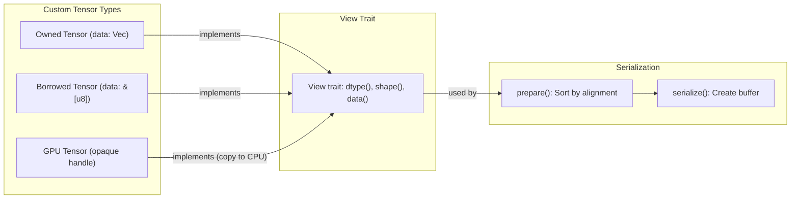
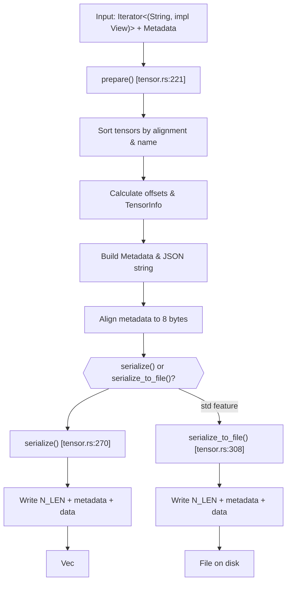

<!-- source: DeepWiki mcp.deepwiki.com · repo huggingface/safetensors · page 2.2 Core Rust Library · fetched 2026-10-21 -->

# Core Rust Library

<details>
<summary>Relevant source files</summary>

The following files were used as context for generating this wiki page:

- [README.md](README.md)
- [safetensors/Cargo.toml](safetensors/Cargo.toml)
- [safetensors/README.md](safetensors/README.md)
- [safetensors/benches/benchmark.rs](safetensors/benches/benchmark.rs)
- [safetensors/fuzz/.gitignore](safetensors/fuzz/.gitignore)
- [safetensors/fuzz/Cargo.toml](safetensors/fuzz/Cargo.toml)
- [safetensors/fuzz/fuzz_targets/fuzz_target_1.rs](safetensors/fuzz/fuzz_targets/fuzz_target_1.rs)
- [safetensors/src/lib.rs](safetensors/src/lib.rs)
- [safetensors/src/slice.rs](safetensors/src/slice.rs)
- [safetensors/src/tensor.rs](safetensors/src/tensor.rs)

</details>


## Purpose and Scope

This document describes the `safetensors` Rust crate, which provides the core implementation of the safetensors format. This crate defines the primary data structures (`SafeTensors`, `Metadata`, `TensorInfo`, `TensorView`), serialization/deserialization functions, the `View` trait for custom tensor types, error types, and support for both `std` and `no_std` environments.

For information about the binary file format specification, see [File Format](#2.1). For tensor slicing and lazy loading capabilities, see [Tensor Slicing](#2.3). For Python bindings that wrap this Rust library, see [Python Bindings](#3).

---

## Crate Structure and Dependencies

The `safetensors` crate is organized into primary modules with minimal external dependencies:

| Module | File | Purpose |
|--------|------|---------|
| `tensor` | [safetensors/src/tensor.rs]() | Core serialization structures and functions |
| `slice` | [safetensors/src/slice.rs]() | Lazy loading and slicing support |
| `lib` | [safetensors/src/lib.rs]() | Root module with feature flag handling |

### Dependencies

The crate has a minimal dependency footprint, as specified in [safetensors/Cargo.toml:24-30]():

```toml
[dependencies]
serde = { version = "1.0", default-features = false, features = ["derive", "alloc"] }
serde_json = { version = "1.0", default-features = false, features = ["alloc"] }
hashbrown = { version = "0.16", features = ["serde"] }
tempfile = { version = "3", optional = true }
```

Development dependencies include `memmap2` for memory-mapped files, `criterion` for benchmarks, and `proptest` for property-based testing [safetensors/Cargo.toml:36-40]().

**Sources:** [safetensors/Cargo.toml:1-46](), [safetensors/src/lib.rs:1-39]()

---

## Core Data Structures Overview

The following diagram illustrates the relationships between the core data structures in the `safetensors` crate:

**Diagram: Core Structure Relationships**



**Sources:** [safetensors/src/tensor.rs:342-348](), [safetensors/src/tensor.rs:499-504](), [safetensors/src/tensor.rs:670-678](), [safetensors/src/tensor.rs:766-774]()

---

## SafeTensors Struct

The `SafeTensors<'data>` struct is the primary interface for deserializing and accessing tensors from a safetensors buffer. It owns the parsed metadata but only borrows the underlying data buffer, enabling zero-copy access.

**Definition:** [safetensors/src/tensor.rs:342-348]()

```rust
pub struct SafeTensors<'data> {
    metadata: Metadata,
    data: &'data [u8],
}
```

### Key Methods

| Method | Signature | Purpose |
|--------|-----------|---------|
| `deserialize` | `fn(&'data [u8]) -> Result<Self, SafeTensorError>` | Parse buffer and create SafeTensors instance |
| `read_metadata` | `fn(&'data [u8]) -> Result<(usize, Metadata), SafeTensorError>` | Parse only the header without creating SafeTensors |
| `tensor` | `fn(&self, &str) -> Result<TensorView<'data>, SafeTensorError>` | Get a specific tensor by name |
| `tensors` | `fn(&self) -> Vec<(String, TensorView<'data>)>` | Get all tensors as owned vector |
| `iter` | `fn(&self) -> impl Iterator<Item = (&str, TensorView<'data>)>` | Iterate over tensors |
| `names` | `fn(&self) -> Vec<&str>` | Get all tensor names |
| `len` | `fn(&self) -> usize` | Get number of tensors |

### Deserialization Process

The deserialization process is implemented in `SafeTensors::deserialize` [safetensors/src/tensor.rs:350-370]():

1. **Read header size**: Extract first 8 bytes (`N_LEN`) as little-endian `u64` representing header length.
2. **Validate header size**: Ensure header is between 8 bytes and 100MB (`MAX_HEADER_SIZE`) [safetensors/src/tensor.rs:10]().
3. **Extract header bytes**: Slice buffer from `N_LEN` to `N_LEN + n`.
4. **Parse JSON**: Deserialize header as UTF-8 string, then parse as JSON into `Metadata`.
5. **Validate metadata**: Check offsets are contiguous, non-overlapping, and cover the entire buffer.

**Sources:** [safetensors/src/tensor.rs:350-418](), [safetensors/src/tensor.rs:420-495]()

---

## Metadata Struct

The `Metadata` struct stores the parsed header information and provides indexed access to tensor metadata.

**Definition:** [safetensors/src/tensor.rs:499-504]()

```rust
pub struct Metadata {
    metadata: Option<HashMap<String, String>>,
    tensors: Vec<TensorInfo>,
    index_map: HashMap<String, usize>,
}
```

### Validation Logic

The `validate` method performs critical safety checks to prevent malformed files or polyglot attacks [safetensors/src/tensor.rs:595-632]():

1. **Offset continuity**: Verifies each tensor's start offset equals the previous tensor's end offset.
2. **Offset ordering**: Ensures end offset is greater than or equal to start offset.
3. **Size calculation**: Computes expected size from shape and dtype, checking for `ValidationOverflow` [safetensors/src/tensor.rs:89]().
4. **Byte alignment**: Validates that sub-byte dtypes (F4, F6) align on byte boundaries [safetensors/src/tensor.rs:90]().
5. **Size matching**: Confirms computed size matches declared `data_offsets` range.

**Sources:** [safetensors/src/tensor.rs:499-668]()

---

## TensorView Struct

`TensorView<'data>` provides a read-only view of a single tensor, borrowing data from the parent buffer.

**Definition:** [safetensors/src/tensor.rs:670-678]()

### Key Methods

| Method | Purpose |
|--------|---------|
| `new(dtype, shape, &'data [u8])` | Create validated TensorView, checking size matches shape×dtype |
| `dtype() -> Dtype` | Get tensor data type |
| `shape() -> &[usize]` | Get tensor dimensions |
| `data() -> &'data [u8]` | Get raw byte buffer |
| `sliced_data(&[TensorIndexer])` | Get iterator over sliced data chunks |

`TensorView` implements the `View` trait [safetensors/src/tensor.rs:680-714](), enabling it to be serialized back to safetensors format.

**Sources:** [safetensors/src/tensor.rs:670-761]()

---

## Dtype Enum

The `Dtype` enum enumerates all supported data types, including modern sub-byte types.

**Definition:** [safetensors/src/tensor.rs:776-825]()

### Supported Types

| Category | Types |
|----------|-------|
| **Boolean** | BOOL |
| **Sub-byte** | F4, F6_E2M3, F6_E3M2 |
| **8-bit** | U8, I8, F8_E5M2, F8_E4M3, F8_E8M0 |
| **16-bit** | I16, U16, F16, BF16 |
| **32-bit** | I32, U32, F32, C64 |
| **64-bit** | F64, I64, U64 |

The `bitsize()` method returns the bit width of each dtype [safetensors/src/tensor.rs:828-852]().

**Sources:** [safetensors/src/tensor.rs:776-888]()

---

## The View Trait

The `View` trait enables custom tensor types to be serialized. Any type implementing this trait can be passed to the `serialize` function.

**Definition:** [safetensors/src/tensor.rs:208-219]()

```rust
pub trait View {
    fn dtype(&self) -> Dtype;
    fn shape(&self) -> &[usize];
    fn data(&self) -> Cow<'_, [u8]>;
    fn data_len(&self) -> usize;
}
```

**Diagram: View Trait Implementation Flow**



**Sources:** [safetensors/src/tensor.rs:129-219](), [safetensors/src/tensor.rs:680-714]()

---

## Serialization Pipeline

The crate provides two primary serialization functions.

**Diagram: Serialization Flow**



### serialize_to_file Function (std only)

Only available with the `std` feature flag [safetensors/src/lib.rs:7-8](). It writes directly to a file using a `BufWriter` [safetensors/src/tensor.rs:304-340](), avoiding full memory allocation for the output file.

**Sources:** [safetensors/src/tensor.rs:221-340]()

---

## Feature Flags and no_std Support

The crate supports `no_std` environments by using the `alloc` crate and conditional exports in `lib.rs`.

### lib.rs Abstraction Layer

The [safetensors/src/lib.rs:18-38]() module provides a facade that conditionally exports types from either `std` or `alloc`/`core`:

```rust
mod lib {
    #[cfg(not(feature = "std"))]
    mod no_stds {
        pub use alloc::borrow::Cow;
        pub use alloc::string::{String, ToString};
        pub use alloc::vec::Vec;
        pub use hashbrown::HashMap;
    }
    #[cfg(feature = "std")]
    mod stds {
        pub use std::borrow::Cow;
        pub use std::collections::HashMap;
        pub use std::string::{String, ToString};
        pub use std::vec::Vec;
    }
    #[cfg(not(feature = "std"))]
    pub use no_stds::*;
    #[cfg(feature = "std")]
    pub use stds::*;
}
```

**Sources:** [safetensors/Cargo.toml:41-43](), [safetensors/src/lib.rs:1-39]()

---

