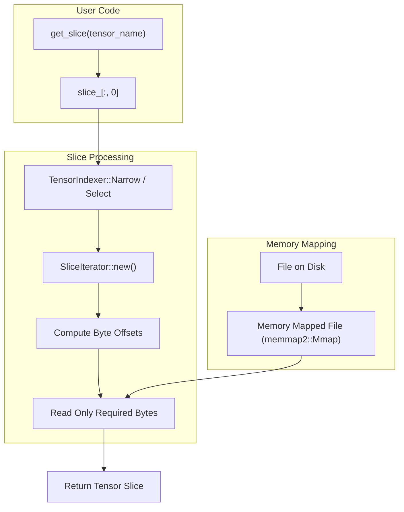
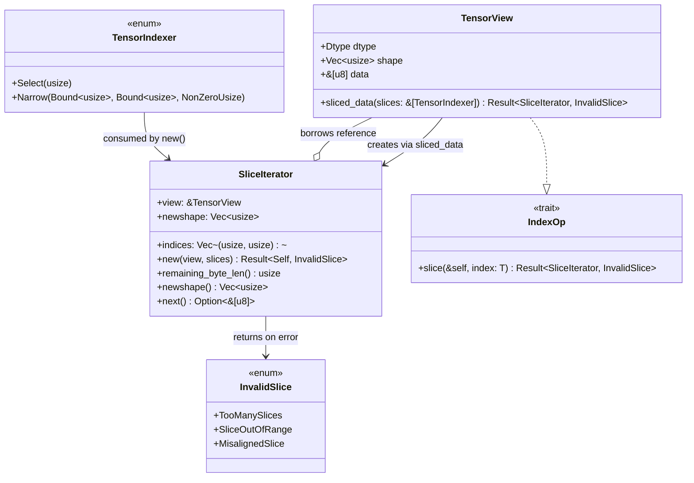
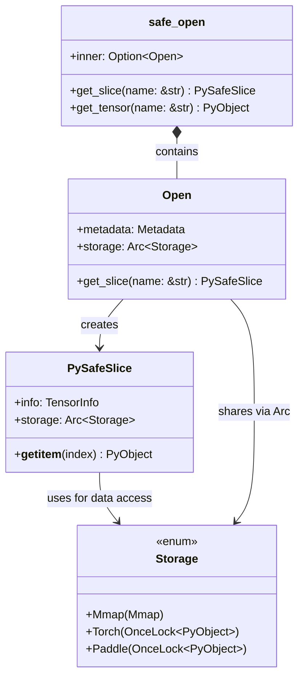

<!-- source: DeepWiki mcp.deepwiki.com · repo huggingface/safetensors · page 2.3 Tensor Slicing · fetched 2026-10-21 -->

# Tensor Slicing

<details>
<summary>Relevant source files</summary>

The following files were used as context for generating this wiki page:

- [bindings/python/src/lib.rs](bindings/python/src/lib.rs)
- [bindings/python/tests/test_pt_comparison.py](bindings/python/tests/test_pt_comparison.py)
- [safetensors/benches/benchmark.rs](safetensors/benches/benchmark.rs)
- [safetensors/src/slice.rs](safetensors/src/slice.rs)
- [safetensors/src/tensor.rs](safetensors/src/tensor.rs)

</details>


## Purpose and Overview

Tensor Slicing is a core feature of the SafeTensors library that enables efficient memory access to partial tensor data without loading entire tensors into memory. This capability is particularly valuable when working with large machine learning models, allowing users to extract only the specific portions of tensors they need for computation.

The tensor slicing functionality is implemented in the Rust core of SafeTensors and exposed through the language bindings, primarily Python. It provides NumPy/PyTorch-like slicing syntax for accessing subsets of tensor data directly from serialized files.

For information about the overall file format, see [File Format](#2.1). For details on the core serialization and deserialization functions, see [Core Rust Library](#2.2).

## Core Concepts

Tensor slicing in SafeTensors works by:

1. Allowing memory-mapped access to tensor data files via `memmap2`.
2. Computing exact byte offsets for the requested slice using `SliceIterator`.
3. Reading only the necessary bytes from storage.
4. Reshaping the resulting data to match the slice dimensions.

This approach is significantly more efficient than loading the entire tensor and then slicing it in memory, especially for large models where memory constraints are a concern.



Sources: [safetensors/src/slice.rs:1-7](), [bindings/python/src/lib.rs:9-19]()

## Implementation Architecture

The tensor slicing implementation spans both the Rust core and Python bindings, with several key components working together to provide efficient slicing operations.

### Rust Core Components

The core logic resides in `safetensors/src/slice.rs`. It defines how indices are represented and how they map to the underlying byte buffer.



Sources: [safetensors/src/slice.rs:55-64](), [safetensors/src/slice.rs:145-149](), [safetensors/src/slice.rs:268-273](), [safetensors/src/tensor.rs:3-5]()

### Python Binding Components

The Python layer in `bindings/python/src/lib.rs` provides the user-facing `safe_open` interface and handles the conversion from Python `slice` objects to Rust `TensorIndexer`.



Sources: [bindings/python/src/lib.rs:385-397](), [bindings/python/src/lib.rs:441-450](), [bindings/python/src/lib.rs:839-848](), [bindings/python/src/lib.rs:1009-1016]()

## TensorIndexer Enum

The `TensorIndexer` enum at [safetensors/src/slice.rs:58-64]() specifies how to index a tensor dimension.

1. **Select(usize)**: Selects a specific index, removing that dimension from the result.
2. **Narrow(Bound\<usize\>, Bound\<usize\>, NonZeroUsize)**: Selects a range (start, stop, step), preserving the dimension.

### Conversion from Rust Range Types

The implementation in [safetensors/src/slice.rs:112-141]() provides automatic `From` trait implementations for idiomatic Rust range syntax. Note that the `step` in `Narrow` is initialized to `NonZeroUsize::MIN` (which is 1) for these ranges.

| Rust Range Type | Example | TensorIndexer Equivalent |
|-----------------|---------|--------------------------|
| `Range<usize>` | `0..5` | `Narrow(Included(0), Excluded(5), 1)` |
| `RangeFrom<usize>` | `2..` | `Narrow(Included(2), Unbounded, 1)` |
| `RangeFull` | `..` | `Narrow(Unbounded, Unbounded, 1)` |
| `RangeInclusive<usize>` | `0..=4` | `Narrow(Included(0), Included(4), 1)` |
| `usize` | `3` | `Select(3)` |

### Display Implementation

The `Display` trait implementation at [safetensors/src/slice.rs:75-90]() formats indexers in Python-like syntax:
- `Select(3)` → `"3"`
- `Narrow(Included(2), Excluded(5), 1)` → `"2:5"`
- `Narrow(Unbounded, Excluded(5), 2)` → `":5:2"`

Sources: [safetensors/src/slice.rs:58-90](), [safetensors/src/slice.rs:112-141]()

## SliceIterator Structure

The `SliceIterator` at [safetensors/src/slice.rs:268-273]() iterates over the byte chunks that constitute a slice. It pre-computes all necessary byte offsets during construction.

### Structure Fields

```rust
pub struct SliceIterator<'data> {
    view: &'data TensorView<'data>,  // Borrowed reference to original tensor
    indices: Vec<(usize, usize)>,    // Pre-computed (start, stop) byte offsets
    newshape: Vec<usize>,            // Resulting shape after slicing
}
```

### Iterator Implementation

The `Iterator` trait implementation at [safetensors/src/slice.rs:388-398]() yields byte slices:

```rust
fn next(&mut self) -> Option<&'data [u8]> {
    let (start, stop) = self.indices.pop()?;
    Some(&self.view.data()[start..stop])
}
```

The `indices` vector is reversed during construction so `pop()` yields chunks in the correct order efficiently [safetensors/src/slice.rs:369]().

### Sub-byte Alignment Constraints

SafeTensors supports sub-byte types like `F4` (4 bits per element). Slicing these requires special care because a slice might start or end in the middle of a byte.

The `SliceIterator` checks for alignment at [safetensors/src/slice.rs:337-342]() and [safetensors/src/slice.rs:351-353](). If a slice for a sub-byte dtype does not land on a byte boundary, it returns `InvalidSlice::MisalignedSlice`. This ensures that the yielded `&[u8]` chunks are always valid whole bytes.

Sources: [safetensors/src/slice.rs:268-273](), [safetensors/src/slice.rs:337-353](), [safetensors/src/slice.rs:388-398]()

## Slicing Algorithm

The core slicing algorithm is implemented in `SliceIterator::new` at [safetensors/src/slice.rs:275-375]().

### Algorithm Steps

1. **Validation**: Checks if the number of slices exceeds tensor dimensions [safetensors/src/slice.rs:281-283]().
2. **Span Calculation**: Tracks the "span" (byte size of a single element or dimension) while iterating dimensions in reverse (row-major order) [safetensors/src/slice.rs:290-366]().
3. **Index Expansion**: For each dimension, it expands the existing `indices` (byte ranges). If a dimension is narrowed, the number of byte ranges increases unless the dimension is contiguous [safetensors/src/slice.rs:344-362]().
4. **Byte Range Mapping**: Converts logical element indices (start/stop) into physical byte offsets by multiplying by the current `span` [safetensors/src/slice.rs:317-318]().
5. **Shape Update**: Updates `newshape` based on whether the dimension was `Select`ed or `Narrow`ed [safetensors/src/slice.rs:309-312]().

Sources: [safetensors/src/slice.rs:275-375]()

## Python API: safe_open and PySafeSlice

The `safe_open` context manager provides the primary entry point for slicing in Python.

### safe_open and Open

The `safe_open` class at [bindings/python/src/lib.rs:873-882]() wraps an `Open` struct. When `get_slice(name)` is called, it returns a `PySafeSlice` [bindings/python/src/lib.rs:856-871]().

### PySafeSlice.__getitem__

The `PySafeSlice` struct at [bindings/python/src/lib.rs:1009-1016]() implements `__getitem__` to handle Python slicing syntax:

- It parses Python `slice`, `int`, `Ellipsis`, and `None` (newaxis) into a vector of `TensorIndexer` [bindings/python/src/lib.rs:1022-1135]().
- It handles `Ellipsis` by calculating how many `RangeFull` indexers are needed to fill the gap between specified indices [bindings/python/src/lib.rs:1053-1070]().
- It uses `slice_to_indexer` to convert individual Python slice objects to Rust `TensorIndexer` [bindings/python/src/lib.rs:201-236]().
- Finally, it calls `SliceIterator` to get the byte ranges and reconstructs a tensor in the requested framework (PyTorch, NumPy, etc.) [bindings/python/src/lib.rs:1140-1185]().

### Python Usage Example

```python
from safetensors import safe_open

with safe_open("model.safetensors", framework="pt") as f:
    # Returns PySafeSlice, no data loaded yet
    slice_obj = f.get_slice("embeddings.weight")
    
    # Slice using standard Python syntax
    # Only the required bytes are read from the file
    subset = slice_obj[0:10, :] 
    
    # Ellipsis support
    middle = slice_obj[..., 5:10]
```

Sources: [bindings/python/src/lib.rs:201-236](), [bindings/python/src/lib.rs:856-871](), [bindings/python/src/lib.rs:1009-1185]()

## Performance and Memory Efficiency

### Zero-Copy and Lazy Loading
Slicing relies on memory mapping via `memmap2`. By default, `safe_open` maps the file into memory. When a slice is requested, the library only touches the pages corresponding to the calculated byte ranges.

### Framework Integration
- **PyTorch**: Uses `UntypedStorage.from_file` for efficient file-backed tensors [bindings/python/src/lib.rs:533-581]().
- **Paddle**: Uses `paddle.MmapStorage` [bindings/python/src/lib.rs:496-532]().
- **MLX**: Uses `MTLBuffer` and DLPack for high-performance loading on Apple Silicon [bindings/python/src/lib.rs:3-6]().

Sources: [bindings/python/src/lib.rs:496-581](), [bindings/python/src/lib.rs:1018-1185]()

---

