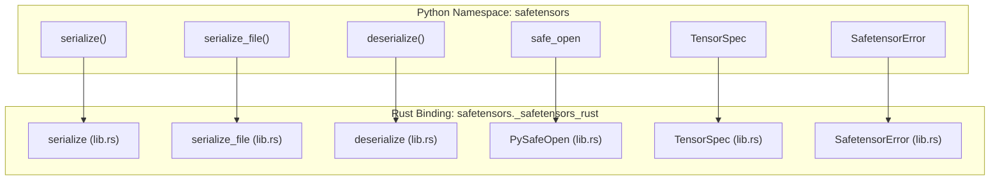
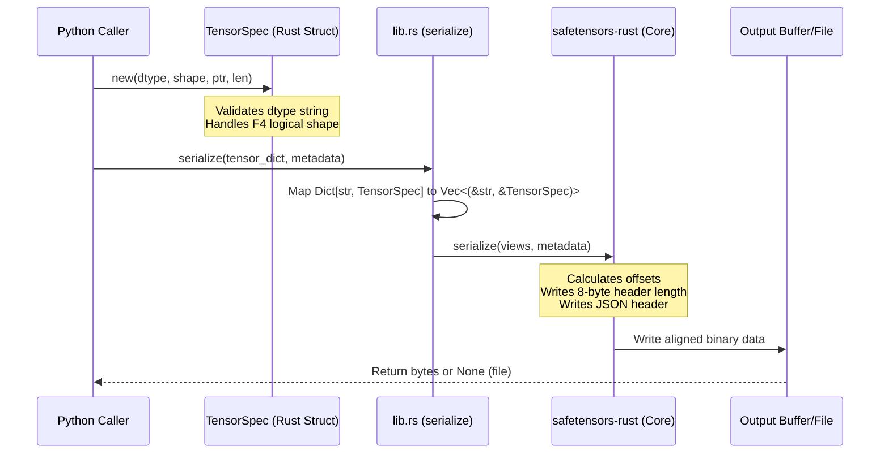

<!-- source: DeepWiki mcp.deepwiki.com · repo huggingface/safetensors · page 3.1 API Reference · fetched 2026-10-21 -->

# API Reference

<details>
<summary>Relevant source files</summary>

The following files were used as context for generating this wiki page:

- [bindings/python/py_src/safetensors/__init__.py](bindings/python/py_src/safetensors/__init__.py)
- [bindings/python/py_src/safetensors/__init__.pyi](bindings/python/py_src/safetensors/__init__.pyi)
- [bindings/python/src/lib.rs](bindings/python/src/lib.rs)
- [bindings/python/stub.py](bindings/python/stub.py)
- [bindings/python/tests/test_simple.py](bindings/python/tests/test_simple.py)
- [docs/source/index.mdx](docs/source/index.mdx)

</details>


This page provides a comprehensive reference to the Python API of the `safetensors` library. The public interface is primarily exported from `safetensors._safetensors_rust` via the `safetensors` package.

## Core API Overview

The core API provides fundamental functions for serializing and deserializing tensors. It is designed to be framework-agnostic at the lowest level, using raw memory addresses and lengths for serialization.

### Code Entity Association

The following diagram bridges the high-level Python API calls to the underlying Rust-backed entities defined in the bindings.


Sources: [bindings/python/py_src/safetensors/__init__.py:2-11](), [bindings/python/src/lib.rs:59-64](), [bindings/python/src/lib.rs:187-200]()

## Public Interface

### `TensorSpec`
A class describing a single tensor's metadata and memory location for serialization.

**Constructor:**
`TensorSpec(dtype: str, shape: Sequence[int], data_ptr: int, data_len: int)`

*   **dtype**: The data type string (e.g., `"float32"`, `"int64"`, `"bfloat16"`). Note: `float4_e2m1fn_x2` is handled specially by doubling the last dimension of the shape to reflect logical element count [bindings/python/src/lib.rs:75-83]().
*   **shape**: A list of integers representing the tensor dimensions.
*   **data_ptr**: The raw memory address (as an integer) of the contiguous buffer [bindings/python/src/lib.rs:110-112]().
*   **data_len**: The total size of the buffer in bytes [bindings/python/src/lib.rs:114-118]().

**Properties:**
*   `dtype`: Returns the safetensors format code (e.g., `"F32"`) [bindings/python/py_src/safetensors/__init__.pyi:137-143]().
*   `shape`: Returns the logical shape [bindings/python/py_src/safetensors/__init__.pyi:146-152]().
*   `data_ptr`: The memory address [bindings/python/py_src/safetensors/__init__.pyi:129-135]().
*   `data_len`: The buffer length in bytes [bindings/python/py_src/safetensors/__init__.pyi:122-127]().

Sources: [bindings/python/src/lib.rs:59-129](), [bindings/python/py_src/safetensors/__init__.pyi:93-152]()

### `serialize(tensor_dict, metadata=None)`
Serializes a dictionary of `TensorSpec` objects into a `bytes` object.

*   **tensor_dict**: `Dict[str, TensorSpec]`
*   **metadata**: `Optional[Dict[str, str]]` - Optional key-value pairs for the header.

**Safety Warning:** The caller must ensure that the memory pointed to by `data_ptr` in each `TensorSpec` remains valid for the duration of this call [bindings/python/src/lib.rs:189-195]().

Sources: [bindings/python/src/lib.rs:187-210](), [bindings/python/py_src/safetensors/__init__.pyi:35-60]()

### `serialize_file(tensor_dict, filename, metadata=None)`
Same as `serialize`, but writes the result directly to a file on disk.

*   **filename**: `Union[str, os.PathLike]`

Sources: [bindings/python/src/lib.rs:212-230](), [bindings/python/py_src/safetensors/__init__.pyi:63-91]()

### `safe_open(filename, framework, device="cpu", *, backend="mmap")`
A context manager for lazily loading tensors from a `.safetensors` file.

**Parameters:**
*   **framework**: One of `"pt"`, `"tf"`, `"flax"`, `"numpy"`, `"paddle"`, or `"mlx"`.
*   **device**: Target device (default `"cpu"`).
*   **backend**: Either `"mmap"` (default) or `"pread"`. `"pread"` is recommended for Apple Silicon MPS to avoid page-cache duplication [bindings/python/py_src/safetensors/__init__.pyi:169-174]().

**Methods:**
*   `keys()`: Returns list of tensor names in the file.
*   `metadata()`: Returns the header metadata dictionary.
*   `get_tensor(name)`: Loads and returns the full tensor for the given name.
*   `get_slice(name)`: Returns a `PySafeSlice` object for partial loading.

Sources: [bindings/python/py_src/safetensors/__init__.pyi:154-211](), [bindings/python/src/lib.rs:31-36]()

### `deserialize(bytes)`
Deserializes a `bytes` object into a list of tuples containing tensor names and their metadata/data.

Sources: [bindings/python/py_src/safetensors/__init__.pyi:19-32]()

## Internal Data Flow: Serialization Pipeline

The following diagram illustrates how Python objects are converted into the binary Safetensors format via the Rust bridge.


Sources: [bindings/python/src/lib.rs:67-90](), [bindings/python/src/lib.rs:196-210](), [bindings/python/src/lib.rs:131-152]()

## Type Mappings

The `parse_dtype_str` function in the Rust bindings maps Python-style string identifiers to the internal `Dtype` enum used by the core library.

| Python String | Internal Dtype |
| :--- | :--- |
| `"bool"` | `BOOL` |
| `"int8"`, `"uint8"` | `I8`, `U8` |
| `"int16"`, `"uint16"` | `I16`, `U16` |
| `"int32"`, `"uint32"` | `I32`, `U32` |
| `"int64"`, `"uint64"` | `I64`, `U64` |
| `"float16"`, `"bfloat16"` | `F16`, `BF16` |
| `"float32"`, `"float64"` | `F32`, `F64` |
| `"float8_e4m3fn"`, `"float8_e5m2"` | `F8_E4M3`, `F8_E5M2` |
| `"float4_e2m1fn_x2"` | `F4` |
| `"complex64"` | `C64` |

Sources: [bindings/python/src/lib.rs:154-185]()

## Usage Examples

### Manual Serialization using `TensorSpec`
This is useful when implementing new framework adapters or handling raw memory.

```python
import numpy as np
from safetensors import serialize, TensorSpec

arr = np.zeros((2, 2), dtype=np.float32)
spec = TensorSpec(
    dtype="float32",
    shape=arr.shape,
    data_ptr=arr.ctypes.data,
    data_len=arr.nbytes
)

serialized = serialize({"weight": spec}, metadata={"version": "1.0"})
```
Sources: [bindings/python/src/lib.rs:41-56](), [bindings/python/py_src/safetensors/__init__.pyi:50-52]()

### Lazy Loading with `safe_open`
Efficiently access parts of a model without loading the entire file into memory.

```python
from safetensors import safe_open

with safe_open("model.safetensors", framework="pt", device="cpu") as f:
    # Get metadata from the header
    meta = f.metadata()
    
    # Load only a specific slice of a large tensor
    # This uses zero-copy memory mapping or efficient pread
    slice_obj = f.get_slice("large_layer")
    partial_tensor = slice_obj[0:10, :] 
```
Sources: [bindings/python/py_src/safetensors/__init__.pyi:154-211](), [docs/source/index.mdx:39-47]()

## Versioning
The current version of the library is available via `safetensors.__version__`.

Sources: [bindings/python/py_src/safetensors/__init__.py:5](), [bindings/python/py_src/safetensors/__init__.pyi:16]()

---

