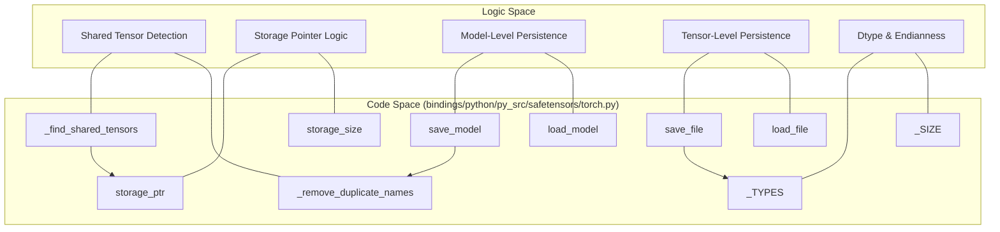
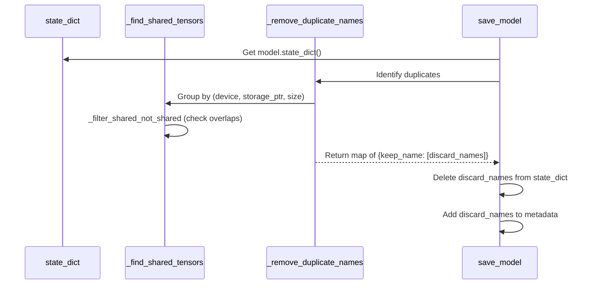

<!-- source: DeepWiki mcp.deepwiki.com · repo huggingface/safetensors · page 3.2 PyTorch Integration · fetched 2026-10-21 -->

# PyTorch Integration

Relevant source files

The following files were used as context for generating this wiki page:

- [bindings/python/py_src/safetensors/torch.py](bindings/python/py_src/safetensors/torch.py)
- [bindings/python/tests/test_pt_comparison.py](bindings/python/tests/test_pt_comparison.py)
- [bindings/python/tests/test_pt_model.py](bindings/python/tests/test_pt_model.py)
- [docs/source/api/torch.mdx](docs/source/api/torch.mdx)

This document explains how `safetensors` integrates with PyTorch, allowing users to save and load PyTorch tensors and models. The PyTorch integration provides specialized handling for shared tensors, supports diverse dtypes (including new FP8 formats), and enables efficient loading across hardware accelerators.

## Overview of PyTorch Integration

The PyTorch integration module acts as a bridge between PyTorch's `torch.Tensor` objects and the core `safetensors` serialization format. It manages the complexities of PyTorch's internal memory representation, such as shared storage and non-contiguous layouts.

### System Mapping: Logic to Code

The following diagram maps high-level PyTorch integration concepts to their specific implementations in the codebase.

Sources: [bindings/python/py_src/safetensors/torch.py:16-172](), [bindings/python/py_src/safetensors/torch.py:346-430]()

## Core API Functions

The integration provides two primary API layers: one for raw tensor dictionaries and one for `torch.nn.Module` instances.

### Model-level API
- **`save_model`**: Extracts a model's `state_dict`, identifies shared tensors, and saves them. It includes a `force_contiguous` parameter (default `True`) to ensure tensors are in a standard layout for serialization [bindings/python/py_src/safetensors/torch.py:145-192]().
- **`load_model`**: Loads a file into a model instance. It uses `load_file` internally and handles `strict` loading requirements [bindings/python/py_src/safetensors/torch.py:194-222]().

### Tensor-level API
- **`save_file` / `load_file`**: Functions for saving/loading dictionaries of tensors to/from disk [bindings/python/py_src/safetensors/torch.py:225-316]().
- **`save` / `load`**: In-memory serialization and deserialization to `bytes` [bindings/python/py_src/safetensors/torch.py:319-342]().

Sources: [bindings/python/py_src/safetensors/torch.py:145-342]()

## Handling Shared Tensors

SafeTensors does not allow the same byte range to be referenced by multiple tensor headers to prevent ambiguity and potential security risks. PyTorch models, however, frequently share storage (e.g., tied weights in embeddings and LM heads).

### Shared Tensor Detection Flow
The integration detects these by comparing storage pointers and sizes.

Sources: [bindings/python/py_src/safetensors/torch.py:76-142](), [bindings/python/py_src/safetensors/torch.py:172-183]()

### Implementation Details
- **`storage_ptr`**: Retrieves the underlying memory address using `tensor.untyped_storage().data_ptr()` [bindings/python/py_src/safetensors/torch.py:16-25]().
- **`_is_complete`**: Validates if a tensor view covers its entire underlying storage. `safetensors` refuses to save a shared group if no single tensor covers the whole storage, as this would lead to saving redundant "holes" in memory [bindings/python/py_src/safetensors/torch.py:91-94](), [bindings/python/py_src/safetensors/torch.py:116-123]().
- **`_filter_shared_not_shared`**: Handles cases where tensors share the same storage but represent non-overlapping segments [bindings/python/py_src/safetensors/torch.py:49-73]().

## Dtype Support and Byte-Swapping

The integration maintains strict mappings between PyTorch dtypes and SafeTensors types.

### Dtype Mapping Table
| PyTorch Dtype | SafeTensors Identifier | Size (Bytes) |
| :--- | :--- | :--- |
| `torch.float32` | `"F32"` | 4 |
| `torch.bfloat16` | `"BF16"` | 2 |
| `torch.float8_e4m3fn` | `"F8_E4M3"` | 1 |
| `torch.float4_e2m1fn_x2`| `"F4_E2M1_X2"` | 1 |
| `torch.complex64` | `"C64"` | 8 |

Sources: [bindings/python/py_src/safetensors/torch.py:346-430](), [bindings/python/tests/test_pt_comparison.py:84-102](), [bindings/python/tests/test_pt_comparison.py:163-172]()

### Big-Endian Logic
For architectures like `s390x`, `safetensors` performs manual byte-swapping during serialization if the system is big-endian, as the format specification requires little-endian data [bindings/python/py_src/safetensors/torch.py:449-455]().

## Device Placement

When loading tensors via `load_file` or `load_model`, the `device` argument determines where the tensors are instantiated.
- **CPU**: Default placement.
- **CUDA/NPU/HPU**: Tensors are loaded into memory and then moved to the specified accelerator device [bindings/python/py_src/safetensors/torch.py:289-316]().
- **Meta Device**: `_find_shared_tensors` explicitly ignores tensors on the `meta` device as they have no underlying storage [bindings/python/py_src/safetensors/torch.py:79-81]().

Sources: [bindings/python/py_src/safetensors/torch.py:289-316](), [bindings/python/py_src/safetensors/torch.py:79-83]()

## Performance and Constraints

- **Contiguity**: SafeTensors requires data to be a contiguous byte stream. If `force_contiguous=False` is passed to `save_model` and the model contains non-contiguous parameters (e.g., transposed weights), a `ValueError` is raised [bindings/python/py_src/safetensors/torch.py:184-191](), [bindings/python/tests/test_pt_model.py:205-209]().
- **Zero-Copy**: The integration leverages `safe_open` for zero-copy loading when the framework is set to `"pt"`, allowing for efficient memory mapping of large model weights [bindings/python/tests/test_pt_comparison.py:282-294]().

Sources: [bindings/python/py_src/safetensors/torch.py:184-191](), [bindings/python/tests/test_pt_comparison.py:282-294]()

---

