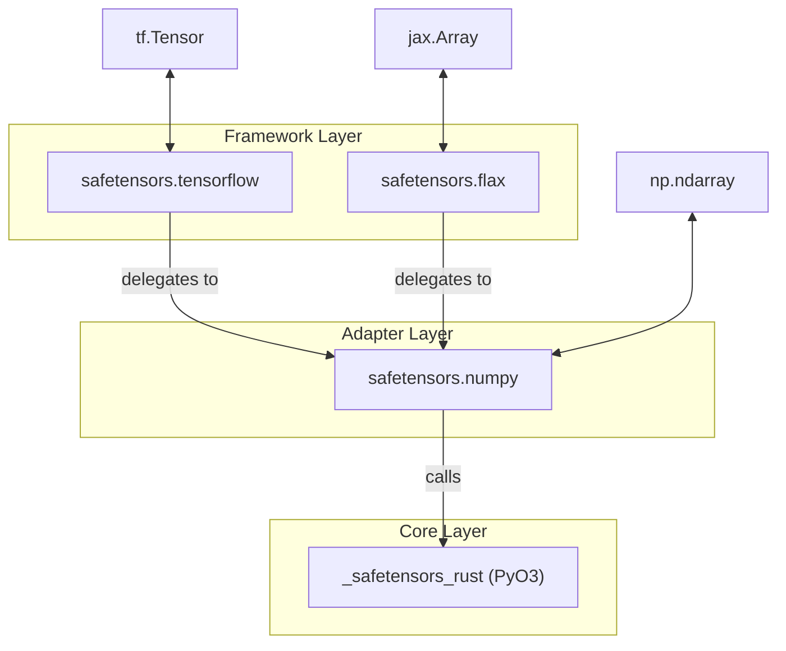
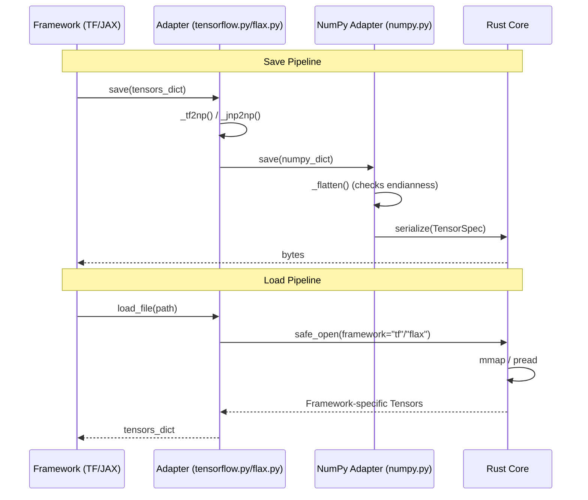

<!-- source: DeepWiki mcp.deepwiki.com · repo huggingface/safetensors · page 3.3 NumPy, TensorFlow, and JAX/Flax Integration · fetched 2026-10-21 -->

# NumPy, TensorFlow, and JAX/Flax Integration

Relevant source files

The following files were used as context for generating this wiki page:

- [bindings/python/benches/test_mlx.py](bindings/python/benches/test_mlx.py)
- [bindings/python/py_src/safetensors/flax.py](bindings/python/py_src/safetensors/flax.py)
- [bindings/python/py_src/safetensors/numpy.py](bindings/python/py_src/safetensors/numpy.py)
- [bindings/python/py_src/safetensors/tensorflow.py](bindings/python/py_src/safetensors/tensorflow.py)
- [bindings/python/tests/test_flax_comparison.py](bindings/python/tests/test_flax_comparison.py)
- [bindings/python/tests/test_mlx_comparison.py](bindings/python/tests/test_mlx_comparison.py)
- [bindings/python/tests/test_tf_comparison.py](bindings/python/tests/test_tf_comparison.py)
- [docs/source/api/flax.mdx](docs/source/api/flax.mdx)
- [docs/source/api/numpy.mdx](docs/source/api/numpy.mdx)
- [docs/source/api/tensorflow.mdx](docs/source/api/tensorflow.mdx)

This document explains how `safetensors` integrates with NumPy, TensorFlow, and JAX/Flax. NumPy serves as the core adapter layer for the Python ecosystem, while TensorFlow and JAX/Flax integrations are built as thin wrappers around the NumPy implementation to provide a consistent, secure, and performant serialization format across these frameworks.

## Integration Architecture Overview

The `safetensors` library uses a layered approach where framework-specific modules (`tensorflow.py`, `flax.py`) delegate the heavy lifting of buffer management and serialization to the `numpy.py` module, which in turn interfaces with the Rust core.

### Framework Dependency Graph

Sources: [bindings/python/py_src/safetensors/numpy.py:7](), [bindings/python/py_src/safetensors/tensorflow.py:7](), [bindings/python/py_src/safetensors/flax.py:8]()

### Serialization and Deserialization Flow

The following diagram illustrates the data flow when saving and loading tensors, highlighting the conversion patterns used by framework adapters.

Sources: [bindings/python/py_src/safetensors/tensorflow.py:37-38](), [bindings/python/py_src/safetensors/flax.py:36-37](), [bindings/python/py_src/safetensors/numpy.py:10-25](), [bindings/python/py_src/safetensors/tensorflow.py:128-129](), [bindings/python/py_src/safetensors/flax.py:127-128]()

## NumPy: The Core Adapter Layer

The `safetensors.numpy` module is the primary entry point for Python-based serialization. It handles the mapping between NumPy's memory layout and the `safetensors` format.

### Endianness Handling
SafeTensors mandates little-endian byte order. The `_is_little_endian` function inspects the NumPy `dtype.byteorder` [bindings/python/py_src/safetensors/numpy.py:184-197](). If a tensor is big-endian, the `_flatten` function performs an in-memory `byteswap` and maintains a `keep_alive_buffer` to ensure the temporary swapped tensor is not garbage collected before serialization completes [bindings/python/py_src/safetensors/numpy.py:10-25]().

### Dtype Mappings
The module defines a strict mapping between SafeTensors string identifiers and NumPy types:

| SafeTensors Dtype | NumPy Dtype | Code Reference |
|:---|:---|:---|
| `F64` | `np.float64` | [bindings/python/py_src/safetensors/numpy.py:155]() |
| `F32` | `np.float32` | [bindings/python/py_src/safetensors/numpy.py:156]() |
| `F16` | `np.float16` | [bindings/python/py_src/safetensors/numpy.py:157]() |
| `I64` | `np.int64` | [bindings/python/py_src/safetensors/numpy.py:158]() |
| `U64` | `np.uint64` | [bindings/python/py_src/safetensors/numpy.py:159]() |
| `I32` | `np.int32` | [bindings/python/py_src/safetensors/numpy.py:160]() |
| `U32` | `np.uint32` | [bindings/python/py_src/safetensors/numpy.py:161]() |
| `BOOL` | `bool` | [bindings/python/py_src/safetensors/numpy.py:166]() |
| `C64` | `np.complex64` | [bindings/python/py_src/safetensors/numpy.py:167]() |

### Conversion Functions
- `_flatten`: Converts a dictionary of NumPy arrays into a dictionary of `TensorSpec` objects containing raw data pointers (`ctypes.data`) and metadata [bindings/python/py_src/safetensors/numpy.py:10-25]().
- `_view2np`: Reconstructs NumPy arrays from the raw bytes returned by the Rust `deserialize` function using `np.frombuffer` [bindings/python/py_src/safetensors/numpy.py:175-181]().

## TensorFlow Integration

The `safetensors.tensorflow` module provides wrappers that convert `tf.Tensor` objects to NumPy arrays for processing.

- **Saving**: `save` and `save_file` use `_tf2np`, which iterates through the tensor dictionary and calls `.numpy()` on each tensor [bindings/python/py_src/safetensors/tensorflow.py:138-141]().
- **Loading**: `load` uses `_np2tf`, which wraps the loaded NumPy arrays using `tf.convert_to_tensor` [bindings/python/py_src/safetensors/tensorflow.py:132-135]().
- **Zero-Copy**: `load_file` uses `safe_open` with `framework="tf"`, allowing the Rust backend to return TensorFlow tensors directly via the internal C++ API, supporting memory mapping [bindings/python/py_src/safetensors/tensorflow.py:128-129]().

Sources: [bindings/python/py_src/safetensors/tensorflow.py:10-141]()

## JAX/Flax Integration

The `safetensors.flax` module integrates JAX's `Array` type.

- **Saving**: `_jnp2np` converts JAX arrays to NumPy using `np.asarray(v)` [bindings/python/py_src/safetensors/flax.py:137-140]().
- **Loading**: `_np2jnp` converts NumPy arrays back to JAX using `jnp.array(v)` [bindings/python/py_src/safetensors/flax.py:131-134]().
- **Framework Support**: The `load_file` function specifies `framework="flax"` in the `safe_open` call, enabling JAX-specific optimizations in the underlying bindings [bindings/python/py_src/safetensors/flax.py:127-128]().

Sources: [bindings/python/py_src/safetensors/flax.py:11-140]()

## Testing and Validation

The integration is verified through comprehensive test suites that compare `safetensors` against native framework formats (H5 for TensorFlow, Msgpack for Flax).

- **TensorFlow**: `test_tf_comparison.py` validates `bfloat16` support [bindings/python/tests/test_tf_comparison.py:66-78]() and compares deserialization results against `h5py` [bindings/python/tests/test_tf_comparison.py:56-64]().
- **Flax**: `test_flax_comparison.py` validates `complex64` and `bfloat16` types [bindings/python/tests/test_flax_comparison.py:24-26](). It also ensures that loading works even if `ml_dtypes` is missing [bindings/python/tests/test_flax_comparison.py:72-79]().
- **Zero-sized Tensors**: All integrations are tested to ensure they correctly handle tensors with zero dimensions (e.g., shape `(2, 0)`) [bindings/python/tests/test_tf_comparison.py:45-54](), [bindings/python/tests/test_flax_comparison.py:36-45]().

Sources: [bindings/python/tests/test_tf_comparison.py](), [bindings/python/tests/test_flax_comparison.py]()

---

