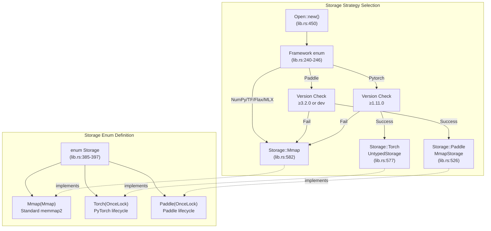
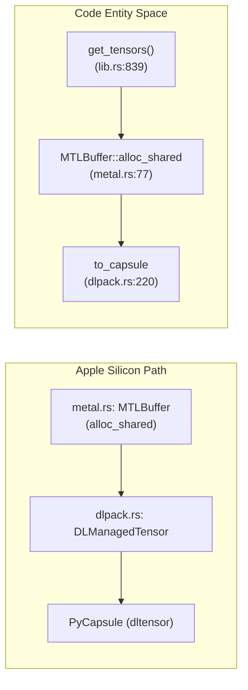

<!-- source: DeepWiki mcp.deepwiki.com · repo huggingface/safetensors · page 3.4 MLX and Other Frameworks · fetched 2026-10-21 -->

# MLX and Other Frameworks

<details>
<summary>Relevant source files</summary>

The following files were used as context for generating this wiki page:

- [.gitignore](.gitignore)
- [bindings/python/Cargo.lock](bindings/python/Cargo.lock)
- [bindings/python/benches/test_pt.py](bindings/python/benches/test_pt.py)
- [bindings/python/py_src/safetensors/mlx.py](bindings/python/py_src/safetensors/mlx.py)
- [bindings/python/py_src/safetensors/paddle.py](bindings/python/py_src/safetensors/paddle.py)
- [bindings/python/src/dlpack.rs](bindings/python/src/dlpack.rs)
- [bindings/python/src/lib.rs](bindings/python/src/lib.rs)
- [bindings/python/src/metal.rs](bindings/python/src/metal.rs)
- [bindings/python/tests/test_paddle_comparison.py](bindings/python/tests/test_paddle_comparison.py)

</details>


This page documents the integration of MLX (Apple's machine learning framework) and PaddlePaddle with safetensors, along with the framework-specific storage strategies used for optimized tensor loading. MLX is designed for efficient machine learning on Apple Silicon (utilizing Unified Memory Architecture), while PaddlePaddle is a deep learning framework that supports specialized memory-mapped storage.

For PyTorch integration specifics, see [PyTorch Integration](). For NumPy, TensorFlow, and JAX/Flax integrations, see [NumPy, TensorFlow, and JAX/Flax Integration](). For the core Python API, see [API Reference]().

## Overview

The safetensors library supports multiple deep learning frameworks through a combination of:
- **Direct NumPy conversion** for TensorFlow and JAX/Flax.
- **Unified Memory (UMA) optimizations** for MLX and PyTorch MPS via `MTLBuffer` and `DLPack`.
- **Specialized memory-mapped storage** for PyTorch and PaddlePaddle.
- **Framework detection and validation** at the Rust bindings layer.

MLX integration utilizes the `safe_open` interface to provide lazy loading. On Apple Silicon, this path is highly optimized using parallel `pread` into shared Metal buffers. PaddlePaddle receives special treatment with `MmapStorage` support for zero-copy tensor loading in recent versions.

## Framework Support Matrix

The following frameworks are supported with varying levels of optimization:

| Framework | Framework ID | Storage Strategy | Device Support | Version Requirements |
|-----------|-------------|------------------|----------------|---------------------|
| PyTorch | `"pt"`, `"torch"`, `"pytorch"` | `Storage::Torch` | CPU, CUDA, MPS, NPU, XPU, XLA, MLU, MUSA, HPU | ≥1.11.0 for optimized storage |
| NumPy | `"np"`, `"numpy"` | `Storage::Mmap` | CPU only | None |
| TensorFlow | `"tf"`, `"tensorflow"` | `Storage::Mmap` | CPU only | None |
| JAX/Flax | `"jax"`, `"flax"` | `Storage::Mmap` | CPU only | None |
| MLX | `"mlx"` | `Storage::Mmap` | CPU (UMA) | None |
| PaddlePaddle | `"paddle"` | `Storage::Paddle` or `Storage::Mmap` | CPU, GPU (CUDA as gpu:N) | ≥3.2.0 for `MmapStorage` |

Sources: [bindings/python/src/lib.rs:240-285](), [bindings/python/src/lib.rs:457-465](), [bindings/python/py_src/safetensors/paddle.py:111-121]()

## Storage Strategy Architecture

The Rust bindings implement distinct storage strategies for memory-mapped tensor access.



Sources: [bindings/python/src/lib.rs:385-397](), [bindings/python/src/lib.rs:495-583]()

### Storage::Mmap
Standard memory-mapped storage used by NumPy, TensorFlow, JAX/Flax, and MLX. It uses the `memmap2` crate for read-only mapping.

### Storage::Paddle
PaddlePaddle-specific storage using `paddle.base.core.frombuffer` or `paddle.MmapStorage`, available in PaddlePaddle ≥3.2.0.
Sources: [bindings/python/py_src/safetensors/paddle.py:111-121](), [bindings/python/src/lib.rs:496-532]()

## MLX Framework Integration

MLX is Apple's framework for machine learning on Apple Silicon. The integration provides high-performance loading using the shared memory architecture of M-series chips.

### Apple Silicon (Metal) Optimizations
On macOS AArch64, `safetensors` uses a specialized path for loading tensors to MPS/MLX devices:
1. **Parallel `pread`**: Instead of standard `mmap`, the library can use parallelized `pread` calls to populate buffers.
2. **MTLBuffer**: Allocates `MTLResourceOptions::StorageModeShared` buffers that are simultaneously visible to the CPU and GPU.
3. **DLPack Integration**: Uses DLPack capsules to hand off these `MTLBuffer` objects to frameworks like PyTorch (MPS) without copying data.


Sources: [bindings/python/src/metal.rs:77-89](), [bindings/python/src/dlpack.rs:220-234](), [bindings/python/benches/test_pt.py:202-209]()

### Python API
The MLX module mirrors the standard safetensors API.

#### save() / save_file()
Converts MLX arrays to NumPy arrays and serializes them.
```python
def save(tensors: Dict[str, mx.array], metadata: Optional[Dict[str, str]] = None) -> bytes:
    np_tensors = _mx2np(tensors)
    return numpy.save(np_tensors, metadata=metadata)
```
Sources: [bindings/python/py_src/safetensors/mlx.py:10-38](), [bindings/python/py_src/safetensors/mlx.py:41-73]()

#### load_file()
Uses `safe_open` with the MLX framework identifier to enable lazy loading.
Sources: [bindings/python/py_src/safetensors/mlx.py:103-129]()

## PaddlePaddle Framework Integration

PaddlePaddle integration supports both legacy NumPy-based loading and modern `MmapStorage` loading.

### Version Detection
- **Paddle < 3.2.0**: Falls back to `numpy.load` and `paddle.to_tensor`.
- **Paddle ≥ 3.2.0**: Uses `safe_open` with `framework="paddle"` for zero-copy.
Sources: [bindings/python/py_src/safetensors/paddle.py:111-121](), [bindings/python/py_src/safetensors/paddle.py:147-151]()

### Data Flow for PaddlePaddle

```mermaid
graph TD
    subgraph "Paddle Load Path"
        LOAD_FILE["paddle.load_file(filename)"]
        VERSION_CHECK{"paddle.__version__ >= 3.2.0?"}
        SAFE_OPEN["safe_open(framework='paddle')"]
        NP_LOAD["numpy.load_file()"]
        VIEW2PADDLE["_view2paddle()"]
        
        LOAD_FILE --> VERSION_CHECK
        VERSION_CHECK -- Yes --> SAFE_OPEN
        VERSION_CHECK -- No --> NP_LOAD
        SAFE_OPEN --> VIEW2PADDLE
    end
    
    subgraph "Implementation Details"
        FROMBUFFER["paddle.base.core.frombuffer<br/>(paddle.py:238)"]
        PADDLE_TYPES["_TYPES mapping<br/>(paddle.py:192-205)"]
    end
    
    VIEW2PADDLE --> FROMBUFFER
    FROMBUFFER --> PADDLE_TYPES
```

Sources: [bindings/python/py_src/safetensors/paddle.py:119-153](), [bindings/python/py_src/safetensors/paddle.py:229-245]()

### Device Support
Paddle supports CPU and GPU (CUDA) devices. GPU devices are specified using strings like `"gpu:0"`.
Sources: [bindings/python/py_src/safetensors/paddle.py:128-130](), [bindings/python/tests/test_paddle_comparison.py:77-83]()

## Framework Module Caching
The Rust bindings cache framework modules in static `OnceLock` variables to avoid repeated import overhead.
```rust
static MLX_MODULE: OnceLock<Py<PyModule>> = OnceLock::new();
static PADDLE_MODULE: OnceLock<Py<PyModule>> = OnceLock::new();
```
Sources: [bindings/python/src/lib.rs:35-36]()

## Summary of Conversion Functions
- **MLX**: Uses `_np2mx` ([mlx.py:132-135]()) and `_mx2np` ([mlx.py:138-142]()) for array conversion.
- **Paddle**: Uses `_np2paddle` ([paddle.py:156-161]()) and `_paddle2np` ([paddle.py:164-167]()) for framework interop.

Sources: [bindings/python/py_src/safetensors/mlx.py:1-143](), [bindings/python/py_src/safetensors/paddle.py:1-245]()

---

