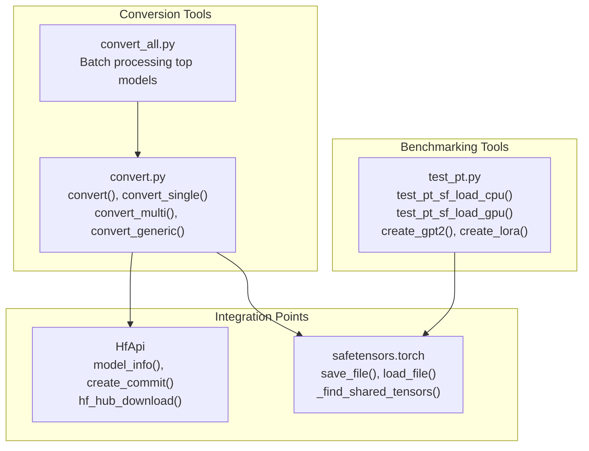
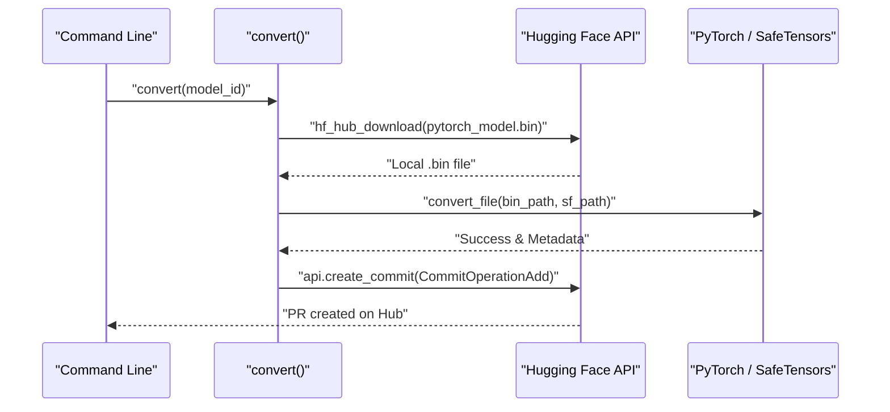

<!-- source: DeepWiki mcp.deepwiki.com · repo huggingface/safetensors · page 4 Tools and Utilities · fetched 2026-10-21 -->

# Tools and Utilities

Relevant source files

The following files were used as context for generating this wiki page:

- [bindings/python/benches/test_flax.py](bindings/python/benches/test_flax.py)
- [bindings/python/benches/test_paddle.py](bindings/python/benches/test_paddle.py)
- [bindings/python/benches/test_pt.py](bindings/python/benches/test_pt.py)
- [bindings/python/benches/test_tf.py](bindings/python/benches/test_tf.py)
- [bindings/python/convert.py](bindings/python/convert.py)
- [bindings/python/convert_all.py](bindings/python/convert_all.py)
- [bindings/python/py_src/safetensors/mlx.py](bindings/python/py_src/safetensors/mlx.py)

This page documents the practical tools and utilities built on safetensors, including model conversion scripts for migrating PyTorch models to safetensors format, benchmarking utilities for performance testing, and Hugging Face Hub integration for automated model conversion workflows.

## Overview

SafeTensors provides three primary categories of utilities:

| Tool Category | Primary Files | Purpose |
|--------------|--------------|---------|
| **Model Conversion** | `convert.py`, `convert_all.py` | Convert PyTorch models to safetensors format with automatic PR creation |
| **Benchmarking** | `benches/test_pt.py`, `test_mlx.py`, etc. | Performance comparison between native formats and safetensors |
| **Hub Integration** | Functions in `convert.py` | Automated workflows for Hugging Face Hub model conversion |

Sources: [bindings/python/convert.py:1-40]() , [bindings/python/convert_all.py:1-7]() , [bindings/python/benches/test_pt.py:1-9]()

## Model Conversion

The conversion utilities are designed to transition the ecosystem from PyTorch's pickle-based `pytorch_model.bin` files to the safer and faster `.safetensors` format. For a deep dive into the conversion logic, see [Model Conversion](#4.1).

### Conversion Pipeline
The `convert()` function in `convert.py` orchestrates the process, detecting model type and routing to appropriate handlers like `convert_single` or `convert_multi` [bindings/python/convert.py:330-406](). It uses `hf_hub_download` to fetch weights and `api.create_commit` to push results back to the Hub [bindings/python/convert.py:153-159]().

### Shared Tensor Handling
To avoid memory bloat, the conversion process identifies shared weights using `_find_shared_tensors` [bindings/python/convert.py:55-55](). It resolves duplicates via `_remove_duplicate_names`, ensuring only one "complete" version of a shared tensor is saved while recording the mapping in the file metadata [bindings/python/convert.py:42-89]().

### Batch Conversion
`convert_all.py` provides a workflow for mass-converting models. It filters the top 50 models by download count [bindings/python/convert_all.py:12-19](), skipping those over 2GB [bindings/python/convert_all.py:29-31](), and automatically opens PRs for each successful conversion.

Sources: [bindings/python/convert.py:42-118]() , [bindings/python/convert_all.py:8-48]()

## Benchmarking Tools

### Performance Testing Suite
The codebase includes comprehensive benchmarks comparing safetensors against native framework formats (PyTorch, TensorFlow, Flax, Paddle, MLX). These tests utilize `pytest-benchmark` to measure loading speeds across CPU, CUDA, and Apple Silicon (MPS).

**Key Benchmark Files:**
*   **PyTorch**: `benches/test_pt.py` compares `torch.load` vs `load_file` [bindings/python/benches/test_pt.py:41-64]().
*   **MLX**: `mlx.py` integration supports parallel `pread` into `MTLBuffer` for Apple Silicon [bindings/python/py_src/safetensors/mlx.py:103-129]().
*   **Frameworks**: `test_tf.py`, `test_flax.py`, and `test_paddle.py` provide cross-format parity and speed checks [bindings/python/benches/test_tf.py:55-79](), [bindings/python/benches/test_flax.py:39-64](), [bindings/python/benches/test_paddle.py:33-57]().

### Model Generation for Tests
To ensure realistic testing, the suite includes utilities to generate synthetic models:
*   `create_gpt2(n_layers)`: Generates standard transformer weights [bindings/python/benches/test_pt.py:10-30]().
*   `create_lora(n_layers)`: Generates many small adapter matrices to test overhead with high tensor counts [bindings/python/benches/test_pt.py:33-38]().

### Backend Selection
Benchmarks often compare different loading backends. For example, `test_pt_sf_load_gpu_pread` specifically tests the `pread` backend on CUDA [bindings/python/benches/test_pt.py:148-159](), while `test_pt_sf_load_mps_pread` evaluates the parallel loading path on Apple Silicon [bindings/python/benches/test_pt.py:201-215]().

Sources: [bindings/python/benches/test_pt.py:10-215]() , [bindings/python/py_src/safetensors/mlx.py:103-129]() , [bindings/python/benches/test_tf.py:1-79]()

## Hugging Face Hub Integration

The conversion workflow is deeply integrated with the `huggingface_hub` library. It uses:
*   `CommitOperationAdd`: To stage converted `.safetensors` and `.index.json` files [bindings/python/convert.py:183-186]().
*   `HfApi`: To check for existing conversion PRs via `api.get_repo_discussions` and create new ones [bindings/python/convert.py:267-285]().
*   `hf_hub_download`: To pull the original `pytorch_model.bin` or shard indices [bindings/python/convert.py:100-106]().

Sources: [bindings/python/convert.py:145-213]() , [bindings/python/convert.py:267-285]()

---

