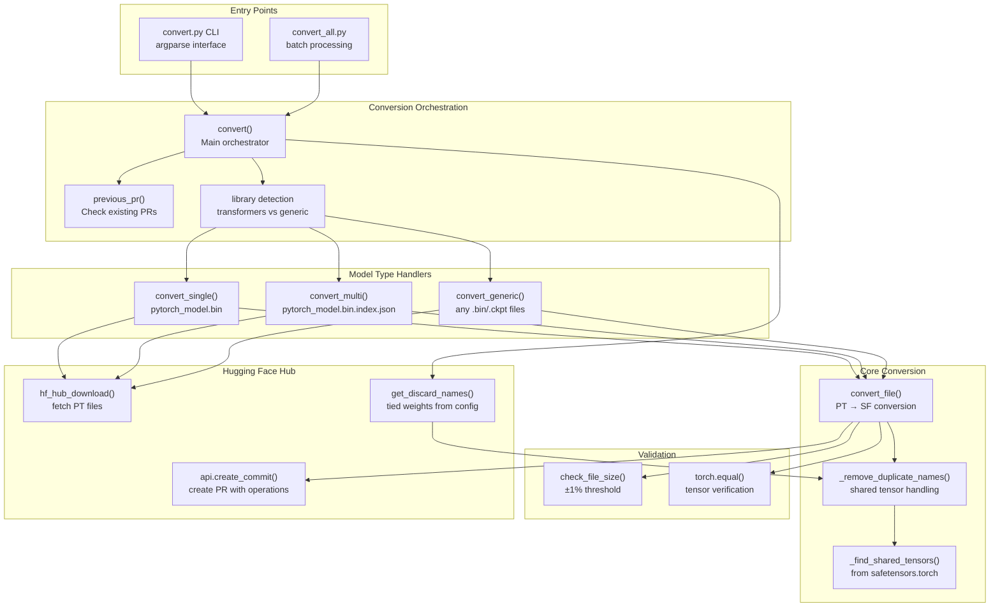
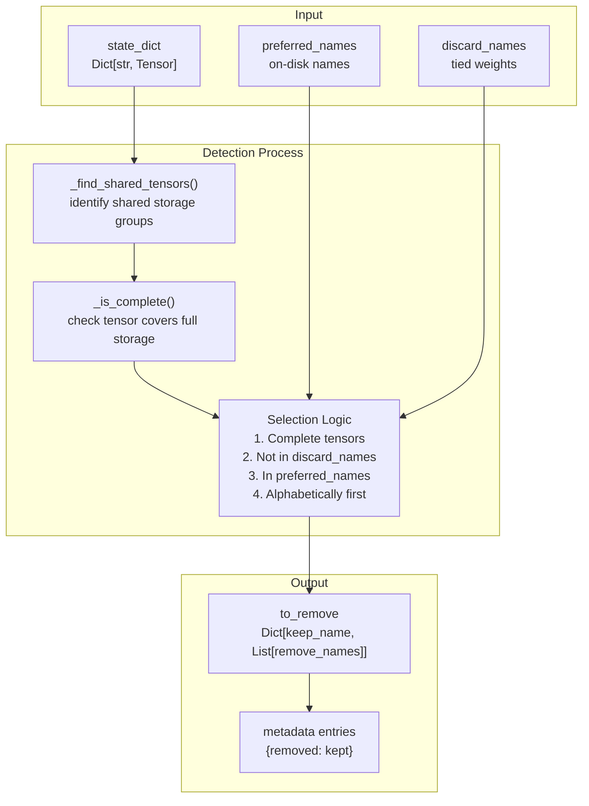
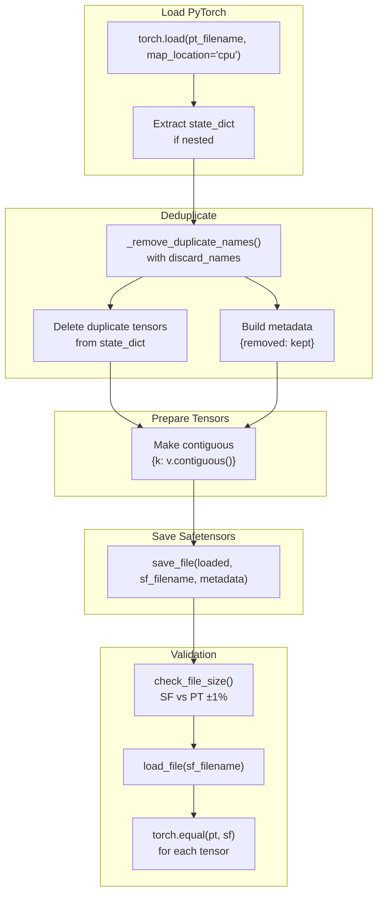

<!-- source: DeepWiki mcp.deepwiki.com · repo huggingface/safetensors · page 4.1 Model Conversion · fetched 2026-10-21 -->

# Model Conversion

<details>
<summary>Relevant source files</summary>

The following files were used as context for generating this wiki page:

- [bindings/python/convert.py](bindings/python/convert.py)
- [bindings/python/convert_all.py](bindings/python/convert_all.py)
- [bindings/python/py_src/safetensors/torch.py](bindings/python/py_src/safetensors/torch.py)

</details>


## Purpose and Scope

This document covers the utilities for converting PyTorch models from pickle format (`pytorch_model.bin`) to the safetensors format. The primary tool, `convert.py`, automates the conversion of models hosted on the Hugging Face Hub and creates pull requests with the converted files. A secondary utility, `convert_all.py`, enables batch conversion of multiple models.

For information about basic save and load operations using the safetensors API directly, see [API Reference](#3.1). For PyTorch-specific integration details, see [PyTorch Integration](#3.2).

**Sources:** [bindings/python/convert.py:1-466](), [bindings/python/convert_all.py:1-49]()

## Conversion Utilities Overview

The safetensors repository provides two command-line utilities for model conversion:

| Utility | Purpose | Primary Use Case |
|---------|---------|------------------|
| `convert.py` | Single model conversion | Converting individual models from Hugging Face Hub with PR creation |
| `convert_all.py` | Batch conversion | Converting top-N most downloaded models for ecosystem migration |

Both utilities are PyTorch-exclusive and designed to work with models hosted on the Hugging Face Hub. They handle downloading the original weights, converting them locally, verifying correctness, and uploading the results.

**Sources:** [bindings/python/convert.py:409-466](), [bindings/python/convert_all.py:8-49]()

## Conversion Architecture



**Diagram: Model Conversion Pipeline Architecture**

The conversion pipeline orchestrates multiple steps: detecting model type, downloading files from the Hub, handling shared tensors, converting the format, validating correctness, and creating a pull request with the converted files.

**Sources:** [bindings/python/convert.py:330-407](), [bindings/python/convert.py:216-245]()

## Main Conversion Entry Point

The `convert()` function at [bindings/python/convert.py:330-407]() serves as the main orchestrator for converting a single model. Its signature is:

```python
def convert(
    api: "HfApi", 
    model_id: str, 
    revision: Optional[str] = None, 
    force: bool = False
) -> Tuple["CommitInfo", List[Tuple[str, "Exception"]]]
```

The function performs the following workflow:

1. **Check for existing conversions**: Calls `previous_pr()` to detect if a conversion PR already exists or if the model already has safetensors files [bindings/python/convert.py:338-349]().
2. **Detect library type**: Checks `library_name` attribute to determine if the model is a `transformers` model or generic [bindings/python/convert.py:355-356]().
3. **Route to appropriate handler**:
   - For transformers with `pytorch_model.bin`: calls `convert_single()` [bindings/python/convert.py:375-377]().
   - For transformers with `pytorch_model.bin.index.json`: calls `convert_multi()` [bindings/python/convert.py:366-373]().
   - For other libraries or unknown: calls `convert_generic()` [bindings/python/convert.py:382-389]().
4. **Create pull request**: Uses `api.create_commit()` with `create_pr=True` to submit converted files [bindings/python/convert.py:393-400]().

The function returns a `CommitInfo` object with the PR URL and a list of any errors encountered during conversion.

**Sources:** [bindings/python/convert.py:330-407](), [bindings/python/convert.py:267-286]()

## Shared Tensor Detection and Handling

A critical aspect of PyTorch model conversion is handling shared tensors—tensors that share underlying storage. The conversion process must preserve this sharing relationship through metadata rather than duplicating tensors.

### Shared Tensor Detection

The `_remove_duplicate_names()` function at [bindings/python/convert.py:42-89]() identifies and handles shared tensors:



**Diagram: Shared Tensor Detection and Name Selection**

The function uses `_find_shared_tensors()` from `safetensors.torch` [bindings/python/torch.py:76-88]() to identify groups of tensor names that share storage. For each group, it selects one "keep name" based on:

1. **Completeness**: The tensor must cover the entire storage (checked via `_is_complete()`) [bindings/python/convert.py:58-60]().
2. **Not discarded**: Not in `discard_names` (tied weights from config) [bindings/python/convert.py:78-80]().
3. **Preference**: Prioritize names in `preferred_names` (from existing safetensors files) [bindings/python/convert.py:82-85]().
4. **Alphabetical**: As a fallback, select the first alphabetically [bindings/python/convert.py:72]().

All other names in the group are marked for removal and tracked in metadata.

**Sources:** [bindings/python/convert.py:42-89](), [bindings/python/torch.py:76-88](), [bindings/python/torch.py:91-95]()

### Tied Weights Configuration

The `get_discard_names()` function at [bindings/python/convert.py:92-119]() retrieves tied weight information from the model's config:

```python
discard_names = getattr(class_, "_tied_weights_keys", [])
```

This loads the model architecture class from `transformers` and extracts the `_tied_weights_keys` attribute, which lists tensor names that should not be preferred during deduplication (e.g., language model heads that share embeddings).

**Sources:** [bindings/python/convert.py:92-119]()

## Single-File Model Conversion

The `convert_single()` function at [bindings/python/convert.py:192-214]() handles models with a single `pytorch_model.bin` file:

```python
def convert_single(
    model_id: str,
    *,
    revision: Optional[str],
    folder: str,
    token: Optional[str],
    discard_names: List[str],
) -> ConversionResult
```

**Process:**

1. Downloads `pytorch_model.bin` from the Hub using `hf_hub_download()` [bindings/python/convert.py:200-206]().
2. Converts to `model.safetensors` via `convert_file()` [bindings/python/convert.py:210]().
3. Returns a `CommitOperationAdd` for uploading the converted file [bindings/python/convert.py:211]().

The output filename is always `model.safetensors` for single-file models.

**Sources:** [bindings/python/convert.py:192-214]()

## Multi-File Model Conversion

The `convert_multi()` function at [bindings/python/convert.py:145-190]() handles models sharded across multiple files with an index:

```python
def convert_multi(
    model_id: str,
    *,
    revision=Optional[str],
    folder: str,
    token: Optional[str],
    discard_names: List[str],
) -> ConversionResult
```

**Process:**

1. Downloads `pytorch_model.bin.index.json` to get the shard mapping [bindings/python/convert.py:153-159]().
2. Extracts unique filenames from the `weight_map` dictionary [bindings/python/convert.py:163]().
3. For each shard file:
   - Downloads the `.bin` file [bindings/python/convert.py:166-168]().
   - Converts using `convert_file()` with `rename()` to transform `pytorch_model-XXXXX.bin` to `model-XXXXX.safetensors` [bindings/python/convert.py:170-172]().
4. Creates a new `model.safetensors.index.json` with updated mappings [bindings/python/convert.py:175-180]().
5. Returns `CommitOperationAdd` operations for all shards and the index file [bindings/python/convert.py:183-186]().

The `rename()` function at [bindings/python/convert.py:138-143]() transforms filenames:
- Changes extension from `.bin` to `.safetensors`
- Replaces `pytorch_model` prefix with `model`

**Sources:** [bindings/python/convert.py:145-190](), [bindings/python/convert.py:138-143]()

## Generic File Conversion

The `convert_generic()` function at [bindings/python/convert.py:288-328]() handles non-transformers models or any `.bin` or `.ckpt` files:

```python
def convert_generic(
    model_id: str,
    *,
    revision=Optional[str],
    folder: str,
    filenames: Set[str],
    token: Optional[str],
) -> ConversionResult
```

**Process:**

1. Iterates through all files in the repository [bindings/python/convert.py:299]().
2. For each file with `.bin` or `.ckpt` extension:
   - Downloads the file [bindings/python/convert.py:302-304]().
   - Converts with `convert_file()` (using empty `discard_names`) [bindings/python/convert.py:315]().
   - Special case: `pytorch_model.bin` becomes `model.safetensors` [bindings/python/convert.py:307-308]().
   - Default: replaces extension with `.safetensors` [bindings/python/convert.py:310-311]().
3. Collects errors for files that fail conversion but continues with remaining files [bindings/python/convert.py:318-320]().
4. Returns successful operations and error list [bindings/python/convert.py:328]().

This function is more permissive, attempting conversion on all compatible files and reporting errors without failing the entire conversion.

**Sources:** [bindings/python/convert.py:288-328]()

## Core File Conversion Process

The `convert_file()` function at [bindings/python/convert.py:216-245]() implements the actual conversion logic:



**Diagram: convert_file() Processing Pipeline**

**Key steps:**

1. **Load**: Uses `torch.load()` with `map_location="cpu"` and `weights_only=True` to avoid arbitrary code execution during the conversion process itself [bindings/python/convert.py:221]().
2. **Extract state_dict**: Some checkpoint files nest the state_dict under a `"state_dict"` key [bindings/python/convert.py:222-223]().
3. **Deduplicate**: Calls `_remove_duplicate_names()` to identify shared tensors [bindings/python/convert.py:225]().
4. **Build metadata**: Creates metadata entries mapping removed names to kept names, plus `{"format": "pt"}` [bindings/python/convert.py:226-231]().
5. **Force contiguity**: Ensures all tensors are contiguous with `.contiguous()` (safetensors requirement) [bindings/python/convert.py:233]().
6. **Save**: Uses `save_file()` from `safetensors.torch` [bindings/python/convert.py:234]().
7. **Validate size**: Ensures safetensors file is not >1% larger than PyTorch file [bindings/python/convert.py:236]().
8. **Validate correctness**: Reloads and verifies tensor equality with `torch.equal()` [bindings/python/convert.py:239-244]().

Any validation failure raises a `RuntimeError`, preventing upload of invalid conversions.

**Sources:** [bindings/python/convert.py:216-245]()

## Validation and Safety Checks

### File Size Validation

The `check_file_size()` function at [bindings/python/convert.py:125-136]() ensures the converted file size is reasonable:

```python
if (sf_size - pt_size) / pt_size > 0.01:
    raise RuntimeError(
        f"""The file size different is more than 1%:
     - {sf_filename}: {sf_size}
     - {pt_filename}: {pt_size}
     """
    )
```

This check prevents significant size increases, which could indicate issues with tensor storage or metadata overhead. A 1% threshold allows for minor differences due to alignment and header structure while catching problematic conversions.

**Sources:** [bindings/python/convert.py:125-136]()

### Tensor Equality Verification

At [bindings/python/convert.py:239-244](), the conversion process verifies each tensor:

```python
reloaded = load_file(sf_filename)
for k in loaded:
    pt_tensor = loaded[k]
    sf_tensor = reloaded[k]
    if not torch.equal(pt_tensor, sf_tensor):
        raise RuntimeError(f"The output tensors do not match for key {k}")
```

This ensures bit-exact equivalence between the original PyTorch tensors and the reloaded safetensors, guaranteeing no data corruption during conversion.

**Sources:** [bindings/python/convert.py:239-244]()

## Batch Conversion Utility

The `convert_all.py` script at [bindings/python/convert_all.py:8-49]() demonstrates batch conversion of popular models:

```python
total = 50
models = list(
    api.list_models(
        filter=ModelFilter(library=args.library.Transformers),
        sort="downloads",
        direction=-1,
    )
)[:total]
```

**Process:**

1. **Query Hub**: Lists transformers models sorted by download count [bindings/python/convert_all.py:13-19]().
2. **Filter by size**: Skips models with `pytorch_model.bin` larger than 2GB to avoid excessive processing time [bindings/python/convert_all.py:26-31]().
3. **Convert each model**: Calls `convert()` for each model [bindings/python/convert_all.py:36]().
4. **Handle errors**: Catches `AlreadyExists` exceptions (already converted) and other exceptions [bindings/python/convert_all.py:38-44]().
5. **Track statistics**: Reports success rate and error types [bindings/python/convert_all.py:46-48]().

This utility is useful for large-scale ecosystem migration from pickle to safetensors format.

**Sources:** [bindings/python/convert_all.py:8-49]()

## Hugging Face Hub Integration

### Pull Request Creation

The conversion process creates pull requests on the Hugging Face Hub with a standardized description defined at [bindings/python/convert.py:22-37]():

```python
COMMIT_DESCRIPTION = """
This is an automated PR created with https://huggingface.co/spaces/safetensors/convert

This new file is equivalent to `pytorch_model.bin` but safe in the sense that
no arbitrary code can be put into it.
...
"""
```

The PR is created via [bindings/python/convert.py:393-400]():

```python
new_pr = api.create_commit(
    repo_id=model_id,
    revision=revision,
    operations=operations,
    commit_message=pr_title,
    commit_description=COMMIT_DESCRIPTION,
    create_pr=True,
)
```

**Sources:** [bindings/python/convert.py:22-37](), [bindings/python/convert.py:393-400]()

### Duplicate PR Detection

The `previous_pr()` function at [bindings/python/convert.py:267-286]() checks for existing conversion PRs:

1. Retrieves the current revision's commit SHA [bindings/python/convert.py:270]().
2. Lists all discussions (PRs) for the repository [bindings/python/convert.py:272]().
3. Checks if any open or closed PR has the title "Adding `safetensors` variant of this model" [bindings/python/convert.py:275]().
4. Verifies the PR's base commit matches the current revision [bindings/python/convert.py:281]().
5. Returns the existing PR if found, `None` otherwise.

This prevents creating duplicate PRs when re-running conversion on the same model.

**Sources:** [bindings/python/convert.py:267-286]()

### Safety Warning

The CLI interface at [bindings/python/convert.py:443-447]() includes a safety prompt:

```python
txt = input(
    "This conversion script will unpickle a pickled file, which is inherently unsafe. "
    "If you do not trust this file, we invite you to use "
    "https://huggingface.co/spaces/safetensors/convert or google colab or other hosted solution "
    "to avoid potential issues with this file. Continue [Y/n] ?"
)
```

This warns users about the inherent dangers of loading pickle files, recommending the use of isolated environments (the hosted conversion Space or Colab) for untrusted models.

**Sources:** [bindings/python/convert.py:443-447]()

## Command-Line Usage

### convert.py

```bash
python convert.py MODEL_ID [--revision REVISION] [--force] [-y]
```

**Arguments:**

| Argument | Description |
|----------|-------------|
| `model_id` | Hugging Face model identifier (e.g., `gpt2`, `facebook/wav2vec2-base-960h`) |
| `--revision` | Specific git revision to convert (default: main branch) |
| `--force` | Create PR even if model already has safetensors files or existing PR |
| `-y` | Skip safety prompt for automated workflows |

**Example:**

```bash
python convert.py bert-base-uncased
```

**Sources:** [bindings/python/convert.py:409-466]()

### convert_all.py

```bash
python convert_all.py
```

This script has no command-line arguments. It converts the top 50 most downloaded transformers models under 2GB. Configuration is hardcoded in the script.

**Sources:** [bindings/python/convert_all.py:8-49]()

## Conversion Error Handling

The conversion utilities implement comprehensive error handling:

| Error Type | Exception | Behavior |
|------------|-----------|----------|
| Model already converted | `AlreadyExists` | Counted as success in batch mode, skipped |
| Existing PR found | `AlreadyExists` | Provides PR URL, skipped unless `--force` |
| File size difference >1% | `RuntimeError` | Conversion fails, not uploaded |
| Tensor inequality | `RuntimeError` | Conversion fails, not uploaded |
| Individual file failure in generic mode | `Exception` | Collected in errors list, other files continue |

The `ConversionResult` type at [bindings/python/convert.py:39]() captures both successful operations and errors:

```python
ConversionResult = Tuple[List["CommitOperationAdd"], List[Tuple[str, "Exception"]]]
```

This allows partial success: some files may convert successfully while others fail, useful for repositories with mixed content.

**Sources:** [bindings/python/convert.py:39](), [bindings/python/convert.py:121-123](), [bindings/python/convert.py:318-327]()

---

