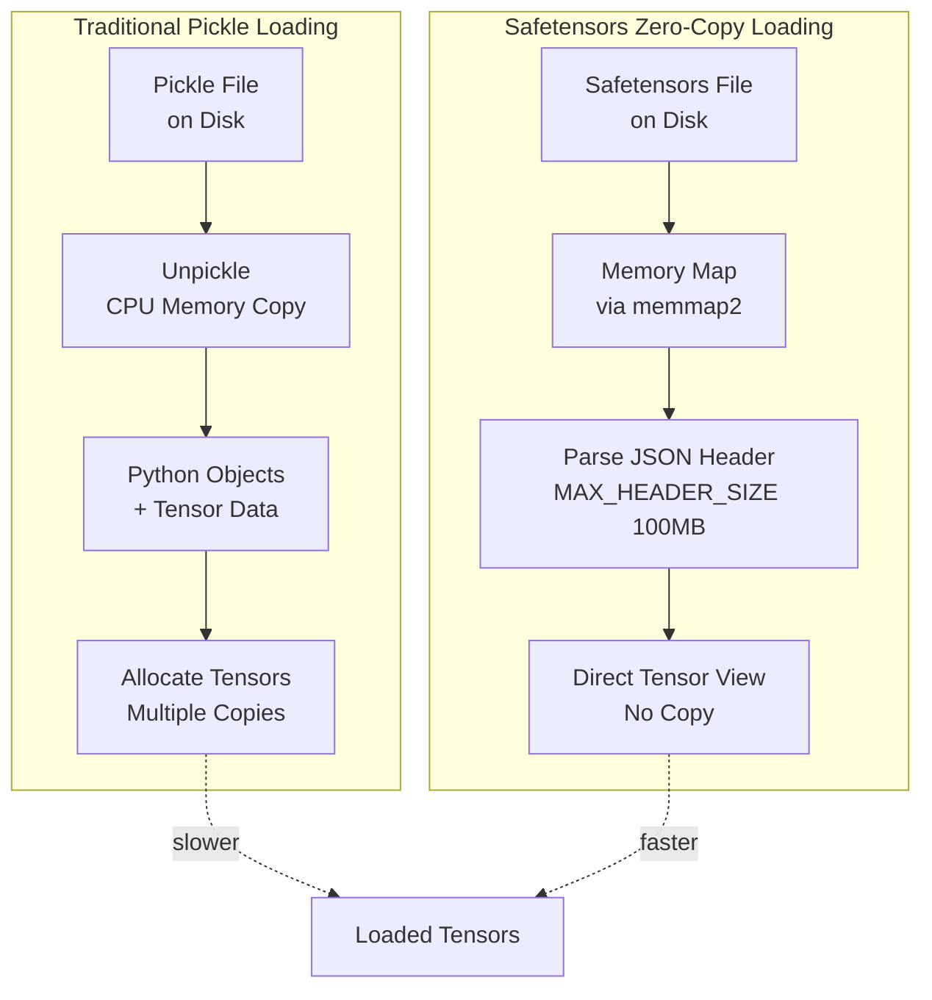
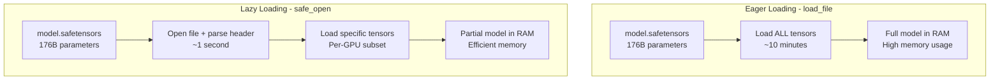
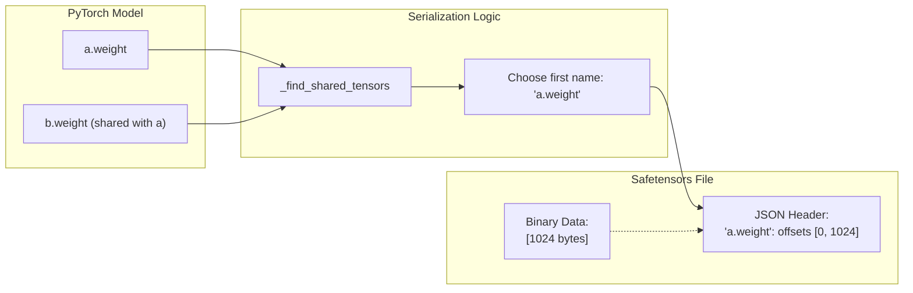

<!-- source: DeepWiki mcp.deepwiki.com · repo huggingface/safetensors · page 5 Performance · fetched 2026-10-21 -->

# Performance

Relevant source files

The following files were used as context for generating this wiki page:

- [.github/workflows/python-bench.yml](.github/workflows/python-bench.yml)
- [bindings/python/benches/test_pt.py](bindings/python/benches/test_pt.py)
- [bindings/python/py_src/safetensors/mlx.py](bindings/python/py_src/safetensors/mlx.py)
- [bindings/python/pyproject.toml](bindings/python/pyproject.toml)
- [bindings/python/src/lib.rs](bindings/python/src/lib.rs)
- [bindings/python/uv.lock](bindings/python/uv.lock)
- [docs/source/speed.mdx](docs/source/speed.mdx)
- [docs/source/torch_shared_tensors.mdx](docs/source/torch_shared_tensors.mdx)
- [safetensors/benches/benchmark.rs](safetensors/benches/benchmark.rs)
- [safetensors/src/slice.rs](safetensors/src/slice.rs)
- [safetensors/src/tensor.rs](safetensors/src/tensor.rs)

This page documents the performance characteristics of the `safetensors` format and its implementations. It covers zero-copy loading mechanisms, memory mapping benefits, lazy loading advantages, benchmarks (including the BLOOM 10min to 45sec speedup), distributed training optimizations, the `pread` backend, parallel MPS loading, and pinned CUDA memory transfers.

For details about the lazy loading API, see [Tensor Slicing](#2.3).

---

## Zero-Copy Loading Architecture

Safetensors achieves significant performance improvements through zero-copy loading, which eliminates unnecessary memory allocations and data copies during tensor deserialization. The format's design enables direct memory mapping of tensor data without intermediate copies.

**Zero-Copy Mechanism Components**

The zero-copy implementation leverages several techniques:

| Component | Implementation | Benefit |
|-----------|---------------|---------|
| Memory Mapping | `memmap2::Mmap` | Avoids loading entire file into RAM by mapping to address space [bindings/python/src/lib.rs:9-9](). |
| Direct Buffer Access | `slice::from_raw_parts` | Rust `TensorView` points directly to the mapped memory [bindings/python/src/lib.rs:141-147](). |
| Header Validation | `SafeTensors::deserialize` | Minimal overhead (JSON parsing) with a 100MB safety cap [safetensors/src/tensor.rs:10-10](). |
| Offset-Based Access | `TensorInfo` | Pre-computed `data_offsets` allow random access without scanning [safetensors/src/tensor.rs:29-32](). |

**Sources:** [bindings/python/src/lib.rs:9-9](), [bindings/python/src/lib.rs:141-147](), [safetensors/src/tensor.rs:10-10](), [safetensors/src/tensor.rs:29-32]()

---

## Memory Mapping and `pread` Backends

Safetensors supports multiple backends for sourcing bytes, primarily `mmap` and `pread`. 

### Memory Mapping Implementation
The Rust core uses the `memmap2` crate to map file contents directly into the process address space. In the Python bindings, `safe_open` defaults to `backend="mmap"` [bindings/python/py_src/safetensors/mlx.py:104-114]().

### The `pread` Backend
For environments where memory mapping is suboptimal (e.g., certain network filesystems or specific hardware constraints), safetensors provides a `pread` backend. This uses the `pread(2)` system call to read bytes from a specific offset without changing the file pointer, which is thread-safe and efficient for parallel loading [bindings/python/benches/test_pt.py:67-71]().

**Sources:** [bindings/python/py_src/safetensors/mlx.py:104-114](), [bindings/python/benches/test_pt.py:67-71](), [bindings/python/benches/test_pt.py:148-152]()

---

## Lazy Loading for Distributed Training

The `safe_open` context manager enables lazy loading, where tensors are loaded on-demand rather than all at once. This is particularly valuable in distributed training scenarios with large models.

**BLOOM Case Study**
The BLOOM model (176 billion parameters) demonstrates the impact of lazy loading:
- **Traditional PyTorch Loading**: ~10 minutes to load on 8 GPUs.
- **Safetensors Lazy Loading**: ~45 seconds to load on 8 GPUs.
- **Performance Improvement**: ~13.3x faster.

This speedup occurs because each rank only loads its assigned tensor subset using the `SafeTensors` metadata to calculate specific byte ranges [safetensors/src/slice.rs:1-3]().

**Sources:** [safetensors/src/slice.rs:1-3](), [docs/source/torch_shared_tensors.mdx:59-62]()

---

## Hardware-Specific Optimizations

### Parallel MPS Loading (Apple Silicon)
On Apple Silicon, safetensors optimizes for the Unified Memory Architecture (UMA). When loading to `mps` (Metal Performance Shaders) devices, the library can allocate `Shared MTLBuffers` and use parallel `pread` to fill them, then hand off the buffer to the framework via DLPack [bindings/python/benches/test_pt.py:202-208]().

### Pinned CUDA Memory Transfers
For GPU loading, safetensors can leverage "Fast GPU" mode by setting `SAFETENSORS_FAST_GPU=1`. This enables memory mapping the file and calling `cudaMemcpy` directly to move data to the GPU, bypassing intermediate CPU tensor allocations [docs/source/speed.mdx:63-87]().

**Sources:** [bindings/python/benches/test_pt.py:202-208](), [docs/source/speed.mdx:63-87]()

---

## Benchmark Results

Performance benchmarks compare safetensors against PyTorch's native pickle-based format. The suite uses `pytest-benchmark` to track regressions [bindings/python/pyproject.toml:51-51]().

### Benchmark Structure
[bindings/python/benches/test_pt.py:10-30]() defines representative models:
- **GPT-2 (12 layers)**: Standard transformer weights.
- **LoRA (500 layers)**: Many small adapter weights (tests header parsing overhead).

| Scenario | PyTorch (Pickle) | Safetensors | Speedup (Approx) |
|----------|------------------|-------------|------------------|
| CPU Loading (GPT-2) | 0.307s | 0.004s | 76x |
| GPU Loading (GPT-2) | 0.353s | 0.165s | 2.1x |

**Benchmark Test Functions**
- `test_pt_sf_load_cpu_pread`: Benchmarks `pread` backend performance [bindings/python/benches/test_pt.py:67-71]().
- `test_pt_sf_load_mps`: Benchmarks Apple Silicon specific paths [bindings/python/benches/test_pt.py:183-195]().
- `bench_serialize`: Measures Rust-side serialization of metadata [safetensors/benches/benchmark.rs:18-34]().

**Sources:** [bindings/python/pyproject.toml:51-51](), [bindings/python/benches/test_pt.py:10-30](), [docs/source/speed.mdx:38-85](), [safetensors/benches/benchmark.rs:18-34]()

---

## Memory Efficiency and Shared Tensors

Safetensors optimizes memory by identifying shared tensors during serialization. 

### Shared Tensor Detection
In PyTorch, models often share weights (e.g., `embeddings` and `lm_head`). Safetensors' `save_model` function uses `_find_shared_tensors` to ensure a single buffer is written to disk for multiple names, reducing file size and peak memory [docs/source/torch_shared_tensors.mdx:24-49]().

**Sources:** [docs/source/torch_shared_tensors.mdx:24-49](), [docs/source/torch_shared_tensors.mdx:91-101]()

---

