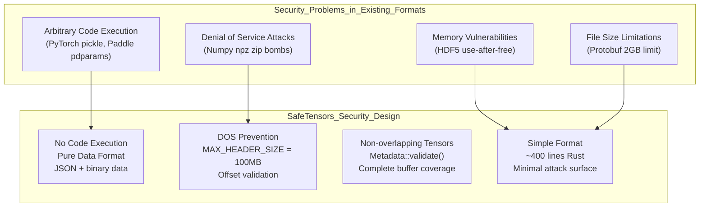
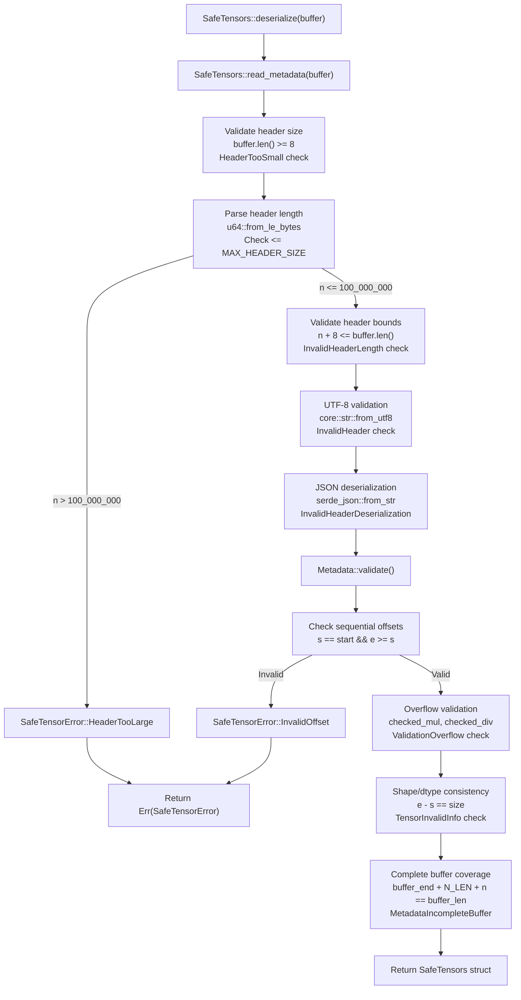

<!-- source: DeepWiki mcp.deepwiki.com · repo huggingface/safetensors · page 6 Security · fetched 2026-10-21 -->

# Security

Relevant source files

The following files were used as context for generating this wiki page:

- [.github/workflows/security-audit.yml](.github/workflows/security-audit.yml)
- [README.md](README.md)
- [SECURITY.md](SECURITY.md)
- [attacks/README.md](attacks/README.md)
- [attacks/numpy_dos_create.py](attacks/numpy_dos_create.py)
- [attacks/paddle_ace_create.py](attacks/paddle_ace_create.py)
- [attacks/paddle_ace_get_pwned.py](attacks/paddle_ace_get_pwned.py)
- [attacks/tf_safe_ace_create.py](attacks/tf_safe_ace_create.py)
- [attacks/tf_safe_ace_get_pwned.py](attacks/tf_safe_ace_get_pwned.py)
- [attacks/torch_ace_create.py](attacks/torch_ace_create.py)
- [safetensors/README.md](safetensors/README.md)
- [safetensors/benches/benchmark.rs](safetensors/benches/benchmark.rs)
- [safetensors/fuzz/.gitignore](safetensors/fuzz/.gitignore)
- [safetensors/fuzz/Cargo.toml](safetensors/fuzz/Cargo.toml)
- [safetensors/fuzz/fuzz_targets/fuzz_target_1.rs](safetensors/fuzz/fuzz_targets/fuzz_target_1.rs)
- [safetensors/src/lib.rs](safetensors/src/lib.rs)
- [safetensors/src/slice.rs](safetensors/src/slice.rs)
- [safetensors/src/tensor.rs](safetensors/src/tensor.rs)

This page documents the security guarantees, validation pipeline, and attack mitigations in the `safetensors` library. SafeTensors provides a secure alternative to formats like `pickle` that are vulnerable to arbitrary code execution, while maintaining high performance through zero-copy loading and memory mapping.

## Security Motivation

SafeTensors was created to address critical security vulnerabilities in common tensor serialization formats used in machine learning, particularly the arbitrary code execution risks associated with `pickle`.

**Diagram: Security Problems and SafeTensors Solutions**

Sources: [README.md:109-153](), [safetensors/src/tensor.rs:10](), [README.md:145-147]()

## Core Security Guarantees

SafeTensors provides fundamental security guarantees implemented through the Rust core library:

### 1. No Arbitrary Code Execution
The format is a pure data format consisting of a JSON metadata header and raw binary tensor data. Unlike `pickle`, no Python objects, bytecode, or executable code can be embedded in the file.

### 2. DOS Attack Prevention
Multiple validation layers prevent denial-of-service attacks:
- `MAX_HEADER_SIZE` constant limits the header to 100MB [safetensors/src/tensor.rs:10]().
- Header length is validated against the total buffer size [safetensors/src/tensor.rs:369-377]().
- JSON "bombs" are prevented because the header size is strictly capped, unlike zip-based formats where small files can expand to massive sizes [attacks/README.md:51-53]().

### 3. Polyglot File Prevention
The format requires the byte buffer to be entirely indexed, and it cannot contain holes. This prevents the creation of polyglot files where hidden payloads could be stored in unindexed gaps [README.md:99-100]().
- `MetadataIncompleteBuffer` error is raised if tensors don't fully cover the file [safetensors/src/tensor.rs:43-43]().
- Sequential offset validation ensures no gaps or overlaps [safetensors/src/tensor.rs:595-632]().

### 4. Simple, Auditable Format
The core implementation is intentionally kept small (~400 lines of Rust) to make security audits feasible, contrasting with complex formats like HDF5 [README.md:145-146]().

Sources: [README.md:74-106](), [safetensors/src/tensor.rs:10-50](), [attacks/README.md:44-67]()

## Validation Pipeline

The SafeTensors deserialization process implements a multi-stage validation pipeline to ensure file safety.

**Diagram: SafeTensors::deserialize() Validation Pipeline**

Sources: [safetensors/src/tensor.rs:353-393](), [safetensors/src/tensor.rs:595-632]()

### Validation Stages

1.  **Header Size Validation**: Checks that the buffer is at least 8 bytes [safetensors/src/tensor.rs:355-357]() and reads the little-endian 64-bit header size [safetensors/src/tensor.rs:358-363](). It enforces `MAX_HEADER_SIZE` (100MB) [safetensors/src/tensor.rs:365-367]().
2.  **Header Bounds Validation**: Ensures the declared header size fits within the provided buffer [safetensors/src/tensor.rs:369-377]().
3.  **UTF-8 and JSON Validation**: Validates that the header is valid UTF-8 [safetensors/src/tensor.rs:378]() and uses `serde_json` for parsing [safetensors/src/tensor.rs:384-385]().
4.  **Metadata Validation (`Metadata::validate()`)**:
    *   **Sequential Offsets**: Ensures each tensor's start offset matches the previous tensor's end offset [safetensors/src/tensor.rs:598-606]().
    *   **Overflow Protection**: Uses `checked_mul` and `checked_div` to prevent arithmetic overflow when calculating buffer sizes from shapes and dtypes [safetensors/src/tensor.rs:610-625]().
    *   **Consistency**: Validates that the declared `data_offsets` match the computed size from `shape` and `dtype` [safetensors/src/tensor.rs:627-629]().
5.  **Complete Buffer Coverage**: Verifies that the total size of all tensors plus the header exactly matches the file size [safetensors/src/tensor.rs:388-390]().

Sources: [safetensors/src/tensor.rs:353-393](), [safetensors/src/tensor.rs:595-632]()

## Attack Vectors and Demonstrations

The `attacks/` directory contains exploits for other formats to demonstrate why SafeTensors is necessary, as well as tests for SafeTensors' own robustness.

### Real Exploits in Other Formats
- **Torch ACE**: Arbitrary code execution using `torch.save` (pickle) [attacks/README.md:4-10]().
- **Paddle ACE**: ACE using `paddle.save` [attacks/README.md:12-18]().
- **Tensorflow ACE**: ACE via Keras `Lambda` layers in `.h5` files [attacks/README.md:20-26]().
- **DOS Attacks**: ZIP bombs or massive allocation requests in Torch and Numpy [attacks/README.md:28-42]().

### SafeTensors Abuse Attempts
The library explicitly tests and mitigations against:
- **Proposal 1**: Invalid initial 8 bytes (crashes early/out of bounds) [attacks/README.md:50-50]().
- **Proposal 2**: Massive JSON headers (mitigated by 100MB cap) [attacks/README.md:51-53]().
- **Proposal 3**: Negative or out-of-file offsets [attacks/README.md:54-54]().
- **Proposal 4**: Overlapping offsets (sanitized to be contiguous and non-overlapping) [attacks/README.md:55-58]().
- **Proposal 5**: Shape/Dtype mismatch (validated against) [attacks/README.md:59-59]().

Sources: [attacks/README.md:1-68](), [attacks/tf_safe_ace_create.py:1-18]()

## Comparison with Alternative Formats

SafeTensors is compared against other common formats on security and efficiency axes:

| Format | Safe | Zero-copy | Lazy loading | No size limit | Layout control |
| :--- | :--- | :--- | :--- | :--- | :--- |
| **SafeTensors** | 🗸 | 🗸 | 🗸 | 🗸 | 🗸 |
| pickle (PyTorch) | ✗ | ✗ | ✗ | 🗸 | ✗ |
| H5 (Tensorflow) | 🗸 | ✗ | 🗸 | 🗸 | ~ |
| MsgPack (flax) | 🗸 | 🗸 | ✗ | 🗸 | ✗ |
| Protobuf (ONNX) | 🗸 | ✗ | ✗ | ✗ | ✗ |
| Numpy (npy) | 🗸 | ? | ? | ✗ | 🗸 |

Sources: [README.md:118-130]()

## Security Policy and Auditing

- **Reporting**: Vulnerabilities should be reported to `security@huggingface.co` or via [Huntr](https://huntr.com) [SECURITY.md:3-9]().
- **CI/CD Auditing**: The project uses a `Security Audit` workflow that utilizes Claude to perform penetration-test-style reviews of every change on the `main` branch, focusing on memory safety, integer overflows, and input validation [.github/workflows/security-audit.yml:1-110]().
- **Fuzzing**: The project includes fuzzing targets to discover edge cases in the parser [safetensors/fuzz/fuzz_targets/fuzz_target_1.rs]().

Sources: [SECURITY.md:1-32](), [.github/workflows/security-audit.yml:1-62]()

---

