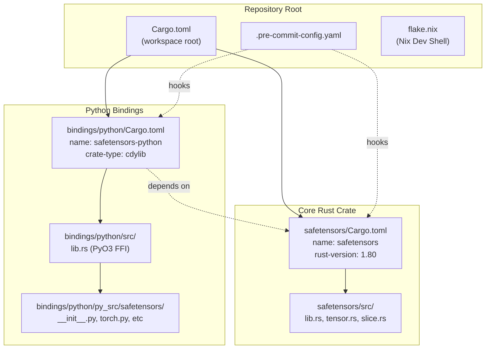
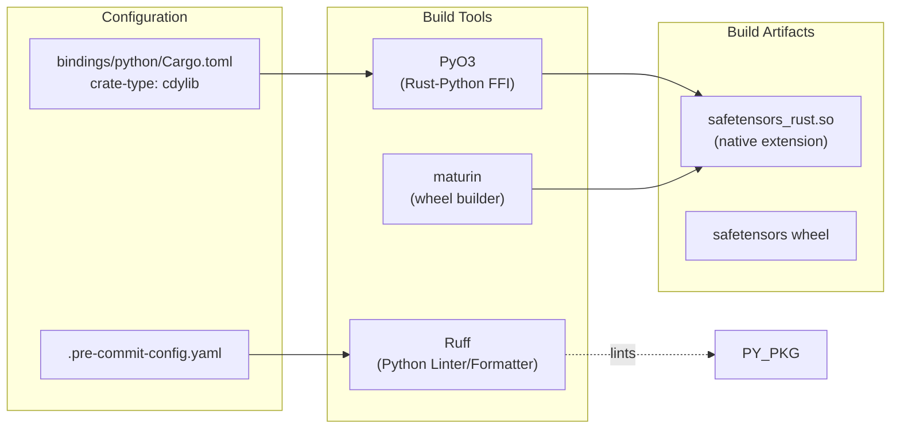

<!-- source: DeepWiki mcp.deepwiki.com · repo huggingface/safetensors · page 7 Developer Guide · fetched 2026-10-21 -->

# Developer Guide

Relevant source files

The following files were used as context for generating this wiki page:

- [.github/CODEOWNERS](.github/CODEOWNERS)
- [.github/PULL_REQUEST_TEMPLATE.md](.github/PULL_REQUEST_TEMPLATE.md)
- [.pre-commit-config.yaml](.pre-commit-config.yaml)
- [CODE_OF_CONDUCT.md](CODE_OF_CONDUCT.md)
- [CONTRIBUTING.md](CONTRIBUTING.md)
- [GOVERNANCE.md](GOVERNANCE.md)
- [MAINTAINERS.md](MAINTAINERS.md)
- [Makefile](Makefile)
- [bindings/python/tests/test_handle.py](bindings/python/tests/test_handle.py)
- [flake.nix](flake.nix)

This guide provides an overview of the development workflow for contributors to the `safetensors` project. It covers the project structure, build tooling, testing approach, and CI/CD infrastructure. For detailed instructions on building from source, see [Building from Source](#7.1). For comprehensive testing documentation, see [Testing](#7.2). For CI/CD pipeline and release process details, see [CI/CD and Release Process](#7.3).

## Project Structure

The `safetensors` repository is organized as a multi-language project with a Rust core and language bindings. The project enforces quality through a `.pre-commit-config.yaml` that runs `fmt` and `clippy` on both the core crate and the Python bindings.

**Sources:** [safetensors/Cargo.toml:1-5](), [bindings/python/Cargo.toml:1-10](), [.pre-commit-config.yaml:1-33](), [flake.nix:1-27]()

## Build Toolchain

The project uses a two-tier build system that reflects its dual Rust/Python nature. Contributors can use `uv` or a standard `nix` flake to manage the environment.

### Rust Toolchain

The core `safetensors` crate uses standard Cargo tooling. Formatting and linting are strictly enforced for all targets.

| Component | Purpose | Configuration |
|-----------|---------|---------------|
| `cargo` | Rust build system | Minimum version 1.80 |
| `rustfmt` | Code formatting | Enforced via `fmt` hook in pre-commit |
| `clippy` | Linting | Enforced with `-D warnings` for all targets |

**Sources:** [safetensors/Cargo.toml:1-5](), [.pre-commit-config.yaml:1-17]()

### Python Bindings Toolchain

The Python bindings use `PyO3` via `maturin`. Development typically involves `maturin develop` for incremental builds.

**Sources:** [bindings/python/Cargo.toml:1-15](), [.pre-commit-config.yaml:34-49](), [CONTRIBUTING.md:142-145]()

## Development Workflow

### Local Development Setup

Contributors should follow these steps to set up a local environment:

1.  **Prerequisites**: Install Rust (stable) and Python 3.10+. The project recommends using `uv` for Python management [CONTRIBUTING.md:87-94]().
2.  **Rust Core**: Build and test the core library using `cargo build` and `cargo test` in the `safetensors/` directory [CONTRIBUTING.md:108-117]().
3.  **Python Bindings**: In `bindings/python/`, use `maturin develop` to install the Rust extension into your virtual environment [CONTRIBUTING.md:131-145]().
4.  **Formatting**: Run `ruff-check` and `ruff-format` via pre-commit or directly to ensure Python code style compliance [.pre-commit-config.yaml:34-49]().

### Submitting Contributions

When submitting a Pull Request, contributors must indicate if an AI model was used in development [ .github/PULL_REQUEST_TEMPLATE.md:17-30](). PRs are reviewed by the maintainers listed in the `CODEOWNERS` file [.github/CODEOWNERS:1-3]().

**Sources:** [CONTRIBUTING.md:85-145](), [.github/PULL_REQUEST_TEMPLATE.md:1-30](), [.github/CODEOWNERS:1-3]()

## Testing Infrastructure

Testing spans Rust unit tests and Python integration tests across various frameworks.

| Test Suite | Command | Purpose |
|------------|---------|---------|
| **Rust Core** | `cargo test` | Validates binary format logic and safety guarantees. |
| **Python Unit** | `pytest tests/` | Tests the `PyO3` interface and framework-agnostic features. |
| **Frameworks** | `pytest tests/` | Tests specific integrations for `torch`, `numpy`, `jax`, `flax`, `tensorflow`, and `paddle`. |

Specialized tests like `test_handle.py` validate interoperability with `fsspec` and cloud storage like S3 using `_safe_open_handle`.

**Sources:** [CONTRIBUTING.md:171-205](), [bindings/python/tests/test_handle.py:1-65]()

## CI/CD and Release Process

The project uses GitHub Actions to automate multi-platform testing and wheel distribution.

- **Testing Pipeline**: Executes on every PR, covering multiple OS/Arch combinations and Python versions.
- **Release Pipeline**: Triggered by tag pushes, building wheels for 15+ architectures and publishing to PyPI with build attestations.
- **Security Audit**: Automated `cargo audit` checks for vulnerable Rust dependencies.

For details, see [CI/CD and Release Process](#7.3).

## Governance

Safetensors follows a consensus-based decision-making model. Maintainers (currently Daniël de Kok and Luc Georges) are responsible for organizing development and determining consensus.

**Sources:** [GOVERNANCE.md:1-20](), [MAINTAINERS.md:1-9]()

---

