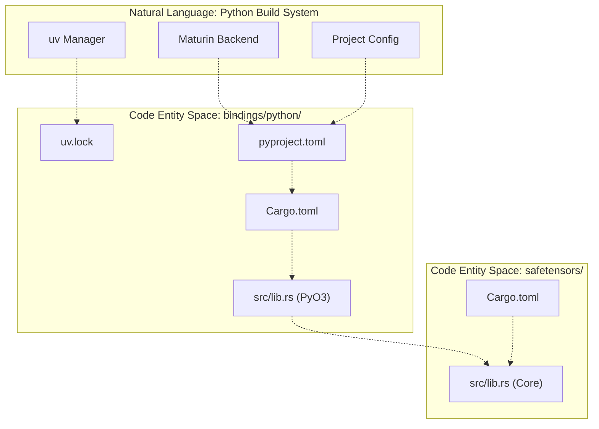
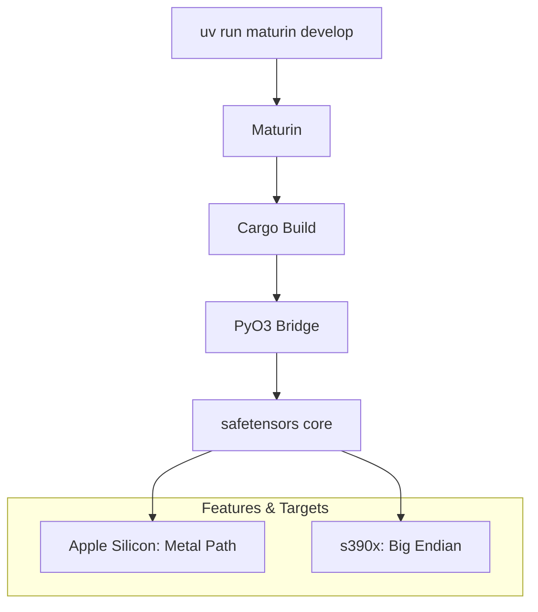

<!-- source: DeepWiki mcp.deepwiki.com · repo huggingface/safetensors · page 7.1 Building from Source · fetched 2026-10-21 -->

# Building from Source

<details>
<summary>Relevant source files</summary>

The following files were used as context for generating this wiki page:

- [.github/workflows/python-bench.yml](.github/workflows/python-bench.yml)
- [Dockerfile.s390x.test](Dockerfile.s390x.test)
- [bindings/python/Cargo.toml](bindings/python/Cargo.toml)
- [bindings/python/pyproject.toml](bindings/python/pyproject.toml)
- [bindings/python/src/view.rs](bindings/python/src/view.rs)
- [bindings/python/uv.lock](bindings/python/uv.lock)
- [safetensors/Cargo.toml](safetensors/Cargo.toml)

</details>


This page provides instructions for building the safetensors library from source code, covering both the Rust core library and Python bindings. Building from source is necessary for development work, platform-specific optimizations (such as Apple Silicon Metal support), or when pre-built wheels are not available for your system architecture.

For information about the automated release process that produces pre-built wheels, see [CI/CD and Release Process](). For testing the built artifacts, see [Testing]().

## Prerequisites

### Rust Toolchain

The safetensors project requires Rust to build both the core library and Python bindings. The required Rust versions are:

- **Core Rust library** (`safetensors` crate): Rust 1.80 or later [safetensors/Cargo.toml:5]()
- **Python bindings** (`safetensors-python`): Rust 1.74 or later [bindings/python/Cargo.toml:5]()

**Installation Steps:**

```bash
# Install Rust using rustup
curl --proto '=https' --tlsv1.2 -sSf https://sh.rustup.rs | sh

# Ensure you're using the stable channel and latest version
rustup update
```

### Python Environment and dependency management

For building Python bindings, you need:
- Python 3.10 or later [bindings/python/pyproject.toml:3]()
- `pip` package manager
- `maturin` (>=1.0, <2.0) as the build backend [bindings/python/pyproject.toml:70-71]()
- `uv` is recommended for dependency management and synchronization [bindings/python/uv.lock:1-10]()

Sources: [safetensors/Cargo.toml:5](), [bindings/python/Cargo.toml:5](), [bindings/python/pyproject.toml:3,70-71](), [bindings/python/uv.lock:1-10]()

## Build Architecture Overview

The build process involves the Rust core and a PyO3-based wrapper that exposes the core functionality to Python.

### System Entity Mapping

The following diagram maps high-level build components to their corresponding entities in the codebase.

**Build System to Code Entity Mapping**

Sources: [bindings/python/pyproject.toml:70-71,94-98](), [bindings/python/Cargo.toml:1-18](), [safetensors/Cargo.toml:1-5]()

## Building the Rust Core Library

The core `safetensors` crate can be built independently.

### Standard Build

```bash
cd safetensors
cargo build --release
```

### Feature Flags

The core library supports the following feature flags:

| Feature | Description | Default | Dependencies Affected |
|---------|-------------|---------|----------------------|
| `std` | Enable standard library support | Yes | `serde/default`, `serde_json/default`, `tempfile` [safetensors/Cargo.toml:43]() |
| `alloc` | Enable allocation support | Always on | No-op, kept for compatibility [safetensors/Cargo.toml:45]() |

**Building for `no_std`:**
```bash
cargo build --release --no-default-features
```
In `no_std` mode, the crate uses `hashbrown` for `HashMap` and `serde_json` with the `alloc` feature [safetensors/Cargo.toml:24-30]().

Sources: [safetensors/Cargo.toml:24-30,41-45]()

## Building Python Bindings

Python bindings use `maturin` as the build backend and `pyo3` for the bridge [bindings/python/pyproject.toml:70-71,97]().

### Development Installation with `uv`

The project uses `uv` for managing development environments and locking dependencies.

```bash
cd bindings/python
pip install uv
uv sync --extra dev
```
This command synchronizes the environment based on `uv.lock` and installs development extras including `torch`, `numpy`, and `pytest` [bindings/python/pyproject.toml:66](), [bindings/python/uv.lock:1-10]().

### Compilation Flow



### Build Configuration in `pyproject.toml`
- **Module Name**: `safetensors._safetensors_rust` [bindings/python/pyproject.toml:96]()
- **Python Source**: `py_src` [bindings/python/pyproject.toml:95]()
- **Bindings**: `pyo3` [bindings/python/pyproject.toml:97]()

Sources: [bindings/python/pyproject.toml:70-71,94-98](), [bindings/python/uv.lock:1-10]()

## Platform-Specific Build Considerations

### Apple Silicon (Metal Path)
For macOS on `aarch64`, the build includes specific dependencies for direct `MTLBuffer` access, leveraging Unified Memory Architecture (UMA) [bindings/python/Cargo.toml:23-25]().
- **Dependencies**: `objc2`, `objc2-metal` [bindings/python/Cargo.toml:26-32]().
- **Requirement**: `target_os = "macos"` and `target_arch = "aarch64"` [bindings/python/Cargo.toml:26]().

### Big-Endian Systems (s390x)
Safetensors supports big-endian architectures like `s390x`.
- **Dockerized Build**: A specific `Dockerfile.s390x.test` is provided to handle big-endian environments [Dockerfile.s390x.test:1-20]().
- **Environment Tweak**: `GLIBC_TUNABLES=glibc.rtld.execstack=2` is used to work around specific shared object issues on this platform [Dockerfile.s390x.test:17]().

### PyO3 Feature Gating
The bindings use conditional compilation based on Python version features:
- **Python 3.11+**: Uses `PyBuffer` for zero-copy data access [bindings/python/src/view.rs:2-3,21-29]().
- **Python 3.8+**: Falls back to `PyBytes` [bindings/python/src/view.rs:5-6,13-19]().

Sources: [bindings/python/Cargo.toml:23-32](), [Dockerfile.s390x.test:1-20](), [bindings/python/src/view.rs:2-29]()

## Build Options and Optimization

### Release Builds
To build a production-ready wheel with optimizations:
```bash
cd bindings/python
uv run maturin build --release
```

### Dependency Conflicts
The `pyproject.toml` and `uv.lock` define specific conflicts to ensure environment stability, particularly regarding TensorFlow versions (standard, nightly, and pinned) [bindings/python/pyproject.toml:78-92](), [bindings/python/uv.lock:10-20]().

| Extra | Incompatible With |
|-------|-------------------|
| `tensorflow` | `tf-nightly`, `pinned-tf`, `dev` |
| `tf-nightly` | `tensorflow`, `pinned-tf`, `dev` |
| `dev` | `tensorflow`, `tf-nightly` |

Sources: [bindings/python/pyproject.toml:78-92](), [bindings/python/uv.lock:10-20]()

---

