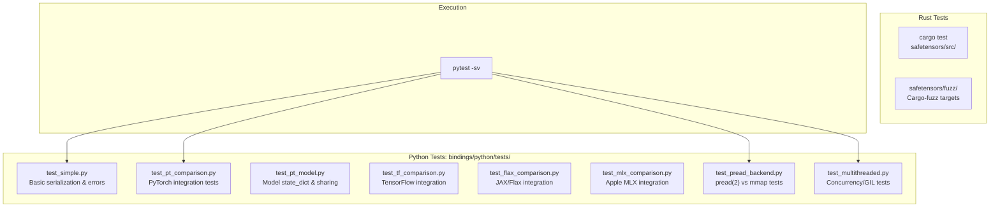
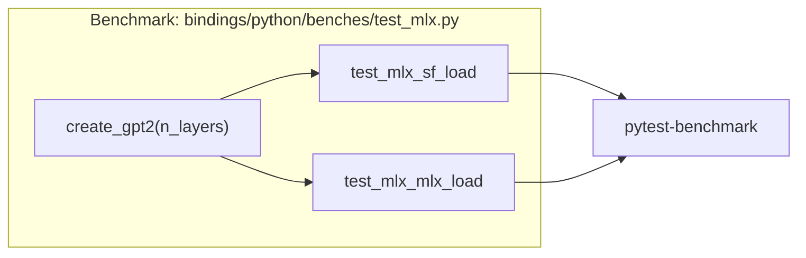

<!-- source: DeepWiki mcp.deepwiki.com · repo huggingface/safetensors · page 7.2 Testing · fetched 2026-10-21 -->

# Testing

<details>
<summary>Relevant source files</summary>

The following files were used as context for generating this wiki page:

- [bindings/python/benches/test_mlx.py](bindings/python/benches/test_mlx.py)
- [bindings/python/fuzz.py](bindings/python/fuzz.py)
- [bindings/python/setup.cfg](bindings/python/setup.cfg)
- [bindings/python/tests/test_flax_comparison.py](bindings/python/tests/test_flax_comparison.py)
- [bindings/python/tests/test_mlx_comparison.py](bindings/python/tests/test_mlx_comparison.py)
- [bindings/python/tests/test_multithreaded.py](bindings/python/tests/test_multithreaded.py)
- [bindings/python/tests/test_pread_backend.py](bindings/python/tests/test_pread_backend.py)
- [bindings/python/tests/test_pt_comparison.py](bindings/python/tests/test_pt_comparison.py)
- [bindings/python/tests/test_simple.py](bindings/python/tests/test_simple.py)
- [bindings/python/tests/test_tf_comparison.py](bindings/python/tests/test_tf_comparison.py)
- [bindings/python/tests/test_threadable.py](bindings/python/tests/test_threadable.py)
- [safetensors/fuzz/.gitignore](safetensors/fuzz/.gitignore)
- [safetensors/fuzz/Cargo.toml](safetensors/fuzz/Cargo.toml)
- [safetensors/fuzz/fuzz_targets/fuzz_target_1.rs](safetensors/fuzz/fuzz_targets/fuzz_target_1.rs)

</details>


This page documents the testing infrastructure for the safetensors codebase. It covers test organization, test categories, framework-specific test suites, property-based testing, and instructions for running tests locally.

## Test Organization

The safetensors repository maintains separate test suites for Rust core functionality and Python bindings with framework integrations.



**Sources:** [bindings/python/tests/test_pt_comparison.py:1-18](), [bindings/python/tests/test_simple.py:1-17](), [bindings/python/tests/test_pread_backend.py:1-28](), [bindings/python/tests/test_multithreaded.py:1-16]()

## Framework-Specific Test Suites

Safetensors provides dedicated comparison tests for major ML frameworks to ensure parity with native serialization (like Pickle, H5, or Msgpack).

### PyTorch Integration
The PyTorch suite is the most comprehensive, testing complex storage scenarios and new data types.
*   **Data Types**: Includes tests for `bfloat16`, `float8_e4m3fn`, `float8_e5m2`, `float8_e8m0fnu`, and `float4_e2m1fn_x2` [bindings/python/tests/test_pt_comparison.py:104-180]().
*   **Complex Numbers**: Validates `complex64` representation across platforms [bindings/python/tests/test_pt_comparison.py:80-102]().
*   **Shared Storage**: Tests `_find_shared_tensors` for overlapping or disjoint views of the same memory [bindings/python/tests/test_simple.py:131-160]().

### TensorFlow, Flax, and MLX
These suites compare safetensors output against native formats:
*   **TensorFlow**: Compares against `.h5` files using `h5py` [bindings/python/tests/test_tf_comparison.py:30-43]().
*   **Flax**: Compares against `msgpack` serialization [bindings/python/tests/test_flax_comparison.py:18-34]().
*   **MLX**: Validates Apple Silicon-specific loading against `.npz` [bindings/python/tests/test_mlx_comparison.py:23-42]().

**Sources:** [bindings/python/tests/test_pt_comparison.py:104-180](), [bindings/python/tests/test_tf_comparison.py:1-92](), [bindings/python/tests/test_flax_comparison.py:1-80](), [bindings/python/tests/test_mlx_comparison.py:1-74]()

## Specialized Testing Categories

### Multithreaded and Threadable Tests
Tests in `test_multithreaded.py` and `test_threadable.py` ensure the library is safe for concurrent access and correctly releases the Python Global Interpreter Lock (GIL).

*   **GIL Release**: `test_serialize_file_releases_gil` uses a `threading.Barrier` and `ThreadPoolExecutor` to verify that multiple serialization tasks run in parallel by checking for overlapping execution windows [bindings/python/tests/test_threadable.py:12-76]().
*   **Roundtripping**: `test_multithreaded_roundtripping_numpy` and `test_multithreaded_roundtripping_torch` verify data integrity when multiple threads perform simultaneous save/load operations [bindings/python/tests/test_multithreaded.py:37-81]().

### Pread Backend Tests
The `pread` backend (alternative to `mmap`) is tested in `test_pread_backend.py`. It ensures that using `pread(2)` for tensor loading produces identical results to memory mapping while keeping host memory usage bounded [bindings/python/tests/test_pread_backend.py:1-6]().

*   **Round-trip Validation**: Verifies `safe_open`, `get_tensor`, and `load_model` using the `pread` backend [bindings/python/tests/test_pread_backend.py:64-78]().
*   **Security Validation**: Explicitly tests that truncated headers or overflowing data offsets are rejected by the backend [bindings/python/tests/test_pread_backend.py:123-150]().

### Fuzzing
Safetensors uses `atheris` for Python-level fuzzing and `cargo-fuzz` for Rust-level fuzzing to detect memory corruption or DOS vulnerabilities.
*   **Python Fuzzing**: `TestOneInput` in `fuzz.py` feeds random data into `load_file` to identify unhandled exceptions or crashes [bindings/python/fuzz.py:18-27]().
*   **Rust Fuzzing**: Located in `safetensors/fuzz/`, targeting core parsing logic [safetensors/fuzz/fuzz_targets/fuzz_target_1.rs:1-5]().

**Sources:** [bindings/python/tests/test_threadable.py:12-76](), [bindings/python/tests/test_pread_backend.py:1-150](), [bindings/python/fuzz.py:1-36]()

## Benchmark Tests
Performance benchmarks are integrated into the test suite using `pytest-benchmark`.

*   **MLX Benchmarks**: `test_mlx.py` compares the performance of `mx.load` (native) against `safetensors.mlx.load_file` using a simulated GPT-2 model structure [bindings/python/benches/test_mlx.py:35-59]().



**Sources:** [bindings/python/benches/test_mlx.py:1-59]()

## Running Tests Locally

### Rust Core
Run from the root or `safetensors/` directory:
```bash
cargo test
```

### Python Bindings
Install dependencies defined in `setup.cfg` [bindings/python/setup.cfg:1-43]() and run `pytest`:
```bash
# Basic tests
pytest bindings/python/tests/test_simple.py

# Framework specific (requires respective libraries)
pytest bindings/python/tests/test_pt_comparison.py
pytest bindings/python/tests/test_tf_comparison.py
```

### Benchmarks
```bash
pytest bindings/python/benches/test_mlx.py
```

**Sources:** [bindings/python/setup.cfg:54-57](), [bindings/python/benches/test_mlx.py:35-53]()

---

