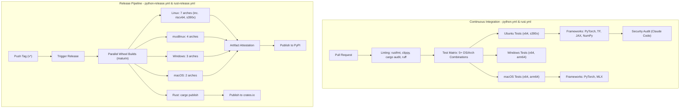

<!-- source: DeepWiki mcp.deepwiki.com · repo huggingface/safetensors · page 7.3 CI/CD and Release Process · fetched 2026-10-21 -->

# CI/CD and Release Process

Relevant source files

The following files were used as context for generating this wiki page:

- [.github/workflows/build_documentation.yml](.github/workflows/build_documentation.yml)
- [.github/workflows/build_pr_documentation.yml](.github/workflows/build_pr_documentation.yml)
- [.github/workflows/delete_doc_comment.yml](.github/workflows/delete_doc_comment.yml)
- [.github/workflows/delete_doc_comment_trigger.yml](.github/workflows/delete_doc_comment_trigger.yml)
- [.github/workflows/python-release.yml](.github/workflows/python-release.yml)
- [.github/workflows/python.yml](.github/workflows/python.yml)
- [.github/workflows/rust-release.yml](.github/workflows/rust-release.yml)
- [.github/workflows/rust.yml](.github/workflows/rust.yml)
- [.github/workflows/security-audit.yml](.github/workflows/security-audit.yml)
- [.github/workflows/stale.yml](.github/workflows/stale.yml)
- [.github/workflows/trufflehog.yml](.github/workflows/trufflehog.yml)
- [.github/workflows/upload_pr_documentation.yml](.github/workflows/upload_pr_documentation.yml)
- [RELEASE.md](RELEASE.md)
- [SECURITY.md](SECURITY.md)

This page documents the Continuous Integration/Continuous Deployment (CI/CD) and release processes for the SafeTensors library. The automated pipeline ensures code quality through multi-platform testing, security auditing, and builds binary wheels for 15+ platform/architecture combinations.

## Overview

SafeTensors utilizes a suite of GitHub Actions workflows to manage the lifecycle of both the Rust core and Python bindings. The primary CI pipeline (`python.yml`) validates pull requests, while specialized release workflows (`python-release.yml`, `rust-release.yml`) handle artifact distribution to PyPI and crates.io.

**CI/CD Pipeline Architecture**

Sources: [.github/workflows/python.yml:1-145](), [.github/workflows/python-release.yml:1-195](), [.github/workflows/rust-release.yml:1-35](), [RELEASE.md:7-14]()

## Continuous Integration Pipeline

The `python.yml` workflow validates the Python bindings on every pull request. The working directory for these operations is `./bindings/python` [.github/workflows/python.yml:51-51]().

### Test Matrix Configuration

The CI system tests across multiple environment combinations to ensure broad compatibility:

| OS | Python | Architecture | PyTorch | NumPy | Notes |
|---|---|---|---|---|---|
| `ubuntu-latest` | 3.10 | x64 | 2.4 | 1.26.4 | Lowest supported |
| `ubuntu-latest` | 3.13 | x64 | latest | latest | Standard latest |
| `ubuntu-latest` | 3.14 | x64 | latest | latest | Future support |
| `ubuntu-latest` | 3.14 | x64-freethreaded | latest | latest | GIL-disabled testing |
| `windows-latest` | 3.10 | x64 | 2.4 | 1.26.4 | Windows base |
| `windows-11-arm` | 3.13 | arm64 | latest | latest | Windows ARM |
| `macos-15-intel` | 3.10 | x64 | latest | 1.26 | Intel Mac |
| `macos-latest` | 3.13 | arm64 | latest | latest | Apple Silicon |

Sources: [.github/workflows/python.yml:10-48]()

### Security Audit and Secret Scanning

SafeTensors employs proactive security measures in the CI pipeline:
- **Claude Code Audit**: A specialized workflow (`security-audit.yml`) uses an LLM-based senior security engineer prompt to review diffs for memory safety issues, integer overflows, and input validation vulnerabilities [.github/workflows/security-audit.yml:27-79]().
- **Trufflehog**: Scans for secret leaks and credentials in every push [.github/workflows/trufflehog.yml:7-17]().
- **Cargo Audit**: Checks Rust dependencies for known vulnerabilities (RUSTSEC) [.github/workflows/rust.yml:46-48]().

### Big-Endian Testing (s390x)

To ensure the binary format remains compatible with big-endian systems, a dedicated job runs tests on emulated `s390x` hardware using QEMU and Docker [.github/workflows/python.yml:146-195]().

## Release Process

The release process is triggered by pushing a tag matching `v*` (e.g., `v0.5.0`) [RELEASE.md:7-12]().

### Python Wheel Building

The `python-release.yml` workflow, managed by `maturin`, builds wheels for 15+ architectures. It includes support for:
- **Linux**: `x86_64`, `i686`, `aarch64`, `armv7`, `s390x`, `ppc64le`, and `riscv64` [.github/workflows/python-release.yml:26-47]().
- **Windows**: `x64`, `x86`, and `arm64` [.github/workflows/windows.yml:103-109]().
- **macOS**: Universal support for Intel and Apple Silicon [.github/workflows/python-release.yml:133-137]().

**Artifact Provenance**
The release job uses `actions/attest-build-provenance` to sign artifacts and generate build attestations, providing a cryptographically verifiable link between the PyPI wheels and the source code [.github/workflows/python-release.yml:185-188]().

### Rust Release

The Rust core library is published to `crates.io` via the `rust-release.yml` workflow. This workflow authenticates using `rust-lang/crates-io-auth-action` and executes `cargo publish` from the `./safetensors` directory [.github/workflows/rust-release.yml:25-31]().

### Documentation Deployment

Documentation is automatically built and deployed for both PRs and merges to `main`:
- **PR Previews**: `build_pr_documentation.yml` generates a preview for review [.github/workflows/build_pr_documentation.yml:15-24]().
- **Production Docs**: `build_documentation.yml` pushes the latest documentation to the Hugging Face documentation server upon merges to `main` [.github/workflows/build_documentation.yml:12-24]().

## Maintenance Workflows

- **Stale Issue Management**: The `stale.yml` workflow automatically labels and closes inactive issues to maintain project hygiene.
- **Dependency Updates**: The project uses `uv` for Python lockfile management during the release cycle [RELEASE.md:59-59]().

### Release Checklist
Before cutting a release, maintainers follow the `RELEASE.md` checklist:
1. Verify CI is green on all platforms [RELEASE.md:20-20]().
2. Identify breaking changes for semver compliance [RELEASE.md:26-26]().
3. Run benchmarks using `cargo bench` [RELEASE.md:27-29]().
4. Test compatibility with the `transformers` library [RELEASE.md:31-39]().

Sources: [RELEASE.md:18-41](), [.github/workflows/python-release.yml:1-195](), [.github/workflows/rust-release.yml:1-35]()

---

