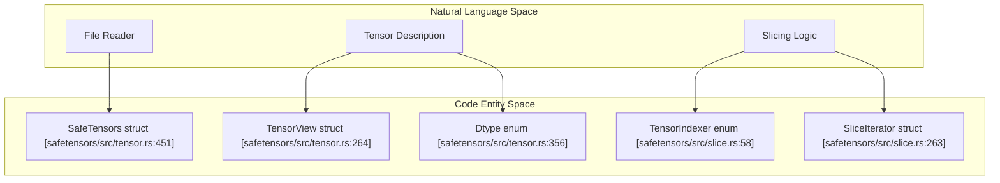
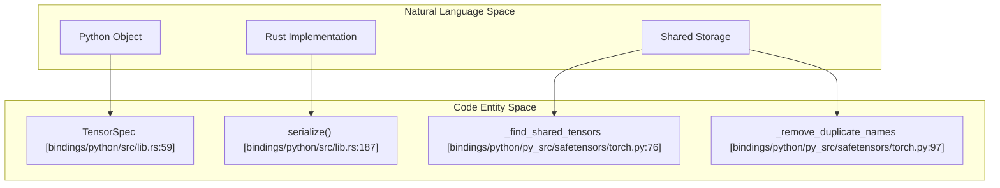

<!-- source: DeepWiki mcp.deepwiki.com · repo huggingface/safetensors · page 8 Glossary · fetched 2026-10-21 -->

# Glossary

Relevant source files

The following files were used as context for generating this wiki page:

- [.github/workflows/python-release.yml](.github/workflows/python-release.yml)
- [README.md](README.md)
- [bindings/python/Cargo.toml](bindings/python/Cargo.toml)
- [bindings/python/py_src/safetensors/torch.py](bindings/python/py_src/safetensors/torch.py)
- [bindings/python/src/lib.rs](bindings/python/src/lib.rs)
- [safetensors/README.md](safetensors/README.md)
- [safetensors/benches/benchmark.rs](safetensors/benches/benchmark.rs)
- [safetensors/src/lib.rs](safetensors/src/lib.rs)
- [safetensors/src/slice.rs](safetensors/src/slice.rs)
- [safetensors/src/tensor.rs](safetensors/src/tensor.rs)

This glossary defines codebase-specific terms, abbreviations, and domain concepts used throughout the `safetensors` project. It covers the core Rust implementation, Python interop, and security-related jargon.

## Format Concepts

### Header
The metadata section at the beginning of a `.safetensors` file. It consists of an 8-byte little-endian unsigned integer (N) followed by N bytes of a UTF-8 encoded JSON string [README.md:76-77](). The header describes tensor shapes, types, and offsets within the subsequent byte buffer.
*   **Implementation**: Represented by the `Metadata` struct in Rust [safetensors/src/tensor.rs:434-438]().
*   **Size Limit**: For security and DOS prevention, the header is capped at 100MB [safetensors/src/tensor.rs:10-10]().

### Data Offsets
A pair of integers `[BEGIN, END]` in the JSON header representing the byte range for a specific tensor relative to the start of the data buffer [README.md:80-82]().
*   **Code Pointer**: Field `data_offsets` in the `TensorInfo` struct [safetensors/src/tensor.rs:444-448]().

### __metadata__
A reserved key in the JSON header used for storing arbitrary string-to-string key-value pairs [README.md:83-83](). This is often used for model versioning or library-specific metadata.
*   **Code Pointer**: `metadata` field in the `Metadata` struct [safetensors/src/tensor.rs:436-436]().

### Polyglot File Prevention
A security design choice where the entire byte buffer must be indexed by the header. The format does not allow "holes" (unindexed bytes) between tensors, which prevents the file from being valid in two different formats simultaneously (e.g., a ZIP and a Safetensors file) [README.md:99-100]().
*   **Validation Logic**: Checked during metadata validation in `SafeTensors::deserialize` [safetensors/src/tensor.rs:43-43]().

---

## Rust Core Entities

### SafeTensors
The primary structure for reading safetensors data. It provides a validated view of the tensors contained within a buffer [safetensors/src/tensor.rs:451-455]().
*   **Key Method**: `SafeTensors::deserialize(&data)` [safetensors/src/tensor.rs:462-464]().

### TensorView
A borrowed view of a tensor's data, including its `Dtype`, `shape`, and a slice of the underlying buffer [safetensors/src/tensor.rs:264-269]().
*   **Trait Implementation**: Implements the `View` trait [safetensors/src/tensor.rs:306-320]().

### View (Trait)
A trait defining the interface for any object that can be serialized as a tensor. It requires methods for `dtype()`, `shape()`, `data()`, and `data_len()` [safetensors/src/tensor.rs:126-152]().

### Dtype
An enumeration of supported data types, including standard types (F32, I64, BOOL) and specialized ML types (BF16, F8_E4M3, F4) [safetensors/src/tensor.rs:356-410]().

### TensorIndexer
An enum used for lazy loading and slicing. It supports `Select(index)` for a single dimension or `Narrow(start, stop, step)` for range-based slicing [safetensors/src/slice.rs:58-64]().

**Natural Language to Code Mapping: Rust Core**

Sources: [safetensors/src/tensor.rs:264-451](), [safetensors/src/slice.rs:58-263]().

---

## Python Interop Concepts

### TensorSpec
A Python-side class used to describe a tensor before serialization. It holds the `dtype`, `shape`, and a raw `data_ptr` to the memory buffer [bindings/python/src/lib.rs:57-64]().
*   **Safety**: The `data_ptr` must remain valid for the duration of the serialization call [bindings/python/src/lib.rs:54-56]().

### PyO3 Bindings
The bridge between Rust and Python. The `safetensors_rust` module is defined using PyO3, exposing Rust functions like `serialize` and `deserialize` to Python [bindings/python/src/lib.rs:1145-1150]().

### Shared Tensor Detection
The process of identifying if multiple names in a model's state dictionary point to the same underlying memory storage. Safetensors requires explicit handling of these to avoid duplicate data on disk [bindings/python/py_src/safetensors/torch.py:76-88]().
*   **Key Function**: `_find_shared_tensors` in the Torch integration [bindings/python/py_src/safetensors/torch.py:76]().

**Natural Language to Code Mapping: Python Bindings**

Sources: [bindings/python/src/lib.rs:59-187](), [bindings/python/py_src/safetensors/torch.py:76-97]().

---

## Hardware & Framework Terms

### UMA (Unified Memory Architecture)
A memory design where the CPU and GPU share the same physical memory pool. This is critical for "Zero-copy" performance on Apple Silicon (M-series chips) [bindings/python/Cargo.toml:23-25]().

### Zero-copy
A loading technique where the data is mapped directly from disk to memory (often via `mmap`) without an intermediate copy into a secondary buffer [README.md:26-27](). Safetensors achieves this by ensuring the byte buffer is aligned and ready for direct consumption by framework tensors.

### Big-Endian (s390x)
While the safetensors format is strictly little-endian [README.md:101-101](), the library includes logic to handle big-endian architectures like `s390x` by performing byte-swapping during load/save operations [.github/workflows/python-release.yml:40-41]().

---

## Security Terms

### Pickle Vulnerability
The standard PyTorch `.bin` format uses Python's `pickle` module, which is unsafe because it can execute arbitrary code during deserialization. Safetensors is "safe" because it only parses JSON and raw bytes [README.md:144-144]().

### DOS (Denial of Service) Prevention
The library prevents memory exhaustion attacks by validating header sizes and ensuring that tensor offsets do not overlap or exceed the file boundaries [safetensors/src/tensor.rs:10-43]().

| Term | Code Reference | Definition |
| :--- | :--- | :--- |
| **Header Size Cap** | `MAX_HEADER_SIZE` [safetensors/src/tensor.rs:10]() | 100MB limit on the JSON metadata section. |
| **ValidationOverflow** | `SafeTensorError::ValidationOverflow` [safetensors/src/tensor.rs:46]() | Error triggered if shape/dtype math overflows `usize`. |
| **MisalignedSlice** | `SafeTensorError::MisalignedSlice` [safetensors/src/tensor.rs:49]() | Error for sub-byte dtypes (like F4) when slicing doesn't land on a byte boundary. |

Sources: [safetensors/src/tensor.rs:10-49](), [README.md:144-144]().