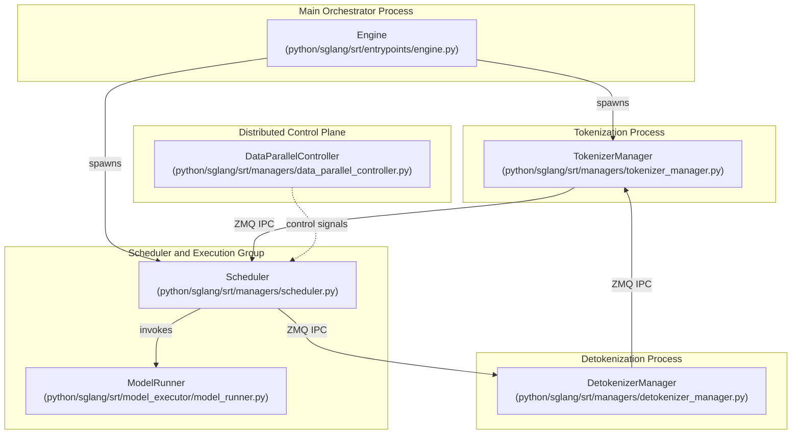
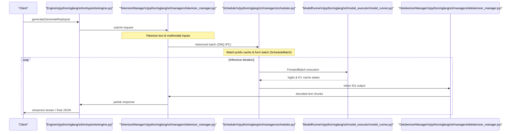

<!-- source: DeepWiki mcp.deepwiki.com · repo sgl-project/sglang · page 1 Overview · fetched 2026-10-30 -->

# Overview

Relevant source files

The following files were used as context for generating this wiki page:

- [.github/workflows/release-pypi-nightly.yml](.github/workflows/release-pypi-nightly.yml)
- [.github/workflows/release-pypi-pr.yml](.github/workflows/release-pypi-pr.yml)
- [3rdparty/amd/wheel/sglang/pyproject.toml](3rdparty/amd/wheel/sglang/pyproject.toml)
- [docker/Dockerfile](docker/Dockerfile)
- [docs/docs/references/environment_variables.mdx](docs/docs/references/environment_variables.mdx)
- [python/pyproject.toml](python/pyproject.toml)
- [python/pyproject_cpu.toml](python/pyproject_cpu.toml)
- [python/pyproject_npu.toml](python/pyproject_npu.toml)
- [python/pyproject_other.toml](python/pyproject_other.toml)
- [python/pyproject_xpu.toml](python/pyproject_xpu.toml)
- [python/sglang/benchmark/one_batch.py](python/sglang/benchmark/one_batch.py)
- [python/sglang/srt/arg_groups/attention_hook.py](python/sglang/srt/arg_groups/attention_hook.py)
- [python/sglang/srt/arg_groups/overrides.py](python/sglang/srt/arg_groups/overrides.py)
- [python/sglang/srt/arg_groups/pd_disaggregation_hook.py](python/sglang/srt/arg_groups/pd_disaggregation_hook.py)
- [python/sglang/srt/disaggregation/role_switch.py](python/sglang/srt/disaggregation/role_switch.py)
- [python/sglang/srt/distributed/bootstrap.py](python/sglang/srt/distributed/bootstrap.py)
- [python/sglang/srt/distributed/parallel_state.py](python/sglang/srt/distributed/parallel_state.py)
- [python/sglang/srt/entrypoints/engine.py](python/sglang/srt/entrypoints/engine.py)
- [python/sglang/srt/environ.py](python/sglang/srt/environ.py)
- [python/sglang/srt/function_call/deepseekv32_detector.py](python/sglang/srt/function_call/deepseekv32_detector.py)
- [python/sglang/srt/function_call/kimik2_detector.py](python/sglang/srt/function_call/kimik2_detector.py)
- [python/sglang/srt/layers/dp_attention.py](python/sglang/srt/layers/dp_attention.py)
- [python/sglang/srt/managers/schedule_batch.py](python/sglang/srt/managers/schedule_batch.py)
- [python/sglang/srt/managers/scheduler.py](python/sglang/srt/managers/scheduler.py)
- [python/sglang/srt/mem_cache/common.py](python/sglang/srt/mem_cache/common.py)
- [python/sglang/srt/model_executor/model_runner.py](python/sglang/srt/model_executor/model_runner.py)
- [python/sglang/srt/runtime_context.py](python/sglang/srt/runtime_context.py)
- [python/sglang/srt/server_args.py](python/sglang/srt/server_args.py)
- [python/sglang/srt/utils/common.py](python/sglang/srt/utils/common.py)
- [python/sglang/srt/utils/json_response.py](python/sglang/srt/utils/json_response.py)
- [scripts/update_nightly_whl_index.py](scripts/update_nightly_whl_index.py)
- [test/manual/test_forward_split_prefill.py](test/manual/test_forward_split_prefill.py)
- [test/manual/test_vlm_accuracy.py](test/manual/test_vlm_accuracy.py)
- [test/registered/function_call/test_kimik2_detector.py](test/registered/function_call/test_kimik2_detector.py)
- [test/registered/moe/test_cutedsl_moe.py](test/registered/moe/test_cutedsl_moe.py)
- [test/registered/unit/disaggregation/test_pd_role_switch.py](test/registered/unit/disaggregation/test_pd_role_switch.py)
- [test/registered/unit/function_call/test_deepseekv4_detector.py](test/registered/unit/function_call/test_deepseekv4_detector.py)
- [test/registered/unit/function_call/test_json_schema_constraint.py](test/registered/unit/function_call/test_json_schema_constraint.py)
- [test/registered/unit/function_call/test_structural_tag_excludes.py](test/registered/unit/function_call/test_structural_tag_excludes.py)
- [test/registered/unit/function_call/test_unknown_tool_name.py](test/registered/unit/function_call/test_unknown_tool_name.py)
- [test/registered/unit/server_args/test_server_args.py](test/registered/unit/server_args/test_server_args.py)
- [test/registered/unit/test_model_overrides.py](test/registered/unit/test_model_overrides.py)
- [test/registered/unit/test_runtime_context.py](test/registered/unit/test_runtime_context.py)
- [test/registered/unit/utils/test_common.py](test/registered/unit/utils/test_common.py)
- [test/registered/unit/utils/test_json_response.py](test/registered/unit/utils/test_json_response.py)

## Purpose and Scope

SGLang is a high-performance serving framework for large language models (LLMs) and vision-language models (VLMs), optimized for low-latency and high-throughput inference [python/pyproject.toml:14-14](). It provides a complete runtime environment featuring automatic prefix caching via `RadixAttention`, multi-tier memory management, speculative decoding, and multi-dimensional parallelism across tensor, pipeline, expert, and data dimensions [python/pyproject.toml:14-14]().

This page serves as a high-level parent overview of the SGLang architecture, components, and design principles. Detailed explorations of repository layout, entry points, and low-level dataflow are delegated to child pages.

Sources: [python/pyproject.toml:14-14]()

---

## Architectural Overview and Process Model

SGLang utilizes a multi-process architecture to isolate resource profiles, bypass Python's Global Interpreter Lock (GIL), and maximize concurrency. CPU-bound tasks such as tokenization, request parsing, and scheduling run in separate processes from GPU-bound model execution [python/sglang/srt/entrypoints/engine.py:28-34](). The core server arguments are defined in `ServerArgs` [python/sglang/srt/server_args.py:700-700](), which encapsulates various configuration options for the runtime.

Diagram: SGLang Process Architecture Mapping to Code Entities

Sources: [python/sglang/srt/entrypoints/engine.py:28-34](), [python/sglang/srt/managers/scheduler.py:14-14](), [python/sglang/srt/server_args.py:700-700]()

---

## Request Lifecycle and Dataflow

Incoming requests flow from client APIs through the asynchronous engine stack, getting tokenized, matched against prefix caches, scheduled into batches, executed on hardware accelerators, and finally detokenized back into text streams [python/sglang/srt/entrypoints/engine.py:73-100](). The `ScheduleBatch` [python/sglang/srt/managers/schedule_batch.py:49-50]() is managed by the `Scheduler` [python/sglang/srt/managers/scheduler.py:14-14](), while the `ForwardBatch` [python/sglang/srt/managers/schedule_batch.py:51-52]() is managed by the `ModelRunner` [python/sglang/srt/model_executor/model_runner.py:14-14]().

Diagram: Request Lifecycle and Dataflow Mapping to Code Entities

Sources: [python/sglang/srt/entrypoints/engine.py:73-100](), [python/sglang/srt/managers/scheduler.py:14-14](), [python/sglang/srt/model_executor/model_runner.py:14-14](), [python/sglang/srt/managers/schedule_batch.py:49-52]()

---

## Core Runtime Components

- **Engine**: Orchestrates subprocesses and exposes Python generation APIs (`python/sglang/srt/entrypoints/engine.py`) [python/sglang/srt/entrypoints/engine.py:64-64]().
- **TokenizerManager**: Handles asynchronous text and multimodal tokenization (`python/sglang/srt/managers/tokenizer_manager.py`) [python/sglang/srt/entrypoints/engine.py:110-110]().
- **Scheduler**: Manages GPU memory allocation, prefix caching, batch formation, and execution scheduling (`python/sglang/srt/managers/scheduler.py`) [python/sglang/srt/managers/scheduler.py:14-14]().
- **ModelRunner**: Executes forward passes, CUDA graphs, and tensor operations (`python/sglang/srt/model_executor/model_runner.py`) [python/sglang/srt/model_executor/model_runner.py:14-14]().
- **DetokenizerManager**: Translates output token sequences back into strings (`python/sglang/srt/managers/detokenizer_manager.py`) [python/sglang/srt/entrypoints/engine.py:71-71]().
- **ServerArgs**: A dataclass defining all configurable parameters for the SGLang server, including model paths, memory settings, parallelism strategies, and more (`python/sglang/srt/server_args.py`) [python/sglang/srt/server_args.py:700-700]().

Sources: [python/sglang/srt/entrypoints/engine.py:64-110](), [python/sglang/srt/managers/scheduler.py:14-14](), [python/sglang/srt/model_executor/model_runner.py:14-14](), [python/sglang/srt/server_args.py:700-700]()

---

## Memory Management and Caching

SGLang manages KV cache efficiently via pooled allocators (`ReqToTokenPool`, `TokenToKVPool`) and tree-structured prefix sharing (`RadixCache`) to minimize redundant computations across requests [python/pyproject.toml:14-16](). The `Memory` argument group within `ServerArgs` [python/sglang/srt/server_args.py:161-162]() controls these aspects.

Sources: [python/pyproject.toml:14-16](), [python/sglang/srt/server_args.py:161-162]()

---

## Child Pages & Further Reading

For deep technical details and specific implementation guides, refer to the child pages:
- [Repository Layout, Major Packages, and Entry Points](#1.1) — Orient new contributors to the monorepo layout and entry points.
- [Core Concepts and Dataflow (Tokenizer → Scheduler → ModelRunner → Detokenizer)](#1.2) — Detailed conceptual request lifecycle and runtime roles.

---

