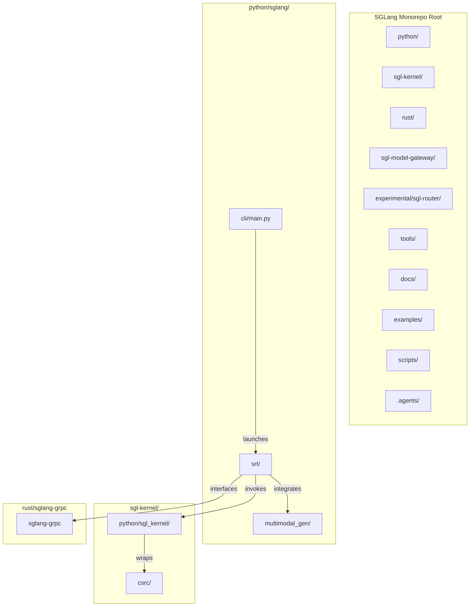
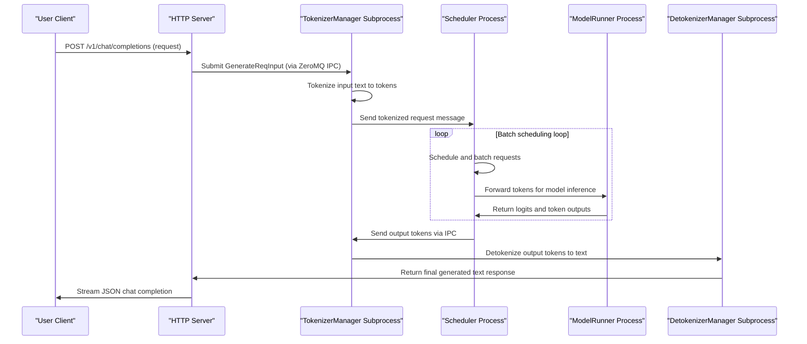

<!-- source: DeepWiki mcp.deepwiki.com · repo sgl-project/sglang · page 1.1 Repository Layout, Major Packages, and Entry Points · fetched 2026-10-30 -->

# Repository Layout, Major Packages, and Entry Points

Relevant source files

The following files were used as context for generating this wiki page:

- [.github/workflows/release-pypi-nightly.yml](.github/workflows/release-pypi-nightly.yml)
- [.github/workflows/release-pypi-pr.yml](.github/workflows/release-pypi-pr.yml)
- [3rdparty/amd/wheel/sglang/pyproject.toml](3rdparty/amd/wheel/sglang/pyproject.toml)
- [docker/Dockerfile](docker/Dockerfile)
- [docs/cards/logos/iquestlab.png](docs/cards/logos/iquestlab.png)
- [docs/cards/logos/perplexity.png](docs/cards/logos/perplexity.png)
- [docs/cookbook/autoregressive/DeepReinforce/Ornith-1.0.mdx](docs/cookbook/autoregressive/DeepReinforce/Ornith-1.0.mdx)
- [docs/cookbook/autoregressive/DeepReinforce/Ornith-1.5.mdx](docs/cookbook/autoregressive/DeepReinforce/Ornith-1.5.mdx)
- [docs/cookbook/autoregressive/Perplexity/PPLX-Decider-v1-27B.mdx](docs/cookbook/autoregressive/Perplexity/PPLX-Decider-v1-27B.mdx)
- [docs/cookbook/autoregressive/Perplexity/PPLX-Decider-v1.1-27B.mdx](docs/cookbook/autoregressive/Perplexity/PPLX-Decider-v1.1-27B.mdx)
- [docs/cookbook/autoregressive/intro.mdx](docs/cookbook/autoregressive/intro.mdx)
- [docs/docs.json](docs/docs.json)
- [docs/docs/supported-models/decision_models.mdx](docs/docs/supported-models/decision_models.mdx)
- [docs/src/snippets/configs/ornith-ai/ornith-1.5.jsx](docs/src/snippets/configs/ornith-ai/ornith-1.5.jsx)
- [docs/src/snippets/configs/perplexity-ai/pplx-decider-v1-27b-benchmarks.jsx](docs/src/snippets/configs/perplexity-ai/pplx-decider-v1-27b-benchmarks.jsx)
- [docs/src/snippets/configs/perplexity-ai/pplx-decider-v1-27b.jsx](docs/src/snippets/configs/perplexity-ai/pplx-decider-v1-27b.jsx)
- [docs/src/snippets/configs/perplexity-ai/pplx-decider-v1.1-27b-benchmarks.jsx](docs/src/snippets/configs/perplexity-ai/pplx-decider-v1.1-27b-benchmarks.jsx)
- [docs/src/snippets/configs/perplexity-ai/pplx-decider-v1.1-27b.jsx](docs/src/snippets/configs/perplexity-ai/pplx-decider-v1.1-27b.jsx)
- [docs/src/snippets/configs/popular-models.jsx](docs/src/snippets/configs/popular-models.jsx)
- [python/pyproject.toml](python/pyproject.toml)
- [python/pyproject_cpu.toml](python/pyproject_cpu.toml)
- [python/pyproject_npu.toml](python/pyproject_npu.toml)
- [python/pyproject_other.toml](python/pyproject_other.toml)
- [python/pyproject_xpu.toml](python/pyproject_xpu.toml)
- [python/sglang/srt/entrypoints/engine.py](python/sglang/srt/entrypoints/engine.py)
- [python/sglang/srt/entrypoints/openai/serving_base.py](python/sglang/srt/entrypoints/openai/serving_base.py)
- [python/sglang/srt/entrypoints/openai/serving_decisions.py](python/sglang/srt/entrypoints/openai/serving_decisions.py)
- [python/sglang/srt/entrypoints/systemone/protocol.py](python/sglang/srt/entrypoints/systemone/protocol.py)
- [python/sglang/srt/entrypoints/systemone/serving.py](python/sglang/srt/entrypoints/systemone/serving.py)
- [python/sglang/srt/function_call/deepseekv32_detector.py](python/sglang/srt/function_call/deepseekv32_detector.py)
- [python/sglang/srt/function_call/kimik2_detector.py](python/sglang/srt/function_call/kimik2_detector.py)
- [python/sglang/srt/utils/common.py](python/sglang/srt/utils/common.py)
- [python/sglang/srt/utils/json_response.py](python/sglang/srt/utils/json_response.py)
- [scripts/update_nightly_whl_index.py](scripts/update_nightly_whl_index.py)
- [test/registered/function_call/test_kimik2_detector.py](test/registered/function_call/test_kimik2_detector.py)
- [test/registered/lora/test_lora_openai_api.py](test/registered/lora/test_lora_openai_api.py)
- [test/registered/moe/test_cutedsl_moe.py](test/registered/moe/test_cutedsl_moe.py)
- [test/registered/unit/entrypoints/openai/test_serving_decisions.py](test/registered/unit/entrypoints/openai/test_serving_decisions.py)
- [test/registered/unit/function_call/test_deepseekv4_detector.py](test/registered/unit/function_call/test_deepseekv4_detector.py)
- [test/registered/unit/function_call/test_json_schema_constraint.py](test/registered/unit/function_call/test_json_schema_constraint.py)
- [test/registered/unit/function_call/test_structural_tag_excludes.py](test/registered/unit/function_call/test_structural_tag_excludes.py)
- [test/registered/unit/function_call/test_unknown_tool_name.py](test/registered/unit/function_call/test_unknown_tool_name.py)
- [test/registered/unit/utils/test_common.py](test/registered/unit/utils/test_common.py)
- [test/registered/unit/utils/test_json_response.py](test/registered/unit/utils/test_json_response.py)

This page provides a detailed technical orientation to the SGLang monorepo layout, illustrating the major packages and their roles, along with the main user-facing entry points. SGLang is a high-performance serving framework for Large Language Models (LLMs) and Vision Language Models (VLMs), designed for scalability and multi-hardware platform support using a multi-process architecture [python/sglang/srt/entrypoints/engine.py:1-211]().

---

## Monorepo Layout

The SGLang repository consists of the following key directories, each with a distinct purpose in building, deploying, or running components of the framework:

| Directory | Description |
|---|---|
| `python/` | Core Python package implementing the SGLang Runtime (SRT), CLI tools, API entrypoints, multimodal generation (diffusion), and various utilities [python/pyproject.toml:14-21](). |
| `sgl-kernel/` | High-performance kernel implementations targeting CUDA, ROCm, CPU (AMX), including attention, MoE, quantization, and fused kernels [python/pyproject.toml:80-80](). |
| `sgl-model-gateway/` | A high-throughput model routing gateway supporting multi-node orchestration, worker load balancing, and workflow management. |
| `experimental/sgl-router/` | Experimental Rust-based lightweight router implementing KV-event-driven cache-aware routing with Kubernetes EndpointSlice discovery and static worker pools. |
| `rust/` | Rust extension crates including `sglang-grpc` which provides a performant Rust-based gRPC server and protobuf bindings. |
| `tools/` | Utility tools, including the `sglang-simulator` for offline trace replay and workload simulation. |
| `docs/` | Documentation source files for SGLang features, tutorials, and API references. |
| `examples/` | Code examples illustrating SGLang's DSL, API usage, multimodal model integration, and runtime features. |
| `scripts/` | Development, Continuous Integration (CI), benchmarking, release, and utility scripts aiding development and deployment workflows [python/pyproject.toml:217-218](). |
| `.agents/` | Internal skill and agent scripts aiding debugging and development workflows. |

### Diagram: Repository to Code Entity Mapping

Sources: [python/pyproject.toml:14-21](), [python/sglang/srt/entrypoints/engine.py:1-211](), [python/pyproject.toml:80-80](), [python/pyproject.toml:220-224]()

---

## Major Packages

### 1. `sglang` (Python Core)

SGLang's primary Python package providing the runtime (SRT), command-line interface, HTTP and Python APIs, diffusion runtime, and utilities.

- **Runtime (`srt/`)**: Implements the core serving runtime including multi-process managers:
  - `TokenizerManager`: Runs as a separate subprocess managing all tokenization tasks, converting user input text into token IDs to feed the model [python/sglang/srt/entrypoints/engine.py:201-202]().
  - `Scheduler`: Core batch scheduler responsible for request multiplexing, batching, and scheduling requests to model runner processes efficiently [python/sglang/srt/managers/scheduler.py:1-1]().
  - `DetokenizerManager`: Runs separately to detokenize output token streams and deliver the final textual response [python/sglang/srt/managers/detokenizer_manager.py:1-1]().

- **Command-Line Interface (`cli/`)**: The CLI entrypoint (`sglang.cli.main:main`) enables launching servers, running inference engines, managing model weights and LoRA adapters, and utility commands. This CLI is the main front-facing user interface for running and configuring SGLang [python/pyproject.toml:217-218]().

- **Multimodal Generation (`multimodal_gen/`)**: Provides runtime support for diffusion-based image, video, and vision-language models built using DiT architectures. This module integrates tightly with the core runtime to enable multimodal serving [python/pyproject.toml:220-224]().

Sources: [python/pyproject.toml:14-21](), [python/sglang/srt/entrypoints/engine.py:201-202](), [python/pyproject.toml:217-218](), [python/pyproject.toml:220-224](), [python/sglang/srt/managers/scheduler.py:1-1](), [python/sglang/srt/managers/detokenizer_manager.py:1-1]()

### 2. `sgl-kernel` (Kernel Implementations)

The `sgl-kernel` directory contains a collection of highly optimized inference kernels targeting multiple hardware platforms:

- CUDA kernels including custom attention, quantization (FP8, FP4, INT8), fused MoE operators, and elementwise operations.
- Support for AMD ROCm and Intel AMX CPU kernels.
- It exposes Python bindings packaged as `sglang-kernel` for integration with the Python runtime [python/pyproject.toml:80-80]().

Sources: [python/pyproject.toml:80-80]()

### 3. Rust Extensions (`rust/`)

- Contains Rust crates including `sglang-grpc`, a high-performance gRPC server implementation using protobuf that supports streaming APIs and integrates with the Python runtime for high-throughput serving.

Sources: [docker/Dockerfile:188-194]()

### 4. `sgl-model-gateway/`

- A scalable model gateway service enabling routing, load balancing, worker lifecycle management, and workflow orchestration for multiple models in production environments.

### 5. `experimental/sgl-router/`

- An experimental Rust-based lightweight router implementing KV-event-driven cache-aware routing with Kubernetes EndpointSlice discovery and static worker pools.

### 6. `tools/`

- Contains utility tools like the `sglang-simulator` for offline trace replay, workload simulation, and testing.

### 7. `docs/`

- The documentation source files, including guides, API references, and tutorials.

### 8. `examples/`

- Example programs demonstrating the usage of SGLang features, the frontend language, API clients, and multimodal integrations.

### 9. `scripts/`

- Development scripts for CI/CD workflows, benchmarking, profiling, and release automation [python/pyproject.toml:217-218]().

### 10. `.agents/`

- Internal skill and agent scripts included to support debugging, testing, and agentic inference workflows.

Sources: [python/pyproject.toml:217-218]()

---

## Primary User Entry Points

The SGLang system offers three main entry points for users to interact with the serving runtime:

### 1. Command Line Interface (CLI)

- The primary user-facing CLI interface is the `sglang` command line tool.
- Invokes the main entrypoint at `python/sglang/cli/main.py` which processes commands including server launch.
- Command-line arguments control server launch, model selection, runtime config, and utilities.
- CLI translates arguments into structured `ServerArgs` configuration objects used by the runtime [python/sglang/srt/server_args.py:14-19]().

Sources: [python/pyproject.toml:217-218](), [python/sglang/srt/server_args.py:14-19]()

### 2. HTTP Server (OpenAI-Compatible API)

- Implements a FastAPI-based HTTP server exposing industry-standard endpoints such as `/v1/chat/completions`, `/v1/completions`, and `/v1/embeddings`.
- Supports Anthropic and Ollama-compatible APIs as well.
- Runs as the parent process and coordinates with tokenizer, scheduler, and detokenizer subprocesses communicating over ZeroMQ sockets for efficient inter-process communication and batching.
- The HTTP server accepts requests, sends tokenized input to the `TokenizerManager` subprocess, schedules inference via `Scheduler` and `ModelRunner` subprocesses, detokenizes output, then streams JSON completion results back to the client [python/sglang/srt/entrypoints/openai/serving_base.py:14-18](), [python/sglang/srt/entrypoints/engine.py:68-100]().
- Specific endpoints like `/v1/decisions` and `/v1/systemone` are SGLang extensions that turn a chat model into a decision model, allowing it to answer typed choice, score, and yes/no questions with probabilities without generating text [docs/docs/supported-models/decision_models.mdx:1-7](), [test/registered/unit/entrypoints/openai/test_serving_decisions.py:18-20](). These endpoints are handled by `OpenAIServingDecisions` and `SystemOneServing` classes respectively [python/sglang/srt/entrypoints/openai/serving_decisions.py:1-1](), [python/sglang/srt/entrypoints/systemone/serving.py:1-1]().

Sources: [python/sglang/srt/entrypoints/engine.py:68-100](), [python/sglang/srt/entrypoints/openai/serving_base.py:14-18](), [docs/docs/supported-models/decision_models.mdx:1-7](), [test/registered/unit/entrypoints/openai/test_serving_decisions.py:18-20](), [python/sglang/srt/entrypoints/openai/serving_decisions.py:1-1](), [python/sglang/srt/entrypoints/systemone/serving.py:1-1]()

### 3. Python Engine API

- The `Engine` class in the runtime (`srt/entrypoints/engine.py`) offers a programmatic interface to the serving runtime.
- Enables asynchronous token generation, batch dispatch to the scheduler, tokenizer/detokenizer direct calls, and dynamic model weight updates.
- This interface is intended for embedding SGLang inference capabilities into Python applications without the HTTP server overhead [python/sglang/srt/entrypoints/engine.py:62-94]().

Sources: [python/sglang/srt/entrypoints/engine.py:62-94]()

---

## Internal Data Flow at Server Entry Points

### Diagram: Request Lifecycle Through Server Components

This flow diagram reveals how an incoming request progresses through the major processes, leveraging asynchronous IPC and batching to achieve high throughput and low latency.
Sources: [python/sglang/srt/entrypoints/engine.py:68-100](), [python/sglang/srt/entrypoints/openai/serving_base.py:113-146](), [python/sglang/srt/managers/tokenizer_manager.py:14-15]()

---

## Build and Dependency Management

- **Python Packaging:** The project uses `pyproject.toml` with `setuptools` and `setuptools-rust` for building Python packages and Rust extensions.
- **Dependencies:** Core dependencies include `torch`, `transformers`, `fastapi`, `uvicorn`, `pyzmq`, and multiple extras for diffusion models, distributed serving, tracing, and platform-specific builds [python/pyproject.toml:24-102]().
- **Rust Extensions:** Rust crates are compiled and integrated with Python runtime via `setuptools-rust` bindings.
- **Docker:** The provided multi-stage Dockerfile sets up the NVIDIA CUDA 13 environment, installs system dependencies and build tools, and compiles the SGLang Python module and kernel dependencies [docker/Dockerfile:1-126]().

Sources: [python/pyproject.toml:1-102](), [docker/Dockerfile:1-126]()

---

## Summary Table: Directory Roles and Primary User Interfaces

| Component | Primary Code Location | Description | Entry Point / Usage |
|---|---|---|---|
| Core Python Runtime (SRT) | `python/sglang/srt/` | Tokenization, scheduling, model execution, detokenization | `sglang.cli.main:main`, `Engine` class |
| CLI | `python/sglang/cli/main.py` | Command line tool with commands for server launch, model management | `sglang` CLI |
| Diffusion Generation | `python/sglang/multimodal_gen/` | Diffusion-based image/video generation runtime | APIs and CLI |
| Kernel Library | `sgl-kernel/` | CUDA, ROCm, CPU optimized kernels (Attention, MoE, Quantization) | Python bindings via `sglang-kernel` wheel |
| Rust Extensions (gRPC server) | `rust/sglang-grpc/` | High-performance gRPC server and protobuf interfaces | gRPC server via Python wrapper |
| Model Gateway | `sgl-model-gateway/` | Model routing, worker pooling, load balancing, orchestration | Multi-model routing gateway |
| Experimental Router | `experimental/sgl-router/` | Rust-based KV-event-driven cache-aware router for advanced routing | Experimental routing service |
| Documentation | `docs/` | Documentation source files, API references, usage guides | HTML/PDF docs |
| Tools | `tools/` | Utility tools including simulator and offline workload trace playback | CLI tools and simulation runners |
| Scripts | `scripts/` | Utility, CI/CD, benchmarking, profiling, and environment setup scripts | Developer and CI tooling |
| Agent Scripts | `.agents/` | Internal skills and agent scripts for development and debugging workflows | Agent SDK, skill runners |

Sources: [python/pyproject.toml:71-233](), [docker/Dockerfile:1-126]()

---

This detailed layout and orientation should help new contributors understand the structure of the SGLang repository, the purpose of each major component, and how the main user entry points relate to the internal multi-process architecture for scalable LLM and VLM serving.

---

