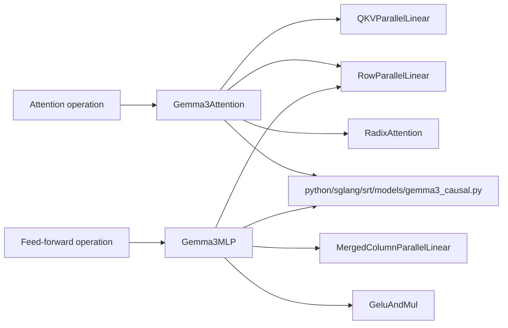
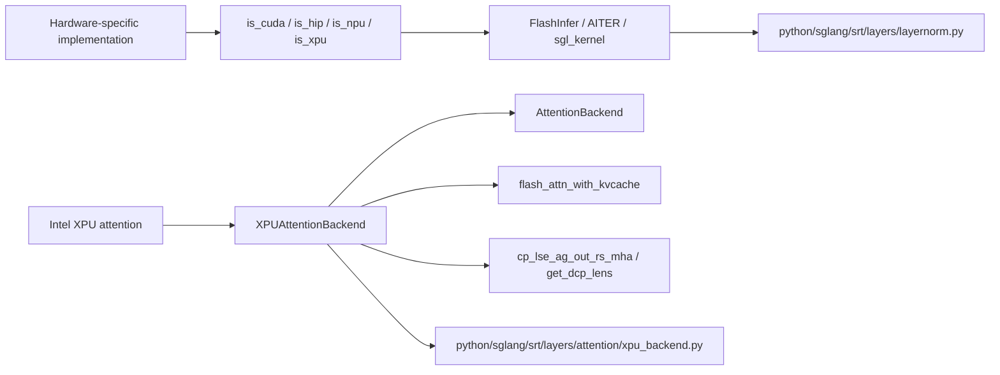

<!-- source: DeepWiki mcp.deepwiki.com · repo sgl-project/sglang · page 10 Model Execution Layers · fetched 2026-10-30 -->

# Model Execution Layers

Relevant source files

The following files were used as context for generating this wiki page:

- [python/sglang/kernels/ops/attention/dcp_kernels.py](python/sglang/kernels/ops/attention/dcp_kernels.py)
- [python/sglang/srt/arg_groups/model_overrides/kimi_k3.py](python/sglang/srt/arg_groups/model_overrides/kimi_k3.py)
- [python/sglang/srt/layers/attention/aiter_backend.py](python/sglang/srt/layers/attention/aiter_backend.py)
- [python/sglang/srt/layers/attention/aiter_mla_gluon.py](python/sglang/srt/layers/attention/aiter_mla_gluon.py)
- [python/sglang/srt/layers/attention/cutedsl_mla_backend.py](python/sglang/srt/layers/attention/cutedsl_mla_backend.py)
- [python/sglang/srt/layers/attention/flashattention_backend.py](python/sglang/srt/layers/attention/flashattention_backend.py)
- [python/sglang/srt/layers/attention/flashinfer_backend.py](python/sglang/srt/layers/attention/flashinfer_backend.py)
- [python/sglang/srt/layers/attention/flashinfer_mla_backend.py](python/sglang/srt/layers/attention/flashinfer_mla_backend.py)
- [python/sglang/srt/layers/attention/flashmla_backend.py](python/sglang/srt/layers/attention/flashmla_backend.py)
- [python/sglang/srt/layers/attention/triton_backend.py](python/sglang/srt/layers/attention/triton_backend.py)
- [python/sglang/srt/layers/attention/trtllm_mla_backend.py](python/sglang/srt/layers/attention/trtllm_mla_backend.py)
- [python/sglang/srt/layers/attention/wave_backend.py](python/sglang/srt/layers/attention/wave_backend.py)
- [python/sglang/srt/layers/dcp/__init__.py](python/sglang/srt/layers/dcp/__init__.py)
- [python/sglang/srt/layers/dcp/comm.py](python/sglang/srt/layers/dcp/comm.py)
- [python/sglang/test/kits/attention_unittest/runner_modes/speculative_target_verify_runner.py](python/sglang/test/kits/attention_unittest/runner_modes/speculative_target_verify_runner.py)
- [test/registered/attention/test_aiter_fp8_q_unified_attention.py](test/registered/attention/test_aiter_fp8_q_unified_attention.py)
- [test/registered/attention/test_aiter_gluon_h12_fp8.py](test/registered/attention/test_aiter_gluon_h12_fp8.py)
- [test/registered/attention/unittests/swa/README.md](test/registered/attention/unittests/swa/README.md)
- [test/registered/attention/unittests/swa/test_flashinfer.py](test/registered/attention/unittests/swa/test_flashinfer.py)
- [test/registered/dcp/test_dcp_layout_unit.py](test/registered/dcp/test_dcp_layout_unit.py)
- [test/registered/dcp/test_trtllm_mla_family_dcp_metadata.py](test/registered/dcp/test_trtllm_mla_family_dcp_metadata.py)

## Purpose and scope

This page gives a high-level map of SGLang’s model execution layers: reusable model-building components, hardware-specific implementations, and distributed layer operations. It introduces how these concerns connect and points to the child pages for implementation details. For model-family examples, the supplied code includes Gemma 3 and Gemma 4 text and multimodal models. [python/sglang/srt/models/gemma3_causal.py:31-55](), [python/sglang/srt/models/gemma4_causal.py:27-76](), [python/sglang/srt/models/gemma4_mm.py:41-69]()

Sources: [python/sglang/srt/models/gemma3_causal.py:31-55](), [python/sglang/srt/models/gemma4_causal.py:27-76](), [python/sglang/srt/models/gemma4_mm.py:41-69]()

## Overview

Model implementations assemble layer-level operations such as attention, normalization, and linear projections. For example, `Gemma3Attention` uses `QKVParallelLinear` and `RowParallelLinear`, while Gemma 4 imports `RadixAttention`, `get_rope`, and parallel linear layers. These examples show how model code composes reusable layer APIs rather than implementing every operation inside a model class. [python/sglang/srt/models/gemma3_causal.py:125-183](), [python/sglang/srt/models/gemma4_causal.py:47-64]()

Layer implementations also connect model semantics to platform and distributed execution. `layernorm.py` selects among platform-dependent normalization implementations, and `XPUAttentionBackend` provides an Intel XPU attention implementation using shared attention metadata and kernel interfaces. [python/sglang/srt/layers/layernorm.py:35-57](), [python/sglang/srt/layers/attention/xpu_backend.py:8-44](), [python/sglang/srt/layers/attention/xpu_backend.py:128-174]()

| Concern | Representative code entity | Where to look |
|---|---|---|
| Attention execution | `XPUAttentionBackend` | [python/sglang/srt/layers/attention/xpu_backend.py:128-174]() |
| Normalization | `RMSNorm`, fused normalization operators | [python/sglang/srt/layers/layernorm.py:14-35]() |
| Parallel projections | `QKVParallelLinear`, `RowParallelLinear` | [python/sglang/srt/models/gemma3_causal.py:168-183]() |
| Model composition | `Gemma3Attention`, `Gemma3MLP` | [python/sglang/srt/models/gemma3_causal.py:83-122](), [python/sglang/srt/models/gemma3_causal.py:125-183]() |

Sources: [python/sglang/srt/layers/attention/xpu_backend.py:128-174](), [python/sglang/srt/layers/layernorm.py:14-57](), [python/sglang/srt/models/gemma3_causal.py:83-183]()

## Layer composition and execution path

The diagram connects familiar model-layer concepts to symbols that can be searched in the repository. It is illustrative: the supplied code shows `Gemma3Attention` and `Gemma3MLP` as model components and the corresponding layer APIs they use. [python/sglang/srt/models/gemma3_causal.py:83-122](), [python/sglang/srt/models/gemma3_causal.py:125-183]()

### Diagram: Model-layer concepts mapped to Gemma 3 code entities

Sources: [python/sglang/srt/models/gemma3_causal.py:31-55](), [python/sglang/srt/models/gemma3_causal.py:83-122](), [python/sglang/srt/models/gemma3_causal.py:125-183]()

## Platform abstraction and distributed operations

Layer modules select or import implementations according to available platform support. In `layernorm.py`, platform checks include CUDA, HIP, NPU, CPU, and XPU; optional paths include FlashInfer, AITER, and other kernel providers. The XPU attention backend extends `AttentionBackend`, captures model and KV-cache metadata, and includes distributed-context-parallel helpers. [python/sglang/srt/layers/layernorm.py:35-57](), [python/sglang/srt/layers/layernorm.py:61-107](), [python/sglang/srt/layers/layernorm.py:111-148](), [python/sglang/srt/layers/attention/xpu_backend.py:16-24](), [python/sglang/srt/layers/attention/xpu_backend.py:128-174]()

### Diagram: Hardware and distributed concepts mapped to code entities

Sources: [python/sglang/srt/layers/layernorm.py:35-57](), [python/sglang/srt/layers/layernorm.py:61-107](), [python/sglang/srt/layers/layernorm.py:111-148](), [python/sglang/srt/layers/attention/xpu_backend.py:16-24](), [python/sglang/srt/layers/attention/xpu_backend.py:37-45](), [python/sglang/srt/layers/attention/xpu_backend.py:128-174]()

## Sub-topics and child pages

The child pages cover individual layer families and their implementation details. This parent page describes how those topics fit together; it does not specify backend-selection rules or kernel-level behavior.

### 10.1 Multi-Platform Layer Abstraction

Covers platform detection, hardware dispatch, the NPU/XPU/MLX `hardware_backend` packages, and the custom-op framework. The supplied normalization implementation illustrates platform checks and conditional imports; the XPU attention implementation illustrates a platform-specific backend. For details, see [Multi-Platform Layer Abstraction](#10.1). [python/sglang/srt/layers/layernorm.py:35-57](), [python/sglang/srt/layers/attention/xpu_backend.py:128-174]()

Sources: [python/sglang/srt/layers/layernorm.py:35-57](), [python/sglang/srt/layers/attention/xpu_backend.py:128-174]()

### 10.2 Attention Mechanisms and Backends

Covers MHA, MLA, GQA, attention backends, the registry, and backend selection. `XPUAttentionBackend` is one concrete backend and records whether the model uses MLA. For details, see [Attention Mechanisms and Backends](#10.2). [python/sglang/srt/layers/attention/xpu_backend.py:128-174]()

Sources: [python/sglang/srt/layers/attention/xpu_backend.py:128-174]()

### 10.3 Positional Embeddings

Covers RoPE, YaRN, MRoPE, and other positional embedding implementations. The supplied Gemma model code imports `get_rope` and `apply_rotary_pos_emb`; implementation details belong in the child page. For details, see [Positional Embeddings](#10.3). [python/sglang/srt/models/gemma3_causal.py:43-45](), [python/sglang/srt/models/gemma4_causal.py:59-61]()

Sources: [python/sglang/srt/models/gemma3_causal.py:43-45](), [python/sglang/srt/models/gemma4_causal.py:59-61]()

### 10.4 Normalization and Activation Layers

Covers RMSNorm, LayerNorm, SiLU, GELU, and fused operations. The normalization module contains fused-operator integrations and platform-specific imports; Gemma 3’s MLP composes `GeluAndMul` with parallel projections. For details, see [Normalization and Activation Layers](#10.4). [python/sglang/srt/layers/layernorm.py:14-35](), [python/sglang/srt/models/gemma3_causal.py:83-122]()

Sources: [python/sglang/srt/layers/layernorm.py:14-35](), [python/sglang/srt/models/gemma3_causal.py:83-122]()

### 10.5 Linear Layers and Distributed Communication

Covers `LinearBase`, parallel linear layers, `LayerCommunicator`, layer boundaries, and communication fusion. The supplied model examples use `QKVParallelLinear`, `MergedColumnParallelLinear`, `RowParallelLinear`, and replicated projections. For details, see [Linear Layers and Distributed Communication](#10.5). [python/sglang/srt/models/gemma3_causal.py:34-39](), [python/sglang/srt/models/gemma4_causal.py:47-53]()

Sources: [python/sglang/srt/models/gemma3_causal.py:34-39](), [python/sglang/srt/models/gemma4_causal.py:47-53]()

### 10.6 Hybrid and Linear Attention Models

Covers hybrid attention backends, linear-attention families, and models such as Qwen3-Next and Kimi-Linear. These specialized model and backend designs are outside this page’s overview. For details, see [Hybrid and Linear Attention Models](#10.6).

Sources: [python/sglang/srt/layers/attention/xpu_backend.py:128-174]()

## Summary

Model execution layers provide reusable operations that model implementations compose, while platform-specific backends and distributed helpers adapt execution to the target runtime. The child pages expand on each layer family, from attention and normalization to projections and hybrid models. [python/sglang/srt/models/gemma3_causal.py:83-183](), [python/sglang/srt/layers/layernorm.py:35-57](), [python/sglang/srt/layers/attention/xpu_backend.py:128-174]()

Sources: [python/sglang/srt/models/gemma3_causal.py:83-183](), [python/sglang/srt/layers/layernorm.py:35-57](), [python/sglang/srt/layers/attention/xpu_backend.py:128-174]()

---

# Child Pages

- **10.1 Multi-Platform Layer Abstraction**
- **10.2 Attention Mechanisms and Backends**
- **10.3 Positional Embeddings**
- **10.4 Normalization and Activation Layers**
- **10.5 Linear Layers and Distributed Communication**
- **10.6 Hybrid and Linear Attention Models**

Sources: [python/sglang/srt/layers/layernorm.py:35-57]()

---

