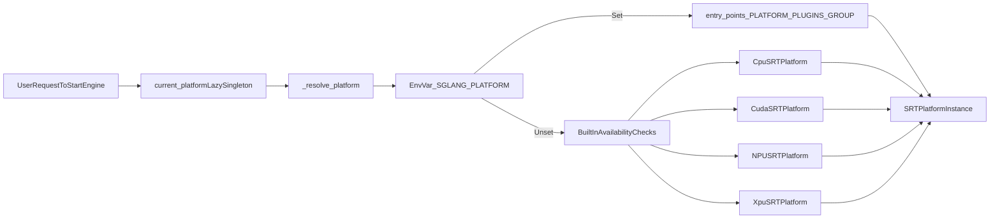
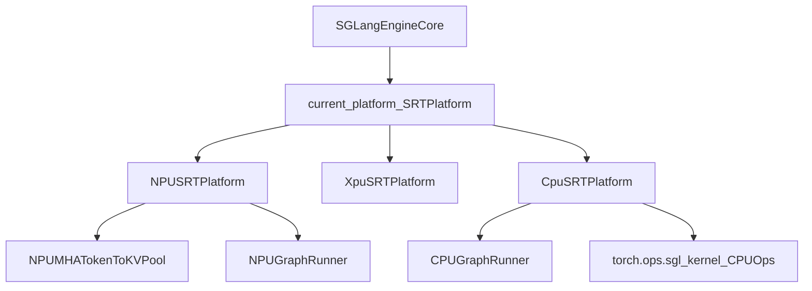

<!-- source: DeepWiki mcp.deepwiki.com · repo sgl-project/sglang · page 10.1 Multi-Platform Layer Abstraction · fetched 2026-10-30 -->

# Multi-Platform Layer Abstraction

<details>
<summary>Relevant source files</summary>

The following files were used as context for generating this wiki page:

- [docs/docs/hardware-platforms/plugin.mdx](docs/docs/hardware-platforms/plugin.mdx)
- [python/sglang/kernels/aot/csrc/cpu/decode.cpp](python/sglang/kernels/aot/csrc/cpu/decode.cpp)
- [python/sglang/kernels/aot/csrc/cpu/extend.cpp](python/sglang/kernels/aot/csrc/cpu/extend.cpp)
- [python/sglang/kernels/aot/csrc/cpu/norm.cpp](python/sglang/kernels/aot/csrc/cpu/norm.cpp)
- [python/sglang/kernels/aot/csrc/cpu/topk.cpp](python/sglang/kernels/aot/csrc/cpu/topk.cpp)
- [python/sglang/kernels/aot/csrc/cpu/torch_extension_cpu.cpp](python/sglang/kernels/aot/csrc/cpu/torch_extension_cpu.cpp)
- [python/sglang/kernels/aot/csrc/cpu/vec_pack.h](python/sglang/kernels/aot/csrc/cpu/vec_pack.h)
- [python/sglang/kernels/ops/speculative/spec_tree.py](python/sglang/kernels/ops/speculative/spec_tree.py)
- [python/sglang/multimodal_gen/test/server/ascend/conftest.py](python/sglang/multimodal_gen/test/server/ascend/conftest.py)
- [python/sglang/srt/hardware_backend/musa/attention/flashattention_backend.py](python/sglang/srt/hardware_backend/musa/attention/flashattention_backend.py)
- [python/sglang/srt/hardware_backend/npu/attention/ascend_gdn_backend.py](python/sglang/srt/hardware_backend/npu/attention/ascend_gdn_backend.py)
- [python/sglang/srt/hardware_backend/npu/attention/ascend_hybrid_linear_attn_backend.py](python/sglang/srt/hardware_backend/npu/attention/ascend_hybrid_linear_attn_backend.py)
- [python/sglang/srt/hardware_backend/npu/graph_runner/npu_cudagraph_backend.py](python/sglang/srt/hardware_backend/npu/graph_runner/npu_cudagraph_backend.py)
- [python/sglang/srt/hardware_backend/npu/memory_pool_npu.py](python/sglang/srt/hardware_backend/npu/memory_pool_npu.py)
- [python/sglang/srt/hardware_backend/npu/modules/qwen_vl_processor.py](python/sglang/srt/hardware_backend/npu/modules/qwen_vl_processor.py)
- [python/sglang/srt/layers/attention/intel_amx_backend.py](python/sglang/srt/layers/attention/intel_amx_backend.py)
- [python/sglang/srt/layers/attention/torch_native_backend.py](python/sglang/srt/layers/attention/torch_native_backend.py)
- [python/sglang/srt/model_executor/cpu_graph_runner.py](python/sglang/srt/model_executor/cpu_graph_runner.py)
- [python/sglang/srt/models/grok.py](python/sglang/srt/models/grok.py)
- [python/sglang/srt/platforms/__init__.py](python/sglang/srt/platforms/__init__.py)
- [python/sglang/srt/platforms/cpu.py](python/sglang/srt/platforms/cpu.py)
- [python/sglang/srt/platforms/cuda.py](python/sglang/srt/platforms/cuda.py)
- [python/sglang/srt/platforms/device_mixin.py](python/sglang/srt/platforms/device_mixin.py)
- [python/sglang/srt/platforms/interface.py](python/sglang/srt/platforms/interface.py)
- [python/sglang/srt/platforms/musa.py](python/sglang/srt/platforms/musa.py)
- [python/sglang/srt/platforms/npu.py](python/sglang/srt/platforms/npu.py)
- [python/sglang/srt/platforms/rocm.py](python/sglang/srt/platforms/rocm.py)
- [python/sglang/srt/platforms/sail.py](python/sglang/srt/platforms/sail.py)
- [python/sglang/srt/platforms/xpu.py](python/sglang/srt/platforms/xpu.py)
- [python/sglang/srt/speculative/adaptive_runtime_state.py](python/sglang/srt/speculative/adaptive_runtime_state.py)
- [python/sglang/srt/speculative/adaptive_spec_params.py](python/sglang/srt/speculative/adaptive_spec_params.py)
- [test/manual/ascend/test_npu_piecewise_graph_prefill.py](test/manual/ascend/test_npu_piecewise_graph_prefill.py)
- [test/registered/cpu/test_activation.py](test/registered/cpu/test_activation.py)
- [test/registered/cpu/test_bmm.py](test/registered/cpu/test_bmm.py)
- [test/registered/cpu/test_decode.py](test/registered/cpu/test_decode.py)
- [test/registered/cpu/test_extend.py](test/registered/cpu/test_extend.py)
- [test/registered/cpu/test_gemm.py](test/registered/cpu/test_gemm.py)
- [test/registered/cpu/test_mamba.py](test/registered/cpu/test_mamba.py)
- [test/registered/cpu/test_mla.py](test/registered/cpu/test_mla.py)
- [test/registered/cpu/test_moe.py](test/registered/cpu/test_moe.py)
- [test/registered/cpu/test_norm.py](test/registered/cpu/test_norm.py)
- [test/registered/cpu/test_qkv_proj_with_rope.py](test/registered/cpu/test_qkv_proj_with_rope.py)
- [test/registered/cpu/test_qwen3.py](test/registered/cpu/test_qwen3.py)
- [test/registered/cpu/test_rope.py](test/registered/cpu/test_rope.py)
- [test/registered/cpu/test_shared_expert.py](test/registered/cpu/test_shared_expert.py)
- [test/registered/cpu/test_store_cache.py](test/registered/cpu/test_store_cache.py)
- [test/registered/cpu/test_topk.py](test/registered/cpu/test_topk.py)
- [test/registered/npu/accuracy/glm5_top64_pruned/test_npu_glm5_top64_pruned_bf16_8p_gsm8k.py](test/registered/npu/accuracy/glm5_top64_pruned/test_npu_glm5_top64_pruned_bf16_8p_gsm8k.py)
- [test/registered/npu/accuracy/kimi_k2_6/test_npu_kimi_k2_6_w4a8_16p_in64k_out1k_100ms_aime25.py](test/registered/npu/accuracy/kimi_k2_6/test_npu_kimi_k2_6_w4a8_16p_in64k_out1k_100ms_aime25.py)
- [test/registered/npu/basic_function/HiCache/test_npu_hicache_mha.py](test/registered/npu/basic_function/HiCache/test_npu_hicache_mha.py)
- [test/registered/npu/basic_function/parallel_strategy/data_parallelism/test_npu_load_balance_method.py](test/registered/npu/basic_function/parallel_strategy/data_parallelism/test_npu_load_balance_method.py)
- [test/registered/npu/basic_function/parallel_strategy/data_parallelism/test_npu_load_balance_method_pd_disaggregation.py](test/registered/npu/basic_function/parallel_strategy/data_parallelism/test_npu_load_balance_method_pd_disaggregation.py)
- [test/registered/npu/basic_function/parallel_strategy/expert_parallelism/test_npu_deepep_auto_deepseek_v3_2_w8a8.py](test/registered/npu/basic_function/parallel_strategy/expert_parallelism/test_npu_deepep_auto_deepseek_v3_2_w8a8.py)
- [test/registered/npu/basic_function/parallel_strategy/expert_parallelism/test_npu_deepep_auto_qwen3_480b.py](test/registered/npu/basic_function/parallel_strategy/expert_parallelism/test_npu_deepep_auto_qwen3_480b.py)
- [test/registered/npu/basic_function/parallel_strategy/expert_parallelism/test_npu_deepep_auto_qwen3_next.py](test/registered/npu/basic_function/parallel_strategy/expert_parallelism/test_npu_deepep_auto_qwen3_next.py)
- [test/registered/npu/basic_function/parallel_strategy/expert_parallelism/test_npu_deepep_low_latency_deepseek_v3_2_w8a8.py](test/registered/npu/basic_function/parallel_strategy/expert_parallelism/test_npu_deepep_low_latency_deepseek_v3_2_w8a8.py)
- [test/registered/npu/basic_function/parallel_strategy/expert_parallelism/test_npu_deepep_low_latency_qwen3_480b.py](test/registered/npu/basic_function/parallel_strategy/expert_parallelism/test_npu_deepep_low_latency_qwen3_480b.py)
- [test/registered/npu/basic_function/parallel_strategy/expert_parallelism/test_npu_deepep_low_latency_qwen3_next.py](test/registered/npu/basic_function/parallel_strategy/expert_parallelism/test_npu_deepep_low_latency_qwen3_next.py)
- [test/registered/npu/basic_function/parallel_strategy/expert_parallelism/test_npu_eplb_min_rebalancing_utilization_threshold.py](test/registered/npu/basic_function/parallel_strategy/expert_parallelism/test_npu_eplb_min_rebalancing_utilization_threshold.py)
- [test/registered/npu/basic_function/parallel_strategy/expert_parallelism/test_npu_expert_distribution_recorder_mode.py](test/registered/npu/basic_function/parallel_strategy/expert_parallelism/test_npu_expert_distribution_recorder_mode.py)
- [test/registered/npu/basic_function/parallel_strategy/expert_parallelism/test_npu_moe_dense_tp_size.py](test/registered/npu/basic_function/parallel_strategy/expert_parallelism/test_npu_moe_dense_tp_size.py)
- [test/registered/npu/basic_function/parallel_strategy/expert_parallelism/test_npu_moe_runner_backend.py](test/registered/npu/basic_function/parallel_strategy/expert_parallelism/test_npu_moe_runner_backend.py)
- [test/registered/npu/basic_function/pd_disaggregation/test_npu_pd_disaggregation.py](test/registered/npu/basic_function/pd_disaggregation/test_npu_pd_disaggregation.py)
- [test/registered/npu/basic_function/speculative_inference/test_npu_speculative_attention_mode.py](test/registered/npu/basic_function/speculative_inference/test_npu_speculative_attention_mode.py)
- [test/registered/npu/basic_function/speculative_inference/test_npu_speculative_moe_a2a_backend.py](test/registered/npu/basic_function/speculative_inference/test_npu_speculative_moe_a2a_backend.py)
- [test/registered/npu/basic_function/speculative_inference/test_npu_speculative_token_map.py](test/registered/npu/basic_function/speculative_inference/test_npu_speculative_token_map.py)
- [test/registered/npu/performance/qwen3_5_397b/test_npu_qwen3_5_397b_w4a8_8p_in3k5_out1k5_50ms.py](test/registered/npu/performance/qwen3_5_397b/test_npu_qwen3_5_397b_w4a8_8p_in3k5_out1k5_50ms.py)
- [test/registered/npu/performance/qwen3_6_27b/test_npu_qwen3_6_27b_2p_in64k_out1k_prefix90_50ms.py](test/registered/npu/performance/qwen3_6_27b/test_npu_qwen3_6_27b_2p_in64k_out1k_prefix90_50ms.py)
- [test/registered/npu/performance/qwen3_6_27b/test_npu_qwen3_6_27b_w8a8_1p_in64k_out1k_50ms.py](test/registered/npu/performance/qwen3_6_27b/test_npu_qwen3_6_27b_w8a8_1p_in64k_out1k_50ms.py)
- [test/registered/npu/rl/indexer_replay/test_npu_return_indexer_topk_deepseek_v4.py](test/registered/npu/rl/indexer_replay/test_npu_return_indexer_topk_deepseek_v4.py)
- [test/registered/npu/rl/indexer_replay/test_npu_return_indexer_topk_glm52.py](test/registered/npu/rl/indexer_replay/test_npu_return_indexer_topk_glm52.py)
- [test/registered/spec/eagle/test_adaptive_speculative.py](test/registered/spec/eagle/test_adaptive_speculative.py)
- [test/registered/spec/test_frozen_kv_mtp.py](test/registered/spec/test_frozen_kv_mtp.py)
- [test/registered/spec/test_gemma4_mtp_31b_extra.py](test/registered/spec/test_gemma4_mtp_31b_extra.py)
- [test/registered/unit/distributed/test_get_default_distributed_backend.py](test/registered/unit/distributed/test_get_default_distributed_backend.py)
- [test/registered/unit/distributed/test_oot_group_coordinator_hooks.py](test/registered/unit/distributed/test_oot_group_coordinator_hooks.py)
- [test/registered/unit/npu/test_npu_scatter_pa_kv_cache.py](test/registered/unit/npu/test_npu_scatter_pa_kv_cache.py)
- [test/registered/unit/platforms/test_platform_interface.py](test/registered/unit/platforms/test_platform_interface.py)
- [test/registered/unit/spec/test_adaptive_runtime_state.py](test/registered/unit/spec/test_adaptive_runtime_state.py)
- [test/registered/unit/spec/test_adaptive_spec_params.py](test/registered/unit/spec/test_adaptive_spec_params.py)
- [test/registered/unit/spec/test_oot_eagle_hooks.py](test/registered/unit/spec/test_oot_eagle_hooks.py)

</details>


## Purpose and Scope

This page describes how SGLang represents hardware platforms, selects a platform at runtime via lazy initialization, and exposes extension seams for platform-specific runtime components. It covers hardware backend packages (such as NPU, XPU, MLX, and CPU), platform capability declarations, and the custom operator framework used to dispatch hardware-accelerated kernels under `torch.compile`. [python/sglang/srt/platforms/interface.py:1-10]() [python/sglang/srt/platforms/__init__.py:1-12]()

Sources: [python/sglang/srt/platforms/interface.py:1-10](), [python/sglang/srt/platforms/__init__.py:1-12]()

---

## Architecture Overview and Platform Detection

### Platform Detection and Resolution

`current_platform` operates as a module-level lazy singleton. On its initial access, `_resolve_platform()` determines the active hardware platform using an explicit environment override or an auto-discovery sequence [python/sglang/srt/platforms/__init__.py:4-10]().

1. **Explicit Override (`SGLANG_PLATFORM`)**: When specified, SGLang performs a front-loading filter. It enumerates entry points under `sglang.srt.platforms` (`PLATFORM_PLUGINS_GROUP`), loads only the matching plugin, and validates that its activation callback returns a valid platform identifier [python/sglang/srt/platforms/__init__.py:108-137](). Other plugins remain unimported, preventing unnecessary third-party hardware dependencies from loading.
2. **Auto-Discovery**: When `SGLANG_PLATFORM` is unset, SGLang evaluates available plugins and falls back to built-in platform detectors in priority order:
   - CPU engine opt-in (`SGLANG_USE_CPU_ENGINE=1` → `CpuSRTPlatform`) [python/sglang/srt/platforms/__init__.py:50-51](), [python/sglang/srt/platforms/__init__.py:153-155]()
   - SAIL hardware (`_is_sail_available()` → `SailSRTPlatform`) [python/sglang/srt/platforms/__init__.py:45-48](), [python/sglang/srt/platforms/__init__.py:156-160]()
   - NVIDIA CUDA (`_is_cuda_available()` → `CudaSRTPlatform`) [python/sglang/srt/platforms/__init__.py:37-39](), [python/sglang/srt/platforms/__init__.py:161-165]()
   - Ascend NPU (`_is_npu_available()` → `NPUSRTPlatform`) [python/sglang/srt/platforms/__init__.py:53-55](), [python/sglang/srt/platforms/__init__.py:166-168]()
   - AMD ROCm (`_is_rocm_available()` → `RocmSRTPlatform`) [python/sglang/srt/platforms/__init__.py:41-43](), [python/sglang/srt/platforms/__init__.py:169-173]()
   - Intel XPU (`_is_xpu_available()` → `XpuSRTPlatform`) [python/sglang/srt/platforms/__init__.py:57-59](), [python/sglang/srt/platforms/__init__.py:174-176]()
   - MUSA, Apple MPS, or base `SRTPlatform` [python/sglang/srt/platforms/__init__.py:61-73]()

`DeviceMixin` encapsulates basic device identity queries (`is_cuda()`, `is_npu()`, `is_cpu()`, etc.), while `SRTPlatform` extends it with subsystem factory hooks and capability flags (`PlatformCapabilities`) [python/sglang/srt/platforms/interface.py:49-90]().

### Platform Selection: Natural Language to Code Entities



Sources: [python/sglang/srt/platforms/__init__.py:37-178](), [python/sglang/srt/platforms/interface.py:49-90]()

### Platform Interface and Dispatch Seams

`SRTPlatform` defines the virtual contract implemented by all hardware backends [python/sglang/srt/platforms/interface.py:76-179](). Key methods include:
- `get_default_attention_backend()`: Returns the preferred attention kernel backend string [python/sglang/srt/platforms/interface.py:107-110]().
- `get_graph_runner_cls()`: Returns the graph runner implementation class (e.g., CUDA Graph or NPU graph runner) [python/sglang/srt/platforms/interface.py:115-125]().
- `get_kv_pool_cls(kind)`: Returns specialized token-to-KV pool classes for `mha`, `mla`, or `dsa` [python/sglang/srt/platforms/interface.py:130-163]().
- `get_compile_backend()`: Returns the compiler backend identifier (defaulting to `"inductor"`) [python/sglang/srt/platforms/interface.py:174-179]().

Sources: [python/sglang/srt/platforms/interface.py:76-179]()

---

## Hardware Backend Packages: NPU, XPU, MLX, CPU

Hardware abstraction packages decouple the inference engine core from device-specific memory layouts, attention mechanics, and graph compilation strategies.

### 1. NPU Backend (`python/sglang/srt/hardware_backend/npu/`)
The Ascend NPU backend integrates via `torch_npu`. 
- **Memory Pools**: `NPUMHATokenToKVPool` subclasses `MHATokenToKVPool` to support Ascend-specific memory layouts, Flash Attention (FIA) NZ layouts, and HiCache D2H/H2D exchanges [python/sglang/srt/hardware_backend/npu/memory_pool_npu.py:88-178]().
- **Attention & Hybrid-Linear Backends**: Integrates specialized kernels such as `AscendGDNAttnBackend` and `AscendMambaAttnBackendBase` for state-space model layers (Mamba, GDN) [python/sglang/srt/hardware_backend/npu/attention/ascend_gdn_backend.py:24-40](), [python/sglang/srt/hardware_backend/npu/attention/ascend_hybrid_linear_attn_backend.py:26-30]().
- **Graph Runners**: `NPUGraphRunner` manages NPU-specific graph capture and replay [python/sglang/srt/hardware_backend/npu/graph_runner/npu_graph_runner.py:14-24]().

### 2. CPU Backend and Graph Runner (`python/sglang/srt/model_executor/cpu_graph_runner.py`)
For CPU inference, `CPUGraphRunner` and `set_torch_compile_config()` leverage `torch.compile` combined with `torch._inductor` optimizations to reduce Python interpreter overhead during decode [python/sglang/srt/model_executor/cpu_graph_runner.py:14-133](). It registers fake/meta kernels for custom SGLang CPU operators to support graph tracing without execution errors [python/sglang/srt/model_executor/cpu_graph_runner.py:153-198]().

### 3. XPU and MLX Backends
- **XPU**: Managed via `XpuSRTPlatform` utilizing `torch.xpu` availability checks and custom Intel-optimized execution paths [python/sglang/srt/platforms/__init__.py:57-59]().
- **MLX**: Provides Apple Silicon hardware abstraction through specialized tensor operations and memory management.

### Hardware Backend Dispatch Architecture



Sources: [python/sglang/srt/platforms/__init__.py:20-30](), [python/sglang/srt/hardware_backend/npu/memory_pool_npu.py:88-120](), [python/sglang/srt/model_executor/cpu_graph_runner.py:14-133]()

---

## Custom Op and JIT Kernel Framework

SGLang defines a custom operator namespace (`sgl_kernel`) to execute highly optimized low-level kernels across platforms (CUDA, ROCm, CPU, NPU). 

### Fake Operator Registration for `torch.compile`
To support graph capture and compilation on non-CUDA platforms (such as CPU and NPU), custom operations must register fake (meta) implementations via `torch.library.register_fake` [python/sglang/srt/model_executor/cpu_graph_runner.py:153-175](). For example, CPU operators like `rms_norm_cpu`, `fused_add_rmsnorm_cpu`, and attention forward functions register corresponding fake kernels so that `torch._dynamo` can trace models without hardware execution [python/sglang/srt/model_executor/cpu_graph_runner.py:177-198]().

Similarly, C++ extensions expose these operations via PyTorch extension bindings (`torch_extension_cpu.cpp`) [python/sglang/kernels/aot/csrc/cpu/torch_extension_cpu.cpp:16-30]():

```cpp
// Example C++ registration header pattern
at::Tensor rmsnorm_cpu(at::Tensor& input, at::Tensor& weight, double eps);
void fused_add_rmsnorm_cpu(at::Tensor& input, at::Tensor& residual, at::Tensor& weight, double eps);
```

Sources: [python/sglang/srt/model_executor/cpu_graph_runner.py:153-198](), [python/sglang/kernels/aot/csrc/cpu/torch_extension_cpu.cpp:16-78]()

---

## Summary Table of Key Components and Files

| Component | Location | Role |
|---|---|---|
| Platform Resolution | `python/sglang/srt/platforms/__init__.py` | Implements `_resolve_platform()` and lazy singleton `current_platform` |
| Platform Interface | `python/sglang/srt/platforms/interface.py` | Defines `SRTPlatform`, `PlatformCapabilities`, and subsystem factories |
| NPU Memory Pool | `python/sglang/srt/hardware_backend/npu/memory_pool_npu.py` | Ascend NPU-specific KV cache pool and FIA layout management |
| CPU Graph Runner | `python/sglang/srt/model_executor/cpu_graph_runner.py` | PyTorch compile integration, fake operator registration, and CPU execution |
| CPU Extension Bindings | `python/sglang/kernels/aot/csrc/cpu/torch_extension_cpu.cpp` | C++ ATen operator bindings for normalization, activation, and attention on CPU |
| Platform Unit Tests | `test/registered/unit/platforms/test_platform_interface.py` | Unit test suite for `DeviceMixin`, `SRTPlatform`, and discovery mechanisms |

Sources: [python/sglang/srt/platforms/__init__.py:1-178](), [python/sglang/srt/platforms/interface.py:1-179](), [python/sglang/srt/hardware_backend/npu/memory_pool_npu.py:1-178](), [python/sglang/srt/model_executor/cpu_graph_runner.py:1-198](), [python/sglang/kernels/aot/csrc/cpu/torch_extension_cpu.cpp:1-100](), [test/registered/unit/platforms/test_platform_interface.py:1-100]()

---

