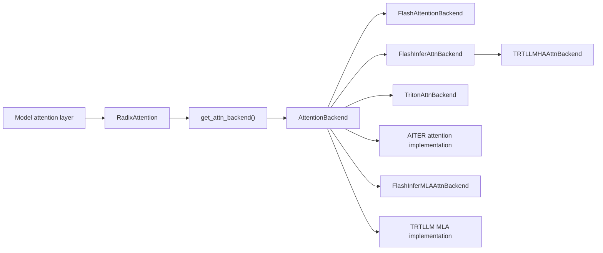
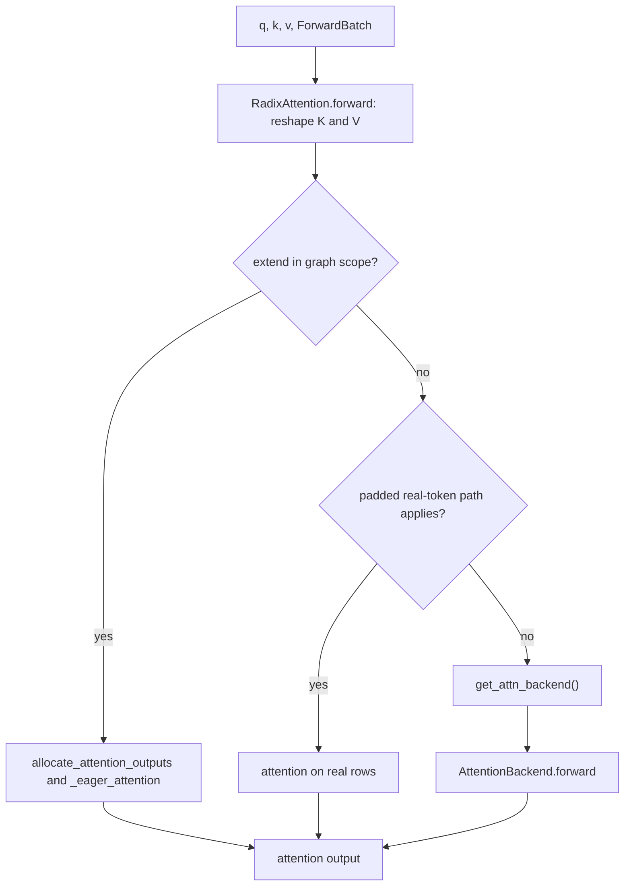
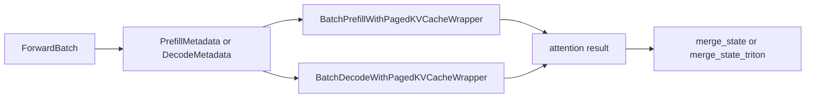
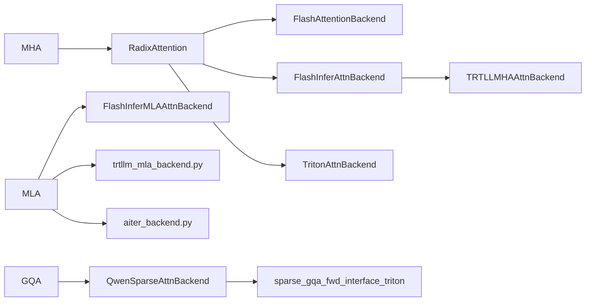
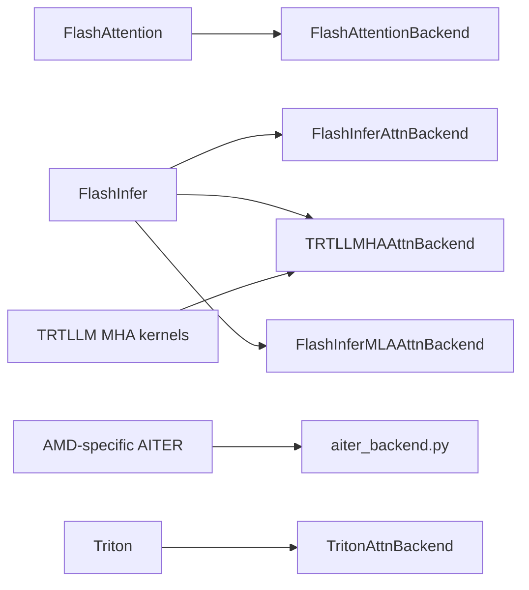

<!-- source: DeepWiki mcp.deepwiki.com · repo sgl-project/sglang · page 10.2 Attention Mechanisms and Backends · fetched 2026-10-30 -->

# Attention Mechanisms and Backends

Relevant source files

The following files were used as context for generating this wiki page:

- [python/sglang/kernels/jit/csrc/attention/qsa_indexer.cuh](python/sglang/kernels/jit/csrc/attention/qsa_indexer.cuh)
- [python/sglang/kernels/ops/attention/dcp_kernels.py](python/sglang/kernels/ops/attention/dcp_kernels.py)
- [python/sglang/kernels/ops/attention/qsa_indexer.py](python/sglang/kernels/ops/attention/qsa_indexer.py)
- [python/sglang/kernels/ops/gemm/fp8_kernel.py](python/sglang/kernels/ops/gemm/fp8_kernel.py)
- [python/sglang/srt/arg_groups/model_overrides/kimi_k3.py](python/sglang/srt/arg_groups/model_overrides/kimi_k3.py)
- [python/sglang/srt/arg_groups/model_overrides/qwen4_exp.py](python/sglang/srt/arg_groups/model_overrides/qwen4_exp.py)
- [python/sglang/srt/layers/attention/aiter_backend.py](python/sglang/srt/layers/attention/aiter_backend.py)
- [python/sglang/srt/layers/attention/aiter_mla_gluon.py](python/sglang/srt/layers/attention/aiter_mla_gluon.py)
- [python/sglang/srt/layers/attention/cutedsl_mla_backend.py](python/sglang/srt/layers/attention/cutedsl_mla_backend.py)
- [python/sglang/srt/layers/attention/flashattention_backend.py](python/sglang/srt/layers/attention/flashattention_backend.py)
- [python/sglang/srt/layers/attention/flashinfer_backend.py](python/sglang/srt/layers/attention/flashinfer_backend.py)
- [python/sglang/srt/layers/attention/flashinfer_mla_backend.py](python/sglang/srt/layers/attention/flashinfer_mla_backend.py)
- [python/sglang/srt/layers/attention/flashmla_backend.py](python/sglang/srt/layers/attention/flashmla_backend.py)
- [python/sglang/srt/layers/attention/qsa/fused_kv.py](python/sglang/srt/layers/attention/qsa/fused_kv.py)
- [python/sglang/srt/layers/attention/qsa/kernel.py](python/sglang/srt/layers/attention/qsa/kernel.py)
- [python/sglang/srt/layers/attention/qsa/metadata.py](python/sglang/srt/layers/attention/qsa/metadata.py)
- [python/sglang/srt/layers/attention/qsa/mqa.py](python/sglang/srt/layers/attention/qsa/mqa.py)
- [python/sglang/srt/layers/attention/qsa/qsa_indexer.py](python/sglang/srt/layers/attention/qsa/qsa_indexer.py)
- [python/sglang/srt/layers/attention/qsa/sparse_attn.py](python/sglang/srt/layers/attention/qsa/sparse_attn.py)
- [python/sglang/srt/layers/attention/qwen_sparse_attn_backend.py](python/sglang/srt/layers/attention/qwen_sparse_attn_backend.py)
- [python/sglang/srt/layers/attention/triton_backend.py](python/sglang/srt/layers/attention/triton_backend.py)
- [python/sglang/srt/layers/attention/trtllm_mha_backend.py](python/sglang/srt/layers/attention/trtllm_mha_backend.py)
- [python/sglang/srt/layers/attention/trtllm_mla_backend.py](python/sglang/srt/layers/attention/trtllm_mla_backend.py)
- [python/sglang/srt/layers/attention/verify_mask.py](python/sglang/srt/layers/attention/verify_mask.py)
- [python/sglang/srt/layers/attention/wave_backend.py](python/sglang/srt/layers/attention/wave_backend.py)
- [python/sglang/srt/layers/dcp/__init__.py](python/sglang/srt/layers/dcp/__init__.py)
- [python/sglang/srt/layers/dcp/comm.py](python/sglang/srt/layers/dcp/comm.py)
- [python/sglang/srt/mem_cache/allocation_sizing.py](python/sglang/srt/mem_cache/allocation_sizing.py)
- [python/sglang/srt/mem_cache/qsa_kv_pool.py](python/sglang/srt/mem_cache/qsa_kv_pool.py)
- [python/sglang/srt/models/qwen4_exp.py](python/sglang/srt/models/qwen4_exp.py)
- [python/sglang/srt/speculative/dflash_info_v2.py](python/sglang/srt/speculative/dflash_info_v2.py)
- [python/sglang/srt/speculative/eagle_worker_common.py](python/sglang/srt/speculative/eagle_worker_common.py)
- [python/sglang/test/kits/attention_unittest/attention_methods/dense_attention.py](python/sglang/test/kits/attention_unittest/attention_methods/dense_attention.py)
- [python/sglang/test/kits/attention_unittest/attention_methods/dsa_attention.py](python/sglang/test/kits/attention_unittest/attention_methods/dsa_attention.py)
- [python/sglang/test/kits/attention_unittest/attention_methods/dsv4_attention.py](python/sglang/test/kits/attention_unittest/attention_methods/dsv4_attention.py)
- [python/sglang/test/kits/attention_unittest/attention_methods/gdn_attention.py](python/sglang/test/kits/attention_unittest/attention_methods/gdn_attention.py)
- [python/sglang/test/kits/attention_unittest/attention_methods/kda_attention.py](python/sglang/test/kits/attention_unittest/attention_methods/kda_attention.py)
- [python/sglang/test/kits/attention_unittest/attention_methods/lightning_attention.py](python/sglang/test/kits/attention_unittest/attention_methods/lightning_attention.py)
- [python/sglang/test/kits/attention_unittest/attention_methods/mamba2_attention.py](python/sglang/test/kits/attention_unittest/attention_methods/mamba2_attention.py)
- [python/sglang/test/kits/attention_unittest/attention_methods/mla_attention.py](python/sglang/test/kits/attention_unittest/attention_methods/mla_attention.py)
- [python/sglang/test/kits/attention_unittest/runner_modes/speculative_target_verify_runner.py](python/sglang/test/kits/attention_unittest/runner_modes/speculative_target_verify_runner.py)
- [test/registered/attention/test_aiter_fp8_q_unified_attention.py](test/registered/attention/test_aiter_fp8_q_unified_attention.py)
- [test/registered/attention/test_aiter_gluon_h12_fp8.py](test/registered/attention/test_aiter_gluon_h12_fp8.py)
- [test/registered/attention/test_trtllm_mha_encoder_only.py](test/registered/attention/test_trtllm_mha_encoder_only.py)
- [test/registered/attention/test_trtllm_mha_graph_metadata.py](test/registered/attention/test_trtllm_mha_graph_metadata.py)
- [test/registered/attention/unittests/swa/README.md](test/registered/attention/unittests/swa/README.md)
- [test/registered/attention/unittests/swa/test_flashinfer.py](test/registered/attention/unittests/swa/test_flashinfer.py)
- [test/registered/cuda_graph/breakable/test_breakable_cuda_graph.py](test/registered/cuda_graph/breakable/test_breakable_cuda_graph.py)
- [test/registered/dcp/test_dcp_layout_unit.py](test/registered/dcp/test_dcp_layout_unit.py)
- [test/registered/dcp/test_trtllm_mla_family_dcp_metadata.py](test/registered/dcp/test_trtllm_mla_family_dcp_metadata.py)
- [test/registered/kernels/ops/attention/qsa/test_qsa.py](test/registered/kernels/ops/attention/qsa/test_qsa.py)
- [test/registered/kernels/ops/attention/qsa/test_qsa_determinism.py](test/registered/kernels/ops/attention/qsa/test_qsa_determinism.py)
- [test/registered/kernels/ops/attention/qsa/test_qsa_fused_kv_prepare.py](test/registered/kernels/ops/attention/qsa/test_qsa_fused_kv_prepare.py)
- [test/registered/kernels/ops/attention/qsa/test_qsa_indexer.py](test/registered/kernels/ops/attention/qsa/test_qsa_indexer.py)
- [test/registered/kernels/ops/attention/qsa/test_qsa_strided_zero_fill.py](test/registered/kernels/ops/attention/qsa/test_qsa_strided_zero_fill.py)
- [test/registered/unit/batch_invariant_ops/test_qwen_batch_invariance.py](test/registered/unit/batch_invariant_ops/test_qwen_batch_invariance.py)
- [test/registered/unit/cp/test_qsa_cp_unit.py](test/registered/unit/cp/test_qsa_cp_unit.py)
- [test/registered/unit/layers/attention/test_verify_mask.py](test/registered/unit/layers/attention/test_verify_mask.py)
- [test/registered/unit/layers/deep_gemm_wrapper/test_warmup_memory.py](test/registered/unit/layers/deep_gemm_wrapper/test_warmup_memory.py)
- [test/registered/unit/model_executor/model_runner_components/test_attention_backend_setup.py](test/registered/unit/model_executor/model_runner_components/test_attention_backend_setup.py)
- [test/registered/unit/model_executor/test_prefill_cuda_graph_runner_helpers.py](test/registered/unit/model_executor/test_prefill_cuda_graph_runner_helpers.py)
- [test/registered/unit/spec/test_dflash_overlap_hostsync.py](test/registered/unit/spec/test_dflash_overlap_hostsync.py)
- [test/registered/unit/spec/test_eagle_worker_v2_topk1_fastpath.py](test/registered/unit/spec/test_eagle_worker_v2_topk1_fastpath.py)
- [test/registered/xpu/test_qsa_indexer_xpu.py](test/registered/xpu/test_qsa_indexer_xpu.py)

## Purpose and Scope

This page documents SGLang’s attention-layer interface and the backend implementations visible in the supplied code: `RadixAttention`, MHA-oriented paths, MLA paths, sparse attention, and FlashAttention, FlashInfer, TRTLLM, AITER, and Triton integrations. It also describes the backend-dispatch boundary. The supplied file excerpts do not show the complete attention registry, backend-registration table, or backend-selection implementation, so those internals are not inferred here.

Sources: [python/sglang/srt/layers/radix_attention.py:52-80](), [python/sglang/srt/layers/radix_attention.py:114-176](), [python/sglang/srt/layers/attention/flashinfer_backend.py:10-15]()

---

## Attention Architecture Overview

`RadixAttention` is the model-layer interface for attention. It stores per-layer properties such as query-head count, KV-head count, head dimensions, scaling, attention type, and sliding-window configuration. During `forward`, it handles input reshaping and special graph-related paths, then delegates normal execution to `get_attn_backend().forward(...)`. The backend therefore supplies the kernel implementation while the layer carries model-specific attention parameters. [python/sglang/srt/layers/radix_attention.py:60-108](), [python/sglang/srt/layers/radix_attention.py:114-176]()

The available backends cover different kernel libraries and attention variants. For example, `FlashAttentionBackend` and `TritonAttnBackend` derive from `AttentionBackend`; `TRTLLMHAAttnBackend` derives from `FlashInferAttnBackend`; and the MLA implementations have separate FlashInfer and TRTLLM backend modules. [python/sglang/srt/layers/attention/flashattention_backend.py:132-160](), [python/sglang/srt/layers/attention/triton_backend.py:150-166](), [python/sglang/srt/layers/attention/trtllm_mha_backend.py:32-35](), [python/sglang/srt/layers/attention/trtllm_mha_backend.py:174-175](), [python/sglang/srt/layers/attention/trtllm_mla_backend.py:52-55]()

**Diagram: Model attention layer to backend execution**

Sources: [python/sglang/srt/layers/radix_attention.py:33-35](), [python/sglang/srt/layers/radix_attention.py:60-80](), [python/sglang/srt/layers/radix_attention.py:174-176](), [python/sglang/srt/layers/attention/base_attn_backend.py:36-155](), [python/sglang/srt/layers/attention/flashattention_backend.py:132-160](), [python/sglang/srt/layers/attention/flashinfer_backend.py:32-35](), [python/sglang/srt/layers/attention/triton_backend.py:150-166](), [python/sglang/srt/layers/attention/trtllm_mha_backend.py:32-35](), [python/sglang/srt/layers/attention/trtllm_mla_backend.py:52-55](), [python/sglang/srt/layers/attention/aiter_backend.py:18-30]()

---

## Attention Implementations

### Multi-Head Attention (MHA)

`RadixAttention` records the query-head count in `tp_q_head_num`, and the KV-head count in both `tp_k_head_num` and `tp_v_head_num`. `head_dim`, `v_head_dim`, scaling, layer ID, attention type, and optional sliding-window size are also retained on the layer. The forward path reshapes incoming K and V tensors using these head counts and dimensions before dispatching to the active backend. [python/sglang/srt/layers/radix_attention.py:60-108](), [python/sglang/srt/layers/radix_attention.py:114-132]()

The supplied implementations include several MHA-oriented backends:

- **FlashInfer:** `FlashInferAttnBackend` uses FlashInfer paged and ragged prefill/decode wrappers when FlashInfer is available. The module describes extend and decode as its two operators. [python/sglang/srt/layers/attention/flashinfer_backend.py:10-15](), [python/sglang/srt/layers/attention/flashinfer_backend.py:76-85]()
- **FlashAttention:** `FlashAttentionBackend` is an `AttentionBackend` implementation. Its `FlashAttentionMetadata` stores sequence-length data, cumulative query/key lengths, page tables, window configuration, and related forward metadata. [python/sglang/srt/layers/attention/flashattention_backend.py:74-130](), [python/sglang/srt/layers/attention/flashattention_backend.py:132-148]()
- **TRTLLM MHA:** `TRTLLMHAAttnBackend` extends `FlashInferAttnBackend`. Its module documents prefill dispatch by GPU architecture and decode dispatch using XQA or TRTLLM-GEN; it also documents sliding-window and attention-sink support. [python/sglang/srt/layers/attention/trtllm_mha_backend.py:3-13](), [python/sglang/srt/layers/attention/trtllm_mha_backend.py:174-175]()
- **Triton:** `TritonAttnBackend` is an `AttentionBackend` implementation. Its initialization lazily imports decode and extend attention functions, including `decode_attention_fwd` and `extend_attention_fwd`. [python/sglang/srt/layers/attention/triton_backend.py:150-184]()
- **AITER:** `aiter_backend.py` imports AITER MHA, MLA, paged-attention, and unified-attention functions in its optional AITER import block. The module identifies AITER as an AMD-specific kernel library. [python/sglang/srt/layers/attention/aiter_backend.py:47-73]()

Sources: [python/sglang/srt/layers/radix_attention.py:60-108](), [python/sglang/srt/layers/radix_attention.py:114-176](), [python/sglang/srt/layers/attention/flashinfer_backend.py:10-15](), [python/sglang/srt/layers/attention/flashinfer_backend.py:76-85](), [python/sglang/srt/layers/attention/flashattention_backend.py:74-148](), [python/sglang/srt/layers/attention/trtllm_mha_backend.py:3-13](), [python/sglang/srt/layers/attention/trtllm_mha_backend.py:174-175](), [python/sglang/srt/layers/attention/triton_backend.py:150-184](), [python/sglang/srt/layers/attention/aiter_backend.py:47-73]()

### Grouped-Query Attention (GQA)

In the `RadixAttention` interface, the query-head count and KV-head count are distinct constructor inputs. `tp_q_head_num` is assigned from `num_heads`, while `tp_k_head_num` and `tp_v_head_num` are assigned from `num_kv_heads`. This represents the head-count relationship needed by grouped-query configurations; the supplied excerpts do not provide a separate class named “GQA.” [python/sglang/srt/layers/radix_attention.py:60-87]()

The sparse Qwen backend also includes GQA-oriented kernel interfaces, including `sparse_gqa_fwd_interface_triton` and `sparse_gqa_packed_decode_triton`. Its `QwenSparseAttnMetadata` carries per-forward sequence, token-to-batch, slot-table, and indexer metadata consumed by sparse attention. [python/sglang/srt/layers/attention/qwen_sparse_attn_backend.py:25-44](), [python/sglang/srt/layers/attention/qwen_sparse_attn_backend.py:144-156]()

Sources: [python/sglang/srt/layers/radix_attention.py:60-87](), [python/sglang/srt/layers/attention/qwen_sparse_attn_backend.py:25-44](), [python/sglang/srt/layers/attention/qwen_sparse_attn_backend.py:144-156]()

### Multi-Head Latent Attention (MLA)

MLA has dedicated FlashInfer and TRTLLM implementations in the supplied files:

- **FlashInfer MLA:** `flashinfer_mla_backend.py` uses `BatchMLAPagedAttentionWrapper` for paged MLA attention and `BatchPrefillWithRaggedKVCacheWrapper` for ragged prefill. `FlashInferMhaChunkKVRunner` configures local head count and MLA-specific query/key and value dimensions, then prepares wrappers for prefix chunks and ragged prefill. [python/sglang/srt/layers/attention/flashinfer_mla_backend.py:70-86](), [python/sglang/srt/layers/attention/flashinfer_mla_backend.py:91-109](), [python/sglang/srt/layers/attention/flashinfer_mla_backend.py:114-172]()
- **TRTLLM MLA:** `trtllm_mla_backend.py` defines MLA-specific metadata for prefill and decode. Its helpers allocate and grow a persistent multi-CTA KV counter buffer, and `_quantize_fp8_qkv` converts Q, K, and V to FP8, applying configured scales where present. [python/sglang/srt/layers/attention/trtllm_mla_backend.py:104-128](), [python/sglang/srt/layers/attention/trtllm_mla_backend.py:131-158](), [python/sglang/srt/layers/attention/trtllm_mla_backend.py:168-197]()
- **AITER MLA:** the AITER import block includes MLA prefill/decode functions and metadata helpers; the module also defines MLA-specific metadata structures. [python/sglang/srt/layers/attention/aiter_backend.py:47-69](), [python/sglang/srt/layers/attention/aiter_backend.py:163-192]()

Sources: [python/sglang/srt/layers/attention/flashinfer_mla_backend.py:70-86](), [python/sglang/srt/layers/attention/flashinfer_mla_backend.py:91-172](), [python/sglang/srt/layers/attention/trtllm_mla_backend.py:104-128](), [python/sglang/srt/layers/attention/trtllm_mla_backend.py:131-158](), [python/sglang/srt/layers/attention/trtllm_mla_backend.py:168-197](), [python/sglang/srt/layers/attention/aiter_backend.py:47-69](), [python/sglang/srt/layers/attention/aiter_backend.py:163-192]()

### Sparse and Hybrid Attention

`QwenSparseAttnBackend` implements an indexed sparse-attention path for Qwen4-Exp models. Its module describes the backend as the full-attention side of a hybrid arrangement, with linear-attention layers continuing to use GDN. The backend imports QSA metadata, sparse kernels, and GQA interfaces, and resolves available decode and varlen kernel implementations based on platform and imports. [python/sglang/srt/layers/attention/qwen_sparse_attn_backend.py:1-5](), [python/sglang/srt/layers/attention/qwen_sparse_attn_backend.py:19-44](), [python/sglang/srt/layers/attention/qwen_sparse_attn_backend.py:64-125]()

`RadixAttention` distinguishes decoder, bidirectional decoder, and encoder-only attention types through `AttentionType`. The supplied code also shows cross-attention configuration on the layer and encoder metadata in the FlashAttention backend, but does not expose the complete hybrid-backend implementation. [python/sglang/srt/layers/radix_attention.py:52-58](), [python/sglang/srt/layers/radix_attention.py:60-79](), [python/sglang/srt/layers/attention/flashattention_backend.py:116-124]()

Sources: [python/sglang/srt/layers/attention/qwen_sparse_attn_backend.py:1-5](), [python/sglang/srt/layers/attention/qwen_sparse_attn_backend.py:19-44](), [python/sglang/srt/layers/attention/qwen_sparse_attn_backend.py:64-125](), [python/sglang/srt/layers/radix_attention.py:52-79](), [python/sglang/srt/layers/attention/flashattention_backend.py:116-124]()

---

## Backend Dispatch and Runtime Selection

### Dispatch Boundary

At the layer boundary, `RadixAttention.forward` first reshapes K and V when they are supplied. It has a special eager-attention path for certain extend batches in graph scopes and a real-token path for padded extends. If neither path applies, it obtains the backend through `get_attn_backend()` and calls that backend’s `forward` method with Q, K, V, the attention layer, and the `ForwardBatch`. [python/sglang/srt/layers/radix_attention.py:114-176]()

The active backend is thus looked up from the forward context at execution time. The supplied excerpts do not include the implementation that registers backend names or resolves configuration strings into backend instances, so this page does not claim a particular registry API or selection precedence. [python/sglang/srt/layers/radix_attention.py:33-35](), [python/sglang/srt/layers/radix_attention.py:174-176]()

Sources: [python/sglang/srt/layers/radix_attention.py:33-35](), [python/sglang/srt/layers/radix_attention.py:114-176]()

### Metadata, Forward Modes, and Graph Support

Backends prepare metadata to amortize work across layers or support kernel-specific layouts. For example, `FlashAttentionMetadata` contains cumulative sequence lengths, page tables, window information, scheduler metadata, and encoder fields. `TRTLLMMHAMetadata` similarly includes sequence lengths, page tables, and fields for sliding-window and zigzag layouts. [python/sglang/srt/layers/attention/flashattention_backend.py:74-130](), [python/sglang/srt/layers/attention/trtllm_mha_backend.py:138-172]()

Backends expose capability flags that callers can inspect. `FlashAttentionBackend` declares `needs_cpu_seq_lens`, `supports_ragged_verify_graph`, and `supports_full_cuda_graph_chunked_prefix`; `TritonAttnBackend` declares `needs_cpu_seq_lens` and `extend_dummy_seqs_capped_by_req_pool`. These flags describe backend constraints, not the complete global selection policy. [python/sglang/srt/layers/attention/flashattention_backend.py:150-159](), [python/sglang/srt/layers/attention/triton_backend.py:150-157]()

Sources: [python/sglang/srt/layers/attention/flashattention_backend.py:74-130](), [python/sglang/srt/layers/attention/trtllm_mha_backend.py:138-172](), [python/sglang/srt/layers/attention/flashattention_backend.py:150-159](), [python/sglang/srt/layers/attention/triton_backend.py:150-157]()

**Diagram: `RadixAttention.forward` execution path**

Sources: [python/sglang/srt/layers/radix_attention.py:114-176](), [python/sglang/srt/layers/radix_attention.py:178-195]()

---

## Backend Deep-Dive and Data Flow

### FlashInfer Backend

`flashinfer_backend.py` imports FlashInfer’s paged decode, paged prefill, ragged prefill, and planning wrappers when FlashInfer is available. The module’s interface distinguishes extend (prefill with a cached prefix) and decode. It also defines `DecodeMetadata` and `PrefillMetadata` to retain wrapper state and prefill mode information. [python/sglang/srt/layers/attention/flashinfer_backend.py:10-15](), [python/sglang/srt/layers/attention/flashinfer_backend.py:76-85](), [python/sglang/srt/layers/attention/flashinfer_backend.py:151-165]()

The module includes `_safe_merge_state`, which uses FlashInfer’s merge operation when the head count is within the computed safe limit and otherwise falls back to `merge_state_triton`. [python/sglang/srt/layers/attention/flashinfer_backend.py:87-113]()

**Diagram: FlashInfer wrapper and metadata flow**

Sources: [python/sglang/srt/layers/attention/flashinfer_backend.py:76-85](), [python/sglang/srt/layers/attention/flashinfer_backend.py:102-113](), [python/sglang/srt/layers/attention/flashinfer_backend.py:151-165]()

### FlashAttention Backend

`FlashAttentionBackend` imports `flash_attn_varlen_func` and `flash_attn_with_kvcache`. Its `FlashAttentionMetadata` holds per-forward information such as cache sequence lengths, cumulative query/key lengths, page tables, sliding-window tables, and optional encoder metadata. The class documentation describes CUDA graph support for decode and target verify, and says extend and draft extend are not supported by that documented graph path. [python/sglang/srt/layers/attention/flashattention_backend.py:62-68](), [python/sglang/srt/layers/attention/flashattention_backend.py:74-130](), [python/sglang/srt/layers/attention/flashattention_backend.py:132-148]()

Sources: [python/sglang/srt/layers/attention/flashattention_backend.py:62-68](), [python/sglang/srt/layers/attention/flashattention_backend.py:74-148]()

### TRTLLM MHA and MLA

`TRTLLMHAAttnBackend` is documented as the TRTLLM MHA attention kernel from FlashInfer and subclasses `FlashInferAttnBackend`. The module documents architecture-specific prefill and decode dispatch, plus sliding-window and attention-sink support. `TRTLLMMHAMetadata` stores sequence lengths, page tables, and fields for sliding-window and context-parallel layouts. [python/sglang/srt/layers/attention/trtllm_mha_backend.py:3-13](), [python/sglang/srt/layers/attention/trtllm_mha_backend.py:32-35](), [python/sglang/srt/layers/attention/trtllm_mha_backend.py:138-175]()

`trtllm_mla_backend.py` contains MLA-specific prefill and decode metadata classes. Its FP8 helper quantizes Q, K, and V and applies per-layer K/V scales when configured. The persistent multi-CTA counter helpers size and grow a buffer for the TRTLLM MLA execution path. [python/sglang/srt/layers/attention/trtllm_mla_backend.py:104-128](), [python/sglang/srt/layers/attention/trtllm_mla_backend.py:131-158](), [python/sglang/srt/layers/attention/trtllm_mla_backend.py:168-197]()

Sources: [python/sglang/srt/layers/attention/trtllm_mha_backend.py:3-13](), [python/sglang/srt/layers/attention/trtllm_mha_backend.py:32-35](), [python/sglang/srt/layers/attention/trtllm_mha_backend.py:138-175](), [python/sglang/srt/layers/attention/trtllm_mla_backend.py:104-128](), [python/sglang/srt/layers/attention/trtllm_mla_backend.py:131-158](), [python/sglang/srt/layers/attention/trtllm_mla_backend.py:168-197]()

### AITER and Triton

`aiter_backend.py` conditionally imports AITER functions, including MHA prefill, MLA prefill/decode, paged attention, and unified attention. The module also imports SGLang helpers for KV-index construction, cache writes, DCP, speculative decoding, and MLA decode. The shown excerpt establishes these integrations but does not expose the full backend forward implementation. [python/sglang/srt/layers/attention/aiter_backend.py:18-39](), [python/sglang/srt/layers/attention/aiter_backend.py:47-93]()

`TritonAttnBackend` lazily imports decode and extend kernel functions in its initializer, including `decode_attention_fwd`, `extend_attention_fwd`, and `extend_attention_fwd_unified`. Its `ForwardMetadata` carries KV indices, query indptr, masks, split counts, and optional sliding-window and lean-decode buffers. [python/sglang/srt/layers/attention/triton_backend.py:118-148](), [python/sglang/srt/layers/attention/triton_backend.py:159-184]()

Sources: [python/sglang/srt/layers/attention/aiter_backend.py:18-39](), [python/sglang/srt/layers/attention/aiter_backend.py:47-93](), [python/sglang/srt/layers/attention/triton_backend.py:118-148](), [python/sglang/srt/layers/attention/triton_backend.py:159-184]()

---

## Natural Language to Code Entity Mappings

### Mapping Attention Concepts to Execution Classes

The diagram connects attention terms with entities present in the supplied code. It distinguishes direct class names from implementation modules where the excerpt does not show a dedicated class definition.

**Diagram: Attention concepts and code entities**

Sources: [python/sglang/srt/layers/radix_attention.py:60-80](), [python/sglang/srt/layers/attention/flashattention_backend.py:132-148](), [python/sglang/srt/layers/attention/flashinfer_backend.py:32-35](), [python/sglang/srt/layers/attention/trtllm_mha_backend.py:174-175](), [python/sglang/srt/layers/attention/triton_backend.py:150-166](), [python/sglang/srt/layers/attention/flashinfer_mla_backend.py:70-86](), [python/sglang/srt/layers/attention/trtllm_mla_backend.py:168-197](), [python/sglang/srt/layers/attention/aiter_backend.py:47-69](), [python/sglang/srt/layers/attention/qwen_sparse_attn_backend.py:19-44]()

### Mapping Platform or Kernel Family to Code Entities

The mappings below are limited to platform and kernel-family facts explicitly visible in the excerpts. The AITER module identifies the library as AMD-specific; the TRTLLM MHA module documents architecture-specific dispatch. No general platform-to-backend registry mapping is asserted.

**Diagram: Kernel-family identifiers and backend modules**

Sources: [python/sglang/srt/layers/attention/flashattention_backend.py:132-148](), [python/sglang/srt/layers/attention/flashinfer_backend.py:10-15](), [python/sglang/srt/layers/attention/trtllm_mha_backend.py:3-13](), [python/sglang/srt/layers/attention/trtllm_mha_backend.py:174-175](), [python/sglang/srt/layers/attention/flashinfer_mla_backend.py:12-19](), [python/sglang/srt/layers/attention/aiter_backend.py:5-7](), [python/sglang/srt/layers/attention/triton_backend.py:150-166]()

---

## Summary Table: Backends and Visible Features

| Backend or implementation | Attention role visible in supplied files | Notable implementation details |
|---|---|---|
| `FlashInferAttnBackend` | Paged/ragged prefill and decode wrappers | Defines prefill/decode metadata and a safe merge-state fallback. [python/sglang/srt/layers/attention/flashinfer_backend.py:76-85](), [python/sglang/srt/layers/attention/flashinfer_backend.py:102-113](), [python/sglang/srt/layers/attention/flashinfer_backend.py:151-165]() |
| `FlashAttentionBackend` | FlashAttention-backed attention | Stores reusable forward metadata; documents graph support boundaries. [python/sglang/srt/layers/attention/flashattention_backend.py:74-148]() |
| `TRTLLMHAAttnBackend` | TRTLLM MHA kernels from FlashInfer | Documents architecture-specific prefill/decode paths and sliding-window/attention-sink support. [python/sglang/srt/layers/attention/trtllm_mha_backend.py:3-13](), [python/sglang/srt/layers/attention/trtllm_mha_backend.py:174-175]() |
| FlashInfer MLA implementation | MLA paged and ragged attention | Uses MLA paged wrapper and ragged prefill wrappers. [python/sglang/srt/layers/attention/flashinfer_mla_backend.py:70-86](), [python/sglang/srt/layers/attention/flashinfer_mla_backend.py:91-172]() |
| TRTLLM MLA implementation | MLA prefill and decode | Includes FP8 QKV quantization helpers and multi-CTA KV counter buffers. [python/sglang/srt/layers/attention/trtllm_mla_backend.py:104-158](), [python/sglang/srt/layers/attention/trtllm_mla_backend.py:168-197]() |
| AITER | MHA and MLA kernel integration | Optional AITER imports include prefill, decode, paged, and unified-attention functions; module identifies AITER as AMD-specific. [python/sglang/srt/layers/attention/aiter_backend.py:47-73]() |
| `TritonAttnBackend` | Decode and extend attention | Lazily imports decode and extend kernels; maintains forward metadata for KV indices, masks, and split-KV paths. [python/sglang/srt/layers/attention/triton_backend.py:118-148](), [python/sglang/srt/layers/attention/triton_backend.py:159-184]() |
| `QwenSparseAttnBackend` | Indexed sparse attention with GQA kernel interfaces | Imports QSA metadata and sparse GQA kernels; module describes its full-attention role in a hybrid model. [python/sglang/srt/layers/attention/qwen_sparse_attn_backend.py:1-5](), [python/sglang/srt/layers/attention/qwen_sparse_attn_backend.py:25-44]() |

Sources: [python/sglang/srt/layers/attention/flashinfer_backend.py:76-85](), [python/sglang/srt/layers/attention/flashinfer_backend.py:102-113](), [python/sglang/srt/layers/attention/flashinfer_backend.py:151-165](), [python/sglang/srt/layers/attention/flashattention_backend.py:74-148](), [python/sglang/srt/layers/attention/trtllm_mha_backend.py:3-13](), [python/sglang/srt/layers/attention/trtllm_mha_backend.py:174-175](), [python/sglang/srt/layers/attention/flashinfer_mla_backend.py:70-86](), [python/sglang/srt/layers/attention/flashinfer_mla_backend.py:91-172](), [python/sglang/srt/layers/attention/trtllm_mla_backend.py:104-158](), [python/sglang/srt/layers/attention/trtllm_mla_backend.py:168-197](), [python/sglang/srt/layers/attention/aiter_backend.py:47-73](), [python/sglang/srt/layers/attention/triton_backend.py:118-148](), [python/sglang/srt/layers/attention/triton_backend.py:159-184](), [python/sglang/srt/layers/attention/qwen_sparse_attn_backend.py:1-5](), [python/sglang/srt/layers/attention/qwen_sparse_attn_backend.py:25-44]()

---

