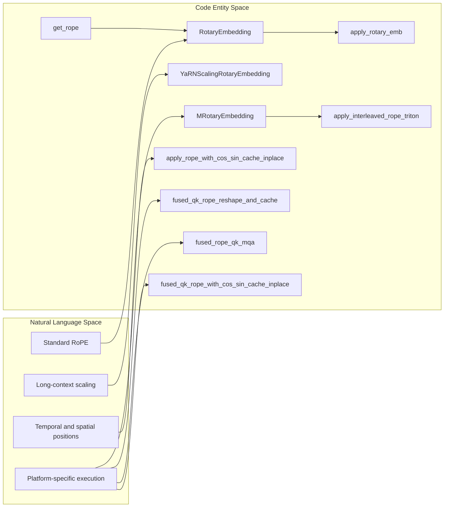
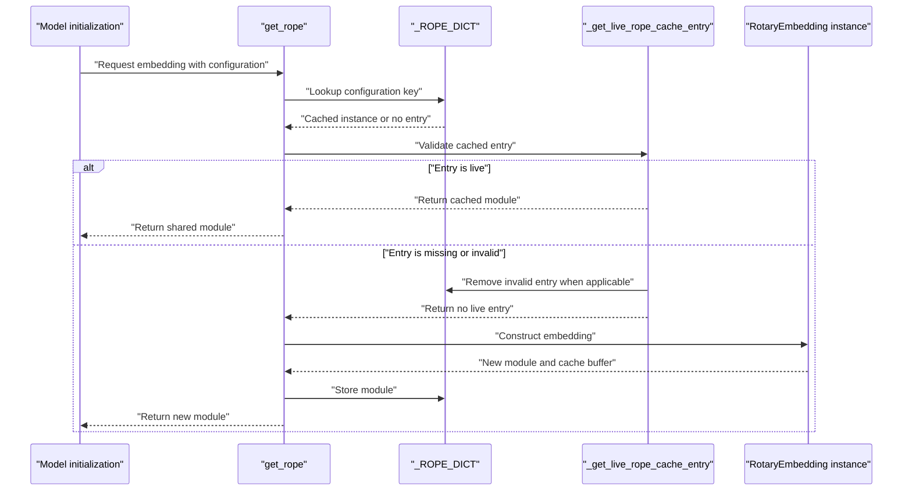

<!-- source: DeepWiki mcp.deepwiki.com · repo sgl-project/sglang · page 10.3 Positional Embeddings · fetched 2026-10-30 -->

# Positional Embeddings

Relevant source files

The following files were used as context for generating this wiki page:

- [python/sglang/srt/layers/rotary_embedding/base.py](python/sglang/srt/layers/rotary_embedding/base.py)
- [python/sglang/srt/layers/rotary_embedding/factory.py](python/sglang/srt/layers/rotary_embedding/factory.py)
- [python/sglang/srt/layers/rotary_embedding/mrope.py](python/sglang/srt/layers/rotary_embedding/mrope.py)
- [python/sglang/srt/layers/rotary_embedding/rope_variant.py](python/sglang/srt/layers/rotary_embedding/rope_variant.py)
- [python/sglang/srt/layers/rotary_embedding/yarn.py](python/sglang/srt/layers/rotary_embedding/yarn.py)
- [python/sglang/srt/utils/patch_tokenizer.py](python/sglang/srt/utils/patch_tokenizer.py)
- [test/registered/rotary/test_rope_cache_invalidation.py](test/registered/rotary/test_rope_cache_invalidation.py)
- [test/registered/unit/layers/test_rope_hip_fallback_cache_dtype.py](test/registered/unit/layers/test_rope_hip_fallback_cache_dtype.py)
- [test/registered/unit/layers/test_yarn_cache_extension.py](test/registered/unit/layers/test_yarn_cache_extension.py)
- [test/registered/unit/utils/test_patch_tokenizer.py](test/registered/unit/utils/test_patch_tokenizer.py)

## Purpose and scope

This page describes SGLang’s rotary positional embedding implementations: standard RoPE, YaRN scaling, multimodal RoPE (MRoPE), and additional variants exposed through the RoPE factory. It covers cache construction and reuse, position-to-cache data flow, and the hardware-specific paths visible in the provided implementation. [python/sglang/srt/layers/rotary_embedding/base.py:86-165]()

Sources: `[python/sglang/srt/layers/rotary_embedding/base.py:86-165]()` `[python/sglang/srt/layers/rotary_embedding/factory.py:11-30]()`

---

## 1. Overview

SGLang’s positional embedding code is organized around `RotaryEmbedding`, which precomputes cosine and sine values and stores them in a non-persistent `cos_sin_cache` buffer. Its constructor records the head and rotary dimensions, maximum position, frequency base, layout style, dtype, and position offset. It also sets up platform-dependent execution choices. [python/sglang/srt/layers/rotary_embedding/base.py:86-165]()

Specialized implementations extend the available behavior: `YaRNScalingRotaryEmbedding` changes frequency calculation and can extend its cache; `MRotaryEmbedding` assigns rotary lanes to temporal, height, and width axes; and `factory.py` imports multiple model- and scaling-specific variants for construction through `get_rope`. [python/sglang/srt/layers/rotary_embedding/yarn.py:91-180]() [python/sglang/srt/layers/rotary_embedding/mrope.py:60-172]() [python/sglang/srt/layers/rotary_embedding/factory.py:11-30]()

Sources: `[python/sglang/srt/layers/rotary_embedding/base.py:86-165]()` `[python/sglang/srt/layers/rotary_embedding/yarn.py:91-180]()` `[python/sglang/srt/layers/rotary_embedding/mrope.py:60-172]()` `[python/sglang/srt/layers/rotary_embedding/factory.py:11-30]()`

### Architecture: concepts mapped to code entities

This diagram connects positional-embedding concepts to the named classes, functions, and kernels present in the code. [python/sglang/srt/layers/rotary_embedding/base.py:86-165]() [python/sglang/srt/layers/rotary_embedding/mrope.py:60-172]() [python/sglang/srt/layers/rotary_embedding/yarn.py:91-180]() [python/sglang/srt/layers/rotary_embedding/factory.py:11-30]()

Sources: `[python/sglang/srt/layers/rotary_embedding/base.py:10-24]()` `[python/sglang/srt/layers/rotary_embedding/base.py:44-83]()` `[python/sglang/srt/layers/rotary_embedding/base.py:86-165]()` `[python/sglang/srt/layers/rotary_embedding/mrope.py:10-20]()` `[python/sglang/srt/layers/rotary_embedding/mrope.py:50-60]()` `[python/sglang/srt/layers/rotary_embedding/yarn.py:91-180]()` `[python/sglang/srt/layers/rotary_embedding/factory.py:11-30]()` `[python/sglang/srt/layers/rotary_embedding/factory.py:125-194]()`

### High-level data flow

`get_rope` accepts the embedding dimensions, position limit, frequency base, layout style, optional scaling configuration, dtype, partial rotary factor, and optional dual-chunk configuration. It normalizes list-valued configuration entries for use in its cache key, applies `partial_rotary_factor` to `rotary_dim` when below one, then checks the process-wide `_ROPE_DICT` before constructing an embedding. [python/sglang/srt/layers/rotary_embedding/factory.py:125-170]()

For standard RoPE, `RotaryEmbedding` computes its cache during initialization and registers it as a non-persistent buffer. The base class imports `apply_rotary_emb` as the wrapped implementation and chooses native or platform-specific paths according to platform and runtime conditions. [python/sglang/srt/layers/rotary_embedding/base.py:10-24]() [python/sglang/srt/layers/rotary_embedding/base.py:110-165]()

```mermaid
flowchart LR
    Request["Model requests positional embedding"]
    Factory["get_rope"]
    Key["Configuration cache key"]
    Cache["_ROPE_DICT"]
    Instance["RotaryEmbedding or selected variant"]
    CosSin["cos_sin_cache"]
    Apply["Rotary application path"]
    Output["Position-adjusted query and key"]

    Request --> Factory
    Factory --> Key
    Key --> Cache
    Cache -->|"live entry"| Instance
    Cache -->|"missing or invalid entry"| Instance
    Instance --> CosSin
    CosSin --> Apply
    Apply --> Output
```

Sources: `[python/sglang/srt/layers/rotary_embedding/factory.py:90-170]()` `[python/sglang/srt/layers/rotary_embedding/base.py:86-165]()`

---

## 2. Core Architecture and Class Hierarchy

`RotaryEmbedding` is defined as a `BaseFusedOp` subclass. Its constructor saves configuration fields, computes the cosine/sine cache, and registers that cache as a non-persistent buffer. The cache is kept in FP32 for CUDA, HIP, XPU, or when `SGLANG_ROPE_CACHE_FP32` is enabled; otherwise, it is converted to the requested dtype. [python/sglang/srt/layers/rotary_embedding/base.py:86-120]() [python/sglang/srt/layers/rotary_embedding/base.py:153-156]()

The constructor sets `use_fallback_kernel` and `fallback_rotary_embedding` under a platform- and head-size-dependent condition. It also sets `_supports_bf16_rope_store` only when several conditions hold, including CUDA, the exact `RotaryEmbedding` type, NeoX style, and no forced-native execution. The visible constructor sets `forward_native` as the selected method for forced-native execution or MUSA. [python/sglang/srt/layers/rotary_embedding/base.py:110-165]()

| Field or mechanism | Role |
|---|---|
| `head_size`, `rotary_dim` | Record head width and the portion of each head designated for rotary embedding. [python/sglang/srt/layers/rotary_embedding/base.py:92-109]() |
| `max_position_embeddings`, `base` | Configure the position range and frequency base used by the embedding. [python/sglang/srt/layers/rotary_embedding/base.py:92-109]() |
| `is_neox_style` | Select the rotary layout style stored by the instance. [python/sglang/srt/layers/rotary_embedding/base.py:92-109]() |
| `cos_sin_cache` | Non-persistent buffer populated from `_compute_cos_sin_cache()`. [python/sglang/srt/layers/rotary_embedding/base.py:115-120]() [python/sglang/srt/layers/rotary_embedding/base.py:153-156]() |
| `_apply_rotary_emb_wrapped` | Initially references `apply_rotary_emb`; the forced-native/MUSA path wraps it with `torch.compile`. [python/sglang/srt/layers/rotary_embedding/base.py:156-164]() |
| `_force_native` | Derived from runtime role and deterministic on-policy target state. [python/sglang/srt/layers/rotary_embedding/base.py:110-114]() |

Sources: `[python/sglang/srt/layers/rotary_embedding/base.py:86-165]()`

### Class and system mapping

`factory.py` imports the base, YaRN, MRoPE, and variant classes used by `get_rope`. The diagram distinguishes these code entities from the embedding concepts they represent; it does not imply that every imported variant has the same inheritance or dispatch behavior. [python/sglang/srt/layers/rotary_embedding/factory.py:11-30]()

```mermaid
flowchart TB
    subgraph Concepts["Natural Language Space"]
        Default["Default rotary embedding"]
        YaRNConcept["YaRN-scaled rotary embedding"]
        MRoPEConcept["Multimodal rotary embedding"]
        OtherVariants["Other scaling or model variants"]
    end

    subgraph Entities["Code Entity Space"]
        get_rope["factory.py:get_rope"]
        RotaryEmbedding["base.py:RotaryEmbedding"]
        YaRNScalingRotaryEmbedding["yarn.py:YaRNScalingRotaryEmbedding"]
        MRotaryEmbedding["mrope.py:MRotaryEmbedding"]
        LinearScalingRotaryEmbedding["base.py:LinearScalingRotaryEmbedding"]
        DeepseekScalingRotaryEmbedding["rope_variant.py:DeepseekScalingRotaryEmbedding"]
        DualChunkRotaryEmbedding["rope_variant.py:DualChunkRotaryEmbedding"]
        DynamicNTKScalingRotaryEmbedding["rope_variant.py:DynamicNTKScalingRotaryEmbedding"]
        Llama3RotaryEmbedding["rope_variant.py:Llama3RotaryEmbedding"]
        Phi3LongRoPEScaledRotaryEmbedding["rope_variant.py:Phi3LongRoPEScaledRotaryEmbedding"]
    end

    Default --> RotaryEmbedding
    YaRNConcept --> YaRNScalingRotaryEmbedding
    MRoPEConcept --> MRotaryEmbedding
    OtherVariants --> LinearScalingRotaryEmbedding
    OtherVariants --> DeepseekScalingRotaryEmbedding
    OtherVariants --> DualChunkRotaryEmbedding
    OtherVariants --> DynamicNTKScalingRotaryEmbedding
    OtherVariants --> Llama3RotaryEmbedding
    OtherVariants --> Phi3LongRoPEScaledRotaryEmbedding
    get_rope --> RotaryEmbedding
    get_rope --> YaRNScalingRotaryEmbedding
    get_rope --> MRotaryEmbedding
```

Sources: `[python/sglang/srt/layers/rotary_embedding/base.py:86-109]()` `[python/sglang/srt/layers/rotary_embedding/factory.py:11-30]()`

---

## 3. Positional Embedding Types

### 3.1. Rotary Positional Embeddings (RoPE)

`RotaryEmbedding` is the standard implementation. It computes the cache during initialization, registers it as a buffer, and keeps a reference to `apply_rotary_emb` for rotary application. The supplied code also shows CUDA, HIP, NPU, and XPU-specific imports or optional fast paths, alongside device-dependent fallback selection. [python/sglang/srt/layers/rotary_embedding/base.py:44-83]() [python/sglang/srt/layers/rotary_embedding/base.py:86-165]()

The constructor’s FP32 cache policy is platform-aware: CUDA, HIP, and XPU retain the computed cache dtype, while other platforms convert it to the requested dtype unless `SGLANG_ROPE_CACHE_FP32` is set. NPU’s optional `fused_rope_qk_mqa` import is caught; if unavailable, the module logs a warning and records `None` for that kernel. [python/sglang/srt/layers/rotary_embedding/base.py:47-67]() [python/sglang/srt/layers/rotary_embedding/base.py:115-120]()

Sources: `[python/sglang/srt/layers/rotary_embedding/base.py:44-83]()` `[python/sglang/srt/layers/rotary_embedding/base.py:86-165]()`

### 3.2. YaRN Scaling Rotary Embedding

`YaRNScalingRotaryEmbedding` extends `RotaryEmbedding`. Its constructor accepts a scaling factor, extrapolation and attention factors, `beta_fast`, `beta_slow`, truncation behavior, and optional magnitude-scaling parameters. It computes `mscale` from the supplied values or from `yarn_get_mscale_simple`, then passes the RoPE dimensions and layout to the base constructor. [python/sglang/srt/layers/rotary_embedding/yarn.py:91-135]()

The frequency calculation blends interpolation and extrapolation frequencies. `yarn_find_correction_range` determines the blend range, and `yarn_linear_ramp_mask` forms the interpolation mask used in that blend. `_ensure_cos_sin_cache_length` calls `_extend_yarn_cache`; the helper returns the existing cache unchanged when it already covers the requested position, otherwise it aligns the new length using `SGLANG_ROPE_CACHE_ALIGN` and appends newly computed rows. [python/sglang/srt/layers/rotary_embedding/yarn.py:14-51]() [python/sglang/srt/layers/rotary_embedding/yarn.py:66-88]() [python/sglang/srt/layers/rotary_embedding/yarn.py:137-180]()

| YaRN element | Implementation role |
|---|---|
| `yarn_find_correction_dim` and `yarn_find_correction_range` | Derive and clamp correction dimensions from rotation counts and embedding parameters. [python/sglang/srt/layers/rotary_embedding/yarn.py:14-40]() |
| `yarn_linear_ramp_mask` | Produces a clamped linear ramp for frequency blending. [python/sglang/srt/layers/rotary_embedding/yarn.py:43-51]() |
| `yarn_get_mscale_simple`, `yarn_get_mscale` | Compute magnitude-scaling values for scales above one. [python/sglang/srt/layers/rotary_embedding/yarn.py:54-63]() |
| `_extend_yarn_cache` | Extends the cache to an aligned length and returns appended, uncast rows for auxiliary use. [python/sglang/srt/layers/rotary_embedding/yarn.py:66-88]() |
| `_compute_inv_freq` | Blends interpolation and extrapolation inverse frequencies using the correction range and ramp mask. [python/sglang/srt/layers/rotary_embedding/yarn.py:137-161]() |

Sources: `[python/sglang/srt/layers/rotary_embedding/yarn.py:14-88]()` `[python/sglang/srt/layers/rotary_embedding/yarn.py:91-180]()`

### 3.3. Multimodal Rotary Embeddings (MRoPE)

`MRotaryEmbedding` subclasses `RotaryEmbedding` and accepts `mrope_section`, `mrope_interleaved`, and `mrope_interleaved_glm`. When sections are provided, their sum is checked against `rotary_dim // 2`; mismatches are corrected by rescaling the sections or distributing them across axes. [python/sglang/srt/layers/rotary_embedding/mrope.py:60-109]()

`_build_axis_map` maps each rotary pair to one of three axes. In GLM interleaved mode it assigns lanes cyclically while respecting each section’s capacity; in the other interleaved mode it assigns lanes by a stepped pattern; otherwise, it assigns contiguous ranges by section. The resulting `axis_map` is registered as a non-persistent buffer. [python/sglang/srt/layers/rotary_embedding/mrope.py:109-143]()

For one-dimensional positions, `get_cos_sin_with_position` delegates to the base implementation. For two-dimensional positions, it indexes `cos_sin_cache`, splits cosine and sine values, then rearranges sections. Interleaved MRoPE uses `apply_interleaved_rope_triton` when both prefill and decode backends support Triton; otherwise it uses `apply_interleaved_rope`. The resulting position cosine and sine tensors are repeated and reshaped for subsequent use. [python/sglang/srt/layers/rotary_embedding/mrope.py:145-172]()

`apply_interleaved_rope` clones the first position-axis tensor and replaces selected lanes with values from the second and third axis tensors. [python/sglang/srt/layers/rotary_embedding/mrope.py:53-57]()

Sources: `[python/sglang/srt/layers/rotary_embedding/mrope.py:53-172]()`

### 3.4. Other Rotary Embedding Variants

`factory.py` imports multiple alternatives, including `LinearScalingRotaryEmbedding`, `DeepseekScalingRotaryEmbedding`, `DualChunkRotaryEmbedding`, `DynamicNTKAlphaRotaryEmbedding`, `DynamicNTKScalingRotaryEmbedding`, `FourierRotaryEmbedding`, `Gemma4RotaryEmbedding`, `Llama3RotaryEmbedding`, and `Phi3LongRoPEScaledRotaryEmbedding`. The available factory excerpt shows that a non-`None` `dual_chunk_attention_config` selects `DualChunkRotaryEmbedding`, passing through `chunk_size` and `local_size` when present. [python/sglang/srt/layers/rotary_embedding/factory.py:11-30]() [python/sglang/srt/layers/rotary_embedding/factory.py:172-190]()

The visible `Phi3LongRoPEScaledRotaryEmbedding` implementation requires NeoX style and constructs separate short- and long-context caches from their respective factor lists. Its forward path selects positions from a concatenated cache and rotates the configured portion of query and key while preserving the remaining dimensions. [python/sglang/srt/layers/rotary_embedding/rope_variant.py:37-100]() [python/sglang/srt/layers/rotary_embedding/rope_variant.py:103-170]()

`FourierRotaryEmbedding` is identified in its class docstring as an extended Fourier rotary embedding; the provided excerpt shows its constructor parameters, including `fope_init_factor`, `fope_sep_head`, and `num_inv_freq`. [python/sglang/srt/layers/rotary_embedding/rope_variant.py:173-200]()

Sources: `[python/sglang/srt/layers/rotary_embedding/factory.py:11-30]()` `[python/sglang/srt/layers/rotary_embedding/factory.py:172-190]()` `[python/sglang/srt/layers/rotary_embedding/rope_variant.py:37-200]()`

---

## 4. Factory Interface and Cache Invalidation Lifecycle

`get_rope` accepts the principal RoPE parameters and optional scaling and dual-chunk configuration. It defaults `dtype` to PyTorch’s default dtype, converts list-valued configuration entries to tuples for the cache key, and scales `rotary_dim` when `partial_rotary_factor < 1.0`. The key includes head size, effective rotary dimension, maximum position, base, layout style, scaling configuration, dual-chunk configuration, and dtype. [python/sglang/srt/layers/rotary_embedding/factory.py:125-167]()

The process-wide `_ROPE_DICT` stores embedding instances. `_get_live_rope_cache_entry` returns no cached instance when the current construction is not on the meta device and a cached buffer is meta-backed or has zero-byte storage; it removes that entry so the factory can rebuild it. During a meta-device construction pass, a meta entry is retained for sharing. [python/sglang/srt/layers/rotary_embedding/factory.py:90-122]()

The visible `get_rope` excerpt first checks for a live cached entry. If none is returned, it constructs `DualChunkRotaryEmbedding` when a dual-chunk configuration is provided, or `RotaryEmbedding` when scaling is absent. [python/sglang/srt/layers/rotary_embedding/factory.py:168-190]()

### Cache lookup and recovery

Sources: `[python/sglang/srt/layers/rotary_embedding/factory.py:90-122]()` `[python/sglang/srt/layers/rotary_embedding/factory.py:125-190]()`

The cache invalidation tests verify rebuilding after a module is moved to the meta device or its cache storage is released. They also verify that live entries are shared and that intentionally created meta-device entries remain shared during meta construction. [test/registered/rotary/test_rope_cache_invalidation.py:23-77]()

Sources: `[test/registered/rotary/test_rope_cache_invalidation.py:23-77]()`

---

## 5. Hardware-Specific Integration and Optimization

`base.py` selects or imports platform-specific implementations at module load time. The NPU fused kernel is optional and falls back to the generic path when unavailable; the XPU fused kernel is also optional and emits a warning when it cannot be imported. HIP imports `fused_qk_rope_reshape_and_cache`, and CUDA imports `apply_rope_with_cos_sin_cache_inplace`. [python/sglang/srt/layers/rotary_embedding/base.py:34-83]()

| Platform or path | Code entity | Implementation evidence |
|---|---|---|
| CUDA | `apply_rope_with_cos_sin_cache_inplace` | Imported when `_is_cuda` is true. [python/sglang/srt/layers/rotary_embedding/base.py:44-45]() |
| HIP | `fused_qk_rope_reshape_and_cache` | Imported when `_is_hip` is true. [python/sglang/srt/layers/rotary_embedding/base.py:69-72]() |
| NPU | `fused_rope_qk_mqa` | Optional import; missing-kernel handling sets the symbol to `None` and logs a warning. [python/sglang/srt/layers/rotary_embedding/base.py:47-67]() |
| XPU | `fused_qk_rope_with_cos_sin_cache_inplace` | Optional import; missing-kernel handling sets the symbol to `None` and logs a warning. [python/sglang/srt/layers/rotary_embedding/base.py:74-83]() |
| MRoPE interleaving | `apply_interleaved_rope_triton` | Used when both prefill and decode backends support Triton; otherwise the Python `apply_interleaved_rope` path is used. [python/sglang/srt/layers/rotary_embedding/mrope.py:153-162]() |
| XPU MRoPE import | `multimodal_rotary_embedding` | Optional import in `mrope.py`. [python/sglang/srt/layers/rotary_embedding/mrope.py:44-48]() |

Sources: `[python/sglang/srt/layers/rotary_embedding/base.py:34-83]()` `[python/sglang/srt/layers/rotary_embedding/mrope.py:10-13]()` `[python/sglang/srt/layers/rotary_embedding/mrope.py:38-50]()` `[python/sglang/srt/layers/rotary_embedding/mrope.py:153-162]()`

---

## Summary Table of Positional Embedding Implementations

| Implementation | Role or visible behavior | Code reference |
|---|---|---|
| `RotaryEmbedding` | Base RoPE module with a cosine/sine cache and platform-dependent implementation setup. | [python/sglang/srt/layers/rotary_embedding/base.py:86-165]() |
| `LinearScalingRotaryEmbedding` | Imported by the factory as a scaling variant. | [python/sglang/srt/layers/rotary_embedding/factory.py:11-15]() |
| `YaRNScalingRotaryEmbedding` | YaRN frequency blending, magnitude scaling, and cache extension. | [python/sglang/srt/layers/rotary_embedding/yarn.py:91-180]() |
| `MRotaryEmbedding` | Multimodal sections and optional interleaved axis handling. | [python/sglang/srt/layers/rotary_embedding/mrope.py:60-172]() |
| `DeepseekScalingRotaryEmbedding` | Imported by the factory as a rotary variant. | [python/sglang/srt/layers/rotary_embedding/factory.py:20-29]() |
| `DualChunkRotaryEmbedding` | Selected when `dual_chunk_attention_config` is present in the visible `get_rope` branch. | [python/sglang/srt/layers/rotary_embedding/factory.py:172-190]() |
| `DynamicNTKAlphaRotaryEmbedding`, `DynamicNTKScalingRotaryEmbedding` | Imported by the factory as rotary variants. | [python/sglang/srt/layers/rotary_embedding/factory.py:20-29]() |
| `FourierRotaryEmbedding` | Fourier rotary variant; constructor parameters include Fourier-specific options. | [python/sglang/srt/layers/rotary_embedding/rope_variant.py:173-200]() |
| `Gemma4RotaryEmbedding`, `Llama3RotaryEmbedding` | Imported by the factory as rotary variants. | [python/sglang/srt/layers/rotary_embedding/factory.py:20-29]() |
| `Phi3LongRoPEScaledRotaryEmbedding` | Separate short- and long-context caches; NeoX layout is required. | [python/sglang/srt/layers/rotary_embedding/rope_variant.py:37-100]() [python/sglang/srt/layers/rotary_embedding/rope_variant.py:131-170]() |
| `get_rope` | Factory with configuration-keyed shared instances and invalid-entry checks. | [python/sglang/srt/layers/rotary_embedding/factory.py:90-170]() |

Sources: `[python/sglang/srt/layers/rotary_embedding/base.py:86-165]()` `[python/sglang/srt/layers/rotary_embedding/factory.py:11-30]()` `[python/sglang/srt/layers/rotary_embedding/factory.py:90-190]()` `[python/sglang/srt/layers/rotary_embedding/mrope.py:60-172]()` `[python/sglang/srt/layers/rotary_embedding/rope_variant.py:37-200]()` `[python/sglang/srt/layers/rotary_embedding/yarn.py:91-180]()`

---

