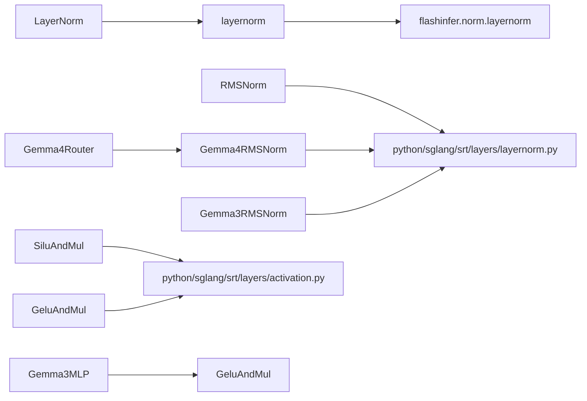
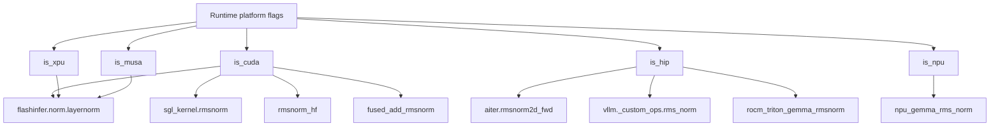
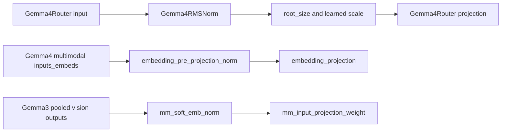
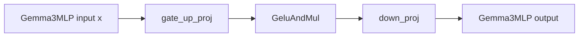
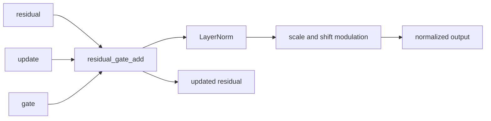

<!-- source: DeepWiki mcp.deepwiki.com · repo sgl-project/sglang · page 10.4 Normalization and Activation Layers · fetched 2026-10-30 -->

# Normalization and Activation Layers

Relevant source files

The following files were used as context for generating this wiki page:

- [python/sglang/kernels/ops/communication/all_reduce_mhc.py](python/sglang/kernels/ops/communication/all_reduce_mhc.py)
- [python/sglang/kernels/ops/layernorm/hc_combine_norm.py](python/sglang/kernels/ops/layernorm/hc_combine_norm.py)
- [python/sglang/kernels/ops/layernorm/mhc.py](python/sglang/kernels/ops/layernorm/mhc.py)
- [python/sglang/kernels/ops/layernorm/mhc_mega.py](python/sglang/kernels/ops/layernorm/mhc_mega.py)
- [python/sglang/srt/hardware_backend/npu/attention/ascend_backend.py](python/sglang/srt/hardware_backend/npu/attention/ascend_backend.py)
- [python/sglang/srt/hardware_backend/npu/graph_runner/eagle_draft_extend_npu_graph_runner.py](python/sglang/srt/hardware_backend/npu/graph_runner/eagle_draft_extend_npu_graph_runner.py)
- [python/sglang/srt/hardware_backend/npu/graph_runner/eagle_draft_npu_graph_runner.py](python/sglang/srt/hardware_backend/npu/graph_runner/eagle_draft_npu_graph_runner.py)
- [python/sglang/srt/hardware_backend/npu/graph_runner/npu_graph_runner.py](python/sglang/srt/hardware_backend/npu/graph_runner/npu_graph_runner.py)
- [python/sglang/srt/layers/attention/xpu_backend.py](python/sglang/srt/layers/attention/xpu_backend.py)
- [python/sglang/srt/layers/aux_hidden_states.py](python/sglang/srt/layers/aux_hidden_states.py)
- [python/sglang/srt/layers/layernorm.py](python/sglang/srt/layers/layernorm.py)
- [python/sglang/srt/models/deepseek_common/amd/deepseek_v2_hip_moe.py](python/sglang/srt/models/deepseek_common/amd/deepseek_v2_hip_moe.py)
- [python/sglang/srt/models/deepseek_v4_boundary.py](python/sglang/srt/models/deepseek_v4_boundary.py)
- [python/sglang/srt/models/deepseek_v4_mhc.py](python/sglang/srt/models/deepseek_v4_mhc.py)
- [python/sglang/srt/models/gemma3_causal.py](python/sglang/srt/models/gemma3_causal.py)
- [python/sglang/srt/models/gemma3_mm.py](python/sglang/srt/models/gemma3_mm.py)
- [python/sglang/srt/models/gemma4_causal.py](python/sglang/srt/models/gemma4_causal.py)
- [python/sglang/srt/models/gemma4_mm.py](python/sglang/srt/models/gemma4_mm.py)
- [python/sglang/srt/models/gemma4_mtp.py](python/sglang/srt/models/gemma4_mtp.py)
- [python/sglang/srt/models/gemma4_unified.py](python/sglang/srt/models/gemma4_unified.py)
- [python/sglang/srt/multimodal/processors/gemma4_unified.py](python/sglang/srt/multimodal/processors/gemma4_unified.py)
- [test/manual/ascend/llm_models/test_npu_glm_5_1_w4a8_draft_prefetch.py](test/manual/ascend/llm_models/test_npu_glm_5_1_w4a8_draft_prefetch.py)
- [test/registered/e2e/xpu/test_dflash_intel_xpu.py](test/registered/e2e/xpu/test_dflash_intel_xpu.py)
- [test/registered/e2e/xpu/test_spec_eagle_intel_xpu.py](test/registered/e2e/xpu/test_spec_eagle_intel_xpu.py)
- [test/registered/kernels/ops/gemm/test_minimax_fused_qkv_index_gemm.py](test/registered/kernels/ops/gemm/test_minimax_fused_qkv_index_gemm.py)
- [test/registered/kernels/ops/layernorm/test_mhc_aiter_hip.py](test/registered/kernels/ops/layernorm/test_mhc_aiter_hip.py)
- [test/registered/kernels/ops/layernorm/test_mhc_stream_mean.py](test/registered/kernels/ops/layernorm/test_mhc_stream_mean.py)
- [test/registered/spec/test_gemma4_dflash_31b_extra.py](test/registered/spec/test_gemma4_dflash_31b_extra.py)
- [test/registered/unit/layers/attention/test_encoder_decoder_varlen_gather.py](test/registered/unit/layers/attention/test_encoder_decoder_varlen_gather.py)
- [test/registered/unit/models/test_deepseek_v4_boundary.py](test/registered/unit/models/test_deepseek_v4_boundary.py)
- [test/registered/xpu/test_xpu_encoder_decoder_varlen.py](test/registered/xpu/test_xpu_encoder_decoder_varlen.py)
- [test/registered/xpu/test_xpu_gemma3_bidirectional_attn.py](test/registered/xpu/test_xpu_gemma3_bidirectional_attn.py)

## Purpose and scope

This page maps SGLang’s normalization and activation layer code to its roles in model execution. It covers the available implementation evidence for RMSNorm, LayerNorm, SiLU, GELU, and fused operations. The provided source excerpt for `layernorm.py` shows platform and kernel setup but not the later definitions of the normalization classes or their forward methods; details not visible in that excerpt are not inferred here. [python/sglang/srt/layers/layernorm.py:14-47]()

Sources: `[python/sglang/srt/layers/layernorm.py:14-47]()`

---

## Overview and architecture

`python/sglang/srt/layers/layernorm.py` prepares normalization implementations by detecting the runtime platform and importing available providers. The excerpt identifies CUDA, HIP, MUSA, NPU, CPU, and XPU, and conditionally imports FlashInfer, SGLang kernels, AITER, vLLM operators, and CUDA JIT kernels. [python/sglang/srt/layers/layernorm.py:49-57]()[python/sglang/srt/layers/layernorm.py:61-107]()[python/sglang/srt/layers/layernorm.py:111-177]()[python/sglang/srt/layers/layernorm.py:183-194]()

### Layer roles mapped to code entities

**Diagram 1 — Normalization and activation names mapped to model-layer code entities**

The Gemma model files import the named normalization and activation entities shown: `Gemma4Router` constructs `Gemma4RMSNorm`; `Gemma3MLP` constructs `GeluAndMul`; and Gemma3/Gemma4 model files import their corresponding RMSNorm classes. The `layernorm.py` excerpt defines a `layernorm` custom operation that calls `flashinfer.norm.layernorm` when that provider is available. [python/sglang/srt/models/gemma4_causal.py:27-47]()[python/sglang/srt/models/gemma4_causal.py:160-184]()[python/sglang/srt/models/gemma3_causal.py:31-33]()[python/sglang/srt/models/gemma3_causal.py:83-122]()[python/sglang/srt/layers/layernorm.py:61-87]()

Sources: `[python/sglang/srt/layers/layernorm.py:61-87]()` `[python/sglang/srt/models/gemma3_causal.py:31-33]()` `[python/sglang/srt/models/gemma3_causal.py:83-122]()` `[python/sglang/srt/models/gemma4_causal.py:27-47]()` `[python/sglang/srt/models/gemma4_causal.py:160-184]()`

### Platform dispatch and provider setup

At module import, `layernorm.py` evaluates platform predicates and stores their results in module-level flags. On CUDA, XPU, or MUSA, it attempts to register a FlashInfer-backed `layernorm` custom operation when FlashInfer is available. It separately checks for FlashInfer RMSNorm quantization operations. The shown code also imports `sgl_kernel` RMSNorm and fused-add RMSNorm operations in that platform branch. [python/sglang/srt/layers/layernorm.py:49-107]()

For HIP, the module may select AITER operators when `SGLANG_USE_AITER` is enabled, or try vLLM RMSNorm operators otherwise. A separate HIP import check enables Gemma-specific Triton RMSNorm operations when available. On CUDA, it attempts to import an HF-semantics RMSNorm JIT kernel and a JIT fused-add RMSNorm kernel. On NPU, it imports `torch_npu` and resolves `npu_gemma_rms_norm` through `sgl-kernel-npu` when possible, with a `torch_npu` fallback in the shown code. [python/sglang/srt/layers/layernorm.py:108-148]()[python/sglang/srt/layers/layernorm.py:150-177]()[python/sglang/srt/layers/layernorm.py:183-194]()

**Diagram 2 — Platform setup bridged to normalization provider symbols**

The diagram represents import/setup paths visible in `layernorm.py`, not a claim that every provider is active on every device. FlashInfer setup is conditional on both platform membership and availability; AITER use is conditional on HIP and the environment setting; and the NPU Gemma provider has an explicit fallback. [python/sglang/srt/layers/layernorm.py:49-107]()[python/sglang/srt/layers/layernorm.py:108-148]()[python/sglang/srt/layers/layernorm.py:183-194]()

Sources: `[python/sglang/srt/layers/layernorm.py:49-107]()` `[python/sglang/srt/layers/layernorm.py:108-148]()` `[python/sglang/srt/layers/layernorm.py:183-194]()`

---

## RMSNorm (Root Mean Square Normalization)

The available `layernorm.py` excerpt exposes RMSNorm provider setup rather than the `RMSNorm` class implementation. It imports `rmsnorm`, `gemma_rmsnorm`, and `fused_add_rmsnorm` from `sgl_kernel` in the CUDA/XPU/MUSA branch. The excerpt also shows provider alternatives for HIP and an NPU Gemma RMSNorm entry point. [python/sglang/srt/layers/layernorm.py:61-107]()[python/sglang/srt/layers/layernorm.py:111-148]()[python/sglang/srt/layers/layernorm.py:183-194]()

The CUDA setup includes an optional JIT kernel named `rmsnorm_hf`. Its adjacent comment describes the relevant numerical distinction: in the Transformers backend path, when `cast_x_before_out_mul=True`, the cast from FP32 to the activation dtype happens before the weight multiplication, so multiplication occurs in the narrower dtype to match Hugging Face `LlamaRMSNorm` semantics. The excerpt shows the import and availability flag, but not the class or call site that selects this option. [python/sglang/srt/layers/layernorm.py:150-170]()

The module imports `is_batch_invariant_mode_enabled` and `rms_norm_batch_invariant`, but the shown lines do not establish where or under what conditions the latter is called. [python/sglang/srt/layers/layernorm.py:24-28]()

### RMSNorm use in model code

`Gemma4Router` creates a `Gemma4RMSNorm` with `with_scale=False`, then defines a learned per-dimension `scale` and a non-persistent `root_size` buffer. Its docstring states that the router preprocessing applies to the router input, not to expert MLP inputs. [python/sglang/srt/models/gemma4_causal.py:160-194]()

`Gemma4MultimodalEmbedder` uses `Gemma4RMSNorm` to normalize multimodal tower embeddings before applying `embedding_projection`. The forward method calls the normalization first, then the projection. [python/sglang/srt/models/gemma4_mm.py:92-135]()

`Gemma3MultiModalProjector` applies `Gemma3RMSNorm` to pooled vision outputs before multiplying by the multimodal input projection weight. [python/sglang/srt/models/gemma3_mm.py:64-78]()[python/sglang/srt/models/gemma3_mm.py:89-113]()

**Diagram 3 — RMSNorm model data paths**

These paths show normalization followed by scaling or projection in the cited model implementations. They are model-level data flows; the provided excerpt does not expose the internal arithmetic of the RMSNorm classes themselves. [python/sglang/srt/models/gemma4_causal.py:160-194]()[python/sglang/srt/models/gemma4_mm.py:122-135]()[python/sglang/srt/models/gemma3_mm.py:89-113]()

Sources: `[python/sglang/srt/layers/layernorm.py:24-28]()` `[python/sglang/srt/layers/layernorm.py:61-107]()` `[python/sglang/srt/layers/layernorm.py:111-148]()` `[python/sglang/srt/layers/layernorm.py:150-170]()` `[python/sglang/srt/layers/layernorm.py:183-194]()` `[python/sglang/srt/models/gemma3_mm.py:64-78]()` `[python/sglang/srt/models/gemma3_mm.py:89-113]()` `[python/sglang/srt/models/gemma4_causal.py:160-194]()` `[python/sglang/srt/models/gemma4_mm.py:92-135]()`

---

## LayerNorm

In the shown portion of `layernorm.py`, FlashInfer LayerNorm is exposed as a custom operation named `layernorm`. A fake implementation returns an empty tensor with the same shape as the input; the registered operation delegates to `flashinfer.norm.layernorm(input, gamma, beta, eps)`. Registration is attempted only in the CUDA, XPU, or MUSA branch when FlashInfer is available, and the availability flag is cleared if the import or attribute lookup fails. [python/sglang/srt/layers/layernorm.py:61-87]()

The supplied excerpt does not show the `LayerNorm` class, any native fallback implementation, or the call sites that choose between providers. Therefore this page does not specify fallback behavior or claim which model families use this operation.

Sources: `[python/sglang/srt/layers/layernorm.py:61-87]()`

---

## Activation functions

The supplied excerpts show a concrete GELU-gated MLP path in `Gemma3MLP`. They do not include `python/sglang/srt/layers/activation.py`, so the activation module’s class definitions, SiLU implementation, platform dispatch, and backend kernels cannot be verified from the available code. The following subsections distinguish the model-level GELU evidence from details not shown in the excerpt.

Sources: `[python/sglang/srt/models/gemma3_causal.py:83-122]()`

### SiluAndMul (SwiGLU activation)

The provided code excerpts do not show the definition or a model call site for `SiluAndMul`. Its implementation details, dispatch behavior, and platform support are therefore not specified here.

Sources: No supplied file excerpt contains the `SiluAndMul` definition or call site.

### GeluAndMul (GeGLU activation)

`Gemma3MLP` constructs `GeluAndMul` after validating that `hidden_activation` is `"gelu_pytorch_tanh"`. In `forward`, it runs `gate_up_proj`, passes the projection output through `act_fn`, and then passes the result to `down_proj`. The supplied lines establish this model-level ordering but do not include the `GeluAndMul` implementation or its kernel dispatch. [python/sglang/srt/models/gemma3_causal.py:83-122]()

**Diagram 4 — Gemma3 MLP activation path**

`Gemma3MLP.forward` invokes the projection, activation, and down-projection in that sequence. [python/sglang/srt/models/gemma3_causal.py:118-122]()

Sources: `[python/sglang/srt/models/gemma3_causal.py:83-122]()`

---

## Fused operations

### Normalization kernel fusion and provider variants

The `layernorm.py` setup imports `fused_add_rmsnorm` from `sgl_kernel` in its CUDA/XPU/MUSA branch. HIP may use AITER’s `rmsnorm2d_fwd_with_add` under the AITER path, or vLLM’s `fused_add_rms_norm` when the AITER branch is not selected and that import succeeds. CUDA setup also imports a JIT fused-add RMSNorm implementation and a hidden-size support predicate. These are provider imports; the supplied excerpt does not show the later dispatch logic or the precise input/output contract of each function. [python/sglang/srt/layers/layernorm.py:102-107]()[python/sglang/srt/layers/layernorm.py:111-135]()[python/sglang/srt/layers/layernorm.py:128-135]()[python/sglang/srt/layers/layernorm.py:172-177]()

### Fused normalization in Gemma4

`gemma4_causal.py` imports `gemma_dual_rmsnorm_residual_scalar`, `gemma_qkv_rmsnorm`, and `gemma_rmsnorm_residual_scalar` from `gemma4_fused_ops`. The excerpt confirms that these operations are imported by the model file but does not show their call sites or define their numerical behavior. [python/sglang/srt/models/gemma4_causal.py:27-30]()

### Fused normalization and modulation in diffusion

The XPU diffusion test exercises `xpu_layernorm_modulate` and `xpu_gated_resnorm`. It defines expected results using PyTorch LayerNorm followed by modulation, and, for gated residual normalization, first computes `residual_gate_add`. The tests assert exact equality for the supported test cases and check that unsupported FP16 or strided inputs remain on the eager residual-add path. [test/registered/kernels/ops/diffusion/test_flux2_xpu_norm_fusions.py:87-112]()[test/registered/kernels/ops/diffusion/test_flux2_xpu_norm_fusions.py:135-149]()

**Diagram 5 — XPU diffusion normalization fusion as tested**

The test’s expected path computes the gated residual first, then LayerNorm, then modulation; the fused path returns both the modulated output and updated residual and is checked against those expected values. [test/registered/kernels/ops/diffusion/test_flux2_xpu_norm_fusions.py:102-112]()

Sources: `[python/sglang/srt/layers/layernorm.py:102-107]()` `[python/sglang/srt/layers/layernorm.py:111-135]()` `[python/sglang/srt/layers/layernorm.py:172-177]()` `[python/sglang/srt/models/gemma4_causal.py:27-30]()` `[test/registered/kernels/ops/diffusion/test_flux2_xpu_norm_fusions.py:87-112]()` `[test/registered/kernels/ops/diffusion/test_flux2_xpu_norm_fusions.py:135-149]()`

---

## Summary table: normalization and activation layers

| Operation or entity | Evidence available in the supplied excerpts | Code pointer |
|---|---|---|
| `RMSNorm` providers | `sgl_kernel` RMSNorm imports; optional HIP, CUDA, and NPU provider setup | `[python/sglang/srt/layers/layernorm.py:102-107]()` `[python/sglang/srt/layers/layernorm.py:111-148]()` `[python/sglang/srt/layers/layernorm.py:150-170]()` `[python/sglang/srt/layers/layernorm.py:183-194]()` |
| `Gemma4RMSNorm` | Used in the Gemma4 router and multimodal embedder | `[python/sglang/srt/models/gemma4_causal.py:160-194]()` `[python/sglang/srt/models/gemma4_mm.py:122-135]()` |
| `Gemma3RMSNorm` | Used by the Gemma3 multimodal projector | `[python/sglang/srt/models/gemma3_mm.py:64-78]()` |
| FlashInfer `layernorm` custom op | Registered operation delegates to `flashinfer.norm.layernorm` | `[python/sglang/srt/layers/layernorm.py:61-87]()` |
| `SiluAndMul` | Definition and call sites are not present in the supplied excerpts | No supplied source excerpt |
| `GeluAndMul` | Invoked by `Gemma3MLP` between `gate_up_proj` and `down_proj` | `[python/sglang/srt/models/gemma3_causal.py:83-122]()` |
| Fused add + RMSNorm providers | Imports for SGLang, AITER, vLLM, and CUDA JIT variants are visible; later dispatch is not shown | `[python/sglang/srt/layers/layernorm.py:102-107]()` `[python/sglang/srt/layers/layernorm.py:111-135]()` `[python/sglang/srt/layers/layernorm.py:172-177]()` |
| XPU LayerNorm/modulation fusion | Tests compare fused operations to the explicit LayerNorm/modulation and gated-residual paths | `[test/registered/kernels/ops/diffusion/test_flux2_xpu_norm_fusions.py:87-112]()` |

Sources: `[python/sglang/srt/layers/layernorm.py:61-107]()` `[python/sglang/srt/layers/layernorm.py:111-177]()` `[python/sglang/srt/layers/layernorm.py:183-194]()` `[python/sglang/srt/models/gemma3_causal.py:83-122]()` `[python/sglang/srt/models/gemma3_mm.py:64-78]()` `[python/sglang/srt/models/gemma4_causal.py:160-194]()` `[python/sglang/srt/models/gemma4_mm.py:122-135]()` `[test/registered/kernels/ops/diffusion/test_flux2_xpu_norm_fusions.py:87-112]()`

---

