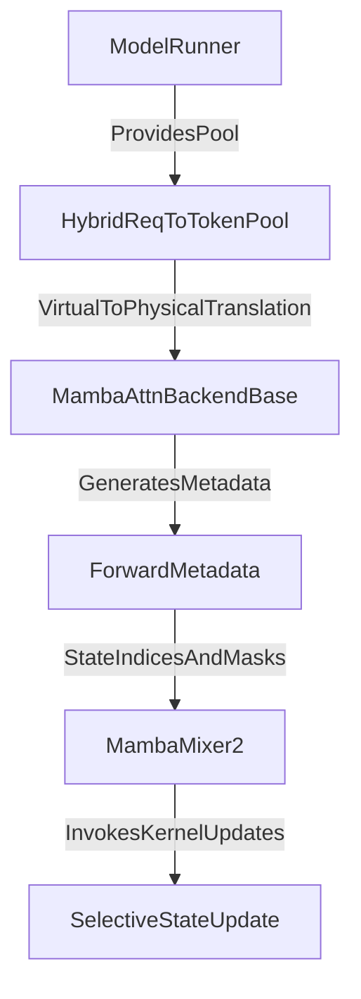
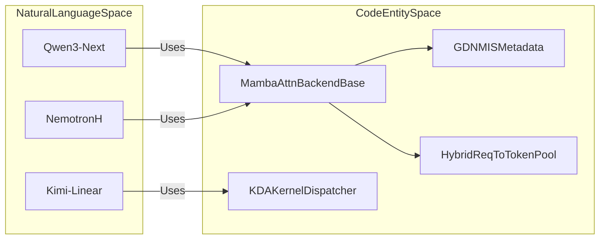
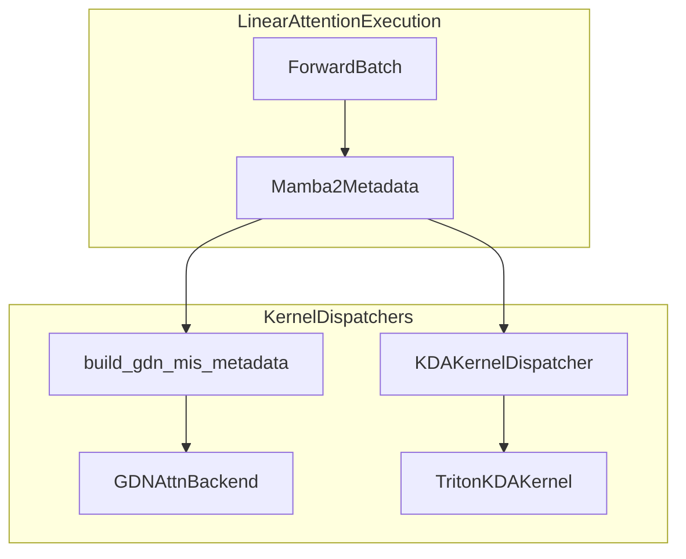

<!-- source: DeepWiki mcp.deepwiki.com · repo sgl-project/sglang · page 10.6 Hybrid and Linear Attention Models · fetched 2026-10-30 -->

# Hybrid and Linear Attention Models

Relevant source files

The following files were used as context for generating this wiki page:

- [python/sglang/kernels/kda_kernels/README.md](python/sglang/kernels/kda_kernels/README.md)
- [python/sglang/kernels/kda_kernels/csrc/attention/kda_decode_gfx950.cu](python/sglang/kernels/kda_kernels/csrc/attention/kda_decode_gfx950.cu)
- [python/sglang/kernels/kda_kernels/csrc/attention/kda_prefill_gfx950.cu](python/sglang/kernels/kda_kernels/csrc/attention/kda_prefill_gfx950.cu)
- [python/sglang/kernels/kda_kernels/kda_decode_gfx950.py](python/sglang/kernels/kda_kernels/kda_decode_gfx950.py)
- [python/sglang/kernels/kda_kernels/kda_prefill_gfx950.py](python/sglang/kernels/kda_kernels/kda_prefill_gfx950.py)
- [python/sglang/kernels/ops/attention/__init__.py](python/sglang/kernels/ops/attention/__init__.py)
- [python/sglang/kernels/ops/attention/fla/kda.py](python/sglang/kernels/ops/attention/fla/kda.py)
- [python/sglang/kernels/ops/attention/kda_fused_decode_gfx950.py](python/sglang/kernels/ops/attention/kda_fused_decode_gfx950.py)
- [python/sglang/kernels/ops/attention/linear/kda_gfx950_prefill.py](python/sglang/kernels/ops/attention/linear/kda_gfx950_prefill.py)
- [python/sglang/srt/layers/attention/base_attn_backend.py](python/sglang/srt/layers/attention/base_attn_backend.py)
- [python/sglang/srt/layers/attention/hybrid_attn_backend.py](python/sglang/srt/layers/attention/hybrid_attn_backend.py)
- [python/sglang/srt/layers/attention/hybrid_linear_attn_backend.py](python/sglang/srt/layers/attention/hybrid_linear_attn_backend.py)
- [python/sglang/srt/layers/attention/linear/gdn_backend.py](python/sglang/srt/layers/attention/linear/gdn_backend.py)
- [python/sglang/srt/layers/attention/linear/kda_backend.py](python/sglang/srt/layers/attention/linear/kda_backend.py)
- [python/sglang/srt/layers/attention/linear/kernels/gdn_flashinfer.py](python/sglang/srt/layers/attention/linear/kernels/gdn_flashinfer.py)
- [python/sglang/srt/layers/attention/linear/kernels/kda_flashkda.py](python/sglang/srt/layers/attention/linear/kernels/kda_flashkda.py)
- [python/sglang/srt/layers/attention/linear/kernels/kda_triton.py](python/sglang/srt/layers/attention/linear/kernels/kda_triton.py)
- [python/sglang/srt/layers/attention/linear/kernels/kernel_backend.py](python/sglang/srt/layers/attention/linear/kernels/kernel_backend.py)
- [python/sglang/srt/layers/attention/linear/utils.py](python/sglang/srt/layers/attention/linear/utils.py)
- [python/sglang/srt/layers/attention/mamba/mamba.py](python/sglang/srt/layers/attention/mamba/mamba.py)
- [python/sglang/srt/layers/attention/mamba/mamba2_metadata.py](python/sglang/srt/layers/attention/mamba/mamba2_metadata.py)
- [python/sglang/srt/layers/attention/mamba/mixer2_rms_norm_gated.py](python/sglang/srt/layers/attention/mamba/mixer2_rms_norm_gated.py)
- [python/sglang/srt/layers/attention/tbo_backend.py](python/sglang/srt/layers/attention/tbo_backend.py)
- [python/sglang/srt/models/nemotron_h.py](python/sglang/srt/models/nemotron_h.py)
- [python/sglang/srt/models/nemotron_h_mtp.py](python/sglang/srt/models/nemotron_h_mtp.py)
- [python/sglang/srt/models/nemotron_h_utils.py](python/sglang/srt/models/nemotron_h_utils.py)
- [test/manual/4-gpu-models/test_qwen35_fp4_triton.py](test/manual/4-gpu-models/test_qwen35_fp4_triton.py)
- [test/registered/attention/test_kda_prefill_flashkda.py](test/registered/attention/test_kda_prefill_flashkda.py)
- [test/registered/attention/unittests/kda/README.md](test/registered/attention/unittests/kda/README.md)
- [test/registered/kernels/ops/attention/test_kda_fused_decode_gfx950.py](test/registered/kernels/ops/attention/test_kda_fused_decode_gfx950.py)
- [test/registered/kernels/ops/attention/test_kda_gate_beta_cumsum.py](test/registered/kernels/ops/attention/test_kda_gate_beta_cumsum.py)
- [test/registered/kernels/ops/attention/test_kda_gfx950_prefill.py](test/registered/kernels/ops/attention/test_kda_gfx950_prefill.py)
- [test/registered/unit/layers/attention/test_gdn_prefill_backend_policy.py](test/registered/unit/layers/attention/test_gdn_prefill_backend_policy.py)
- [test/registered/unit/layers/attention/test_linear_attn_config.py](test/registered/unit/layers/attention/test_linear_attn_config.py)
- [test/registered/unit/layers/test_mamba2_track_ssm_indices.py](test/registered/unit/layers/test_mamba2_track_ssm_indices.py)
- [test/registered/unit/server_args/test_page_major_backend_allowlist.py](test/registered/unit/server_args/test_page_major_backend_allowlist.py)

This page documents hybrid attention backends, linear attention mechanisms (such as Mamba, GDN, FLA, KDA, and Lightning), and model architectures like Qwen3-Next, NemotronH, and Kimi-Linear supported within SGLang [python/sglang/srt/layers/attention/hybrid_linear_attn_backend.py:49-110](), [python/sglang/srt/layers/radix_linear_attention.py:38-42]().

Sources: [python/sglang/srt/layers/attention/hybrid_linear_attn_backend.py:49-110](), [python/sglang/srt/layers/radix_linear_attention.py:38-42]()

---

## Overview and Purpose

This section details SGLang’s modular design around hybrid and linear attention backends, providing:

- **Hybrid Backends**: Unified implementations combining standard softmax attention (`RadixAttention`) with linear or SSM-based layers, primarily managed by `MambaAttnBackendBase` [python/sglang/srt/layers/attention/hybrid_linear_attn_backend.py:32-49]().

- **Linear Attention Backends**: Implementations such as Gated DeltaNet (GDN), Kernel Delta Attention (KDA), Flash Linear Attention (FLA) primitives, Lightning attention configs, and Mamba2-style state-space models, all orchestrated via the `LinearAttnBackends` enum and kernel backends [python/sglang/srt/layers/attention/linear/utils.py:16-18]().

- **Model Implementations**: Hybrid and linear attention models like Qwen3-Next, Kimi-Linear, and NemotronH that leverage these backends for scalable, efficient attention on long sequences [python/sglang/srt/layers/attention/mamba/mamba.py:83-92](), [python/sglang/srt/models/nemotron_h.py:18-38]().

- **Kernel Dispatch and State Handling**: Usage of kernel dispatchers like `KDAKernelDispatcher`, FlashInfer kernels, Mamba metadata (`ForwardMetadata`, `Mamba2Metadata`), and memory pooling abstractions [python/sglang/srt/layers/attention/mamba/mamba2_metadata.py:28-86](), [python/sglang/srt/layers/attention/linear/kda_backend.py:99-166]().

- **Performance Optimizations**: Techniques such as Breakable CUDA Graphs, piecewise graph capture, and tightly fused kernels to accelerate linear and hybrid attention [python/sglang/srt/layers/attention/linear/gdn_backend.py:6-50](), [python/sglang/srt/layers/attention/linear/kda_backend.py:47-101]().

Sources: [python/sglang/srt/layers/attention/hybrid_linear_attn_backend.py:32-155](), [python/sglang/srt/layers/attention/linear/utils.py:16-18](), [python/sglang/srt/layers/attention/mamba/mamba2_metadata.py:28-86](), [python/sglang/srt/models/nemotron_h.py:18-38]()

---

## Hybrid Attention Backend

The **hybrid attention backend** integrates standard softmax attention with linear state-space mechanisms for models requiring both precision and efficiency on long sequences. At its core, the `MambaAttnBackendBase` class orchestrates this unified hybrid attention:

- **Pooling and Index Translation:** It relies on the `HybridReqToTokenPool` for managing request-to-token mappings specialized for hybrid use, including support for virtual-to-physical slot ID translation (`_translate_mamba_indices`) to manage fused replay states and convolutional states used by the Mamba kernels [python/sglang/srt/layers/attention/hybrid_linear_attn_backend.py:53-124]().

- **State Tracking and Metadata:** The backend maintains `ForwardMetadata` to track replay indices, track masks, convolution states, and fused accept states for breakable CUDA graph optimizations during decode and extend passes [python/sglang/srt/layers/attention/hybrid_linear_attn_backend.py:121-155]().

- **Multi-Item Scoring (MIS) Support:** Hybrid backends explicitly declare support for MIS (multi-item scoring), ensuring that decode and prefill phases have compatible attention kernels and coherent state management [python/sglang/srt/layers/attention/hybrid_linear_attn_backend.py:53-64]().

### Key Classes and Data Flow

Title: "Hybrid Attention and Metadata Flow"

Sources: [python/sglang/srt/layers/attention/hybrid_linear_attn_backend.py:49-110](), [python/sglang/srt/layers/attention/mamba/mamba.py:7-10](), [python/sglang/srt/layers/attention/mamba/mamba2_metadata.py:28-86]()

---

## Linear Attention Backends

SGLang supports several state-of-the-art **linear attention backends**, including Gated Delta Network (GDN), Kernel Delta Attention (KDA), Flash Linear Attention (FLA), and Lightning attention.

### Gated Delta Network (GDN) and FLA Integration
- Implements recurrent linear attention models using fused gating and delta state updates via custom Triton and FlashInfer kernels, utilizing Flash Linear Attention (FLA) primitives (`fused_gdn_gating`, chunk delta kernels) [python/sglang/srt/layers/attention/linear/gdn_backend.py:6-14]().
- Uses a specialized `GDNMISMetadata` structure carrying request-local token segmentations for multi-item scoring [python/sglang/srt/layers/attention/linear/gdn_backend.py:56-151]().
- Supports fused projections and decode/prefill fusion with operators like `fused_qkvzba_causal_conv1d_update_contiguous`.
- Maintains compatibility with gated delta kernels on SM90 (Hopper) and SM100 (Blackwell) NVIDIA architectures, with fallbacks for HIP platforms [python/sglang/srt/layers/attention/linear/gdn_backend.py:6-50]().

### Kernel Delta Attention (KDA)
- Implements delta-rule-based recurrent attention with fused updates across prefill, decode, and verify phases [python/sglang/srt/layers/attention/linear/kda_backend.py:47-101]().
- The central dispatcher `KDAKernelDispatcher` selects the appropriate kernel backend (`TritonKDAKernel`, `HelionKDAKernel`, `CuteDSLKDAKernel`, `FlashInferKDAKernel`) based on hardware, phase, and flags [python/sglang/srt/layers/attention/linear/kda_backend.py:99-166]().
- Supports packed decode with replay state scatter, fused accept state plan, and multi-item scoring with fused windows [python/sglang/srt/layers/attention/linear/kda_backend.py:12-28]().
- Advanced verification kernels and fallback paths manage replay correctness and enable breakable CUDA graph support [python/sglang/srt/layers/attention/linear/kda_backend.py:47-146]().

Sources: [python/sglang/srt/layers/attention/linear/gdn_backend.py:6-151](), [python/sglang/srt/layers/attention/linear/kda_backend.py:47-166]()

---

## State and Memory Management

Efficient state management is essential for linear and hybrid attention. SGLang provides:

- **MambaPool & BaseLinearStateParams:** Manage fixed-size convolutional and SSM states per request, including pre-calculated byte sizes for convolution and temporal state tensors, critical for efficient memory allocation [python/sglang/srt/configs/mamba_utils.py:111-166]().

- **ForwardMetadata & Mamba2Metadata:** Structures that hold all transient metadata needed during forward and decode passes, including replay indices, forced flush flags for replay SSM, fused accept buffers for KDA, and multi-item speculation tokens [python/sglang/srt/layers/attention/mamba/mamba2_metadata.py:28-86]().

- **Verify Intermediate State Indices:** Functions such as `build_verify_intermediate_state_indices` maintain stable row mappings into speculative intermediate scratch buffers used during multi-step verification of speculative decoding in linear backends [python/sglang/srt/layers/attention/linear/utils.py:19-27]().

Sources: [python/sglang/srt/configs/mamba_utils.py:111-166](), [python/sglang/srt/layers/attention/mamba/mamba2_metadata.py:28-86](), [python/sglang/srt/layers/attention/linear/utils.py:19-27]()

---

## Model Implementations Leveraging Hybrid and Linear Attention

SGLang hosts multiple models that fully exploit these architectures:

- **Qwen3-Next:** A hybrid multi-head mixture-of-experts model using gated delta mechanics and sharded projection loaders (`mamba_v2_sharded_weight_loader`) for tensor parallelism with precise head shard grouping [python/sglang/srt/layers/attention/mamba/mamba.py:83-138]().

- **NemotronH:** Hybrid architecture combining standard attention, Mamba layers, and MoE blocks with advanced CUDA graph capture and stream overlaps [python/sglang/srt/models/nemotron_h.py:18-112](), [python/sglang/srt/models/nemotron_h_mtp.py:45-124]().

- **Radix Linear Attention Wrapper:** Provides a unified interface (`RadixLinearAttention`) that manages data flow across linear attention backends, enabling dynamic sequence extensions, breakable CUDA graph capture, and integration with speculative decoding [python/sglang/srt/layers/radix_linear_attention.py:38-148]().

Sources: [python/sglang/srt/layers/attention/mamba/mamba.py:83-138](), [python/sglang/srt/models/nemotron_h.py:18-112](), [python/sglang/srt/models/nemotron_h_mtp.py:45-124](), [python/sglang/srt/layers/radix_linear_attention.py:38-148]()

---

## Architecture to Code Entity Mapping Diagrams

### Diagram 1: Hybrid Models and Attention Backend Routing

Title: "Hybrid Models and Attention Backend Routing"

Sources: [python/sglang/srt/layers/attention/hybrid_linear_attn_backend.py:49-80](), [python/sglang/srt/layers/attention/linear/gdn_backend.py:54-64](), [python/sglang/srt/layers/attention/linear/kda_backend.py:47-101]()

---

### Diagram 2: Kernel Dispatch and Execution Pipeline

Title: "Kernel Dispatch and Execution Pipeline"

Sources: [python/sglang/srt/layers/attention/linear/gdn_backend.py:54-64](), [python/sglang/srt/layers/attention/linear/kda_backend.py:47-134](), [python/sglang/srt/layers/attention/mamba/mamba2_metadata.py:28-86]()

---

# Summary

This page documents the sophisticated hybrid and linear attention models in SGLang. The hybrid backends unify softmax and linear/SSM mechanisms for efficient long-context support, notably in Mamba, GDN, and KDA architectures. Linear attention backends such as GDN, KDA, and FLA-backed operations provide specialized recurrent kernels optimized for various platforms. Models like Qwen3-Next, NemotronH, and Kimi-Linear leverage these backends for scalable and performant deployments.

Sources:
- [python/sglang/srt/layers/attention/hybrid_linear_attn_backend.py]()
- [python/sglang/srt/layers/attention/linear/gdn_backend.py]()
- [python/sglang/srt/layers/attention/linear/kda_backend.py]()
- [python/sglang/srt/layers/attention/mamba/mamba.py]()
- [python/sglang/srt/layers/attention/mamba/mamba2_metadata.py]()
- [python/sglang/srt/layers/attention/linear/utils.py]()
- [python/sglang/srt/layers/radix_linear_attention.py]()
- [python/sglang/srt/models/nemotron_h.py]()

---

