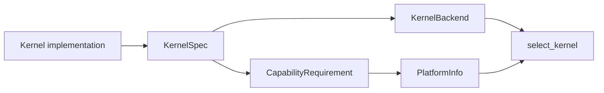
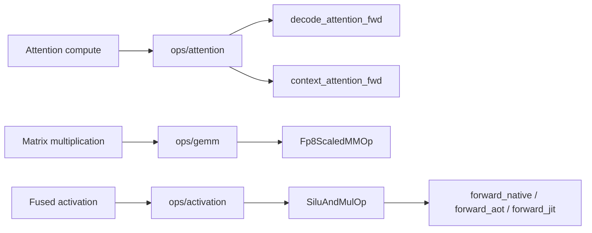
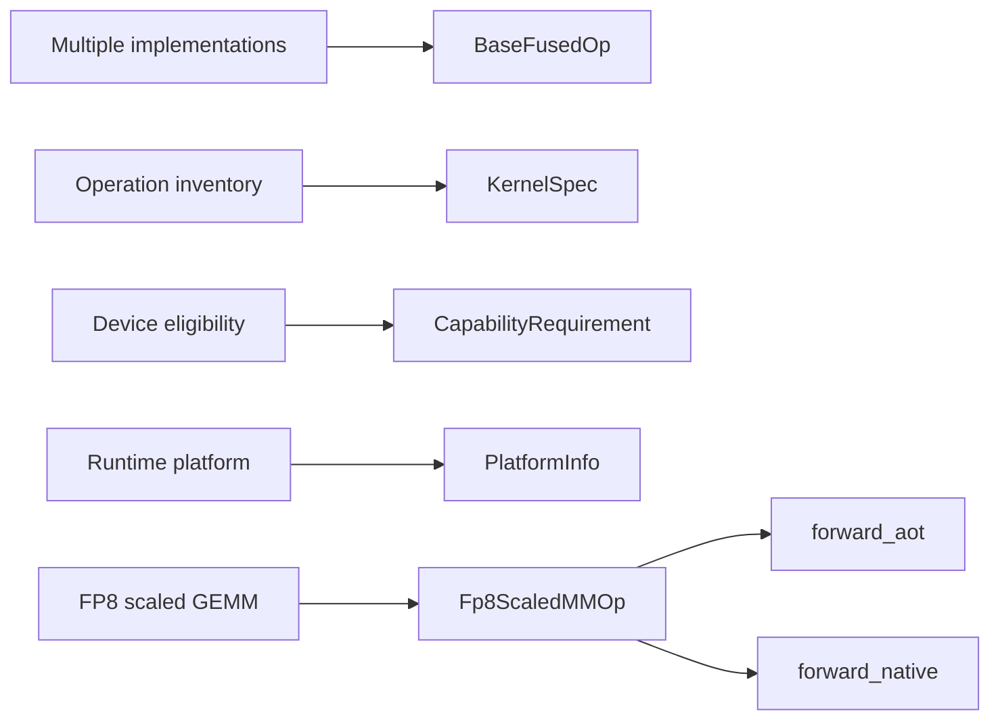
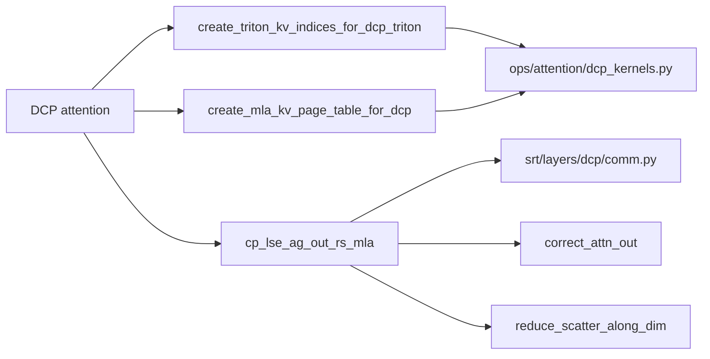

<!-- source: DeepWiki mcp.deepwiki.com · repo sgl-project/sglang · page 11 sgl-kernel Library · fetched 2026-10-30 -->

# sgl-kernel Library

Relevant source files

The following files were used as context for generating this wiki page:

- [python/sglang/kernels/jit/csrc/gemm/per_token_group_quant.cuh](python/sglang/kernels/jit/csrc/gemm/per_token_group_quant.cuh)
- [python/sglang/kernels/ops/quantization/per_token_group_quant.py](python/sglang/kernels/ops/quantization/per_token_group_quant.py)
- [python/sglang/srt/layers/deep_gemm_wrapper/compile_utils.py](python/sglang/srt/layers/deep_gemm_wrapper/compile_utils.py)
- [python/sglang/srt/layers/deep_gemm_wrapper/entrypoint.py](python/sglang/srt/layers/deep_gemm_wrapper/entrypoint.py)
- [python/sglang/srt/layers/quantization/fp8_activation.py](python/sglang/srt/layers/quantization/fp8_activation.py)
- [test/manual/dsv4/test_wo_a_fp8_sm90.py](test/manual/dsv4/test_wo_a_fp8_sm90.py)
- [test/manual/kernels/bench_dense_swiglu_quant.py](test/manual/kernels/bench_dense_swiglu_quant.py)
- [test/registered/kernels/benchmark/quantization/bench_per_token_group_quant.py](test/registered/kernels/benchmark/quantization/bench_per_token_group_quant.py)
- [test/registered/kernels/ops/quantization/test_per_token_group_quant.py](test/registered/kernels/ops/quantization/test_per_token_group_quant.py)
- [test/registered/unit/layers/quantization/test_dense_swiglu_fp8.py](test/registered/unit/layers/quantization/test_dense_swiglu_fp8.py)
- [test/registered/unit/layers/quantization/test_fp8_blockwise_linear_backends.py](test/registered/unit/layers/quantization/test_fp8_blockwise_linear_backends.py)

## Purpose and Scope

The `sglang.kernels` namespace provides a unified interface for kernel implementations and backend selection. Its metadata distinguishes an implementation’s provenance—such as `TRITON`, `JIT`, `AOT`, `FLASHINFER`, or `CUTE_DSL`—from the devices on which it can run; per-kernel `CapabilityRequirement` metadata expresses platform and, where applicable, CUDA architecture constraints [python/sglang/kernels/spec.py:12-17](). Kernel implementations are loaded lazily, keeping the namespace lightweight until a kernel is called [python/sglang/kernels/spec.py:1-10]().

This parent page outlines the library’s organization, dispatch model, and optimization themes. For implementation detail, see [Build System and Multi-Architecture Support](#11.1), [Kernel Categories and Implementations](#11.2), [Quantization Kernels](#11.3), [MoE Fused Kernels](#11.4), [Third-Party Library Integration](#11.5), and [CPU and JIT Kernel Support](#11.6).

Sources: [python/sglang/kernels/spec.py:1-17]()

---

## Package Structure and Build System

### High-Level Build Architecture

The kernel namespace describes multiple implementation backends, including pure PyTorch, Triton, JIT, AOT, CuTe DSL, FlashInfer, DeepGEMM, AITER, and `torch_npu`; the backend name describes implementation provenance, not device compatibility [python/sglang/kernels/spec.py:29-54](). Device support is declared separately through capability requirements, including CUDA architecture bounds [python/sglang/kernels/spec.py:125-162](). Build configuration and platform-specific compilation are covered in [Build System and Multi-Architecture Support](#11.1).

**Kernel metadata and dispatch concepts**

Sources: [python/sglang/kernels/spec.py:9-17](), [python/sglang/kernels/spec.py:29-54](), [python/sglang/kernels/spec.py:68-77](), [python/sglang/kernels/spec.py:125-162]()

The build system’s CMake configuration, SM90/SM100 compilation, ROCm support, and platform-specific build paths are detailed in [Build System and Multi-Architecture Support](#11.1). This overview focuses on the runtime-facing distinction between kernel backend and device capability, rather than prescribing build steps [python/sglang/kernels/spec.py:12-17]().

Sources: [python/sglang/kernels/spec.py:12-17]()

---

## Kernel Categories and Implementations

### Kernel Source Organization and Registration

The Python namespace groups kernels by operation family. For example, `sglang.kernels.ops.attention` registers Triton attention and metadata kernels, while `sglang.kernels.ops.gemm` registers GEMM operations and backend alternatives [python/sglang/kernels/ops/attention/__init__.py:25-73](), [python/sglang/kernels/ops/gemm/__init__.py:78-149](). Activation operations can expose a pure-PyTorch reference and optimized AOT, JIT, or AITER implementations behind a shared fused-op interface [python/sglang/kernels/ops/activation/__init__.py:28-48](), [python/sglang/kernels/ops/activation/__init__.py:50-106]().

`BaseFusedOp` provides the shared operator abstraction and dispatches among implementations according to explicit or forced backend selection, platform capability, and fallback behavior [python/sglang/kernels/fused_op.py:1-20](), [python/sglang/kernels/fused_op.py:23-44](). For category-specific inventory and PyTorch binding details, see [Kernel Categories and Implementations](#11.2).

**Operation families mapped to code entities**

Sources: [python/sglang/kernels/ops/attention/__init__.py:25-73](), [python/sglang/kernels/ops/gemm/__init__.py:78-149](), [python/sglang/kernels/ops/activation/__init__.py:28-80]()

---

## Quantization Kernels

Quantization-related operations are represented in the kernel namespace alongside their alternatives and eligibility conditions. For instance, `Fp8ScaledMMOp` exposes AOT and PyTorch paths for FP8 scaled matrix multiplication, with a shape- and platform-dependent eligibility check for the PyTorch route [python/sglang/kernels/ops/gemm/__init__.py:30-76](), [python/sglang/kernels/ops/gemm/__init__.py:78-147](). Furthermore, JIT-based per-token group quantization (`per_token_group_quant` in `python/sglang/kernels/ops/quantization/per_token_group_quant.py`) supports packed UE8M0 scale formats and dense SwiGLU/FP8 activation-quantization fusion (`DenseSiluAndMulQuant` in `python/sglang/srt/layers/quantization/fp8_activation.py`) for Blackwell and Hopper architectures [python/sglang/kernels/ops/quantization/per_token_group_quant.py:104-152](), [python/sglang/srt/layers/quantization/fp8_activation.py:25-67](). The precise supported formats and implementations—including FP8, NVFP4, INT8, and AWQ—are covered in [Quantization Kernels](#11.3).

Sources: [python/sglang/kernels/ops/gemm/__init__.py:30-76](), [python/sglang/kernels/ops/gemm/__init__.py:78-147](), [python/sglang/kernels/ops/quantization/per_token_group_quant.py:104-152](), [python/sglang/srt/layers/quantization/fp8_activation.py:25-67]()

---

## MoE Fused Kernels

Kernel operations support MoE-related paths as well as general-purpose compute. For example, specialized routing and grouped GEMM operations integrate with DeepGEMM wrappers (`python/sglang/srt/layers/deep_gemm_wrapper/entrypoint.py`) to manage masked and contiguous layouts across experts [python/sglang/srt/layers/deep_gemm_wrapper/entrypoint.py:48-171](). The MoE child page covers fused gating, expert selection, grouped GEMM, and alignment kernels in detail: [MoE Fused Kernels](#11.4).

Sources: [python/sglang/srt/layers/deep_gemm_wrapper/entrypoint.py:48-171]()

---

## Third-Party Library Integration

The backend vocabulary includes implementations associated with libraries such as FlashInfer, DeepGEMM, and AITER [python/sglang/kernels/spec.py:40-54](). Operation registrations can point to a specific backend and target; GEMM registrations, for example, include FlashInfer and CuTe DSL targets [python/sglang/kernels/ops/gemm/__init__.py:151-184](). DeepGEMM integration utilizes precompilation utilities and execution hooks (`compile_utils.py`) to manage JIT compilation locks and warmup stages across distributed ranks [python/sglang/srt/layers/deep_gemm_wrapper/compile_utils.py:126-184](). See [Third-Party Library Integration](#11.5) for the integration details and supported libraries.

Sources: [python/sglang/kernels/spec.py:40-54](), [python/sglang/kernels/ops/gemm/__init__.py:151-184](), [python/sglang/srt/layers/deep_gemm_wrapper/compile_utils.py:126-184]()

---

## CPU and JIT Kernel Support

The dispatch model includes CPU as a device type and JIT as an implementation backend; those are separate dimensions, and device eligibility is determined by capability metadata [python/sglang/kernels/spec.py:29-37](), [python/sglang/kernels/spec.py:57-65](). The namespace is designed to avoid importing kernel backends until needed, and its metadata module does not import Torch or the JIT implementation at module import time [python/sglang/kernels/spec.py:1-10](). See [CPU and JIT Kernel Support](#11.6) for CPU kernels, JIT infrastructure, and platform-specific optimizations.

Sources: [python/sglang/kernels/spec.py:1-10](), [python/sglang/kernels/spec.py:29-37](), [python/sglang/kernels/spec.py:57-65]()

---

## Bridging Natural Language Concepts to Code Entities

### Runtime Optimization Concepts to Code Entities

The following map connects common kernel-library concepts to symbols and modules visible in the codebase. `BaseFusedOp` supplies a shared multi-backend operator contract, while `KernelSpec` records an operation’s backend and target for registry-based lookup [python/sglang/kernels/fused_op.py:1-16](), [python/sglang/kernels/spec.py:1-10]().

Sources: [python/sglang/kernels/fused_op.py:1-16](), [python/sglang/kernels/spec.py:1-10](), [python/sglang/kernels/spec.py:68-77](), [python/sglang/kernels/spec.py:125-162](), [python/sglang/kernels/ops/gemm/__init__.py:78-147]()

### Attention and Distributed Decode Concepts to Code Entities

Decode context parallelism (DCP) illustrates how a runtime operation can combine kernel code with communication code: `dcp_kernels.py` defines Triton routines for KV-index construction and attention-output correction, while `comm.py` coordinates gathered statistics and output merging across a `GroupCoordinator` [python/sglang/kernels/ops/attention/dcp_kernels.py:15-20](), [python/sglang/srt/layers/dcp/comm.py:45-53](), [python/sglang/srt/layers/dcp/comm.py:56-82]().

Sources: [python/sglang/kernels/ops/attention/dcp_kernels.py:15-20](), [python/sglang/kernels/ops/attention/dcp_kernels.py:33-72](), [python/sglang/kernels/ops/attention/dcp_kernels.py:79-125](), [python/sglang/srt/layers/dcp/comm.py:85-123]()

---

## Summary

The `sglang.kernels` namespace organizes kernel implementations by operation and describes their backend and platform eligibility through registry metadata [python/sglang/kernels/spec.py:12-17](), [python/sglang/kernels/spec.py:125-162](). Shared fused-op dispatch supports optimized implementations and fallbacks behind a common operator interface [python/sglang/kernels/fused_op.py:1-16](), [python/sglang/kernels/fused_op.py:23-44](). For detailed treatment, continue to the child pages:

- [Build System and Multi-Architecture Support](#11.1)
- [Kernel Categories and Implementations](#11.2)
- [Quantization Kernels](#11.3)
- [MoE Fused Kernels](#11.4)
- [Third-Party Library Integration](#11.5)
- [CPU and JIT Kernel Support](#11.6)

Sources: [python/sglang/kernels/spec.py:12-17](), [python/sglang/kernels/spec.py:125-162](), [python/sglang/kernels/fused_op.py:1-16](), [python/sglang/kernels/fused_op.py:23-44]()

---

