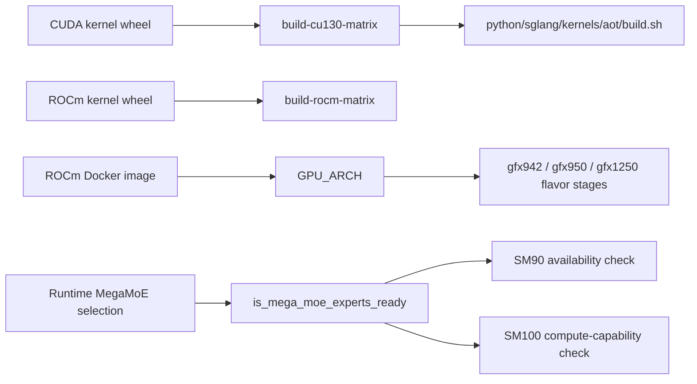
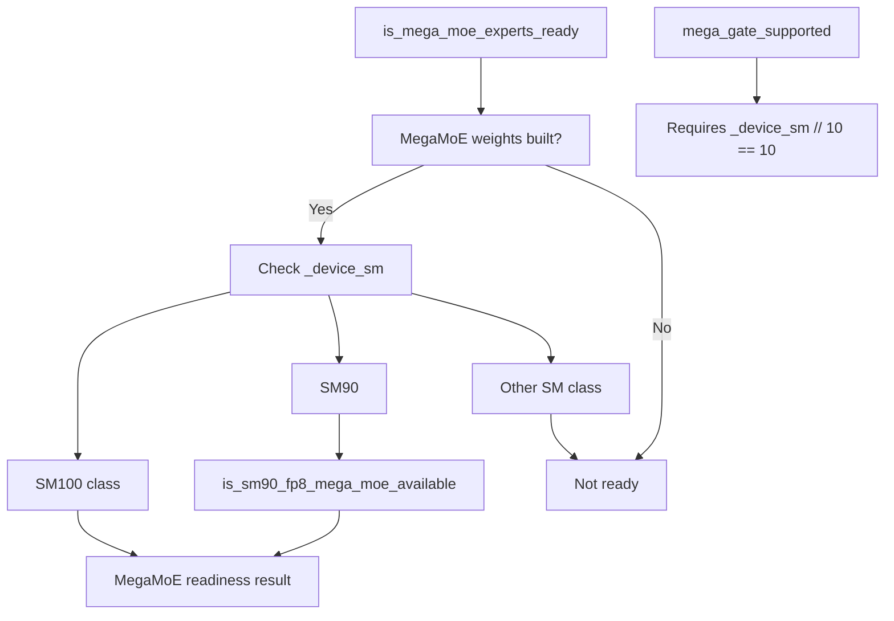
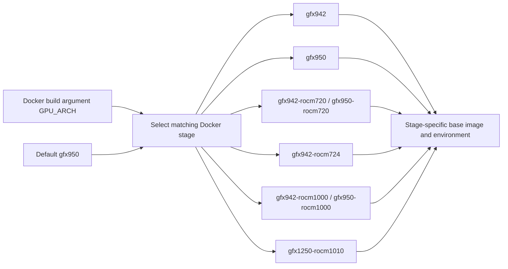

<!-- source: DeepWiki mcp.deepwiki.com · repo sgl-project/sglang · page 11.1 Build System and Multi-Architecture Support · fetched 2026-10-30 -->

# Build System and Multi-Architecture Support

Relevant source files

The following files were used as context for generating this wiki page:

- [.claude/rules/comment-style.md](.claude/rules/comment-style.md)
- [.github/actions/download-rust-ext/action.yml](.github/actions/download-rust-ext/action.yml)
- [.github/workflows/_pr-test-rust-ext-build.yml](.github/workflows/_pr-test-rust-ext-build.yml)
- [.github/workflows/_pr-test-sgl-kernel-build.yml](.github/workflows/_pr-test-sgl-kernel-build.yml)
- [.github/workflows/_pr-test-stage.yml](.github/workflows/_pr-test-stage.yml)
- [.github/workflows/nightly-test-amd.yml](.github/workflows/nightly-test-amd.yml)
- [.github/workflows/nightly-test-nvidia.yml](.github/workflows/nightly-test-nvidia.yml)
- [.github/workflows/pr-test-amd.yml](.github/workflows/pr-test-amd.yml)
- [.github/workflows/pr-test-extra.yml](.github/workflows/pr-test-extra.yml)
- [.github/workflows/pr-test-jit-kernel.yml](.github/workflows/pr-test-jit-kernel.yml)
- [.github/workflows/pr-test-multimodal-gen.yml](.github/workflows/pr-test-multimodal-gen.yml)
- [.github/workflows/pr-test-sgl-kernel.yml](.github/workflows/pr-test-sgl-kernel.yml)
- [.github/workflows/pr-test.yml](.github/workflows/pr-test.yml)
- [.github/workflows/release-docker-amd-gfx1151-nightly.yml](.github/workflows/release-docker-amd-gfx1151-nightly.yml)
- [.github/workflows/release-docker-amd-rocm10.yml](.github/workflows/release-docker-amd-rocm10.yml)
- [.github/workflows/release-docker-amd-rocm720-nightly.yml](.github/workflows/release-docker-amd-rocm720-nightly.yml)
- [.github/workflows/release-docker-amd.yml](.github/workflows/release-docker-amd.yml)
- [.github/workflows/release-whl-deepgemm.yml](.github/workflows/release-whl-deepgemm.yml)
- [.github/workflows/release-whl-kernel-xpu.yml](.github/workflows/release-whl-kernel-xpu.yml)
- [.github/workflows/release-whl-kernel.yml](.github/workflows/release-whl-kernel.yml)
- [.github/workflows/rerun-test.yml](.github/workflows/rerun-test.yml)
- [.github/workflows/seed-rust-ext-cache.yml](.github/workflows/seed-rust-ext-cache.yml)
- [3rdparty/amd/wheel/README.md](3rdparty/amd/wheel/README.md)
- [3rdparty/amd/wheel/sgl-kernel/build_rocm.sh](3rdparty/amd/wheel/sgl-kernel/build_rocm.sh)
- [3rdparty/amd/wheel/sgl-kernel/rename_wheels_rocm.sh](3rdparty/amd/wheel/sgl-kernel/rename_wheels_rocm.sh)
- [docker/patches/sgl-kernel-gfx1151.sh](docker/patches/sgl-kernel-gfx1151.sh)
- [docker/rocm-gfx1151.Dockerfile](docker/rocm-gfx1151.Dockerfile)
- [docker/rocm.Dockerfile](docker/rocm.Dockerfile)
- [docker/sgl-deep-gemm.Dockerfile](docker/sgl-deep-gemm.Dockerfile)
- [python/sglang/kernels/aot/csrc/elementwise/pos_enc.cu](python/sglang/kernels/aot/csrc/elementwise/pos_enc.cu)
- [python/sglang/multimodal_gen/test/unit/test_diffusion_import_isolation.py](python/sglang/multimodal_gen/test/unit/test_diffusion_import_isolation.py)
- [python/sglang/srt/model_loader/ci_weight_validation.py](python/sglang/srt/model_loader/ci_weight_validation.py)
- [scripts/build_sgl_deep_gemm.sh](scripts/build_sgl_deep_gemm.sh)
- [scripts/ci/amd/amd_ci_install_dependency.sh](scripts/ci/amd/amd_ci_install_dependency.sh)
- [scripts/ci/amd/amd_ci_start_container.sh](scripts/ci/amd/amd_ci_start_container.sh)
- [scripts/ci/amd/amd_ci_start_container_disagg.sh](scripts/ci/amd/amd_ci_start_container_disagg.sh)
- [scripts/ci/cuda/ci_download_flashinfer_jit_cache.sh](scripts/ci/cuda/ci_download_flashinfer_jit_cache.sh)
- [scripts/ci/cuda/ci_install_dependency.sh](scripts/ci/cuda/ci_install_dependency.sh)
- [scripts/ci/partition_rerun_tests.py](scripts/ci/partition_rerun_tests.py)
- [scripts/ci/utils/git_clone_with_retry.sh](scripts/ci/utils/git_clone_with_retry.sh)
- [scripts/ci/utils/install_rustup.sh](scripts/ci/utils/install_rustup.sh)
- [scripts/ci/utils/slash_command_handler.py](scripts/ci/utils/slash_command_handler.py)
- [scripts/ci/utils/stage_rust_ext_modules.sh](scripts/ci/utils/stage_rust_ext_modules.sh)
- [scripts/release/get_version_tag.py](scripts/release/get_version_tag.py)
- [scripts/rename_sgl_deep_gemm_whl.sh](scripts/rename_sgl_deep_gemm_whl.sh)
- [scripts/update_deepgemm_whl_index.py](scripts/update_deepgemm_whl_index.py)
- [scripts/update_kernel_whl_index.py](scripts/update_kernel_whl_index.py)
- [test/manual/test_weight_validation.py](test/manual/test_weight_validation.py)
- [test/registered/amd/perf/mi35x/test_qwen35_fp8_ar_fusion_mi35x.py](test/registered/amd/perf/mi35x/test_qwen35_fp8_ar_fusion_mi35x.py)
- [test/registered/amd/test_deepseek_v32_basic.py](test/registered/amd/test_deepseek_v32_basic.py)
- [test/registered/amd/test_kimi_k2_instruct.py](test/registered/amd/test_kimi_k2_instruct.py)
- [test/registered/amd/test_moriep_small.py](test/registered/amd/test_moriep_small.py)
- [test/registered/amd/test_moriep_small_extra.py](test/registered/amd/test_moriep_small_extra.py)
- [test/registered/amd/test_qwen3_coder_next_8gpu.py](test/registered/amd/test_qwen3_coder_next_8gpu.py)
- [test/registered/basic_perf/test_vlm_serving_aiter.py](test/registered/basic_perf/test_vlm_serving_aiter.py)
- [test/registered/dllm/test_llada2_mini_amd.py](test/registered/dllm/test_llada2_mini_amd.py)
- [test/registered/rotary/test_rope_rocm.py](test/registered/rotary/test_rope_rocm.py)
- [test/run_suite.py](test/run_suite.py)

## Purpose and Scope

This page describes the build and packaging paths for `sgl-kernel` and the SGLang runtime, evidenced by repository configuration files and workflow definitions: ROCm Docker flavors, CUDA and ROCm kernel-wheel release workflows (`release-whl-kernel.yml`), AMD CI image selection, and runtime architecture checks for hardware-specific optimizations like MegaMoE. 

Sources: [docker/rocm.Dockerfile:1-24](), [.github/workflows/release-whl-kernel.yml:1-80](), [python/sglang/srt/layers/moe/mega_moe.py:161-168]()

---

## Build System Architecture Overview

The build pipeline spans Docker container image construction for ROCm architectures, Ahead-Of-Time (AOT) kernel wheel compilation for CUDA and ROCm targets, and runtime capability dispatch. 

### Natural Language to Code Entity Mapping: Build Pipeline

| Build concept | Code entity | Evidenced role |
|---|---|---|
| CUDA kernel-wheel build | `build-cu130-matrix` | Executes `python/sglang/kernels/aot/build.sh` for CUDA 13.0 across supported target architectures. [.github/workflows/release-whl-kernel.yml:35-78]() |
| ROCm kernel-wheel build | `build-rocm-matrix` | Defines the ROCm wheel-build matrix targets and package versions. [.github/workflows/release-whl-kernel.yml:168-184]() |
| ROCm image flavor selection | `GPU_ARCH` and `FROM ... AS gfx...` | Selects architecture- and ROCm-version-specific Docker build stages in container files. [docker/rocm.Dockerfile:42-58](), [docker/rocm.Dockerfile:60-89](), [docker/rocm.Dockerfile:105-124]() |
| CUDA MegaMoE capability gate | `is_mega_moe_experts_ready` | Evaluates expert weights and device compute capability (`_device_sm`) before selecting the MegaMoE execution path. [python/sglang/srt/layers/moe/mega_moe.py:161-168]() |
| ROCm MegaMoE selection | `_use_amd_flydsl_mega_moe` | Restricts the FlyDSL MegaMoE execution path to HIP/ROCm environments. [python/sglang/srt/layers/moe/mega_moe.py:46-53]() |

Sources: [.github/workflows/release-whl-kernel.yml:35-78](), [.github/workflows/release-whl-kernel.yml:168-184](), [docker/rocm.Dockerfile:42-58](), [docker/rocm.Dockerfile:60-89](), [docker/rocm.Dockerfile:105-124](), [python/sglang/srt/layers/moe/mega_moe.py:46-53](), [python/sglang/srt/layers/moe/mega_moe.py:161-168]()

### Build Flow Diagram

Sources: [.github/workflows/release-whl-kernel.yml:35-78](), [.github/workflows/release-whl-kernel.yml:168-184](), [docker/rocm.Dockerfile:42-58](), [python/sglang/srt/layers/moe/mega_moe.py:161-168]()

---

## CMake Configuration and Multi-Architecture Compilation (SM90/SM100)

Compilation and target architecture selection for custom kernels are handled via AOT build scripts and runtime hardware checks. Multi-architecture compilation targets distinct compute capabilities such as SM90 (Hopper) and SM100 (Blackwell).

The runtime validates target compute capabilities via helper functions:
- `is_mega_moe_experts_ready` checks whether expert weights are initialized and dispatches based on `_device_sm`. For `_device_sm == 90`, it invokes `is_sm90_fp8_mega_moe_available(experts)`; for SM100-class devices, it validates `_device_sm // 10 == 10`. [python/sglang/srt/layers/moe/mega_moe.py:161-168]()
- `_mega_moe_max_num_sms` assigns launch budgets based on whether the device is SM100-class or older, adjusting residency margins for clustered grid launches. [python/sglang/srt/layers/moe/mega_moe.py:63-75]()
- `mega_gate_supported` restricts specific fused gating operations to SM100-class devices (`_device_sm // 10 != 10`). [python/sglang/srt/layers/moe/mega_gate.py:35-55]()

| Runtime symbol | Code behavior and role |
|---|---|
| `is_mega_moe_experts_ready` | Runtime capability verification for SM90 and SM100-class hardware. [python/sglang/srt/layers/moe/mega_moe.py:161-168]() |
| `_mega_moe_max_num_sms` | Determines multiprocessor resource allocation for SM90 vs. SM100+ launch paradigms. [python/sglang/srt/layers/moe/mega_moe.py:63-75]() |
| `mega_gate_supported` | Enforces hardware architecture gating for advanced MegaGate functions. [python/sglang/srt/layers/moe/mega_gate.py:35-55]() |

Sources: [python/sglang/srt/layers/moe/mega_moe.py:63-75](), [python/sglang/srt/layers/moe/mega_moe.py:161-168](), [python/sglang/srt/layers/moe/mega_gate.py:35-55]()

### Natural Language to Code Entity Mapping: SM90 and SM100

| Architecture concept | Code entity | Relationship |
|---|---|---|
| SM90 MegaMoE check | `is_sm90_fp8_mega_moe_available` | Invoked by `is_mega_moe_experts_ready` when `_device_sm == 90`. [python/sglang/srt/layers/moe/mega_moe.py:161-165]() |
| SM90 SMS budgeting | `_mega_moe_max_num_sms` | Handles non-clustered resource limits for pre-SM100 architectures. [python/sglang/srt/layers/moe/mega_moe.py:63-75]() |
| SM100 MegaMoE validation | `_device_sm // 10 == 10` | Compute capability grouping check in `is_mega_moe_experts_ready`. [python/sglang/srt/layers/moe/mega_moe.py:161-168]() |
| SM100 MegaGate eligibility | `mega_gate_supported` | Filters execution based on architecture constraints. [python/sglang/srt/layers/moe/mega_gate.py:35-55]() |

Sources: [python/sglang/srt/layers/moe/mega_moe.py:63-75](), [python/sglang/srt/layers/moe/mega_moe.py:161-168](), [python/sglang/srt/layers/moe/mega_gate.py:35-55]()

### Runtime Architecture-Selection Diagram

Sources: [python/sglang/srt/layers/moe/mega_moe.py:161-168](), [python/sglang/srt/layers/moe/mega_gate.py:35-55]()

---

## ROCm Build Configuration

ROCm container builds are managed via multi-stage Dockerfiles (`docker/rocm.Dockerfile`) parameterized by `GPU_ARCH`. Default builds target `gfx950`, while specific stages cater to `gfx942`, ROCm runtime versions, and newer architectures like `gfx1250`. [docker/rocm.Dockerfile:42-58]()

Different flavor stages define specific environment variables and build flags:
- The `gfx942` stage enables `BUILD_AITER_ALL` and `BUILD_MOONCAKE`, while disabling vLLM and Triton compilation flags. [docker/rocm.Dockerfile:60-69]()
- The `gfx942-rocm720` stage introduces pinned commits for Triton and AITER components. [docker/rocm.Dockerfile:70-79]()
- The `gfx942-rocm724` stage targets Python 3.12, configures `PIP_CONSTRAINT` for ROCm-specific PyTorch packages, and enables legacy IPC mode (`HSA_ENABLE_IPC_MODE_LEGACY=1`) to prevent GPU memory leakage. [docker/rocm.Dockerfile:81-103]()

| ROCm Flavor | Key Build Configuration & Environment |
|---|---|
| `gfx942` | Uses base image 942; sets AITER and Mooncake build flags. [docker/rocm.Dockerfile:60-69]() |
| `gfx942-rocm720` | Incorporates ROCm 7.2 PyTorch base with pinned Triton/AITER commits. [docker/rocm.Dockerfile:70-79]() |
| `gfx942-rocm724` | Configures Python 3.12, `PIP_CONSTRAINT`, and legacy IPC enforcement. [docker/rocm.Dockerfile:81-103]() |
| `gfx950` | Targets MI35x class hardware with default AITER/Mooncake builds. [docker/rocm.Dockerfile:105-113]() |

Sources: [docker/rocm.Dockerfile:13-24](), [docker/rocm.Dockerfile:42-58](), [docker/rocm.Dockerfile:60-103](), [docker/rocm.Dockerfile:105-124]()

### ROCm Flavor Selection Diagram

Sources: [docker/rocm.Dockerfile:42-58](), [docker/rocm.Dockerfile:60-124](), [.github/workflows/release-docker-amd-rocm10.yml:88-117]()

---

## Platform-Specific Builds and Dependencies

Platform-specific builds are orchestrated via CI workflows and packaging scripts:
- **CUDA Wheels**: Built via `release-whl-kernel.yml` using `python/sglang/kernels/aot/build.sh` across `x86_64` and `aarch64` architectures for CUDA 13.0. [.github/workflows/release-whl-kernel.yml:35-78]()
- **ROCm Images**: Configured via `docker/rocm.Dockerfile` supporting target architectures `gfx942`, `gfx950`, and `gfx1250` with distinct ROCm runtime versions. [docker/rocm.Dockerfile:42-124]()
- **Container Initialization**: AMD container startup scripts normalize runtime hostnames and hardware identifiers (e.g., mapping `mi30x` and `mi325` to appropriate runner families). [scripts/ci/amd/amd_ci_start_container.sh:70-95]()

| Build Target | Mechanism |
|---|---|
| CUDA 13.0 Kernel Wheels | Matrix-based AOT build execution for `x86_64` and `aarch64`. [.github/workflows/release-whl-kernel.yml:35-78]() |
| ROCm Container Images | Multi-stage Docker build utilizing `GPU_ARCH` build arguments. [docker/rocm.Dockerfile:42-58]() |

Sources: [.github/workflows/release-whl-kernel.yml:35-78](), [docker/rocm.Dockerfile:42-124](), [scripts/ci/amd/amd_ci_start_container.sh:70-95]()

---

## Summary

The build system and multi-architecture framework integrate AOT compilation scripts, platform-specific Docker pipelines, and runtime capability checks to support diverse hardware accelerators (NVIDIA CUDA SM90/SM100 and AMD ROCm gfx942/gfx950/gfx1250).

Sources: [.github/workflows/release-whl-kernel.yml:35-78](), [docker/rocm.Dockerfile:42-124](), [python/sglang/srt/layers/moe/mega_moe.py:161-168]()

---

