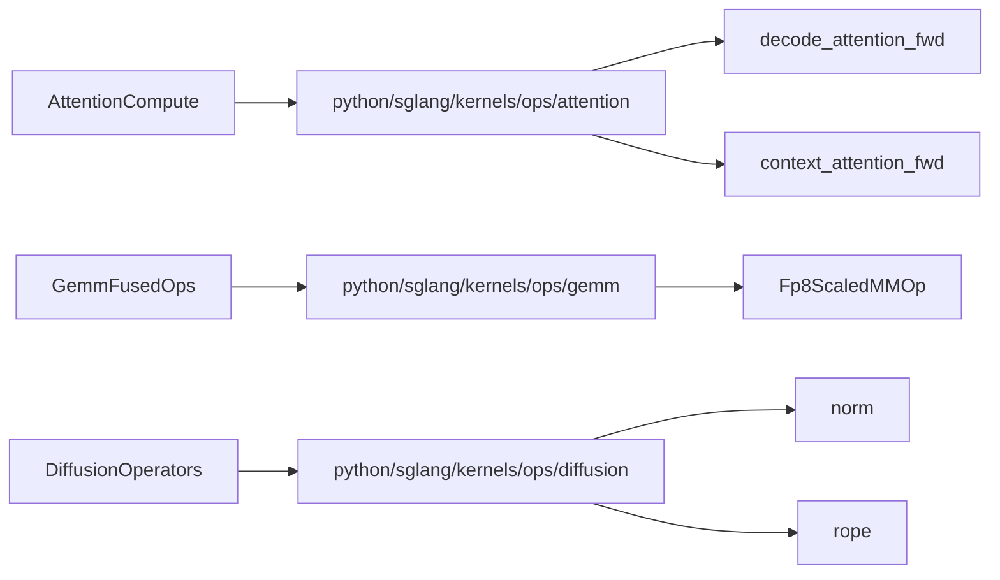

<!-- source: DeepWiki mcp.deepwiki.com · repo sgl-project/sglang · page 11.2 Kernel Categories and Implementations · fetched 2026-10-30 -->

# Kernel Categories and Implementations

<details>
<summary>Relevant source files</summary>

The following files were used as context for generating this wiki page:

- [docs/docs/sglang-diffusion/fused_kernels.mdx](docs/docs/sglang-diffusion/fused_kernels.mdx)
- [python/sglang/kernels/jit/csrc/diffusion/interleaved_rope_fp64.cuh](python/sglang/kernels/jit/csrc/diffusion/interleaved_rope_fp64.cuh)
- [python/sglang/kernels/kda_kernels/README.md](python/sglang/kernels/kda_kernels/README.md)
- [python/sglang/kernels/kda_kernels/csrc/attention/kda_decode_gfx950.cu](python/sglang/kernels/kda_kernels/csrc/attention/kda_decode_gfx950.cu)
- [python/sglang/kernels/kda_kernels/csrc/attention/kda_prefill_gfx950.cu](python/sglang/kernels/kda_kernels/csrc/attention/kda_prefill_gfx950.cu)
- [python/sglang/kernels/kda_kernels/kda_decode_gfx950.py](python/sglang/kernels/kda_kernels/kda_decode_gfx950.py)
- [python/sglang/kernels/kda_kernels/kda_prefill_gfx950.py](python/sglang/kernels/kda_kernels/kda_prefill_gfx950.py)
- [python/sglang/kernels/ops/attention/__init__.py](python/sglang/kernels/ops/attention/__init__.py)
- [python/sglang/kernels/ops/attention/fla/kda.py](python/sglang/kernels/ops/attention/fla/kda.py)
- [python/sglang/kernels/ops/attention/kda_fused_decode_gfx950.py](python/sglang/kernels/ops/attention/kda_fused_decode_gfx950.py)
- [python/sglang/kernels/ops/attention/linear/kda_gfx950_prefill.py](python/sglang/kernels/ops/attention/linear/kda_gfx950_prefill.py)
- [python/sglang/kernels/ops/diffusion/README.md](python/sglang/kernels/ops/diffusion/README.md)
- [python/sglang/kernels/ops/diffusion/__init__.py](python/sglang/kernels/ops/diffusion/__init__.py)
- [python/sglang/kernels/ops/diffusion/modulate/conv_bias_epilogue_triton.py](python/sglang/kernels/ops/diffusion/modulate/conv_bias_epilogue_triton.py)
- [python/sglang/kernels/ops/diffusion/norm/cutedsl_common/norm_fusion.py](python/sglang/kernels/ops/diffusion/norm/cutedsl_common/norm_fusion.py)
- [python/sglang/kernels/ops/diffusion/norm/cutedsl_common/reduce.py](python/sglang/kernels/ops/diffusion/norm/cutedsl_common/reduce.py)
- [python/sglang/kernels/ops/diffusion/norm/scale_residual_norm_cutedsl.py](python/sglang/kernels/ops/diffusion/norm/scale_residual_norm_cutedsl.py)
- [python/sglang/kernels/ops/diffusion/norm/wan_rmsnorm_silu_triton.py](python/sglang/kernels/ops/diffusion/norm/wan_rmsnorm_silu_triton.py)
- [python/sglang/kernels/ops/diffusion/rope/interleaved_rope_fp64_jit.py](python/sglang/kernels/ops/diffusion/rope/interleaved_rope_fp64_jit.py)
- [python/sglang/kernels/ops/diffusion/rope/rmsnorm_interleaved_rope_cutedsl.py](python/sglang/kernels/ops/diffusion/rope/rmsnorm_interleaved_rope_cutedsl.py)
- [python/sglang/multimodal_gen/configs/models/dits/sana.py](python/sglang/multimodal_gen/configs/models/dits/sana.py)
- [python/sglang/multimodal_gen/runtime/managers/forward_context.py](python/sglang/multimodal_gen/runtime/managers/forward_context.py)
- [python/sglang/multimodal_gen/runtime/models/dits/qwen_image.py](python/sglang/multimodal_gen/runtime/models/dits/qwen_image.py)
- [python/sglang/multimodal_gen/runtime/models/dits/sana.py](python/sglang/multimodal_gen/runtime/models/dits/sana.py)
- [python/sglang/multimodal_gen/runtime/models/dits/sana_video.py](python/sglang/multimodal_gen/runtime/models/dits/sana_video.py)
- [python/sglang/multimodal_gen/runtime/models/dits/wanvideo.py](python/sglang/multimodal_gen/runtime/models/dits/wanvideo.py)
- [python/sglang/multimodal_gen/runtime/models/vaes/wan_vae_cuda_opt.py](python/sglang/multimodal_gen/runtime/models/vaes/wan_vae_cuda_opt.py)
- [python/sglang/multimodal_gen/runtime/models/vaes/wanvae.py](python/sglang/multimodal_gen/runtime/models/vaes/wanvae.py)
- [python/sglang/multimodal_gen/runtime/pipelines_core/stages/denoising.py](python/sglang/multimodal_gen/runtime/pipelines_core/stages/denoising.py)
- [python/sglang/multimodal_gen/test/unit/test_sana_video.py](python/sglang/multimodal_gen/test/unit/test_sana_video.py)
- [python/sglang/multimodal_gen/test/unit/test_wan_temb_table_slices.py](python/sglang/multimodal_gen/test/unit/test_wan_temb_table_slices.py)
- [python/sglang/multimodal_gen/test/unit/test_wan_vae_attention_rows.py](python/sglang/multimodal_gen/test/unit/test_wan_vae_attention_rows.py)
- [python/sglang/multimodal_gen/test/unit/test_wan_vae_dupup.py](python/sglang/multimodal_gen/test/unit/test_wan_vae_dupup.py)
- [python/sglang/srt/layers/attention/linear/kda_backend.py](python/sglang/srt/layers/attention/linear/kda_backend.py)
- [python/sglang/srt/layers/attention/linear/kernels/kda_flashkda.py](python/sglang/srt/layers/attention/linear/kernels/kda_flashkda.py)
- [python/sglang/srt/layers/attention/linear/kernels/kda_triton.py](python/sglang/srt/layers/attention/linear/kernels/kda_triton.py)
- [python/sglang/srt/layers/attention/linear/kernels/kernel_backend.py](python/sglang/srt/layers/attention/linear/kernels/kernel_backend.py)
- [python/sglang/srt/layers/attention/linear/utils.py](python/sglang/srt/layers/attention/linear/utils.py)
- [test/registered/attention/test_kda_prefill_flashkda.py](test/registered/attention/test_kda_prefill_flashkda.py)
- [test/registered/attention/unittests/kda/README.md](test/registered/attention/unittests/kda/README.md)
- [test/registered/kernels/benchmark/diffusion/bench_interleaved_rope_fp64.py](test/registered/kernels/benchmark/diffusion/bench_interleaved_rope_fp64.py)
- [test/registered/kernels/ops/attention/test_kda_fused_decode_gfx950.py](test/registered/kernels/ops/attention/test_kda_fused_decode_gfx950.py)
- [test/registered/kernels/ops/attention/test_kda_gate_beta_cumsum.py](test/registered/kernels/ops/attention/test_kda_gate_beta_cumsum.py)
- [test/registered/kernels/ops/attention/test_kda_gfx950_prefill.py](test/registered/kernels/ops/attention/test_kda_gfx950_prefill.py)
- [test/registered/kernels/ops/diffusion/test_conv_bias_epilogue.py](test/registered/kernels/ops/diffusion/test_conv_bias_epilogue.py)
- [test/registered/kernels/ops/diffusion/test_interleaved_rope_fp64.py](test/registered/kernels/ops/diffusion/test_interleaved_rope_fp64.py)
- [test/registered/kernels/ops/diffusion/test_model_fast_paths.py](test/registered/kernels/ops/diffusion/test_model_fast_paths.py)
- [test/registered/kernels/ops/diffusion/test_norm.py](test/registered/kernels/ops/diffusion/test_norm.py)
- [test/registered/kernels/ops/diffusion/test_rmsnorm_interleaved_rope.py](test/registered/kernels/ops/diffusion/test_rmsnorm_interleaved_rope.py)
- [test/registered/kernels/ops/diffusion/test_wan_norm_silu_post.py](test/registered/kernels/ops/diffusion/test_wan_norm_silu_post.py)
- [test/registered/unit/layers/attention/test_linear_attn_config.py](test/registered/unit/layers/attention/test_linear_attn_config.py)

</details>


## Purpose and Scope

This page details the organization, implementation patterns, and registration workflows under `python/sglang/kernels`, covering attention, GEMM, MoE, elementwise, and diffusion categories [python/sglang/kernels/ops/attention/__init__.py:1-20]() [python/sglang/kernels/ops/diffusion/README.md:1-12](). It explains the PyTorch binding architecture, lazy resolution strategies, numeric verification gates, and hardware-specific dispatch logic used across SGLang runtimes.

Sources: [python/sglang/kernels/ops/attention/__init__.py:1-20]() [python/sglang/kernels/ops/diffusion/README.md:1-12]()

---

## Kernel Organization Overview

Kernel packages structure implementations by operator domain and register metadata via `KernelSpec` registries [python/sglang/kernels/ops/attention/__init__.py:1-7]() [python/sglang/kernels/ops/diffusion/__init__.py:32-46](). The attention package registers Triton compute kernels like `attention.decode_attention_fwd` and `attention.context_attention_fwd` [python/sglang/kernels/ops/attention/__init__.py:25-73](). The GEMM package provides scaled matrix multiplication and fused operations [python/sglang/kernels/ops/gemm/__init__.py:7-27](). The diffusion package organizes implementations under domains (`norm`, `modulate`, `rope`, `activation`, `quantization`, `attention`, `routing`, `layout`) alongside `common` infrastructure and `sites` mount policies [python/sglang/kernels/ops/diffusion/README.md:27-48]().

**Diagram: Kernel Domains Mapped to Package Entities**



Sources: [python/sglang/kernels/ops/attention/__init__.py:1-73]() [python/sglang/kernels/ops/diffusion/README.md:27-48]()

---

## Attention Kernels

Attention implementations combine Triton decode, extend, and prefill compute kernels with specialized state merging and metadata builders [python/sglang/kernels/ops/attention/__init__.py:25-73](). Linear and sparse attention variants such as `chunk_gated_delta_rule`, `lightning_attention`, and `flash_decode_with_topk_idx` are integrated into the registry [python/sglang/kernels/ops/attention/__init__.py:141-181](). 

For hardware-qualified paths like Qwen3.8 QSA on SM121, `qwen38_qsa_sm121_varlen` verifies sequence length constraints and capability requirements before dispatching to the `KernelBackend.KDA` target [python/sglang/kernels/ops/attention/__init__.py:88-138](). Kernel dispatchers like `KDAKernelDispatcher` route execution across Triton, CuTe-DSL, Helion, and FlashInfer backends [python/sglang/srt/layers/attention/linear/kda_backend.py:99-156]().

**Diagram: Code Entity Space for Attention Dispatch**

```mermaid
flowchart TD
    Dispatcher["KDAKernelDispatcher"] --> DecodeCheck["decode_backend"]
    DecodeCheck -->| "triton" | TritonKernel["TritonKDAKernel"]
    DecodeCheck -->| "flashinfer" | FlashInferKernel["FlashInferKDAKernel"]
    DecodeCheck -->| "cutedsl" | CuteDSLKernel["CuteDSLKDAKernel"]
    TritonKernel --> PackedDecode["fused_recurrent_kda_packed_decode"]
    TritonKernel --> StandardDecode["fused_sigmoid_gating_delta_rule_update"]
```

Sources: [python/sglang/kernels/ops/attention/__init__.py:88-138]() [python/sglang/srt/layers/attention/linear/kda_backend.py:99-156]() [python/sglang/srt/layers/attention/linear/kernels/kda_triton.py:27-162]()

---

## GEMM and Fused Matrix Operations

The GEMM package defines complex operations like `Fp8ScaledMMOp`, representing `gemm.fp8_scaled_mm` [python/sglang/kernels/ops/gemm/__init__.py:78-149](). Eligibility logic evaluates runtime configurations via `_prefer_torch_rowwise_fp8` to select between `torch._scaled_mm` and AOT-compiled `sgl_kernel.fp8_scaled_mm` implementations [python/sglang/kernels/ops/gemm/__init__.py:30-107](). Additional hardware-specific kernels (such as CuTe-DSL dual-GEMM SwiGLU and NVFP4 producers) are registered with explicit capability checks [python/sglang/kernels/ops/gemm/__init__.py:151-184]().

Sources: [python/sglang/kernels/ops/gemm/__init__.py:30-184]()

---

## Elementwise and Activation Operations

Elementwise and activation routines fuse unary transformations directly into linear or convolutional epilogues [python/sglang/kernels/ops/diffusion/README.md:27-44](). JIT-backed operators such as `diffusion.gelu_tanh_cat` handle specialized tensor concatenations and activation sequences [python/sglang/kernels/ops/diffusion/__init__.py:73-101](). Fused bias-silu and bias-gelu implementations eliminate intermediate round trips by combining arithmetic operations within the primary memory pass [python/sglang/multimodal_gen/runtime/models/dits/sana.py:175-191]().

Sources: [python/sglang/kernels/ops/diffusion/__init__.py:73-101]() [python/sglang/kernels/ops/diffusion/README.md:27-44]() [python/sglang/multimodal_gen/runtime/models/dits/sana.py:175-191]()

---

## MoE Kernels

Mixture-of-Experts (MoE) kernel organization spans expert routing, token dispatch, and grouped GEMM computations [python/sglang/kernels/ops/diffusion/README.md:35-48](). Routing operators handle diffusion and transformer MoE selection rules, mapping token indices to designated expert compute blocks while ensuring synchronization across parallel ranks [python/sglang/kernels/ops/diffusion/README.md:35-48]().

Sources: [python/sglang/kernels/ops/diffusion/README.md:35-48]()

---

## Diffusion and Multimodal-Generation Kernels

Diffusion kernels replace eager PyTorch operator chains in DiT blocks and VAE pipelines [python/sglang/kernels/ops/diffusion/README.md:1-11](). Because multi-step denoising amplifies rounding discrepancies, implementations are categorized by numerical contract: bit-exact kernels (replicating reduction trees and Welford updates precisely) and request-gated lossless/high fusions [python/sglang/kernels/ops/diffusion/README.md:50-75]().

**Diagram: Diffusion Facade and Lazy Resolution**

```mermaid
flowchart LR
    Model["ModelWrapper"] --> Facade["python/sglang/kernels/ops/diffusion"]
    Facade --> LazyEval["_EXPORTS Lazy Resolution"]
    LazyEval --> TritonBackend["Triton Backends"]
    LazyEval --> CuteDSLBackend["CUTLASS / CuTe-DSL"]
    LazyEval --> KDAKernel["KDA Kernels"]
    Model --> Gate["BitExactFusionGate"]
    Gate -->| "Verified" | FusedKernel["Optimized Kernel Path"]
    Gate -->| "Mismatch" | EagerRef["Eager Reference Chain"]
```

Sources: [python/sglang/kernels/ops/diffusion/__init__.py:1-25]() [python/sglang/kernels/ops/diffusion/README.md:50-75]()

---

## Python Binding and Kernel-Selection Architecture

Kernel registration uses a declarative metadata model where Python wrappers inspect input tensors, check device capabilities, and invoke JIT or AOT backends [python/sglang/kernels/ops/attention/__init__.py:13-73]() [python/sglang/kernels/ops/gemm/__init__.py:7-16](). Lazy module imports (`PEP 562`) prevent heavy dependencies (such as Triton and CUTLASS) from loading unconditionally at startup [python/sglang/kernels/ops/diffusion/__init__.py:21-26]().

Sources: [python/sglang/kernels/ops/attention/__init__.py:13-73]() [python/sglang/kernels/ops/diffusion/__init__.py:21-26]()

---

## Summary

SGLang's kernel library organizes implementations across attention, GEMM, MoE, elementwise, and diffusion categories [python/sglang/kernels/ops/attention/__init__.py:1-73]() [python/sglang/kernels/ops/diffusion/README.md:27-48](). Through explicit registration (`KernelSpec`), runtime gate verification (`BitExactFusionGate`), and multi-backend dispatchers, the framework balances high-performance execution with strict numerical fidelity [python/sglang/kernels/ops/diffusion/README.md:50-75]().

Sources: [python/sglang/kernels/ops/attention/__init__.py:1-73]() [python/sglang/kernels/ops/diffusion/README.md:27-75]()

---

