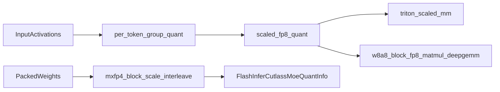
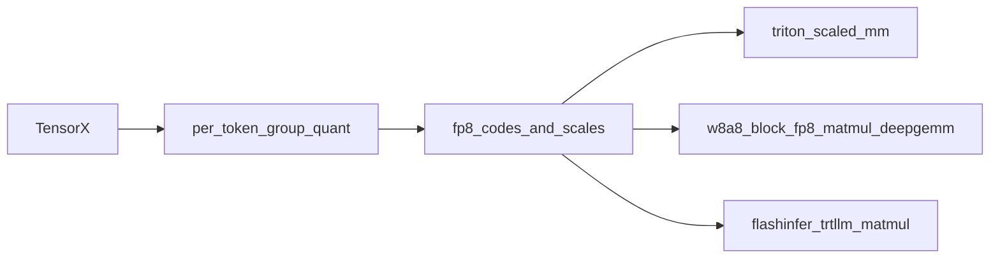
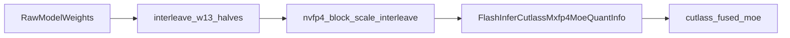
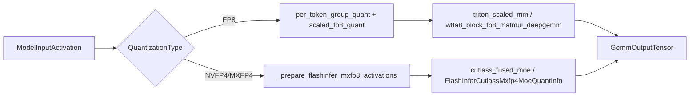

<!-- source: DeepWiki mcp.deepwiki.com · repo sgl-project/sglang · page 11.3 Quantization Kernels · fetched 2026-10-30 -->

# Quantization Kernels

Relevant source files

The following files were used as context for generating this wiki page:

- [benchmark/kernels/attention/bench_flash_attention_tmem_red_max.py](benchmark/kernels/attention/bench_flash_attention_tmem_red_max.py)
- [python/sglang/kernels/jit/csrc/gemm/per_token_group_quant.cuh](python/sglang/kernels/jit/csrc/gemm/per_token_group_quant.cuh)
- [python/sglang/kernels/ops/attention/flash_attn/cute/flash_fwd_sm100.py](python/sglang/kernels/ops/attention/flash_attn/cute/flash_fwd_sm100.py)
- [python/sglang/kernels/ops/attention/flash_attn/cute/softmax.py](python/sglang/kernels/ops/attention/flash_attn/cute/softmax.py)
- [python/sglang/kernels/ops/quantization/per_token_group_quant.py](python/sglang/kernels/ops/quantization/per_token_group_quant.py)
- [python/sglang/srt/hardware_backend/npu/graph_runner/vit_npu_graph_runner.py](python/sglang/srt/hardware_backend/npu/graph_runner/vit_npu_graph_runner.py)
- [python/sglang/srt/layers/attention/vision.py](python/sglang/srt/layers/attention/vision.py)
- [python/sglang/srt/layers/deep_gemm_wrapper/compile_utils.py](python/sglang/srt/layers/deep_gemm_wrapper/compile_utils.py)
- [python/sglang/srt/layers/deep_gemm_wrapper/entrypoint.py](python/sglang/srt/layers/deep_gemm_wrapper/entrypoint.py)
- [python/sglang/srt/layers/moe/moe_runner/flashinfer_cutedsl.py](python/sglang/srt/layers/moe/moe_runner/flashinfer_cutedsl.py)
- [python/sglang/srt/layers/moe/moe_runner/flashinfer_cutlass.py](python/sglang/srt/layers/moe/moe_runner/flashinfer_cutlass.py)
- [python/sglang/srt/layers/moe/token_dispatcher/flashinfer.py](python/sglang/srt/layers/moe/token_dispatcher/flashinfer.py)
- [python/sglang/srt/layers/quantization/fp8_activation.py](python/sglang/srt/layers/quantization/fp8_activation.py)
- [python/sglang/srt/layers/quantization/mxfp4.py](python/sglang/srt/layers/quantization/mxfp4.py)
- [python/sglang/srt/layers/quantization/mxfp4_flashinfer_cutlass_moe.py](python/sglang/srt/layers/quantization/mxfp4_flashinfer_cutlass_moe.py)
- [python/sglang/srt/multimodal/internvl_vit_cuda_graph_runner.py](python/sglang/srt/multimodal/internvl_vit_cuda_graph_runner.py)
- [python/sglang/srt/multimodal/vit_cuda_graph_runner.py](python/sglang/srt/multimodal/vit_cuda_graph_runner.py)
- [test/manual/dsv4/test_wo_a_fp8_sm90.py](test/manual/dsv4/test_wo_a_fp8_sm90.py)
- [test/manual/kernels/bench_dense_swiglu_quant.py](test/manual/kernels/bench_dense_swiglu_quant.py)
- [test/registered/e2e/models_large/test_deepseek_v3_cutedsl_4gpu.py](test/registered/e2e/models_large/test_deepseek_v3_cutedsl_4gpu.py)
- [test/registered/ep/test_flashinfer_a2a.py](test/registered/ep/test_flashinfer_a2a.py)
- [test/registered/kernels/benchmark/quantization/bench_per_token_group_quant.py](test/registered/kernels/benchmark/quantization/bench_per_token_group_quant.py)
- [test/registered/kernels/ops/attention/test_flash_attention_4_sm103.py](test/registered/kernels/ops/attention/test_flash_attention_4_sm103.py)
- [test/registered/kernels/ops/quantization/test_per_token_group_quant.py](test/registered/kernels/ops/quantization/test_per_token_group_quant.py)
- [test/registered/unit/layers/attention/test_vision_backend_selection.py](test/registered/unit/layers/attention/test_vision_backend_selection.py)
- [test/registered/unit/layers/attention/test_vision_max_seqlen.py](test/registered/unit/layers/attention/test_vision_max_seqlen.py)
- [test/registered/unit/layers/moe/test_flashinfer_cutlass_swiglu_params.py](test/registered/unit/layers/moe/test_flashinfer_cutlass_swiglu_params.py)
- [test/registered/unit/layers/moe/test_flashinfer_dispatcher.py](test/registered/unit/layers/moe/test_flashinfer_dispatcher.py)
- [test/registered/unit/layers/moe/test_moe_runner_config_placement.py](test/registered/unit/layers/moe/test_moe_runner_config_placement.py)
- [test/registered/unit/layers/quantization/test_dense_swiglu_fp8.py](test/registered/unit/layers/quantization/test_dense_swiglu_fp8.py)
- [test/registered/unit/layers/quantization/test_fp8_blockwise_linear_backends.py](test/registered/unit/layers/quantization/test_fp8_blockwise_linear_backends.py)
- [test/registered/unit/layers/quantization/test_mxfp4_flashinfer_activation_prep.py](test/registered/unit/layers/quantization/test_mxfp4_flashinfer_activation_prep.py)
- [test/registered/unit/layers/quantization/test_mxfp4_sm120_cutlass.py](test/registered/unit/layers/quantization/test_mxfp4_sm120_cutlass.py)
- [test/registered/unit/layers/quantization/test_mxfp4_sm90_cutlass.py](test/registered/unit/layers/quantization/test_mxfp4_sm90_cutlass.py)
- [test/registered/unit/multimodal/test_vit_cuda_graph_metadata_cuda.py](test/registered/unit/multimodal/test_vit_cuda_graph_metadata_cuda.py)
- [test/registered/unit/multimodal/test_vit_cuda_graph_runner.py](test/registered/unit/multimodal/test_vit_cuda_graph_runner.py)
- [test/registered/unit/multimodal/test_vit_npu_graph_runner.py](test/registered/unit/multimodal/test_vit_npu_graph_runner.py)

## Purpose and Scope

This page details the quantization-kernel implementations, runtime wrappers, and dispatch mechanisms in SGLang, covering FP8 quantization, scaled matrix multiplication (`scaled_mm`), NVFP4/MXFP4 microscaling formats, INT8, and AWQ/Marlin weight-only routines [python/sglang/srt/layers/quantization/fp8_utils.py:10-28](), [python/sglang/srt/layers/quantization/mxfp4.py:1-70](), [python/sglang/srt/layers/moe/utils.py:112-216](). It emphasizes runtime data flows, kernel entrypoints, and backend integrations across diverse hardware architectures (Hopper, Blackwell).

Sources: [python/sglang/srt/layers/quantization/fp8_utils.py:10-28](), [python/sglang/srt/layers/quantization/mxfp4.py:1-70](), [python/sglang/srt/layers/moe/utils.py:112-216]()

---

## Quantization Kernel Taxonomy

SGLang organizes quantization across low-level JIT kernels, C++ CUDA extensions, wrapper utilities, and high-level layer methods.

| Area | Code Entities | Role |
|---|---|---|
| Per-token / Group Quantization | `per_token_group_quant`, `sglang_per_token_quant_fp8`, `scaled_fp8_quant` | Computes per-token or per-group scaling factors and quantizes activation tensors [python/sglang/srt/layers/quantization/fp8_utils.py:16-28](), [python/sglang/kernels/ops/quantization/per_token_group_quant.py:1-35]() |
| FP8 & Blockwise GEMM | `triton_scaled_mm`, `w8a8_block_fp8_matmul_deepgemm`, `w8a8_block_fp8_matmul_triton` | Dispatches scaled W8A8 matrix multiplications to Triton, DeepGEMM, or FlashInfer [python/sglang/srt/layers/quantization/fp8_utils.py:10-15]() |
| NVFP4 & MXFP4 Kernels | `fp4_gemm`, `FlashinferCutlassMxfp4MoeQuantInfo`, `mxfp4_block_scale_interleave` | Implements Blackwell FP4 and MXFP4 (UE8M0 scales) packing, interleaving, and GEMM execution [python/sglang/srt/layers/quantization/mxfp4.py:78-142](), [python/sglang/srt/layers/quantization/modelopt_quant.py:136-184]() |
| MoE Quantized Runners | `FlashInferCutlassMoeQuantInfo`, `interleave_w13_halves`, `grouped_gemm_nt_f8f8bf16_masked` | Fused MoE execution paths supporting FP8, FP4, and MXFP4 through FlashInfer CUTLASS and DeepGEMM [python/sglang/srt/layers/moe/moe_runner/flashinfer_cutlass.py:50-138](), [python/sglang/srt/layers/moe/moe_runner/flashinfer_cutedsl.py:47-73]() |

Sources: [python/sglang/srt/layers/quantization/fp8_utils.py:10-28](), [python/sglang/srt/layers/quantization/mxfp4.py:78-142](), [python/sglang/srt/layers/moe/moe_runner/flashinfer_cutlass.py:50-138]()

### Natural-Language to Code Entity Mapping

Sources: [python/sglang/kernels/ops/quantization/per_token_group_quant.py:1-35](), [python/sglang/srt/layers/quantization/fp8_utils.py:10-28](), [python/sglang/srt/layers/moe/moe_runner/flashinfer_cutlass.py:50-138]()

---

## FP8 Quantization and Scaled GEMM

### Per-Token and Group Quantization Kernels
Activation quantization is driven by `per_token_group_quant`, implemented via a trait-driven JIT kernel infrastructure [python/sglang/kernels/ops/quantization/per_token_group_quant.py:1-40](), [python/sglang/kernels/jit/csrc/gemm/per_token_group_quant.cuh:1-75](). The kernel computes absolute maximums over configurable group sizes (`group_size=32` or `128`) and applies either float32 scales or UE8M0 bit-exact power-of-two exponent bytes [test/registered/kernels/ops/quantization/test_per_token_group_quant.py:76-118](). 

The underlying CUDA kernel (`ScaleStoreArgs::store`) handles layout transformations, storing row-major or column-major scale tensors with alignment padding for TMA execution [python/sglang/kernels/jit/csrc/gemm/per_token_group_quant.cuh:81-151]().

### Scaled Matrix Multiplication Backends
Linear and MoE layers route FP8 operations through specialized backends determined by `Fp8GemmRunnerBackend` and configuration factories:
- **Triton (`triton_scaled_mm`)**: General-purpose scaled FP8 matmul for arbitrary shapes [python/sglang/srt/layers/quantization/fp8_utils.py:10-15]().
- **DeepGEMM (`w8a8_block_fp8_matmul_deepgemm`)**: Highly optimized Hopper/Blackwell group GEMM with support for TMA-aligned scales and runtime JIT compilation caching via `DG_JIT_CACHE_DIR` [python/sglang/srt/layers/deep_gemm_wrapper/compile_utils.py:38-57]().
- **FlashInfer / TRT-LLM**: Integrated via fused routines for block-quantized inputs [test/registered/unit/layers/quantization/test_fp8_blockwise_linear_backends.py:62-85]().

Sources: [python/sglang/kernels/ops/quantization/per_token_group_quant.py:1-40](), [python/sglang/kernels/jit/csrc/gemm/per_token_group_quant.cuh:81-151](), [python/sglang/srt/layers/quantization/fp8_utils.py:10-28](), [python/sglang/srt/layers/deep_gemm_wrapper/compile_utils.py:38-57]()

---

## NVFP4, MXFP4, and FP4 GEMM

### FP4 and MXFP4 Microscaling Formats
Designed for Blackwell GPUs (SM100+), SGLang supports FP4, NVFP4, and MXFP4 data formats utilizing block microscaling scales stored in `UE8M0` format (`_UE8M0_ONE = 127` neutral scale) [python/sglang/srt/layers/quantization/mxfp4.py:68-75]().
- **Activation Preparation**: `_prepare_flashinfer_mxfp8_activations` inspects incoming hidden states, handling route-quant handoffs or invoking `flashinfer_mxfp8_quantize` / `per_token_group_quant` with `scale_ue8m0=True` [python/sglang/srt/layers/quantization/mxfp4.py:78-117]().
- **Weight Interleaving**: Functions such as `interleave_w13_halves` and FlashInfer's `nvfp4_block_scale_interleave` rearrange weights and block scales into hardware-friendly layouts for CUTLASS and CuteDSL execution [python/sglang/srt/layers/moe/moe_runner/flashinfer_cutedsl.py:47-73](), [python/sglang/srt/layers/quantization/mxfp4.py:120-142]().

### FP4 Custom Operations
`fp4_gemm` acts as the registered custom operation entrypoint for ModelOpt FP4 [python/sglang/srt/layers/quantization/modelopt_quant.py:136-167](). It first queries `try_qwen3x_nvfp4_gemm` before falling back to FlashInfer's `mm_fp4` (for W4A4) or `mm_bf16_fp4` (for W4A16) [python/sglang/srt/layers/quantization/modelopt_quant.py:161-184]().

Sources: [python/sglang/srt/layers/quantization/mxfp4.py:68-142](), [python/sglang/srt/layers/quantization/modelopt_quant.py:136-184](), [python/sglang/srt/layers/moe/moe_runner/flashinfer_cutedsl.py:47-73]()

---

## Quantized MoE Execution and Backend Selection

MoE execution integrates quantization via `MoeRunnerBackend` configurations and specialized dispatcher/runner pairs [python/sglang/srt/layers/moe/utils.py:112-216](). 

### Runner Backends
- **FlashInfer CUTLASS (`flashinfer_cutlass`)**: Manages unquantized, ModelOpt FP8, NVFP4, and CUTLASS MXFP4 MoE paths via `FlashInferCutlassMoeQuantInfo` and `FlashInferCutlassMxfp4MoeQuantInfo` structures [python/sglang/srt/layers/moe/moe_runner/flashinfer_cutlass.py:1-138]().
- **FlashInfer CuteDSL (`flashinfer_cutedsl`)**: Provides TRTLLM-compatible scale reduction (`cutedsl_quant_scale_to_scalar`) and expert weight reordering [python/sglang/srt/layers/moe/moe_runner/flashinfer_cutedsl.py:75-106]().
- **DeepGEMM**: Handles grouped FP8 and BF16 GEMMs with dynamic M-dimension precompilation hooks and local rank locking (`_local_rank_compile_lock`) [python/sglang/srt/layers/deep_gemm_wrapper/compile_utils.py:126-147](), [python/sglang/srt/layers/deep_gemm_wrapper/entrypoint.py:48-97]().

Sources: [python/sglang/srt/layers/moe/utils.py:112-216](), [python/sglang/srt/layers/moe/moe_runner/flashinfer_cutlass.py:1-138](), [python/sglang/srt/layers/deep_gemm_wrapper/compile_utils.py:126-147]()

---

## INT8, AWQ, and Weight-Only Methods

- **INT8**: Quantization routines operate via per-tensor or per-channel weight scaling, though dedicated standalone INT8 custom kernels rely on infrastructure bindings not fully exposed in current code excerpts [python/sglang/srt/layers/quantization/fp8_utils.py:10-28]().
- **AWQ / Marlin**: The MoE runner backend enumeration includes `MoeRunnerBackend.MARLIN` and `MoeRunnerBackend.EXPERIMENTAL_SGL_MARLIN` to support packed weight formats and dequantization-free weight-only GEMMs [python/sglang/srt/layers/moe/utils.py:159-172]().

Sources: [python/sglang/srt/layers/quantization/fp8_utils.py:10-28](), [python/sglang/srt/layers/moe/utils.py:159-172]()

---

## Summary of Quantization Data Flow

Sources: [python/sglang/kernels/ops/quantization/per_token_group_quant.py:1-35](), [python/sglang/srt/layers/quantization/mxfp4.py:78-117](), [python/sglang/srt/layers/moe/moe_runner/flashinfer_cutlass.py:50-138]()

---

## Key Code Entities

| Code Entity | Role |
|---|---|
| `per_token_group_quant` | JIT-compiled CUDA kernel for per-token group absolute maximum extraction and quantization [python/sglang/kernels/ops/quantization/per_token_group_quant.py:1-35]() |
| `ScaleStoreArgs` | Memory store helper managing layout and alignment for scale buffers [python/sglang/kernels/jit/csrc/gemm/per_token_group_quant.cuh:81-151]() |
| `fp4_gemm` | Custom operation dispatching FP4 GEMMs to Qwen3x or FlashInfer backends [python/sglang/srt/layers/quantization/modelopt_quant.py:136-184]() |
| `FlashInferCutlassMxfp4MoeQuantInfo` | Quantization payload container for CUTLASS MXFP4 MoE execution [python/sglang/srt/layers/moe/moe_runner/flashinfer_cutlass.py:113-156]() |
| `interleave_w13_halves` | Weight rearrangement helper for CuteDSL SwiGLU GEMM1 layouts [python/sglang/srt/layers/moe/moe_runner/flashinfer_cutedsl.py:47-73]() |
| `_local_rank_compile_lock` | Process-safe file locking context manager for DeepGEMM precompilation cache [python/sglang/srt/layers/deep_gemm_wrapper/compile_utils.py:126-147]() |

Sources: [python/sglang/kernels/ops/quantization/per_token_group_quant.py:1-35](), [python/sglang/kernels/jit/csrc/gemm/per_token_group_quant.cuh:81-151](), [python/sglang/srt/layers/quantization/modelopt_quant.py:136-184](), [python/sglang/srt/layers/moe/moe_runner/flashinfer_cutlass.py:113-156](), [python/sglang/srt/layers/moe/moe_runner/flashinfer_cutedsl.py:47-73](), [python/sglang/srt/layers/deep_gemm_wrapper/compile_utils.py:126-147]()

# End of Section 11.3: Quantization Kernels

---

