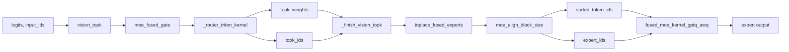
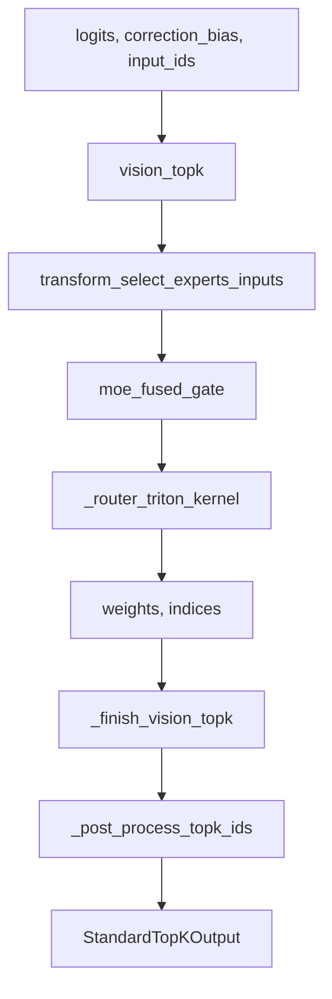
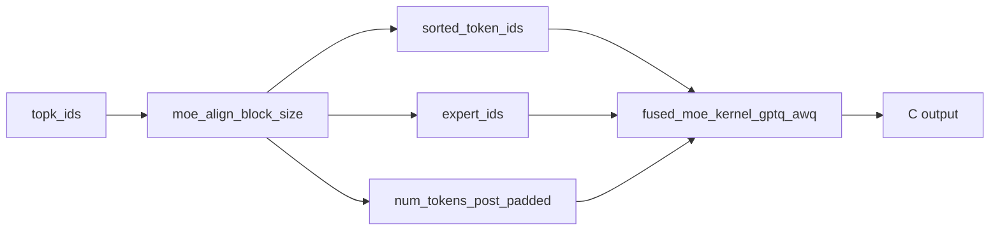

<!-- source: DeepWiki mcp.deepwiki.com · repo sgl-project/sglang · page 11.4 MoE Fused Kernels · fetched 2026-10-30 -->

# MoE Fused Kernels

Relevant source files

The following files were used as context for generating this wiki page:

- [python/sglang/kernels/jit/csrc/deepseek_v4/hash_topk.cuh](python/sglang/kernels/jit/csrc/deepseek_v4/hash_topk.cuh)
- [python/sglang/kernels/jit/csrc/gemm/marlin_moe/kernel.h](python/sglang/kernels/jit/csrc/gemm/marlin_moe/kernel.h)
- [python/sglang/kernels/jit/csrc/gemm/marlin_moe/marlin_template.h](python/sglang/kernels/jit/csrc/gemm/marlin_moe/marlin_template.h)
- [python/sglang/kernels/jit/csrc/gemm/marlin_moe/moe_wna16_marlin.cuh](python/sglang/kernels/jit/csrc/gemm/marlin_moe/moe_wna16_marlin.cuh)
- [python/sglang/kernels/jit/csrc/lora/trtllm_lora_temp/moe_lora_merged_align_kernel.cu](python/sglang/kernels/jit/csrc/lora/trtllm_lora_temp/moe_lora_merged_align_kernel.cu)
- [python/sglang/kernels/jit/csrc/moe/align_single_token.cuh](python/sglang/kernels/jit/csrc/moe/align_single_token.cuh)
- [python/sglang/kernels/jit/csrc/moe/moe_align_kernel.cu](python/sglang/kernels/jit/csrc/moe/moe_align_kernel.cu)
- [python/sglang/kernels/ops/lora/common/routing.py](python/sglang/kernels/ops/lora/common/routing.py)
- [python/sglang/kernels/ops/lora/moe/trtllm_lora_temp/moe_lora_merged_align.py](python/sglang/kernels/ops/lora/moe/trtllm_lora_temp/moe_lora_merged_align.py)
- [python/sglang/kernels/ops/lora/moe/trtllm_lora_temp/topk_softmax_pack.py](python/sglang/kernels/ops/lora/moe/trtllm_lora_temp/topk_softmax_pack.py)
- [python/sglang/kernels/ops/lora/moe/trtllm_lora_temp/virtual_experts.py](python/sglang/kernels/ops/lora/moe/trtllm_lora_temp/virtual_experts.py)
- [python/sglang/kernels/ops/lora/moe/virtual_experts.py](python/sglang/kernels/ops/lora/moe/virtual_experts.py)
- [python/sglang/kernels/ops/moe/fused_moe_triton_kernels.py](python/sglang/kernels/ops/moe/fused_moe_triton_kernels.py)
- [python/sglang/kernels/ops/moe/moe_align.py](python/sglang/kernels/ops/moe/moe_align.py)
- [python/sglang/kernels/ops/moe/moe_align_single_token.py](python/sglang/kernels/ops/moe/moe_align_single_token.py)
- [python/sglang/kernels/ops/moe/moe_align_small_numel.py](python/sglang/kernels/ops/moe/moe_align_small_numel.py)
- [python/sglang/kernels/ops/moe/moe_fused_gate.py](python/sglang/kernels/ops/moe/moe_fused_gate.py)
- [python/sglang/kernels/ops/moe/moe_wna16_marlin.py](python/sglang/kernels/ops/moe/moe_wna16_marlin.py)
- [python/sglang/srt/layers/attention/wave_ops/decode_attention.py](python/sglang/srt/layers/attention/wave_ops/decode_attention.py)
- [python/sglang/srt/layers/moe/hash_topk.py](python/sglang/srt/layers/moe/hash_topk.py)
- [python/sglang/srt/layers/moe/moe_runner/triton.py](python/sglang/srt/layers/moe/moe_runner/triton.py)
- [python/sglang/srt/layers/moe/moe_runner/triton_utils/fused_moe.py](python/sglang/srt/layers/moe/moe_runner/triton_utils/fused_moe.py)
- [python/sglang/srt/layers/moe/moe_runner/triton_utils/moe_align_block_size.py](python/sglang/srt/layers/moe/moe_runner/triton_utils/moe_align_block_size.py)
- [python/sglang/srt/layers/moe/topk.py](python/sglang/srt/layers/moe/topk.py)
- [python/sglang/srt/layers/quantization/quark/schemes/quark_w8a8_fp8_moe.py](python/sglang/srt/layers/quantization/quark/schemes/quark_w8a8_fp8_moe.py)
- [python/sglang/srt/lora/lora_moe_runner_marlin.py](python/sglang/srt/lora/lora_moe_runner_marlin.py)
- [python/sglang/srt/lora/marlin_lora_temp/activation.py](python/sglang/srt/lora/marlin_lora_temp/activation.py)
- [python/sglang/srt/lora/marlin_lora_temp/direct_decode.py](python/sglang/srt/lora/marlin_lora_temp/direct_decode.py)
- [python/sglang/srt/lora/marlin_lora_temp/moe_runner.py](python/sglang/srt/lora/marlin_lora_temp/moe_runner.py)
- [python/sglang/srt/lora/trtllm_lora_temp/specialized_expand.py](python/sglang/srt/lora/trtllm_lora_temp/specialized_expand.py)
- [python/sglang/srt/multimodal/dsv41/vl_routing.py](python/sglang/srt/multimodal/dsv41/vl_routing.py)
- [test/registered/kernels/ops/moe/test_glm53_shared_expert_fusion.py](test/registered/kernels/ops/moe/test_glm53_shared_expert_fusion.py)
- [test/registered/kernels/ops/moe/test_jit_grouped_topk.py](test/registered/kernels/ops/moe/test_jit_grouped_topk.py)
- [test/registered/kernels/ops/moe/test_marlin_packed_topk_unpack.py](test/registered/kernels/ops/moe/test_marlin_packed_topk_unpack.py)
- [test/registered/kernels/ops/moe/test_moe_align_block_size.py](test/registered/kernels/ops/moe/test_moe_align_block_size.py)
- [test/registered/kernels/ops/moe/test_moe_fused_gate.py](test/registered/kernels/ops/moe/test_moe_fused_gate.py)
- [test/registered/kernels/ops/moe/test_moe_wna16_marlin.py](test/registered/kernels/ops/moe/test_moe_wna16_marlin.py)
- [test/registered/kernels/ops/moe/test_rocm_router_gate.py](test/registered/kernels/ops/moe/test_rocm_router_gate.py)
- [test/registered/lora/test_virtual_experts_kernels.py](test/registered/lora/test_virtual_experts_kernels.py)
- [test/registered/moe/test_fused_append_remap_per_rank_shared_slots.py](test/registered/moe/test_fused_append_remap_per_rank_shared_slots.py)
- [test/registered/moe/test_topk_padded_region.py](test/registered/moe/test_topk_padded_region.py)
- [test/registered/unit/eplb/test_waterfill_eplb.py](test/registered/unit/eplb/test_waterfill_eplb.py)
- [test/registered/unit/layers/moe/test_fused_shared_expert_scaling.py](test/registered/unit/layers/moe/test_fused_shared_expert_scaling.py)
- [test/registered/unit/lora/test_experimental_sgl_marlin_runtime_unit.py](test/registered/unit/lora/test_experimental_sgl_marlin_runtime_unit.py)
- [test/registered/unit/lora/test_experimental_sgl_marlin_shared_outer_reduce.py](test/registered/unit/lora/test_experimental_sgl_marlin_shared_outer_reduce.py)
- [test/registered/unit/models/test_glm_nextn_moe_ptpc.py](test/registered/unit/models/test_glm_nextn_moe_ptpc.py)
- [test/registered/unit/models/test_shared_experts_fusion_gates.py](test/registered/unit/models/test_shared_experts_fusion_gates.py)
- [test/registered/xpu/test_topk.py](test/registered/xpu/test_topk.py)

## Purpose and Scope

This page describes the MoE routing and expert-computation kernels represented in the provided code: the Triton gate in `moe_fused_gate.py`, the runtime routing path in `vision_topk`, the grouped GEMM implementation and wrapper in the MoE Triton runner, and the alignment metadata consumed by GEMM kernels [python/sglang/kernels/ops/moe/moe_fused_gate.py:14-18](), [python/sglang/srt/multimodal/dsv41/vl_routing.py:22-92](), [python/sglang/srt/layers/moe/moe_runner/triton_utils/fused_moe.py:163-210](), [python/sglang/kernels/ops/moe/fused_moe_triton_kernels.py:93-164]().

The main data path is: compute expert scores and select routes; organize token-route pairs into expert-aligned blocks; run the expert projections and activation; then combine the routed contributions. The supplied excerpts show the gate, alignment interface, GEMM kernels, and wrapper entry point, but do not include every downstream dispatch or combine implementation [python/sglang/kernels/ops/moe/moe_fused_gate.py:98-193](), [python/sglang/srt/layers/moe/moe_runner/triton_utils/fused_moe.py:43-45](), [python/sglang/srt/layers/moe/moe_runner/triton_utils/fused_moe.py:163-210](), [python/sglang/kernels/ops/moe/fused_moe_triton_kernels.py:93-164]().

Sources: [python/sglang/kernels/ops/moe/moe_fused_gate.py:14-18](), [python/sglang/srt/multimodal/dsv41/vl_routing.py:22-92](), [python/sglang/srt/layers/moe/moe_runner/triton_utils/fused_moe.py:43-45](), [python/sglang/srt/layers/moe/moe_runner/triton_utils/fused_moe.py:163-210](), [python/sglang/kernels/ops/moe/fused_moe_triton_kernels.py:93-164]()

---

## Kernel Categories and Data Flow

The MoE kernel path separates routing from expert computation. `moe_fused_gate.py` contains Triton router kernels; `vision_topk` supplies routing configuration and post-processes the results; `inplace_fused_experts` forwards selected routes and expert weights to the fused expert implementation; and the grouped GEMM kernels consume sorted token IDs, block expert IDs, and padding metadata [python/sglang/kernels/ops/moe/moe_fused_gate.py:98-193](), [python/sglang/srt/multimodal/dsv41/vl_routing.py:22-92](), [python/sglang/srt/layers/moe/moe_runner/triton_utils/fused_moe.py:163-210](), [python/sglang/kernels/ops/moe/fused_moe_triton_kernels.py:93-164]().

| Category | Role | Key code entities |
|:---|:---|:---|
| Gate and route selection | Score experts, apply routing options, and select per-token routes | `_router_triton_kernel`, `_topk_gate_small_m`, `_SCORING_FUNC_MAP` [python/sglang/kernels/ops/moe/moe_fused_gate.py:14-18](), [python/sglang/kernels/ops/moe/moe_fused_gate.py:63-95](), [python/sglang/kernels/ops/moe/moe_fused_gate.py:98-144]() |
| Runtime routing integration | Prepare gate inputs and configuration, call `moe_fused_gate`, then post-process route IDs and weights | `vision_topk`, `_finish_vision_topk` [python/sglang/srt/multimodal/dsv41/vl_routing.py:22-92](), [python/sglang/srt/multimodal/dsv41/vl_routing.py:133-175]() |
| Alignment | Produce token-order and expert-block metadata for tiled GEMM | `moe_align_block_size`, `sorted_token_ids`, `expert_ids`, `num_tokens_post_padded` [python/sglang/srt/layers/moe/moe_runner/triton_utils/fused_moe.py:43-45](), [python/sglang/kernels/ops/moe/fused_moe_triton_kernels.py:93-164]() |
| Expert computation | Execute expert projections over aligned token blocks | `inplace_fused_experts`, `fused_moe_kernel_gptq_awq`, `invoke_fused_moe_kernel` [python/sglang/srt/layers/moe/moe_runner/triton_utils/fused_moe.py:163-210](), [python/sglang/kernels/ops/moe/fused_moe_triton_kernels.py:93-164](), [python/sglang/srt/layers/moe/moe_runner/triton_utils/fused_moe.py:18-23]() |
| Activation and reduction | Apply fused activation and MoE reduction operations selected by the runner | `act_and_mul_triton`, `moe_sum_reduce_triton`, platform-specific activation imports [python/sglang/srt/layers/moe/moe_runner/triton_utils/fused_moe.py:18-23](), [python/sglang/srt/layers/moe/moe_runner/triton_utils/fused_moe.py:58-87]() |

### Data Flow: Runtime Names to Kernel Entities

Title: "Routing and Expert Computation: Runtime-to-Kernel Mapping"

Sources: [python/sglang/kernels/ops/moe/moe_fused_gate.py:98-144](), [python/sglang/srt/multimodal/dsv41/vl_routing.py:22-92](), [python/sglang/srt/multimodal/dsv41/vl_routing.py:133-175](), [python/sglang/srt/layers/moe/moe_runner/triton_utils/fused_moe.py:18-23](), [python/sglang/srt/layers/moe/moe_runner/triton_utils/fused_moe.py:43-45](), [python/sglang/srt/layers/moe/moe_runner/triton_utils/fused_moe.py:163-210](), [python/sglang/kernels/ops/moe/fused_moe_triton_kernels.py:93-164]()

---

## Gating and Hierarchical Expert Selection (`moe_fused_gate`)

### Gate kernels and scoring

`moe_fused_gate.py` maps the scoring names `sigmoid`, `sqrtsoftplus`, and `softmax` to compile-time integer choices in `_SCORING_FUNC_MAP`. Its general `_router_triton_kernel` processes a row tile of router scores, with experts along the reduction axis; its parameters include `N` (expert count), `K` (output top-k including fused shared slots), and `K_ROUTED` (routed top-k excluding those slots) [python/sglang/kernels/ops/moe/moe_fused_gate.py:14-18](), [python/sglang/kernels/ops/moe/moe_fused_gate.py:98-144]().

The router loads scores as float32 for the scoring path. It can load a shared expert bias, a token-specific alternate bias, and input IDs used to choose that alternate bias for designated tokens. Padding can also be represented through `num_token_non_padded`, so padded rows are excluded from the live-row mask [python/sglang/kernels/ops/moe/moe_fused_gate.py:154-189]().

For sigmoid scoring, the kernel activates the raw logits with sigmoid and uses the bias for ranking rather than for the selected routing weight. The small-row specialized path `_topk_gate_small_m` is constrained to CUDA float32 score tensors with 512 experts, 1–16 rows, contiguous float32 bias, and top-k 22; it launches `_sm120_router_top22_kernel` [python/sglang/kernels/ops/moe/moe_fused_gate.py:21-60](), [python/sglang/kernels/ops/moe/moe_fused_gate.py:63-95]().

### Hierarchical and grouped selection

The general router kernel exposes `N_GROUP`, `TOPK_GROUP`, and `EXPERTS_PER_GROUP` as compile-time parameters. These provide the kernel-level controls for grouped or hierarchical expert selection; `N_GROUP == 1` is documented as ungrouped routing. The supplied excerpt shows those parameters but not the later kernel body that applies the group selection, so the exact group-reduction sequence is not specified here [python/sglang/kernels/ops/moe/moe_fused_gate.py:111-123]().

At runtime, `vision_topk` obtains routing configuration from `moe.topk.topk_config`, transforms logits and correction bias with `transform_select_experts_inputs`, and calls `moe_fused_gate` on CUDA. It passes the configured top-k, scoring mode, shared-slot count, alternate vision bias and token ID, renormalization settings, routed scaling behavior, non-padded token count, and optional packed output buffer [python/sglang/srt/multimodal/dsv41/vl_routing.py:22-80]().

After the gate call, `_finish_vision_topk` applies optional routing simulation, calls `_post_process_topk_ids`, records expert selections when a recorder is available, and masks padded rows when required. The non-CUDA path shown in `vision_topk` computes `sqrt(softplus(logits))`, selects routed experts by biased scores, and handles shared slots and weight renormalization in PyTorch [python/sglang/srt/multimodal/dsv41/vl_routing.py:81-92](), [python/sglang/srt/multimodal/dsv41/vl_routing.py:93-130](), [python/sglang/srt/multimodal/dsv41/vl_routing.py:133-175]().

`HashTopK` is a separate runtime router implementation. It maintains a token-ID-to-expert lookup table (`tid2eid`), supports `softmax`, `sigmoid`, and `sqrtsoftplus` scoring in its Torch path, and has explicit handling for a fused shared slot. It should not be conflated with the Triton grouped-selection parameters in `_router_triton_kernel` [python/sglang/srt/layers/moe/hash_topk.py:37-70](), [python/sglang/srt/layers/moe/hash_topk.py:145-181]().

### Gate path: code entities

Title: "moe_fused_gate Call Path"

Sources: [python/sglang/kernels/ops/moe/moe_fused_gate.py:14-18](), [python/sglang/kernels/ops/moe/moe_fused_gate.py:21-95](), [python/sglang/kernels/ops/moe/moe_fused_gate.py:98-189](), [python/sglang/srt/multimodal/dsv41/vl_routing.py:22-130](), [python/sglang/srt/multimodal/dsv41/vl_routing.py:133-175](), [python/sglang/srt/layers/moe/hash_topk.py:37-70](), [python/sglang/srt/layers/moe/hash_topk.py:145-181]()

---

## Grouped GEMM Kernels for Expert Computation (`fused_moe`)

### Wrapper and computation stages

`inplace_fused_experts` is a registered custom operation that accepts token hidden states, expert weight tensors `w1` and `w2`, routing weights and IDs, and options for activation, gating, router-weight placement, quantization, and weight/activation scales. Its wrapper calls `fused_experts_impl` with the supplied arguments [python/sglang/srt/layers/moe/moe_runner/triton_utils/fused_moe.py:163-210]().

The runner module imports `invoke_fused_moe_kernel`, `act_and_mul_triton`, and `moe_sum_reduce_triton` from the kernel operations package. The displayed platform branches select activation and reduction dependencies according to CUDA, HIP, XPU, MUSA, and CPU/AMX availability; the excerpt does not show the complete implementation of `fused_experts_impl` or the call sequence between its stages [python/sglang/srt/layers/moe/moe_runner/triton_utils/fused_moe.py:18-23](), [python/sglang/srt/layers/moe/moe_runner/triton_utils/fused_moe.py:58-98]().

### Grouped GEMM metadata and tiling

`fused_moe_kernel_gptq_awq` documents its operands as token input `A`, stacked expert weights `B`, and output cache `C`. Its routing metadata consists of `sorted_token_ids`, which arranges repeated token-route entries by expert, and `expert_ids`, which identifies the expert used by each block. Sorting and padding make the token count per expert divisible by `BLOCK_SIZE_M` [python/sglang/kernels/ops/moe/fused_moe_triton_kernels.py:93-164]().

The kernel maps its program ID to M and N tiles in a grouped order. `GROUP_SIZE_M` controls the tile grouping used in that mapping, while `BLOCK_SIZE_M`, `BLOCK_SIZE_N`, and `BLOCK_SIZE_K` determine the tile extents. It reads the post-padding token count, loads token IDs for the current M block, and loads the corresponding expert ID. If the expert ID is `-1`, the kernel writes zeros to the output for the relevant token rows instead of performing the expert GEMM [python/sglang/kernels/ops/moe/fused_moe_triton_kernels.py:165-205]().

The kernel module imports FP8 and INT8 quantization helpers, and the GPTQ/AWQ kernel signature includes scales, zero-point pointers, group size, and compile-time flags for quantized formats and routed-weight multiplication. These parameters establish quantization-aware execution paths; the shown excerpt does not include the full inner-loop arithmetic or every supported format’s dispatch [python/sglang/kernels/ops/moe/fused_moe_triton_kernels.py:12-20](), [python/sglang/kernels/ops/moe/fused_moe_triton_kernels.py:93-139]().

Sources: [python/sglang/srt/layers/moe/moe_runner/triton_utils/fused_moe.py:18-23](), [python/sglang/srt/layers/moe/moe_runner/triton_utils/fused_moe.py:58-98](), [python/sglang/srt/layers/moe/moe_runner/triton_utils/fused_moe.py:163-210](), [python/sglang/kernels/ops/moe/fused_moe_triton_kernels.py:12-20](), [python/sglang/kernels/ops/moe/fused_moe_triton_kernels.py:93-205]()

---

## Token Alignment and Dispatch (`moe_align_block_size`)

The Triton MoE runner imports `moe_align_block_size` from its local `moe_align_block_size` module. The supplied excerpts show the alignment function’s import and the metadata contract consumed by the grouped GEMM kernel, but do not include the alignment kernel’s implementation or its exact sorting algorithm [python/sglang/srt/layers/moe/moe_runner/triton_utils/fused_moe.py:43-45](), [python/sglang/kernels/ops/moe/fused_moe_triton_kernels.py:93-164]().

For GEMM execution, the relevant outputs are `sorted_token_ids`, `expert_ids`, and `num_tokens_post_padded`. `sorted_token_ids` groups token-route rows by expert and includes padding; `expert_ids` associates each aligned M block with an expert, with `-1` representing padding or nonlocal routes in the documented kernel contract; and `num_tokens_post_padded` bounds the blocks that the kernel should process [python/sglang/kernels/ops/moe/fused_moe_triton_kernels.py:93-108](), [python/sglang/kernels/ops/moe/fused_moe_triton_kernels.py:140-164](), [python/sglang/kernels/ops/moe/fused_moe_triton_kernels.py:184-205]().

### Alignment metadata consumed by GEMM

Title: "Alignment Metadata to Grouped GEMM"

Sources: [python/sglang/srt/layers/moe/moe_runner/triton_utils/fused_moe.py:43-45](), [python/sglang/kernels/ops/moe/fused_moe_triton_kernels.py:93-108](), [python/sglang/kernels/ops/moe/fused_moe_triton_kernels.py:140-164](), [python/sglang/kernels/ops/moe/fused_moe_triton_kernels.py:184-205]()

---

## Summary Table: MoE Fused Kernel Components and Key Functions

| Component | Location | Role shown by the supplied implementation |
|:---|:---|:---|
| `_SCORING_FUNC_MAP` and `_router_triton_kernel` | `python/sglang/kernels/ops/moe/moe_fused_gate.py` | Define routing score modes and the general row-tiled router kernel interface, including grouped-selection parameters. [python/sglang/kernels/ops/moe/moe_fused_gate.py:14-18](), [python/sglang/kernels/ops/moe/moe_fused_gate.py:98-144]() |
| `_sm120_router_top22_kernel` and `_topk_gate_small_m` | `python/sglang/kernels/ops/moe/moe_fused_gate.py` | Provide a specialized CUDA path with fixed 512-expert, top-22, small-row constraints. [python/sglang/kernels/ops/moe/moe_fused_gate.py:21-95]() |
| `vision_topk` and `_finish_vision_topk` | `python/sglang/srt/multimodal/dsv41/vl_routing.py` | Connect router configuration and inputs to `moe_fused_gate`, then post-process selected IDs and weights. [python/sglang/srt/multimodal/dsv41/vl_routing.py:22-92](), [python/sglang/srt/multimodal/dsv41/vl_routing.py:133-175]() |
| `HashTopK` | `python/sglang/srt/layers/moe/hash_topk.py` | Implements a token-ID lookup router and Torch scoring path, including shared-slot behavior. [python/sglang/srt/layers/moe/hash_topk.py:37-70](), [python/sglang/srt/layers/moe/hash_topk.py:145-181]() |
| `inplace_fused_experts` | `python/sglang/srt/layers/moe/moe_runner/triton_utils/fused_moe.py` | Registered wrapper accepting expert weights, routing outputs, activation, and quantization arguments. [python/sglang/srt/layers/moe/moe_runner/triton_utils/fused_moe.py:163-210]() |
| `moe_align_block_size` | `python/sglang/srt/layers/moe/moe_runner/triton_utils/fused_moe.py` | Alignment helper imported by the runner; its outputs are consumed as routing metadata by grouped GEMM. [python/sglang/srt/layers/moe/moe_runner/triton_utils/fused_moe.py:43-45](), [python/sglang/kernels/ops/moe/fused_moe_triton_kernels.py:93-108]() |
| `fused_moe_kernel_gptq_awq` | `python/sglang/kernels/ops/moe/fused_moe_triton_kernels.py` | Triton grouped GEMM kernel using token-order and expert-block metadata, with quantization-related arguments. [python/sglang/kernels/ops/moe/fused_moe_triton_kernels.py:93-164]() |

Sources: [python/sglang/kernels/ops/moe/moe_fused_gate.py:14-18](), [python/sglang/kernels/ops/moe/moe_fused_gate.py:21-95](), [python/sglang/kernels/ops/moe/moe_fused_gate.py:98-144](), [python/sglang/srt/multimodal/dsv41/vl_routing.py:22-92](), [python/sglang/srt/multimodal/dsv41/vl_routing.py:133-175](), [python/sglang/srt/layers/moe/hash_topk.py:37-70](), [python/sglang/srt/layers/moe/hash_topk.py:145-181](), [python/sglang/srt/layers/moe/moe_runner/triton_utils/fused_moe.py:43-45](), [python/sglang/srt/layers/moe/moe_runner/triton_utils/fused_moe.py:163-210](), [python/sglang/kernels/ops/moe/fused_moe_triton_kernels.py:93-164]()

---

